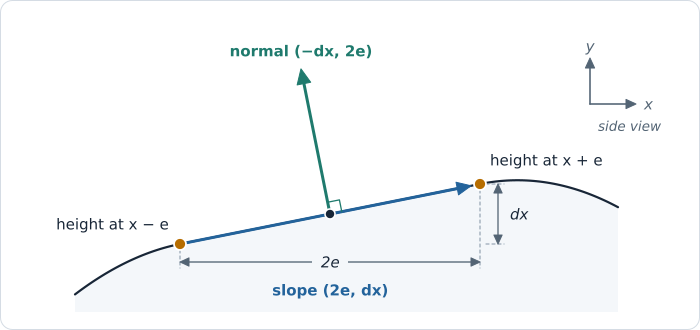
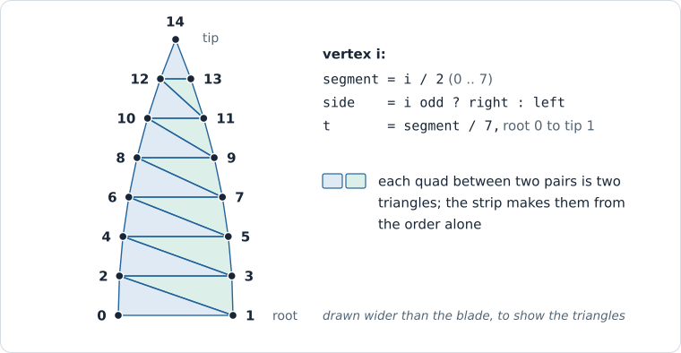

# 25 — Grass I: Blades

**Goal:** a 20 × 20 m patch of forty thousand grass blades on rolling ground.
Every blade is a curved, tapered strip that the vertex shader builds from two
`vec4`s and `gl_VertexIndex` — no mesh, no vertex buffer. The blades are lit by
Chapter 16's sun, shadowed by Chapter 17's cascades, and two standing stones
throw shadows across them.

**ROADMAP:** step 21+ — a demo, in `Source/PillowFort/Demos/Grass/` with
shaders under `Shaders/Grass/`.

**Module:** the demo is `pf::demos::grass` (`GrassDemo`). One engine addition
that any later pipeline can use: `GraphicsPipelineDesc` gains a `topology`
field (section 4).

**Prerequisites:** builds on Chapter 24, built and running, though only section
8 uses it: a demo's sky
([Chapter 23, section 8](23-The-Sky.md#8-one-setting-and-the-first-demo)'s
member, `Initialize`, `Update` before the scene pass, `Draw` after the opaque
draws, and `Shutdown`;
[Chapter 24, section 4](24-Image-Based-Lighting.md#4-the-diffuse-cube-and-the-switch)'s
`SetImageBasedLighting`, the frame index in `Sky::Update`, and `skyLightsScene`
becoming `FrameData::ambientMode`). From earlier chapters, one line each:

- Chapter 8, sections
  [4](08-Resources-And-Descriptors.md#4-getting-the-offscreen-image-to-the-screen),
  [6](08-Resources-And-Descriptors.md#6-descriptor-sets), and
  [8](08-Resources-And-Descriptors.md#8-one-layout-two-languages): ImGui colors
  are sRGB and the shaders want linear; one uniform buffer per frame in flight;
  C++/GLSL twin structs.
- Chapter 9, sections [2](09-Demo-Harness.md#2-the-demo-interface),
  [3](09-Demo-Harness.md#3-what-a-demo-is-handed),
  [4](09-Demo-Harness.md#4-the-scene-part-chapter-8s-contract-now-across-a-boundary),
  [7](09-Demo-Harness.md#7-sandboxgame-the-list-the-picker-and-the-loop), and
  [8](09-Demo-Harness.md#8-the-second-demo): the `Demo` interface, what `Setup`
  is handed, the scene part of the frame (`beginScenePass`, `endScenePass`,
  `handBackSceneTarget`), registering a demo in `Main.cpp`, and a demo's
  C++/GLSL twin header.
- Chapter 10, sections
  [6](10-Cameras-And-Depth.md#6-turning-a-camera-yaw-pitch-and-the-orbit-controller),
  [7](10-Cameras-And-Depth.md#7-the-per-frame-buffer),
  [9](10-Cameras-And-Depth.md#9-the-depth-buffer),
  [11](10-Cameras-And-Depth.md#11-the-fly-controller), and
  [12](10-Cameras-And-Depth.md#12-both-controllers-and-their-panel):
  `rotationFromYawPitch`; `FrameData`, `FrameBlock.glsl`, and `SceneRenderer`'s
  set 0; the depth buffer every scene pipeline declares; the fly controller;
  `CameraControls` and the "Camera" panel.
- Chapter 11, sections [4](11-Meshes.md#4-meshes-from-a-formula),
  [6](11-Meshes.md#6-getting-a-mesh-onto-the-gpu),
  [7](11-Meshes.md#7-which-side-is-the-front),
  [10](11-Meshes.md#10-the-fragment-shader-before-there-is-a-light), and
  [11](11-Meshes.md#11-scenerenderer-draws-meshes), and `ColorSpace.h`:
  `makeCube`; uploading through a staging buffer, and the barrier after the
  copy; which side is the front; Lambert's diffuse light; `AddMesh` and
  `AddMaterial`; `scene::srgbToLinear`.
- [Chapter 12, section 5](12-Scene-Graph.md#5-the-camera-becomes-a-node): why a
  demo keeps its camera's `Transform` beside the `Camera`, and the cross
  product, whose argument order sections 5 and 7 rely on.
- Chapter 16, sections [2](16-Lights.md#2-light-units-and-lights-as-scene-data),
  [4](16-Lights.md#4-the-light-buffer), and
  [5](16-Lights.md#5-forward-shading-one-loop-over-the-lights): a `LightItem` is
  plain data, `WriteLights` fills set 0's light buffer, and `lightIrradiance`
  reads it.
- Chapter 17, sections
  [6](17-Shadows.md#6-sampling-it-set-0-bindings-3-and-4-and-a-comparison-sampler)
  and [7](17-Shadows.md#7-how-shadows-reach-the-shading): `sunShadow` in
  `Shadows.glsl`, `RecordShadows`, and the "Shadows" panel.
- [Chapter 18, section 6](18-Anti-Aliasing.md#6-every-scene-pipeline-declares-the-sample-count):
  every pipeline drawn in the scene pass takes the scene's sample count.
- Chapter 19, sections
  [1](19-Instancing-And-Indirect.md#1-one-call-many-instances),
  [2](19-Instancing-And-Indirect.md#2-two-ways-to-feed-per-instance-data),
  [4](19-Instancing-And-Indirect.md#4-one-vertex-buffer-for-every-mesh),
  [5](19-Instancing-And-Indirect.md#5-batching-the-draw-list), and
  [6](19-Instancing-And-Indirect.md#6-indirect-draws): instancing with
  `gl_InstanceIndex`; a storage buffer as per-instance data; `memoryBarrier`;
  the `PrepareDraws` / `RecordDraws` split.
- [Chapter 20, section 4](20-Compute-Fundamentals.md#4-storage-images):
  `createDescriptorSets`, which makes the grass's set layout, its pool, and its
  sets.

<a id="assembled-grass-owner"></a>

Later in the reference, this chapter's GPU resources and draws move into
`GrassField`, which [Chapter 41](41-Grass-On-The-Island.md) reuses on the
island, and its shaders into shared kernels; follow the listings here.
Details below.

<details>
<summary>Later stages change this chapter's code</summary>

[Chapter 41](41-Grass-On-The-Island.md) reuses this system on the island. GPU
buffers, pipelines, parameter packing and draws now live in
[GrassField](https://github.com/ZevosSky/PillowFort-private/blob/reference-main/Source/PillowFort/Demos/Grass/GrassField.h); `GrassDemo`
retains the standalone camera, frame writes, controls and passes. `GrassField`
is a stable GPU owner: its header deletes copying and supplies no move
operation. Keep it in its host and use `Initialize`/`Shutdown` for GPU
recreation; copying CPU settings does not copy the resource owner. The current
`Grass.vert.glsl` / `Grass.frag.glsl` entry points include
`GrassVertexKernel.glsl` / `GrassFragmentKernel.glsl`. These shared kernels
originally preserved the earlier path and added an explicit island
specialization. [Chapters 46–48](46-Capturing-Grass-Clumps.md) subsequently
replace the assembled field's independent source with shared captured/geometric
clump templates, extend its blade record and use coherent canopy lean. These are
later stages, not changes you must guess while working through this chapter. The
chapter-local listings below describe the earlier construction sequence, not a
second implementation you should copy into the island host.

</details>

---

## Where this is going

*Ghost of Tsushima* (Sucker Punch, 2020) is remembered for its fields: hills of
pampas grass that move in long waves when the wind comes through, every blade
its own. Eric Wohllaib described how they were made in "Procedural Grass in
*Ghost of Tsushima*" at GDC 2021. These three chapters build toward that grass,
one idea at a time.

The talk's grass is generated on the GPU every frame, blade by blade, in tiles
around the camera. The table below says, technique by technique, what it does,
where this tutorial builds it, and which techniques are the tutorial's own.

### Where each technique comes from

Every technique in these three chapters has an evidence label. **Secondary agreement**
means at least two of the sources listed at the end of this chapter — written
summaries of the talk, and open implementations that say which of their ideas
came from it — agree that *Ghost of Tsushima* does it. This is agreement between
accounts, not verification against the original implementation. **One source** means only
one summary says so. **This tutorial's** means the sources do not describe the
game's method, and what is built here is a common technique chosen to fill the
gap. **Primary slides** means inspected text/diagrams from Wohllaib's
[original GDC PDF](https://media.gdcvault.com/GDC%2B2021/gdc_2021_procedural_grass_in_got.pdf).
Page numbers below are PDF pages, starting at 1; static pictures do not verify
animation or an unstated formula. The chapters state the chosen method either way.

| Technique | Evidence | Where |
| --- | --- | --- |
| Blades on a jittered grid, generated per tile in compute, culled by view and distance | primary slides, p. 11 | Chapter 25, section 2, Chapter 26, sections 2–3 |
| A blade as a cubic Bézier curve, tapering to a point, from height, width, tilt, bend, and facing | primary slides, pp. 14, 24, 28–30; this chapter's exact control-point formula is local | Chapter 25, section 6 |
| Curve derivatives used to construct blade normals | primary slides, pp. 28–30 | Chapter 25, sections 6–7 |
| 15 vertices near, 7 far | primary slides, pp. 24, 27 | Chapter 25, section 4, Chapter 26, sections 5–6 |
| Vertices crowded toward the tip, and a morph before the switch | secondary agreement; exact distribution/morph unverified in static slides | Chapter 26, sections 5–6 |
| The blade's height read from the terrain under it | secondary agreement (from a height texture; here a function) | Chapter 25, section 3 |
| The 32-byte blade record, the 4 m tile, the density falloff, the capacities | this tutorial's | Chapter 25, section 2; Chapter 26, sections 2 and 7 |
| No culling of edge-on blades; widening them in view space instead | secondary agreement; pp. 34–35 show widening, not a culling policy/formula | Chapter 26, section 3, Chapter 27, section 3 |
| Occlusion culling against last frame's depth | this tutorial's, from GPU-driven renderers | Chapter 26, section 9 |
| Clumps from Voronoi cells sharing facing and color | primary slides, pp. 14, 16–21 | Chapter 27, section 1 |
| Shared clump height | secondary agreement | Chapter 27, section 1 |
| Wind strength sampled at the blade position | primary slides, pp. 14, 31 | Chapter 27, section 2 |
| Wind from a scrolling noise field, plus a sway on each blade's own phase | secondary agreement; per-blade phase unverified in these slides | Chapter 27, section 2 |
| A minimum width carried as alpha-to-coverage | this tutorial's, the standard thin-geometry technique | Chapter 27, section 4 |
| Normals tilted across the blade | primary slides, p. 33 | Chapter 27, section 5 |
| Distant blades taking the ground's normal | secondary agreement; pp. 36–37 name clump-normal filtering, not this ground-normal blend | Chapter 27, section 6 |
| Translucency, a highlight, and darkening toward the root | secondary agreement (named); the shading models are this tutorial's | Chapter 27, section 7 |
| Terrain/depth-dither impostor and screen-space shadows | primary slide labels, pp. 45–47 | Chapter 27, section 8 |
| Raising terrain as the caster; too many/thin blades for a shadow map | one secondary source; this tutorial's offsets are local | Chapter 27, section 8 |
| A ball that pushes blades aside | this tutorial's | Chapter 27, section 9 |
| Short grass folding one blade into two | secondary agreement (not built) | 27, "Where to go from here" |

### The staircase

That is three chapters' work, and each stands on the last:

| Chapter | What it adds | The idea to take from it |
| --- | --- | --- |
| **25 — Blades** (this one) | One blade's geometry: a strip from `gl_VertexIndex`, curved, two-sided, lit, shadowed. Forty thousand of them, placed once by the CPU. | A blade is a function of a few numbers, evaluated in the vertex shader. |
| **26 — GPU Generation** | The field is generated around the camera every frame in compute, culled, split into two LODs, and drawn by two indirect draws. An optional Part 2: occlusion culling against last frame's depth. | The field is a function of *position*, not a list. |
| **27 — The Look** | Clumps, wind, edge-on thickening, rounded normals, light through the blades, the far field, grass shadows, and a ball the blades get out of the way of. | Each trick is a few lines, and each is a toggle you can see. |

This chapter places the blades once, on the CPU, in a fixed patch. That is a
useful geometry experiment with a bounded population. Chapter 26 changes the
placement owner when the goal becomes a camera-centered field with GPU culling
and indirect counts. The fixed patch keeps placement scheduling out of the
way while the blade itself is the subject. Nothing
here is wasted: the blade's shape, its data, its two pipelines, and its lighting
all carry forward unchanged.

### What you are actually writing

**This is `GrassDemo.h`**, the map of the chapter. Every private function names
the section that writes it; the five functions every demo has start in section 1
and grow.

```cpp
///========================================================
/// @author Gary Yang
/// @brief  Grass toward Ghost of Tsushima: blades from the vertex shader (Chapter 25)
/// @copyright (C) Gary 2026
///========================================================

// Source/PillowFort/Demos/Grass/GrassDemo.h
#pragma once

#include "PillowFort/Demos/Demo.h"
#include "PillowFort/Scene/Camera.h"
#include "PillowFort/Scene/CameraControls.h"
#include "PillowFort/Scene/DrawItem.h"
#include "PillowFort/Scene/Scene.h"
#include "PillowFort/Scene/Transform.h"
#include "PillowFort/VulkanGraphics/SceneRenderer.h"
#include "PillowFort/VulkanGraphics/ShadowMaps.h"
#include "PillowFort/VulkanGraphics/Sky.h"
#include "Grass/GrassTypes.h"

#include <glm/glm.hpp>

#include <array>
#include <cstdint>
#include <vector>

namespace pf::demos::grass {

// What the panel edits (section 2). CPU state: it survives Teardown and Setup.
struct GrassSettings
{
    glm::vec3 rootColor   { 0.15f, 0.25f, 0.10f };   // sRGB, as the swatches show them
    glm::vec3 tipColor    { 0.54f, 0.65f, 0.27f };
    glm::vec3 groundColor { 0.27f, 0.25f, 0.17f };
    float     terrainAmplitude  = 1.2f;     // metres
    float     terrainWavelength = 40.0f;    // metres
    float     sunElevation      = 35.0f;    // degrees above the horizon
    float     sunAzimuth        = 230.0f;   // degrees, turning from -Z toward +X
    float     sunIntensity      = 3.0f;     // irradiance, in Chapter 16's units
    int       debugView         = 0;        // GRASS_VIEW_*
};

class GrassDemo final : public Demo
{
public:
    GrassDemo();                                                                         // section 1
    const char*          Name() const override { return "Grass"; }
    InitializationResult Setup(const DemoContext& context) override;                    // section 1
    InitializationResult Resize(const vulkan_graphics::SceneTargets& targets) override; // section 1
    void                 Update(const FrameInput& input) override;                      // section 1
    InitializationResult Record(const RecordContext& frame) override;                   // section 1
    void                 Teardown() override;                                           // section 1
    bool                 WantsCursorCaptured() const override { return m_controls.WantsCursorCaptured(); }

private:
    InitializationResult CreateBlades();        // section 2
    InitializationResult CreateDescriptors();   // section 2
    InitializationResult CreatePipelines();     // sections 3 and 4
    InitializationResult CreateStones();        // section 8
    InitializationResult WriteFrameBuffers(uint32_t frameIndex, const glm::mat4& view, const glm::mat4& projection);   // section 2

    // The patch: PATCH_SIDE x PATCH_SIDE cells of BLADE_SPACING metres, one blade in each.
    static constexpr float    BLADE_SPACING = 0.1f;
    static constexpr uint32_t PATCH_SIDE    = 200;     // 20 m square, 40 000 blades
    // The ground under it: TERRAIN_CELLS x TERRAIN_CELLS quads of TERRAIN_CELL metres.
    static constexpr float    TERRAIN_CELL  = 0.5f;
    static constexpr uint32_t TERRAIN_CELLS = 160;     // 80 m square

    DemoContext                    m_context;
    vulkan_graphics::SceneRenderer m_sceneRenderer;    // set 0: camera, sun, shadows; it also draws the stones
    vulkan_graphics::Sky           m_sky;   // Chapter 23
    bool                           m_skyLightsScene = false;   // Chapter 25, section 8: Chapter 24's switch, this frame

    // Section 2: the blades and the parameters, and the set that holds them.
    vulkan_graphics::AllocatedBuffer m_blades;
    uint32_t                         m_bladeCount = 0;
    std::array<vulkan_graphics::AllocatedBuffer, vulkan_graphics::FRAMES_IN_FLIGHT> m_parameterBuffers;
    VkDescriptorSetLayout            m_grassSetLayout = VK_NULL_HANDLE;
    VkDescriptorPool                 m_descriptorPool = VK_NULL_HANDLE;
    std::array<VkDescriptorSet, vulkan_graphics::FRAMES_IN_FLIGHT> m_grassSets{};

    // Sections 3 and 4: one layout for both pipelines.
    VkPipelineLayout m_pipelineLayout  = VK_NULL_HANDLE;
    VkPipeline       m_terrainPipeline = VK_NULL_HANDLE;
    VkPipeline       m_grassPipeline   = VK_NULL_HANDLE;

    // Section 8: something to cast a shadow on the grass.
    scene::Scene m_propScene;
    std::vector<scene::DrawItem> m_propDraws;

    // CPU state.
    GrassSettings                   m_settings;
    vulkan_graphics::ShadowSettings m_shadowSettings;
    scene::Camera                   m_camera;
    scene::Transform                m_cameraTransform;   // the grass has no Scene: its camera's pose is its own
    scene::CameraControls           m_controls;
    float                           m_time      = 0.0f;
    float                           m_deltaTime = 0.0f;
};

} // namespace pf::demos::grass
```

Everything the panel edits lives in `GrassSettings`, and the camera lives in
the demo object, so switching to another demo and back keeps both (Chapter 9, section 2). A field of grass is not a node tree, and the only
`Scene` here, `m_propScene`, holds section 8's two stones and no camera, so the demo
keeps the camera's pose in `m_cameraTransform` beside `m_camera`, the way
Chapter 12, section 5 arranges every camera. `m_sceneRenderer` is there for three
things the grass needs and should not rebuild: set 0 (the camera, the sun, the
shadow map), the shadow pass, and drawing ordinary meshes — the two stones of
section 8.

### Where everything lands

New files: `Source/PillowFort/Demos/Grass/GrassDemo.h/.cpp`, and under
`Shaders/Grass/` `GrassTypes.h` (section 2), `Terrain.glsl`, `Terrain.vert.glsl`,
and `Terrain.frag.glsl` (section 3), and `Grass.vert.glsl` and `Grass.frag.glsl`
(sections 4–7). `GraphicsPipeline.h/.cpp` gains `topology` (section 4), and
`Main.cpp` one registration line (section 1). Inside `GrassDemo.cpp`:

```text
GrassDemo.cpp
  includes
  static sunTravelDirection(elevation, azimuth)          section 2
  namespace pf::demos::grass {
      using namespace vulkan_graphics;
      static drawGrassPanel(settings, bladeCount)         section 2
      GrassDemo::GrassDemo                                section 1
      GrassDemo::Setup                                    section 1
      GrassDemo::CreatePipelines                          sections 3 and 4
      GrassDemo::CreateBlades                             section 2
      GrassDemo::CreateDescriptors                        section 2
      GrassDemo::CreateStones                             section 8
      GrassDemo::Resize                                   section 1
      GrassDemo::Update                                   section 1, grown in 2 and 8
      GrassDemo::WriteFrameBuffers                        section 2
      GrassDemo::Record                                   section 1, grown in 2-5 and 8
      GrassDemo::Teardown                                 section 1, grown in 8
  }
```

`GrassDemo.cpp` includes `GrassDemo.h`, `PillowFort/DebugPanels/DemoPanel.h`,
`PillowFort/Scene/ColorSpace.h`, `PillowFort/Scene/Light.h`,
`PillowFort/Scene/MeshGenerators.h`, `PillowFort/VulkanGraphics/GraphicsPipeline.h`,
`PillowFort/VulkanGraphics/VulkanBarriers.h` (`memoryBarrier`),
`<glm/gtc/matrix_transform.hpp>`, `<imgui.h>`, `<vma/vk_mem_alloc.h>`, `<cmath>`,
`<cstring>`, `<random>`, and `<span>`.

> **Rerun `GenerateProjects.bat`** after creating these files, and again
> whenever a later section adds one. Premake expands both the C++ and the shader
> globs when it generates the projects; a file added afterwards is not built,
> and a shader that is not built fails at `Setup` with a missing `.spv`.

---

<a id="grass-blades-field"></a>

# Part 1 — One blade, then forty thousand (sections 1–5)

Sections 1 to 5 build the demo around an empty field, then the ground, one
straight blade decoded from fifteen vertices, and forty thousand of them,
placed once by the CPU. Part 1 ends at a checkpoint with the whole patch
standing on the hills as straight spikes, and View **Strip** showing how each
one is decoded.

## 1. An empty field: the demo's skeleton


Before any grass, the demo needs to exist: a camera you can fly, a sky, and a
scene pass that draws nothing yet. Everything in this section is Chapter 9's
and Chapter 10's pattern, so it goes quickly.

**This is the constructor.** Chapter 9, section 2 says a demo's constructor
holds CPU state only — no device exists yet — so all it does is say where the
camera starts:

```cpp
// CPU state only, no GPU work (Chapter 09): where the camera starts. Walking
// height, a few metres back from the patch, looking slightly down, flying.
GrassDemo::GrassDemo()
{
    m_controls.active              = scene::ControllerKind::Fly;
    m_cameraTransform.translation  = glm::vec3(0.0f, 1.6f, 9.0f);
    m_cameraTransform.rotation     = scene::rotationFromYawPitch({ .yaw = 0.0f, .pitch = glm::radians(-8.0f) });
}
```

The **fly** controller (Chapter 10, section 11) suits grass better than the
default orbit: you want to walk through a field at head height, not circle a
point. The camera starts 1.6 m up — eye height — 9 m back from the patch's
centre, pitched 8° down so the patch fills the lower half of the view.
`rotationFromYawPitch` is Chapter 10, section 6's; the fly controller reads its
angles back out of the rotation every frame, so a pitch set here is kept, not
snapped back to level the first time the mouse moves.

**This is `Setup`, as it starts.** The scene renderer is created first, because
everything later depends on its set 0 layout:

<a id="ch25-an-empty-field"></a>

### Attempt CH25-an-empty-field: an empty field

Keep the Chapter 24 application running while adding a separate grass demo. Sketch which objects the demo owns, which resources are shared, and what must be released if setup fails halfway through; implement that lifecycle before adding blades. Keep the worked solution closed until you have a prediction or an attempt.

**Acceptance:** Select the empty grass demo, switch back, and resize with no validation errors; temporarily fail one required resource and confirm setup reports it without drawing a partial demo.

**Transfer:** Add a second empty demo using the same lifecycle, without copying application-level device or frame ownership.

<details>
<summary>Hint 1: the idea</summary>

Start from the Demo contract: Setup acquires resources, Record uses them, Teardown releases whatever Setup acquired.

</details>

<details>
<summary>Hint 2: the data and coordinates</summary>

Keep camera/settings as CPU state; publish GPU handles only after checked initialization succeeds. Null-safe teardown must work after each setup step.

</details>

<details>
<summary>Hint 3: a concrete route</summary>

Return the failing InitializationResult from each required helper. Switch away and back, then resize, to exercise destruction and recreation.

</details>

[Complete reference](https://github.com/ZevosSky/PillowFort-private/blob/reference-main/Source/PillowFort/Demos/Grass/GrassDemo.cpp) includes later additions; the worked listing below is this step's solution.

<details>
<summary>Worked solution: an empty field</summary>

```cpp
InitializationResult GrassDemo::Setup(const DemoContext& context)
{
    m_context = context;   // first, so Teardown works however far this gets

    if (auto result = m_sceneRenderer.Initialize(m_context.vulkan, m_context.pipelineCache, m_context.formats);
        !result)
    {
        return result;
    }
    return InitializationResult::success();
}
```

</details>

### The rest of the demo, as it starts

`m_context` is assigned before anything can fail, because `Teardown` uses its
device and allocator to destroy whatever `Setup` got as far as making (Chapter
9, section 2: `Teardown` must be safe after a partial `Setup`). Sections 2, 3,
4, and 8 each add a line here.

**This is `Resize`.** The demo owns nothing sized to the window — the depth
buffer is the renderer's, and the aspect ratio is read from the targets every
frame — so there is nothing to do:

```cpp
// Nothing here is sized to the window: Record takes the aspect ratio from the targets.
InitializationResult GrassDemo::Resize(const SceneTargets& /*targets*/)
{
    return InitializationResult::success();
}
```

**This is `Update`, as it starts:** this frame's events to the controllers,
the active controller moves the camera, the time is kept for `FrameData`, and
Chapter 10's "Camera" panel is drawn:

<details>
<summary>Worked solution: GrassDemo::Update</summary>

```cpp
void GrassDemo::Update(const FrameInput& input)
{
    for (const window::Event& event : input.events)
    {
        m_controls.HandleEvent(event);
    }
    m_controls.Update(input.deltaSeconds, m_cameraTransform);
    m_time      = input.elapsedSeconds;
    m_deltaTime = input.deltaSeconds;

    scene::drawCameraPanel(m_camera, m_controls, m_cameraTransform);
}
```

</details>

`Update` runs before the frame's fence wait (Chapter 9, section 9), so it
touches CPU state only. Everything the GPU reads is written in `Record`.

**This is `Record`, as it starts:** clear the scene target to a sky blue and
hand it back.

<details>
<summary>Worked solution: GrassDemo::Record</summary>

```cpp
InitializationResult GrassDemo::Record(const RecordContext& frame)
{
    const VkCommandBuffer commandBuffer = frame.commandBuffer;

    const VkClearColorValue clearColor{ { 0.35f, 0.50f, 0.75f, 1.0f } };   // linear
    beginScenePass(commandBuffer, frame.targets, &clearColor);
    endScenePass(commandBuffer);
    handBackSceneTarget(commandBuffer, frame.targets);
    return InitializationResult::success();
}
```

</details>

The clear color is **linear**, like every color the scene target holds
(Chapter 8, section 4), so it reaches the screen as a lighter, paler blue.

**This is `Teardown`, as it starts.** It releases what `Setup` made, in reverse:

```cpp
void GrassDemo::Teardown()
{
    m_sceneRenderer.Shutdown();
}
```

Section 8 shows it complete.

**And the registration** is Chapter 9, section 7's one line in
`Source/SandboxGame/Main.cpp`, beside the other demos, with its include,
`#include "PillowFort/Demos/Grass/GrassDemo.h"`:
`demoList.push_back(std::make_unique<demos::grass::GrassDemo>());`.

Run with `--demo Grass`, or pick "Grass" in the "Demos" window. You should see
an empty blue sky and the "Camera" panel, set to Fly. Moving changes nothing
you can see yet, because there is nothing to see.

---

## 2. The grass's own data

The grass needs three things the scene renderer does not provide: the blades
themselves, the numbers the panel edits, and a few values that differ between
draws. Each gets the home its access pattern calls for.

### The twin structs

**This is `Shaders/Grass/GrassTypes.h`**, shared by C++ and GLSL the way Chapter
9, section 8 shares a demo's types: `#include "GrassTypes.h"` from a shader
beside it, `#include "Grass/GrassTypes.h"` from C++ (premake's `Shaders`
include directory, Chapter 9):

```c
/* Shaders/Grass/GrassTypes.h - the grass demo's C++/GLSL twins. GLSL includes it as
   "GrassTypes.h", C++ as "Grass/GrassTypes.h". */
#ifndef PF_GRASS_TYPES_H
#define PF_GRASS_TYPES_H

#include "SharedShaderTypes.h"   /* the vec4 and uint aliases, on the C++ side */

#ifdef __cplusplus
    namespace pf::demos::grass {
    using shared::vec4;
    using shared::uint;
#endif

/* What the fragment shaders draw instead of the lit color (GrassParameters::debugView). */
#define GRASS_VIEW_SHADED   0u
#define GRASS_VIEW_STRIP    1u   /* segments as bands, left edge red, right edge green */
#define GRASS_VIEW_NORMALS  2u   /* the normal the light sees, as a color */

/* One blade. std430, set 1 binding 0, read by the vertex shader with gl_InstanceIndex. */
struct GrassBlade
{
    vec4 rootAndFacing;   /* xz: where it grows, world metres; y: unused, the vertex shader asks the
                             terrain; w: facing, radians about +Y */
    vec4 shape;           /* x height (m), y width at the root (m), z tilt 0..1, w bend 0..1 */
};

/* Everything the panel edits. std140, set 1 binding 1, one buffer per frame in flight. */
struct GrassParameters
{
    vec4 rootColor;       /* linear rgb: the panel's sRGB, converted on the CPU */
    vec4 tipColor;        /* linear rgb */
    vec4 groundColor;     /* linear rgb */
    vec4 terrainShape;    /* x amplitude (m), y wavelength (m), zw unused */
    uint debugView;       /* GRASS_VIEW_* */
    uint padding0;
    uint padding1;
    uint padding2;
};

/* Push constants, vertex stage, shared by both pipelines; each reads what it needs. */
struct GrassPush
{
    vec4 terrainGrid;     /* xy: world xz of the grid's corner, z: cell size (m), w: cells per side */
};

#ifdef __cplusplus
    static_assert(sizeof(GrassBlade) == 32, "GrassBlade layout drifted.");
    static_assert(sizeof(GrassParameters) == 80, "GrassParameters layout drifted.");
    static_assert(offsetof(GrassParameters, debugView) == 64, "GrassParameters alignment drifted.");
    static_assert(sizeof(GrassPush) == 16, "GrassPush layout drifted.");
    }
#endif

#endif
```

Each of the three structs answers a different question.

**`GrassBlade` — what makes one blade different from another.** Five numbers
describe a blade, and they are all the vertex shader needs to build it:

- where it grows (**x**, **z**) and the direction it **faces**;
- its **height** and its **width** at the root, in metres;
- its **tilt**, how far it leans from upright: 0 stands straight, 1 lies flat;
- its **bend**, how much it arches over: 0 is a straight blade, 1 a strong curve.

Section 6 turns these into a curve. Packed into two `vec4`s the struct is
32 bytes, identical in C++ and std430, with no padding to get wrong (Chapter 8, section 8). The root's **y** is deliberately left unused: the vertex shader asks
the terrain how high the ground is (section 5). The CPU does not know the
terrain's shape and never needs to. Chapter 27 adds a third `vec4`.

**`GrassParameters` — what the panel edits.** Colors, the terrain's shape, and
which debug view to draw. It changes when the panel changes, so it is a uniform
buffer rewritten every frame, one per frame in flight (Chapter 8, section 6).
The colors are **linear**: the panel shows sRGB swatches, and the CPU converts
them before they are written (Chapter 8, section 4). The three `padding` words
round the struct to a multiple of 16 bytes so that Chapter 26 can append `vec4`s
after it without breaking std140's alignment rules; the `static_assert`s catch
any drift between the two languages.

**`GrassPush` — what differs between draws in one frame.** Only the ground uses
it in this chapter: where its grid starts and how big a cell is (section 3).
Push constants are the place for values that change between two draws with the
same pipeline layout; Chapter 26 adds a field the blade draws use.

### The blades: a jittered grid, uploaded once

**This is `CreateBlades`.** Forty thousand blades on a 20 × 20 m square, one in
every 10 cm cell, at a random spot inside its cell:

<details>
<summary>Worked solution: GrassDemo::CreateBlades</summary>

```cpp
InitializationResult GrassDemo::CreateBlades()
{
    // A fixed seed: the same field every run, so screenshots can be compared.
    std::mt19937                          random(1234u);
    std::uniform_real_distribution<float> unit(0.0f, 1.0f);

    std::vector<GrassBlade> blades;
    blades.reserve(PATCH_SIDE * PATCH_SIDE);
    const float start = -0.5f * BLADE_SPACING * static_cast<float>(PATCH_SIDE);
    for (uint32_t z = 0; z < PATCH_SIDE; ++z)
    {
        for (uint32_t x = 0; x < PATCH_SIDE; ++x)
        {
            // One blade somewhere in each cell: a jittered grid, never a clump or a gap.
            const float rootX = start + (static_cast<float>(x) + unit(random)) * BLADE_SPACING;
            const float rootZ = start + (static_cast<float>(z) + unit(random)) * BLADE_SPACING;
            blades.push_back(GrassBlade{
                .rootAndFacing = { rootX, 0.0f, rootZ, unit(random) * 6.2831853f },
                .shape         = { 0.35f + 0.35f * unit(random),     // height, metres
                                   0.035f + 0.02f * unit(random),    // width, metres
                                   0.10f + 0.35f * unit(random),     // tilt
                                   0.10f + 0.40f * unit(random) },   // bend
            });
        }
    }
    m_bladeCount = static_cast<uint32_t>(blades.size());

    // Written once and read by the GPU ever after: device-local, filled through a
    // staging buffer the way Chapter 11, section 6 fills a mesh.
    const VkDeviceSize size    = sizeof(GrassBlade) * blades.size();
    AllocatedBuffer    staging = createBuffer(m_context.vulkan, size, VK_BUFFER_USAGE_TRANSFER_SRC_BIT, true);
    m_blades = createBuffer(m_context.vulkan, size,
                            VK_BUFFER_USAGE_STORAGE_BUFFER_BIT | VK_BUFFER_USAGE_TRANSFER_DST_BIT, false);
    if (staging.buffer == VK_NULL_HANDLE || staging.allocation == VK_NULL_HANDLE
        || staging.mapped == nullptr || staging.size < size || m_blades.buffer == VK_NULL_HANDLE)
    {
        destroyBuffer(m_context.vulkan, staging);
        return InitializationResult::failure("Creating the blade buffer failed.");
    }
    std::memcpy(staging.mapped, blades.data(), static_cast<size_t>(size));
    if (vmaFlushAllocation(m_context.vulkan.allocator, staging.allocation, 0, VK_WHOLE_SIZE) != VK_SUCCESS)
    {
        destroyBuffer(m_context.vulkan, staging);
        return InitializationResult::failure("Flushing the blade staging buffer failed.");
    }
    const InitializationResult uploaded = immediateSubmit(m_context.vulkan, [&](VkCommandBuffer commandBuffer) {
        const VkBufferCopy region{ .srcOffset = 0, .dstOffset = 0, .size = size };
        vkCmdCopyBuffer(commandBuffer, staging.buffer, m_blades.buffer, 1, &region);
        // The copy's writes, visible to the vertex shader in every later submission.
        memoryBarrier(commandBuffer,
                      VK_PIPELINE_STAGE_2_COPY_BIT, VK_ACCESS_2_TRANSFER_WRITE_BIT,
                      VK_PIPELINE_STAGE_2_VERTEX_SHADER_BIT, VK_ACCESS_2_SHADER_STORAGE_READ_BIT);
    });
    destroyBuffer(m_context.vulkan, staging);   // immediateSubmit established that this temporary is no longer in use
    if (!uploaded) { return uploaded; }

    // Rewritten every frame from the panel: one per frame in flight (Chapter 8, section 6).
    for (AllocatedBuffer& parameters : m_parameterBuffers)
    {
        parameters = createBuffer(m_context.vulkan, sizeof(GrassParameters),
                                  VK_BUFFER_USAGE_UNIFORM_BUFFER_BIT, true);
        if (parameters.buffer == VK_NULL_HANDLE || parameters.mapped == nullptr)
        {
            return InitializationResult::failure("Creating a grass parameter buffer failed.");
        }
    }
    return InitializationResult::success();
}
```

</details>

Why each choice:

- **A jittered grid, not uniform random positions.** Points scattered uniformly
  at random clump and leave holes — that is what "random" looks like, and it does
  not look like a lawn. One point per cell, jittered inside the cell, gives even
  coverage with no visible pattern. *Ghost of Tsushima* lays its blades out the
  same way; Chapter 27 adds clumps on purpose, with control over where.
- **A fixed seed.** The same field every run, so a screenshot taken before a
  change can be compared with one taken after.
- **The shape ranges** — 35-70 cm tall, 3.5-5.5 cm wide, a little tilt, a little
  bend — are a meadow's, and the panel will not edit them in this chapter. They
  become `shapeMin` and `shapeMax` in Chapter 26.
- **A staging copy with a barrier**: Chapter 11, section 6's mesh upload, with
  the vertex shader instead of vertex input as the reader, and the barrier
  written with Chapter 19, section 4's `memoryBarrier`. Chapter 11 explains
  why the barrier is needed although `immediateSubmit` waits on a fence; note
  that synchronization validation will not report it missing. Its row is
  "Storage buffer uploaded, read by a vertex shader" in Chapter 4's appendix.
  Chapter 26 replaces the upload with blades the GPU generates, so this is its
  only use here.

The same function creates the parameter buffers — host-visible, mapped, one per
frame in flight, because the CPU rewrites one every frame while the GPU may
still be reading the other.

### Set 1

The blades and the parameters are the grass's descriptor set. **Set 0 stays the
scene renderer's** (camera, lights, shadows; Chapter 10, section 7), and the
grass takes **set 1**, the slot meshes use for their material (Chapter 15, section 7): the grass is, in effect, its own material, so the numbering keeps
meaning what it means everywhere else.

**This is `CreateDescriptors`**: the two bindings, one call to Chapter 20, section 4's `createDescriptorSets` for the layout, a pool counted from it and
one set per frame in flight, and the writes:

<details>
<summary>Worked solution: GrassDemo::CreateDescriptors</summary>

```cpp
InitializationResult GrassDemo::CreateDescriptors()
{
    const VkDescriptorSetLayoutBinding bindings[] = {
        { .binding         = 0,   // the blades
          .descriptorType  = VK_DESCRIPTOR_TYPE_STORAGE_BUFFER,
          .descriptorCount = 1,
          .stageFlags      = VK_SHADER_STAGE_VERTEX_BIT },
        { .binding         = 1,   // the parameters
          .descriptorType  = VK_DESCRIPTOR_TYPE_UNIFORM_BUFFER,
          .descriptorCount = 1,
          .stageFlags      = VK_SHADER_STAGE_VERTEX_BIT | VK_SHADER_STAGE_FRAGMENT_BIT },
    };
    // One set per frame in flight: the layout, a pool counted from it, and both sets (Chapter 20 section 4).
    if (!createDescriptorSets(m_context.vulkan, bindings, m_grassSetLayout, m_descriptorPool, m_grassSets))
    {
        return InitializationResult::failure("Creating the grass's descriptor sets failed.");
    }

    // Both sets point at the one blade buffer; each at its own frame's parameters.
    for (uint32_t i = 0; i < FRAMES_IN_FLIGHT; ++i)
    {
        const VkDescriptorBufferInfo bladeInfo{ .buffer = m_blades.buffer, .offset = 0, .range = VK_WHOLE_SIZE };
        const VkDescriptorBufferInfo parameterInfo{
            .buffer = m_parameterBuffers[i].buffer, .offset = 0, .range = sizeof(GrassParameters) };
        const VkWriteDescriptorSet writes[] = {
            { .sType           = VK_STRUCTURE_TYPE_WRITE_DESCRIPTOR_SET,
              .dstSet          = m_grassSets[i],
              .dstBinding      = 0,
              .descriptorCount = 1,
              .descriptorType  = VK_DESCRIPTOR_TYPE_STORAGE_BUFFER,
              .pBufferInfo     = &bladeInfo },
            { .sType           = VK_STRUCTURE_TYPE_WRITE_DESCRIPTOR_SET,
              .dstSet          = m_grassSets[i],
              .dstBinding      = 1,
              .descriptorCount = 1,
              .descriptorType  = VK_DESCRIPTOR_TYPE_UNIFORM_BUFFER,
              .pBufferInfo     = &parameterInfo },
        };
        vkUpdateDescriptorSets(m_context.vulkan.device, 2, writes, 0, nullptr);
    }
    return InitializationResult::success();
}
```

</details>

Binding 0 is read by the vertex stage only; binding 1 by both stages, because
the fragment shader reads the colors and the debug view. Two sets, one per frame
in flight: both point at the one blade buffer, which never changes after
`Setup`, and each at its own frame's parameter buffer, so writing frame N+1's
parameters cannot change what frame N is still drawing with.

### Writing a frame's data

**This is `WriteFrameBuffers`**, which fills this frame's slot of every buffer
the CPU writes — set 0's frame data and lights, set 1's parameters:

<details>
<summary>Worked solution: GrassDemo::WriteFrameBuffers</summary>

```cpp
// This frame's slot of every buffer the CPU writes: set 0's frame data and lights,
// set 1's parameters. Record calls it after the fence wait (Chapter 9, section 9).
InitializationResult GrassDemo::WriteFrameBuffers(uint32_t frameIndex, const glm::mat4& view, const glm::mat4& projection)
{
    if (frameIndex >= m_parameterBuffers.size())
    {
        return InitializationResult::failure("Grass parameter frame slot is out of range.");
    }
    AllocatedBuffer& buffer = m_parameterBuffers[frameIndex];
    if (buffer.buffer == VK_NULL_HANDLE || buffer.allocation == VK_NULL_HANDLE
        || buffer.mapped == nullptr || buffer.size < sizeof(GrassParameters))
    {
        return InitializationResult::failure("Grass parameter buffer is not mapped or is too small.");
    }
    const glm::vec3 sunTravel = sunTravelDirection(m_settings.sunElevation, m_settings.sunAzimuth);
    const glm::vec3 ambient{ 0.12f, 0.15f, 0.20f };   // a blue sky's fill light, linear

    shared::FrameData frameData = makeFrameData(view, projection, m_cameraTransform.translation, m_time, m_deltaTime);
    if (auto result = m_sceneRenderer.WriteFrameData(frameIndex, frameData); !result) { return result; }

    // The sun as Chapter 16's light, built by hand: a LightItem is plain data.
    const scene::LightItem sun{
        .type      = scene::LightType::Distant,
        .direction = sunTravel,
        .emission  = glm::vec3(m_settings.sunIntensity),   // a distant light's emission is irradiance
    };
    if (auto result = m_sceneRenderer.WriteLights(frameIndex, std::span(&sun, 1), ambient); !result) { return result; }

    const GrassParameters parameters{
        .rootColor    = glm::vec4(scene::srgbToLinear(m_settings.rootColor), 1.0f),
        .tipColor     = glm::vec4(scene::srgbToLinear(m_settings.tipColor), 1.0f),
        .groundColor  = glm::vec4(scene::srgbToLinear(m_settings.groundColor), 1.0f),
        .terrainShape = { m_settings.terrainAmplitude, m_settings.terrainWavelength, 0.0f, 0.0f },
        .debugView    = static_cast<uint>(m_settings.debugView),
    };
    std::memcpy(buffer.mapped, &parameters, sizeof(parameters));
    if (vmaFlushAllocation(m_context.vulkan.allocator, buffer.allocation, 0, sizeof(parameters)) != VK_SUCCESS)
    {
        return InitializationResult::failure("Flushing grass parameters failed.");
    }
    return InitializationResult::success();
}
```

</details>

`makeFrameData` is Chapter 10's shared construction path: it fills the camera
matrices and their derived inverse consistently, along with position and time.
The **sun** is a
Chapter 16 `LightItem` built by hand — there is no USD stage to import one from,
and a `LightItem` is plain data (Chapter 16, section 2). A distant light's
`emission` is the irradiance it delivers to a surface facing it. A white surface
reflects that irradiance divided by π (section 3's Lambert term), so the panel's
"Intensity" of 3 brings a white surface facing the sun to 3/π, about 0.95: just
under a pixel value of 1 at exposure 0, before the ambient term is added. The ambient term is a dim blue: the sky's light, arriving from
everywhere, in the shadows too.

The sun's direction comes from two angles, which is how the panel will edit it.
**This is `sunTravelDirection`**, at file scope above the namespace block:

<details>
<summary>Worked solution: sunTravelDirection</summary>

```cpp
// File scope, above the namespace block. The direction sunlight travels, from the
// panel's two angles: Chapter 16's convention, the reverse of "toward the sun".
static glm::vec3 sunTravelDirection(float elevationDegrees, float azimuthDegrees)
{
    const float elevation = glm::radians(elevationDegrees);
    const float azimuth   = glm::radians(azimuthDegrees);
    const glm::vec3 towardSun{ std::cos(elevation) * std::sin(azimuth),
                               std::sin(elevation),
                               -std::cos(elevation) * std::cos(azimuth) };
    return -towardSun;
}
```

</details>

Elevation is degrees above the horizon; azimuth turns from −Z (straight ahead
of the starting camera) toward +X. Chapter 16 describes a light by the
direction its light **travels** — a UsdLux light shines down its own −Z
axis — so the function builds the direction *toward* the
sun — which is how a person aims one — and returns its opposite. Get this
backwards and the lit side of everything goes dark.

Every write ends with `vmaFlushAllocation`, because VMA's host-writable memory
is not promised to be coherent (Chapter 10, section 7); on memory that is, the
flush does nothing.

Every required upload returns a result. An invalid parameter slot or mapping
fails before the copy; a failed shared camera/light write or parameter flush
returns to `Record`, which returns to the renderer before submission. A
partially changed CPU mapping is not a successfully published GPU frame.

### The panel

**This is `drawGrassPanel`**, a static function inside the namespace like
Chapter 21's panel. It edits `GrassSettings` directly; `WriteFrameBuffers` reads
the settings every frame, so nothing needs to be told that a slider moved:

<details>
<summary>Worked solution: drawGrassPanel</summary>

```cpp
// The demo's panel (section 2), below Chapter 10's "Camera" window.
static void drawGrassPanel(GrassSettings& settings, uint32_t bladeCount)
{
    if (debug_panels::beginDemoPanel("Grass", debug_panels::DemoPanelSlot::BelowCamera))
    {
        ImGui::Text("Blades: %u", bladeCount);

        // The count stays in view; each group of controls folds away under its name (Chapter 09
        // section 6). The debug view comes first: nearly every check in Chapters 25-27 starts there.
        if (ImGui::CollapsingHeader("Debug"))
        {
            ImGui::Combo("View", &settings.debugView, "Shaded\0Strip\0Normals\0");
        }

        if (ImGui::CollapsingHeader("Color"))
        {
            ImGui::ColorEdit3("Root", &settings.rootColor.x);
            ImGui::ColorEdit3("Tip", &settings.tipColor.x);
            ImGui::ColorEdit3("Ground", &settings.groundColor.x);
        }

        if (ImGui::CollapsingHeader("Ground"))
        {
            ImGui::SliderFloat("Hill height (m)", &settings.terrainAmplitude, 0.0f, 2.0f);   // the stones reach 2 m down
            // Clamped even when typed (Ctrl+click): the ground's waves are 2 pi / spacing, so a typed 0 is an
            // infinity, and sin of it is a NaN in every vertex and blade root.
            ImGui::SliderFloat("Hill spacing (m)", &settings.terrainWavelength, 5.0f, 100.0f, "%.3f",
                               ImGuiSliderFlags_AlwaysClamp);
        }

        if (ImGui::CollapsingHeader("Sun"))
        {
            ImGui::SliderFloat("Elevation", &settings.sunElevation, 1.0f, 90.0f, "%.0f deg");
            ImGui::SliderFloat("Azimuth", &settings.sunAzimuth, 0.0f, 360.0f, "%.0f deg");
            ImGui::SliderFloat("Intensity", &settings.sunIntensity, 0.0f, 10.0f);
        }
    }
    ImGui::End();
}
```

</details>

The colors are edited as sRGB, because that is what the swatches show and what
a person picks by eye; `WriteFrameBuffers` converts them with Chapter 11's
`scene::srgbToLinear`. One slider keeps its range even for a typed value.
Ctrl+click types a number into a slider, past its ends, and section 3 builds
the hills from 2π divided by "Hill spacing": a typed 0 would put an infinity
into every sine of the ground, and a NaN into every vertex and blade root.
`ImGuiSliderFlags_AlwaysClamp` holds it to 5-100 m. The debug views do not do anything until sections 4 and
7 give the shaders something to show. The window opens below Chapter 10's
"Camera" panel, where the other demos put theirs, and its groups start closed:
click a group's name to open it (Chapter 9, section 6). **Add the call to `Update`**,
after the camera panel:

```cpp
    drawGrassPanel(m_settings, m_bladeCount);
```

**This is `Record`, grown:** the view and projection are computed first, and
the frame's buffers written before anything is recorded that could read them.
Replace the top of section 1's `Record` with:

<details>
<summary>Worked solution: GrassDemo::Record</summary>

```cpp
InitializationResult GrassDemo::Record(const RecordContext& frame)
{
    const VkCommandBuffer commandBuffer = frame.commandBuffer;
    const uint32_t        frameIndex    = frame.frameIndex;

    const VkExtent2D extent    = frame.targets.extent;
    const float     aspect     = static_cast<float>(extent.width) / static_cast<float>(extent.height);
    const glm::mat4 view       = scene::viewMatrix(m_cameraTransform.Matrix());
    const glm::mat4 projection = m_camera.Projection(aspect);
    if (auto result = WriteFrameBuffers(frameIndex, view, projection); !result) { return result; }
```

</details>

`Record` runs after the frame's fence wait (Chapter 9, section 9), which is what
makes it safe to overwrite this frame slot's buffers. The aspect ratio comes
from the targets each frame, so a resize needs nothing from the demo.

Add the two calls to `Setup`, after the scene renderer:

```cpp
    if (auto result = CreateBlades(); !result)      { return result; }   // section 2
    if (auto result = CreateDescriptors(); !result) { return result; }   // section 2
```

The picture has not changed — nothing draws yet — but the run should still be
free of validation messages, which is worth checking now: a wrong descriptor
type shows up here, not later.

---

## 3. The ground

Grass grows on something, and a flat floor would hide half of what the blades
have to get right: standing upright on a slope, catching light that comes over
a ridge. So the ground comes before the blades, and it gets its shape from one
function.

### One function for the ground's shape

**This is `Shaders/Grass/Terrain.glsl`**, an include (no stage in its name, so
Chapter 6's glob does not compile it on its own):

<details>
<summary>Worked solution: terrainHeight</summary>

```glsl
// Shaders/Grass/Terrain.glsl - the ground's shape. Everything that stands on the
// ground includes this file. Roots sample its analytic shape; the drawn grid
// approximates that shape between its vertices (Chapter 48 matches triangles).
#ifndef PF_GRASS_TERRAIN_GLSL
#define PF_GRASS_TERRAIN_GLSL

// Three sine ridges at unrelated angles: rolling hills with no repeat you can
// spot. The weights add up to 1.75, so the height never leaves [-amplitude, amplitude].
float terrainHeight(vec2 xz, vec4 shape)
{
    vec2  p = xz * (6.2831853 / shape.y);   // shape.y: wavelength, metres
    float h = sin(p.x) * cos(0.8 * p.y)
            + 0.50 * sin(1.7 * p.x + 1.3 * p.y + 1.0)
            + 0.25 * sin(-2.9 * p.x + 3.1 * p.y + 2.0);
    return shape.x * h / 1.75;               // shape.x: amplitude, metres
}

// The slope from four nearby heights (central differences). Across 2e in x the
// ground rises dx, and the upward perpendicular to that slope is (-dx, 2e); the
// same in z gives -dz (Chapter 25 section 3).
vec3 terrainNormal(vec2 xz, vec4 shape)
{
    const float e = 0.05;   // metres; far smaller than any ridge
    float dx = terrainHeight(xz + vec2(e, 0.0), shape) - terrainHeight(xz - vec2(e, 0.0), shape);
    float dz = terrainHeight(xz + vec2(0.0, e), shape) - terrainHeight(xz - vec2(0.0, e), shape);
    return normalize(vec3(-dx, 2.0 * e, -dz));
}

#endif
```

</details>

Three sine waves at unrelated angles and frequencies add up to rolling hills
with no repeat the eye can find. `terrainShape.x` is the amplitude — how high
the hills are — and `terrainShape.y` the wavelength, how far apart; both are on
the panel. The weights add up to 1.75, so dividing by it keeps the height
inside `[-amplitude, amplitude]`, which section 8's stones and Chapter 26's
culling both rely on.

The normal comes from the same function, by **central differences**. Ask for
the height a step `e` = 5 cm either side of the point in x: across a run of
`2e` the ground rises by `dx`, so the slope along x is the arrow `(2e, dx)` —
run, then rise. The arrow at right angles to it that points up is `(-dx, 2e)`:
swap the two numbers and negate the first. Their dot product,
`2e·(-dx) + dx·2e`, is 0, which is what "at right angles" means.



The same step in z gives `-dz` in the third slot, and the normal is
`normalize(vec3(-dx, 2e, -dz))`. In numbers: if the ground rises 2 cm across
the 10 cm step in x and is level in z, the normal is
`normalize(-0.02, 0.1, 0)` = `(-0.20, 0.98, 0)`, tipped about 11° from straight
up, away from the rise. On flat ground `dx` and `dz` are 0 and the normal is
straight up. No normal is stored anywhere.

**Why a function, and why in its own file.** Two different shaders need the
ground's height: the terrain's vertex shader, to build the ground, and the
blade's vertex shader, to stand each blade on it (section 5). If they asked two
different sources, their shapes could drift apart. One include prevents that
source drift, but it does not remove the drawn grid's approximation: the ground
samples the function only at its vertices and fills flat triangles between
them, while a root asks the analytic function at its own xz. They agree at
vertices, not necessarily between them. Keep the default broad hills for this
first stage; [Chapter 48's rendered-surface problem](48-Grass-In-The-Coastal-Pipeline.md#ch48-rendered-standalone-surface)
later makes placement agree with the actual triangles. *Ghost of Tsushima* reads
the height from the terrain's own height texture, per tile; this
demo has no terrain system, and a function plays the same role — Chapter 26's
compute shader calls it exactly where the game would sample that texture.

The distinction is measurable. At amplitude 2 m and spacing 5 m, this function
at `(0.25, 0.25)` gives about 1.1263 m. The midpoint of the drawn cell's
diagonal, interpolated from its `(0.5,0)` and `(0,0.5)` vertices, is about
0.7863 m: a 34 cm gap despite identical source formulas. These are values
computed from the listings, not a new GPU measurement.

### A square of ground from `gl_VertexIndex`

The ground is a grid of quads, and like the blades it is built in the vertex
shader with no vertex buffer — Chapter 11, section 1's idea, a mesh whose
vertices are a formula of their index.

**This is `Shaders/Grass/Terrain.vert.glsl`:**

<details>
<summary>Worked solution: main</summary>

```glsl
// Shaders/Grass/Terrain.vert.glsl - a square of ground made from gl_VertexIndex.
#version 450
#extension GL_GOOGLE_include_directive : require

#include "FrameBlock.glsl"
#include "GrassTypes.h"
#include "Terrain.glsl"

layout(set = 1, binding = 1) uniform GrassBlock { GrassParameters grass; };
layout(push_constant) uniform GrassPushBlock { GrassPush push; };

layout(location = 0) out vec3 worldPosition;

// Two triangles per cell, counter-clockwise seen from above.
const vec2 corners[6] = vec2[](
    vec2(0.0, 0.0), vec2(0.0, 1.0), vec2(1.0, 0.0),
    vec2(1.0, 0.0), vec2(0.0, 1.0), vec2(1.0, 1.0));

void main()
{
    uint cellsPerSide = uint(push.terrainGrid.w);
    uint cell         = uint(gl_VertexIndex) / 6u;
    vec2 cellXZ       = vec2(cell % cellsPerSide, cell / cellsPerSide);
    vec2 xz           = push.terrainGrid.xy + (cellXZ + corners[gl_VertexIndex % 6]) * push.terrainGrid.z;

    worldPosition = vec3(xz.x, terrainHeight(xz, grass.terrainShape), xz.y);
    gl_Position   = frame.viewProjection * vec4(worldPosition, 1.0);
}
```

</details>

Each cell is two triangles, six vertices. Vertex `i` belongs to cell `i / 6`,
which is at column `cell % cellsPerSide` and row `cell / cellsPerSide`, and is
corner `i % 6` of it. The push constant says where the grid starts, how big a
cell is, and how many cells make a side, so the same shader can draw the ground
anywhere — Chapter 26 moves it with the camera. The six corners are listed so
both triangles run **counter-clockwise seen from above**, the winding Chapter 11, section 7 made the front for every mesh: with back-face culling on, the
ground is drawn from above and invisible from below.

Shared corners are computed twice, once for each triangle that uses them, where
an index buffer would compute them once. At six vertices a cell and a few sine
calls a vertex, the waste is not worth an index buffer.

**This is `Shaders/Grass/Terrain.frag.glsl`:**

<details>
<summary>Worked solution: main</summary>

```glsl
// Shaders/Grass/Terrain.frag.glsl
#version 450
#extension GL_GOOGLE_include_directive : require

#include "FrameBlock.glsl"
#include "Lights.glsl"
#include "Shadows.glsl"
#include "GrassTypes.h"
#include "Terrain.glsl"

layout(set = 1, binding = 1) uniform GrassBlock { GrassParameters grass; };

layout(location = 0) in  vec3 worldPosition;
layout(location = 0) out vec4 outColor;

const float PI = 3.14159265;

void main()
{
    // Per pixel, from the same function the vertices used: smoother than
    // interpolating a normal per vertex, and nothing to store.
    vec3 normal = terrainNormal(worldPosition.xz, grass.terrainShape);
    vec3 albedo = grass.groundColor.rgb;

    float viewDepth = -(frame.view * vec4(worldPosition, 1.0)).z;   // Chapter 17's cascade choice
    vec3 color = albedo * lightHeader.ambient.rgb;
    if (lightHeader.sunIndex >= 0)
    {
        vec3  L;
        vec3  irradiance = lightIrradiance(lights[lightHeader.sunIndex], worldPosition, L);
        float shadow     = sunShadow(worldPosition, normal, viewDepth);
        color += albedo / PI * irradiance * max(dot(normal, L), 0.0) * shadow;
    }
    outColor = vec4(color * cascadeDebugColor(viewDepth), 1.0);   // white unless "Show cascades" is on
}
```

</details>

The lighting is Chapter 11, section 14's Lambert, with Chapter 16's light and
Chapter 17's shadow plugged in: ambient everywhere, plus the sun's irradiance
times the cosine of its angle to the surface, times whether the sun can see the
point. `albedo / π` is the Lambertian BRDF — the `π` is what makes a white
surface reflect exactly the light that reaches it, no more. The normal is
recomputed per pixel from `Terrain.glsl` rather than interpolated from the
vertices: smoother, and nothing to pass between stages.

The view depth is worked out before the sun's block because two things use it:
`sunShadow`, to pick a cascade, and the last line's `cascadeDebugColor`,
Chapter 17, section 13's tint — white unless the "Shadows" panel's "Show
cascades" is on — which the mesh shader applies the same way, so the ground
shows the cascades like everything else.

`sunShadow` reads Chapter 17's shadow map. Until section 8 records a shadow pass
the map's flags say "off" and `sunShadow` returns 1 — Chapter 17, sections 5 and
6 leave the map in a state that is valid to read even if no pass ever runs — so
the ground is lit everywhere for now.

### The pipeline layout, and the ground's pipeline

Both of the grass's pipelines — this one and section 4's — use one layout: set
0 from the scene renderer, set 1 from section 2, and the push constant.

**This is `CreatePipelines`, as it starts:**

<details>
<summary>Worked solution: GrassDemo::CreatePipelines</summary>

```cpp
InitializationResult GrassDemo::CreatePipelines()
{
    // Set 0 is the scene renderer's: camera, lights, shadows. Set 1 is the grass's.
    const std::array<VkDescriptorSetLayout, 2> setLayouts{ m_sceneRenderer.FrameSetLayout(), m_grassSetLayout };
    const VkPushConstantRange pushRange{
        .stageFlags = VK_SHADER_STAGE_VERTEX_BIT,
        .offset     = 0,
        .size       = sizeof(GrassPush),
    };
    const VkPipelineLayoutCreateInfo layoutInfo{
        .sType                  = VK_STRUCTURE_TYPE_PIPELINE_LAYOUT_CREATE_INFO,
        .setLayoutCount         = static_cast<uint32_t>(setLayouts.size()),
        .pSetLayouts            = setLayouts.data(),
        .pushConstantRangeCount = 1,
        .pPushConstantRanges    = &pushRange,
    };
    VkPipelineLayout createdPipelineLayout = VK_NULL_HANDLE;
    if (vkCreatePipelineLayout(m_context.vulkan.device, &layoutInfo, nullptr, &createdPipelineLayout) != VK_SUCCESS)
    {
        return InitializationResult::failure("vkCreatePipelineLayout failed for the grass.");
    }
    m_pipelineLayout = createdPipelineLayout;

    const GraphicsPipelineDesc terrain{
        .vertexShader   = "Grass/Terrain.vert.spv",
        .fragmentShader = "Grass/Terrain.frag.spv",
        .colorFormats   = { &m_context.formats.color, 1 },
        .depthFormat    = m_context.formats.depth,
        .depthTest      = true,
        .depthWrite     = true,
        .cullMode       = VK_CULL_MODE_BACK_BIT,
        .frontFace      = VK_FRONT_FACE_COUNTER_CLOCKWISE,
        .layout         = m_pipelineLayout,
        .samples        = m_context.formats.samples,
    };
    m_terrainPipeline = createGraphicsPipeline(m_context.vulkan.device, m_context.pipelineCache, terrain);
    if (m_terrainPipeline == VK_NULL_HANDLE)
    {
        return InitializationResult::failure("Creating the terrain pipeline failed.");
    }
    return InitializationResult::success();
}
```

</details>

Using `m_sceneRenderer.FrameSetLayout()` for set 0 is what lets
`BindFrameSet` bind the scene renderer's set into this layout (Chapter 10, section 7): two layouts that start with the same set layout are compatible up
to it. The desc is Chapter 11's with Chapter 18's `samples`: the ground is
drawn in the scene pass, so it takes the pass's color and depth formats and
its sample count, and it tests and writes depth like any opaque mesh.

Add it to `Setup`, after the descriptors (it needs `m_grassSetLayout`):

```cpp
    if (auto result = CreatePipelines(); !result)   { return result; }   // sections 3 and 4
```

**Drawing it.** In `Record`, between `beginScenePass` and `endScenePass`:

```cpp
    m_sceneRenderer.BindFrameSet(commandBuffer, m_pipelineLayout, frameIndex);
    vkCmdBindDescriptorSets(commandBuffer, VK_PIPELINE_BIND_POINT_GRAPHICS, m_pipelineLayout,
                            1, 1, &m_grassSets[frameIndex], 0, nullptr);

    // The ground: a square of TERRAIN_CELLS quads centred on the patch.
    const float     groundSide = TERRAIN_CELL * static_cast<float>(TERRAIN_CELLS);
    const GrassPush push{ .terrainGrid = { -0.5f * groundSide, -0.5f * groundSide,
                                           TERRAIN_CELL, static_cast<float>(TERRAIN_CELLS) } };
    vkCmdPushConstants(commandBuffer, m_pipelineLayout, VK_SHADER_STAGE_VERTEX_BIT, 0, sizeof(push), &push);
    vkCmdBindPipeline(commandBuffer, VK_PIPELINE_BIND_POINT_GRAPHICS, m_terrainPipeline);
    vkCmdDraw(commandBuffer, 6 * TERRAIN_CELLS * TERRAIN_CELLS, 1, 0, 0);
```

Set 0 is bound through the grass's layout — `BindFrameSet` takes the layout to
bind it with — and set 1 after it. The grid is 160 cells of 0.5 m a side, an
80 m square centred on the origin: comfortably bigger than the 20 m patch, so
the patch sits in the middle of open ground. That is 153,600 vertices with no
vertex buffer behind them.

You should see rolling olive-brown hills under the blue sky, lit from behind
your left shoulder — the default sun is 35° up, at an azimuth of 230°, so the
slopes that face you are the bright ones. Drag "Hill height" to 0 and the
ground goes flat; drag "Hill spacing" down and the hills crowd together.

---

## 4. One blade from fifteen vertices


Now the subject of the chapter. A blade is a thin strip that narrows to a point.
*Ghost of Tsushima*'s near blades have **15 vertices**; this
section builds exactly that, standing straight at one spot, and the next three
sections give it a place, a curve, and light.

### The strip

Fifteen vertices make **seven pairs and a tip**. Each pair is the blade's left
and right edge at one height; consecutive pairs make a quad of two triangles;
the last pair and the tip make the final triangle. Numbered:



That is exactly what a **triangle strip** draws. In a strip, every vertex after
the first two makes a triangle with the two before it: (0, 1, 2), (1, 2, 3),
(2, 3, 4), and so on up to (12, 13, 14). Fifteen vertices give thirteen
triangles, and each vertex is shaded once. As a triangle *list* the same blade
needs 39 vertices, each pair shaded up to three times.

A strip alternates the order of its triangles' vertices — (0, 1, 2) runs one
way round, (1, 2, 3) the other — and Vulkan compensates by swapping the last
two vertices of every second triangle (it draws (1, 2, 3) as (1, 3, 2)), so the
whole strip has the winding of its first triangle. That matters in section 7, where the
fragment shader asks which side of the blade it is looking at.

> **Jump:** every pipeline so far has drawn **triangle lists**, so the topology
> was hard-coded in Chapter 6's `createGraphicsPipeline`. A strip is a
> different way of reading the same vertex stream, and it is a pipeline
> property, so `GraphicsPipelineDesc` grows one more field. Keep in mind that
> a strip is a *primitive topology*, not a mesh format: the vertex shader is
> unchanged in kind — it still turns `gl_VertexIndex` into a position — and
> only the way consecutive vertices are grouped into triangles differs. Each
> **instance** starts a new strip, so the next section's forty thousand blades
> never join into one long ribbon, with no primitive restart needed.

**This is the `GraphicsPipelineDesc` change**, in
`Source/PillowFort/VulkanGraphics/GraphicsPipeline.h`. The field goes **at the
end**, after Chapter 18's two, so every existing designated initializer, which
must name fields in declaration order, still compiles:

```cpp
    VkPrimitiveTopology         topology        = VK_PRIMITIVE_TOPOLOGY_TRIANGLE_LIST;   // Chapter 25: strips for grass blades
```

and in `GraphicsPipeline.cpp`, Chapter 6, section 4's input-assembly state
stops hard-coding the list:

```cpp
    const VkPipelineInputAssemblyStateCreateInfo inputAssembly{
        .sType    = VK_STRUCTURE_TYPE_PIPELINE_INPUT_ASSEMBLY_STATE_CREATE_INFO,
        .topology = desc.topology,
    };
```

The default keeps every existing pipeline a triangle list.
`primitiveRestartEnable` stays false: restart is for joining several strips in
one *indexed* draw, and here instancing separates them.

### The shader

**This is `Shaders/Grass/Grass.vert.glsl`, as it starts:** one blade, half a
metre tall and 5 cm wide, standing on the ground at the origin.

<a id="ch25-decode-the-strip"></a>

### Attempt CH25-decode-the-strip: decode the strip

From a segment count alone, turn gl_VertexIndex into the two edges of a straight blade. Draw the segment colours before using random shapes; predict the triangle order and the vertex count on paper. Keep the worked solution closed until you have a prediction or an attempt.

**Acceptance:** With 7 segments, draw 15 vertices per strip, giving 13 triangles, ordered colour bands and no crossed triangles; look from both sides before adding lighting.

**Transfer:** Use 3 segments with the same decoder. Predict what changes visually and what does not.

<details>
<summary>Hint 1: the idea</summary>

Use seven vertex pairs and a single zero-width tip: the last segment does not need a duplicate tip vertex.

</details>

<details>
<summary>Hint 2: the data and coordinates</summary>

The pair index is vertexIndex / 2; the edge is vertexIndex % 2. Divide the pair index by the segment count for normalized height.

</details>

<details>
<summary>Hint 3: a concrete route</summary>

Use 2 * segmentCount + 1 vertices, taper the width to zero at t = 1, and place opposite signed half-widths below the tip.

</details>

[Complete reference](https://github.com/ZevosSky/PillowFort-private/blob/reference-main/Shaders/Grass/GrassVertexKernel.glsl), the kernel that `Grass.vert.glsl` now includes, has later additions; the worked listing below is this step's solution.

<details>
<summary>Worked solution: decode the strip</summary>

```glsl
// Shaders/Grass/Grass.vert.glsl - one blade, built from gl_VertexIndex (section 4).
#version 450
#extension GL_GOOGLE_include_directive : require

#include "FrameBlock.glsl"
#include "GrassTypes.h"
#include "Terrain.glsl"

layout(set = 1, binding = 1) uniform GrassBlock { GrassParameters grass; };

layout(location = 2) out float bladeT;        // 0 at the root, 1 at the tip
layout(location = 3) out float bladeSide;     // -1 on the left edge, +1 on the right

const uint SEGMENTS = 7u;   // 7 pairs of vertices and a tip: 15 vertices

void main()
{
    // Which vertex of the strip this is: a pair per segment, then the tip.
    uint  segment = uint(gl_VertexIndex) / 2u;                // 0 .. SEGMENTS
    float side    = (gl_VertexIndex & 1) == 0 ? -1.0 : 1.0;    // left, right
    float t       = float(segment) / float(SEGMENTS);

    // For now one blade, half a metre tall, standing on the ground at the origin.
    float height    = 0.5;
    float width     = 0.05;
    vec3  root      = vec3(0.0, terrainHeight(vec2(0.0), grass.terrainShape), 0.0);
    float halfWidth = 0.5 * width * (1.0 - t * t);             // full width low down, a point at the tip

    vec3 position = root + vec3(side * halfWidth, t * height, 0.0);
    bladeT        = t;
    bladeSide     = side;
    gl_Position   = frame.viewProjection * vec4(position, 1.0);
}
```

</details>

### What the decode does

Three lines carry the idea:

- **`segment` and `side`** decode the vertex number into the diagram above:
  integer division by two gives the height step, the lowest bit the edge. The
  tip, vertex 14, comes out as segment 7 on the left edge, and since the width
  there is zero, which edge does not matter.
- **`t`** runs from 0 at the root to 1 at the tip. It is the one coordinate
  everything along the blade is a function of: position now, the curve in
  section 6, color in section 7.
- **`halfWidth`** is `1 - t²`: almost the full width for the lower half of the
  blade, then a fast taper into the point. A linear taper, `1 - t`, makes a
  narrow triangle that reads as a spike rather than a leaf.

The outputs start at location 2 because section 7 adds two more in front of
them (the world position and the normal); numbering them now means nothing has
to move later.

**This is `Shaders/Grass/Grass.frag.glsl`, as it starts**, unlit:

<details>
<summary>Worked solution: main</summary>

```glsl
// Shaders/Grass/Grass.frag.glsl - unlit for now (section 4); section 7 lights it.
#version 450
#extension GL_GOOGLE_include_directive : require

#include "GrassTypes.h"

layout(set = 1, binding = 1) uniform GrassBlock { GrassParameters grass; };

layout(location = 2) in  float bladeT;
layout(location = 3) in  float bladeSide;
layout(location = 0) out vec4  outColor;

void main()
{
    if (grass.debugView == GRASS_VIEW_STRIP)
    {
        float band = mod(min(floor(clamp(bladeT, 0.0, 1.0) * 7.0), 6.0), 2.0) < 1.0 ? 1.0 : 0.6;
        outColor = vec4(band * (bladeSide < 0.0 ? vec3(0.9, 0.1, 0.1) : vec3(0.1, 0.9, 0.1)), 1.0);
        return;
    }
    outColor = vec4(mix(grass.rootColor.rgb, grass.tipColor.rgb, bladeT), 1.0);
}
```

</details>

The **Strip** debug view is how you check the vertex decoding without trusting
the shading: each segment is a band, alternating bright and dark, and the left
half of the blade is red, the right half green (`bladeSide` is interpolated
across each triangle, so it changes sign down the middle). Seven bands, red on
the left, green on the right, a point at the top: the strip is right. The
`floor(t * 7)` selects the band and its parity selects the brightness; clamping
the tip to band 6 avoids inventing an eighth band at `t = 1`.

The capture below is the Strip view of the finished demo, so its blades curve,
lean and gather into clumps as Chapter 27 leaves them; yours, at this point, is
one straight blade. Look at any one blade: the same bands, red on one half and
green on the other, narrowing to a point.


### The pipeline

**In `CreatePipelines`**, the blade's desc goes after the ground's:

```cpp
    const GraphicsPipelineDesc blades{
        .vertexShader   = "Grass/Grass.vert.spv",
        .fragmentShader = "Grass/Grass.frag.spv",
        .colorFormats   = { &m_context.formats.color, 1 },
        .depthFormat    = m_context.formats.depth,
        .depthTest      = true,
        .depthWrite     = true,
        .cullMode       = VK_CULL_MODE_NONE,                       // sections 4 and 7: both faces
        .frontFace      = VK_FRONT_FACE_COUNTER_CLOCKWISE,
        .layout         = m_pipelineLayout,
        .samples        = m_context.formats.samples,
        .topology       = VK_PRIMITIVE_TOPOLOGY_TRIANGLE_STRIP,    // section 4
    };
```

and the creation at the end makes both pipelines and checks both:

```cpp
    m_terrainPipeline = createGraphicsPipeline(m_context.vulkan.device, m_context.pipelineCache, terrain);
    m_grassPipeline   = createGraphicsPipeline(m_context.vulkan.device, m_context.pipelineCache, blades);
    if (m_terrainPipeline == VK_NULL_HANDLE || m_grassPipeline == VK_NULL_HANDLE)
    {
        return InitializationResult::failure("Creating a grass pipeline failed.");
    }
```

Two fields differ from the ground's:

- **`topology`**: the strip.
- **`cullMode = NONE`.** A blade is one sheet with nothing behind it, seen from
  either side as the wind and the camera turn it. With back-face culling, every
  blade whose back faced the camera would vanish — about half of them, at
  random. Section 7 makes the back face *look* right; here it only has to be
  drawn. `frontFace` is still set, because section 7's `gl_FrontFacing` is
  decided by it.

**Drawing one blade.** In `Record`, after the ground:

```cpp
    vkCmdBindPipeline(commandBuffer, VK_PIPELINE_BIND_POINT_GRAPHICS, m_grassPipeline);
    vkCmdDraw(commandBuffer, 15, 1, 0, 0);
```

The pipeline layout is the ground's, so the sets and the push constant bound
for the ground are still bound.

Fly forward a few metres (W) until a thin pale-green spike stands on the hill in
front of you; set the panel's View to **Strip** and it becomes seven red and
green bands.

---

## 5. Forty thousand blades

One blade becomes many the way Chapter 19 drew four thousand trees: one draw
with an instance count, and per-instance data in a storage buffer that the
vertex shader indexes with `gl_InstanceIndex`. Here the instance *is* the blade
— there is no mesh behind it at all — and the per-instance data is section 2's
`GrassBlade`.

**This is how `Grass.vert.glsl` grows:** the blade's numbers come from the
buffer, and its own frame from its facing. Three changes to section 4's shader.

The blade buffer is declared beside the parameters, after the includes:

```glsl
layout(set = 1, binding = 0, std430) readonly buffer BladeBlock { GrassBlade blades[]; };
```

`main` starts by reading this instance's blade:

```glsl
    GrassBlade blade = blades[gl_InstanceIndex];
```

and section 4's fixed blade — from `// For now one blade` to the `position`
line — becomes the blade's own frame and its root on the ground:

```glsl
    // The blade's own frame. front is where its face looks; right runs across it.
    float facing = blade.rootAndFacing.w;
    vec3  up     = vec3(0.0, 1.0, 0.0);
    vec3  front  = vec3(sin(facing), 0.0, cos(facing));
    vec3  right  = cross(up, front);                           // across the blade

    float height = blade.shape.x;
    float width  = blade.shape.y;

    vec3 root = vec3(blade.rootAndFacing.x, 0.0, blade.rootAndFacing.z);
    root.y    = terrainHeight(root.xz, grass.terrainShape);

    float halfWidth = 0.5 * width * (1.0 - t * t);             // full width low down, a point at the tip
    vec3  position  = root + up * t * height + right * side * halfWidth;
```

What changed, and why:

- **`blades[gl_InstanceIndex]`.** Every one of an instance's fifteen vertices
  reads the same blade. The buffer is `readonly`, which a storage buffer read by
  a vertex shader must be (Chapter 20, section 7: writing one from the vertex
  stage needs a feature the tutorial does not enable).
- **The blade's own frame.** `facing` is an angle about the vertical. `front`
  is the horizontal direction the blade's face looks toward, and `right =
  up × front` runs across it, so the width is laid along `right` and the height
  along `up`. With a facing of 0, `front` is +Z, and Chapter 12, section 5's
  formula gives `cross((0,1,0), (0,0,1))` = `(1·1 − 0·0, 0·0 − 0·1, 0·0 − 1·0)`
  = `(1, 0, 0)`: `right` is +X, and the blade is section 4's exactly. Random
  facings are what keep a field from looking combed.
- **The root on the ground.** The buffer says where in x and z; the height comes
  from `Terrain.glsl`, the function the ground was built from, so every blade
  follows the same analytic hills as the ground's vertices. Between those
  vertices the 0.5 m grid is an approximation, so small gaps can remain and
  become large at the shortest hill spacing. Move "Hill height" and both
  update together; exact triangle attachment is the later Chapter 48 contract.

**And in `Record`**, the draw asks for every blade:

```cpp
    // The blades: 15 vertices each, one instance per blade.
    vkCmdBindPipeline(commandBuffer, VK_PIPELINE_BIND_POINT_GRAPHICS, m_grassPipeline);
    vkCmdDraw(commandBuffer, 15, m_bladeCount, 0, 0);
```

That is 600,000 vertices, and per-blade work — reading the blade, building its
frame, asking the terrain — is repeated by each of a blade's fifteen vertices.
Chapter 26 moves the per-blade part into a compute pass, where it is done once
per blade. Whether that reduces frame time depends on the population, scene
and target GPU; measure it rather than choosing a universal blade threshold.

You should see a field of straight, pale-green spikes, darker at the root and
lighter at the tip, covering the hill in front of the camera and ending sharply
at the patch's edges, ten metres either side of the origin. It looks like a
brush, not grass: real blades lean and curve.

<a id="grass-blades-field-checkpoint"></a>

## Checkpoint

The field exists: forty thousand blades, each built by the vertex shader from
two `vec4`s, standing on the ground wherever the hills put it, and View
**Strip** shows how each one is decoded. Sections 6–8 give the blades their
shape, their light, and their shadows.

---

<a id="grass-blades-light"></a>

# Part 2 — The curve, its normals, and its light (sections 6–8)

Sections 6 to 8 bend each blade into a curve, give it normals and two lit
faces, and stand two stones in the field whose shadows fall across it. Part 2
ends with the finished patch, which is what the exit check runs against.

## 6. The curve


A real blade is a leaf that leans away from its root and arches over under its
own weight. The shape to give it needs to be smooth, controllable with a few
numbers, and cheap to evaluate at any point along its length — every vertex
asks "where am I at my `t`?". A cubic Bézier curve is all three, and it is what
*Ghost of Tsushima*'s blades are.

> **Jump:** this is the one new piece of mathematics in the chapter.
> A **cubic Bézier curve** is defined by four control points, `P0` to `P3`:
>
> `B(t) = (1-t)³ P0 + 3(1-t)²t P1 + 3(1-t)t² P2 + t³ P3`, for `t` from 0 to 1.
>
> Read it as a **weighted average** of the four points whose weights slide along
> as `t` grows: at `t = 0` all the weight is on `P0`, at `t = 1` all of it on
> `P3`, and in between the middle two pull the curve toward themselves without
> it passing through them. Three properties are all the grass needs. The curve
> **starts at `P0` and ends at `P3`**, so the root stays put and the tip is
> where you say. It **leaves `P0` heading toward `P1` and arrives at `P3` coming
> from `P2`**, so the inner two points set how it bends. And the four weights
> are never negative and always add up to 1, so the curve **never leaves the
> box around its four points** — Chapters 26 and 27 use that to bound a blade
> for culling without evaluating it. Keep in mind that the blade's height is
> now the distance from `P0` to `P3`, not the length along the curve.

### Four points from tilt and bend

The blade's numbers become control points in the vertical plane that contains
its facing. Two directions in that plane describe the shape:


- **`chord`** runs from the root toward where the tip will be. `tilt` leans it
  from straight up (`tilt = 0`) toward lying flat along `back` (`tilt = 1`),
  the direction opposite the blade's face.
- **`arch`** is perpendicular to the chord, on the side away from the ground.
- **`P1` and `P2`** sit at a third and two thirds of the way along the chord,
  so with `bend = 0` all four points lie on one line and the "curve" is that
  straight line: a stiff, leaning blade. **`bend`** pushes the middle two out
  along `arch`, by up to half the blade's height, and the blade arches over.

Two checks with numbers. At `tilt = 0`, `lean` is 0, so `chord` = `up` and
`arch` = `−back` = `front`: an upright blade bows toward its face. At
`tilt = 1`, `lean` is 90°, so `chord` = `back` and `arch` = `up`: a blade lying
flat bows toward the sky. In between, the two stay at right angles.

Leaning toward `back` means the blade's face — the side `front` looks out of —
tilts up toward the sky as the blade leans. That is the side that catches the
sun, and the one section 7's normal points out of.

**This is how `Grass.vert.glsl` grows again.** The curve is a function of its
own, before `main`:

<a id="ch25-bend-without-moving-the-root"></a>

### Attempt CH25-bend-without-moving-the-root: bend without moving the root

Replace the straight centreline with a curve while retaining the strip decoder. Use the cubic curve defined above to work out its four control points, then compose it with blade facing and placement. Keep the worked solution closed until you have a prediction or an attempt.

**Acceptance:** The curve evaluates to the root at t=0 and the intended tip at t=1; lean and bend change intermediate points without relocating the root.

**Transfer:** Rotate a blade by 90 degrees, then vary segment count. The curve's placement must not depend on a fixed world direction.

<details>
<summary>Hint 1: the idea</summary>

Treat the blade's shape and its placement as separate problems. Evaluate in blade-local coordinates, then rotate and translate.

</details>

<details>
<summary>Hint 2: the data and coordinates</summary>

A cubic Bezier gives a centreline from four control points. The first and last points fix its endpoints; the inner points shape the bend.

</details>

<details>
<summary>Hint 3: a concrete route</summary>

Use B(t) = (1-t)^3 P0 + 3(1-t)^2 t P1 + 3(1-t)t^2 P2 + t^3 P3; construct the chord and perpendicular arch in blade space, then rotate and translate the control points.

</details>

[Complete reference](https://github.com/ZevosSky/PillowFort-private/blob/reference-main/Shaders/Grass/BladeShape.glsl) includes later additions; the worked listing below is this step's solution.

<details>
<summary>Worked solution: bend without moving the root</summary>

```glsl
// The cubic Bezier curve: a weighted average of four points, the weights set by t.
vec3 bezier(vec3 p0, vec3 p1, vec3 p2, vec3 p3, float t)
{
    float s = 1.0 - t;
    return s * s * s * p0 + 3.0 * s * s * t * p1 + 3.0 * s * t * t * p2 + t * t * t * p3;
}
```

</details>

### The curve in `main`

In `main`, the frame gains `back`, after `front`:

```glsl
    vec3  back   = -front;
```

the shape gains its other two numbers, after `width`:

```glsl
    float tilt   = blade.shape.z;
    float bend   = blade.shape.w;
```

and the `halfWidth` and `position` lines at the end become the curve: four
control points, the point on the curve at `t`, and the two edges either side of
it.

<details>
<summary>Worked solution: section 6 implementation step</summary>

```glsl
    // Four control points in the plane of up and back. chord runs root to tip;
    // arch is perpendicular to it, on the side away from the ground.
    float lean  = tilt * 1.5707963;                            // 0 upright, 1 lying flat
    vec3  chord = cos(lean) * up + sin(lean) * back;
    vec3  arch  = sin(lean) * up - cos(lean) * back;
    vec3  p0    = root;
    vec3  p1    = root + height * (chord / 3.0       + arch * bend * 0.5);
    vec3  p2    = root + height * (chord * 2.0 / 3.0 + arch * bend * 0.5);
    vec3  p3    = root + height * chord;

    vec3  center    = bezier(p0, p1, p2, p3, t);
    float halfWidth = 0.5 * width * (1.0 - t * t);             // full width low down, a point at the tip

    vec3 position = center + right * side * halfWidth;
```

</details>

Each pair of vertices is now placed at the curve's point for its `t` and spread
across `right`, which stays horizontal: the blade is a ribbon swept along the
curve, flat side to the facing. The tip vertex lands exactly on `P3`.

The seven segments are evenly spaced in `t`, which is the curve's parameter,
not its arc length. These particular control points reduce the cubic to
`B(t) = P0 + height * (chord*t + 1.5*bend*arch*t*(1-t))`: its bend is
symmetric about the middle, rather than concentrated at the tip. Chapter 26
moves the vertices toward the tip, a convention it keeps, when it adds a
coarser blade. Its LOD morph needs only that the coarse blade's vertices be
some of the fine blade's, and the tip-heavy spacing does not make this curve
more accurate.

Set View to **Strip** and fly close to a blade: the bands now follow an arch,
and the red and green halves stay on their own sides all the way up. Back on
**Shaded**, the field has turned from a brush into grass — blades leaning every
which way, some nearly upright, some arching over — but it is flat: every blade
is the same color at the same height whichever way it faces, because nothing is
lit yet.

---

## 7. Normals, two faces, and light

Light needs a normal, and a blade's normal changes along its length: upright
near the root, the face looks sideways; near an arched-over tip it looks at the
sky. The curve already knows which way it is going at every `t`, and that is
enough to find the normal.

### The tangent, and the normal from it

The **derivative** of the Bézier curve, `B'(t)`, is the direction the curve runs
at `t` — the tangent. Differentiating section 6's formula term by term and
collecting gives a curve of the same family, built from the three *differences*
between consecutive control points:

`B'(t) = 3(1-t)² (P1 - P0) + 6(1-t)t (P2 - P1) + 3t² (P3 - P2)`

Take the algebra on trust; the check that matters is this. At the root it
points from `P0` toward `P1`; at the tip from `P2` toward `P3`:
the "leaves toward `P1`, arrives from `P2`" property of section 6, in numbers.
Its length is the curve's speed, which does not matter here, because it is only
used for a direction.

The blade's surface at `t` contains two directions: along the blade (the
tangent) and across it (`right`). The normal is perpendicular to both,
`normalize(cross(right, tangent))`, and the **order of the two arguments
decides which face it comes out of**. Check it with numbers. With a facing of
0, `right` is `(1, 0, 0)` (section 5), and an upright blade's tangent is `up`,
`(0, 1, 0)`. Chapter 12, section 5's formula gives

`cross((1,0,0), (0,1,0))` = `(0·0 − 0·1, 0·0 − 1·0, 1·1 − 0·0)` = `(0, 0, 1)`

which is `front`: the normal points out of the blade's face. Swap the
arguments, `cross(tangent, right)`, and every term changes sign: `(0, 0, −1)`,
out of the back. As the blade leans back, the tangent tilts toward `back` and
the normal tilts up toward the sky with it.

**This is how `Grass.vert.glsl` is finished for this chapter.** Two outputs for
lighting, the world position and the normal, take locations 0 and 1, the ones
section 4 left free; they go before `bladeT`:

<details>
<summary>Worked solution: section 7 implementation step</summary>

```glsl
layout(location = 0) out vec3  worldPosition;
layout(location = 1) out vec3  worldNormal;   // of the front face; the fragment shader flips it for the back
```

</details>

The derivative goes after `bezier`:

<details>
<summary>Worked solution: section 7 implementation step</summary>

```glsl
vec3 bezierDerivative(vec3 p0, vec3 p1, vec3 p2, vec3 p3, float t)
{
    float s = 1.0 - t;
    return 3.0 * s * s * (p1 - p0) + 6.0 * s * t * (p2 - p1) + 3.0 * t * t * (p3 - p2);
}
```

</details>

`main` takes the tangent beside the point on the curve, after `center`:

```glsl
    vec3  tangent   = bezierDerivative(p0, p1, p2, p3, t);
```

and its last lines — from `position` to `gl_Position` — write the two new
outputs:

<details>
<summary>Worked solution: section 7 implementation step</summary>

```glsl
    worldPosition = center + right * side * halfWidth;
    worldNormal   = normalize(cross(right, tangent));
    bladeT        = t;
    bladeSide     = side;
    gl_Position   = frame.viewProjection * vec4(worldPosition, 1.0);
```

</details>

The whole shader, as this chapter leaves it, is in the Appendix.

### Two faces from one triangle

A blade is one sheet. When the camera looks at its back, the normal computed
above points away from the camera, and lighting with it shades the back as if
it were the far side of a solid object — dark when the sun is in front of the
blade, lit when the sun is behind it, which is the wrong way round for what
the eye sees.

The fix is in the fragment shader: **if the fragment belongs to a back face,
flip the normal**, so the normal always points out of the side being looked at.
`gl_FrontFacing` says which side the rasterizer is drawing. It is decided by the
triangle's winding on screen and the pipeline's `frontFace`, which is why
section 4 kept `COUNTER_CLOCKWISE` although nothing is culled. Look at the
strip's first triangle from the side `front` looks out of — for a facing of 0,
from +Z, so +X is to your right and +Y up:


Seen from the front, 0 → 1 → 2 turns counter-clockwise, so "front facing" means
"looking at the face the normal points out of". The strip's alternate
triangles are flipped by Vulkan to match (section 4), so the whole blade
agrees.

Lighting the back with a flipped normal makes it behave like a second,
independent surface. Real leaves are a little more interesting than that: light
from behind shines *through* them. Chapter 27 adds that.

**This is `Shaders/Grass/Grass.frag.glsl`, complete for this chapter:**

<a id="ch25-normals-from-the-curve"></a>

### Attempt CH25-normals-from-the-curve: normals from the curve

Use the derivative and cross-product conventions above to light both faces of the curved blade. Predict the front/back normals at one vertex before using the shader listing. Keep the worked solution closed until you have a prediction or an attempt.

**Acceptance:** Normals view changes smoothly along the curve and rotates with the blade; both faces light consistently as the sun and camera move.

**Transfer:** Reverse blade facing and move the sun behind it without changing vertex order. Identify which sign is geometry and which is the viewed face.

<details>
<summary>Hint 1: the idea</summary>

A geometric normal must be perpendicular to both the curve tangent and the width direction.

</details>

<details>
<summary>Hint 2: the data and coordinates</summary>

Differentiate the same cubic curve at the same t used for position, cross it with the across-blade direction, and normalize.

</details>

<details>
<summary>Hint 3: a concrete route</summary>

Keep geometric front-face orientation consistent, flip for the face actually viewed with gl_FrontFacing, then apply Lambert lighting in linear space.

</details>

[Complete reference](https://github.com/ZevosSky/PillowFort-private/blob/reference-main/Shaders/Grass/GrassFragmentKernel.glsl), the kernel that `Grass.frag.glsl` now includes, has later additions; the worked listing below is this step's solution.

<details>
<summary>Worked solution: main</summary>

```glsl
// Shaders/Grass/Grass.frag.glsl
#version 450
#extension GL_GOOGLE_include_directive : require

#include "FrameBlock.glsl"
#include "Lights.glsl"
#include "Shadows.glsl"
#include "GrassTypes.h"

layout(set = 1, binding = 1) uniform GrassBlock { GrassParameters grass; };

layout(location = 0) in  vec3  worldPosition;
layout(location = 1) in  vec3  worldNormal;
layout(location = 2) in  float bladeT;
layout(location = 3) in  float bladeSide;
layout(location = 0) out vec4  outColor;

const float PI = 3.14159265;

void main()
{
    // One triangle, two faces: light the face you are looking at.
    vec3 normal = normalize(worldNormal) * (gl_FrontFacing ? 1.0 : -1.0);

    if (grass.debugView == GRASS_VIEW_STRIP)
    {
        float band = mod(min(floor(clamp(bladeT, 0.0, 1.0) * 7.0), 6.0), 2.0) < 1.0 ? 1.0 : 0.6;
        outColor = vec4(band * (bladeSide < 0.0 ? vec3(0.9, 0.1, 0.1) : vec3(0.1, 0.9, 0.1)), 1.0);
        return;
    }
    if (grass.debugView == GRASS_VIEW_NORMALS)
    {
        outColor = vec4(normal * 0.5 + 0.5, 1.0);
        return;
    }

    vec3 albedo = mix(grass.rootColor.rgb, grass.tipColor.rgb, bladeT);

    float viewDepth = -(frame.view * vec4(worldPosition, 1.0)).z;   // Chapter 17's cascade choice
    vec3 color = albedo * lightHeader.ambient.rgb;
    if (lightHeader.sunIndex >= 0)
    {
        vec3  L;
        vec3  irradiance = lightIrradiance(lights[lightHeader.sunIndex], worldPosition, L);
        float shadow     = sunShadow(worldPosition, normal, viewDepth);
        color += albedo / PI * irradiance * max(dot(normal, L), 0.0) * shadow;
    }
    outColor = vec4(color * cascadeDebugColor(viewDepth), 1.0);   // white unless "Show cascades" is on
}
```

</details>

### The blade's lighting

The lighting is the ground's from section 3 — ambient, plus the sun times the
cosine, times the shadow, over `π` — with the blade's normal and color:

- **The color runs from root to tip**, mixed by `t` between two linear colors
  from the panel: dark at the base, where little light reaches in a real field,
  and lighter, yellower at the tip. It is the cheapest thing that makes the
  field read as grass rather than green paper. Chapter 27 adds per-blade and
  per-clump variation and darkens the roots properly.
- **`sunShadow` gets the flipped normal**, the side facing the camera. Chapter
  17's normal offset therefore follows the side being shaded; this does not
  guarantee that side faces the sun. The
  stones of section 8 are the first thing to cast a shadow onto the blades.
- **The cascade tint** is the ground's: the view depth is computed once, for
  `sunShadow` and for `cascadeDebugColor` on the last line.
- **The Normals view** shows the normal after the flip, as a color: `n * 0.5 +
  0.5`, so a normal along +X is pinkish, +Y light green, +Z light blue. Each blade
  should shade smoothly from root to tip with no seam down its middle and no
  sudden jump at a segment. The colors come out paler than those numbers,
  because the composite pass encodes them as if they were light; Chapter 11, section 10 converts its debug normals first to show the raw values, and for
  judging smoothness it makes no difference.

The vertex shader's two new outputs are now read, by locations 0 and 1.

Back on **Shaded**, the field has depth: blades facing the sun are bright,
blades turned away are darker, and the arching tips catch more light than the
upright stems. The ground shows between the blades, darker than they are.

---

## 8. Stones, shadows, and teardown

Grass that receives shadows needs something to cast them. This demo does not
draw its blades into the shadow map at all — there are far too many, and they
are thinner than a shadow-map texel — and neither does *Ghost of Tsushima*. How
grass can *seem* to shade itself without that is Chapter 27, section 8. Here, two
standing stones cast shadows across the field, which exercises everything
Chapter 17 built: cascades, filtering, and the blades' normal offset.

**This is `CreateStones`:**

<details>
<summary>Worked solution: GrassDemo::CreateStones</summary>

```cpp
InitializationResult GrassDemo::CreateStones()
{
    // Two standing stones: Chapter 11's cube through the scene renderer, there to
    // throw shadows across the blades. Each runs from 2 m below the origin, the
    // lowest the ground can be, to 3 m above it, so it stands in the ground wherever
    // the hills are - the CPU never needs to know the ground's height.
    m_propScene = scene::Scene{};
    const uint32_t material = m_propScene.AddMaterial(scene::Material{
        .name = "Stone", .baseColor = { 0.25f, 0.24f, 0.22f, 1.0f } });
    auto cube = scene::makeCube(1.0f);
    cube.submeshes[0].materialIndex = material;
    const uint32_t mesh = m_propScene.AddMesh("Standing stone", std::move(cube));
    uint32_t uploaded = scene::NO_COMPONENT;
    for (uint32_t i = 0; i < m_propScene.MaterialCount(); ++i)
    {
        if (auto result = m_sceneRenderer.AddMaterial(m_propScene.GetMaterial(i), uploaded); !result) { return result; }
    }
    if (auto result = m_sceneRenderer.AddMesh(m_propScene.GetMesh(mesh).data, uploaded); !result) { return result; }
    const glm::vec3 positions[] = { { -3.5f, 0.0f, 3.5f }, { 3.0f, 0.0f, -2.5f } };
    for (const glm::vec3& position : positions)
    {
        const auto node = m_propScene.AddNode("Standing stone", scene::ROOT_NODE,
            scene::Transform{ .translation = position + glm::vec3(0.0f, 0.5f, 0.0f), .scale = { 0.8f, 5.0f, 0.6f } });
        m_propScene.SetMesh(node, mesh);
    }
    return InitializationResult::success();
}
```

</details>

`m_propScene` is why the header map includes `PillowFort/Scene/Scene.h`. The stones are ordinary
scene nodes, not a second list of authored world matrices. The scene owns their
transforms and mesh/material identity; the collected draw list is derived for
rendering and shadows. This is the same ownership model used by imported props.

A stone is Chapter 11's cube, scaled into a slab 0.8 m wide, 0.6 m deep, and 5
m tall, drawn by the scene renderer with an ordinary material — the grass's
pipelines have nothing to do with it. Its material is Chapter 15's, every field
but the name and a linear grey left at its default.

The stones go 2.5 m below and above their centre, which is lifted 0.5 m: from
−2.0 m to +3.0 m. The panel's "Hill height" stops at 2 m, so the ground is never
lower than −2 m and a stone always stands in it, wherever the hills are, and
the CPU never needs to know the ground's height. The cost is that most of the
stone is underground; nothing is drawn there that anyone sees.

**This is how `Record` is finished.** The stones are prepared and the shadows
recorded before the scene pass, after `WriteFrameBuffers`:

```cpp
    // Before the scene pass: the stones' draws (Chapter 19), drawn and casting
    // shadows, then the sun's cascades (Chapter 17).
    m_propScene.UpdateWorldTransforms();
    m_propScene.CollectDraws(m_propDraws, nullptr);
    if (auto result = m_sceneRenderer.PrepareDraws(frameIndex, m_propDraws, m_propDraws); !result) { return result; }
    if (auto result = m_sceneRenderer.RecordShadows(commandBuffer, frameIndex, m_camera, view, aspect,
                                  m_sceneRenderer.SunDirection(frameIndex), m_shadowSettings); !result) { return result; }
```

and the stones are drawn first inside it, right after `beginScenePass`:

```cpp
    // The stones first: RecordDraws binds its own pipeline and set 0, and ours follow.
    m_sceneRenderer.RecordDraws(commandBuffer, frameIndex);
```

The order follows from what each call needs:

- **`PrepareDraws`** (Chapter 19) batches the stones twice — once as the
  scene's draws, once as the shadow casters — and writes this frame's instance
  data. It runs before anything binds set 0, as Chapter 19 requires.
- **`RecordShadows`** (Chapter 17, section 7) fits the cascades to the camera,
  draws every caster into every cascade, and leaves the shadow map ready for
  the fragment shaders. It needs `SunDirection(frameIndex)`, which
  `WriteLights` set inside `WriteFrameBuffers`, so it comes after that.
- **`RecordDraws`** draws the stones inside the scene pass. It binds its own
  pipeline and its own sets, so it goes **before** the grass binds set 0 and
  set 1 through its own layout. The other way round, the grass's bindings would
  be disturbed and need binding again.

`Record` is listed whole in the Appendix.

**The sky (Chapter 23).** The field gets Chapter 23's sky like every other 3D
demo (section 9 of that chapter), with the panel's sun — the one
`WriteFrameBuffers` gives the light buffer. Its additions, in order:

- `Setup`, just before `CreateStones()`: `m_sky.Initialize(m_context.vulkan,
  m_context.pipelineCache, m_context.formats)`, returning its result on failure.
- `Setup`, right after it, one line from Chapter 24: the stones are drawn with the
  mesh pipelines, whose fragment shader names set 0's bindings 10-12, so the demo
  points them at the sky's light with
  `m_sceneRenderer.SetImageBasedLighting(m_sky.Lighting());`.
- `Record`, after `RecordShadows` and before the clear color, with the frame
  index Chapter 24, section 4 added: `m_sky.Update(commandBuffer, frameIndex,
  frame.sky, { .sunDirection = sunTravelDirection(m_settings.sunElevation,
  m_settings.sunAzimuth), .sunIrradiance = glm::vec3(m_settings.sunIntensity) });`
- `Record`, after the blades and before `endScenePass`:
  `m_sky.Draw(commandBuffer, view, projection);`
- `Teardown`, first: `m_sky.Shutdown();`

With the sky Off, the clear color's blue shows as before.

**The sky's light, on the field too.** Chapter 24's "Light the scene with the
sky" decides each frame where the ambient light comes from, through
`FrameData::ambientMode`. The stones' mesh shader reads it already; the ground
and the blades have shaders of their own, so they read it too, and look up
binding 10, the diffuse cube, by their normal. Each fragment shader declares
the one binding it reads, after its set 1 block:

```glsl
layout(set = 0, binding = 10) uniform samplerCube skyDiffuse;   // Chapter 25 section 8: Chapter 24's sky light, E / pi
```

and its ambient line becomes the switch: in `Terrain.frag.glsl`

```glsl
    // Chapter 25 section 8: Chapter 24's switch - the sky's light around the normal, or Chapter 16's constant.
    vec3 ambient = frame.ambientMode == AMBIENT_SKY ? texture(skyDiffuse, normal).rgb : lightHeader.ambient.rgb;
    vec3 color   = albedo * ambient;
```

and in `Grass.frag.glsl` the same two lines, where section 7 wrote its ambient
line. The mode is uniform across the draw (Chapter 15, section 9). The
demo turns the setting into the mode as Meshes does (Chapter 24, section 4),
but `WriteFrameBuffers` is not handed the frame's settings, so `Record` keeps
the answer in a member beside `m_sky`:

```cpp
    bool                           m_skyLightsScene = false;   // Chapter 25, section 8: Chapter 24's switch, this frame
```

sets it just before it calls `WriteFrameBuffers`:

```cpp
    m_skyLightsScene = vulkan_graphics::skyLightsScene(frame.sky);   // Chapter 25 section 8: for WriteFrameBuffers
```

and `WriteFrameBuffers` writes it into `frameData` right after the
`makeFrameData` line, before `m_sceneRenderer.WriteFrameData` copies it:

```cpp
    frameData.ambientMode    = m_skyLightsScene ? AMBIENT_SKY : AMBIENT_FLAT;   // Chapter 25 section 8: the sky's light
```

With the sky on and the box ticked, the field's shade takes the sky's color: the
shaded blades and ground turn a little bluer, and dim with the sky as the sun
sets. Untick it and the shade is the fixed fill light again.

**In `Update`**, Chapter 17's "Shadows" panel goes between the camera's and the
grass's, editing `m_shadowSettings`, which the demo owns like its other CPU
state:

```cpp
    drawShadowPanel(m_shadowSettings);
```

**In `Setup`**, the stones come last:

```cpp
    if (auto result = CreateStones(); !result) { return result; }                                                      // section 8
```

`CreateStones` comes last because it adds a mesh and a material to the scene
renderer, which must already exist, and it cannot fail in a way the demo can
recover from: `AddMesh` uploads and waits.

**This is `Teardown`, complete.** It destroys in the reverse order of creation,
and puts every handle back to null, because Chapter 9, section 2 allows `Setup`
to run again after `Teardown` — a sample-count change does exactly that
(Chapter 18, section 7):

<details>
<summary>Worked solution: GrassDemo::Teardown</summary>

```cpp
void GrassDemo::Teardown()
{
    const VkDevice device = m_context.vulkan.device;
    m_sky.Shutdown();                                              // Chapter 23
    vkDestroyPipeline(device, m_grassPipeline, nullptr);
    vkDestroyPipeline(device, m_terrainPipeline, nullptr);
    vkDestroyPipelineLayout(device, m_pipelineLayout, nullptr);
    vkDestroyDescriptorPool(device, m_descriptorPool, nullptr);   // frees the sets
    vkDestroyDescriptorSetLayout(device, m_grassSetLayout, nullptr);
    m_grassPipeline   = VK_NULL_HANDLE;
    m_terrainPipeline = VK_NULL_HANDLE;
    m_pipelineLayout  = VK_NULL_HANDLE;
    m_descriptorPool  = VK_NULL_HANDLE;
    m_grassSetLayout  = VK_NULL_HANDLE;
    m_grassSets       = {};

    for (AllocatedBuffer& parameters : m_parameterBuffers)
    {
        destroyBuffer(m_context.vulkan, parameters);
    }
    destroyBuffer(m_context.vulkan, m_blades);
    m_bladeCount = 0;

    m_propDraws.clear();
    m_propScene = scene::Scene{};
    m_sceneRenderer.Shutdown();
}
```

</details>

Destroying the descriptor pool frees the sets allocated from it, so the sets are
only forgotten. The stones' `DrawItem`s are cleared because they name a mesh and
a material inside the scene renderer that `Shutdown` is about to release;
`Setup` adds them again. `vkDestroy*` and `destroyBuffer` accept null handles,
which is what makes this safe after a `Setup` that failed halfway.

You should now see the finished picture: forty thousand blades on the hill and
two grey slabs standing in the field, the near one to your left. The sun is
behind your left shoulder, so the shadows run away from you and to the right:
the near stone's lies across the grass toward the middle of the view. From eye
height it is easy to miss — you look along the field at a grazing angle, and the
blades in the shadow are a thin band among lit ones — so fly up a few metres (E)
and look down, and both shadows lie clearly across the grass and the ground.
Turn the sun's azimuth and they swing round; lower its elevation and they
stretch. Where a shadow crosses a blade, the blade darkens part of the way up:
the shadow's edge climbs the blade at the angle the sun sets.

---

## If something goes wrong

- **No blades, only the ground.** The draw's instance count is zero (check
  `m_bladeCount` in the panel), the strip topology is missing (a *list* of 15
  vertices is five scattered triangles, and with 40,000 instances the field is
  shards), or `cullMode` is `BACK` and you are looking at backs — try turning the
  camera round.
- **Blades floating above the ground or sunk into it.** First check that roots
  and ground use the same `Terrain.glsl` and `terrainShape`. Matching sources
  still leave analytic-root versus triangle-interpolation error, especially at
  short hill spacing; section 3 names that boundary. Do not keep changing the
  formula to chase an error caused by the ground's mesh resolution.
- **Every blade the same shade whichever way it faces.** The normal is not
  reaching the fragment shader (check the locations: 0 and 1 in both stages), or
  it is not being flipped for back faces — fly round a blade and watch its back.
- **Blades black on one side and normal on the other.** `frontFace` does not
  match the strip's winding, so the flip happens on the wrong side. It must be
  `COUNTER_CLOCKWISE` for a strip built as in section 4.
- **A validation error about the descriptor type at binding 0 or 1.** The set
  layout and the writes in `CreateDescriptors` must agree: binding 0 a storage
  buffer, binding 1 a uniform buffer.
- **Lit side and shadowed side swapped, or no light at all.** The sun's
  direction is the direction its light travels; `sunTravelDirection` returns
  the opposite of "toward the sun". A `LightItem` built with the toward-the-sun
  vector lights everything from below.
- **Colors far too saturated or too dark.** The panel's colors are sRGB and must
  pass through `scene::srgbToLinear` before they are written; the composite
  pass encodes the result once.

---

## Exit check

Run `SandboxGame --demo Grass` with validation on, under the [hygiene every exit
check assumes](../VulkanTutorial.md#conventions-every-chapter-uses). The
checkpoints' pictures still hold: the strip's bands (section 4), the arch
(section 6), the shaded field (section 7), and the stones' shadows (section 8).
Then:

- [ ] With "Hill height" at 0, the analytic and drawn ground are both flat.
      At 2 m and the default 40 m spacing, roots follow the hills. Then lower
      spacing toward 5 m and inspect the gaps caused by triangulation; this
      stage does not promise exact attachment throughout that range. Chapter
      48 closes that separate contract.
- [ ] View **Normals**: each blade shades smoothly from root to tip, with no
      seam down its middle; blades seen from behind show the same colors as
      blades seen from the front, facing you.
- [ ] Seen from a few metres up, both stones' shadows move when the sun's
      azimuth and elevation change, and "Show cascades" in the "Shadows" panel
      tints the grass and the ground by cascade, like the stones.
- [ ] Sky section on **Sun sky**: the sky replaces the clear color, and turning
      the sun's azimuth moves its glow, the disk, and the stones' shadows
      together. Untick **Light the scene with the sky**: the shaded side of the
      field loses its blue tint.
- [ ] Switching to another demo and back keeps the camera, the panel's
      settings, and the shadow settings.

---

## Sources

Per-lesson sources and their limits: [Concept sources](ConceptSources.md#compute-vegetation-and-water).

These are the sources behind the table in "Where each technique comes from";
"secondary agreement" means at least two accounts agree, with the evidence
limit stated above.

- Eric Wohllaib, [official session](https://gdcvault.com/play/1027033/Advanced-Graphics-Summit-Procedural-Grass)
  and [original slides](https://media.gdcvault.com/GDC%2B2021/gdc_2021_procedural_grass_in_got.pdf),
  GDC 2021, Sucker Punch. Inspected subsets are identified above; the mirror
  was verified byte-identical to GDC's original. Slide 11's texture-derived
  height does not establish the terrain-attachment formula.
- Written summaries of the talk: Tiger Abrodi's write-up (tigerabrodi.blog), a
  GitHub gist summarizing the talk, hexaquo.at's notes, and the GDC Vault
  abstract.
- Cain Rademan, *Unity-Grass* (GitHub): an implementation whose README lists the
  techniques it takes "mostly from the Tsushima talk" — Bézier blades, clumps,
  view-space thickening, rounded normals, vertices toward the tip.
- 2Retr0, *GodotGrass* (GitHub): view-space thickening "as suggested in the GoT
  GDC talk", clumps from cellular noise.
- WhiteWhale52, *GhostofTsushimaGrassRendering* (GitHub): tiles generated by
  compute, and the 15- and 7-vertex levels of detail.
- Klemens Jahrmann and Michael Wimmer, "Responsive Real-Time Grass Rendering for
  General 3D Scenes", I3D 2017 — the best-known earlier GPU grass method, built
  on *quadratic* Bézier blades; Chapter 26 contrasts its culling with this one's.

---

## Appendix: complete listings

For reference: the code this chapter changed in more than one place, as the
chapter leaves it. Read the sections for why; use these to check your files.

**`Shaders/Grass/Grass.vert.glsl`:**

```glsl
// Shaders/Grass/Grass.vert.glsl - one blade per instance, built from gl_VertexIndex.
#version 450
#extension GL_GOOGLE_include_directive : require

#include "FrameBlock.glsl"
#include "GrassTypes.h"
#include "Terrain.glsl"

layout(set = 1, binding = 0, std430) readonly buffer BladeBlock { GrassBlade blades[]; };
layout(set = 1, binding = 1) uniform GrassBlock { GrassParameters grass; };

layout(location = 0) out vec3  worldPosition;
layout(location = 1) out vec3  worldNormal;   // of the front face; the fragment shader flips it for the back
layout(location = 2) out float bladeT;        // 0 at the root, 1 at the tip
layout(location = 3) out float bladeSide;     // -1 on the left edge, +1 on the right

const uint SEGMENTS = 7u;   // 7 pairs of vertices and a tip: 15 vertices

// The cubic Bezier curve, and its derivative: the direction the curve runs at t.
vec3 bezier(vec3 p0, vec3 p1, vec3 p2, vec3 p3, float t)
{
    float s = 1.0 - t;
    return s * s * s * p0 + 3.0 * s * s * t * p1 + 3.0 * s * t * t * p2 + t * t * t * p3;
}

vec3 bezierDerivative(vec3 p0, vec3 p1, vec3 p2, vec3 p3, float t)
{
    float s = 1.0 - t;
    return 3.0 * s * s * (p1 - p0) + 6.0 * s * t * (p2 - p1) + 3.0 * t * t * (p3 - p2);
}

void main()
{
    GrassBlade blade = blades[gl_InstanceIndex];

    // Which vertex of the strip this is: a pair per segment, then the tip.
    uint  segment = uint(gl_VertexIndex) / 2u;                // 0 .. SEGMENTS
    float side    = (gl_VertexIndex & 1) == 0 ? -1.0 : 1.0;    // left, right
    float t       = float(segment) / float(SEGMENTS);

    // The blade's own frame. front is where its face looks while it stands
    // upright; it leans the other way, toward back.
    float facing = blade.rootAndFacing.w;
    vec3  up     = vec3(0.0, 1.0, 0.0);
    vec3  front  = vec3(sin(facing), 0.0, cos(facing));
    vec3  back   = -front;
    vec3  right  = cross(up, front);                           // across the blade

    float height = blade.shape.x;
    float width  = blade.shape.y;
    float tilt   = blade.shape.z;
    float bend   = blade.shape.w;

    vec3 root = vec3(blade.rootAndFacing.x, 0.0, blade.rootAndFacing.z);
    root.y    = terrainHeight(root.xz, grass.terrainShape);

    // Four control points in the plane of up and back. chord runs root to tip;
    // arch is perpendicular to it, on the side away from the ground.
    float lean  = tilt * 1.5707963;                            // 0 upright, 1 lying flat
    vec3  chord = cos(lean) * up + sin(lean) * back;
    vec3  arch  = sin(lean) * up - cos(lean) * back;
    vec3  p0    = root;
    vec3  p1    = root + height * (chord / 3.0       + arch * bend * 0.5);
    vec3  p2    = root + height * (chord * 2.0 / 3.0 + arch * bend * 0.5);
    vec3  p3    = root + height * chord;

    vec3  center    = bezier(p0, p1, p2, p3, t);
    vec3  tangent   = bezierDerivative(p0, p1, p2, p3, t);
    float halfWidth = 0.5 * width * (1.0 - t * t);             // full width low down, a point at the tip

    worldPosition = center + right * side * halfWidth;
    worldNormal   = normalize(cross(right, tangent));
    bladeT        = t;
    bladeSide     = side;
    gl_Position   = frame.viewProjection * vec4(worldPosition, 1.0);
}
```

**`GrassDemo::Record`:**

```cpp
InitializationResult GrassDemo::Record(const RecordContext& frame)
{
    const VkCommandBuffer commandBuffer = frame.commandBuffer;
    const uint32_t        frameIndex    = frame.frameIndex;

    const VkExtent2D extent    = frame.targets.extent;
    const float     aspect     = static_cast<float>(extent.width) / static_cast<float>(extent.height);
    const glm::mat4 view       = scene::viewMatrix(m_cameraTransform.Matrix());
    const glm::mat4 projection = m_camera.Projection(aspect);
    m_skyLightsScene = vulkan_graphics::skyLightsScene(frame.sky);   // Chapter 25 section 8: for WriteFrameBuffers
    if (auto result = WriteFrameBuffers(frameIndex, view, projection); !result) { return result; }

    // Before the scene pass: the stones' draws (Chapter 19), drawn and casting
    // shadows, then the sun's cascades (Chapter 17).
    m_propScene.UpdateWorldTransforms();
    m_propScene.CollectDraws(m_propDraws, nullptr);
    if (auto result = m_sceneRenderer.PrepareDraws(frameIndex, m_propDraws, m_propDraws); !result) { return result; }
    if (auto result = m_sceneRenderer.RecordShadows(commandBuffer, frameIndex, m_camera, view, aspect,
                                  m_sceneRenderer.SunDirection(frameIndex), m_shadowSettings); !result) { return result; }

    // Chapter 23: the sky's sun is the panel's, the one WriteFrameBuffers gave the light buffer.
    m_sky.Update(commandBuffer, frameIndex, frame.sky,
                 { .sunDirection  = sunTravelDirection(m_settings.sunElevation, m_settings.sunAzimuth),
                   .sunIrradiance = glm::vec3(m_settings.sunIntensity) });

    const VkClearColorValue clearColor{ { 0.35f, 0.50f, 0.75f, 1.0f } };   // linear
    beginScenePass(commandBuffer, frame.targets, &clearColor);

    // The stones first: RecordDraws binds its own pipeline and set 0, and ours follow.
    m_sceneRenderer.RecordDraws(commandBuffer, frameIndex);

    m_sceneRenderer.BindFrameSet(commandBuffer, m_pipelineLayout, frameIndex);
    vkCmdBindDescriptorSets(commandBuffer, VK_PIPELINE_BIND_POINT_GRAPHICS, m_pipelineLayout,
                            1, 1, &m_grassSets[frameIndex], 0, nullptr);

    // The ground: a square of TERRAIN_CELLS quads centred on the patch.
    const float     groundSide = TERRAIN_CELL * static_cast<float>(TERRAIN_CELLS);
    const GrassPush push{ .terrainGrid = { -0.5f * groundSide, -0.5f * groundSide,
                                           TERRAIN_CELL, static_cast<float>(TERRAIN_CELLS) } };
    vkCmdPushConstants(commandBuffer, m_pipelineLayout, VK_SHADER_STAGE_VERTEX_BIT, 0, sizeof(push), &push);
    vkCmdBindPipeline(commandBuffer, VK_PIPELINE_BIND_POINT_GRAPHICS, m_terrainPipeline);
    vkCmdDraw(commandBuffer, 6 * TERRAIN_CELLS * TERRAIN_CELLS, 1, 0, 0);

    // The blades: 15 vertices each, one instance per blade.
    vkCmdBindPipeline(commandBuffer, VK_PIPELINE_BIND_POINT_GRAPHICS, m_grassPipeline);
    vkCmdDraw(commandBuffer, 15, m_bladeCount, 0, 0);

    m_sky.Draw(commandBuffer, view, projection);   // Chapter 23: after the ground, the stones, and the blades
    endScenePass(commandBuffer);
    handBackSceneTarget(commandBuffer, frame.targets);
    return InitializationResult::success();
}
```

Next: [26 — Grass II: GPU Generation](26-Grass-GPU-Generation.md)
