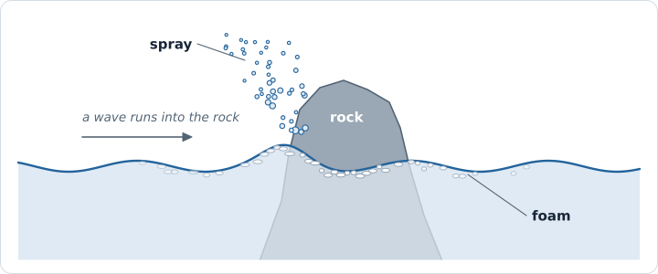

# 31 — Spray

> **Reference support:** named prepared-exercise and native-regression commands
> in this lesson run from the [reference checkout](../BranchWorkflow.md#prepared-reference-exercises).
> The growing chapter implementation remains in your learning checkout.

**Goal:** something in Chapter 30's sea for the waves to hit. A rock stands in
it, and where a wave runs into the rock the water flies up as spray, Chapter
21's particles, with the GPU deciding where and how many. Foam stays behind on
the water around the rock and fades. Chapter 32 floats a boat in the same sea,
through the same door this chapter builds.

### Checkpoint route

Each part ends with a runnable checkpoint. Finish one result before adding the
next; on return, restore that checkpoint's view and settings before editing.

| Work block | Result at its checkpoint |
| --- | --- |
| [1. A rock in the sea, sections 1–2](#spray-rock) | The rock 70 m ahead, the water climbing and falling on it as the waves pass |
| [2. Spray, sections 3–6](#spray-breaking) | White spray where the waves hit the rock, and the particle count in the panel |
| [3. Foam that stays, sections 7–8](#spray-foam) | A ring of foam at the rock's waterline that fades when the waves stop |

**ROADMAP:** step 21+ — Chapter 30's demo, grown, in `Source/PillowFort/Demos/Sea/`
with shaders under `Shaders/Sea/` and a prop in `Assets/Scenes/`.

**Module:** still `pf::demos::sea`. Everything new lives in one class,
`SeaObjects`, which `SeaDemo` owns and calls from a handful of places, and in
`SprayParticles`, Chapter 21's particle system copied for its second user.
`SeaDemo.cpp` changes in thirteen places, each small and made by the section
that needs it, `SeaDemo.h` in two, the surface's fragment shader in five. The
engine does not change.

**Math:** taught where it is first used (sections 3, 5 and 6) and listed in the
index's [The math, chapter by
chapter](../VulkanTutorial.md#the-math-chapter-by-chapter).

**Prerequisites:**

- Builds on Chapter 30, built and running. `SeaDemo` calls this chapter's code
  from a handful of places, and each says where in `SeaDemo` it goes.
- Chapter 29, sections [8](29-FFT-Ocean.md#8-waves-in-motion) and
  [9](29-FFT-Ocean.md#9-assembling-the-maps): the choppy displacement moves the
  water sideways, and the displacement map says where each point of the flat sea
  goes, not what is above a place. Section 3 here starts from that.
- Chapter 21, sections [1](21-GPU-Particles.md#1-the-pool) to
  [5](21-GPU-Particles.md#5-drawing-the-particles): the pool, the dead and alive
  lists, the counters and indirect arguments, the five passes and their
  barriers, and drawing the particles in a second rendering scope. Section 6
  copies all of it. Section 3 too: `seedRandom` and `randomFloat`, semi-implicit
  Euler, and drag as an exponential; and section 7, the counters read back for
  the panel.
- Chapter 20, sections [4](20-Compute-Fundamentals.md#4-storage-images)
  (`createStorageImage` and `createDescriptorSets`),
  [5](20-Compute-Fundamentals.md#5-barriers-between-dispatches)
  (`computeToComputeBarrier`),
  [8](20-Compute-Fundamentals.md#8-counting-storage-buffers-atomics-and-subgroups)
  (atomics, and `atomicAdd` handing out places in a list), and
  [9](20-Compute-Fundamentals.md#9-reading-results-back-without-stalling)
  (reading results back without stalling).
- [Chapter 19, section 4](19-Instancing-And-Indirect.md#4-one-vertex-buffer-for-every-mesh):
  `memoryBarrier`, the global barrier this chapter's buffer hazards use.
- [Chapter 14, section 7](14-Importing-USD-Scenes.md#7-the-walk-and-the-public-function)
  (`ImportUsdFile`) and
  [Chapter 12, section 6](12-Scene-Graph.md#6-the-flat-draw-list) (the flat draw
  list), for loading the rock; Chapter 11, sections
  [5](11-Meshes.md#5-telling-the-pipeline-where-the-attributes-are) to
  [7](11-Meshes.md#7-which-side-is-the-front),
  [13](11-Meshes.md#13-how-normals-move-the-normal-matrix) and
  [14](11-Meshes.md#14-one-light) (vertex attributes, `uploadMesh`, which side
  is the front, the normal matrix, one light).
- For drawing the rock as any other mesh is drawn: Chapter 15, sections
  [7](15-Materials-And-Textures.md#7-set-1-one-descriptor-set-per-material) and
  [11](15-Materials-And-Textures.md#11-the-mesh-shaders-rewritten) (the
  material's set 1, and `Mesh.frag`'s cutout specialization constant),
  [Chapter 16, section 4](16-Lights.md#4-the-light-buffer) (`WriteLights`),
  Chapter 17, sections
  [5](17-Shadows.md#5-recording-the-shadow-pass-and-its-two-barriers),
  [6](17-Shadows.md#6-sampling-it-set-0-bindings-3-and-4-and-a-comparison-sampler)
  and [7](17-Shadows.md#7-how-shadows-reach-the-shading) (extra shadow casters
  through a callback, `sunShadow`, `RecordShadows`),
  [Chapter 18, section 8](18-Anti-Aliasing.md#8-alpha-to-coverage-for-cutouts)
  (alpha to coverage), and
  [Chapter 24, section 4](24-Image-Based-Lighting.md#4-the-diffuse-cube-and-the-switch)
  (`SetImageBasedLighting`).
- [Chapter 9, section 6](09-Demo-Harness.md#6-the-triangle-becomes-a-demo): the
  height limit a panel takes so that it stops at the bottom of the window.
- [Chapter 4, section 5](04-Commands-And-Synchronization.md#5-barriers-and-the-three-questions-they-answer):
  the three questions every barrier answers.

This chapter's listings hand `SeaObjects` the displacement maps straight from
`SeaDemo`'s cascades and give the surface its local foam map the same way.
Later in the reference, Chapter 30's `SeaSurface` owns the maps, lends them to
this chapter's passes and borrows the foam map; details below.

<details>
<summary>Later stages change this chapter's code</summary>

In the assembled reference, `SeaDemo` still
owns the rock, the spray and the foam this chapter adds. Chapter 30's shared
`SeaSurface` hands out the displacement maps' views for this chapter's passes
and takes their local foam map, which it does not own, through `SetLocalFoam`
(see the [current ownership map (open the note)](30-A-Rougher-Sea.md#assembled-sea-owner)).
Horizon's coastal sea does not create these objects: moving them there would
need the rock placed in world coordinates and its materials registered with
Horizon's renderer.

</details>

---

## Where this is going



The sea of Chapter 30 is a set of images on the GPU, made fresh every frame.
Everything in this chapter and the next is a question put to those images:
*where is the water here, and how fast is it moving?* The rock asks at 96
points round its waterline, and where the answer is "coming at me fast", it
asks for spray. Chapter 32's boat asks the same question under its hull, and
the answers push it up. So after a rock to look at, the chapter's job is a door
into the sea that a compute shader can use, and the rest goes through it.

One frame, end to end. Chapter 30's frame is unchanged up to the surface; this
chapter adds the boxes marked *new*:

![One frame with spray: after Chapter 30's steps 1 to 9, the new SeaObjects::RecordSimulation fades the local foam into scratch, finds the water at the rock to write requests and atomic foam maxima, resolves the scratch to the sampled local foam, and runs Chapter 21's particle passes with emission sized by the requests. Step 10 then records the new rock into the sun's shadow cascades, each a rendering scope of its own, before its scene pass draws the sea, the new rock and the sky, and the new SeaObjects::RecordSpray draws the spray.](images/one-frame-with-spray.svg)

### Two decisions about the code

**A class of its own.** Chapter 30's `SeaDemo.cpp` is over a thousand lines
already. Everything this chapter adds reads the sea the same way — through the
displacement maps, after the hand-over — and nothing in Chapter 30 reads
anything this chapter makes except one foam map. So it goes in its own class,
`SeaObjects`, with one sea-data input (the displacement maps) and one sea-data
output (the foam map). To draw the rock it uses the scene renderer's frame,
material and light sets, as any mesh does, and it gives the scene renderer a
callback that draws the rock into the shadow maps; neither is a second way into
the sea, nor a second material system. `SeaDemo` calls it at the
corresponding points of its frame. Chapter 32's boat moves into
the same class: it reads the sea through the same door.

**Chapter 21's particles, copied.** The spray needs Chapter 21's whole system:
the pool, the lists, the counters, the five passes, the billboards. The sea is
its second user. The house rule is to write a pattern twice before automating
it, so `SprayParticles` is a copy, narrowed to what spray needs, and it runs
three of Chapter 21's five compute shaders and both of its drawing shaders
exactly as they are.

### What you are actually writing

**This is `SeaObjects.h`**, the class map. Every private function names the
section that writes it:

```cpp
///========================================================
/// @author Gary Yang
/// @brief  Chapters 31 and 32: a rock and a boat in Chapter 30's sea, the spray they throw, the foam they leave
/// @copyright (C) Gary 2026
///========================================================

// Source/PillowFort/Demos/Sea/SeaObjects.h
#pragma once

#include "PillowFort/Demos/Demo.h"
#include "PillowFort/Demos/Sea/SprayParticles.h"
#include "PillowFort/Scene/Scene.h"
#include "PillowFort/VulkanGraphics/GpuMesh.h"
#include "PillowFort/VulkanGraphics/SceneRenderer.h"
#include "PillowFort/VulkanGraphics/VulkanResources.h"
#include "Particles/ParticleTypes.h"
#include "Sea/SeaTypes.h"
#include "Sea/SprayTypes.h"

#include <glm/glm.hpp>

#include <array>
#include <cstdint>
#include <filesystem>
#include <span>
#include <vector>

namespace pf::demos::sea {

// What the "Rock and boat" panel edits. CPU state: it survives Shutdown and Initialize.
// Colors are sRGB, as the swatches show them.
struct SeaObjectSettings
{
    float sprayThreshold = 1.0f;     // section 5: m/s the water must come at an object faster than
    float sprayRate      = 150.0f;   // section 6: particles a second, per point, per m/s past the threshold
    float sprayLaunch    = 10.0f;    // section 6: launch speed, m/s, per m/s past the threshold
    float sprayDrag      = 0.6f;     // section 6: per second
    float spraySize      = 0.25f;    // section 6: metres across at birth; three times that at the end
    float sprayOpacity   = 0.6f;     // section 6
    glm::vec3 sprayColor { 0.95f, 0.97f, 1.0f };
    float foamStamp      = 0.4f;     // section 7: foam left per m/s past the threshold
    float foamFade       = 8.0f;     // section 7: seconds for the local foam to fade to 37%
};

// One part of a prop, ready to draw: which uploaded mesh, which of its submeshes, where, and in
// what color (section 2).
struct PropPart
{
    uint32_t  mesh    = 0;            // index into SeaObjects::m_meshes
    uint32_t  submesh = 0;
    glm::mat4 model{ 1.0f };          // inside the prop: the rock's includes where the rock stands
    uint32_t material = 0;            // complete imported material, registered in the scene renderer
    bool cutout = false;
    bool doubleSided = false;
};

// Section 1. Everything Chapters 31 and 32 put in the sea, as one piece SeaDemo owns and calls at a few
// points of its frame. Its simulation reads the sea through one data input: the cascades' displacement maps,
// in SHADER_READ_ONLY_OPTIMAL whenever RecordSimulation and RecordDraw run.
class SeaObjects
{
public:
    SeaObjects() = default;
    SeaObjects(const SeaObjects&) = delete;
    SeaObjects& operator=(const SeaObjects&) = delete;

    InitializationResult Initialize(const DemoContext& context, vulkan_graphics::SceneRenderer& sceneRenderer,
                                    std::span<const VkImageView, SEA_CASCADE_COUNT> displacementMaps);   // section 1
    void Shutdown();   // device idle first; safe after a partial Initialize, or none. Keeps the settings.

    // Section 7: the foam map the surface's fragment shader reads, always in GENERAL, and the sampler
    // that reads it: clamped, with a border of no foam.
    VkImageView LocalFoamView() const    { return m_localFoam.view; }
    VkSampler   LocalFoamSampler() const { return m_localFoamSampler; }

    // In SeaDemo::Update: the panel.
    void Update();

    // In SeaDemo::Record, in this order. ReadResults first, after the frame's fence wait.
    void ReadResults(uint32_t frameIndex);                                   // section 6
    InitializationResult RecordSimulation(VkCommandBuffer commandBuffer, uint32_t frameIndex,
                                          const SeaParameters& sea);                         // sections 5-7: before the scene pass
    void RecordDraw(VkCommandBuffer commandBuffer, uint32_t frameIndex,
                    const SeaParameters& sea) const;                         // section 2: inside it
    void RecordShadowCasters(VkCommandBuffer commandBuffer, uint32_t frameIndex, uint32_t cascade) const;  // section 2
    void RecordSpray(VkCommandBuffer commandBuffer, const RecordContext& frame,
                     const SeaParameters& sea) const;                        // section 6: after it

private:
    InitializationResult LoadProp(const std::filesystem::path& file, const glm::mat4& placement);   // section 2
    InitializationResult CreateBuffersAndImages();                                                         // section 4
    InitializationResult CreateProbeSet(std::span<const VkImageView, SEA_CASCADE_COUNT> displacementMaps);   // section 4
    InitializationResult CreatePipelines();                                         // section 2, grown in 4, 5, 7
    SprayParameters      PackSpray(const SeaParameters& sea) const;                 // section 5

    DemoContext                           m_context;
    vulkan_graphics::SceneRenderer* m_sceneRenderer = nullptr;   // SeaDemo's: set 0, the camera

    // Section 2: retained imported hierarchy and its rendering adapter.
    scene::Scene m_propScene;
    // The GPU meshes and per-part local transforms/materials:
    std::vector<vulkan_graphics::GpuMesh> m_meshes;
    std::vector<PropPart>                 m_parts;

    // Section 4: what the passes that read the sea keep from frame to frame.
    vulkan_graphics::AllocatedBuffer m_probes;      // vec4 per sample point: last frame's water there (section 5)
    vulkan_graphics::AllocatedBuffer m_requests;    // the request count, then SprayRequest[SPRAY_REQUEST_CAPACITY] (section 6)
    vulkan_graphics::AllocatedImage  m_foamMax;     // r32ui atomic maximum scratch (section 7)
    vulkan_graphics::AllocatedImage  m_localFoam;                              // rgba16f, r used (section 7)
    VkSampler                        m_localFoamSampler    = VK_NULL_HANDLE;   // clamped, a border of no foam
    VkSampler                        m_repeatSampler       = VK_NULL_HANDLE;   // Chapter 30's, for the cascades' maps
    std::array<vulkan_graphics::AllocatedBuffer, vulkan_graphics::FRAMES_IN_FLIGHT> m_readback;   // section 6
    std::array<bool, vulkan_graphics::FRAMES_IN_FLIGHT>                       m_readbackPending{};

    VkDescriptorSetLayout m_probeSetLayout = VK_NULL_HANDLE;   // section 4
    VkDescriptorPool      m_probePool      = VK_NULL_HANDLE;
    VkDescriptorSet       m_probeSet       = VK_NULL_HANDLE;
    VkPipelineLayout      m_probeLayout    = VK_NULL_HANDLE;
    VkPipeline            m_impactPipeline = VK_NULL_HANDLE;   // sections 5-7
    VkPipeline            m_fadePipeline   = VK_NULL_HANDLE;   // section 7
    VkPipeline            m_resolvePipeline = VK_NULL_HANDLE;  // section 7
    VkPipelineLayout      m_propLayout     = VK_NULL_HANDLE;   // section 2
    std::array<VkPipeline, 2> m_propPipelines{};        // opaque, cutout
    std::array<VkPipeline, 2> m_propShadowPipelines{};  // the same material split in shadows

    SprayParticles m_spray;   // section 6: Chapter 21's system, fed by the impact pass

    // CPU state.
    SeaObjectSettings           m_settings;
    particles::ParticleCounters m_counters{};            // section 6: for the panel, a frame or two old
    bool                        m_reset       = true;    // forget the probes, clear the foam and the spray
    uint32_t                    m_frameNumber = 0;       // seeds the impact pass's random numbers
};

} // namespace pf::demos::sea
```

`SeaObjectSettings` is what its panel edits. `PropPart` is one piece of a
prop, ready to draw. The members come in groups: the props (section 2), the
buffers and images the passes keep from frame to frame (sections 4–7), the set
and the pipelines, Chapter 21's particles, and the CPU's own state, including
its copy of what the GPU reports back.

**This is how `SeaObjects.cpp` is laid out**:

```text
SeaObjects.cpp
  includes, static scenesDirectory                       Appendix A
  namespace pf::demos::sea {
      using namespace vulkan_graphics;
      ObjectReadback                                     section 4
      SeaObjects's members, in any order                 its section: the class map or Appendix A
  }
```

### Where everything lands

```text
Assets/Scenes/
  make_sea_props.py         writes the props (Appendix B): the rock, and Chapter 32's boat     section 2
  Rock.usda, Boat.usda      what it wrote (the script and both files ship on `start`)
Shaders/Sea/
  SprayTypes.h              C++/GLSL twins: the rock, the samples, the spray            sections 2-7
  SeaWater.glsl             where the water is, for any compute shader                  section 3
  SeaProp.vert.glsl         standard material varyings for the rock                     section 2
  SeaPropShadow.vert.glsl   the rock in the shadow cascades                             section 2
  SprayImpact.comp.glsl     the water against the rock                                  sections 5-7
  SprayRequests.glsl        the list of particles asked for                             section 6
  SprayBegin.comp.glsl      Chapter 21's begin, sized by the requests                   section 6
  SprayEmit.comp.glsl       Chapter 21's emit, from the requests                        section 6
  SeaLocalFoam.comp.glsl    local foam fades into atomic scratch                        section 7
  FoamMax.glsl              shared narrow-disc atomic stamps                            section 7
  SeaFoamResolve.comp.glsl  scratch resolves to the sampled local foam                  section 7
  SeaSurface.frag.glsl      + the local foam                                            section 7
Shaders/Particles/          Chapter 21's, used as they are:
  ParticleReset.comp.glsl, ParticleSimulate.comp.glsl, ParticleEnd.comp.glsl,
  Particle.vert.glsl, Particle.frag.glsl, ParticleBuffers.glsl, ParticleTypes.h
Source/PillowFort/Demos/Sea/
  SeaObjects.h/.cpp         the rock, the spray, the local foam                         sections 1-7
  SprayParticles.h/.cpp     Chapter 21's particle system, copied                        section 6
  SeaDemo.h/.cpp            + the calls into SeaObjects                                 sections 1, 2, 4, 6, 7
```

---

<a id="spray-rock"></a>

# Part 1 — A rock in the sea (sections 1–2)

Part 1 builds the class that holds everything new and the first thing in the
sea: a rock, drawn with the camera's set and nothing else. Nothing in it reads
the sea yet; Part 2 opens the door.

## 1. A class for what is in the sea


`SeaObjects` is the class map at the top of the chapter. Part 1 writes its
setup, its draw, and its teardown; Part 2 adds its passes. One thing in the map
belongs to a later section: `m_spray`, whose class section 6 writes. Until
section 6, leave out the `#include` of `SprayParticles.h` and the `m_spray`
member; everything else in the map can be typed now. The map names the types of
`SprayTypes.h`, which section 2 writes, so the class compiles at the end of
Part 1, not before.

**This is `SeaObjects::Initialize`, as Part 1 has it**: the rock, then its
pipeline, each a step of its own so that each can fail with its own message:

```cpp
InitializationResult SeaObjects::Initialize(const DemoContext& context, SceneRenderer& sceneRenderer,
                                            std::span<const VkImageView, SEA_CASCADE_COUNT> /*displacementMaps*/)
{
    m_context       = context;   // first, so Shutdown works however far this gets
    m_sceneRenderer = &sceneRenderer;

    // Section 2: the rock where SprayTypes.h says it stands.
    const glm::mat4 rockPlacement = glm::translate(glm::mat4(1.0f), glm::vec3(SPRAY_ROCK_X, SPRAY_ROCK_Y, SPRAY_ROCK_Z));
    if (auto result = LoadProp(scenesDirectory() / "Rock.usda", rockPlacement); !result) { return result; }

    if (auto result = CreatePipelines(); !result) { return result; }   // section 2

    m_reset = true;   // the probes, the foam, and the particles all start from nothing
    m_readbackPending.fill(false);
    return InitializationResult::success();
}
```


`m_context` first, as in every demo's `Setup`, so that `Shutdown` can run
however far this got. The displacement maps are the class's one door in, and
nothing reads them until section 4; until then the parameter's name is
commented out, so that the compiler does not warn that it is unused. Section 4
puts the name back and adds two steps before `CreatePipelines`. `m_reset` asks
the first frame of Part 2's passes to start from nothing: the GPU's buffers hold
whatever was in memory until a pass writes them.

**This is `SeaObjects::Shutdown`.** It destroys everything the class will own
by the end of the chapter, in reverse order. Handles that were never made are
null, and destroying a null handle does nothing, so it is right after a partial
`Initialize` and right in every part of the chapter. Only when `Initialize` never
ran at all is there no device to destroy anything with:


```cpp
void SeaObjects::Shutdown()
{
    // SeaDemo's Teardown waited for the device. Reverse order of Initialize; null handles are
    // no-ops. The settings are kept.
    const VkDevice device = m_context.vulkan.device;
    if (device == VK_NULL_HANDLE)
    {
        return;   // Initialize never ran
    }
    for (auto& pipeline : m_propPipelines) { vkDestroyPipeline(device, pipeline, nullptr); pipeline = VK_NULL_HANDLE; }
    for (auto& pipeline : m_propShadowPipelines) { vkDestroyPipeline(device, pipeline, nullptr); pipeline = VK_NULL_HANDLE; }
    VkPipeline* pipelines[] = { &m_resolvePipeline, &m_fadePipeline, &m_impactPipeline };
    for (VkPipeline* pipeline : pipelines)
    {
        vkDestroyPipeline(device, *pipeline, nullptr);
        *pipeline = VK_NULL_HANDLE;
    }
    vkDestroyPipelineLayout(device, m_propLayout, nullptr);
    vkDestroyPipelineLayout(device, m_probeLayout, nullptr);
    vkDestroyDescriptorPool(device, m_probePool, nullptr);
    vkDestroyDescriptorSetLayout(device, m_probeSetLayout, nullptr);

    vkDestroySampler(device, m_localFoamSampler, nullptr);
    vkDestroySampler(device, m_repeatSampler, nullptr);
    destroyImage(m_context.vulkan, m_localFoam);   // null handles: no-op
    destroyImage(m_context.vulkan, m_foamMax);
    for (AllocatedBuffer& readback : m_readback)
    {
        destroyBuffer(m_context.vulkan, readback);
    }
    destroyBuffer(m_context.vulkan, m_requests);
    destroyBuffer(m_context.vulkan, m_probes);
    for (GpuMesh& mesh : m_meshes)
    {
        destroyMesh(m_context.vulkan, mesh);
    }
    m_meshes.clear();
    m_parts.clear();
    m_propScene = scene::Scene{};

    m_propLayout       = m_probeLayout = VK_NULL_HANDLE;
    m_probePool        = VK_NULL_HANDLE;
    m_probeSetLayout   = VK_NULL_HANDLE;
    m_probeSet         = VK_NULL_HANDLE;
    m_localFoamSampler = m_repeatSampler = VK_NULL_HANDLE;
}
```


### Where `SeaDemo` calls it

`SeaDemo` owns one. In `SeaDemo.h`, the include goes with the others,

```cpp
#include "PillowFort/Demos/Sea/SeaObjects.h"
```

and the member after `m_sky`:

```cpp
    // Chapters 31 and 32: a rock and a boat, the spray they throw, and the foam they leave.
    SeaObjects m_objects;
```

Keep Chapter 30's `Deactivate()` override, which releases the camera's held
controls. `SprayParticles` is a subsystem, not another `Demo` with its own
deactivation hook. Chapter 32 extends the existing `SeaDemo` hook to release
its new arrow-key state too.

In `SeaDemo::Setup`, it is initialized after the sky and before
`CreateSurface`: the surface's set will name a foam map that `SeaObjects` makes
(section 7). It is handed the three displacement maps' views, the one door in:

```cpp
    // Chapter 31: before the surface too, whose set names the local foam map.
    const std::array<VkImageView, SEA_CASCADE_COUNT> displacementMaps{
        m_cascades[0].displacement.view, m_cascades[1].displacement.view, m_cascades[2].displacement.view };
    if (auto result = m_objects.Initialize(m_context, m_sceneRenderer, displacementMaps); !result) { return result; }
```

`m_sceneRenderer` is passed by reference and kept as a pointer: the props and
the spray draw with the camera's set 0, which belongs to the scene renderer.
`SeaDemo` outlives `SeaObjects` (it owns it), so the pointer never dangles.

In `SeaDemo::Teardown`, it goes just before the sky's `Shutdown`:

```cpp
    m_objects.Shutdown();   // Chapter 31
```

## 2. A rock

### The prop

The rock is a USD file, `Assets/Scenes/Rock.usda`: a sphere of radius 7 m cut
into 24 rings of 48 facets, each point pushed in or out by two smooth waves
over the sphere, so its outline is lumpy but has nothing hanging over the
water. It has no normals of its own, so Chapter 14's importer gives every
facet its own, which suits a rock. A short Python script,
`Assets/Scenes/make_sea_props.py`, writes it, and Chapter 32's boat beside it.
The script and both files are on the `start` branch, so there is nothing to type
and nothing to run; Appendix B says what is in them.

The rock stands with its middle 3 m under the mean sea level, at
`(0, −3, −70)`: 70 m in front of where Chapter 29's camera starts. Where a sphere
of radius 7 m meets a plane 3 m above its middle is a circle of radius
`√(7² − 3²) = 6.32` m, rounded to 6.3 in `SPRAY_ROCK_WATERLINE`. The lumps move the real
waterline in and out by up to a metre around that circle, which section 5 has
to live with.

### The twin structs

Everything the CPU and the shaders of this chapter must agree on is in one
header, read by both languages, like Chapter 30's `SeaTypes.h`. The rock's
numbers and `PropParameters`, the props' push constant, are this section's.
The rest is explained where it is used — the sample points in section 5, the
request list in section 6, the foam map in section 7 — but the class map
already names it, so type the whole header now and read it through once for the
shape.

**This is `Shaders/Sea/SprayTypes.h`**:

```cpp
/* Shaders/Sea/SprayTypes.h - the C++/GLSL twins of Chapters 31 and 32: the rock, the boat, and the
   spray they throw. GLSL includes it as "SprayTypes.h", C++ as "Sea/SprayTypes.h". */
#ifndef PF_SPRAY_TYPES_H
#define PF_SPRAY_TYPES_H

#include "SharedShaderTypes.h"   /* the vec4, mat4, and uint aliases, on the C++ side */

/* Section 2. The rock: where its middle is, and the radius of the circle where it meets the mean
   sea level. Rock.usda is a sphere of radius 7 m with its middle 3 m under the water. */
#define SPRAY_ROCK_X            0.0f
#define SPRAY_ROCK_Y           -3.0f
#define SPRAY_ROCK_Z          -70.0f
#define SPRAY_ROCK_WATERLINE    6.3f

/* Section 5. Where the sea is sampled for spray: points around the rock's waterline. One
   invocation each. */
#define SPRAY_ROCK_SAMPLES     96u
#define SPRAY_SAMPLE_COUNT     SPRAY_ROCK_SAMPLES
#define SPRAY_GROUP_SIZE       64

/* Section 6. Stored requests, and the most any one sample may reserve. The shared count may
   exceed this capacity; the per-sample bound also prevents that uint counter from wrapping. */
#define SPRAY_REQUEST_CAPACITY 4096u
#define SPRAY_MAX_IMPACT       20.0f

/* Section 7. The local foam map: a square of sea, centred on the rock, that does not repeat. */
#define SPRAY_FOAM_SIZE      256.0f    /* metres along each side */
#define SPRAY_FOAM_TEXELS    512u      /* texels along each side: half a metre each */

#ifdef __cplusplus
    static_assert(SPRAY_REQUEST_CAPACITY <= (1u << 24), "The float request bound must be exact.");
    static_assert(1ull * SPRAY_SAMPLE_COUNT * SPRAY_REQUEST_CAPACITY < (1ull << 32), "Spray reservations could wrap.");
    namespace pf::demos::sea {
    using shared::vec4;
    using shared::mat4;
    using shared::uint;
#endif

/* Section 6. One new particle the impact pass asks for (std430, 32 bytes). */
struct SprayRequest
{
    vec4 positionAndLifetime;   /*  0: xyz metres; w seconds it lives */
    vec4 velocity;              /* 16: xyz metres per second; w unused */
};

/* Push constants for the passes that read the sea: the impact pass (section 5), the local foam's
   fade (section 7), and the boat (Chapter 32). Each reads the fields it needs. */
struct SprayParameters
{
    vec4  patchSizes;           /*   0: xyz each cascade's patch size, as SeaParameters has them */
    vec4  weights;              /*  16: xyz the cascades in use */
    vec4  boatStart;            /*  32: xyz where the boat starts; w its heading, radians */
    float deltaTime;            /*  48: ocean seconds this step covers */
    float throttle;             /*  52: -0.5 maximum astern .. 1 full ahead */
    float rudder;               /*  56: -1 hard to port (left) .. 1 hard to starboard (right) */
    float sprayThreshold;       /*  60: m/s of water rising against an object before it sprays */
    float sprayRate;            /*  64: particles per second, per sample, per m/s over the threshold */
    float sprayLaunch;          /*  68: launch speed, m/s, per m/s over the threshold */
    float foamStamp;            /*  72: foam added per m/s over the threshold */
    float foamFade;             /*  76: seconds for the local foam to fade to 37% */
    uint  frameNumber;          /*  80: seeds the random numbers */
    uint  flags;                /*  84: SPRAY_FLAG_* */
    uint  padding0;             /*  88 */
    uint  padding1;             /*  92 */
};

/* SprayParameters::flags */
#define SPRAY_FLAG_RESET 1u     /* forget last frame's samples and foam */

/* Push constants for drawing the rock and the boat (section 2). */
struct PropParameters
{
    mat4 model;                 /*  0: the part's own placement, inside its prop */
    uint boat;                  /* 64: 1 applies the GPU boat placement, 0 uses model only */
    uint cascade;               /* 68: shadow pass's cascade; ignored by the color pass */
    uint padding0;
    uint padding1;
};

#ifdef __cplusplus
    static_assert(sizeof(SprayRequest) == 32, "SprayRequest layout drifted.");
    static_assert(sizeof(SprayParameters) == 96, "SprayParameters layout drifted.");
    static_assert(offsetof(SprayParameters, deltaTime) == 48, "SprayParameters alignment drifted.");
    static_assert(sizeof(PropParameters) == 80, "PropParameters layout drifted.");
    }
#endif

#endif
```

`SprayParameters` is the push constant every pass that reads the sea shares,
96 bytes; each pass reads the fields it needs. Three of its fields, `boatStart`,
`throttle`, and `rudder`, are Chapter 32's boat. They are in the struct from the
start because C++ and every shader that includes the header share its layout,
and a field added in the middle later would move every offset after it; until
Chapter 32 nothing sets them, and they stay 0. Byte 88, `padding0`, stays
unused here too: Chapter 32 names it `boatSubsteps` and checks the step count
it carries before any pass is recorded. The assembled reference already has
that later version, so if you compare with it, keep its shared header, shaders
and owner together rather than mixing them with this chapter's; this
chapter's unused field is not an input for the finished boat shader.
`PropParameters` carries only
where a part is: its model matrix, a `boat` selector, and the shadow pass's
`cascade`. The rock leaves `boat` at zero; Chapter 32 makes it select the boat
matrix the GPU computes. The colour, textures and lights are not in it: they
are in the scene renderer's descriptor sets, as for any mesh.

### Loading it

Chapter 14 imports a USD file into a scene graph. `LoadProp` keeps that CPU
scene, `m_propScene`, with its hierarchy, transforms, textures and materials.
It uploads the meshes, textures and materials, and records one `PropPart` per
draw item: what the sea needs to draw that part. The parts are a way to draw
the imported asset, not a replacement for it.

The parts' matrices are worked out once, at load; nothing edits them while
the demo runs (Chapter 32's boat moves whole, by a matrix the GPU computes).
The simulation does not read the rock's mesh either: it reads numbers written for this one shape, the waterline in `SprayTypes.h`
(and, in Chapter 32, points on the hull). Replacing a prop's geometry therefore
means updating those numbers too, as well as keeping its materials.
[Chapter 45](45-Scene-Documents-And-Properties.md) adds editable properties and
saved documents for CPU scenes in the USD viewer. Authoring Sea's procedural
simulation and placing it as a scene component remain later project work.

<a id="ch31-a-prop-remains-a-project-asset"></a>

### Attempt CH31-a-prop-remains-a-project-asset: a prop remains a project asset

Import the rock into the existing sea. Decide what must survive import besides visible triangles, and how the prop should share camera, materials and lighting with other scene geometry. Keep the worked solution closed until you have a prediction or an attempt.

**Acceptance:** The rock uses the scene's sun/ambient/shadow response and preserves its imported parts; a missing required GPU upload reports failure without drawing partial resources.

**Transfer:** Add a textured, multi-part prop with a non-identity child transform. State which code should remain unchanged.

<details>
<summary>Hint 1: the idea</summary>

The importer already returns transforms, materials and textures. A prop adapter should not silently narrow that contract to a colour-only mesh.

</details>

<details>
<summary>Hint 2: the data and coordinates</summary>

Retain imported scene data, compose placement with each part's transform, and register all required GPU resources with checked results.

</details>

<details>
<summary>Hint 3: a concrete route</summary>

Keep the prop's placement in the world separate from the imported local hierarchy (Chapter 32's boat will take its placement from the GPU); draw with the scene renderer's material and lighting sets so that adding another material does not require another special-case shader.

</details>

[Complete reference](https://github.com/ZevosSky/PillowFort-private/blob/reference-main/Source/PillowFort/Demos/Sea/SeaObjects.cpp) includes later additions; this step's solution is two listings: `Initialize` in section 1, already above, so half of the answer is in front of you, and `LoadProp` below.

**This is `LoadProp`**:

<details>
<summary>Worked solution: a prop remains a project asset</summary>

```cpp
InitializationResult SeaObjects::LoadProp(const std::filesystem::path& file, const glm::mat4& placement)
{
    const uint32_t firstMesh = static_cast<uint32_t>(m_propScene.MeshCount());
    const uint32_t firstTexture = static_cast<uint32_t>(m_propScene.TextureCount());
    if (auto result = usd_import::ImportUsdFile(file, m_propScene); !result) { return result; }
    m_propScene.UpdateWorldTransforms();
    std::vector<scene::DrawItem> draws;
    m_propScene.CollectDraws(draws, nullptr);

    for (uint32_t mesh = firstMesh; mesh < m_propScene.MeshCount(); ++mesh)
    {
        m_meshes.emplace_back();
        if (auto result = uploadMesh(m_context.vulkan, m_propScene.GetMesh(mesh).data, m_meshes.back()); !result) { return result; }
    }
    uint32_t uploaded = scene::NO_COMPONENT;
    for (uint32_t texture = firstTexture; texture < m_propScene.TextureCount(); ++texture)
    {
        if (auto result = m_sceneRenderer->AddTexture(m_propScene.GetTexture(texture), uploaded); !result) { return result; }
    }
    for (uint32_t material = static_cast<uint32_t>(m_sceneRenderer->MaterialCount()); material < m_propScene.MaterialCount(); ++material)
    {
        if (auto result = m_sceneRenderer->AddMaterial(m_propScene.GetMaterial(material), uploaded); !result) { return result; }
    }
    for (const scene::DrawItem& draw : draws)
    {
        if (draw.mesh < firstMesh) { continue; }
        m_parts.push_back(PropPart{
            .mesh    = draw.mesh,
            .submesh = draw.submesh,
            .model   = placement * draw.world,
            .material = draw.material,
            .cutout = m_propScene.GetMaterial(draw.material).opacityThreshold > 0.0f,
            .doubleSided = m_propScene.GetMesh(draw.mesh).data.doubleSided,
        });
    }
    return InitializationResult::success();
}
```

</details>

### What the prop scene owns

The retained `m_propScene` owns the imported hierarchy, which mesh and material
each part uses, and the decoded textures. Each part keeps its imported world
transform and its whole material, not just a base colour. Every upload's
failure is returned. The GPU copies keep the scene's numbering only because the
sea's scene renderer holds nothing else: each texture and material is added in
the order `m_propScene` holds it, so the scene's index *i* is the renderer's
index *i*. A second client of the same scene renderer would break that; it
would have to keep the index each `AddTexture` and `AddMaterial` returns and
renumber with it.

`placement` puts the whole prop in the world: for the rock, a translation to
where `SprayTypes.h` says it stands, multiplied in front of each part's own
matrix from the file. `firstMesh` records the retained scene's mesh count before import. The importer
appends and rebases the new asset's indices; filtering by that count adds only
the new prop's parts, without duplicating an earlier import.

### Drawing it

The rock's fragment shader is **the engine's own `Scene/Mesh.frag.spv`**
(Chapter 15, section 11), so the rock gets the same textures, roughness,
opacity, normal mapping, image-based light, lights and shadows as any mesh,
and there is no sea-only fragment shader to keep in step with the material
model. Its vertex shader only has to hand that fragment shader what it
expects: the world position, the normal through the inverse transpose
(Chapter 11, section 13), the UV, and the tangent, its handedness flipped when
the placement mirrors the part.

**This is `SeaProp.vert.glsl` for the rock**, before Chapter 32 adds the GPU
boat lookup:


```glsl
// Shaders/Sea/SeaProp.vert.glsl - the rock and the boat (section 2; Chapter 32 section 2). The rock
// is placed by the CPU; the boat by the GPU, whose boat pass wrote its matrix this frame.
#version 450
#extension GL_GOOGLE_include_directive : require
#include "FrameBlock.glsl"      // set 0: frame.viewProjection
#include "SprayTypes.h"

layout(location = 0) in vec3 inPosition;   // Chapter 11's vertex: all four attributes retained
layout(location = 1) in vec3 inNormal;
layout(location = 2) in vec2 inUv;
layout(location = 3) in vec4 inTangent;

layout(push_constant) uniform PushConstants
{
    PropParameters prop;
};

layout(location = 0) out vec3 worldPosition;
layout(location = 1) out vec3 worldNormal;
layout(location = 2) out vec2 uv;
layout(location = 3) out vec4 worldTangent;

void main()
{
    mat4 model = prop.model;
    mat3 linear = mat3(model);
    vec4 world = model * vec4(inPosition, 1.0);
    worldPosition = world.xyz;
    worldNormal = transpose(inverse(linear)) * inNormal;
    uv = inUv;
    worldTangent = vec4(linear * inTangent.xyz, inTangent.w * (determinant(linear) < 0.0 ? -1.0 : 1.0));
    gl_Position = frame.viewProjection * world;
}
```


**This is `CreatePipelines` for Part 1.** Set 0 is the scene renderer's frame
set (camera, lights, shadow maps, image-based light); set 1 is its material set
(Chapter 15, section 7). There are two pipelines, opaque and cutout, because
`Mesh.frag`'s `alphaCutout` (constant 1) and `alphaToCoverage` (constant 2,
Chapter 18, section 8) are specialization constants, fixed when a pipeline is
made; alpha to coverage is on only for a cutout drawn with MSAA. Cull mode and
front face are dynamic state, so one pipeline serves double-sided parts (cull
nothing) and mirrored placements (clockwise front faces). Each also gets a
shadow pipeline: depth only, one sample, at the shadow maps' format.


```cpp
InitializationResult SeaObjects::CreatePipelines()
{
    // Set 0 frame/lighting/shadows; set 1 the complete material.
    const VkDescriptorSetLayout setLayouts[] = {
        m_sceneRenderer->FrameSetLayout(), m_sceneRenderer->MaterialSetLayout() };
    const VkPushConstantRange   propRange{ VK_SHADER_STAGE_VERTEX_BIT, 0,
                                           sizeof(PropParameters) };
    const VkPipelineLayoutCreateInfo propLayoutInfo{
        .sType                  = VK_STRUCTURE_TYPE_PIPELINE_LAYOUT_CREATE_INFO,
        .setLayoutCount         = 2,
        .pSetLayouts            = setLayouts,
        .pushConstantRangeCount = 1,
        .pPushConstantRanges    = &propRange,
    };
    VkPipelineLayout createdPropLayout = VK_NULL_HANDLE;
    if (vkCreatePipelineLayout(m_context.vulkan.device, &propLayoutInfo, nullptr, &createdPropLayout) != VK_SUCCESS)
    {
        return InitializationResult::failure("vkCreatePipelineLayout failed for the sea's props.");
    }
    m_propLayout = createdPropLayout;
    // Chapter 11's mesh pipeline: its vertex, counter-clockwise front faces, backs culled, in the
    // scene pass at the scene's sample count.
    const VkDynamicState dynamicStates[] = { VK_DYNAMIC_STATE_CULL_MODE, VK_DYNAMIC_STATE_FRONT_FACE };
    GraphicsPipelineDesc desc{
        .vertexShader     = "Sea/SeaProp.vert.spv",
        .fragmentShader   = "Scene/Mesh.frag.spv",
        .vertexBindings   = meshVertexBindings(),
        .vertexAttributes = meshVertexAttributes(),
        .colorFormats     = { &m_context.formats.color, 1 },
        .depthFormat      = m_context.formats.depth,
        .depthTest        = true,
        .depthWrite       = true,
        .depthCompare     = VK_COMPARE_OP_LESS,
        .cullMode         = VK_CULL_MODE_BACK_BIT,
        .frontFace        = VK_FRONT_FACE_COUNTER_CLOCKWISE,
        .dynamicStates    = dynamicStates,
        .layout           = m_propLayout,
        .samples          = m_context.formats.samples,
    };
    const VkSpecializationMapEntry entries[] = {
        { 1, 0, sizeof(VkBool32) }, { 2, sizeof(VkBool32), sizeof(VkBool32) } };
    const VkDynamicState shadowDynamic[] = { VK_DYNAMIC_STATE_CULL_MODE, VK_DYNAMIC_STATE_FRONT_FACE,
        VK_DYNAMIC_STATE_DEPTH_BIAS_ENABLE, VK_DYNAMIC_STATE_DEPTH_BIAS };
    const auto attributes = meshVertexAttributes();
    const VkVertexInputAttributeDescription shadowAttributes[] = { attributes[0], attributes[2] };
    for (uint32_t cutout = 0; cutout < 2; ++cutout)
    {
        const VkBool32 values[] = { cutout ? VK_TRUE : VK_FALSE,
            cutout && m_context.formats.samples != VK_SAMPLE_COUNT_1_BIT ? VK_TRUE : VK_FALSE };
        const VkSpecializationInfo specialization{ 2, entries, sizeof(values), values };
        desc.fragmentSpecialization = &specialization;
        desc.alphaToCoverage = values[1] == VK_TRUE;
        m_propPipelines[cutout] = createGraphicsPipeline(m_context.vulkan.device, m_context.pipelineCache, desc);
        GraphicsPipelineDesc shadow = desc;
        shadow.vertexShader = "Sea/SeaPropShadow.vert.spv";
        shadow.vertexAttributes = shadowAttributes;   // position and UV; normals/tangents are not read
        shadow.fragmentShader = cutout ? "Shadows/ShadowCutout.frag.spv" : "";
        shadow.colorFormats = {};
        shadow.depthFormat = m_sceneRenderer->Shadows().DepthFormat();
        shadow.samples = VK_SAMPLE_COUNT_1_BIT;
        shadow.alphaToCoverage = false;
        shadow.fragmentSpecialization = nullptr;
        shadow.dynamicStates = shadowDynamic;
        m_propShadowPipelines[cutout] = createGraphicsPipeline(m_context.vulkan.device, m_context.pipelineCache, shadow);
        if (!m_propPipelines[cutout] || !m_propShadowPipelines[cutout])
        {
            return InitializationResult::failure("Creating the sea's material/shadow prop pipelines failed.");
        }
    }
    return InitializationResult::success();
}
```


The matching shadow vertex adapter uses the same imported local transform and
UV. Cutout shadows reuse `Shadows/ShadowCutout.frag.spv`, so a material's
opacity is not forgotten in the shadow pass.

**This is `Shaders/Sea/SeaPropShadow.vert.glsl` for Part 1**, a new file
beside `SeaProp.vert.glsl`:


```glsl
#version 450
#extension GL_GOOGLE_include_directive : require
#include "SprayTypes.h"

layout(location = 0) in vec3 position;
layout(location = 2) in vec2 uv;
layout(location = 0) out vec2 outUv;
layout(std140, set = 0, binding = 3) uniform ShadowBlock { ShadowData shadowData; };
layout(push_constant) uniform PushConstants { PropParameters prop; };

void main()
{
    mat4 model = prop.model;
    gl_Position = shadowData.cascadeViewProjection[prop.cascade] * model * vec4(position, 1.0);
    outUv = uv;
}
```


**This is `RecordDraw`:**


```cpp
void SeaObjects::RecordDraw(VkCommandBuffer commandBuffer, uint32_t frameIndex, const SeaParameters& /*sea*/) const
{
    // Section 2: complete materials through the ordinary scene fragment shader.
    m_sceneRenderer->BindFrameSet(commandBuffer, m_propLayout, frameIndex);

    for (const PropPart& part : m_parts)
    {
        const GpuMesh&        mesh    = m_meshes[part.mesh];
        const scene::Submesh& submesh = mesh.submeshes[part.submesh];
        const PropParameters  prop{
            .model         = part.model,
        };
        vkCmdBindPipeline(commandBuffer, VK_PIPELINE_BIND_POINT_GRAPHICS, m_propPipelines[part.cutout ? 1 : 0]);
        vkCmdSetCullMode(commandBuffer, part.doubleSided ? VK_CULL_MODE_NONE : VK_CULL_MODE_BACK_BIT);
        vkCmdSetFrontFace(commandBuffer, glm::determinant(glm::mat3(part.model)) < 0.0f
            ? VK_FRONT_FACE_CLOCKWISE : VK_FRONT_FACE_COUNTER_CLOCKWISE);
        const VkDescriptorSet material = m_sceneRenderer->MaterialSet(part.material);
        vkCmdBindDescriptorSets(commandBuffer, VK_PIPELINE_BIND_POINT_GRAPHICS, m_propLayout, 1, 1, &material, 0, nullptr);
        vkCmdPushConstants(commandBuffer, m_propLayout, VK_SHADER_STAGE_VERTEX_BIT,
                           0, sizeof(prop), &prop);
        const VkDeviceSize offset = 0;
        vkCmdBindVertexBuffers(commandBuffer, 0, 1, &mesh.vertexBuffer.buffer, &offset);
        vkCmdBindIndexBuffer(commandBuffer, mesh.indexBuffer.buffer, 0, VK_INDEX_TYPE_UINT32);
        vkCmdDrawIndexed(commandBuffer, submesh.indexCount, 1, submesh.firstIndex, 0, 0);
    }
}
```


Draw it inside `SeaDemo::RecordSurface`, after water and before the sky:

```cpp
    m_objects.RecordDraw(commandBuffer, frame.frameIndex, parameters);
```

**This is the shadow-caster adapter**, called inside each existing cascade's
rendering scope:


```cpp
void SeaObjects::RecordShadowCasters(VkCommandBuffer commandBuffer, uint32_t frameIndex, uint32_t cascade) const
{
    m_sceneRenderer->BindFrameSet(commandBuffer, m_propLayout, frameIndex);
    for (const PropPart& part : m_parts)
    {
        const auto& mesh = m_meshes[part.mesh];
        const auto& submesh = mesh.submeshes[part.submesh];
        vkCmdBindPipeline(commandBuffer, VK_PIPELINE_BIND_POINT_GRAPHICS, m_propShadowPipelines[part.cutout ? 1 : 0]);
        vkCmdSetCullMode(commandBuffer, part.doubleSided ? VK_CULL_MODE_NONE : VK_CULL_MODE_BACK_BIT);
        vkCmdSetFrontFace(commandBuffer, glm::determinant(glm::mat3(part.model)) < 0.0f
            ? VK_FRONT_FACE_CLOCKWISE : VK_FRONT_FACE_COUNTER_CLOCKWISE);
        const VkDescriptorSet material = m_sceneRenderer->MaterialSet(part.material);
        vkCmdBindDescriptorSets(commandBuffer, VK_PIPELINE_BIND_POINT_GRAPHICS, m_propLayout, 1, 1, &material, 0, nullptr);
        const PropParameters prop{ .model = part.model, .cascade = cascade };
        vkCmdPushConstants(commandBuffer, m_propLayout, VK_SHADER_STAGE_VERTEX_BIT, 0, sizeof(prop), &prop);
        const VkDeviceSize zero = 0;
        vkCmdBindVertexBuffers(commandBuffer, 0, 1, &mesh.vertexBuffer.buffer, &zero);
        vkCmdBindIndexBuffer(commandBuffer, mesh.indexBuffer.buffer, 0, VK_INDEX_TYPE_UINT32);
        vkCmdDrawIndexed(commandBuffer, submesh.indexCount, 1, submesh.firstIndex, 0, 0);
    }
}
```


`Mesh.frag` reads the image-based light at set 0's bindings 10-12, and a draw
with those bindings never written is a validation error (Chapter 24, section 4).
So in `SeaDemo::Setup`, right after the sky's `Initialize`, hand the scene
renderer the sky's lighting:

```cpp
    m_sceneRenderer.SetImageBasedLighting(m_sky.Lighting());
```

`Mesh.frag` also reads the scene's lights, which the sea never wrote, and the
ambient mode, which it left at 0. At the top of `RecordSurface`, replace the camera's
`makeFrameData` and `WriteFrameData` lines (keep `extent` and `aspect`) with
this block: the same camera, the ambient mode, the sun as the scene's one
light, and then the props' shadows. It stays before `beginScenePass`, because
each shadow cascade is a rendering scope of its own and cannot be recorded
inside the scene pass:

```cpp
    shared::FrameData frameData = makeFrameData(scene::viewMatrix(m_cameraTransform.Matrix()),
        m_camera.Projection(aspect), m_cameraTransform.translation, m_time, m_deltaTime);
    frameData.ambientMode = skyLightsScene(frame.sky) ? AMBIENT_SKY : AMBIENT_FLAT;
    if (auto result = m_sceneRenderer.WriteFrameData(frame.frameIndex, frameData); !result) { return result; }
    const scene::LightItem sun{ .type = scene::LightType::Distant,
        .direction = glm::vec3(parameters.sunDirection), .emission = glm::vec3(parameters.sunIrradiance) };
    if (auto result = m_sceneRenderer.WriteLights(frame.frameIndex, { &sun, 1 }, glm::vec3(parameters.skyColor)); !result) { return result; }
    const ShadowSettings shadows{};
    if (auto result = m_sceneRenderer.RecordShadows(commandBuffer, frame.frameIndex, m_camera, frameData.view, aspect,
        glm::vec3(parameters.sunDirection), shadows, [&](VkCommandBuffer cb, uint32_t cascade)
        { m_objects.RecordShadowCasters(cb, frame.frameIndex, cascade); }); !result) { return result; }
```

Include `Shadows.glsl` in `SeaSurface.frag.glsl`, and in place of Chapter
30's `vec3 sun = sea.sunIrradiance.rgb;` line take the sun through the same
shadow test the rock's own shader uses. Otherwise the rock is in the shadow
maps, and its shadow can fall on Chapter 32's boat, but never on the water
around it:

```glsl
    float viewDepth = -(frame.view * vec4(worldPosition, 1.0)).z;
    float visibility = sunShadow(worldPosition, normal, viewDepth);
    vec3 sun = sea.sunIrradiance.rgb * visibility;
```

The [complete SeaObjects reference](https://github.com/ZevosSky/PillowFort-private/blob/reference-main/Source/PillowFort/Demos/Sea/SeaObjects.cpp)
also has Chapter 32's boat in it: there the props' layout gains the probe set
(section 4) as set 2, so that the boat's vertex shader can read where the GPU
put the boat, and `RecordDraw` and `RecordShadowCasters` bind it. The rock
needs none of that, so the listings here leave it out; the material stays at
set 1 either way.

<a id="spray-rock-checkpoint"></a>

## Checkpoint

Rerun `GenerateProjects.bat` (the new `.cpp` file and the two new vertex
shaders must be in the project), build, and run with `--demo Sea`. Pick "Sun
sky" in the Tone mapping window's Sky section, as at Chapter 30's last
checkpoint: a fresh run starts with the sky Off. You can now see:

- **the rock, 70 m ahead.** From the start you face the sun, so you see its
  shadowed side, lit only by the sky: a dark shape tinted by the sky's blue,
  whose facets barely show. Fly round it to see the sunlit facets. With the
  sky Off the shadowed side is one flat grey: with no sky to light it, the
  ambient light is Chapter 16's constant, the same from every direction, and
  shows no facets;
- **the waves on it.** Watch its waterline: the water climbs and falls on its
  sides as each wave passes, a metre or two each way at the bigger waves. The
  water passes straight through where the rock is — nothing yet tells the sea
  the rock is there, and nothing in this chapter will; the chapter's closing
  [Where to go from here](#where-to-go-from-here) says what would;
- the sky, the clouds, and Chapter 30's panels, as Chapter 30 left them.

---

<a id="spray-breaking"></a>

# Part 2 — Spray (sections 3–6)

A wave that reaches a rock has nowhere to go. It climbs the rock's face and
runs into it, and when it does that fast enough it breaks into spray. Part 2
first finds where the water is at any point (section 3) and gives every new
compute pass one set to read the sea through (section 4). Then it measures how
fast the water comes at the rock at 96 points round its waterline (section 5),
and asks Chapter 21's particle system for spray wherever that is fast
(section 6).

## 3. Where the water is


### The question the maps do not answer

Chapter 29, section 9 made the displacement map: the texel for a point `g` of
the flat sea holds `D(g)`, how far the waves move that point — sideways in x
and z, and up in y. The vertex shader asks the map exactly the question it
answers: *where does this point of the flat sea go?* It takes a grid point and
moves it.

The rock, and Chapter 32's boat, ask a different question: *how high is the
water above this place?* The water above a place `p` is whichever point of the
flat sea landed there, the `g` with

$$
g + D_{xz}(g) = p
$$

and its height is `D_y(g)`. Reading the map at `p` itself gives the height of
the point that *started* at `p`, which has moved somewhere else. With
Chapter 30's choppy waves that is not a small error: a crest is pushed
sideways toward its own middle, which is what makes it sharp (Chapter 29,
section 8), and reading at `p` puts every crest in the wrong place by up to the
waves' amplitude.

### Guessing and correcting

There is no formula that turns `D` around, but there is a way to find `g` by
guessing. Guess that the point above `p` started at `p`. Look up where that
guess really goes: it lands `D_xz(g)` away from where it started, and so misses
`p` by that much. Move the guess back by the miss and look again:

$$
g_{n+1} = p - D_{xz}(g_n)
$$

Each step the miss shrinks, because the displacement changes slowly from one
place to the next. If it changes by at most *f* metres for every metre along
the sea, the miss is multiplied by about *f* each step. For a wave of
amplitude *A*, wave number *k*, and choppiness λ, *f* is at most λ*Ak*: the number that, in
Chapter 29, section 9, folds a crest over when it passes 1. Below 1, every step
shrinks the miss.

A worked example, with one wave 60 m long (*k* = 2π / 60 = 0.105 rad/m), 1 m
high, at choppiness 1, which moves the point that starts at `g` by
`−sin(k g)` sideways and lifts it by `cos(k g)`. The water above `p = 10` m:

| Step | Guess `g` | Lands at | Miss | Height there |
| --- | --- | --- | --- | --- |
| 0 | 10.000 | 9.134 | −0.866 | 0.500 |
| 1 | 10.866 | 9.958 | −0.042 | 0.420 |
| 2 | 10.908 | 9.998 | −0.002 | 0.416 |
| 3 | 10.910 | 10.000 | −0.0001 | 0.415 |

Reading the map at `p` would have said 0.50 m. The water is really about
0.415 m high there, and three corrections leave a horizontal miss of about a
tenth of a millimetre. A real sea is many waves at once. The contraction
condition belongs to the **sum of their horizontal displacements**, not to
each wave in isolation: two slopes of 0.6 can add to 1.2. Three corrections
are a bounded approximation, not a convergence guarantee at every
energy/choppiness setting. Near a folded crest more than one original point
can even land at the same world position, so "the height above this point"
need not be unique.

Check the inverse independently of spray. In the known-wave calculation,
retain the final guess `g` and measure `|g + D_xz(g) − p|`, the horizontal
residual in metres. It is about 0.0001 m in the table after three corrections.
Compare that with a fourth correction before relying on the height. The same
diagnostic can be added temporarily around `seaDisplacementAbove` for the
full maps. A residual that stays large or grows calls for a gentler field or
a stronger inverse method; increasing particle counts cannot fix it.

### `SeaWater.glsl`

The guess-and-correct loop is wanted by this chapter's impact pass and by
Chapter 32's boat, so it lives in an include. It reads the cascades'
displacement maps exactly as Chapter 30's vertex shader does — each at its own
scale, `grid / L` plus half a texel (Chapter 30, section 4), weighted by the
panel's Solo — and adds them up. `textureLod` with level 0, because a compute
shader has no neighbouring pixels to pick a mip level from; the maps have one
level anyway.

**This is `Shaders/Sea/SeaWater.glsl`**:

<a id="ch31-ask-the-displaced-surface-then-request-spray"></a>

### Attempt CH31-ask-the-displaced-surface-then-request-spray: ask the displaced surface, then request spray

Recover water height at a fixed world point and drive Chapter 21's particle system from impact requests. Begin with a flat sea, then a known displacement, before judging a storm visually. Keep the worked solution closed until you have a prediction or an attempt.

**Acceptance:** First reproduce the single-wave table and check its final horizontal residual; sampling directly at `p` must give the distinguishable wrong height, 0.50 m instead of about 0.415 m. Then check that flat/reset sea does not throw a one-frame burst, stronger measured impact increases requests, a zero rate emits none, and a saturated request list never writes out of bounds.

**Transfer:** Translate the probe away from the rock and use a single known wave. Diagnose coordinate inversion separately from particle rendering.

<details>
<summary>Hint 1: the idea</summary>

Horizontal choppiness means sampling displacement directly at the world point is not the inverse lookup.

</details>

<details>
<summary>Hint 2: the data and coordinates</summary>

Iteratively correct the original map coordinate so its displaced horizontal position approaches the probe's world position; compare current and previous samples for rise and flow.

</details>

<details>
<summary>Hint 3: a concrete route</summary>

Emit bounded requests from positive impact above threshold. Reset initializes probe history, and request counts must be checked before writes even when atomic reservation exceeds capacity.

</details>

[Complete reference](https://github.com/ZevosSky/PillowFort-private/blob/reference-main/Shaders/Sea/SeaWater.glsl) includes later additions; the worked listing below is this step's solution.

<details>
<summary>Worked solution: ask the displaced surface, then request spray</summary>

```glsl
// Shaders/Sea/SeaWater.glsl - where the water is, for a compute pass that needs to know (Chapter 31
// section 3). An include, not a stage. It names the three displacement maps at set 0, bindings 0-2,
// which is where the sea's probe set puts them.
#ifndef PF_SEA_WATER_GLSL
#define PF_SEA_WATER_GLSL

layout(set = 0, binding = 0) uniform sampler2D displacementMap0;
layout(set = 0, binding = 1) uniform sampler2D displacementMap1;
layout(set = 0, binding = 2) uniform sampler2D displacementMap2;

// How far the sea moves the point of the flat sea at `grid`: the vertex shader's sum of the
// cascades (Chapter 30 section 4). textureLod, because a compute shader has no derivatives.
vec3 seaDisplacement(vec2 grid, vec4 patchSizes, vec4 weights)
{
    vec3 sum = vec3(0.0);
    sum += weights.x * textureLod(displacementMap0, grid / patchSizes.x + 0.5 / vec2(textureSize(displacementMap0, 0)), 0.0).xyz;
    sum += weights.y * textureLod(displacementMap1, grid / patchSizes.y + 0.5 / vec2(textureSize(displacementMap1, 0)), 0.0).xyz;
    sum += weights.z * textureLod(displacementMap2, grid / patchSizes.z + 0.5 / vec2(textureSize(displacementMap2, 0)), 0.0).xyz;
    return sum;
}

// What the sea did to the water that is now above the world point `position`: its displacement,
// whose y is the water's height there. The maps say where each point of the flat sea goes, not what
// lies above a place, so: guess the point that ends up here, see where it really goes, and move the
// guess back by the miss. Each step shrinks the miss by about lambda A k.
vec3 seaDisplacementAbove(vec2 position, vec4 patchSizes, vec4 weights)
{
    vec2 grid = position;
    for (int step = 0; step < 3; ++step)
    {
        grid = position - seaDisplacement(grid, patchSizes, weights).xz;
    }
    return seaDisplacement(grid, patchSizes, weights);
}

// The water's height above the world point `position`.
float seaHeight(vec2 position, vec4 patchSizes, vec4 weights)
{
    return seaDisplacementAbove(position, patchSizes, weights).y;
}

#endif
```

</details>

### What the include asks of its set

The include names three bindings, 0 to 2 of set 0. A shader that includes it
must be given a set with the three maps there; section 4 builds that set.
`seaDisplacementAbove` returns the whole displacement, not just the height,
because section 5 needs the sideways part too: how fast the water is moving.
`seaHeight`, the height alone, is what Chapter 32's boat asks for.

## 4. The probe set, and one more reader of the maps

### What the passes keep from frame to frame

The passes in this chapter remember things between frames: what each sample
point saw last frame (section 5), the list of particles asked for (section 6),
a map of foam (section 7). Each is written by one frame and read by the next,
so each lives as long as the demo, on the GPU.

The CPU also reads something back every frame, for the panel: the spray's
counters (section 6). Each readback buffer holds this struct, which goes at the
top of `SeaObjects.cpp`, inside the namespace. It is a struct of one member
because Chapter 32 adds a second, the boat's state, to the same copy:

```cpp
// Section 4: what one readback buffer holds: the spray's counters, for the panel (section 6).
struct ObjectReadback
{
    particles::ParticleCounters counters;
};
```

**This is `CreateBuffersAndImages`**:


```cpp
InitializationResult SeaObjects::CreateBuffersAndImages()
{
    // Two buffers the GPU keeps from frame to frame: what each sample point saw last frame
    // (section 5), and the list of particles asked for, with its count in front (section 6).
    m_probes   = createBuffer(m_context.vulkan, sizeof(glm::vec4) * SPRAY_SAMPLE_COUNT,
                              VK_BUFFER_USAGE_STORAGE_BUFFER_BIT, false);
    m_requests = createBuffer(m_context.vulkan, 4 * sizeof(uint32_t) + sizeof(SprayRequest) * SPRAY_REQUEST_CAPACITY,
                              VK_BUFFER_USAGE_STORAGE_BUFFER_BIT | VK_BUFFER_USAGE_TRANSFER_DST_BIT, false);
    if (m_probes.buffer == VK_NULL_HANDLE || m_requests.buffer == VK_NULL_HANDLE)
    {
        return InitializationResult::failure("Creating the sea objects' buffers failed.");
    }

    // Section 6: Chapter 20 section 9's readback, one per frame in flight.
    for (AllocatedBuffer& readback : m_readback)
    {
        readback = createReadbackBuffer(m_context.vulkan, sizeof(ObjectReadback));
        if (readback.buffer == VK_NULL_HANDLE)
        {
            return InitializationResult::failure("Creating a sea objects readback buffer failed.");
        }
    }

    // Section 7: the local foam map, in Chapter 30's foam format for the same reasons: rgba16f is
    // both a storage image and filterable everywhere. Chapter 20 section 4's helper moves it to
    // GENERAL, where it stays (section 7).
    m_localFoam = createStorageImage(m_context.vulkan, VK_FORMAT_R16G16B16A16_SFLOAT,
                                     { SPRAY_FOAM_TEXELS, SPRAY_FOAM_TEXELS },
                                     VK_IMAGE_USAGE_STORAGE_BIT | VK_IMAGE_USAGE_SAMPLED_BIT);
    if (m_localFoam.image == VK_NULL_HANDLE)
    {
        return InitializationResult::failure("Creating the local foam map failed.");
    }

    // Impact probes overlap. Atomic max needs r32ui, not the sampled rgba16f image.
    m_foamMax = createStorageImage(m_context.vulkan, VK_FORMAT_R32_UINT,
                                   { SPRAY_FOAM_TEXELS, SPRAY_FOAM_TEXELS }, VK_IMAGE_USAGE_STORAGE_BIT);
    if (m_foamMax.image == VK_NULL_HANDLE)
    {
        return InitializationResult::failure("Creating the local foam's atomic image failed.");
    }

    // Two samplers, both linear. The cascades' maps repeat, as Chapter 30's sampler does (section 4);
    // the local foam does not, and past its edge reads the border: transparent black, no foam (section 7).
    VkSamplerCreateInfo samplerInfo{
        .sType        = VK_STRUCTURE_TYPE_SAMPLER_CREATE_INFO,
        .magFilter    = VK_FILTER_LINEAR,
        .minFilter    = VK_FILTER_LINEAR,
        .mipmapMode   = VK_SAMPLER_MIPMAP_MODE_NEAREST,
        .addressModeU = VK_SAMPLER_ADDRESS_MODE_REPEAT,
        .addressModeV = VK_SAMPLER_ADDRESS_MODE_REPEAT,
        .addressModeW = VK_SAMPLER_ADDRESS_MODE_REPEAT,
    };
    VkSampler createdRepeatSampler = VK_NULL_HANDLE;
    if (vkCreateSampler(m_context.vulkan.device, &samplerInfo, nullptr, &createdRepeatSampler) != VK_SUCCESS)
    {
        return InitializationResult::failure("vkCreateSampler failed for the sea objects.");
    }
    m_repeatSampler = createdRepeatSampler;
    samplerInfo.addressModeU = VK_SAMPLER_ADDRESS_MODE_CLAMP_TO_BORDER;
    samplerInfo.addressModeV = VK_SAMPLER_ADDRESS_MODE_CLAMP_TO_BORDER;
    samplerInfo.addressModeW = VK_SAMPLER_ADDRESS_MODE_CLAMP_TO_BORDER;
    samplerInfo.borderColor  = VK_BORDER_COLOR_FLOAT_TRANSPARENT_BLACK;
    VkSampler createdLocalFoamSampler = VK_NULL_HANDLE;
    if (vkCreateSampler(m_context.vulkan.device, &samplerInfo, nullptr, &createdLocalFoamSampler) != VK_SUCCESS)
    {
        return InitializationResult::failure("vkCreateSampler failed for the local foam.");
    }
    m_localFoamSampler = createdLocalFoamSampler;

    // One thing before the first frame: the request count starts at zero. After that, the spray's
    // begin pass zeroes it every frame (section 6).
    if (auto result = immediateSubmit(m_context.vulkan, [&](VkCommandBuffer commandBuffer) {
        vkCmdFillBuffer(commandBuffer, m_requests.buffer, 0, 4 * sizeof(uint32_t), 0);
        memoryBarrier(commandBuffer, VK_PIPELINE_STAGE_2_CLEAR_BIT, VK_ACCESS_2_TRANSFER_WRITE_BIT,
                      VK_PIPELINE_STAGE_2_COMPUTE_SHADER_BIT,
                      VK_ACCESS_2_SHADER_STORAGE_READ_BIT | VK_ACCESS_2_SHADER_STORAGE_WRITE_BIT);
    }); !result) { return result; }
    return InitializationResult::success();
}
```


The two buffers are device-local storage buffers (Chapter 20, section 8). The
request list has one more use: it is cleared by `vkCmdFillBuffer` before the
first frame, so it is a transfer destination. The readback buffers are Chapter
20, section 9's, one per frame in flight. The foam map is a storage image of one
level, so Chapter 20, section 4's `createStorageImage` makes it and moves it to
`GENERAL`, where section 7 keeps it. Beside it, `m_foamMax` is section 7's
scratch: an `R32_UINT` storage image of the same size, never sampled, so it
needs only storage usage. The clamping sampler is section 7's; the
repeating sampler is Chapter 30's, made again here because `SeaObjects` takes
the maps' views and nothing else of `SeaDemo`'s. The one-time command at the
end, the fill, is explained in section 6.

### One set for every reader of the sea

Every pass this chapter adds reads the displacement maps, and most of them read
or write the buffers above. They all use one descriptor set, the **probe set**,
named for what the passes do with it: probe the sea at a few points.

| Binding | What | Type | Who uses it |
| --- | --- | --- | --- |
| 0-2 | the cascades' displacement maps | combined image sampler | `SeaWater.glsl`, in every pass |
| 3 | the probes: last frame's water at each sample point | storage buffer | the impact pass (section 5) |
| 5 | the request list | storage buffer | the impact pass, which fills it, and the spray's begin and emit (section 6) |
| 6 | the sampled local foam map | storage image | the fade reads it; the resolve writes it (section 7) |
| 7 | the atomic maximum scratch | storage image, r32ui | fade, impact, and resolve (section 7) |

Binding 4 is missing on purpose. The request list is at 5 because the spray's
own set (section 6) is Chapter 21's five bindings plus the list, so the list is
5 there, and one include, `SprayRequests.glsl`, declares it for both sets.
Chapter 32 puts the boat's state in the gap. Bindings need not be numbered
without gaps; a set's layout lists the ones it has.

The three maps are three bindings, not an array of three, for Chapter 30,
section 4's reason: synchronization validation follows a shader's reads through
single bindings, and the barriers on these maps are worth checking.

**This is `CreateProbeSet`**:


```cpp
InitializationResult SeaObjects::CreateProbeSet(std::span<const VkImageView, SEA_CASCADE_COUNT> displacementMaps)
{
    // One set for every pass that reads the sea:
    //   0-2  the cascades' displacement maps     sampled, as the surface's vertex shader reads them
    //   3    the probes                          section 5
    //   5    the request list                    section 6, at 5 because the spray's own set has it there
    //   6    the local foam map                  section 7
    //   7    the foam's atomic maximum image     section 7
    // Binding 4 waits for Chapter 32's boat.
    const VkShaderStageFlags compute = VK_SHADER_STAGE_COMPUTE_BIT;
    const VkDescriptorSetLayoutBinding bindings[] = {
        { 0, VK_DESCRIPTOR_TYPE_COMBINED_IMAGE_SAMPLER, 1, compute, nullptr },
        { 1, VK_DESCRIPTOR_TYPE_COMBINED_IMAGE_SAMPLER, 1, compute, nullptr },
        { 2, VK_DESCRIPTOR_TYPE_COMBINED_IMAGE_SAMPLER, 1, compute, nullptr },
        { 3, VK_DESCRIPTOR_TYPE_STORAGE_BUFFER,         1, compute, nullptr },
        { 5, VK_DESCRIPTOR_TYPE_STORAGE_BUFFER,         1, compute, nullptr },
        { 6, VK_DESCRIPTOR_TYPE_STORAGE_IMAGE,          1, compute, nullptr },
        { 7, VK_DESCRIPTOR_TYPE_STORAGE_IMAGE,          1, compute, nullptr },
    };
    // Chapter 20 section 4's helper: the layout, a pool for one set of it, and the set.
    if (!createDescriptorSets(m_context.vulkan, bindings, m_probeSetLayout, m_probePool, { &m_probeSet, 1 }))
    {
        return InitializationResult::failure("Creating the sea objects' probe set failed.");
    }

    // The maps in the layout SeaDemo's hand-over leaves them in; the foam in GENERAL, always.
    // One write per binding.
    std::array<VkDescriptorImageInfo, SEA_CASCADE_COUNT> maps{};
    for (uint32_t c = 0; c < SEA_CASCADE_COUNT; ++c)
    {
        maps[c] = { m_repeatSampler, displacementMaps[c], VK_IMAGE_LAYOUT_SHADER_READ_ONLY_OPTIMAL };
    }
    const VkDescriptorImageInfo  foam{ VK_NULL_HANDLE, m_localFoam.view, VK_IMAGE_LAYOUT_GENERAL };
    const VkDescriptorImageInfo  maximum{ VK_NULL_HANDLE, m_foamMax.view, VK_IMAGE_LAYOUT_GENERAL };
    const VkDescriptorBufferInfo probes{ m_probes.buffer, 0, VK_WHOLE_SIZE };
    const VkDescriptorBufferInfo requests{ m_requests.buffer, 0, VK_WHOLE_SIZE };
    const VkWriteDescriptorSet writes[] = {
        { .sType = VK_STRUCTURE_TYPE_WRITE_DESCRIPTOR_SET, .dstSet = m_probeSet, .dstBinding = 0, .descriptorCount = 1,
          .descriptorType = VK_DESCRIPTOR_TYPE_COMBINED_IMAGE_SAMPLER, .pImageInfo = &maps[0] },
        { .sType = VK_STRUCTURE_TYPE_WRITE_DESCRIPTOR_SET, .dstSet = m_probeSet, .dstBinding = 1, .descriptorCount = 1,
          .descriptorType = VK_DESCRIPTOR_TYPE_COMBINED_IMAGE_SAMPLER, .pImageInfo = &maps[1] },
        { .sType = VK_STRUCTURE_TYPE_WRITE_DESCRIPTOR_SET, .dstSet = m_probeSet, .dstBinding = 2, .descriptorCount = 1,
          .descriptorType = VK_DESCRIPTOR_TYPE_COMBINED_IMAGE_SAMPLER, .pImageInfo = &maps[2] },
        { .sType = VK_STRUCTURE_TYPE_WRITE_DESCRIPTOR_SET, .dstSet = m_probeSet, .dstBinding = 3, .descriptorCount = 1,
          .descriptorType = VK_DESCRIPTOR_TYPE_STORAGE_BUFFER, .pBufferInfo = &probes },
        { .sType = VK_STRUCTURE_TYPE_WRITE_DESCRIPTOR_SET, .dstSet = m_probeSet, .dstBinding = 5, .descriptorCount = 1,
          .descriptorType = VK_DESCRIPTOR_TYPE_STORAGE_BUFFER, .pBufferInfo = &requests },
        { .sType = VK_STRUCTURE_TYPE_WRITE_DESCRIPTOR_SET, .dstSet = m_probeSet, .dstBinding = 6, .descriptorCount = 1,
          .descriptorType = VK_DESCRIPTOR_TYPE_STORAGE_IMAGE, .pImageInfo = &foam },
        { .sType = VK_STRUCTURE_TYPE_WRITE_DESCRIPTOR_SET, .dstSet = m_probeSet, .dstBinding = 7, .descriptorCount = 1,
          .descriptorType = VK_DESCRIPTOR_TYPE_STORAGE_IMAGE, .pImageInfo = &maximum },
    };
    vkUpdateDescriptorSets(m_context.vulkan.device, static_cast<uint32_t>(std::size(writes)), writes, 0, nullptr);
    return InitializationResult::success();
}
```


Chapter 20, section 4's helper makes the layout, a pool counted from it (three
combined image samplers, two storage buffers, two storage images), and the one
set. The maps are named in `SHADER_READ_ONLY_OPTIMAL`, the layout Chapter 30's
hand-over leaves them in after step 8; the foam map in `GENERAL`, the only
layout it is ever in. Each binding has a write of its own, naming its number,
so the gap at 4 needs nothing: Chapter 32 adds a row to the table, a buffer
info, and one write.

`Initialize` gains the two steps, before `CreatePipelines`; put the name of the
`displacementMaps` parameter back too:

```cpp
    if (auto result = CreateBuffersAndImages(); !result)         { return result; }   // section 4
    if (auto result = CreateProbeSet(displacementMaps); !result) { return result; }   // section 4
    if (auto result = CreatePipelines(); !result)                { return result; }   // sections 2 and 4
```

The passes that read the sea will share one pipeline layout: the probe set and
a `SprayParameters`. It goes at the top of `CreatePipelines`, before the props'
layout, because sections 5 and 7 add pipelines that use it right after it:

```cpp
    // Section 4: the passes that read the sea share a layout, the probe set and a SprayParameters.
    const VkPushConstantRange probeRange{ VK_SHADER_STAGE_COMPUTE_BIT, 0, sizeof(SprayParameters) };
    const VkPipelineLayoutCreateInfo probeLayoutInfo{
        .sType                  = VK_STRUCTURE_TYPE_PIPELINE_LAYOUT_CREATE_INFO,
        .setLayoutCount         = 1,
        .pSetLayouts            = &m_probeSetLayout,
        .pushConstantRangeCount = 1,
        .pPushConstantRanges    = &probeRange,
    };
    VkPipelineLayout createdProbeLayout = VK_NULL_HANDLE;
    if (vkCreatePipelineLayout(m_context.vulkan.device, &probeLayoutInfo, nullptr, &createdProbeLayout) != VK_SUCCESS)
    {
        return InitializationResult::failure("vkCreatePipelineLayout failed for the sea objects.");
    }
    m_probeLayout = createdProbeLayout;
```

### The maps get a new reader

Until now, only the surface's vertex shader read the displacement maps, and
Chapter 30's barriers say so. Step 8 hands each map from the compute pass that
wrote it to `VERTEX_SHADER`; step 1, next frame, takes it back from
`VERTEX_SHADER`. This chapter's passes are compute dispatches that run after
step 8 and sample the same maps. Both barriers are rows of [Chapter 4's
appendix](04-Commands-And-Synchronization.md#appendix-barriers-the-later-chapters-add),
"Compute result sampled by the vertex shader and by later compute (31's
displacement maps)" and "...its return trip", and each gains one stage:

- **Step 8, the hand-over.** The reads now happen in `VERTEX_SHADER` *and* in
  this chapter's `COMPUTE_SHADER`, so both are the destination. The writes are
  the assemble pass's, the access `SHADER_SAMPLED_READ` is the same for both
  readers, and the layouts are unchanged. In `SeaDemo::Record`, step 8, the
  displacement's destination becomes:

```cpp
        transitionImage(commandBuffer, cascade.displacement.image,
                        VK_IMAGE_LAYOUT_GENERAL, VK_IMAGE_LAYOUT_SHADER_READ_ONLY_OPTIMAL,
                        VK_PIPELINE_STAGE_2_COMPUTE_SHADER_BIT, VK_ACCESS_2_SHADER_STORAGE_WRITE_BIT,
                        VK_PIPELINE_STAGE_2_VERTEX_SHADER_BIT | VK_PIPELINE_STAGE_2_COMPUTE_SHADER_BIT,
                        VK_ACCESS_2_SHADER_SAMPLED_READ_BIT);
```

- **Step 1, the return trip.** Next frame's assemble pass rewrites the maps, so
  it must wait for every reader of this frame's: the vertex shader and now the
  compute passes too. The readers only read, so the source access stays `NONE`.
  In step 1, the displacement's source becomes:

```cpp
        transitionImage(commandBuffer, cascade.displacement.image,
                        VK_IMAGE_LAYOUT_UNDEFINED, VK_IMAGE_LAYOUT_GENERAL,
                        VK_PIPELINE_STAGE_2_VERTEX_SHADER_BIT | VK_PIPELINE_STAGE_2_COMPUTE_SHADER_BIT, VK_ACCESS_2_NONE,
                        VK_PIPELINE_STAGE_2_COMPUTE_SHADER_BIT, VK_ACCESS_2_SHADER_STORAGE_WRITE_BIT);
```

The source must name `COMPUTE_SHADER` itself. Step 1 begins with a
`computeToComputeBarrier`, and it is tempting to think it already covers the
compute readers, but it does not reach the layout transition unless the
transition's source stages take in that barrier's destination, `COMPUTE_SHADER`:
that is what makes two barriers chain (Chapter 21, section 5). With
`VERTEX_SHADER` alone, the layout change, and the assemble pass after it, could
start while last frame's compute passes still read the maps. The exit check has
the control for the hand-over: take `COMPUTE_SHADER` out of step 8's destination,
and synchronization validation reports the impact pass's reads of all three maps.

## 5. How fast the water comes at the rock

### Where to ask

The rock asks at 96 points on a circle round its middle, at the radius where
the mean sea meets it, `SPRAY_ROCK_WATERLINE`. 96 points on a circle 40 m round
are one every 41 cm, close enough that a wave hitting the rock is seen at
several points at once. The circle is the rock's average waterline; its lumps
put the real face up to a metre inside or outside it. Spray that starts inside
the rock is hidden by the rock for the moment it takes to come out, which looks
like water bursting off the face, so the circle is good enough. Each point also
has a direction, **out**: away from the rock's middle, level with the sea.

### Two ways the water comes at the rock

Water reaches the face of a rock in two ways, and spray comes from both:

- **It climbs it.** The water's surface at the face rises. Measure how deep the
  point at the mean waterline is under the water, its **submersion**
  `s = h − y`, where `h` is the water's height above the point and `y` the
  point's own height (0, for the rock). A rising sea makes `s` grow.
- **It runs into it.** Under a wave, the water moves sideways as well as up and
  down, forward under a crest and back under a trough: the sideways part of
  Chapter 29, section 8's choppy displacement. Where it moves toward the rock, it
  is stopped by the face, and its speed has to go somewhere.

Both are speeds, and neither is in the maps. The maps hold where the water *is*
this frame, not how fast it moves. A speed is a change divided by the time it
took: the probe buffer keeps, for every point, what the last frame saw there,
and this frame's value minus last frame's, divided by the frame's time, is the
speed.

$$
\text{rise} = \frac{s_\text{now} - s_\text{last}}{\Delta t}
\qquad
\text{flow} = \frac{D_{xz,\text{now}} - D_{xz,\text{last}}}{\Delta t}
$$

`D_xz` is the sideways displacement of the water above the point, which
`seaDisplacementAbove` returns with the height. Strictly, `flow` is how fast
the displacement above one fixed place changes, which is not quite the water's
own speed: in one dimension it is that speed divided by the Jacobian of
Chapter 29, section 9, how much the choppy waves squeeze the sea there. Under a
crest, where the sea is squeezed, it reads high, and it grows without bound as
a crest nears a fold; the clamp below bounds it. Only the part of the flow
toward the rock counts: `inward = −flow · out`. The two positive parts form our visual impact proxy in metres per second,
not a measured material-water velocity:

$$
\text{impact} = \max(\text{rise}, 0) + \max(\text{inward}, 0)
$$

A worked example. At 60 frames a second, Δ*t* = 1/60 s. A point's submersion
goes from 0.100 m to 0.125 m in one frame: `rise = 0.025 × 60 = 1.5` m/s. The
water above it moved 0.010 m toward the rock in the same frame: `inward = 0.6`
m/s. The impact is 2.1 m/s. A water surface falling away, or flowing out from
the rock, adds nothing: that is what `max(…, 0)` says.

The impact is clamped at 20 m/s. Where Chapter 29, section 9's Jacobian folds a
crest over, the guess-and-correct of section 3 can jump from one side of the
fold to the other between frames, and the difference over one frame is then
huge without meaning anything.

**The threshold.** A gentle sea rises and falls against a rock without throwing
spray. Only the part of the impact above a threshold, "Threshold" in the panel,
1 m/s by default, counts, and the rest of the chapter calls it the
**strength**: `strength = impact − threshold`. Above, in the example, the
strength is 1.1 m/s. A strength at or below 0 throws nothing; section 6 turns a
positive one into particles and section 7 into foam.

### The impact pass

One invocation per sample point, in groups of 64. **This is
`Shaders/Sea/SprayImpact.comp.glsl`, as section 5 has it**:


```glsl
// Shaders/Sea/SprayImpact.comp.glsl - one invocation per point where the sea meets the rock: how
// fast the water comes at it, and where that is fast, spray to ask for and foam to leave
// (sections 5-7).
#version 450
#extension GL_GOOGLE_include_directive : require
#include "SprayTypes.h"
#include "SeaWater.glsl"   // set 0, bindings 0-2: the sea's displacement maps

layout(local_size_x = SPRAY_GROUP_SIZE) in;

// Per point, what the last frame saw: x how deep under the water the point was, yz the water's
// horizontal displacement there.
layout(set = 0, binding = 3, std430) buffer ProbeBuffer { vec4 probes[]; };

layout(push_constant) uniform PushConstants
{
    SprayParameters spray;
};

void main()
{
    uint id = gl_GlobalInvocationID.x;
    if (id >= SPRAY_SAMPLE_COUNT) { return; }

    // 1. Where the point is, which way is out from the object, and how fast the object moves there.
    vec3 point;
    vec3 outward;
    vec3 objectVelocity = vec3(0.0);
    if (id < SPRAY_ROCK_SAMPLES)
    {
        // Round the rock's waterline, at the mean sea level.
        float angle = 2.0 * 3.14159265 * float(id) / float(SPRAY_ROCK_SAMPLES);
        outward = vec3(cos(angle), 0.0, sin(angle));
        point   = vec3(SPRAY_ROCK_X, 0.0, SPRAY_ROCK_Z) + SPRAY_ROCK_WATERLINE * outward;
    }

    // 2. Section 5: how fast the water comes at the object. It climbs it: the point's depth under the
    //    water grows, whether the water rises or a bow drives down into a wave. And it runs into it:
    //    the water's own horizontal speed toward the object. Both are this frame against last frame's,
    //    which is this point's slot.
    vec3  water      = seaDisplacementAbove(point.xz, spray.patchSizes, spray.weights);
    float submersion = water.y - point.y;
    bool  reset      = (spray.flags & SPRAY_FLAG_RESET) != 0u || spray.deltaTime <= 0.0;
    vec4  previous   = reset ? vec4(submersion, water.xz, 0.0) : probes[id];
    probes[id]       = vec4(submersion, water.xz, 0.0);
    float time       = max(spray.deltaTime, 1e-4);
    float rise       = (submersion - previous.x) / time;
    vec2  flow       = (water.xz - previous.yz) / time;
    float inward     = -dot(flow, outward.xz);
    float impact     = min(max(rise, 0.0) + max(inward, 0.0), SPRAY_MAX_IMPACT);   // m/s; a fold can spike it

    // 3. Only near the waterline does anything happen, and only the part of the impact past the
    //    threshold counts: the strength, which throws spray (section 6) and leaves foam (section 7).
    if (abs(submersion) > 1.0) { return; }
    float strength = impact - spray.sprayThreshold;
```


Sections 6 and 7 add the rest of `main`. Step 1 is written for any object at
the water's edge, though the rock is the only one so far: the `if` is always
true while every point is the rock's, and `objectVelocity` stays 0, because a
rock does not move. Chapter 32 puts sample points round a boat after these 96,
with an `else` that places them and gives them the hull's velocity.

The probe buffer, binding 3, holds one `vec4` per point: x the submersion, y
and z the water's sideways displacement, as this frame found them for next
frame to compare with. When there is no last frame to compare with — the first
frame, after "Start again", or a paused sea whose Δ*t* is 0 — the point compares
with itself, and every speed is 0.

Step 3 is a short cut with a reason: a point more than a metre above or below
the water is not at the water's edge, so whatever the water does there throws
nothing. For the rock this happens in a trough of the swell, when the waterline
drops below the circle of points. Its last line is the strength, for the steps
that sections 6 and 7 add after it.

### What the pass is pushed

**This is `PackSpray`.** It copies the sea's patch sizes, weights, and frame
time out of Chapter 30's `SeaParameters`, so the impact pass reads exactly the
sea the surface draws, and adds the panel's settings:


```cpp
SprayParameters SeaObjects::PackSpray(const SeaParameters& sea) const
{
    return SprayParameters{
        .patchSizes     = sea.patchSizes,
        .weights        = sea.weights,
        .deltaTime      = sea.deltaTime,
        .sprayThreshold = m_settings.sprayThreshold,
        .sprayRate      = m_settings.sprayRate,
        .sprayLaunch    = m_settings.sprayLaunch,
        .foamStamp      = m_settings.foamStamp,
        .foamFade       = m_settings.foamFade,
        .frameNumber    = m_frameNumber,
        .flags          = (m_reset ? SPRAY_FLAG_RESET : 0u),
    };
}
```


`m_frameNumber` counts frames, for the random numbers of section 6. The fields
it leaves out, the boat's, are 0.

The pass's pipeline goes in `CreatePipelines`, after the probe layout: a table
of passes, one row so far, which section 7 grows by one:

```cpp
    const struct { VkPipeline* pipeline; const char* shader; } passes[] = {
        { &m_impactPipeline, "Sea/SprayImpact.comp.spv" },     // section 5
    };
    for (const auto& pass : passes)
    {
        *pass.pipeline = createComputePipeline(m_context.vulkan.device, m_context.pipelineCache, pass.shader, m_probeLayout);
        if (*pass.pipeline == VK_NULL_HANDLE)
        {
            return InitializationResult::failure("Creating a sea objects compute pipeline failed.");
        }
    }
```

## 6. Spray the GPU asks for

### Who decides

In Chapter 21 the CPU decided how many particles to make each frame, from a
rate and the frame's time, and pushed the number. Here the number depends on
where the waves hit the rock, which only the GPU knows this frame. The CPU could
find out by reading the impact pass's results back, a frame or two later
(Chapter 20, section 9), and spray would lag the waves that threw it by that
much. So the GPU decides: the impact pass writes a **request** for every
particle it wants, and Chapter 21's begin pass, instead of reading a count the
CPU pushed, reads how many requests there are. The CPU never learns the number
until the panel's readback, and never needs it.

### How many, from a strength

The number of particles a point asks for is a rate times its strength times the
frame's time: 150 particles a second for each metre per second past the
threshold, by default. That is rarely a whole number. The point with strength
1.3 at 60 frames a second wants `150 × 1.3 / 60 = 3.25` particles this frame.

Rounding down would lose the quarter every frame, and a weak hit, wanting 0.4
a frame, would never spray at all. Rounding to the nearest would give that weak
hit nothing and a slightly stronger one, 0.6, a whole particle every frame,
two thirds too many. Instead, **round at random**: take the 3, and add one more
with a probability equal to the fraction left over, 0.25. Over many frames the
average is

$$
3 + 0.25 \times 1 + 0.75 \times 0 = 3.25
$$

the desired expectation. A 0.4 hit has a 40% chance each frame; two in five
is its long-run average, not a schedule or a guarantee for each five frames.
This expectation applies before the storage and particle-pool caps below.

### Asking

**These are steps 5 and 6** of the impact pass's `main`, after step 3; section
7 puts a step 4 between them. Add the two includes they need beside the others
at the top of the file,

```glsl
#include "SprayRequests.glsl"   // set 0, binding 5: the requests, section 6
#include "Random.glsl"
```

and then:

```glsl
    // 5. Section 6: only past the threshold does the water throw spray. How many particles: the rate
    //    times the strength times the step. The fraction left over becomes one more particle as often
    //    as it is large, so below saturation the average comes out right.
    if (!(strength > 0.0)) { return; }   // also reject a NaN strength, after the probes and foam
    uint  random = seedRandom(id, spray.frameNumber);
    float wanted = spray.sprayRate * strength * spray.deltaTime;
    if (isnan(wanted) || isinf(wanted) || wanted < 0.0) { return; }
    float rounding = randomFloat(random);   // keep the ordinary stream's first draw, even at saturation
    uint count = wanted >= float(SPRAY_REQUEST_CAPACITY) ? SPRAY_REQUEST_CAPACITY
               : uint(wanted) + (rounding < fract(wanted) ? 1u : 0u);

    // 6. Reserve at most capacity per sample, before the atomic: 112 * 4096 cannot wrap uint.
    //    The loop then drops reservations beyond the stored prefix. Atomic order chooses that prefix.
    uint first = atomicAdd(requestCount, count);
    for (uint i = 0u; i < count && first + i < SPRAY_REQUEST_CAPACITY; ++i)
    {
        // Up and out from the object, fanned by a random nudge, faster the harder the water hits.
        vec3  nudge     = vec3(randomFloat(random), randomFloat(random), randomFloat(random)) * 2.0 - 1.0;
        vec3  direction = normalize(outward * 0.4 + vec3(0.0, 1.0, 0.0) + 0.4 * nudge);
        float speed     = spray.sprayLaunch * strength * (0.6 + 0.8 * randomFloat(random));
        vec3  start     = vec3(point.x, water.y, point.z) + outward * (0.3 * randomFloat(random));
        float lifetime  = 1.0 + randomFloat(random);
        requests[first + i] = SprayRequest(vec4(start, lifetime), vec4(direction * speed + 0.5 * objectVelocity, 0.0));
    }
}
```

`seedRandom` and `randomFloat` are Chapter 21's: a different stream of random
numbers for each point and each frame.

Placing requests in a shared list is Chapter 20, section 8's `atomicAdd`: each
invocation adds how many it wants to the list's count, and gets back the count
before its add, which is where its own requests start. That gives nonoverlapping
ranges only while the unsigned count does not wrap. The loop's bounds check
alone cannot establish ownership: three requests of 2³¹ would get starts
`0, 2³¹, 0`, and the first and third could write the same stored slots.

Bound each point's reservation **before** converting or adding: at most 4096.
There are 96 producers here, so the counter reaches at most `96 × 4096 = 393216`
from zero; Chapter 32's 112 producers reach 458752, both below 2³². `first + i`
also stays within that proof. The header assertions keep the producer bound
and the exactly representable float capacity visible. Initialization zeroes
the count; the begin pass below consumes and zeroes it each frame.

The counter may exceed the 4096 **stored** requests. The loop keeps only its
prefix, so atomic arrival order chooses which points survive saturation;
this is a bounded visual effect, not fair per-point allocation. Saturated
emission no longer has the unbounded rate's expectation. Below the cap the
same fractional-rounding draw is used, including its position in the random
stream. The explicit finite/nonnegative test precedes float-to-uint
conversion; a clamp is not a NaN validator. Keep these emission checks after
the probe update and, in section 7, the foam stamp: Rate 0 suppresses births
while the surface history and foam still update.

Each request is a particle as the emit pass will make it. It starts on the
water's surface at the point, up to 30 cm out from the face. It flies up and
out — `out × 0.4 + up`, so mostly up, as water deflected by a wall is — fanned
by a random nudge, at a speed of "Launch", 10 m/s, per metre per second of
strength, give or take 40%. The strength-1.3 hit throws its spray at 8 to 18
m/s, up to about 10 m before drag and gravity turn it. It lives one to two
seconds. Half the object's own velocity is added, which for the rock is
nothing; Chapter 32's boat throws its spray forward with it.

**This is `Shaders/Sea/SprayRequests.glsl`**, the list, declared once for the
three shaders that use it:

```glsl
// Shaders/Sea/SprayRequests.glsl - the list of new particles the impact pass asks for (Chapter 31
// section 6). An include: the probe set and the spray's particle set both name it at binding 5 of
// set 0, so the impact pass that fills it and the passes that read it declare it once, here.
#ifndef PF_SPRAY_REQUESTS_GLSL
#define PF_SPRAY_REQUESTS_GLSL

#include "SprayTypes.h"

layout(set = 0, binding = 5, std430) buffer RequestBuffer
{
    uint         requestCount;   // appended to with atomicAdd; may run past the capacity
    uint         padding0;
    uint         padding1;
    uint         padding2;
    SprayRequest requests[];     // SPRAY_REQUEST_CAPACITY of them
};

#endif
```

The count is first, with three words of padding, so that the requests after
it start 16 bytes in, as a `vec4` must in std430.

### Chapter 21's particles, a second time

**This is `SprayParticles.h`**:

```cpp
///========================================================
/// @author Gary Yang
/// @brief  Chapter 31: Chapter 21's GPU particles, copied and narrowed to spray thrown by the sea
/// @copyright (C) Gary 2026
///========================================================

// Source/PillowFort/Demos/Sea/SprayParticles.h
#pragma once

#include "PillowFort/Demos/Demo.h"
#include "PillowFort/VulkanGraphics/SceneRenderer.h"
#include "PillowFort/VulkanGraphics/VulkanResources.h"
#include "Particles/ParticleTypes.h"   // Chapter 21's structs, used as they are
#include "Sea/SprayTypes.h"

#include <cstdint>

namespace pf::demos::sea {

// Section 6. Chapter 21's particle system, its second user: the same pool, lists, counters, and
// indirect arguments, the same reset, simulate, and end passes and the same billboards, with a begin
// and an emit of its own. Its emitter is a list of requests that the impact pass fills on the GPU.
// A third user should move this into VulkanGraphics as a GpuParticles that takes its emit and
// simulate shaders as parameters.
class SprayParticles
{
public:
    SprayParticles() = default;
    SprayParticles(const SprayParticles&) = delete;
    SprayParticles& operator=(const SprayParticles&) = delete;

    // Spray never needs Chapter 21's million: a few thousand a second, living a second or two.
    static constexpr uint32_t CAPACITY = 1u << 16;

    // `requests` is the list the impact pass fills: the request count, then SprayRequest[SPRAY_REQUEST_CAPACITY].
    // It is the caller's; the begin and emit passes read it, and begin zeroes its count.
    InitializationResult Initialize(const vulkan_graphics::VulkanContext& vulkan, VkPipelineCache pipelineCache,
                                    const vulkan_graphics::SceneFormats& formats, VkDescriptorSetLayout frameSetLayout,
                                    VkBuffer requests);
    void Shutdown();   // device idle first; safe after a partial Initialize, or none

    VkBuffer CounterBuffer() const { return m_counters.buffer; }   // for a readback copy

    // Before the scene pass: begin, emit, simulate, and end, each with Chapter 21's barrier after it.
    // `reset` frees every particle first. The caller's earlier barrier covers last frame's readers.
    void RecordSimulation(VkCommandBuffer commandBuffer, float deltaTime, float drag, bool reset);

    // After the scene pass: Chapter 21's second rendering scope, blended over what the scene drew.
    void RecordDraw(VkCommandBuffer commandBuffer, const RecordContext& frame,
                    const vulkan_graphics::SceneRenderer& sceneRenderer,
                    const particles::ParticleAppearance& appearance) const;

private:
    vulkan_graphics::VulkanContext m_vulkan;
    VkPipelineCache                m_pipelineCache = VK_NULL_HANDLE;
    vulkan_graphics::SceneFormats  m_formats;

    vulkan_graphics::AllocatedBuffer m_particles;    // Particle[CAPACITY]
    vulkan_graphics::AllocatedBuffer m_deadList;     // uint[CAPACITY]
    vulkan_graphics::AllocatedBuffer m_aliveLists;   // uint[2 * CAPACITY]
    vulkan_graphics::AllocatedBuffer m_counters;     // ParticleCounters
    vulkan_graphics::AllocatedBuffer m_indirect;     // ParticleIndirect

    VkDescriptorSetLayout m_setLayout      = VK_NULL_HANDLE;   // Chapter 21's five bindings, and the requests at 5
    VkDescriptorPool      m_descriptorPool = VK_NULL_HANDLE;
    VkDescriptorSet       m_set            = VK_NULL_HANDLE;

    VkPipelineLayout m_computeLayout    = VK_NULL_HANDLE;
    VkPipeline       m_resetPipeline    = VK_NULL_HANDLE;   // Chapter 21's
    VkPipeline       m_beginPipeline    = VK_NULL_HANDLE;
    VkPipeline       m_emitPipeline     = VK_NULL_HANDLE;
    VkPipeline       m_simulatePipeline = VK_NULL_HANDLE;
    VkPipeline       m_endPipeline      = VK_NULL_HANDLE;   // Chapter 21's
    VkPipelineLayout m_drawLayout       = VK_NULL_HANDLE;
    VkPipeline       m_drawPipeline     = VK_NULL_HANDLE;   // Chapter 21's billboards, premultiplied

    uint32_t m_currentList = 0;   // the alive list holding the live particles
};

} // namespace pf::demos::sea
```

It is Chapter 21's system with the demo taken out of it: the five buffers of
its section 1, one copy each, the set, the compute passes and their barriers of
its sections 3 and 4, and the billboards of its section 5. What changes is small:

- **The pool is 65,536 particles**, not a million. Spray is a few thousand a
  second, living a second or two.
- **Binding 5 is the request list.** It belongs to `SeaObjects` (the impact pass
  writes it through the probe set), and `SprayParticles` is handed it.
- **Three of the five passes are Chapter 21's shader files, as they are**:
  reset, simulate, and end. Simulate's ground is put 1 km below the sea, so it
  never bounces anything: spray falls back into the water, where the water's
  depth test hides it, and dies of age.
- **Begin and emit are new**, and short.

**This is `SprayParticles::Initialize`**, printed whole with the top of the
file. Chapter 21's structs live in its namespace, so the file takes the five it
uses with a `using particles::` line each. It follows Chapter 21's setup in
order, and differs in four places: the buffers have no second copy for the
CPU's emitter; the limit check asks for six storage buffers, not five, because
the set's six buffers end with the request list, and the set comes from
Chapter 20, section 4's helper, its pool counted from the six bindings; two of
the five passes load the spray's shaders; and there is one billboard pipeline,
premultiplied, where Chapter 21 had two:


```cpp
///========================================================
/// @author Gary Yang
/// @brief  Chapter 31: Chapter 21's GPU particles, copied and narrowed to spray thrown by the sea
/// @copyright (C) Gary 2026
///========================================================

// Source/PillowFort/Demos/Sea/SprayParticles.cpp
#include "PillowFort/Demos/Sea/SprayParticles.h"

#include "PillowFort/VulkanGraphics/GraphicsPipeline.h"
#include "PillowFort/VulkanGraphics/VulkanBarriers.h"

#include <array>
#include <cstddef>

namespace pf::demos::sea {

using namespace vulkan_graphics;
using particles::Particle;
using particles::ParticleAppearance;
using particles::ParticleCounters;
using particles::ParticleIndirect;
using particles::ParticleSimulation;

InitializationResult SprayParticles::Initialize(const VulkanContext& vulkan, VkPipelineCache pipelineCache,
                                                const SceneFormats& formats, VkDescriptorSetLayout frameSetLayout,
                                                VkBuffer requests)
{
    m_vulkan        = vulkan;
    m_pipelineCache = pipelineCache;
    m_formats       = formats;
    m_currentList   = 0;

    // Chapter 21 section 1's buffers, one copy each.
    const struct
    {
        AllocatedBuffer*   buffer;
        VkDeviceSize       size;
        VkBufferUsageFlags usage;
    } buffers[] = {
        { &m_particles,  sizeof(Particle) * CAPACITY,     VK_BUFFER_USAGE_STORAGE_BUFFER_BIT },
        { &m_deadList,   sizeof(uint32_t) * CAPACITY,     VK_BUFFER_USAGE_STORAGE_BUFFER_BIT },
        { &m_aliveLists, sizeof(uint32_t) * CAPACITY * 2, VK_BUFFER_USAGE_STORAGE_BUFFER_BIT },
        { &m_counters,   sizeof(ParticleCounters),
          VK_BUFFER_USAGE_STORAGE_BUFFER_BIT | VK_BUFFER_USAGE_TRANSFER_SRC_BIT },
        { &m_indirect,   sizeof(ParticleIndirect),
          VK_BUFFER_USAGE_STORAGE_BUFFER_BIT | VK_BUFFER_USAGE_INDIRECT_BUFFER_BIT },
    };
    for (const auto& entry : buffers)
    {
        *entry.buffer = createBuffer(m_vulkan, entry.size, entry.usage, false);
        if (entry.buffer->buffer == VK_NULL_HANDLE)
        {
            return InitializationResult::failure("Creating a spray buffer failed.");
        }
    }

    // Chapter 21 section 1's limit check, one buffer higher: the request list makes six storage
    // buffers per shader stage, where Vulkan guarantees four.
    VkPhysicalDeviceProperties properties{};
    vkGetPhysicalDeviceProperties(m_vulkan.physicalDevice, &properties);
    if (properties.limits.maxPerStageDescriptorStorageBuffers < 6)
    {
        return InitializationResult::failure("The spray needs six storage buffers per shader stage.");
    }

    // Chapter 21's set, one binding longer. Bound at set 0 for compute, set 1 for drawing.
    const VkShaderStageFlags computeOnly      = VK_SHADER_STAGE_COMPUTE_BIT;
    const VkShaderStageFlags computeAndVertex = VK_SHADER_STAGE_COMPUTE_BIT | VK_SHADER_STAGE_VERTEX_BIT;
    std::array<VkDescriptorSetLayoutBinding, 6> bindings{};
    for (uint32_t i = 0; i < bindings.size(); ++i)
    {
        bindings[i] = VkDescriptorSetLayoutBinding{
            .binding         = i,
            .descriptorType  = VK_DESCRIPTOR_TYPE_STORAGE_BUFFER,
            .descriptorCount = 1,
            .stageFlags      = (i == 0 || i == 2) ? computeAndVertex : computeOnly,
        };
    }
    if (!createDescriptorSets(m_vulkan, bindings, m_setLayout, m_descriptorPool, { &m_set, 1 }))
    {
        return InitializationResult::failure("Creating the spray's descriptor set failed.");
    }
    const VkBuffer named[] = { m_particles.buffer, m_deadList.buffer, m_aliveLists.buffer, m_counters.buffer,
                               m_indirect.buffer, requests };
    std::array<VkDescriptorBufferInfo, std::size(named)> infos{};
    std::array<VkWriteDescriptorSet, std::size(named)>   writes{};
    for (uint32_t i = 0; i < std::size(named); ++i)
    {
        infos[i]  = VkDescriptorBufferInfo{ .buffer = named[i], .offset = 0, .range = VK_WHOLE_SIZE };
        writes[i] = VkWriteDescriptorSet{
            .sType           = VK_STRUCTURE_TYPE_WRITE_DESCRIPTOR_SET,
            .dstSet          = m_set,
            .dstBinding      = i,
            .descriptorCount = 1,
            .descriptorType  = VK_DESCRIPTOR_TYPE_STORAGE_BUFFER,
            .pBufferInfo     = &infos[i],
        };
    }
    vkUpdateDescriptorSets(m_vulkan.device, static_cast<uint32_t>(writes.size()), writes.data(), 0, nullptr);

    // Chapter 21 section 4's compute layout, and five passes: three of them Chapter 21's own.
    const VkPushConstantRange pushRange{
        .stageFlags = VK_SHADER_STAGE_COMPUTE_BIT,
        .offset     = 0,
        .size       = sizeof(ParticleSimulation),
    };
    const VkPipelineLayoutCreateInfo layoutInfo{
        .sType                  = VK_STRUCTURE_TYPE_PIPELINE_LAYOUT_CREATE_INFO,
        .setLayoutCount         = 1,
        .pSetLayouts            = &m_setLayout,
        .pushConstantRangeCount = 1,
        .pPushConstantRanges    = &pushRange,
    };
    VkPipelineLayout createdComputeLayout = VK_NULL_HANDLE;
    if (vkCreatePipelineLayout(m_vulkan.device, &layoutInfo, nullptr, &createdComputeLayout) != VK_SUCCESS)
    {
        return InitializationResult::failure("vkCreatePipelineLayout failed for the spray's passes.");
    }
    m_computeLayout = createdComputeLayout;
    const struct { VkPipeline* pipeline; const char* shader; } passes[] = {
        { &m_resetPipeline,    "Particles/ParticleReset.comp.spv" },   // Chapter 21's
        { &m_beginPipeline,    "Sea/SprayBegin.comp.spv" },
        { &m_emitPipeline,     "Sea/SprayEmit.comp.spv" },
        { &m_simulatePipeline, "Particles/ParticleSimulate.comp.spv" },   // Chapter 21's
        { &m_endPipeline,      "Particles/ParticleEnd.comp.spv" },     // Chapter 21's
    };
    for (const auto& pass : passes)
    {
        *pass.pipeline = createComputePipeline(m_vulkan.device, m_pipelineCache, pass.shader, m_computeLayout);
        if (*pass.pipeline == VK_NULL_HANDLE)
        {
            return InitializationResult::failure("Creating a spray compute pipeline failed.");
        }
    }

    // Chapter 21 section 5's billboards: set 0 the camera, set 1 the particles, drawn after the
    // scene pass, single-sample, depth tested and not written, premultiplied.
    const VkDescriptorSetLayout drawSetLayouts[] = { frameSetLayout, m_setLayout };
    const VkPushConstantRange drawRange{
        .stageFlags = VK_SHADER_STAGE_VERTEX_BIT,
        .offset     = 0,
        .size       = sizeof(ParticleAppearance),
    };
    const VkPipelineLayoutCreateInfo drawLayoutInfo{
        .sType                  = VK_STRUCTURE_TYPE_PIPELINE_LAYOUT_CREATE_INFO,
        .setLayoutCount         = 2,
        .pSetLayouts            = drawSetLayouts,
        .pushConstantRangeCount = 1,
        .pPushConstantRanges    = &drawRange,
    };
    VkPipelineLayout createdDrawLayout = VK_NULL_HANDLE;
    if (vkCreatePipelineLayout(m_vulkan.device, &drawLayoutInfo, nullptr, &createdDrawLayout) != VK_SUCCESS)
    {
        return InitializationResult::failure("vkCreatePipelineLayout failed for the spray's billboards.");
    }
    m_drawLayout = createdDrawLayout;
    const GraphicsPipelineDesc draw{
        .vertexShader   = "Particles/Particle.vert.spv",
        .fragmentShader = "Particles/Particle.frag.spv",
        .colorFormats   = { &m_formats.color, 1 },
        .depthFormat    = m_formats.depth,
        .depthTest      = true,
        .depthWrite     = false,
        .depthCompare   = VK_COMPARE_OP_LESS,
        .blend          = BlendMode::PremultipliedAlpha,
        .layout         = m_drawLayout,
    };
    m_drawPipeline = createGraphicsPipeline(m_vulkan.device, m_pipelineCache, draw);
    if (m_drawPipeline == VK_NULL_HANDLE)
    {
        return InitializationResult::failure("Creating the spray's billboard pipeline failed.");
    }
    return InitializationResult::success();
}
```


**This is `SprayParticles::RecordSimulation`**: Chapter 21, section 4's
`RecordCompute`, from step 2 to step 6 with their barriers, with these
changes:

- **The signature** takes what the caller knows:
  `void SprayParticles::RecordSimulation(VkCommandBuffer commandBuffer, float deltaTime, float drag, bool reset)`.
- **The push constants** are the spray's. There is no emitter, since the
  requests are it, so none of Chapter 21's emission arithmetic, and only five of
  its fifteen fields; and the ground is far below the sea, so Chapter 21's
  simulate never bounces anything: spray falls back into the water, where the
  sea's depth hides it, and dies of age. In place of everything before Chapter
  21's step 1, with the set bound once for all the passes:

```cpp
    const uint32_t current = m_currentList;
    const ParticleSimulation simulation{
        .gravity      = glm::vec4(0.0f, -9.81f, 0.0f, drag),
        .deltaTime    = deltaTime,
        .groundHeight = -1000.0f,
        .currentList  = current,
        .maxParticles = CAPACITY,
    };
    vkCmdPushConstants(commandBuffer, m_computeLayout, VK_SHADER_STAGE_COMPUTE_BIT, 0, sizeof(simulation), &simulation);
    vkCmdBindDescriptorSets(commandBuffer, VK_PIPELINE_BIND_POINT_COMPUTE, m_computeLayout, 0, 1, &m_set, 0, nullptr);
```

- **The reset** is the parameter: `if (reset)` where Chapter 21 has
  `if (m_resetRequested)`, its dispatch sized by
  `groupCount(CAPACITY, PARTICLE_GROUP_SIZE)`, and the two lines after it that
  clear `m_resetRequested` and `m_emitCarry` gone.
- **No timestamps**, and the function ends as Chapter 21's does, with
  `m_currentList = 1 - current;   // the survivors are in the other list now`.

Chapter 21's step 1, the return trip at the top of the frame, is not here:
`SeaObjects` makes one barrier at the top of its own frame that covers every
buffer it and the spray own (the end of this section shows it). Its readback of
the counters is `SeaObjects`' too.

**This is `Shaders/Sea/SprayBegin.comp.glsl`.** Chapter 21's begin made
`min(emitRequest, deadCount)` particles; this one makes as many as were
requested, capped by the list's capacity and by the dead list, and then sets
the request count back to 0, ready for next frame's impact pass:


```glsl
// Shaders/Sea/SprayBegin.comp.glsl - Chapter 21's begin pass, with the count of new particles read
// from the impact pass's requests instead of pushed by the CPU (section 6).
#version 450
#extension GL_GOOGLE_include_directive : require
#include "../Particles/ParticleBuffers.glsl"   // Chapter 21's set 0, bindings 0-4, and its push constants
#include "SprayRequests.glsl"                  // set 0, binding 5

layout(local_size_x = 1) in;

void main()
{
    uint current = simulation.currentList;
    uint next    = 1u - current;

    // As many as were asked for, as fit in the list, and as the dead list can supply. Then the
    // request count starts again from zero for next frame's impact pass.
    uint emitCount = min(min(requestCount, SPRAY_REQUEST_CAPACITY), counters.deadCount);
    counters.emitCount = emitCount;
    requestCount       = 0u;

    // The rest is Chapter 21's.
    counters.aliveCount[next] = 0u;
    uint simulateCount = counters.aliveCount[current] + emitCount;
    indirect.emit     = DispatchIndirectCommand((emitCount     + PARTICLE_GROUP_SIZE - 1) / PARTICLE_GROUP_SIZE, 1u, 1u);
    indirect.simulate = DispatchIndirectCommand((simulateCount + PARTICLE_GROUP_SIZE - 1) / PARTICLE_GROUP_SIZE, 1u, 1u);
}
```


Zeroing the count here, in a pass that runs anyway, costs no extra command and
no extra barrier, as Chapter 21's begin did for the next alive list. The count
starts at 0 because `CreateBuffersAndImages` filled the list's first 16 bytes
with zeros, followed by a barrier from that fill (`CLEAR`) to the compute passes,
before the first frame.

**This is `Shaders/Sea/SprayEmit.comp.glsl`.** Chapter 21's emit, with the
particle's start taken from its request instead of an emitter and a cone:
request *i* becomes new particle *i*.


```glsl
// Shaders/Sea/SprayEmit.comp.glsl - Chapter 21's emit pass: one invocation per new particle, each
// started from its request rather than from an emitter (section 6).
#version 450
#extension GL_GOOGLE_include_directive : require
#include "../Particles/ParticleBuffers.glsl"   // Chapter 21's set 0, bindings 0-4, and its push constants
#include "SprayRequests.glsl"                  // set 0, binding 5

layout(local_size_x = PARTICLE_GROUP_SIZE) in;

void main()
{
    uint id = gl_GlobalInvocationID.x;
    if (id >= counters.emitCount) { return; }   // the dispatch rounds up

    // Chapter 21's pop: begin made emitCount <= deadCount, so a free slot exists.
    uint deadSlot = atomicAdd(counters.deadCount, uint(-1)) - 1u;
    uint index    = deadList[deadSlot];

    // Request id becomes particle index: where, how fast, and how long, as the impact pass decided.
    SprayRequest request = requests[id];
    particles[index] = Particle(vec4(request.positionAndLifetime.xyz, 0.0),
                                vec4(request.velocity.xyz, request.positionAndLifetime.w));

    // Chapter 21's append to the current alive list.
    uint aliveSlot = atomicAdd(counters.aliveCount[simulation.currentList], 1u);
    aliveLists[simulation.currentList * simulation.maxParticles + aliveSlot] = index;
}
```


**This is `SprayParticles::RecordDraw`**: Chapter 21, section 5's second
rendering scope, with its two barriers in and the depth's return trip out,
handed the scene renderer and the appearance rather than owning them. The
alive list it draws is the one `RecordSimulation` flipped to, and the push
constants carry it with the pool's size:


```cpp
void SprayParticles::RecordDraw(VkCommandBuffer commandBuffer, const RecordContext& frame,
                                const SceneRenderer& sceneRenderer, const ParticleAppearance& appearance) const
{
    const SceneTargets& targets = frame.targets;

    // Chapter 21 section 5's two barriers into a second scope: blend over the color, test against
    // the depth read-only. The depth's source names both of its possible writers.
    transitionImage(commandBuffer, targets.colorImage,
                    VK_IMAGE_LAYOUT_COLOR_ATTACHMENT_OPTIMAL, VK_IMAGE_LAYOUT_COLOR_ATTACHMENT_OPTIMAL,
                    VK_PIPELINE_STAGE_2_COLOR_ATTACHMENT_OUTPUT_BIT, VK_ACCESS_2_COLOR_ATTACHMENT_WRITE_BIT,
                    VK_PIPELINE_STAGE_2_COLOR_ATTACHMENT_OUTPUT_BIT,
                    VK_ACCESS_2_COLOR_ATTACHMENT_READ_BIT | VK_ACCESS_2_COLOR_ATTACHMENT_WRITE_BIT);
    transitionImage(commandBuffer, targets.depthImage,
                    VK_IMAGE_LAYOUT_DEPTH_ATTACHMENT_OPTIMAL, VK_IMAGE_LAYOUT_DEPTH_READ_ONLY_OPTIMAL,
                    VK_PIPELINE_STAGE_2_EARLY_FRAGMENT_TESTS_BIT | VK_PIPELINE_STAGE_2_LATE_FRAGMENT_TESTS_BIT
                        | VK_PIPELINE_STAGE_2_COLOR_ATTACHMENT_OUTPUT_BIT,
                    VK_ACCESS_2_DEPTH_STENCIL_ATTACHMENT_WRITE_BIT | VK_ACCESS_2_COLOR_ATTACHMENT_WRITE_BIT,
                    VK_PIPELINE_STAGE_2_EARLY_FRAGMENT_TESTS_BIT | VK_PIPELINE_STAGE_2_LATE_FRAGMENT_TESTS_BIT,
                    VK_ACCESS_2_DEPTH_STENCIL_ATTACHMENT_READ_BIT,
                    VK_IMAGE_ASPECT_DEPTH_BIT);

    const VkRenderingAttachmentInfo colorAttachment{
        .sType       = VK_STRUCTURE_TYPE_RENDERING_ATTACHMENT_INFO,
        .imageView   = targets.colorView,
        .imageLayout = VK_IMAGE_LAYOUT_COLOR_ATTACHMENT_OPTIMAL,
        .resolveMode = VK_RESOLVE_MODE_NONE,
        .loadOp      = VK_ATTACHMENT_LOAD_OP_LOAD,
        .storeOp     = VK_ATTACHMENT_STORE_OP_STORE,
    };
    const VkRenderingAttachmentInfo depthAttachment{
        .sType       = VK_STRUCTURE_TYPE_RENDERING_ATTACHMENT_INFO,
        .imageView   = targets.depthView,
        .imageLayout = VK_IMAGE_LAYOUT_DEPTH_READ_ONLY_OPTIMAL,
        .resolveMode = VK_RESOLVE_MODE_NONE,
        .loadOp      = VK_ATTACHMENT_LOAD_OP_LOAD,
        .storeOp     = VK_ATTACHMENT_STORE_OP_NONE,
    };
    const VkRenderingInfo renderingInfo{
        .sType                = VK_STRUCTURE_TYPE_RENDERING_INFO,
        .renderArea           = { { 0, 0 }, targets.extent },
        .layerCount           = 1,
        .colorAttachmentCount = 1,
        .pColorAttachments    = &colorAttachment,
        .pDepthAttachment     = &depthAttachment,
    };
    vkCmdBeginRendering(commandBuffer, &renderingInfo);
    const VkViewport viewport{ 0.0f, 0.0f, static_cast<float>(targets.extent.width),
                               static_cast<float>(targets.extent.height), 0.0f, 1.0f };
    const VkRect2D scissor{ { 0, 0 }, targets.extent };
    vkCmdSetViewport(commandBuffer, 0, 1, &viewport);
    vkCmdSetScissor(commandBuffer, 0, 1, &scissor);

    vkCmdBindPipeline(commandBuffer, VK_PIPELINE_BIND_POINT_GRAPHICS, m_drawPipeline);
    sceneRenderer.BindFrameSet(commandBuffer, m_drawLayout, frame.frameIndex);
    vkCmdBindDescriptorSets(commandBuffer, VK_PIPELINE_BIND_POINT_GRAPHICS, m_drawLayout, 1, 1, &m_set, 0, nullptr);

    // The list simulate filled is the one RecordSimulation flipped to; the pool's size is CAPACITY.
    ParticleAppearance look = appearance;
    look.aliveList    = m_currentList;
    look.maxParticles = CAPACITY;
    vkCmdPushConstants(commandBuffer, m_drawLayout, VK_SHADER_STAGE_VERTEX_BIT, 0, sizeof(look), &look);
    vkCmdDrawIndirect(commandBuffer, m_indirect.buffer, offsetof(ParticleIndirect, draw), 1, sizeof(VkDrawIndirectCommand));
    vkCmdEndRendering(commandBuffer);

    // Chapter 21's return trip for the depth, back to what the next scene pass expects.
    transitionImage(commandBuffer, targets.depthImage,
                    VK_IMAGE_LAYOUT_DEPTH_READ_ONLY_OPTIMAL, VK_IMAGE_LAYOUT_DEPTH_ATTACHMENT_OPTIMAL,
                    VK_PIPELINE_STAGE_2_EARLY_FRAGMENT_TESTS_BIT | VK_PIPELINE_STAGE_2_LATE_FRAGMENT_TESTS_BIT,
                    VK_ACCESS_2_NONE,
                    VK_PIPELINE_STAGE_2_EARLY_FRAGMENT_TESTS_BIT | VK_PIPELINE_STAGE_2_LATE_FRAGMENT_TESTS_BIT,
                    VK_ACCESS_2_DEPTH_STENCIL_ATTACHMENT_READ_BIT | VK_ACCESS_2_DEPTH_STENCIL_ATTACHMENT_WRITE_BIT,
                    VK_IMAGE_ASPECT_DEPTH_BIT);
}
```


**This is `SprayParticles::Shutdown`**: Chapter 21, section 6's teardown without
the ground's pipeline and layout, the query pool, the readback, and the scene
renderer, with one draw pipeline rather than two, behind a return when there is
no device. The file's namespace closes after it:


```cpp
void SprayParticles::Shutdown()
{
    const VkDevice device = m_vulkan.device;
    if (device == VK_NULL_HANDLE)
    {
        return;   // never initialized: nothing to destroy
    }
    VkPipeline* pipelines[] = { &m_drawPipeline, &m_endPipeline, &m_simulatePipeline, &m_emitPipeline,
                                &m_beginPipeline, &m_resetPipeline };
    for (VkPipeline* pipeline : pipelines)
    {
        vkDestroyPipeline(device, *pipeline, nullptr);
        *pipeline = VK_NULL_HANDLE;
    }
    vkDestroyPipelineLayout(device, m_drawLayout, nullptr);
    vkDestroyPipelineLayout(device, m_computeLayout, nullptr);
    vkDestroyDescriptorPool(device, m_descriptorPool, nullptr);
    vkDestroyDescriptorSetLayout(device, m_setLayout, nullptr);
    AllocatedBuffer* buffers[] = { &m_indirect, &m_counters, &m_aliveLists, &m_deadList, &m_particles };
    for (AllocatedBuffer* buffer : buffers)
    {
        destroyBuffer(m_vulkan, *buffer);
    }
    m_drawLayout = m_computeLayout = VK_NULL_HANDLE;
    m_descriptorPool = VK_NULL_HANDLE;
    m_setLayout      = VK_NULL_HANDLE;
    m_set            = VK_NULL_HANDLE;
}

} // namespace pf::demos::sea
```


### Wiring it in

In `SeaObjects::Initialize`, after `CreatePipelines`, the spray is initialized
with the scene renderer's set 0 layout, for the billboards, and the request
list:

```cpp
    // Section 6: Chapter 21's particles, fed by the request list.
    if (auto result = m_spray.Initialize(m_context.vulkan, m_context.pipelineCache, m_context.formats,
                                         sceneRenderer.FrameSetLayout(), m_requests.buffer);
        !result)
    {
        return result;
    }
```

In `SeaObjects::Shutdown`, first:

```cpp
    m_spray.Shutdown();
```

Now put back the `#include` of `SprayParticles.h` and the `m_spray` member that
section 1 left out of the header.

**This is `RecordSpray`.** The spray is lit as Chapter 30's foam is, white in
the sun's units, so it dims and brightens with the sun; it starts at "Opacity"
and fades to a third of it, and grows to three times its size as it spreads:


```cpp
void SeaObjects::RecordSpray(VkCommandBuffer commandBuffer, const RecordContext& frame, const SeaParameters& sea) const
{
    // Section 6: Chapter 21's billboards, white in the sun's units, as the foam is (Chapter 30 section 8).
    const glm::vec3 color = scene::srgbToLinear(m_settings.sprayColor) * glm::vec3(sea.sunIrradiance) / 3.14159265f;
    const particles::ParticleAppearance appearance{
        .startColor = glm::vec4(color, m_settings.sprayOpacity),
        .endColor   = glm::vec4(color, 0.3f * m_settings.sprayOpacity),
        .startSize  = m_settings.spraySize,
        .endSize    = 3.0f * m_settings.spraySize,
    };
    m_spray.RecordDraw(commandBuffer, frame, *m_sceneRenderer, appearance);
}
```


Chapter 21 draws its particles in a second rendering scope after the scene
pass, single-sampled, blended over the resolved color and depth-tested against
the resolved depth (Chapter 21, section 5). So `SeaDemo::Record` calls it right
after `RecordSurface`, which ends the scene pass, and before the timestamp
after the surface:

```cpp
    m_objects.RecordSpray(commandBuffer, frame, PackSurface());   // Chapter 31: over the finished scene
```

### The counters, for the panel

The panel shows how many particles are alive. That is Chapter 21, section 7's
readback of the counters: copied to this frame's readback buffer at the end of
`RecordSimulation`, read on the CPU when this frame's slot comes round again,
after its fence. Section 4's `ObjectReadback` is what each readback buffer
holds.

**This is `ReadResults`**:

`readBuffer` can fail, and a failed read is reported through `Log`, so the
file includes `PillowFort/ErrorReporting/Log.h` (Appendix A's list). It returns
before touching `m_counters`, so the panel keeps the last good numbers rather
than showing a failed read.


```cpp
void SeaObjects::ReadResults(uint32_t frameIndex)
{
    // Chapter 20 section 9: this slot's fence has been waited on, so its copy is complete.
    if (m_readbackPending[frameIndex])
    {
        ObjectReadback latest{};
        if (auto result = readBuffer(m_context.vulkan, m_readback[frameIndex], &latest, sizeof(latest)); !result)
        {
            Log::error(result.message());
            return;   // keep the last valid statistics; do not publish a failed read
        }
        m_counters = latest.counters;
        m_readbackPending[frameIndex] = false;
    }
}
```


`SeaDemo::Record` calls it at the top of the frame, beside reading its own
timestamps, which follow the same rule:

```cpp
    m_objects.ReadResults(frame.frameIndex);   // Chapter 31: what this slot copied out last time
```

Alive is the pool's size minus the dead list's count: every slot is either on
the dead list or holds a live particle.

### The frame, as section 6 has it

Before this function, add the following supplied CPU publication check in
`SeaObjects.cpp` (inside `pf::demos::sea`, after `using namespace
vulkan_graphics;`). Add `<cmath>` and `<limits>` to its includes. It checks the physical
domains, including a normal positive local-foam decay time, and conservative float
products at the impact cap. These are numerical limits rather than the UI's
convenient slider maxima. They do not establish a stable boat/particle time
step or validate a corrupted displacement image. A finite shader `wanted`
check remains at the conversion boundary; CPU and GPU evaluation need not
round identically. A subnormal decay time can [flush to zero under GLSL's
precision rules](https://registry.khronos.org/OpenGL/specs/gl/GLSLangSpec.4.60.html#range-and-precision),
so the lower bound is the smallest normal float, far below the slider's
0.5 seconds.

```cpp
static InitializationResult validateSprayInputs(const SeaObjectSettings& settings, float deltaTime)
{
    if (!std::isfinite(deltaTime) || deltaTime < 0.0f)
    {
        return InitializationResult::failure("Spray delta time must be finite and nonnegative.");
    }
    for (float value : { settings.sprayThreshold, settings.sprayRate, settings.sprayLaunch,
                         settings.sprayDrag, settings.foamStamp })
    {
        if (!std::isfinite(value) || value < 0.0f)
        {
            return InitializationResult::failure("Spray threshold, rate, launch, drag and foam stamp must be finite and nonnegative.");
        }
    }
    if (!std::isfinite(settings.foamFade) || settings.foamFade < std::numeric_limits<float>::min())
    {
        return InitializationResult::failure("Local foam fade must be finite and at least the smallest normal float.");
    }
    // A conservative CPU publication domain, evaluated in float at the capped impact strength.
    // The shader separately checks wanted before conversion; this is not a GPU rounding guarantee.
    const float rateAtCap = settings.sprayRate * SPRAY_MAX_IMPACT;
    const float wantedAtCap = rateAtCap * deltaTime;
    const float launchAtCap = settings.sprayLaunch * SPRAY_MAX_IMPACT;
    const float speedAtCap = launchAtCap * 1.4f;
    const float foamAtCap = settings.foamStamp * SPRAY_MAX_IMPACT;
    if (!std::isfinite(rateAtCap) || !std::isfinite(wantedAtCap) ||
        !std::isfinite(launchAtCap) || !std::isfinite(speedAtCap) || !std::isfinite(foamAtCap))
    {
        return InitializationResult::failure("Spray rate, step, launch and foam stamp must fit the capped-impact float domain.");
    }
    return InitializationResult::success();
}
```

Everything the spray needs is in place, and `RecordSimulation` puts it in order.
**This is `SeaObjects::RecordSimulation`, as section 6 has it**:


```cpp
InitializationResult SeaObjects::RecordSimulation(VkCommandBuffer commandBuffer, uint32_t frameIndex, const SeaParameters& sea)
{
    if (auto result = validateSprayInputs(m_settings, sea.deltaTime); !result) { return result; }
    const SprayParameters spray = PackSpray(sea);

    // 1. Return trips. Last frame's compute passes wrote every buffer here; its draw read the spray,
    //    and its copy read the counters out. Chapter 21's barrier, for all of them at once.
    memoryBarrier(commandBuffer,
                  VK_PIPELINE_STAGE_2_DRAW_INDIRECT_BIT | VK_PIPELINE_STAGE_2_VERTEX_SHADER_BIT
                      | VK_PIPELINE_STAGE_2_COPY_BIT | VK_PIPELINE_STAGE_2_COMPUTE_SHADER_BIT,
                  VK_ACCESS_2_SHADER_STORAGE_WRITE_BIT,
                  VK_PIPELINE_STAGE_2_COMPUTE_SHADER_BIT,
                  VK_ACCESS_2_SHADER_STORAGE_READ_BIT | VK_ACCESS_2_SHADER_STORAGE_WRITE_BIT);

    vkCmdBindDescriptorSets(commandBuffer, VK_PIPELINE_BIND_POINT_COMPUTE, m_probeLayout, 0, 1, &m_probeSet, 0, nullptr);
    vkCmdPushConstants(commandBuffer, m_probeLayout, VK_SHADER_STAGE_COMPUTE_BIT, 0, sizeof(spray), &spray);

    // 4. Section 5: where the water comes at the rock fast, spray is asked for. The spray's begin
    //    pass reads the requests next.
    vkCmdBindPipeline(commandBuffer, VK_PIPELINE_BIND_POINT_COMPUTE, m_impactPipeline);
    vkCmdDispatch(commandBuffer, groupCount(SPRAY_SAMPLE_COUNT, SPRAY_GROUP_SIZE), 1, 1);
    computeToComputeBarrier(commandBuffer);

    // 5. Section 6: Chapter 21's frame, its emission sized by the requests.
    m_spray.RecordSimulation(commandBuffer, sea.deltaTime, m_settings.sprayDrag, m_reset);

    // 7. Section 6: Chapter 20 section 9's readback, the spray's counters for the panel.
    const VkBufferCopy counterRegion{ .srcOffset = 0, .dstOffset = offsetof(ObjectReadback, counters),
                                      .size = sizeof(particles::ParticleCounters) };
    vkCmdCopyBuffer(commandBuffer, m_spray.CounterBuffer(), m_readback[frameIndex].buffer, 1, &counterRegion);
    memoryBarrier(commandBuffer,
                  VK_PIPELINE_STAGE_2_COPY_BIT, VK_ACCESS_2_TRANSFER_WRITE_BIT,
                  VK_PIPELINE_STAGE_2_HOST_BIT, VK_ACCESS_2_HOST_READ_BIT);
    m_readbackPending[frameIndex] = true;

    m_reset = false;
    ++m_frameNumber;
    return InitializationResult::success();
}
```


Step by step:

1. **Return trips.** One global memory barrier covers every buffer: Chapter
   21's return trip, whose source names every stage that touched them last
   frame — the compute passes that wrote them, the draw that read the spray's
   indirect arguments and particles, and the copy that read the counters.
4. **The impact pass**, then a barrier: the spray's begin pass reads the request
   count and the emit pass the requests. The exit check's control removes this
   one.
5. **The spray**: Chapter 21's frame, sized by the requests.
7. **The readback**: Chapter 21's end barrier already made the counters
   visible to the copy, and the copy's own barrier makes its result visible to
   the CPU after the fence.

The numbers have gaps. Section 7 fills steps 2, 4b and 6: fade into scratch,
resolve the impact maxima, and hand the sampled local foam to the surface.
Chapter 32 fills step 3, the boat. The steps are numbered as
the finished function numbers them, so nothing is renumbered when they arrive.

`SeaDemo::Record` calls `RecordSimulation` after the sky's `Update` and before
the timestamp that closes Chapter 30's "maps": the maps have been handed over by
then, and the scene pass after it draws what the passes decided.

```cpp
    // Chapters 31 and 32: the rock and the boat ask the sea where it is; the boat moves, the spray with it.
    if (auto result = m_objects.RecordSimulation(commandBuffer, frame.frameIndex, PackSurface()); !result) { return result; }
```

Propagate failure from `SeaDemo::Record`, before draws and submission.
A rejected simulation input records no commands in this method and leaves
its frame seed, reset request, particle-list selection and readback flags
unchanged. Earlier commands in the failed frame are discarded by the
caller's fallible-record contract. Chapter 30's panel's "maps" time now
includes this chapter's compute passes.

### The panel

**This is `SeaObjects::Update`, as section 6 has it**: a window with the
spray's settings and the particle count. It is named "Rock and boat" for what
it holds once Chapter 32 has put the boat in it, and the boat's settings will
make it taller than the room below it at 720 pixels, so it takes Chapter 9,
section 6's height limit from the start, from
`PillowFort/DebugPanels/DemoPanel.h`:


```cpp
void SeaObjects::Update()
{
    ImGui::SetNextWindowPos(ImVec2(360.0f, 275.0f), ImGuiCond_FirstUseEver);   // under "Sea preview"
    ImGui::SetNextWindowCollapsed(true, ImGuiCond_FirstUseEver);              // a title bar until clicked
    debug_panels::stopNextWindowAtScreenBottom();                              // open, taller than the room left
    if (ImGui::Begin("Rock and boat"))
    {
        if (ImGui::Button("Start again"))
        {
            m_reset = true;
        }

        ImGui::SeparatorText("Spray (sections 5 and 6)");
        ImGui::SliderFloat("Threshold (m/s)", &m_settings.sprayThreshold, 0.0f, 5.0f, "%.3f", ImGuiSliderFlags_AlwaysClamp);
        ImGui::SliderFloat("Rate", &m_settings.sprayRate, 0.0f, 1000.0f, "%.0f", ImGuiSliderFlags_AlwaysClamp);
        ImGui::SliderFloat("Launch", &m_settings.sprayLaunch, 0.0f, 20.0f, "%.3f", ImGuiSliderFlags_AlwaysClamp);
        ImGui::SliderFloat("Drag", &m_settings.sprayDrag, 0.0f, 4.0f, "%.3f", ImGuiSliderFlags_AlwaysClamp);
        ImGui::SliderFloat("Size (m)", &m_settings.spraySize, 0.05f, 1.0f);
        ImGui::SliderFloat("Opacity", &m_settings.sprayOpacity, 0.0f, 1.0f);
        ImGui::ColorEdit3("Spray", &m_settings.sprayColor.x);
        ImGui::Text("%u particles alive", SprayParticles::CAPACITY - m_counters.deadCount);
        ImGui::Text("%u new this frame", m_counters.emitCount);
    }
    ImGui::End();
}
```


"Start again" sets `m_reset`, which the next frame packs into the flags: the
probes compare with themselves, and the spray's reset pass frees every
particle. `SeaDemo::Update` calls it after the camera's controls:

```cpp
    m_objects.Update();   // Chapter 31: its panel
```

<a id="spray-breaking-checkpoint"></a>

## Checkpoint

Rerun `GenerateProjects.bat`, build, and run with `--demo Sea`. Fly past the
rock to its far side from the camera's start: to about `(−6, 4, −100)`,
looking back toward the start. That is the rock's lee. The wind blows toward
−Z, so its waves come from the start's side and break on the rock's face
toward the start; from here you see the spray rise over and round the rock,
with the sun behind you lighting it. Open "Rock and boat".
You can now see:

- **waves breaking on the rock.** As a crest reaches the face, white spray
  bursts up and out along the part of the rock it hits, most of it within 6 m
  of the water and its highest drops past 20 m, and falls back; between crests,
  nothing. The bigger waves throw more;
- the panel's particle count rising into the thousands as a wave hits, past ten
  thousand at the biggest, and falling back as the spray dies. "Threshold" at
  0.5 m/s makes the rock spray at every wave; at 3 m/s, only in small bursts;
  at 4, almost never. "Launch" at 4 brings the spray down to about a quarter of
  its height (a sixth with Chapter 30's "Energy x" at 1 instead of its default
  2): a height grows with the square of the speed it is thrown at, less what
  drag takes from the faster drops.

The water where the waves hit stays as it was: the foam they leave is Part 3's.

---

<a id="spray-foam"></a>

# Part 3 — Foam that stays (sections 7–8)

Part 3 keeps a record of where the waves hit: foam in a map of its own, faded
over seconds and drawn on the water (section 7). Then it reads the whole frame
in order (section 8).

## 7. Foam that does not repeat


### Why Chapter 30's foam maps cannot hold it

Where the waves hit the rock, the water should stay white for a while, as it
does behind a breaking crest. Chapter 30 already has foam that lingers: each
cascade's foam map, faded and topped up every frame. But those maps **repeat**.
Each covers one patch, 250 m, 37 m, or 7 m, and the sampler's `REPEAT` lays it
over the whole sea. Foam stamped into cascade 0's map at the rock would appear
at the rock, and also 250 m to its left, 250 m behind it, and in every other
patch of the sea.

So the rock's foam gets a map of its own that does not repeat: **the local foam
map**, a square of sea 256 m across centred on the rock, 512 texels a side, half
a metre per texel. It is `rgba16f`, like Chapter 30's foam, and only its red
channel is used; 512 × 512 texels of 8 bytes are 2 MB. Outside the square, the
surface reads no foam, because its sampler clamps to a border of transparent
black. Chapter 32's boat leaves its wake in the same map, and so leaves none
outside it; [Chapter 32's Where to go from here](32-A-Boat.md#where-to-go-from-here)
says what would carry a wake further.

### Stamping and fading

Each frame has three phases: **fade into scratch**, **stamp atomic maxima**,
then **resolve to the filterable image**. The result at a texel is exactly the
larger of the faded history and every new stamp, independent of invocation
order. A second stamp tops foam up rather than piling it past white.

Why not read, take `max`, and write `rgba16f` from each impact invocation?
Neighbouring probes stamp overlapping discs. Those unsynchronized accesses are
a data race, not a supported approximation with a guaranteed winning value.
A barrier after the dispatch cannot serialize invocations inside it. Vulkan's
[shader memory model](https://docs.vulkan.org/spec/latest/appendices/memorymodel.html)
requires the application to avoid such races.

An atomic maximum would make the stamps safe, but core Vulkan guarantees
storage-image atomics only on 32-bit integer formats (`R32_UINT`, `R32_SINT`),
not on `rgba16f`; a float maximum needs an extension. So keep the surface's
filterable `rgba16f` image and add a 512 x 512 `R32_UINT` scratch image
(1 MiB). For finite coverage in [0, 1], the bits of a non-negative float have
the same order as unsigned integers, so
`imageAtomicMax(floatBitsToUint(coverage))` keeps the correct maximum. The
price is one small resolve dispatch. The way without atomics, one invocation
per texel looking at every probe, would test 96 probes at each of 262,144
texels.

**This is [SeaLocalFoam.comp.glsl](https://github.com/ZevosSky/PillowFort-private/blob/reference-main/Shaders/Sea/SeaLocalFoam.comp.glsl)**:
one invocation reads each texel of last frame's foam, multiplies it by
`exp(-Δt / τ)`, where τ is the panel's "Local foam fade" (`foamFade`, the time
to fall to 37 %), and writes the result to the same texel of the scratch image.
A reset skips the read and writes 0.

<a id="ch31-concurrent-stamps-need-an-exact-contract"></a>

### Attempt CH31-concurrent-stamps-need-an-exact-contract: concurrent stamps need an exact contract

Make local foam retain the maximum of faded history and overlapping new discs. Before writing the shader, trace two invocations stamping 0.2 and 0.9 onto the same texel, and explain why a dispatch-end barrier cannot make ordinary read/max/write safe. Keep the worked solution closed until you have a prediction or an attempt.

**Acceptance:** The headless oracle (`FoamGpuTests.cpp`) retains the known maximum across 112 overlapping stamps, one per sample point once Chapter 32 has added the boat's 16, for 32 repeated frames; fade matches exp(-Δt/τ), reset produces zeros, and the sampled image matches scratch within half-float precision.

**Run the assembled-reference oracle:** Generate optional targets with
`GenerateProjects.bat --tutorial-tests`, build `SandboxGame` and
`TutorialFoamGpuTests` using the repository's one-worker command, then stop
all compilers before running:

```powershell
& ./Build/Artifacts/Debug/TutorialFoamGpuTests/TutorialFoamGpuTests.exe `
    --gpu RTX --shader-dir ./Build/Artifacts/Debug/SandboxGame/Shaders
```

Substitute the configured GPU name and configuration. `SandboxGame` compiles
the matching production/test shaders; the oracle target alone does not.
The final target includes Chapter 32's 112-probe capacity and later engine
dependencies. A learner at Chapter 31 uses its 96 rock probes and section
7's fade/stamp/resolve checks; the final executable is additional reference
evidence, not an independently prepared Chapter 31 snapshot. Apply the native
launch/memory guards described in the harness before running this GPU test.

**Transfer:** Offset two discs so only part of their footprints overlap. Compute the expected per-texel max rather than checking only their centres.

<details>
<summary>Hint 1: the idea</summary>

A write-after-read interleaving can lose the maximum, and unsynchronized storage accesses are a race rather than a supported visual approximation.

</details>

<details>
<summary>Hint 2: the data and coordinates</summary>

Use r32ui scratch for imageAtomicMax. Finite nonnegative coverage has the same ordering in float bits and unsigned integers.

</details>

<details>
<summary>Hint 3: a concrete route</summary>

Initialize scratch from faded history, barrier, atomically stamp only the narrow discs, barrier, then use one resolve writer per texel for the filterable rgba16f image.

</details>

[Complete reference](https://github.com/ZevosSky/PillowFort-private/blob/reference-main/Tests/TutorialHarness/FoamGpuTests.cpp) includes later additions.
**Worked answer:** the protected fade pass below, followed by `FoamMax.glsl`'s
atomic stamp, the one-writer resolve and their barriers in the remainder of
section 7. A fade pass by itself cannot solve the overlapping-write problem.

<details>
<summary>Worked solution: concurrent stamps need an exact contract</summary>

```glsl
// Shaders/Sea/SeaLocalFoam.comp.glsl - the local foam map's fade, before this frame's foam is added
// (section 7): Chapter 30's fade, with no Jacobian, because this map's foam comes from the rock and
// the boat.
#version 450
#extension GL_GOOGLE_include_directive : require
#include "SprayTypes.h"

layout(local_size_x = 8, local_size_y = 8) in;

layout(set = 0, binding = 6, rgba16f) readonly uniform image2D localFoam;
layout(set = 0, binding = 7, r32ui) writeonly uniform uimage2D foamMax;

layout(push_constant) uniform PushConstants
{
    SprayParameters spray;
};

void main()
{
    ivec2 texel = ivec2(gl_GlobalInvocationID.xy);
    if (any(greaterThanEqual(texel, imageSize(localFoam)))) { return; }

    // After a reset the image holds garbage: start from nothing.
    float foam = 0.0;
    if ((spray.flags & SPRAY_FLAG_RESET) == 0u)
    {
        foam = imageLoad(localFoam, texel).r * exp(-spray.deltaTime / spray.foamFade);
    }
    // Nonnegative finite float bits have the same ordering as their uint values.
    imageStore(foamMax, texel, uvec4(floatBitsToUint(clamp(foam, 0.0, 1.0))));
}
```

</details>

### The scratch image and the shared stamp

Declare scratch at binding 7 in the impact shader, and include the shared stamp
**after** that declaration:

```glsl
layout(set = 0, binding = 7, r32ui) uniform uimage2D foamMax;
#include "FoamMax.glsl"
```

**This is [FoamMax.glsl](https://github.com/ZevosSky/PillowFort-private/blob/reference-main/Shaders/Sea/FoamMax.glsl)**. The same function
is used by the production impact shader and the headless overlap test.


```glsl
#ifndef PF_FOAM_MAX_GLSL
#define PF_FOAM_MAX_GLSL

// foamMax is an r32ui storage image. Positive finite float bits preserve their order.
// The fade pass initializes it; concurrent impact stamps only increase it.
void stampFoam(vec2 position, float amount)
{
    vec2 origin = vec2(SPRAY_ROCK_X, SPRAY_ROCK_Z) - 0.5 * SPRAY_FOAM_SIZE;
    vec2 centre = (position - origin) / SPRAY_FOAM_SIZE * float(SPRAY_FOAM_TEXELS);
    ivec2 size = imageSize(foamMax);
    for (int y = -2; y <= 2; ++y)
    {
        for (int x = -2; x <= 2; ++x)
        {
            ivec2 texel = ivec2(floor(centre)) + ivec2(x, y);
            if (any(lessThan(texel, ivec2(0))) || any(greaterThanEqual(texel, size))) { continue; }
            float falloff = max(1.0 - length(vec2(texel) + 0.5 - centre) / 2.5, 0.0);
            imageAtomicMax(foamMax, texel, floatBitsToUint(clamp(amount * falloff, 0.0, 1.0)));
        }
    }
}

#endif
```


The disc is a 5 x 5 block of texels, with coverage falling off over a
2.5-texel radius, 1.25 m; only those 25 texels are visited per probe. The
ordering argument holds only for finite values in [0, 1], so the coverage is
clamped before it is encoded. A clamp does not make a NaN safe, and negative
floats do not keep their order as unsigned integers; this code does not test
for NaN, and relies on the sea never producing one.

After the impact dispatch's compute barrier, one invocation per texel writes
the resulting maximum back to the sampled image.
**This is [SeaFoamResolve.comp.glsl](https://github.com/ZevosSky/PillowFort-private/blob/reference-main/Shaders/Sea/SeaFoamResolve.comp.glsl)**:


```glsl
// Shaders/Sea/SeaFoamResolve.comp.glsl - one writer per texel converts the atomic
// coverage maximum to the filtered local foam map (Chapter 31 section 7).
#version 450
#extension GL_GOOGLE_include_directive : require
#include "SprayTypes.h"

layout(local_size_x = 8, local_size_y = 8) in;

layout(set = 0, binding = 6, rgba16f) writeonly uniform image2D localFoam;
layout(set = 0, binding = 7, r32ui) readonly uniform uimage2D foamMax;

void main()
{
    ivec2 texel = ivec2(gl_GlobalInvocationID.xy);
    if (any(greaterThanEqual(texel, imageSize(localFoam)))) { return; }
    float foam = uintBitsToFloat(imageLoad(foamMax, texel).r);
    imageStore(localFoam, texel, vec4(foam));
}
```


A float-image store is safe here because each invocation owns one texel.
Atomics do not remove inter-dispatch dependencies: fade must be visible to
impact, and all impact maxima must be visible to resolve.

**This is step 4** of the impact pass's `main`, between step 3 and section 6's
step 5. It uses the strength that step 3 ends with:

```glsl
    // 4. Section 7: foam where the water hits hard, more the harder it hits.
    float foam     = spray.foamStamp * strength;
    if (foam > 0.0)
    {
        stampFoam(point.xz, foam);
    }
```

### One layout, always

Chapter 30's foam maps change layout twice a frame: `GENERAL` for the compute
pass that writes them, `SHADER_READ_ONLY_OPTIMAL` for the fragment shader that
samples them. That cost Chapter 30, section 8 a trap: the return trip's old
layout must not be `UNDEFINED`, or the driver may throw the foam away.

The local foam map never leaves `GENERAL`. A storage image must be in `GENERAL`
to be written, and a sampled image may be in `GENERAL` too, so the writers and
the reader can all use it there. Its barriers are then about time and caches
only — the old and new layouts are the same, and there is no layout to get
wrong. `createStorageImage` moves it to `GENERAL` once, when
`CreateBuffersAndImages` makes it, and every barrier after that leaves it
there. On some GPUs, sampling an image in `GENERAL` is a little slower than in
`SHADER_READ_ONLY_OPTIMAL`, because the driver must keep it in a form both
kinds of access understand; for one 2 MB map read once per pixel of water, that
does not matter. Chapter 30's maps keep their two layouts because they are
Chapter 29's, used as they are.

The float map has two **surface-boundary image barriers**, where it passes
between this chapter's compute passes and the surface's fragment shader. They
are in `RecordSimulation`, below, and are rows of Chapter 4's appendix,
"Storage image written by compute, sampled by fragment, `GENERAL` throughout
(31's local foam)" and "...its return trip". They are separate from the
compute-to-compute barriers that order the fade, the impact atomics and the
resolve through the `uint` scratch. The return trip, at the top of the frame,
waits for last frame's surface (`FRAGMENT_SHADER`, a read, so the source access
is `NONE`) before this frame's fade reads the map and the resolve writes it in
`COMPUTE_SHADER`. The hand-over, after the resolve pass, makes its
`SHADER_STORAGE_WRITE` visible to the surface's `SHADER_SAMPLED_READ` in
`FRAGMENT_SHADER`. Both go `GENERAL` to `GENERAL`.

### The surface reads it

The surface's set gains one binding, 11, after Chapter 30's eleven. In
`SeaDemo::CreateSurface` the array grows by one:

```cpp
    // Set 1: one binding per cascade and map. Displacement at 0-2 for the vertex shader; normals at
    // 3-5, foam at 6-8 (section 8), the sky's cube at 9 (section 9), its clouds' at 10 (section 10),
    // and Chapter 31's local foam at 11 for the fragment shader.
    std::array<VkDescriptorSetLayoutBinding, 3 * SEA_CASCADE_COUNT + 3> bindings{};
```

and the new binding's image comes after the clouds' cube, with `SeaObjects`'
clamping sampler and in `GENERAL`:

```cpp
    infos[3 * SEA_CASCADE_COUNT + 2] = { m_objects.LocalFoamSampler(), m_objects.LocalFoamView(),
                                         VK_IMAGE_LAYOUT_GENERAL };   // Chapter 31: always in GENERAL
```

Binding 11 is a fragment-shader binding, like every binding from 3 on, so the
loop that fills in the layout's bindings needs no change.

In `SeaSurface.frag.glsl`, include the twins for where the map lies,

```glsl
#include "SprayTypes.h"   // Chapter 31: where the local foam map lies
```

declare the binding after the clouds' cube,

```glsl
layout(set = 1, binding = 11) uniform sampler2D localFoamMap;   // Chapter 31 section 7: the rock's and the boat's
```

and add its foam to the cascades', after `float foam = 1.0 - clear;`, by
Chapter 30's own rule for adding foam: a point is clear only if every map leaves
it clear.

```glsl
    // Chapter 31 section 7: the foam the rock and the boat leave, from a map of its own that covers
    // one square of sea and does not repeat. Outside the square, the sampler's border is no foam.
    vec2  localUv = (worldPosition.xz - vec2(SPRAY_ROCK_X, SPRAY_ROCK_Z)) / SPRAY_FOAM_SIZE + 0.5;
    float local   = texture(localFoamMap, localUv).r;
    foam = 1.0 - (1.0 - foam) * (1.0 - local);
```

The map is read at `worldPosition`, where the water is drawn, not at
`gridPosition`, where it started: the impact pass stamped the foam where the
water was.

### The frame, as Chapter 31 leaves it

`RecordSimulation` gains four things, all for the local foam. In step 1,
after the memory barrier, comes the sampled map's return trip, the first of
its two surface-boundary image barriers above:

```cpp
    transitionImage(commandBuffer, m_localFoam.image,
                    VK_IMAGE_LAYOUT_GENERAL, VK_IMAGE_LAYOUT_GENERAL,
                    VK_PIPELINE_STAGE_2_FRAGMENT_SHADER_BIT, VK_ACCESS_2_NONE,
                    VK_PIPELINE_STAGE_2_COMPUTE_SHADER_BIT,
                    VK_ACCESS_2_SHADER_STORAGE_READ_BIT | VK_ACCESS_2_SHADER_STORAGE_WRITE_BIT);
```

Step 2, the fade, after `vkCmdPushConstants` and before step 4. One invocation
per texel, in 8 x 8 groups, then a barrier, because impact atomics read and
write the initialized scratch image:

```cpp
    // 2. Section 7: last frame's local foam fades into the atomic maximum image.
    vkCmdBindPipeline(commandBuffer, VK_PIPELINE_BIND_POINT_COMPUTE, m_fadePipeline);
    vkCmdDispatch(commandBuffer, groupCount(SPRAY_FOAM_TEXELS, 8), groupCount(SPRAY_FOAM_TEXELS, 8), 1);
    computeToComputeBarrier(commandBuffer);   // make initialized scratch visible to impact atomics
```

Insert step 4b immediately after the impact dispatch and its existing compute
barrier, before step 5's spray simulation:

```cpp
    // 4b. One writer per texel resolves the concurrent maxima to the sampled image.
    vkCmdBindPipeline(commandBuffer, VK_PIPELINE_BIND_POINT_COMPUTE, m_resolvePipeline);
    vkCmdDispatch(commandBuffer, groupCount(SPRAY_FOAM_TEXELS, 8), groupCount(SPRAY_FOAM_TEXELS, 8), 1);
```

And step 6, after the spray's `RecordSimulation`, hands the resolved float
image to the surface: the second surface-boundary image barrier:

```cpp
    // 6. Hand-overs. The local foam to the surface's fragment shader, still in GENERAL (section 7).
    transitionImage(commandBuffer, m_localFoam.image,
                    VK_IMAGE_LAYOUT_GENERAL, VK_IMAGE_LAYOUT_GENERAL,
                    VK_PIPELINE_STAGE_2_COMPUTE_SHADER_BIT, VK_ACCESS_2_SHADER_STORAGE_WRITE_BIT,
                    VK_PIPELINE_STAGE_2_FRAGMENT_SHADER_BIT, VK_ACCESS_2_SHADER_SAMPLED_READ_BIT);
```

Only step 3 is still missing: it is Chapter 32's boat, which runs beside the fade
and shares its barrier. Chapter 32's Appendix A prints `RecordSimulation` whole,
as it ends.

The fade and resolve are two more rows of the pipeline table:

```cpp
        { &m_fadePipeline,    "Sea/SeaLocalFoam.comp.spv" },    // section 7
        { &m_resolvePipeline, "Sea/SeaFoamResolve.comp.spv" },   // section 7
```

The panel gains the foam's two settings, after the spray's:

```cpp
        ImGui::SeparatorText("Foam (section 7)");
        ImGui::SliderFloat("Foam per m/s", &m_settings.foamStamp, 0.0f, 2.0f, "%.3f", ImGuiSliderFlags_AlwaysClamp);
        ImGui::SliderFloat("Local foam fade (s)", &m_settings.foamFade, 0.5f, 30.0f, "%.1f", ImGuiSliderFlags_Logarithmic | ImGuiSliderFlags_AlwaysClamp);
```

"Start again" now clears the foam as well: with the reset flag set, the fade
writes 0 instead of reading what the map held.

## 8. The frame

### The frame, in order

The frame is the one at the head of the chapter, with `RecordSimulation`'s
numbered steps (sections 6 and 7) between the sky's `Update` and the scene pass,
and `RecordSpray` after it. The index's [One 3D frame, in
order](../VulkanTutorial.md#one-3d-frame-in-order) has the whole.

### What it costs

The new compute passes are small next to Chapter 30's FFTs: the impact pass is
96 invocations, each reading the three maps four times (section 3's three
guesses and the answer); the fade and the resolve each touch 262,144 texels
once; the spray's passes are Chapter 21's, at a few thousand particles.
Chapter 30's panel times them inside "maps", and the spray's draw inside
"surface". Set "Rate" to 0 to see what the particles themselves add on your
GPU: the passes still run, with nothing to simulate or draw.

<a id="spray-foam-checkpoint"></a>

## Checkpoint

Rerun `GenerateProjects.bat`, build, and run with `--demo Sea`. From the same
place, about `(−6, 4, −100)` looking back toward the start, you can now see:

- **foam at the waterline**, a pale ring round the rock where the waves hit,
  which fades over seconds when they stop;
- "Foam per m/s" at 0: no new foam, and the ring fades away over the "Local
  foam fade" time; at 2, a whiter ring;
- the spray as before.

---

## When it does not work

| Symptom | Cause |
| --- | --- |
| `Initialize` fails with a file not found | The rock is read from `Assets/Scenes/` beside the executable (Chapter 13's post-build copy). `Rock.usda` ships on `start`: build again so the copy picks it up, or run `make_sea_props.py` in `Assets/Scenes/` if the file is gone |
| No spray at all | Read the panel's particle count while a wave hits the rock: 0 means no requests. Lower "Threshold" to 0.5: if spray appears, the sea is calmer than the threshold; raise the wind or the swell instead. If it does not, check that `RecordSimulation` runs after step 8's hand-over: before it, the maps are still being written and the impact pass reads a sea that is not there yet, and synchronization validation reports it |
| Spray everywhere, all the time, from the whole circle at once | The probes compare with garbage: the first frame must be a reset, so check that `m_reset` starts true and that the impact pass reads `SPRAY_FLAG_RESET` |
| Foam at the rock appears 250 m away too | The impact pass is stamping into a repeating cascade image instead of the local scratch: probe-set binding 7 must name `m_foamMax.view`; resolve reads it and writes `m_localFoam.view` at binding 6. A copy every 256 m instead means the surface samples binding 11 with a repeating sampler: it must be `LocalFoamSampler()`, clamped to a border of no foam |
| Spray, but no foam at the rock | The surface does not add binding 11's foam, or step 4 of the impact pass is missing. Foam a little off to one side of where the waves hit means the surface reads the map at `gridPosition`; it must read at `worldPosition`, where the impact pass stamped (section 7) |
| Foam that never fades | The fade pass does not run, so the scratch keeps last frame's maxima and the resolve writes them back unchanged; or the pushed `deltaTime` is 0, which is right while the sea is paused. The publication guard rejects a nonpositive, subnormal or nonfinite `foamFade`, including paused `Δt = 0` with `foamFade = 0`, which would form `0/0`; the panel's typed input is clamped too |

## Exit check

Run `SandboxGame --demo Sea` with the sky on, under the [hygiene every exit check assumes](../VulkanTutorial.md#conventions-every-chapter-uses),
with the shader-access setting on (Chapter 20, section 5), and run each part's
checkpoint again: the rock in the sea, the waves breaking on it, and the ring of
foam. Then:

- [ ] Set "Threshold" to 0 and watch the particle count: thousands, and spray
      from all round the rock. Set it to 5: none, but for a stray drop at the
      biggest wave.
- [ ] "Start again": the foam and the spray are gone at once, and come back with
      the next waves.
- [ ] **The positive controls.** Each weakens one barrier this chapter added and
      must be reported by synchronization validation with the shader-access
      setting on; without it all four are silent and prove nothing. Build each
      change on its own, run a few frames, read the messages, and put the barrier
      back.
  - **The maps handed to the impact pass.** In `SeaDemo::Record` step 8, take
    `VK_PIPELINE_STAGE_2_COMPUTE_SHADER_BIT` out of the displacement's
    destination. Expect `SYNC-HAZARD-READ-AFTER-WRITE` at `vkCmdDispatch`, for
    set 0, bindings 0, 1, and 2: the impact pass sampling the maps before the
    assemble pass's writes are visible to it.
  - **The initialized scratch handed to the impact pass.** In
    `RecordSimulation`, delete the `computeToComputeBarrier` after step 2.
    Expect `SYNC-HAZARD-READ-AFTER-WRITE` at the impact pass's `vkCmdDispatch`,
    binding 7: its atomic read/modify/write consumes scratch that the fade
    initialized, not the float map at binding 6. The layer prints at most ten
    of one message, so a longer run does not show more.
  - **Impact handed to resolve and spray.** Delete the
    `computeToComputeBarrier` after step 4. Expect
    `SYNC-HAZARD-WRITE-AFTER-WRITE` at the spray's begin pass, binding 5: begin
    zeroes the request count while impact's writes may still be in flight (on
    a reset frame the particle reset's own barrier can hide it). Do not expect
    a hazard at the resolve dispatch, binding 7, although the resolve reads
    impact's maxima there: none was reported. The layer records an atomic as a
    read, so impact's `imageAtomicMax` followed by the resolve's read looks to
    it like a read after a read, and the last plain write to binding 7, the
    fade's, is still ordered by the barrier after step 2. That half of the
    barrier is argued from Chapter 4's three questions
    instead: the resolve must not start until the impact pass's atomics have
    finished, their writes must be visible to its reads, and the image stays in
    `GENERAL`, so no layout changes.
  - **The local foam handed to the surface.** In step 6, change the local foam's
    destination stage from `FRAGMENT_SHADER` to `COMPUTE_SHADER`. Expect
    `SYNC-HAZARD-READ-AFTER-WRITE` at the surface's `vkCmdDraw`, set 1,
    binding 11.

## Where to go from here

- **The water does not know the rock is there.** Waves pass through it and
  carry on behind it as if it were not there. A real rock reflects waves and
  shelters the water behind it. That takes a simulation of the water itself
  near the rock, a small grid of heights and velocities stepped every frame by
  the shallow-water equations, added on top of the FFT sea; a whole chapter of
  its own.
- **Spray that lands as foam.** Particles that hit the water could stamp foam
  where they fall, from the simulate pass.

---

## Sources

Per-lesson sources and their limits: [Concept sources](ConceptSources.md#compute-vegetation-and-water).

- Jerry Tessendorf, *Simulating Ocean Water*, 2001: the choppy displacement,
  which is why section 3 has to look for the water above a place.
- Chapter 21 of this tutorial, for the particle system, and Chapter 20, section 9,
  for reading results back.

## Appendix A — `SeaObjects.cpp`: its head, and where its functions are built

Reference. The file opens with the banner of `SeaObjects.h` and its own path
comment, and includes `SeaObjects.h`, `PillowFort/DebugPanels/DemoPanel.h`,
`PillowFort/ErrorReporting/Log.h`, `PillowFort/Scene/ColorSpace.h`, `PillowFort/Scene/Scene.h`,
`PillowFort/UsdImport/UsdImport.h`,
`PillowFort/VulkanGraphics/ExecutableFiles.h`,
`PillowFort/VulkanGraphics/GraphicsPipeline.h`,
`PillowFort/VulkanGraphics/VulkanBarriers.h`, `<glm/gtc/matrix_transform.hpp>`,
`<imgui.h>`, `<algorithm>` and `<cstddef>`. Above the namespace stands the
file's one free function, Chapter 14's place for scenes, beside the executable:

```cpp
// File scope, above the namespace block. Chapter 14's place for scenes: beside the executable.
static std::filesystem::path scenesDirectory()
{
    return pf::vulkan_graphics::executableDirectory() / "Assets" / "Scenes";
}
```

Then come `namespace pf::demos::sea {`, `using namespace vulkan_graphics;` and
`ObjectReadback` (section 4). Four functions grow in pieces, each piece printed
where it is built, with its anchor; this is where to find them. Chapter 32's
Appendix A prints `RecordSimulation` whole, as it ends.

| Function | Built in |
| --- | --- |
| `Initialize` | section 1 (the rock and the pipelines), 4 (the buffers and the probe set, before `CreatePipelines`), 6 (the spray, after it); Chapter 32, section 1 (the boat's load) |
| `CreatePipelines` | section 2 (the props' layout and pipelines), 4 (the probe layout, in front of them), 5 (the table of passes, after it), 7 (the fade and resolve rows); Chapter 32, section 1 (the boat's row) and section 2 (the probe set as the props' set 2) |
| `RecordSimulation` | section 6 (steps 1, 4, 5 and 7), 7 (the local foam: step 1's second barrier, step 2, step 4b, step 6); Chapter 32, section 1 (step 3) and section 2 (step 6's second barrier) and section 3 (step 7's second copy) |
| `Update` | section 6 (the panel), 7 (the foam's two sliders); Chapter 32, section 3 (the keys, the boat's group, the camera) |

`Shutdown` is section 1's, printed whole there; section 6 puts
`m_spray.Shutdown();` first.

## Appendix B — `make_sea_props.py`

Reference for section 2: the script that writes the sea's two props. It is on the
`start` branch at `Assets/Scenes/make_sea_props.py` (113 lines, plain Python 3
with `math` only), beside `Rock.usda` and `Boat.usda`, which it wrote and which
ship with it. To write them again, run `python make_sea_props.py` from
`Assets/Scenes/`. It is not part of the build and draws no random numbers, so
every run writes the same two files. Writing both props from one script keeps
their helpers in one place. What it makes, and what each prop is for:

| File | What it is | What it is for |
| --- | --- | --- |
| `Rock.usda` | a sphere of radius 7 m in 24 rings of 48 facets, each point pushed in or out by two smooth waves over the sphere, one material | section 2's rock: an outline that is lumpy and has nothing hanging over the water; its waterline, where it meets the sea 3 m above its middle, is the circle of 6.3 m that section 5's 96 points sit on |
| `Boat.usda` | a boat 6.2 m long and 2.4 m wide, its bow along −Z and its origin at its centre of mass: a hull of seven flat side panels joined to a narrower flat bottom (the keel 0.25 m below the origin, the deck 0.85 m above it), a wooden deck and a cabin; three materials | Chapter 32's boat, and the hull its twelve buoyancy points and sixteen spray points are placed on |

The file holds, in its order: three helpers that write USD text (`material`,
`mesh` and `write`, which put together a `UsdPreviewSurface` material, a mesh of
polygons, and a file); the boat (the deck's outline, the bottom, the cabin's
`box`); and the rock (its rings and facets). It authors no normals, so Chapter
14's importer gives every face its own, which suits a hull of flat panels and a
rock of facets. Two excerpts are the shapes the chapters rely on. The hull is
the deck's outline joined to a narrower, shorter bottom:

```python
deck = [(-1.2, 3.0), (1.2, 3.0), (1.2, 0.0), (1.0, -1.8), (0.0, -3.2), (-1.0, -1.8), (-1.2, 0.0)]
bottom = [(x * 0.7, z if z > -3.0 else -2.4) for x, z in deck]
hullPoints = [(x, 0.85, z) for x, z in deck] + [(x, -0.25, z) for x, z in bottom]
```

and the rock's lumps are two smooth waves over the sphere, by the angle round it
and the angle from its top:

```python
        lump = 1.0 + 0.12 * math.sin(3.0 * around + 1.3) * math.sin(2.0 * polar) \
                   + 0.06 * math.sin(7.0 * around) * math.sin(5.0 * polar + 0.7)
```

## Appendix C — `SprayImpact.comp.glsl`, in order

The shader is built in sections 5, 6 and 7, and Chapter 32 adds the boat's lines
to it, so it is not printed whole: each piece is printed where it is built, with
its anchor. This is the file, top to bottom:

1. The header comment, `#version 450`, the include extension, and the includes:
   `SprayTypes.h` and `SeaWater.glsl` (section 5), then `SprayRequests.glsl` and
   `Random.glsl` (section 6).
2. `local_size_x = SPRAY_GROUP_SIZE` (section 5).
3. The bindings: the probes at 3 (section 5) and the atomic scratch at 7 (section 7), followed by `FoamMax.glsl`;
   Chapter 32 puts the boat's state at 4, beside the probes.
4. The push constants, `SprayParameters spray` (section 5).
5. The boat points added by Chapter 32; `stampFoam` comes from `FoamMax.glsl` (section 7).
6. `main`, its steps numbered as the finished function numbers them, which is
   why there are gaps: 1, where the point is (an `else` for the boat is Chapter
   32's), 2, how fast the water comes, and 3, the strength, all from section 5;
   Chapter 32's return for a boat out of the sea comes between 2 and 3; 4, the
   foam, from section 7, with Chapter 32's wake before the stamp; 5 and 6, how
   many particles and the requests, from section 6.

Next: [32 — A Boat](32-A-Boat.md)
