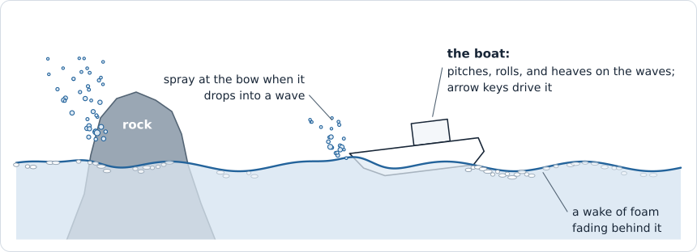

# 32 — A Boat

**Goal:** a boat in the sea of Chapters 30 and 31. It floats on the waves,
pitching and rolling as they pass under it, moved as one rigid body by a
compute shader that reads the same water the surface is drawn from. The arrow
keys drive it: its bow throws Chapter 31's spray when it drops into a wave, it
leaves a wake of foam in Chapter 31's local foam map, and a camera can follow
it.

**ROADMAP:** step 21+ — Chapter 31's demo, grown, in `Source/PillowFort/Demos/Sea/`
with one more shader under `Shaders/Sea/`. The boat's model,
`Assets/Scenes/Boat.usda`, is there already: Chapter 31's script wrote it, and it
ships on `start`.

**Module:** still `pf::demos::sea`, and still Chapter 31's `SeaObjects`: the boat
is one more thing in the sea, read through the same probe set. `SeaDemo.cpp`
changes in `Update` and `Record` to admit the shared step and commit its
clock; `SeaDemo.h` gains the clock declarations. Section 3 also connects
input and the follow camera. The engine does not change.

**Math:** taught where it is first used (sections 1 and 2) and listed in the
index's [The math, chapter by
chapter](../VulkanTutorial.md#the-math-chapter-by-chapter).

**Prerequisites:**

- Builds on Chapter 31, built and running. The boat is one more thing in
  `SeaObjects`, read through the same probe set, and each edit says where it
  goes.
- Chapter 10, sections [3](10-Cameras-And-Depth.md#3-where-a-thing-is-transform)
  (a `Transform`'s quaternion),
  [6](10-Cameras-And-Depth.md#6-turning-a-camera-yaw-pitch-and-the-orbit-controller)
  and [12](10-Cameras-And-Depth.md#12-both-controllers-and-their-panel) (the
  orbit controller, and `Select`, which changes controllers without a jump), and
  [section 8](10-Cameras-And-Depth.md#8-the-cube-field)'s box on normals and the
  cross product.
- [Chapter 21, section 3](21-GPU-Particles.md#3-the-passes): semi-implicit
  Euler, and the exponential that closes a gap by a fraction every step.
- [Chapter 20, section 9](20-Compute-Fundamentals.md#9-reading-results-back-without-stalling):
  reading results back without stalling, which is how the CPU learns where the
  boat is.
- [Chapter 9, section 7](09-Demo-Harness.md#7-sandboxgame-the-list-the-picker-and-the-loop):
  a frame's `deltaSeconds` is capped at a tenth of a second, before the sea's
  time scale is applied.
- [Chapter 4, section 5](04-Commands-And-Synchronization.md#5-barriers-and-the-three-questions-they-answer):
  the three questions every barrier answers.

---

## Where this is going



Chapter 31's rock asked the sea where the water was and threw spray. The boat
asks the same question at twelve points under its hull, and the answers lift it.
It is a different kind of thing to put in the sea: the rock never moves, and
the boat is nothing *but* motion, worked out every frame from the water under it.

Chapter 31's GPU frame, with this chapter's additions marked *new*. Section 2
adds CPU admission before readback or any of this recorded work:


### What you are actually writing

The boat is spread over files Chapter 31 wrote, so there is no class map of its
own: each edit below says where it goes. The files are
`SprayTypes.h` (the boat's state, flags, sample counts and step budget),
`SeaObjects.h` and `SeaObjects.cpp`, `SprayImpact.comp.glsl`, `SeaProp.vert.glsl` and `SeaPropShadow.vert.glsl`
and `SeaDemo.h`/`SeaDemo.cpp`; `SeaBoat.comp.glsl` is new.

Appendix A prints `RecordSimulation`, the function the boat touches in the most
places, as it ends.

---

<a id="boat-floating"></a>

# Part 1 — Floating (sections 1–2)

Part 1 puts the boat in the sea and lets the sea move it: first the push that
holds it up, then everything that turns that push into motion.

## 1. Floating


### Archimedes, a column at a time

A body in water is pushed up by the **weight of the water it pushes aside**.
That is Archimedes' principle, and it is the whole of floating: a boat sinks
until the water it displaces weighs as much as the boat.

$$
F = \rho \, g \, V
$$

ρ is the water's density, 1025 kg/m³ for sea water; *g* is 9.81 m/s²; *V* the
volume under the water. A hull's submerged volume is an awkward shape, and it
changes every frame as the waves pass. So the hull is cut into **columns**:
twelve points spread over the bottom of the hull, each standing for 1.2 m² of
it. A column is as deep as the water above its point, so its volume is 1.2 m²
times that depth, and its push is up, at the point:

$$
F_i = \rho \, g \, A \, d_i
$$

A worked example. The boat weighs 4000 kg, `4000 × 9.81 = 39,240` N. For the
twelve columns to carry it, their depths must add up to
`39,240 / (1025 × 9.81 × 1.2) = 3.25` m: 0.27 m each, on level water. So at
rest the boat sits with its bottom 27 cm under the water. Push it down 10 cm and
every column gains `1025 × 9.81 × 1.2 × 0.1 = 1207` N, 14.5 kN in all, which
pushes it back up; lift it and it falls. A wave under the bow deepens the bow's
columns and not the stern's, and the bow rises.

A column is never deeper than the hull is high, 1.1 m: past that the deck is
under water, and a deck under water pushes aside nothing more. The depth is
also never negative: a point out of the water pushes nothing.

### Where the boat lives: on the GPU or the CPU

A boat floating on a sea is usually a CPU job: game code wants to know where
the boat is, and C++ is easier to write and to step through than a shader. The
boat here is moved on the GPU instead. Both work; they cost different things.

- **On the CPU**, the boat needs the water's height under its twelve points
  every frame. The water is three 256 × 256 FFTs made on the GPU this frame.
  The CPU can get it two ways. It can read the heights back (a small compute
  pass that samples the twelve points, then Chapter 20, section 9's readback),
  and they arrive a frame or two late: the boat floats on the sea of two frames
  ago, while the surface is drawn as it is now. At 60 frames a second that is
  33 ms and hardly shows; at 10 frames a second it is a fifth of a second, and
  the boat visibly sinks into crests and hangs over troughs. Or the CPU can
  run the same spectrum and FFTs itself. That doubles the simulation work, and
  the CPU's sea must use the same seed and match the GPU's numbers closely
  enough that the boat does not float on a slightly different sea; what that
  costs is worth measuring before it is ruled out.
- **On the GPU**, one invocation moves the boat in the same command buffer,
  right after the maps are made, so its height samples use the same frame's
  maps as the water draw. The drawn mesh still approximates those maps between
  vertices, as the troubleshooting table notes. The cost is that now the *CPU* learns where the boat is a frame or
  two late, by the same readback. The camera that follows the boat and the panel
  can live with that (section 3). Game logic that must react to the boat at
  once could not.

This chapter picks the GPU, so the boat reads this frame's maps and waits on no
readback: the height data has no additional CPU-readback delay. That is a choice for
this demo, not a claim that boats or FFTs belong on the GPU in every project. A
game whose code needs the boat would take the first way, read the heights back,
and hide the lag; the chapter's closing
[Where to go from here](#where-to-go-from-here) comes back to it. One invocation
leaves almost all of a GPU idle, which would be a waste for big work; the boat's
is bounded: four to sixteen steps of twelve hull height queries.

> **Jump:** until now, everything the GPU kept from frame to frame was a picture
> (a map, a cube) or a pile of particles that nobody needed one at a time. The
> boat is one object whose position *only the GPU* knows when it matters. Keep in
> mind from here that the CPU's idea of where the boat is, in the panel and for
> the camera, is always a frame or two behind, and that nothing on the CPU can
> push the boat directly: it can only pass the GPU settings, like the throttle.

### The boat

The boat is `Assets/Scenes/Boat.usda`, written by the same script as the rock
(Chapter 31's Appendix B): an open boat 6.2 m long and 2.4 m wide, a hull of
seven flat side panels joined to a narrower flat bottom, a wooden deck, and a
cabin, its bow pointing along −Z. **Its origin is its centre of mass**, low in
the hull where the engine would be: the keel 0.25 m below it, the deck 0.85 m
above. Section 2 shows why that height matters.

Chapter 31's `LoadProp` can load it once a part can say that it belongs to the
boat. The GPU decides where the boat is, so the boat's parts are drawn
differently from the rock's (section 2). `PropPart` gains a flag, after
`doubleSided`,

```cpp
    bool      boat = false;           // Chapter 32 section 2: placed by the GPU's boat state, on top of `model`
```

`LoadProp` gains a third parameter, `bool boat`, after `placement`, in its
declaration in `SeaObjects.h` and in its definition, whose first line now reads:

```cpp
InitializationResult SeaObjects::LoadProp(const std::filesystem::path& file, const glm::mat4& placement, bool boat)
```

It copies it into every part it makes, after `.doubleSided`:

```cpp
            .boat    = boat,
```

In `SeaObjects::Initialize`, the rock's call passes `false`, and the boat is
loaded after it, with no placement of its own:

```cpp
    // Section 2: the rock where SprayTypes.h says it stands. Chapter 32: the boat, where its state puts it.
    const glm::mat4 rockPlacement = glm::translate(glm::mat4(1.0f), glm::vec3(SPRAY_ROCK_X, SPRAY_ROCK_Y, SPRAY_ROCK_Z));
    if (auto result = LoadProp(scenesDirectory() / "Rock.usda", rockPlacement, false); !result) { return result; }
    if (auto result = LoadProp(scenesDirectory() / "Boat.usda", glm::mat4(1.0f), true); !result) { return result; }
```

It starts 25 m to the right of the rock and 30 m nearer the camera's start,
pointing away from the camera. At the top of `SeaObjects.cpp`, after
`ObjectReadback`:

```cpp
// Chapter 32 section 1: where the boat starts, and which way it points, in radians about +Y: 0 points its bow
// along -Z, as the camera starts. 25 m to the right of the rock and 30 m nearer the camera.
constexpr glm::vec4 BOAT_START{ 25.0f, 0.0f, -40.0f, 0.0f };
```

The panel can take the boat out of the sea (section 3 adds its checkbox), so
`SeaObjectSettings` gains, after `foamFade`:

```cpp
    bool  boat           = true;     // Chapter 32 section 1: the boat is in the sea
```

### The boat's state

Where the boat is and how it moves stays on the GPU from frame to frame, in a
buffer the boat pass reads and writes. Its layout is a twin, in `SprayTypes.h`
after `SprayRequest`; section 2 says what each field is for:

```cpp
/* Chapter 32 section 1. The boat, as the GPU keeps it from frame to frame (std430, 144 bytes). */
struct BoatState
{
    mat4 model;                 /*   0: boat to world, for its vertex shader */
    vec4 position;              /*  64: xyz its middle, metres; w unused */
    vec4 orientation;           /*  80: a unit quaternion, xyz then w */
    vec4 velocity;              /*  96: xyz metres per second; w unused */
    vec4 angularVelocity;       /* 112: xyz radians per second, about world axes; w unused */
    vec4 status;                /* 128: x the hull's fraction under water; y speed, m/s; zw unused */
};
```

with its size checked beside the others,

```cpp
    static_assert(sizeof(BoatState) == 144, "BoatState layout drifted.");
```

and a flag that tells the passes the boat is in the sea, after
`SPRAY_FLAG_RESET`, whose comment now says what a reset does to the boat:

```cpp
#define SPRAY_FLAG_RESET 1u     /* put the boat back at its start, forget last frame's samples and foam */
#define SPRAY_FLAG_BOAT  2u     /* the boat is in the sea */
```

The buffer is a member beside Chapter 31's two,

```cpp
    vulkan_graphics::AllocatedBuffer m_boatState;   // BoatState (Chapter 32 section 1)
```

and `CreateBuffersAndImages` makes it after them, and its check names it too. The
comment above the buffers counts three now, the boat the third; after the
`m_requests` line:

```cpp
    m_boatState = createBuffer(m_context.vulkan, sizeof(BoatState),
                               VK_BUFFER_USAGE_STORAGE_BUFFER_BIT | VK_BUFFER_USAGE_TRANSFER_SRC_BIT, false);
```

and the `if` below the three becomes:

```cpp
    if (m_probes.buffer == VK_NULL_HANDLE || m_requests.buffer == VK_NULL_HANDLE || m_boatState.buffer == VK_NULL_HANDLE)
```

It is a storage buffer, like the probes, and a transfer source as well, because
section 3 copies it out for the CPU. `Shutdown` destroys it beside the others:

```cpp
    destroyBuffer(m_context.vulkan, m_boatState);
```

**The probe set's binding 4.** Chapter 31, section 4 left binding 4 free for
this. The boat pass reads and writes the state there, the impact pass reads it
from section 3 on to place the boat's sample points, and the boat's two vertex
shaders, the drawn one and the shadow one, read it to draw the boat where the
GPU put it (section 2). So it is the one binding visible to the vertex stage as
well. In `CreateProbeSet`, the
binding goes between 3 and 5,

```cpp
        { 4, VK_DESCRIPTOR_TYPE_STORAGE_BUFFER,         1, compute | VK_SHADER_STAGE_VERTEX_BIT, nullptr },
```

and Chapter 20, section 4's helper counts it into the pool, now three storage
buffers, with nothing else to change. The buffer goes beside the other two,

```cpp
    const VkDescriptorBufferInfo boat{ m_boatState.buffer, 0, VK_WHOLE_SIZE };
```

and its write between binding 3's and binding 5's:

```cpp
        { .sType = VK_STRUCTURE_TYPE_WRITE_DESCRIPTOR_SET, .dstSet = m_probeSet, .dstBinding = 4, .descriptorCount = 1,
          .descriptorType = VK_DESCRIPTOR_TYPE_STORAGE_BUFFER, .pBufferInfo = &boat },
```

### The boat pass

Section 2 writes the boat pass, `Shaders/Sea/SeaBoat.comp.glsl`, whole, once
the rigid body's pieces are in place. What it does with the columns is this
section's: for each of the twelve points under the hull, it turns the point
from the boat's own space into the world, asks Chapter 31, section 3's
`seaHeight` for the water above it, and takes the depth of the point under that
water, clamped to between 0 and the hull's 1.1 m; the column's push is
`ρ g A` times that depth, straight up, at the point. Everything else in the
pass turns twelve such pushes into one motion.

The pass's pipeline is the table of passes' fourth row, after the resolve's,

```cpp
        { &m_boatPipeline,   "Sea/SeaBoat.comp.spv" },         // Chapter 32 section 1
```

with its member beside the other three compute pipelines, and destroyed with them:

```cpp
    VkPipeline            m_boatPipeline   = VK_NULL_HANDLE;   // Chapter 32
```

```cpp
    VkPipeline* pipelines[] = { &m_boatPipeline, &m_resolvePipeline, &m_fadePipeline, &m_impactPipeline };
```

It runs in `RecordSimulation` as step 3, the gap Chapter 31 left for it, after
the fade's dispatch and before the fade's barrier. The two touch nothing in
common, so the one barrier after both covers both:

```cpp
    // 3. Chapter 32 section 1: the boat moves. It touches nothing the fade does, so the two share the barrier.
    //    On the first frame it runs even with the boat out of the sea, to give its state numbers.
    if (m_settings.boat || m_reset)
    {
        vkCmdBindPipeline(commandBuffer, VK_PIPELINE_BIND_POINT_COMPUTE, m_boatPipeline);
        vkCmdDispatch(commandBuffer, 1, 1, 1);
    }
    computeToComputeBarrier(commandBuffer);
```

It runs while the "Boat" setting is on. On the frame after a reset it runs
anyway, on or off, so that the boat's state holds a real boat, at rest at its
start, before anything reads it.

`PackSpray` passes the start and the flag. The start, after the weights,

```cpp
        .boatStart      = BOAT_START,
```

and the flag as the second half of the flags, which lose their comma:

```cpp
        .flags          = (m_reset ? SPRAY_FLAG_RESET : 0u)
                        | (m_settings.boat ? SPRAY_FLAG_BOAT : 0u),
```

## 2. One rigid body

### What the boat's state is

A rock does not move. A boat moves as one solid thing: a **rigid body**. Where
a rigid body is takes two things, its position and its orientation, and how it
moves takes two more, its velocity and its **angular velocity**, how fast it
turns and about which axis, as one arrow whose length is the turning speed in
radians per second. The GPU keeps all four from frame to frame in `BoatState`
(section 1), with two more things the pass writes for others: the boat's model
matrix, for its vertex shader, and its status, for the panel.

The orientation is a quaternion, Chapter 10, section 3's box that holds a
rotation. `rotationMatrix` turns it into a 3 × 3 rotation matrix, the formula
glm uses inside `glm::mat3_cast`, written out because GLSL has no quaternions.

### Force and torque

Every frame the columns push, gravity pulls, the water drags, and, from section
3, the engine drives. Each force does two things to a rigid body.

- **It moves it.** All the forces add up, wherever they act, and the sum
  divided by the mass is the acceleration: Newton's `a = F / m`, as for Chapter
  21's particles.
- **It turns it,** unless it acts through the centre of mass. How hard a force
  twists the body is its **torque**: the cross product of the arrow from the
  centre to where the force acts, *r*, and the force, *F*:

$$
\tau = r \times F
$$

The cross product is Chapter 10, section 8's: an arrow at right angles to both,
by the right-hand rule, as long as the push times the lever arm. Its direction
is the axis the force turns the body about. A worked example. A wave lifts the
bow so that the middle bow column, at `r = (0, −0.25, −2.2)` from the centre,
is 0.27 m deeper than the rest: an extra `F = (0, 3258, 0)` N. Then

$$
\tau = r \times F = (r_y F_z - r_z F_y,\; r_z F_x - r_x F_z,\; r_x F_y - r_y F_x) = (7168, 0, 0) \text{ N m}
$$

a twist about +X, the boat's sideways axis. By the right-hand rule that turns
−Z, the bow, upward: the bow rises, as it should.

How fast a torque turns the body depends on its **moment of inertia**, *I*, how
hard the body is to turn about that axis; the angular acceleration is `τ / I`,
as acceleration is `F / m`. A long boat is harder to turn end over end than
about its length. A solid box of mass *m* whose sides across the axis are *a*
and *b* has `I = m (a² + b²) / 12`: for 4000 kg the boat's size, 6.2 m long,
2.4 m wide, and 1.1 m deep, that is about 13,000 kg m² for pitching, 14,700 for
turning left and right, and 2300 for rolling. The boat's own numbers are close
to the box's — 12,400, 13,900, and 4000 — with roll raised. With the box's
2300, the columns would roll the boat back and forth in about one and a half
seconds; 4000 slows that to about two, as a real boat of this size rolls.
The bow's 7168 N m pitches the boat at `7168 / 12,400 = 0.58` rad/s².

The three numbers are about the boat's own axes, which turn with it. So the
torque is turned into the boat's axes, divided by the three numbers, and the
answer turned back into the world's. A rotation matrix's **transpose** turns
the other way (its rows are its columns), which is what `transpose(rotation)`
does.

This demo then approximates angular acceleration as `I_world^-1 * torque`.
It omits the gyroscopic term: the full world-space equation is
`I_world^-1 * (torque - cross(omega, I_world * omega))`. The distinction matters
for fast rotation about mixed axes of a nonspherical body; torque-free motion
need not keep angular velocity fixed. The damped boat is not a general
rigid-body solver. [Baraff's unconstrained-body notes](https://www.cs.cmu.edu/~baraff/sigcourse/notesd1.pdf),
sections 2.9–2.11, explain the angular-momentum formulation behind that boundary.

### Where the centre of mass is

The boat's origin, and so the point the twelve columns are measured from, is
its centre of mass, 0.25 m above the keel. That height decides whether the boat
rights itself. When the boat rolls, the columns on the low side deepen and push
harder, the high side's less, and that twists it back upright. But the points are
below the centre, so as the boat rolls they also swing sideways, toward the high
side, and their push, now off to that side, twists the other way. The further
below the centre the points are, the further they swing. A hull is as stable as
its weight is low, which is why real boats carry their engine and ballast deep.

### Drag

Water resists anything moving through it, harder sideways than lengthways for a
hull: a keel slips forward and bites sideways, which is what keeps a boat
going where it points. Each column drags against its own point's velocity. A
point that is *r* from the centre of a body turning at ω moves at right angles
to both the axis and the arm, faster the further out it is: that velocity is
the cross product `ω × r`. Two metres from the centre of a boat yawing at
0.5 rad/s, a point moves at 1 m/s. So a column's velocity is the boat's
velocity plus `ω × r`, and its drag is in proportion to that velocity and to
how wet the column is, weighted by direction in the boat's axes: full in x and
y, a tenth along z, the boat's length. It grows linearly with speed, where real
water's drag grows nearer its square; linear keeps the step simple and the top
speed easy to predict (section 3). Its torque comes with it, by the same cross
product. Drag also calms
the boat: it takes energy out of every bob and roll, so the waves do not rock it
harder and harder.

This drag uses a **world-stationary water reference**: the shader damps
`v + ω × r`, without subtracting a fluid velocity. Wave height drives the
buoyancy, but this term is an authored resistance to the hull's world motion.
It is not a general drag law relative to a moving current. Chapter 31's `flow`
proxy is not a material-water velocity to substitute into that law.

### One step, and smaller steps

The step forward in time is Chapter 21, section 3's semi-implicit Euler, for
turning as for moving: the velocities first, from the accelerations, then the
position and orientation from the new velocities.

The orientation is a quaternion, and turning a quaternion by an angular
velocity ω for a short time *h* is

$$
q \leftarrow \operatorname{normalize}\!\left(q + \tfrac{h}{2}\,(\omega, 0)\,q\right)
$$

> **Jump:** this is the one formula in the chapter used without being derived.
> Hold on to two facts: `(ω, 0)` is ω written as a quaternion with a 0 in its
> fourth place — not a rotation, just four numbers — and the product with *q*
> is the quaternion product, `quaternionMultiply`. What the formula says is
> that a small turn by an angle θ about an axis is close to the quaternion
> `(axis × θ / 2, 1)`, and applying it to *q* adds that half-angle part times
> *q*. It is only close, which is why the result is normalized. Baraff's notes
> in Sources derive it.

A worked example. A boat at rest, `q = (0, 0, 0, 1)`, turning about +Y at
ω = 0.5 rad/s, for one step of *h* = 0.025 s:
`(h / 2) (ω, 0) q = 0.0125 × (0, 0.5, 0, 0) = (0, 0.00625, 0, 0)`, and the new
`q = (0, 0.00625, 0, 1)`, normalized `(0, 0.00625, 0, 0.99998)`. A quaternion
`(0, sin(θ/2), 0, cos(θ/2))` is a turn of θ about +Y, so θ = 2 × 0.00625 =
0.0125 rad, which is ω × *h*.

**Why bound the simulated step.** The columns act like springs: moving the
boat down 1 cm adds about 1450 N of lift. With mass 4000 kg, the calm heave
frequency is about `sqrt(145000 / 4000) = 6` rad/s. The undamped scalar spring
has a semi-implicit Euler stability limit near 0.33 s; explicit drag tightens
that limit, and the full boat also rotates, changes wetness and meets contact.
That scalar estimate is a warning about large steps, not a safe full-body bound.

Chapter 9 caps the raw frame at 0.1 s, but the sea multiplies it by **Time
scale**. The panel's slider stops at 4 (Chapter 30, section 3), so the largest
simulated delta it allows is 0.1 s × 4 = 0.4 s. A caller outside the panel can
pass a larger scale, though, and four fixed cuts would give `h = 0.4 s` at
scale 16 on such a frame: the frame cap alone does not protect the body. We
choose a **0.025 s target** for accuracy, preserving the old four cuts through
a simulated delta of 0.1 s. Longer admitted deltas use
`max(4, ceil(delta / 0.025))` cuts, up to 16. Thus a 0.4 s simulated delta,
the panel's worst case, uses exactly 16 cuts; a larger request is rejected before
clock advance or recording when the boat pass runs, including a reset while
the boat is hidden. This fixes the work budget at 192 hull height queries.
The target is a conservative local choice, not a proof for changed hull constants.

All cuts sample the one set of sea maps already made for this frame. They
refine integration in a frozen water field; they neither regenerate waves
at intermediate times nor feed hull forces back into the FFT. The admitted
delta advances waves and body together; excess time is reported rather than
silently dropped from one clock. More cuts do not resolve fast-changing waves
between render frames.

### The rock

The boat must not sail through the rock. After each step, if its centre is
closer to the rock's middle than the radius of the rock's waterline circle
(`SPRAY_ROCK_WATERLINE`, 6.3 m) plus 2.5 m, about half the boat,
it is put back on that circle, and whatever of its velocity points into the
rock is taken away. It is a wall, not a collision: no bounce, no spin. Enough
to keep the boat out.

### Supplied support: admit the shared step before recording

The force/integration attempt below needs this input boundary. It is supplied
plumbing, so the attempt can focus on the body. Complete it before building
the section 2 shader. The two host variants are named explicitly: use the
written recipe with Chapter 30's single-class `SeaDemo`, or keep the complete
assembled host from the current-reference link; their clock caches have
different owners.

<details>
<summary>Supplied implementation: bounded body cuts and shared clock admission</summary>

**The shared header.** Add these constants after `SPRAY_MAX_IMPACT` in
`SprayTypes.h`:

```cpp
/* Chapter 32. Preserve four ordinary cuts; refine longer admitted steps within a fixed work budget. */
#define SPRAY_BOAT_MIN_SUBSTEPS 4u
#define SPRAY_BOAT_MAX_SUBSTEPS 16u
#define SPRAY_BOAT_TARGET_STEP  0.025f  /* simulated seconds; accuracy target, not a universal stability bound */
```

Rename only the reserved uint at byte 88 in `SprayParameters`, leaving the
96-byte layout and byte 92 padding intact, and add its offset assertion beside
the others:

```cpp
    uint  boatSubsteps;          /*  88: Chapter 32's checked integration count, 4..16 */
```

```cpp
    static_assert(offsetof(SprayParameters, boatSubsteps) == 88, "Boat substep alignment drifted.");
```

**The owner boundary.** `SeaObjects.h` gains a public read-only preflight
beside `RecordSimulation`; its private `PackSpray` gains the checked count:

```cpp
    InitializationResult ValidateSimulation(float deltaTime) const;
```

In the private declarations, replace the old `PackSpray` declaration with:

```cpp
    SprayParameters PackSpray(const SeaParameters& sea, uint32_t boatSubsteps) const;
```

Change `PackSpray`'s definition to the same two-argument signature and add
`.boatSubsteps = boatSubsteps,` after `.flags` in its returned initializer.
Keep section 1's start/boat flag. After Chapter 31's `validateSprayInputs`
helper in `SeaObjects.cpp`, add the shared planner and preflight below.
`<algorithm>`, `<cmath>` and `<limits>` are already present. The planner checks
before `ceil` is converted to uint and publishes the count only on success.
The command values are zero at this stage; section 3 replaces them when it
adds the throttle and rudder members.

```cpp
static InitializationResult planSimulation(const SeaObjectSettings& settings, float deltaTime,
                                            float throttle, float rudder, bool reset, uint32_t& boatSubsteps)
{
    if (auto result = validateSprayInputs(settings, deltaTime); !result) { return result; }
    if (!std::isfinite(throttle) || throttle < -0.5f || throttle > 1.0f ||
        !std::isfinite(rudder) || rudder < -1.0f || rudder > 1.0f)
    {
        return InitializationResult::failure("Boat throttle must be in [-0.5,1] and rudder in [-1,1], both finite.");
    }
    uint32_t cuts = SPRAY_BOAT_MIN_SUBSTEPS;
    if (settings.boat || reset)
    {
        const double target = static_cast<double>(SPRAY_BOAT_TARGET_STEP);
        const double maximum = target * SPRAY_BOAT_MAX_SUBSTEPS;
        if (static_cast<double>(deltaTime) > maximum)
        {
            return InitializationResult::failure("Boat delta time exceeds the 16-step integration budget (0.4 s); reduce the sea time scale.");
        }
        // The admission above bounds ceil before conversion. Ordinary steps keep four cuts.
        cuts = std::max(SPRAY_BOAT_MIN_SUBSTEPS,
                        static_cast<uint32_t>(std::ceil(static_cast<double>(deltaTime) / target)));
    }
    boatSubsteps = cuts;   // publish a plan only after every check succeeded
    return InitializationResult::success();
}

InitializationResult SeaObjects::ValidateSimulation(float deltaTime) const
{
    uint32_t boatSubsteps = 0;
    return planSimulation(m_settings, deltaTime, 0.0f, 0.0f, m_reset, boatSubsteps);
}
```

In `RecordSimulation`, replace its old validation and `PackSpray` lines with
this prefix, immediately after its opening brace. All numbered commands and
the final success return stay in place:

```cpp
    uint32_t boatSubsteps = 0;
    if (auto result = planSimulation(m_settings, sea.deltaTime, 0.0f, 0.0f, m_reset, boatSubsteps); !result) { return result; }
    const SprayParameters spray = PackSpray(sea, boatSubsteps);
```

**The written host clock.** Chapter 30's full `SeaDemo` keeps `m_time` and
`m_deltaTime` because its packing/wave helpers read them. Treat them now as
the admitted frame packet; add these two members beside them:

```cpp
    float m_committedTime = 0.0f;       // authoritative shared simulation clock
    float m_frameDeltaSeconds = 0.0f;   // raw frame input awaiting admission
```

At the end of `SeaDemo::Update`, replace the two old clock lines
(`m_deltaTime = ...` and `m_time += ...`) with:

```cpp
    m_frameDeltaSeconds = input.deltaSeconds;
```

In `SeaDemo::Record`, keep Chapter 30's settings/constants guards first, then
insert the following **before** `m_objects.ReadResults`, timestamps, or any
recorded work. It rounds the checked product to the actual float delta before
adding to the clock, preserving ordinary multiply-then-add rounding. Move an
earlier `ReadResults` call after this prefix if you put it at the head of
`Record` in Chapter 31.

```cpp
    const float scale = m_settings.timeScale;
    if (!std::isfinite(m_frameDeltaSeconds) || m_frameDeltaSeconds < 0.0f ||
        !std::isfinite(scale) || scale < 0.0f || !std::isfinite(m_committedTime) || m_committedTime < 0.0f)
    {
        return InitializationResult::failure("Sea frame delta, time scale and clock must be finite and nonnegative.");
    }
    const double scaled = static_cast<double>(m_frameDeltaSeconds) * static_cast<double>(scale);
    if (scaled > std::numeric_limits<float>::max())
    {
        return InitializationResult::failure("Sea scaled delta time exceeds the finite float domain.");
    }
    const float deltaTime = static_cast<float>(scaled);
    const double advanced = static_cast<double>(m_committedTime) + static_cast<double>(deltaTime);
    if (advanced > std::numeric_limits<float>::max())
    {
        return InitializationResult::failure("Sea clock advance exceeds the finite float domain.");
    }
    const float time = static_cast<float>(advanced);
    if (auto result = m_objects.ValidateSimulation(deltaTime); !result) { return result; }
    m_time = time;          // admitted packet for this single-class host's existing helpers
    m_deltaTime = deltaTime;
```

The rest of the written Record reads the same packet as before. At its very
end, immediately before the final `return InitializationResult::success();`,
add:

```cpp
    m_committedTime = time;
```

An admission failure changes neither the committed clock nor the admitted
packet and consumes no readback. Later recording failures do not commit the
authoritative clock; this is not rollback of every owner or a retry promise.
The renderer stops on failed recording and submits none of that frame's
commands.

**Current extracted reference.** The complete
[SeaDemo.cpp](https://github.com/ZevosSky/PillowFort-private/blob/reference-main/Source/PillowFort/Demos/Sea/SeaDemo.cpp) instead keeps its
`m_time` authoritative and passes local candidates to `SeaSurface::RecordCompute`,
which owns the admitted packet cache. It performs the same preflight before
readback/Sea/Sky and commits after its fallible recording succeeds. Copy that
host as one unit when using the extracted owner; do not add `m_committedTime`
to it. `SeaSurface` itself keeps its wider finite/nonnegative time-scale API:
the body budget belongs to `SeaObjects`. The existing Time scale slider is
clamped to its 0..4 authoring range even when typed.

</details>

### The whole pass

**This is `Shaders/Sea/SeaBoat.comp.glsl`, as section 2 has it**. It is the
worked solution of the attempt below: sections 1 and 2 hold every piece, so
try writing it from them first.

<a id="ch32-a-floating-body-with-a-measurable-equilibrium"></a>

### Attempt CH32-a-floating-body-with-a-measurable-equilibrium: a floating body with a measurable equilibrium

Float the boat using the sea lookup you already verified. Derive the displaced volume at rest (section 1's 0.27 m draft) before choosing the drag, then add torque and orientation so a tilted hull can recover. Keep the worked solution closed until you have a prediction or an attempt.

**Acceptance:** In calm water the hull settles with its bottom about 0.27 m
under, a quarter of its 1.1 m height; with no keys held it does not start turning
by itself, a reset produces finite numbers, and a tilt dies away instead of
growing. The supplied boundary admits 0.4 s with 16 cuts and rejects a larger
body step before clock advance or commands.

The boundary part is a CPU/API check, separate from normal panel motion.
The current reference's [actual-method checks](https://github.com/ZevosSky/PillowFort-private/blob/reference-main/Tests/TutorialHarness/MirrorBatchTests.cpp)
cover it; use the [guarded harness instructions](https://github.com/ZevosSky/PillowFort-private/blob/reference-main/Tests/TutorialHarness/README.md)
and check [execution status](https://github.com/ZevosSky/PillowFort-private/blob/reference-main/ROADMAP.md#status) before treating it as run.

**Transfer:** Change the boat's mass or a column's area and predict the new
draft before running. Reassess the motion and step target too: those changes
alter the dynamics. A different asset needs a matching hull sampling
description, not just a filename change.

<details>
<summary>Hint 1: the idea</summary>

Buoyancy is displaced water's weight, not an arbitrary upward spring attached to the object's origin.

</details>

<details>
<summary>Hint 2: the data and coordinates</summary>

Sample a bounded set of hull columns, sum their force and torque about the centre of mass, and keep the hull geometry approximation explicit.

</details>

<details>
<summary>Hint 3: a concrete route</summary>

Integrate linear and angular state with bounded substeps and normalize orientation; begin with the calmest sea Chapter 30's panel allows (Swell unticked, the lowest wind speed and "Energy x") and no engine before enabling waves.

</details>

[Complete reference](https://github.com/ZevosSky/PillowFort-private/blob/reference-main/Shaders/Sea/SeaBoat.comp.glsl) includes section 3's engine and rudder; the worked listing below is this step's solution.

<details>
<summary>Worked solution: a floating body with a measurable equilibrium</summary>

```glsl
// Shaders/Sea/SeaBoat.comp.glsl - one invocation moves the boat by one frame (Chapter 32): buoyancy
// at points under its hull (section 1), drag and a rigid body's motion (section 2), and the engine
// and the rudder (section 3). It runs on the GPU because the water it floats on is there.
#version 450
#extension GL_GOOGLE_include_directive : require
#include "SprayTypes.h"
#include "SeaWater.glsl"   // set 0, bindings 0-2: the sea's displacement maps

layout(local_size_x = 1) in;

layout(set = 0, binding = 4, std430) buffer BoatBuffer { BoatState boat; };

layout(push_constant) uniform PushConstants
{
    SprayParameters spray;
};

const float GRAVITY       = 9.81;      // m/s^2
const float WATER_DENSITY = 1025.0;    // kg/m^3, sea water
const float BOAT_MASS     = 4000.0;    // kg
const vec3  BOAT_INERTIA  = vec3(12400.0, 13900.0, 4000.0);   // kg m^2 about its own x (pitch), y (yaw), z (roll)
const float HULL_DEPTH    = 1.1;       // metres from the keel to the deck: no column is deeper
const float POINT_AREA    = 1.2;       // m^2 of hull bottom each point stands for
const float DRAG          = 3000.0;    // N per (m/s) per m^2 of fully submerged hull
const vec3  DRAG_SHAPE    = vec3(1.0, 1.0, 0.1);   // sideways, up and down, and lengthways: a hull slips forward

// Twelve points under the hull, in the boat's own space: bow along -Z, the keel at y = -0.25. The
// origin is the boat's centre of mass, low in the hull where the engine sits.
const vec3 HULL_POINTS[12] = vec3[](
    vec3(-0.5, -0.25, -2.2), vec3(0.0, -0.25, -2.2), vec3(0.5, -0.25, -2.2),
    vec3(-0.8, -0.25, -0.8), vec3(0.0, -0.25, -0.8), vec3(0.8, -0.25, -0.8),
    vec3(-0.8, -0.25,  0.6), vec3(0.0, -0.25,  0.6), vec3(0.8, -0.25,  0.6),
    vec3(-0.8, -0.25,  2.0), vec3(0.0, -0.25,  2.0), vec3(0.8, -0.25,  2.0));

// Section 2: a quaternion's rotation as a matrix (Chapter 10 section 3 used glm's).
mat3 rotationMatrix(vec4 q)
{
    float x = q.x, y = q.y, z = q.z, w = q.w;
    return mat3(1.0 - 2.0 * (y * y + z * z), 2.0 * (x * y + w * z),       2.0 * (x * z - w * y),
                2.0 * (x * y - w * z),       1.0 - 2.0 * (x * x + z * z), 2.0 * (y * z + w * x),
                2.0 * (x * z + w * y),       2.0 * (y * z - w * x),       1.0 - 2.0 * (x * x + y * y));
}

// The product of two quaternions: a turn by b, then by a.
vec4 quaternionMultiply(vec4 a, vec4 b)
{
    return vec4(a.w * b.xyz + b.w * a.xyz + cross(a.xyz, b.xyz), a.w * b.w - dot(a.xyz, b.xyz));
}

void main()
{
    if ((spray.flags & SPRAY_FLAG_RESET) != 0u)
    {
        // At its start, pointing along its heading, at rest.
        float heading        = spray.boatStart.w;
        boat.position        = vec4(spray.boatStart.xyz, 0.0);
        boat.orientation     = vec4(0.0, sin(0.5 * heading), 0.0, cos(0.5 * heading));
        boat.velocity        = vec4(0.0);
        boat.angularVelocity = vec4(0.0);
    }

    vec3  position        = boat.position.xyz;
    vec4  orientation     = boat.orientation;
    vec3  velocity        = boat.velocity.xyz;
    vec3  angularVelocity = boat.angularVelocity.xyz;
    float underwater      = 0.0;
    uint substeps         = clamp(spray.boatSubsteps, SPRAY_BOAT_MIN_SUBSTEPS, SPRAY_BOAT_MAX_SUBSTEPS);
    float h               = spray.deltaTime / float(substeps);

    for (uint substep = 0u; substep < substeps; ++substep)
    {
        mat3 rotation = rotationMatrix(orientation);
        vec3 force    = vec3(0.0, -BOAT_MASS * GRAVITY, 0.0);   // its weight, at its middle
        vec3 torque   = vec3(0.0);
        underwater    = 0.0;

        // 1. Buoyancy and drag at each point: Archimedes, a column at a time.
        for (int i = 0; i < 12; ++i)
        {
            vec3  offset = rotation * HULL_POINTS[i];   // from the middle to the point, in the world
            vec3  point  = position + offset;
            float depth  = clamp(seaHeight(point.xz, spray.patchSizes, spray.weights) - point.y, 0.0, HULL_DEPTH);
            float wet    = depth / HULL_DEPTH;

            // The weight of the water the column pushes aside, pushing back up.
            vec3 lift = vec3(0.0, WATER_DENSITY * GRAVITY * POINT_AREA * depth, 0.0);

            // Drag against the point's own motion, measured in the boat's axes and so easier to
            // push forward than sideways: that is what keeps a boat going where it points.
            vec3 pointVelocity = velocity + cross(angularVelocity, offset);
            vec3 localVelocity = transpose(rotation) * pointVelocity;
            vec3 drag          = -rotation * (DRAG * POINT_AREA * wet * DRAG_SHAPE * localVelocity);

            force      += lift + drag;
            torque     += cross(offset, lift + drag);
            underwater += wet / 12.0;
        }

        // 3. Section 2: semi-implicit Euler (Chapter 21 section 3), for turning as for moving. The
        //    inertia is the boat's own, so the torque goes into its axes and the answer comes back out.
        vec3 angularAcceleration = rotation * ((transpose(rotation) * torque) / BOAT_INERTIA);
        velocity        += force / BOAT_MASS * h;
        angularVelocity += angularAcceleration * h;
        position        += velocity * h;
        orientation      = normalize(orientation + 0.5 * h * quaternionMultiply(vec4(angularVelocity, 0.0), orientation));

        // 4. The rock: no closer than its waterline plus about half a boat, and no speed into it.
        vec2  fromRock = position.xz - vec2(SPRAY_ROCK_X, SPRAY_ROCK_Z);
        float reach    = SPRAY_ROCK_WATERLINE + 2.5;
        float distanceToRock = length(fromRock);
        if (distanceToRock < reach && distanceToRock > 1e-3)
        {
            vec2 away    = fromRock / distanceToRock;
            position.xz  = vec2(SPRAY_ROCK_X, SPRAY_ROCK_Z) + away * reach;
            velocity.xz -= away * min(dot(velocity.xz, away), 0.0);
        }
    }

    // What the boat's vertex shader and the spray read, this frame.
    mat3 rotation        = rotationMatrix(orientation);
    boat.model           = mat4(vec4(rotation[0], 0.0), vec4(rotation[1], 0.0), vec4(rotation[2], 0.0), vec4(position, 1.0));
    boat.position        = vec4(position, 0.0);
    boat.orientation     = orientation;
    boat.velocity        = vec4(velocity, 0.0);
    boat.angularVelocity = vec4(angularVelocity, 0.0);
    boat.status          = vec4(underwater, length(velocity.xz), 0.0, 0.0);
}
```

</details>

### The reset, and what it writes

The reset puts the boat at its start, its heading turned into a quaternion
about +Y, at rest. The last lines write what other passes and shaders read: the
model matrix — the rotation in its first three columns and the position in its
fourth, Chapter 10, section 3's translation-times-rotation — the state for next
frame, and the status, how much of the hull is wet and how fast it moves.

### Drawing the boat where the GPU put it

The boat is drawn by Chapter 31's prop pipelines, with their materials and
shadows. Only its placement differs: its vertex shaders read the model matrix
the boat pass wrote this frame and multiply the part's own transform from the
USD file by it. The `boat` field Chapter 31 reserved in `PropParameters` says
which parts take that matrix; nothing in a part's material does.

Add this declaration to **both** `SeaProp.vert.glsl` and
`SeaPropShadow.vert.glsl`, before their push blocks:

```glsl
// Set 2: the probe/boat set. Set 1 remains the ordinary material set.
layout(set = 2, binding = 4, std430) readonly buffer BoatBuffer { BoatState boat; };
```

Replace both shaders' first model line with:

```glsl
    mat4 model = prop.boat != 0u ? boat.model * prop.model : prop.model;
```

The rest of `SeaProp.vert.glsl` is unchanged: the normal still goes through the
inverse transpose of `model`, and the tangent's sign still flips for a mirrored
part. The shadow shader uses the **same matrix, this frame's from the GPU**,
not the CPU's readback from a frame or two ago, so the boat's shadow stays under
its hull while it moves, and its cutout and double-sided parts cast shadows as
Chapter 31's do.

The props' pipeline layout gains a third set: the frame at 0, the material at
1, and the probe set, with the boat's state at binding 4, at 2. In
`CreatePipelines`, the layout list and count Chapter 31's Part 1 wrote become:

```cpp
    const VkDescriptorSetLayout setLayouts[] = {
        m_sceneRenderer->FrameSetLayout(), m_sceneRenderer->MaterialSetLayout(), m_probeSetLayout };
    const VkPushConstantRange propRange{ VK_SHADER_STAGE_VERTEX_BIT, 0, sizeof(PropParameters) };
    const VkPipelineLayoutCreateInfo propLayoutInfo{
        .sType = VK_STRUCTURE_TYPE_PIPELINE_LAYOUT_CREATE_INFO,
        .setLayoutCount = 3,
        .pSetLayouts = setLayouts,
        .pushConstantRangeCount = 1,
        .pPushConstantRanges = &propRange,
    };
```

In both `RecordDraw` and `RecordShadowCasters`, bind the probe set after the
frame bind:

```cpp
    vkCmdBindDescriptorSets(commandBuffer, VK_PIPELINE_BIND_POINT_GRAPHICS, m_propLayout, 2, 1, &m_probeSet, 0, nullptr);
```

Add this at the start of both loops over the parts, so that a boat out of the
sea is neither drawn nor casts a shadow:

```cpp
        if (part.boat && !m_settings.boat) { continue; }
```

And set the `boat` field in both `PropParameters` initializers, 1 for the
boat's parts and 0 for the rock's:

```cpp
            .boat = part.boat ? 1u : 0u,
```

The shadow initializer also sets `cascade`, as Chapter 31's did, and every part
still binds its material at set 1. The two stay separate: where the boat is
comes from the GPU, while what each part looks like, and where it sits inside
the boat, still come from the imported file.

[Visible vertex solution](https://github.com/ZevosSky/PillowFort-private/blob/reference-main/Shaders/Sea/SeaProp.vert.glsl),
[shadow vertex solution](https://github.com/ZevosSky/PillowFort-private/blob/reference-main/Shaders/Sea/SeaPropShadow.vert.glsl), and
[complete recording functions](https://github.com/ZevosSky/PillowFort-private/blob/reference-main/Source/PillowFort/Demos/Sea/SeaObjects.cpp)
are ready for comparison.

Binding a set does not read anything; only a shader's use does, so binding it
while the rock draws costs nothing.

That makes the boat's state a buffer a compute shader writes and a vertex
shader reads in the same frame, which needs a hand-over. It goes in
`RecordSimulation` step 6, after the local foam's:

```cpp
    //    Chapter 32 section 2: the boat's state to the boat's vertex shader and the readback copy.
    memoryBarrier(commandBuffer,
                  VK_PIPELINE_STAGE_2_COMPUTE_SHADER_BIT, VK_ACCESS_2_SHADER_STORAGE_WRITE_BIT,
                  VK_PIPELINE_STAGE_2_VERTEX_SHADER_BIT | VK_PIPELINE_STAGE_2_COPY_BIT,
                  VK_ACCESS_2_SHADER_STORAGE_READ_BIT | VK_ACCESS_2_TRANSFER_READ_BIT);
```

It is Chapter 4's appendix row "Storage buffer written by compute, read by a
vertex shader and a readback copy (32's boat)": the boat pass's writes made
visible to the boat's `VERTEX_SHADER` and to the `COPY` that section 3 adds to
carry the state out to the CPU. Naming the copy now, before it exists, costs
nothing, and the barrier needs no change when it arrives.

This barrier is one that synchronization validation cannot prove: take
`VERTEX_SHADER` out of it and the layer stays quiet. That is not the layer
missing something. Chapter 21's end barrier, inside the spray's
`RecordSimulation`, runs after the boat pass and is a global memory barrier
from `COMPUTE_SHADER` to `DRAW_INDIRECT`, `VERTEX_SHADER`, and `COPY`: it covers
every compute write before it, the boat's state included. The boat's barrier is
kept anyway, so that the boat does not depend on what the spray happens to do;
the three questions, as that row answers them, are the argument for it.

<a id="boat-floating-checkpoint"></a>

## Checkpoint

Rerun `GenerateProjects.bat` (`SeaBoat.comp.glsl` is new), build, and run with
`--demo Sea`. Fly to the boat, 25 m to the right of the rock: from about
`(25, 3, −28)`, looking ahead. You can now see:

- **the boat**, floating with its bottom a little under the water, rising and
  falling and pitching as waves pass under it, and rolling when they pass at an
  angle;
- **nobody at the helm**: nudged by the waves, it drifts slowly toward you,
  about half a metre a second, and the drag keeps it from going anywhere
  faster. The keys do nothing yet, and its bow throws no spray;
- the rock and its spray and foam, as Chapter 31 left them. Judge them with
  "Sun sky" picked, as Chapter 31's first checkpoint does: a fresh run starts
  with the sky Off, and then the rock's shadowed face is one flat grey.

---

<a id="boat-under-way"></a>

# Part 2 — Under way (sections 3–4)

The boat floats; now it moves. Part 2 gives it an engine and a rudder on the
arrow keys, lets the hull throw Chapter 31's spray and leave a wake in its foam
map, and brings the boat's state back to the CPU for the panel and for a camera
that follows it.

## 3. Steering, spray at the bow, a wake, and a camera that follows


### The engine and the rudder

The engine pushes the boat along its bow. Its immersion proxy is the mean of
the twelve columns' submerged fractions; it does not sample the stern or a
propeller separately. The push is "Throttle" times 6000 N, scaled down when
that mean is below a quarter. At rest it is about a quarter (0.27 m of the
columns' 1.1 m depth), so thrust fades as the mean decreases and reaches zero
when all columns are dry. Against the
lengthways drag the boat reaches about 5 m/s, ten knots, in calm water.

The steering model's twist is proportional to the rudder command and the
boat's forward world speed. It has no immersion test, so it can still turn a
moving boat when all twelve columns are dry. Hard over at 5 m/s gives
10,000 N m about the Y axis, which turns the boat in a circle about 30 m
across. Right rudder, positive, turns the boat clockwise seen from above, a
negative turn about +Y. These are simple control proxies, not separate
propeller and rudder hydrodynamics.
<a id="ch32-motion-without-changing-ownership"></a>

### Attempt CH32-motion-without-changing-ownership: motion without changing ownership

Add throttle and steering commands to the floating boat without moving its
rigid-body state to the CPU. Decide which values the arrow keys may change
and how those values reach the GPU force pass. Delayed readback is observation,
not the next frame's authoritative boat pose. Bow spray, wake and the follow
camera are the subsequent extensions in this section.

**Acceptance:** Starting from zero, holding Up for two seconds reaches full
throttle; releasing it preserves that value. Releasing Left/Right lets the
rudder approach zero. The GPU applies these commands to its existing pose
and velocities; moving the camera does not set the body state. Deactivating
the demo releases held input so returning cannot leave a key stuck.

**Transfer:** Temporarily delay CPU readback by another frame. Predict which
camera observation may lag, and verify the boat's GPU force/integration path
does not read that delayed CPU pose back as its initial state.

<details>
<summary>Hint 1: the idea</summary>

The camera may consume a delayed position, but that must not become feedback into the current GPU simulation.

</details>

<details>
<summary>Hint 2: the data and coordinates</summary>

Keep held-key bits, throttle and rudder on the CPU. Pass the two command
values to the boat compute shader; use its current rotation and velocity
when calculating forward force and rudder torque.

</details>

<details>
<summary>Hint 3: a concrete route</summary>

Integrate throttle from held Up/Down and let rudder return toward zero when
neither turn key is held. Release held input on deactivation. Readback stays
behind its frame-slot fence and must never initialize the next GPU body step.

</details>

[Complete reference](https://github.com/ZevosSky/PillowFort-private/blob/reference-main/Source/PillowFort/Demos/Sea/SeaObjects.cpp) includes later additions.
**Worked answer:** the force and `PackSpray` fields below, then the protected
`HandleEvent`/command-update answer under "The keys". They implement this
input/ownership problem; the later spray, wake and follow-camera listings are
separate extensions, checked by the section's checkpoint.

### Thrust and rudder in the boat pass

**These are step 2's lines** in the boat pass, after step 1's loop:

```glsl
        // 2. Section 3: thrust scales with mean column immersion; steering uses forward world speed.
        //    Steering has no immersion test. Right rudder turns clockwise seen from above.
        vec3  forward      = rotation * vec3(0.0, 0.0, -1.0);
        float forwardSpeed = dot(velocity, forward);
        force  += forward * (THRUST * spray.throttle * min(underwater * 4.0, 1.0));
        torque += vec3(0.0, -RUDDER * spray.rudder * forwardSpeed, 0.0);
```

and its two constants, after `DRAG_SHAPE`:

```glsl
const float THRUST        = 6000.0;    // section 3: N at full throttle
const float RUDDER        = 2000.0;    // section 3: N m of turn per m/s of speed at full rudder
```

`PackSpray` passes them, after the frame time:

```cpp
        .throttle       = m_throttle,
        .rudder         = m_rudder,
```

### The keys

The arrow keys steer: up and down move the throttle while they are held, and it
stays where it is left; left and right put the rudder over, and it swings back
to the middle when let go, as a tiller does. Chapter 10's fly controller uses
W, A, S, D, Q, and E, so the arrows are free. **This is `HandleEvent`**, which
only remembers which arrows are down, as Chapter 10's controllers do.
The worked solution pairs it with command updates; `PackSpray` and the GPU
force lines above complete their path into the simulated body.

<details>
<summary>Worked solution: motion without changing ownership</summary>

The CPU owns key state and command values. The GPU owns the boat's position,
rotation, linear velocity and angular velocity. Only the commands cross
into the force pass; the later delayed readback serves the panel and camera.

```cpp
void SeaObjects::HandleEvent(const window::Event& event)
{
    // Chapter 32 section 3: which arrow keys are held. Repeats change nothing.
    if (!event.isKeyboard() || event.action == GLFW_REPEAT) { return; }
    uint32_t bit = 0;
    switch (event.code)
    {
        case GLFW_KEY_UP:    bit = KEY_AHEAD;     break;
        case GLFW_KEY_DOWN:  bit = KEY_ASTERN;    break;
        case GLFW_KEY_LEFT:  bit = KEY_PORT;      break;
        case GLFW_KEY_RIGHT: bit = KEY_STARBOARD; break;
        default:             return;
    }
    m_heldKeys = event.action == GLFW_PRESS ? (m_heldKeys | bit) : (m_heldKeys & ~bit);
}
```

At the top of `SeaObjects::Update`, convert the held bits to commands:

```cpp
    const float ahead = ((m_heldKeys & KEY_AHEAD) ? 1.0f : 0.0f) - ((m_heldKeys & KEY_ASTERN) ? 1.0f : 0.0f);
    const float turn  = ((m_heldKeys & KEY_STARBOARD) ? 1.0f : 0.0f) - ((m_heldKeys & KEY_PORT) ? 1.0f : 0.0f);
    m_throttle = std::clamp(m_throttle + 0.5f * ahead * deltaSeconds, -0.5f, 1.0f);
    m_rudder  += (turn - m_rudder) * std::min(4.0f * deltaSeconds, 1.0f);
```

`PackSpray` publishes these two values; the force/torque lines above consume
them in `SeaBoat.comp.glsl`. Neither operation overwrites the simulated body
with the CPU's last observed pose. `ReleaseAll`, shown below with the header
state, closes the held-input lifetime when this demo is deactivated.

</details>

The panel listing below uses `ImGuiSliderFlags_AlwaysClamp` for the throttle,
so typed values respect its authoring range. The publication check also
covers callers outside that UI.


`HandleEvent` uses these bits. They go at the top of `SeaObjects.cpp`, after
`BOAT_START`:

```cpp
// Chapter 32 section 3: the arrow keys, as bits of m_heldKeys.
enum HeldKey : uint32_t
{
    KEY_AHEAD     = 1u << 0,
    KEY_ASTERN    = 1u << 1,
    KEY_PORT      = 1u << 2,
    KEY_STARBOARD = 1u << 3,
};
```

In `SeaObjects.h`, `HandleEvent` is declared beside `Update`, and `Update`
takes the frame's time, for the keys, and the camera and its controls, for the
camera that follows the boat:

```cpp
    // In SeaDemo::Update: the arrow keys and the camera that follows the boat (Chapter 32), and the panel.
    void HandleEvent(const window::Event& event);
    void Update(float deltaSeconds, scene::CameraControls& controls, scene::Transform& cameraTransform);
```

The header's includes gain the two that declare those types,

```cpp
#include "PillowFort/Scene/CameraControls.h"
#include "PillowFort/Scene/Transform.h"
```

and the CPU state gains the keys, the throttle, and the rudder, after
`m_frameNumber`:

```cpp
    uint32_t                    m_heldKeys    = 0;       // Chapter 32 section 3: which arrow keys are down
    float                       m_throttle    = 0.0f;    // Chapter 32 section 3: -0.5 astern .. 1 full ahead
    float                       m_rudder      = 0.0f;    // Chapter 32 section 3: -1 port (left) .. 1 starboard (right)
```

Now that `m_throttle` and `m_rudder` are declared, replace the two zero-command
arguments in both section 2 calls to `planSimulation`: in `ValidateSimulation`,
use `m_throttle, m_rudder` after `deltaTime`; in `RecordSimulation`, use them
after `sea.deltaTime`. The shared planner already validates their domains,
so no second actuator guard is needed. The final public preflight is:

```cpp
InitializationResult SeaObjects::ValidateSimulation(float deltaTime) const
{
    uint32_t boatSubsteps = 0;
    return planSimulation(m_settings, deltaTime, m_throttle, m_rudder, m_reset, boatSubsteps);
}
```


The public part of `SeaObjects.h` also gains:

```cpp
    void ReleaseAll() { m_heldKeys = 0; m_rudder = 0.0f; }
```

Replace `SeaDemo`'s camera-only deactivation hook from Chapter 30 with:

```cpp
    void Deactivate() override { m_controls.ReleaseAll(); m_objects.ReleaseAll(); }
```

This releases input while keeping the throttle setting and GPU body state.

In `SeaObjects.cpp`, `Update` takes the same three parameters,

```cpp
void SeaObjects::Update(float deltaSeconds, scene::CameraControls& controls, scene::Transform& cameraTransform)
```

`Update` turns the held keys into the throttle and the rudder, at its top. The
throttle moves by 0.5 a second, so Up takes it from stop to full ahead in two
seconds. The rudder closes the gap to where the keys want it at four times the
gap per second: each frame closes the fraction `4 × deltaSeconds` of the gap,
never more than all of it. That is the one-step form of Chapter 21, section 3's
exponential, close to it at any usual frame rate, and it gets the rudder about
two thirds of the way over in a quarter of a second.

The exact command-update lines are in the worked solution above. Insert
them at the top of this `Update`; do not add a second update of the same
controls later in the frame.

`SeaDemo::Update` hands it the frame's events, beside the camera's controls,

```cpp
        m_objects.HandleEvent(event);   // Chapter 32: the arrow keys steer the boat
```

and calls it with the frame's time, the controls, and the camera:

```cpp
    m_objects.Update(input.deltaSeconds, m_controls, m_cameraTransform);   // Chapters 31-32: its panel, and the camera
```

### Try it: a higher centre of mass

Section 2's [Where the centre of mass is](#where-the-centre-of-mass-is) said
why a low centre of mass keeps the boat upright. With the keys working you can
watch it. In `SeaBoat.comp.glsl`, change the twelve `HULL_POINTS`' y from
−0.25 to −0.6, which puts the centre of mass in the middle of the hull, and
steer the boat in a hard circle in Chapter 30's default sea: it capsizes inside
its first turn, about 6 s after the rudder goes over (10 s with Chapter 30's
"Energy x" at 1 instead of its default 2). As built, the same circle never
capsizes; over a minute of circling, its worst heel is 40° to 50°. Put them
back.

### The boat's own spray, and its wake

Chapter 31's impact pass already does what a hull needs: it measures how fast
the water comes at a point at the water's edge, and sprays and leaves foam
where that is fast. The boat gets 16 sample points after the rock's 96, round
its hull at its waterline, from the stern along one side to the bow and back
along the other, each with its own direction out. They are written in the
boat's own space and carried along by its state every frame. Two things are
different from the rock's points:

- **The point moves.** A bow driving down into a wave, or a hull rolling into
  the water, deepens the point's submersion as surely as a rising wave does, so
  Chapter 31, section 5's rise already measures the hull slamming into the
  water. The boat's own velocity at the point is kept, too: half of it goes into
  the spray it throws, so a moving boat throws its spray forward.
- **A moving hull churns the water** whether or not it throws spray: foam by
  its speed, 0.15 per metre per second, stamped every frame and left behind,
  where it fades into a wake.

For the boat, the current and previous probes are at **different world
positions**. Their horizontal displacement difference includes motion through
the spatial field as well as the field's time evolution. Chapter 31's
fixed-rock Jacobian relation therefore does not describe the entire moving
probe result. The rise term still measures changing submersion along the hull
point; both terms feed the visual impact proxy, not a measurement of relative
fluid velocity.

<details>
<summary>Optional prediction: a moving probe in a frozen displacement field</summary>

Use a local one-dimensional model, not a simulated ocean or a capture:
`D(q) = 0.5q` and `x = q + D(q)`, with all positions and displacements in metres.
The exact inverse gives `q = x / 1.5`, hence the sampled displacement is
`D(q(x)) = x / 3`. Move the probe from `x = 0` to `0.03 m` in `0.01 s`.
The displacement difference reports `0.01 m / 0.01 s = 1 m/s`, although the
field itself has no time evolution. The probe changed which part it sampled.

The three substitutions in `seaDisplacementAbove`, starting with `q = x`, give
`q = 0.5x`, then `0.75x`, then `0.625x`. Their sampled displacement is
`0.3125x`, so the same probe reports `0.9375 m/s`. This is not an accuracy
target for the ocean: even the exact inverse above retains the path-dependent
term. Hold the probe fixed in this frozen model and both differences become
zero.

</details>

`SprayTypes.h` counts them, in place of Chapter 31's sample count:

```cpp
/* Section 5. Where the sea is sampled for spray: points around the rock's waterline, then points
   along the boat's bow and sides (Chapter 32 section 3). One invocation each. */
#define SPRAY_ROCK_SAMPLES     96u
#define SPRAY_BOAT_SAMPLES     16u
#define SPRAY_SAMPLE_COUNT    (SPRAY_ROCK_SAMPLES + SPRAY_BOAT_SAMPLES)
```

The probe buffer and the dispatch are sized by `SPRAY_SAMPLE_COUNT`, so they
grow with it. Chapter 31's per-point reservation bound still applies:
`112 × 4096 = 458752` from a zero count, below 2³². Keep the emission
guards after the probe and wake-foam writes: Rate 0 should leave a moving
boat's wake while suppressing particle births.

**These are the boat's lines** in `SprayImpact.comp.glsl`. Its
state, at binding 4, beside the probes:

```glsl
layout(set = 0, binding = 4, std430) readonly buffer BoatBuffer { BoatState boat; };
```

the points, after the push constants (`stampFoam` is included from `FoamMax.glsl`):

```glsl
// Chapter 32 section 3: points round the boat's hull where the water meets it at rest, in its own
// space: xy is the point's x and z, zw which way is out, in x and z.
const vec4 BOAT_POINTS[SPRAY_BOAT_SAMPLES] = vec4[](
    vec4(-0.51,  3.00, -0.00,  1.00), vec4( 0.35,  3.00, -0.00,  1.00),
    vec4( 0.94,  2.73,  1.00,  0.00), vec4( 0.94,  1.87,  1.00,  0.00),
    vec4( 0.94,  1.01,  1.00,  0.00), vec4( 0.94,  0.15,  1.00,  0.00),
    vec4( 0.88, -0.71,  1.00, -0.09), vec4( 0.80, -1.56,  1.00, -0.09),
    vec4( 0.35, -2.25,  0.72, -0.69), vec4(-0.24, -2.36, -0.72, -0.69),
    vec4(-0.79, -1.72, -1.00, -0.09), vec4(-0.86, -0.86, -1.00, -0.09),
    vec4(-0.94, -0.01, -1.00, -0.09), vec4(-0.94,  0.85, -1.00,  0.00),
    vec4(-0.94,  1.71, -1.00,  0.00), vec4(-0.94,  2.57, -1.00,  0.00));
const float BOAT_WATERLINE = 0.0;    // the boat's own y where the water meets it at rest
const float WAKE_FOAM      = 0.15;   // Chapter 32 section 3: foam a hull leaves per m/s of its speed
```

the points themselves, as step 1's `else`, after the rock's `if`. They are
placed even while the boat is out of the sea, from the state the frame after a
reset always gives it (section 1):

```glsl
    else
    {
        // Round the boat's hull, carried along by the boat (Chapter 32 section 3).
        vec4 local     = BOAT_POINTS[id - SPRAY_ROCK_SAMPLES];
        mat3 rotation  = mat3(boat.model);
        vec3 offset    = rotation * vec3(local.x, BOAT_WATERLINE, local.y);
        point          = boat.position.xyz + offset;
        outward        = normalize(rotation * vec3(local.z, 0.0, local.w));
        objectVelocity = boat.velocity.xyz + cross(boat.angularVelocity.xyz, offset);
    }
```

the return for a boat out of the sea, between steps 2 and 3. It throws nothing
and leaves no wake, but by then its points have stored this frame's water, so
the frame it comes back compares with the frame before. Returning at the top of
the `else`, before the store, would leave their slots holding the frame the boat
left the sea, or, if it has been out since the demo started, memory nothing ever
wrote: the frame it came back would read seconds of change, or garbage, as one
frame's, hit the 20 m/s cap, and throw a fountain of spray and a ring of foam
round the hull:

```glsl
    // Chapter 32 section 3: a boat out of the sea throws nothing. Its points have still updated their
    // probes above, so that the frame it comes back compares with the frame before, not the one it left.
    if (id >= SPRAY_ROCK_SAMPLES && (spray.flags & SPRAY_FLAG_BOAT) == 0u) { return; }
```

and the wake, in step 4, before the stamp:

```glsl
    if (id >= SPRAY_ROCK_SAMPLES)
    {
        // Chapter 32 section 3: and where a hull churns through the water, by its speed, whether or not it
        // throws spray. Left behind, that foam fades into a wake.
        foam = max(foam, WAKE_FOAM * length(objectVelocity.xz));
    }
```

`mat3(boat.model)` is the boat's rotation, the model matrix's first three
columns. `boat.position` is its centre; the point's velocity is the boat's plus
`ω × r`, as in the boat pass's drag (section 2). Only the boat's sample points
are carried along with it; the wake stays where it was stamped, in the local
foam map, so it is left behind on the water as the boat moves on. The map is a
square 256 m on a side, centred on the rock, and outside it the boat leaves no
wake.

### Where the boat is, for the CPU

Two CPU things need the boat: the panel shows its speed, and the camera can
follow it. Chapter 31's readback already carries the spray's counters to the
CPU every frame; the boat's state rides in the same buffer, as
`ObjectReadback`'s second half:

```cpp
// Section 4: what one readback buffer holds. The spray's counters, for the panel (section 6), and the
// boat, for the panel and the camera (Chapter 32 section 3).
struct ObjectReadback
{
    particles::ParticleCounters counters;
    BoatState                   boat;
};
```

`RecordSimulation`'s step 7 copies it out beside the counters: its region after
`counterRegion`, and its copy after the counters' copy. Section 2's hand-over
already named `COPY` for it.

```cpp
    const VkBufferCopy boatRegion{ .srcOffset = 0, .dstOffset = offsetof(ObjectReadback, boat), .size = sizeof(BoatState) };
    vkCmdCopyBuffer(commandBuffer, m_boatState.buffer, m_readback[frameIndex].buffer, 1, &boatRegion);
```

`ReadResults` keeps it, one or two frames after it was copied, after the
counters:

```cpp
        m_boat     = latest.boat;   // Chapter 32 section 3
        m_haveBoat = true;
```

in two members after `m_counters`, the second saying whether the first holds
anything yet,

```cpp
    BoatState                   m_boat{};                // Chapter 32 section 3: likewise
    bool                        m_haveBoat    = false;   // m_boat holds something read back
```

and `Shutdown` forgets it, at its end:

```cpp
    m_haveBoat = false;
```

### The camera that follows

"Follow the boat" switches Chapter 10's controls to the orbit controller and
makes the boat its target every frame. The orbit keeps working, so dragging the
mouse still swings the camera round the boat. The target is the boat's position
from the readback, one or two frames old, at a fixed height a metre above the
mean sea, not the boat's own: a camera that rose and fell with every wave the
boat rode would make the viewer seasick, and it would also make the boat look
still while the sea moved. **These are the last lines of `Update`**, after the
panel:

```cpp
    // Chapter 32 section 3: the camera orbits the boat where the last readback put it, at the mean sea level
    // plus a metre, so that it does not bob with every wave the boat rides.
    if (m_settings.followBoat && m_haveBoat)
    {
        controls.orbit.target       = glm::vec3(m_boat.position.x, 1.0f, m_boat.position.z);
        cameraTransform.translation = controls.orbit.target - cameraTransform.Forward() * controls.orbit.distance;
    }
```

The orbit controller places its camera only when the mouse moves it (Chapter 10,
section 6), so `Update` places it itself, on the line from the target back
along the camera's own forward direction, at the orbit's distance.

**This is the panel's boat group**, after the foam's:

```cpp
        ImGui::SeparatorText("Boat (Chapter 32)");
        ImGui::Checkbox("Boat", &m_settings.boat);
        if (ImGui::Checkbox("Follow the boat", &m_settings.followBoat) && m_settings.followBoat)
        {
            controls.Select(scene::ControllerKind::Orbit, cameraTransform);   // keep looking the same way
            controls.orbit.distance = 20.0f;
        }
        ImGui::TextDisabled("Arrow keys: up, down the throttle;");
        ImGui::TextDisabled("left, right the rudder");
        ImGui::SliderFloat("Throttle", &m_throttle, -0.5f, 1.0f, "%.3f", ImGuiSliderFlags_AlwaysClamp);
        ImGui::Text("Rudder %+.2f", m_rudder);
        if (m_haveBoat)
        {
            ImGui::Text("Speed %.1f m/s", m_boat.status.y);
            ImGui::Text("%.0f%% of the hull under water", 100.0f * m_boat.status.x);
        }
```

and its setting, after the "Boat" setting of section 1:

```cpp
    bool  followBoat     = false;    // Chapter 32 section 3: the camera orbits the boat
```

Ticking "Follow the boat" selects the orbit controller with Chapter 10's
`Select`, which starts it round a point in front of the camera so that the view
does not turn, and sets a distance of 20 m. The next frame's target is then the
boat, so the camera keeps the direction it looks in and moves, in one step, to
20 m from the boat along it. The "Rock and boat" window opens as a title bar,
under "Sea preview"; a
click opens it.

## 4. The frame, and what it costs

### The frame, in order

The frame is the one at the head of the chapter: `RecordSimulation`'s numbered
steps (Chapter 31, sections 6 and 7, with the boat's in step 3, step 6's second
barrier and step 7's second copy) between the sky's `Update` and the scene pass,
and `RecordSpray` after it. Appendix A prints `RecordSimulation` as it ends, and
the index's [One 3D frame, in order](../VulkanTutorial.md#one-3d-frame-in-order)
has the whole.

### What it costs

When scheduled, the body is one invocation making 48–192 hull height queries,
each reading three maps four times (Chapter 31, section 3). Its sixteen spray
sample points also share the impact pass. Compare ordinary frames with
"Boat" on and off to investigate the change, separating reset frames. The
panel's "maps" timestamp interval contains other scheduled work as well;
that comparison does not isolate the body kernel's cost.

<a id="boat-under-way-checkpoint"></a>

## Checkpoint

Rerun `GenerateProjects.bat`, build, and run with `--demo Sea`. Open "Rock and
boat". You can now see:

- **the boat, to the right of the rock**, floating with its bottom a little
  under the water, rising and falling and pitching as waves pass under it;
- **the engine.** Hold Up for two seconds: the throttle reaches 1, and the panel's
  speed climbs toward 4 to 5 m/s, dipping each time the bow climbs a wave.
  Hold Left or Right and it turns, more slowly the slower it goes; at rest the
  rudder does nothing;
- **spray at the bow** when it drops into a wave, thrown forward with the boat,
  and **a wake**: a trail of foam behind it, fading out over 50 m or so.
  Steer in a circle and the wake is a ring;
- **the camera that follows.** Tick "Follow the boat" and drag with the left
  mouse button to swing round it;
- **the rock as a wall.** Steer into it: the boat stops against it and slides
  round it.

---

## When it does not work

| Symptom | Cause |
| --- | --- |
| `Initialize` fails with a file not found | `Boat.usda` is missing from `Assets/Scenes/` beside the executable. It ships on `start`: build again so the copy picks it up, or run Chapter 31's `make_sea_props.py` in `Assets/Scenes/` if the file is gone |
| The boat sinks out of sight, or leaps into the sky | Check buoyancy against weight: the default 4000 kg, 1.2 m² columns give about 0.27 m draft. Growing oscillation calls for checking admitted delta/count, units and any changed mass/drag/column constants; the 0.025 s target is not a full-body stability proof (section 2) |
| Recording reports the boat integration budget | The requested shared step exceeds 0.4 s while the boat or its reset must run. Admission stops before clock advance, readback or commands. Reduce the requested time scale or correct the caller before rerunning; do not bypass the count bound |
| The boat spins or tumbles with no keys held (a slow drift, about half a metre a second, is expected: Part 1's checkpoint) | A sign in the torque: the cross product is `cross(offset, force)`, offset first. Swapped, every twist is backwards, and the boat turns away from upright instead of toward it |
| The boat rolls over | Its points are too far below its centre of mass (section 2): the boat's file and `HULL_POINTS` must agree that the keel is 0.25 m below the origin |
| The boat floats a hand's width above or below the water as drawn | The surface is drawn from a grid two metres across a cell, which smooths away Chapter 30's shortest waves, while the boat floats on the maps themselves. A few centimetres of difference is expected |
| The boat is drawn at the origin, or not at all | Its parts' `boat` selector is not 1, or the props' layout lacks set 2 and the vertex shader reads nothing at binding 4 (section 2) |
| The arrow keys do nothing | `SeaDemo::Update` does not hand the events to `HandleEvent`, or an ImGui window has the keyboard: click on the scene first |
| The wake cut off in a straight line | The local foam map's edge, 128 m from the rock. Outside it, the border reads no foam (Chapter 31, section 7) |

## Exit check

Run `SandboxGame --demo Sea` and open "Rock and boat", under the [hygiene every exit check assumes](../VulkanTutorial.md#conventions-every-chapter-uses),
with the shader-access setting on (Chapter 20, section 5), and run Part 1's and
Part 2's checkpoints again: the boat afloat, the engine, the spray at the bow,
the wake, the camera that follows, and the rock as a wall. A switch to Ocean and
back starts the boat again at its start, at rest. Then:

- [ ] Untick "Boat": the boat is gone, it throws no more spray, and the wake it
      left fades at the panel's "Local foam fade" rate, 8 s to 37 % by
      default. Tick it again: it is where it was,
      and it comes back without a burst of spray or a ring of foam.
- [ ] **The positive controls.** Each weakens a barrier this chapter relies on
      and must be reported by synchronization validation with the shader-access
      setting on. Build each change on its own, run a few frames, read the
      messages, and put the barrier back.
  - **The boat handed to the impact pass.** In `RecordSimulation`, delete the
    `computeToComputeBarrier` after step 3. Expect `SYNC-HAZARD-READ-AFTER-WRITE`
    at the impact pass's `vkCmdDispatch`, binding 4, the boat's state, and on
    binding 7 too: atomic stamps consume the uint scratch initialized by the
    fade. It is the same barrier Chapter 31's second control deletes, the one
    after step 2: the fade and the boat pass share it (section 1), so one
    deletion exposes both. The two bindings share one message, and the layer
    prints at most ten of one message.
  - **The maps handed to the boat pass.** In `SeaDemo::Record` step 8 (in the
    reference tree, `SeaSurface::RecordCompute`'s step 8), take
    `VK_PIPELINE_STAGE_2_COMPUTE_SHADER_BIT` out of the displacement's
    destination. Expect `SYNC-HAZARD-READ-AFTER-WRITE` at `vkCmdDispatch`, for
    set 0, bindings 0, 1, and 2: now the boat pass, the first compute reader of
    the maps, sampling them before the assemble pass's writes are visible.
  - The boat's own hand-over to its vertex shader has no control that fires,
    for the reason section 2 gives.

## Where to go from here

- **A wake that follows the boat anywhere.** The local foam map stays round the
  rock. A second one, centred on the camera and scrolled as it moves, would
  carry the wake across the whole sea; the scrolling is the hard part, since
  the map's contents must move by whole texels and the edge that comes into view
  must start clean.
- **The wake as waves.** A boat makes waves, the V-shaped Kelvin wake, not only
  foam. They could be added to the displacement, locally, as the foam is.
- **A boat the game can steer.** For game code that needs the boat at once,
  move it on the CPU: a small pass samples the water at the hull points, its
  results are read back, and the boat is drawn where the CPU puts it, with the
  frame or two of lag hidden by reading the heights a little ahead.

---

## Sources

Per-lesson sources and their limits: [Concept sources](ConceptSources.md#compute-vegetation-and-water).

- Archimedes' principle, in any physics text: the push on a floating body is the
  weight of the fluid it displaces.
- David Baraff, *Physically Based Modeling: Rigid Body Simulation*, SIGGRAPH
  2001 course notes. Force, torque, inertia in a body's own axes, and the
  quaternion's rate of change, derived.
- Jacques Kerner, *Water interaction model for boats in video games*,
  Gamasutra, 2015. Buoyancy and drag a piece of hull at a time, the method this
  chapter's columns simplify.

## Appendix A — `RecordSimulation`, as it ends

Reference: the function of `SeaObjects.cpp` that the boat changes in the most
places, whole. The others are the sum of the edits printed in the sections, each
with its anchor. `Initialize` is Chapter 31, section 1's, with its section 4's two
steps and section 6's spray, and this chapter's section 1 (the boat's load).
`CreatePipelines` is Chapter 31, section 2's, with its section 4's probe layout
and section 5's table of passes, section 7's fade row, and this chapter's
section 1 (the boat's row) and section 2 (the props' third set, at set 2). `PackSpray` is
Chapter 31, section 5's, with the checked substep argument/field (section 2),
the boat's start, throttle and rudder and the flag's second half (sections 1 and 3).
`ValidateSimulation` and `planSimulation` are section 2's supplied support,
with section 3's command arguments. `Update` is Chapter 31, section 6's, with its
section 7's foam lines and this chapter's section 3 (the keys at its top, the
boat's panel group, and the camera at its end). `Shutdown` is Chapter 31, section
1's with three additions: Chapter 31, section 6's `m_spray.Shutdown();` first,
this chapter's section 1's `destroyBuffer(m_context.vulkan, m_boatState);` beside
the other buffers, and section 3's `m_haveBoat = false;` at its end.

```cpp
InitializationResult SeaObjects::RecordSimulation(VkCommandBuffer commandBuffer, uint32_t frameIndex, const SeaParameters& sea)
{
    uint32_t boatSubsteps = 0;
    if (auto result = planSimulation(m_settings, sea.deltaTime, m_throttle, m_rudder, m_reset, boatSubsteps); !result) { return result; }
    const SprayParameters spray = PackSpray(sea, boatSubsteps);

    // 1. Return trips. Last frame's compute passes wrote every buffer here; its draws read the spray
    //    and the boat's state, and its copy read them out. Chapter 21's barrier, for all of them at
    //    once. The local foam stays in GENERAL; last frame's surface sampled it.
    memoryBarrier(commandBuffer,
                  VK_PIPELINE_STAGE_2_DRAW_INDIRECT_BIT | VK_PIPELINE_STAGE_2_VERTEX_SHADER_BIT
                      | VK_PIPELINE_STAGE_2_COPY_BIT | VK_PIPELINE_STAGE_2_COMPUTE_SHADER_BIT,
                  VK_ACCESS_2_SHADER_STORAGE_WRITE_BIT,
                  VK_PIPELINE_STAGE_2_COMPUTE_SHADER_BIT,
                  VK_ACCESS_2_SHADER_STORAGE_READ_BIT | VK_ACCESS_2_SHADER_STORAGE_WRITE_BIT);
    transitionImage(commandBuffer, m_localFoam.image,
                    VK_IMAGE_LAYOUT_GENERAL, VK_IMAGE_LAYOUT_GENERAL,
                    VK_PIPELINE_STAGE_2_FRAGMENT_SHADER_BIT, VK_ACCESS_2_NONE,
                    VK_PIPELINE_STAGE_2_COMPUTE_SHADER_BIT,
                    VK_ACCESS_2_SHADER_STORAGE_READ_BIT | VK_ACCESS_2_SHADER_STORAGE_WRITE_BIT);

    vkCmdBindDescriptorSets(commandBuffer, VK_PIPELINE_BIND_POINT_COMPUTE, m_probeLayout, 0, 1, &m_probeSet, 0, nullptr);
    vkCmdPushConstants(commandBuffer, m_probeLayout, VK_SHADER_STAGE_COMPUTE_BIT, 0, sizeof(spray), &spray);

    // 2. Section 7: last frame's local foam fades into the atomic maximum image.
    vkCmdBindPipeline(commandBuffer, VK_PIPELINE_BIND_POINT_COMPUTE, m_fadePipeline);
    vkCmdDispatch(commandBuffer, groupCount(SPRAY_FOAM_TEXELS, 8), groupCount(SPRAY_FOAM_TEXELS, 8), 1);

    // 3. Chapter 32 section 1: the boat moves. It touches nothing the fade does, so the two share the barrier.
    //    On the first frame it runs even with the boat out of the sea, to give its state numbers.
    if (m_settings.boat || m_reset)
    {
        vkCmdBindPipeline(commandBuffer, VK_PIPELINE_BIND_POINT_COMPUTE, m_boatPipeline);
        vkCmdDispatch(commandBuffer, 1, 1, 1);
    }
    computeToComputeBarrier(commandBuffer);

    // 4. Section 5: where the water comes at the rock and the boat fast, spray is asked for and foam
    //    left. The spray's begin pass reads the requests next.
    vkCmdBindPipeline(commandBuffer, VK_PIPELINE_BIND_POINT_COMPUTE, m_impactPipeline);
    vkCmdDispatch(commandBuffer, groupCount(SPRAY_SAMPLE_COUNT, SPRAY_GROUP_SIZE), 1, 1);
    computeToComputeBarrier(commandBuffer);

    // 4b. Section 7: each texel has one writer, copying its atomic maximum to the
    // sampled float map. The barrier above orders all impact atomics before these reads.
    vkCmdBindPipeline(commandBuffer, VK_PIPELINE_BIND_POINT_COMPUTE, m_resolvePipeline);
    vkCmdDispatch(commandBuffer, groupCount(SPRAY_FOAM_TEXELS, 8), groupCount(SPRAY_FOAM_TEXELS, 8), 1);

    // 5. Section 6: Chapter 21's frame, its emission sized by the requests.
    m_spray.RecordSimulation(commandBuffer, sea.deltaTime, m_settings.sprayDrag, m_reset);

    // 6. Hand-overs. The local foam to the surface's fragment shader, still in GENERAL (section 7).
    transitionImage(commandBuffer, m_localFoam.image,
                    VK_IMAGE_LAYOUT_GENERAL, VK_IMAGE_LAYOUT_GENERAL,
                    VK_PIPELINE_STAGE_2_COMPUTE_SHADER_BIT, VK_ACCESS_2_SHADER_STORAGE_WRITE_BIT,
                    VK_PIPELINE_STAGE_2_FRAGMENT_SHADER_BIT, VK_ACCESS_2_SHADER_SAMPLED_READ_BIT);
    //    Chapter 32 section 2: the boat's state to the boat's vertex shader and the readback copy.
    memoryBarrier(commandBuffer,
                  VK_PIPELINE_STAGE_2_COMPUTE_SHADER_BIT, VK_ACCESS_2_SHADER_STORAGE_WRITE_BIT,
                  VK_PIPELINE_STAGE_2_VERTEX_SHADER_BIT | VK_PIPELINE_STAGE_2_COPY_BIT,
                  VK_ACCESS_2_SHADER_STORAGE_READ_BIT | VK_ACCESS_2_TRANSFER_READ_BIT);

    // 7. Section 6: Chapter 20 section 9's readback, the spray's counters for the panel and, from
    //    Chapter 32 section 3, the boat.
    const VkBufferCopy counterRegion{ .srcOffset = 0, .dstOffset = offsetof(ObjectReadback, counters),
                                      .size = sizeof(particles::ParticleCounters) };
    const VkBufferCopy boatRegion{ .srcOffset = 0, .dstOffset = offsetof(ObjectReadback, boat), .size = sizeof(BoatState) };
    vkCmdCopyBuffer(commandBuffer, m_spray.CounterBuffer(), m_readback[frameIndex].buffer, 1, &counterRegion);
    vkCmdCopyBuffer(commandBuffer, m_boatState.buffer, m_readback[frameIndex].buffer, 1, &boatRegion);
    memoryBarrier(commandBuffer,
                  VK_PIPELINE_STAGE_2_COPY_BIT, VK_ACCESS_2_TRANSFER_WRITE_BIT,
                  VK_PIPELINE_STAGE_2_HOST_BIT, VK_ACCESS_2_HOST_READ_BIT);
    m_readbackPending[frameIndex] = true;

    m_reset = false;
    ++m_frameNumber;
    return InitializationResult::success();
}
```

Next: [33 — Path Tracing](33-Path-Tracing.md)
