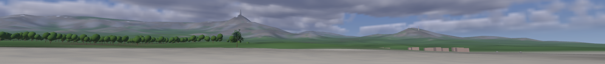
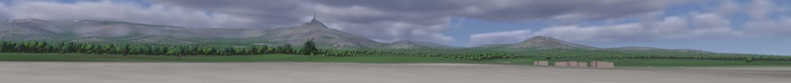

# 40 — Forests to the Horizon

> **Reference support:** named prepared-exercise and native-regression commands
> in this lesson run from the [reference checkout](../BranchWorkflow.md#prepared-reference-exercises).
> The growing chapter implementation remains in your learning checkout.

**Goal:** give every distant slope the same trees as Chapter 39's near pool,
as impostors baked from the real tree meshes, with exactly one representation
owning each tree and the cost of the whole forest measured.

Chapter 39's near trees are individual meshes. They are convincing up close,
but extending that population to every distant slope is not simply a larger
pool. Most far trees occupy only a few pixels, yet their mesh vertices,
instance preparation and shadows can still consume substantial work. Removing
them leaves an empty island; shrinking them away disguises the missing system.

Build another representation of the **same** trees instead: an
**impostor**, one camera-facing square per tree whose pixels are rebuilt from
views of the real tree mesh, baked once from many directions. Keep the same
world-cell identity, placement and material source, then decide which
representation owns a tree at each distance. The
[Renderer convergence](RendererConvergence.md) page after 39 precedes this
chapter: shared geometry, explicit depth policy and independent shadow
visibility are foundations, not cleanup deferred to the final scene.

Here is the difference the chapter makes, from the beach at the **Uphill**
viewpoint, cropped to the horizon (sun sky, 4x MSAA, coastal grass off). With
**Far forest** off, only the near pool's mesh trees stand, in a band on the
left; with it on, impostors carry the same forest over every slope behind
them:





**ROADMAP:** step 21+ — the `Horizon` demo grows.

**Prerequisites:** Chapter 39 built and running, and steps 1–3 of
[Renderer convergence](RendererConvergence.md): geometry ownership,
visibility/depth and fallible frames. The shared-FFT consolidation is an
optional ocean-route detour. From Chapter 39: the three levels, LOD2 a solid
stand-in (section 2), `plantTint` (section 3), far trees casting their stand-ins
(section 4), alpha to coverage (section 5), and the per-level coverage scale
with `filteredCoverage` (section 6). Chapter 37, sections
[2](37-Objects-At-A-Distance.md#2-a-scene-of-the-demos-own) (`FlatDraw`,
`lightAt`), [5](37-Objects-At-A-Distance.md#5-height-on-screen) (levels by size
on screen, with hysteresis),
[6](37-Objects-At-A-Distance.md#6-where-the-forest-grows) (`treeInCell`),
[7](37-Objects-At-A-Distance.md#7-a-pool-of-near-trees) (the pool of near trees)
and [8](37-Objects-At-A-Distance.md#8-shadows-near-the-camera) (`sunShadow` and
the casters);
[Chapter 35, section 6](35-Seeing-Far.md#6-reversed-depth-in-the-frame)
(reversed depth, every pipeline at GREATER);
[Chapter 18, section 8](18-Anti-Aliasing.md#8-alpha-to-coverage-for-cutouts)
(alpha to coverage);
[Chapter 15, section 5](15-Materials-And-Textures.md#5-textures-on-the-gpu) (mip
chains, and how the sampler picks a level); Chapter 19, sections
[2](19-Instancing-And-Indirect.md#2-two-ways-to-feed-per-instance-data)
(instance-rate attributes) and
[5](19-Instancing-And-Indirect.md#5-batching-the-draw-list) (batching);
[Chapter 17, section 11](17-Shadows.md#11-cascaded-shadow-maps) (cascades);
[Chapter 10, section 8](10-Cameras-And-Depth.md#8-the-cube-field) (the cross
product);
[Chapter 8, section 4](08-Resources-And-Descriptors.md#4-getting-the-offscreen-image-to-the-screen)
(linear and sRGB).

## Stage And Files

The [runnable stage](https://github.com/ZevosSky/PillowFort-private/blob/reference-main/Tests/TutorialHarness/Stages/README.md) is
`ch40-impostors`. Its starter and complete solution are real source snapshots
with the same native acceptance checks. The starter is the complete reference
with one deliberate, buildable omission: its `selectTreeMesh` uses one
distance boundary for both representations, so it exercises section 2's
handover problem. The bake and measurement problems in sections 1 and 3 have
worked answers in the reference, not separate starters. Neither variant
reconstructs every intermediate edit described below.

From the outer reference checkout, in PowerShell 7, each line prepares,
builds, checks and smokes one variant in Release:

```powershell
.\Tests\TutorialHarness\Stages\Invoke-LearningStage.ps1 -Stage ch40-impostors -Variant Starter -Configuration Release -ExpectIncomplete -ReuseNativeDependencies -BuildWorkers 1 -MinimumAvailableMemoryMiB 4100 -MemoryFloorMiB 3072
.\Tests\TutorialHarness\Stages\Invoke-LearningStage.ps1 -Stage ch40-impostors -Variant Solution -Configuration Release -ReuseNativeDependencies -BuildWorkers 1 -MinimumAvailableMemoryMiB 4100 -MemoryFloorMiB 3072
```

The Starter's one intended failure is
`FAIL: mesh-impostor hysteresis preserves representation inside overlap`;
`TutorialFrameRecordingTests` and every other check must still pass. How to
run it: [Working a prepared exercise](ReferenceSolutions.md#working-a-prepared-exercise).

| File | Responsibility |
| --- | --- |
| [ImpostorBaker.h](https://github.com/ZevosSky/PillowFort-private/blob/reference-main/Source/PillowFort/Demos/Horizon/ImpostorBaker.h), [implementation](https://github.com/ZevosSky/PillowFort-private/blob/reference-main/Source/PillowFort/Demos/Horizon/ImpostorBaker.cpp) | Rasterize the source tree meshes into cached multi-view surface data |
| [ImpostorMath.h](https://github.com/ZevosSky/PillowFort-private/blob/reference-main/Source/PillowFort/Demos/Horizon/ImpostorMath.h) | Bake directions, runtime view interpolation and representation ownership |
| [Impostors.h](https://github.com/ZevosSky/PillowFort-private/blob/reference-main/Source/PillowFort/Demos/Horizon/Impostors.h), [implementation](https://github.com/ZevosSky/PillowFort-private/blob/reference-main/Source/PillowFort/Demos/Horizon/Impostors.cpp) | Persistent world population, chunk visibility, atlas upload and specialized draw |
| [ForestPopulationCache.h](https://github.com/ZevosSky/PillowFort-private/blob/reference-main/Source/PillowFort/Demos/Horizon/ForestPopulationCache.h) | Validated deterministic cell/population cache, distinct from the surface atlas |
| [vertex shader](https://github.com/ZevosSky/PillowFort-private/blob/reference-main/Shaders/Horizon/Impostor.vert.glsl), [fragment shader](https://github.com/ZevosSky/PillowFort-private/blob/reference-main/Shaders/Horizon/Impostor.frag.glsl) | Reconstruct and light the sampled surface under reversed camera depth |
| [acceptance tests](https://github.com/ZevosSky/PillowFort-private/blob/reference-main/Tests/TutorialHarness/ImpostorTests.cpp) | Bake/cache contracts, directional selection and mesh/impostor handover |

Three smaller headers carry shared pieces: `Shaders/Horizon/ImpostorTypes.h`
holds the constants both C++ and GLSL read (view counts, tile size, mip count,
elevation range), `ForestCulling.h` holds section 3's prepared frustum tests,
and `LevelOfDetail.h` holds section 2's `treeCameraLevel`.

In the current reference, `Impostors` owns GPU resources and deletes copying,
with no move operation. Keep it in its host and rebuild it through
`Initialize`/`Shutdown`; CPU bake and population records remain separate
values. This is the written continuation's ownership contract; leave a sealed
checkpoint's pinned protected headers unchanged.

In Horizon, the Viewpoint list's **Aerial**, **Canopy**, **Far forest** and
**Uphill** entries are this chapter's views. The **Far forest** checkbox,
beside **Show forest**, turns the impostors and their shadow proxies off and
on; with it off, the near pool alone draws trees, out to its 600 m
`TREE_REACH`, and its automatic levels may show the solid LOD2 stand-in. The
**Horizon timings** panel in the Stats inspector shows **Impostors** (visible
/ total), **Chunks**, **Atlas image** and the bake or load time. On the
command line, `--far-forest 0` starts with the far forest off and
`--impostor-rebake 1` ignores the derived cache and bakes again.

Read the problems before the implementations. The complete checkpoint includes
initialization, descriptor bindings, shaders, cache failure handling, draw order
and teardown. None is left as an implied integration exercise.

## 1. A Picture That Is Still A Surface

A single colored rectangle can represent a distant tree from one direction.
Fly above it, move the sun, or inspect where it intersects terrain, and the
missing geometry becomes obvious. Decide which information a reusable bake
must preserve before choosing its texture layout.

> **Jump:** a baked view here is not a picture pasted on a card but a sampled
> surface: per texel, a color and coverage in one array, and an object-space
> normal and depth in the other, each captured by an orthographic camera from
> one of 56 directions per species. Keep in mind that every value is in the
> tree's own object space; the runtime turns it with the instance, relights it,
> and puts it back at its depth.

<a id="ch40-bake-a-surface-contract"></a>

### Attempt CH40-bake-a-surface-contract: bake a surface, not a lit screenshot

Bake the actual tree mesh and materials for changing viewpoints and live
lighting. Specify the coordinate system, color space, coverage, framing (the
square each view captures: its center and size) and depth units shared by the
baker and runtime. Make stale or truncated cached
data detectable instead of accepting any file with the expected name.
Continue the mip chain to one texel. Predict what a mostly empty tree view
should store there, and whether a single binary depth-writing fragment can
represent that fractional area. Fly away from the same tree at one and at four
MSAA samples before treating a retained silhouette as retained foliage
density.

**Acceptance:** The bake preserves source silhouettes and alpha coverage,
stores linear material color rather than a fixed sun's lighting, and has
finite, normalized surface normals. Changing source material data invalidates
the cache; a damaged payload regenerates rather than producing an arbitrary
atlas.

**Transfer:** Change a tree's leaf tint without changing its mesh. Which cache
identity must change? Rotate an instance without rebaking: which sampled
quantities must be rotated into world space?

<details>
<summary>Hint 1: the idea</summary>

Separate surface properties from illumination. A multi-view bake samples a
surface from known directions; it is not an environment map of outgoing light.

</details>

<details>
<summary>Hint 2: the data and coordinates</summary>

Use one object-space framing center and diameter per species. Keep direction
indices, signed depth and normals in the same space. Decode sRGB source color
before filtering, and do not average transparent background colors into a
covered leaf edge.
Keep filtered area coverage distinct from any correction used by a cutout
threshold; changing one must not silently change the surface weights of the
other.

</details>

<details>
<summary>Hint 3: a concrete route</summary>

Rasterize orthographic views of the actual last visible foliage mesh, applying its material
base-color and opacity maps. Store coverage-weighted color and normal/depth
data per view in texture-array layers. Include bake version, dimensions,
source content and payload validation in the cache contract.
Filter all the way from 128 by 128 to 1 by 1. If you correct mask density,
store that correction separately from raw alpha and choose the transition
using the LOD actually sampled by the GPU.

</details>

<details>
<summary>Worked solution: the bake and cache</summary>

`bakeImpostorAtlas` in `ImpostorBaker.cpp` rasterizes the two source species
at `TREE_LAST_VISUAL_MESH_LOD` (LOD1), matching the mesh used at handover,
from eight azimuths and seven elevations. The elevations are -65, -40, -15,
10, 35, 60 and 85 degrees; each orthographic view is 128 by 128 texels. The
negative rows cover uphill views from below the crown. Two species therefore
occupy 112 texture-array layers. Separate array layers prevent one
view's filtered edge from bleeding into a neighboring atlas tile.

The baker is a small CPU rasterizer, not a GPU pass. Each view is an
orthographic projection onto a square 1.08 times the source mesh's
bounding-box diagonal, centered on the box. For each triangle it tests one
point at each texel center, keeps the surface nearest the viewer, and writes
alpha 255 wherever the material's cutout test passes. Level 0's alpha is
therefore binary; fractional coverage first appears in the levels averaged
from it.

The `ImpostorAtlas` contract stores:

- `bounds`: object-space framing center and diameter per species.
- `colors`: linear RGB material color in UNORM bytes, plus alpha coverage.
- `normals`: object normal encoded from [-1,1] into [0,1], with signed depth
  divided by the framing diameter and biased by 0.5 in alpha.
- Eight mip levels: 128, 64, 32, 16, 8, 4, 2 and 1 texels per side.
- A separate layer-major coverage-correction table: two `vec4`s per view,
  224 vectors or 3,584 bytes across the 112 views.

The baker reads the actual mesh and materials, including leaf cutouts; it does
not substitute a newly drawn generic tree. Source sRGB texture values are
decoded before compositing and mip generation. Alpha weights the retained
surface data so transparent background texels do not darken the silhouette.
After each level is built, `dilateTransparentPixels` copies a covered
neighbor's color, normal and depth into empty texels up to two texels out,
leaving their alpha zero, so the runtime's bilinear reads at a silhouette do
not pull in the empty background's black.
Alpha itself remains raw filtered area coverage, never mask-rescaled. The
two texture arrays occupy 19,573,120 image bytes, about 18.67 MiB, before
allocator overhead; the correction table is additional.

The table is Chapter 39, section 6's per-level scale k, found the same way from
127 by 127 bilinear readings of each view; it corrects bilinear cutout density
at mip levels 1 through 5. Its base-level and final two scales remain one.
Under MSAA with the plants' alpha to coverage on (this chapter tests four
samples), the fragment shader reads the LOD the sampler actually used
(`textureQueryLod`), interpolates its
correction, and, through Chapter 39's `filteredCoverage`, smoothly changes
from corrected antialiased mask edges to raw fractional area over LOD 5 to
6, the 4-by-4 to 2-by-2 mip transition. This corresponds roughly to the full
captured tile shrinking from four to two screen pixels, not to every crown
covering that area; the tree occupies only part of its framing square.
Surface color, normal and depth continue
to use raw coverage weights. Reusing corrected mask alpha for those weights
would alter the represented surface while trying to fix its visibility.

One sample still uses a binary mask and cannot represent fractional or
subpixel area with one depth-writing sample. Disappearance and shimmer in
that diagnostic mode remain a stated limitation. This impostor path has no
temporal antialiasing or stochastic accumulation. Its four-sample hardware
alpha-to-coverage still quantizes coverage using implementation-dependent
sample behavior; it does not guarantee shimmer-free motion. Chapter 39,
section 6's **Decorrelate coarse samples** option writes its own
`gl_SampleMask` for near leaf cards, with hardware alpha to coverage off, so
overlapping cards stop repeating one mask. The impostor pipeline does not use
it: it keeps hardware alpha to coverage, and that option is a fixed spatial
pattern, not temporal reconstruction. Inspect
the actual moving near/far transition, not just a passing CPU area calculation.

This baker accepts the authored plant `Bark`/`Leaf` material and normal
contract, not arbitrary imported PBR assets. It retains the leaf crown normals
used by the near shader; it does not reinterpret them as geometric card
normals. Normal-mapped sources are rejected explicitly. A connected opacity
texture replaces the material's constant opacity, with its selected channel,
scale and bias, as in the near-material path; do not multiply both by accident.
Changing these semantics requires a bake-version change as well as a source
hash, so an old valid cache cannot quietly preserve an obsolete interpretation.

The near foliage and impostor share `HorizonShading.glsl`'s `lightAt`: matte
sun Lambert plus diffuse sky/ambient, not the ordinary opaque renderer's
full PreviewSurface/PBR model. Roughness, metallic, emission, occlusion and
transmission are not atlas channels; the specialized near shader does not
evaluate them either. Linear 8-bit color also has quantization loss. Each view
retains one visible surface, so view blending and parallax approximate
disocclusion rather than recovering hidden layers or baked self-shadowing.

`impostorSourceHash` identifies source-dependent data, including the selected
source mesh level. The cache adds a bake
version, expected shape and payload validation. `loadImpostorCache` rejects a
mismatch or corruption; `saveImpostorCache` is an optimization, not the only
way to obtain valid runtime data. Measure a cold rebuild separately from a
warm cache hit. The generated cache belongs in executable-local `DerivedData`,
not in the authored asset set.
The bake format is version 7 (`IMPOSTOR_BAKE_VERSION`); its identity and
validated payload include the full mip chain and the separate coverage table,
not only the image bytes. A version-6 cache, which held six mip levels, fails
the version and file-size checks and is rebaked rather than read as a shorter
chain.

Run `TutorialImpostorTests` for source color/coverage, normals, cache identity
and malformed-data cases. Then inspect source meshes and baked views side by
side. A mathematically valid payload can still frame the tree badly or lose
thin branches.

</details>

## 2. Exactly One Owner

At the boundary, both the mesh and impostor code know about the tree. If their
distance tests differ, they can both draw it or both omit it. If they use the
same single threshold, a small camera wobble can still alternate the
representation every frame. Solve ownership before tuning appearance.

<a id="ch40-stable-handover"></a>

### Attempt CH40-stable-handover: preserve a tree through the handover

Give the mesh and impostor one shared representation decision per world cell.
Keep that decision stable while the camera moves inside an overlap interval.
Use the camera direction in the instance's object space to choose neighboring
baked views, including azimuth wrap and the highest elevation.

**Acceptance:** Exactly one representation owns each tree. Approaching and
receding inside the overlap do not chatter. Rotating an instance changes the
chosen object-space view correctly, and crossing the azimuth seam or looking
down does not sample an invalid array layer.

**Transfer:** Teleport beyond both boundaries, then return. Explain which
ownership state must be persistent and why deriving mesh and impostor lists
independently from their own thresholds is unsafe.

<details>
<summary>Hint 1: the idea</summary>

The cell identifies the tree; the current representation is additional state.
Both renderers must consume that same state rather than agree by coincidence.

</details>

<details>
<summary>Hint 2: the data and coordinates</summary>

The enter distance is 490 m and the exit distance is 560 m, measured from the
camera to the tree's framing center. A mesh stays a mesh until 560 m; an
impostor becomes a mesh only inside 490 m. The exit stays inside the near
pool, which reaches at least 592 m from the camera in every direction
(`Props.h`), so a tree the mesh still owns is always within the pool's reach.
Direction interpolation wraps azimuth but clamps elevation.

</details>

<details>
<summary>Hint 3: a concrete route</summary>

Make `selectTreeMesh(distance, wasMesh)` the sole owner decision, then have
near `Props` query `Impostors::UsesMesh(cell)`. Select the four neighboring
array views with `impostorViewBlend`, alpha-weight their surface samples, and
apply instance rotation before shared lighting.

</details>

<details>
<summary>Worked solution: shared ownership and neighboring views</summary>

Restore the production selector in `ImpostorMath.h`:

```cpp
inline bool selectTreeMesh(float distance, bool wasMesh)
{
    return distance < (wasMesh ? TREE_MESH_EXIT : TREE_MESH_ENTER);
}
```

Inside 490-560 m, the previous decision is retained. `Impostors::Update`
updates that state and `UsesMesh(cell)` exposes it to near-tree preparation.
The state is a frame stamp, not a flag. `Update` decides only for trees in
chunks whose bounds come within 560 m of the camera, passing as `wasMesh`
whether a tree's `meshFrame` holds the previous frame's number, and stamps
every tree it keeps as a mesh with the new frame number, only after the
frame's uploads succeed.
Any older stamp means impostor, so a tree in a chunk `Update` skipped (after a
teleport, or with the far forest off) loses mesh ownership without a separate
reset.
The same deterministic `Terrain::TreeInCell` population supplies both
representations. Chapter 37, section 7's pool-edge shrink, which scaled each
tree to nothing over the pool's last meters, is no longer the handover.

Camera LOD and shadow LOD have different jobs. With impostors enabled,
`treeCameraLevel` caps automatic visible tree meshes at the last real foliage
level, LOD1, until their ownership changes. The solid LOD2 plant proxy is
reserved for independent shadow submission; displaying it as a green blob
between detailed foliage and a detailed impostor creates an obvious quality
band. Forced LOD2 remains an explicit diagnostic. Measure the resulting LOD1
triangle cost instead of hiding that cost behind a visibly wrong proxy.

`impostorViewBlend(toEye)` is a CPU copy of the shader's view selection,
built from the same `ImpostorTypes.h` constants so the tests can check it; the
shader does not call it. It turns the direction to the eye, in the tree's
object space, into view coordinates: azimuth `atan2(x, z)` as a fraction of a
turn times 8, and elevation `(asin(y) + 65°) / 25°`, clamped to rows 0-6. It
returns the lower azimuth and elevation indices, the row capped at 5 so that a
pair of rows always exists, and the fractions `fx` and `fy` between them. The
four views' weights are the bilinear products `(1 − fx)(1 − fy)`,
`fx(1 − fy)`, `(1 − fx)fy` and `fx·fy`.

Both decisions of this section, drawn: the 56 baked directions of one
species at their true spacing on the sphere, which is why the rows near the
top crowd together, and the distances at which a tree changes owner.

![Above, the 56 baked directions of one species, 8 azimuths 45 degrees apart on each of 7 elevation rows from -65 to 85 degrees, drawn at their true spacing on the sphere: neighbours on the 85 degree row are about 4 degrees apart, on the 10 degree row about 44. Below, the handover by distance: a mesh tree stays a mesh until 560 m, an impostor becomes a mesh only inside 490 m, between the two a tree keeps last frame's owner, and the near pool reaches at least 592 m in every direction, inside its 600 m TREE_REACH.](images/impostor-views-and-handover.svg)

The shader samples four views, wraps the azimuth
neighbor, and keeps the elevation pair within the seven-row range. Surface
depth supports two parallax-refinement iterations; the shader blends covered
albedo, normal and position, then computes live lighting and haze. It writes
the reconstructed reversed-Z `gl_FragDepth`, rather than letting the whole
quad intersect terrain as a flat sheet.

The parallax step treats each view's depth as a height field over that view's
image. A fragment starts at its point `p` on the square, in the tree's object
space, and slides along the eye ray `p + t·e` to where its depth along the
view direction `v` equals the stored depth `d` under it:
`t = (d − p·v) / (e·v)`. Since `d` depends on where the ray lands, the shader
repeats the step twice instead of solving it exactly, and clamps `e·v` to at
least 0.2 so that a view seen almost edge-on moves the point at most five
times the depth difference. The albedo then takes Chapter 39, section 3's
per-plant tint, hashed from the tree's base as `plantTint` does, so a tree
keeps its shade across the handover; that formula is copied into
`Impostor.frag.glsl`, not shared.

The complete shaders and runtime integration are part of the pinned solution,
not omitted pseudocode. In `Impostor.vert.glsl`, each instance's six vertices
build the square on the GPU: the tree's base on the shared `terrainHeight`,
the species' framing center turned by the instance's rotation, and a
right/up basis facing the camera, with a fallback when the camera is straight
above. In `Impostors.cpp`, `UploadAtlas` copies each of the eight CPU-built
levels into the 112 layers with one `VkBufferImageCopy` per level and layer;
the CPU keeps a level as one image eight views wide, hence `bufferRowLength`.
`CreatePass` builds set 2 (two combined image samplers and the
`ImpostorBlock` uniform buffer) and a pipeline with GREATER depth, depth
writes, and alpha to coverage whenever the scene is multisampled. `Draw`
issues one `vkCmdDraw` of six vertices with one instance per visible tree,
the corners coming from `gl_VertexIndex` and each tree's placement from an
instance-rate vertex buffer (Chapter 19, section 2).

Run the same stage acceptance tests before and after
repairing the starter. Then travel slowly through both boundaries and rotate
through the full view grid, at ground level and from above.
The CPU directional tests do not prove GPU view-grid sampling or filtering;
the rendered routes supply that separate evidence.

**Limit:** Hysteresis prevents repeated switching; it does not prove the two
representations match perfectly at the one remaining switch. This version is
not an octahedral encoding or a temporally blended handover. Its views form a
latitude/longitude grid, which spends them unevenly: neighboring views on the
85 degree row are about 4 degrees apart, on the 10 degree row about 44. An
octahedral layout spreads the same number of views evenly over the sphere.
Writing `gl_FragDepth` also has a cost: with no conservative-depth layout
declared, the GPU cannot reject a hidden fragment before the shader runs, so
every covered fragment of every square, including those behind hills, pays
for all four view samples before the depth test. Reject obvious
silhouette, color or depth pops in the visual sequence rather than calling
the problem solved because ownership tests pass.

</details>

## 3. A Forest Within A Measured Budget

More triangles are not the only expense. Multi-view impostors add texture
sampling, coverage overdraw, per-instance preparation, cache storage and
runtime memory. The complete world is the workload; a close-up screenshot of
one cheap card is not a performance result.

<a id="ch40-measure-the-whole-forest"></a>

### Attempt CH40-measure-the-whole-forest: keep the world while reducing work

Compare mesh-only near coverage with the full persistent far population under
the same route. Show what changed in visible tree count, CPU preparation,
shadow work, GPU frame/pass distributions and memory. Identify the quality
and lighting limitations that remain at the farthest distances.
If preparation dominates, split it into visibility, prop updates, draw
collection, far-caster collection and caster shaping (the **Horizon timings**
panel's **Forest visibility**, **Props update**, **Draw collection**, **Far
casters** and **Caster shaping** rows) before changing the algorithm. If a
Debug build is far slower than Release, profile that Debug frame with
validation still on and name the function that dominates; "Debug is slow" is
not a diagnosis.

**Acceptance:** Distant slopes retain deterministic trees while traveling.
Chunk rejection never removes a visible crown, runtime allocations and atlas
bytes are reported, and a repeatable Release run records median/p95 costs
with corresponding visual evidence. Cold bake time is reported separately.

**Transfer:** Double view resolution or reduce view count. Predict memory and
sampling changes, then compare appearance from an aerial route. Do not assume
fewer triangles means a faster GPU frame.

<details>
<summary>Hint 1: the idea</summary>

Separate candidate population, coarse visibility, representation choice and
submission. Measure each stage instead of attributing all cost to the draw.

</details>

<details>
<summary>Hint 2: the data and coordinates</summary>

Persistent trees are grouped into 32 by 32 world-cell chunks. Bounds must
include each tree's full framing extent, not just its root. Count visible
chunks and trees independently, alongside atlas and uploaded bytes.
Terrain displacement participates in those bounds: use a derived height
envelope rather than an arbitrary padding constant.
Which of placement, framing, terrain envelope, exact ground height and camera
planes actually change each frame? Cache only quantities whose complete
inputs are unchanged. A stationary-camera shortcut is not a moving-route fix.

</details>

<details>
<summary>Hint 3: a concrete route</summary>

Use `Impostors::Statistics`, the full-frame benchmark CSV, and Horizon's
scripted flights (`--horizon-route edge-sweep`, `aerial-orbit` or
`forest-run`). Compare one control at a time, warm caches, repeat the
same fixed state, and review matching captures plus temporal sequences.

</details>

<details>
<summary>Worked solution: the experiment and its boundaries</summary>

`Impostors::Populate` builds the island's deterministic population once;
`Update` performs coarse chunk rejection, updates representation ownership,
and prepares visible impostor instances. `Statistics` exposes population,
visibility, atlas size, upload bytes, cache outcome and bake time. The current
implementation uses CPU chunk preparation; it is not described as GPU-driven
visibility merely because its draw is instanced.

Measured phase by phase, the expensive loop was neither height sampling nor
batching but rebuilding each visible tree's conservative bounds, outward
rounding included, every frame. `RebuildBounds` therefore caches view and
view/proxy-union bounds after population
initialization, including a resident-cache reuse, and whenever the terrain
height envelope changes. Placement XZ, scale, rotation and atlas/proxy framing
are immutable between initialization calls. Near-tree and caster ground Y
still use the current rings and terrain settings; those are not baked into a
permanent height. Changing only camera orientation still reruns visibility.

`ForestCulling.h` prepares each bound's center/extents and each frame's plane
data once. Its scalar intersection test adds the products in the same order
as `scene::intersects` in `Bounds.cpp`, so the cached path makes bit-for-bit
the same keep-or-reject decision, even for a box that grazes a plane, and the
tests can compare its output with the original exactly. A chunk skips
descendant tests only when every plane has a positive
rounding margin and the chunk contains those descendants; grazing or unknown
inputs take the conservative path. The visible list keeps the population's
tree order, and ownership is still published only after the buffer flushes
succeed. No density,
handover distance, material or shadow quality is reduced by this change.

The cache is a time/memory tradeoff: two prepared bounds add about 31 MB for
549,161 trees, before vector capacity overhead. Report actual retained CPU
placement storage separately from GPU atlas/geometry bytes. Initial bounds
preparation also has its own time; it must not disappear from startup costs
just because it moved outside the population-generation timer. Compare both
frame slots, changed envelopes, camera motion, toggles, ownership boundaries,
caster counts and matching images, not only a stationary frame's average.

Profiling the Debug build exposed a second repeated cost, outside the forest
code: Chapter 19, section 5's batching comparator builds a tuple, fetching
material and mesh state, on every sort comparison. The reference's
`SceneRenderer::PrepareDraws` prepares a `DrawSortKey` once for each validated
draw, including
its determinant sign, then compares those scalar fields in exactly the old
lexicographic order. It still sorts every changed list, computes each normal
matrix, and emits the same instances, commands and shadow bounds. The
`MirrorBatchTests` oracle compares the actual output against the old tuple
ordering, including invalid draws, equal keys, both frame slots and changed
list sizes. This is a later optimization of Chapter 19, not a reason to omit
its correctness work or turn off Debug checks.

The population has its own disk/resident cache. Its identity includes terrain
content and map parameters, the placement version and atlas source identity;
it is not keyed merely by a convenient filename. Validate the cell-to-tree
mapping, chunk ranges and payload on load. A stale placement cache can create
gaps or duplicates even when every surface-atlas texel is correct.

Use the complete experiment/report procedure in
[Chapter 39](39-Plants.md#ch39-make-the-performance-claim-falsifiable) and the
[native benchmark commands](https://github.com/ZevosSky/PillowFort-private/blob/reference-main/Tests/TutorialHarness/README.md#learning-stages-and-measurements).
Save cold-cache and warm-cache runs separately, with the exact checkpoint,
GPU/driver, route, resolution, MSAA and settings. Report complete CPU and GPU
distributions, counters, bytes and quality evidence; explain unavailable
telemetry rather than replacing it with invented zeros.

Label the comparison honestly. Disabling the far forest is a feature-cost
ablation, not an equal-content optimization baseline: it removes distant
trees and can expose the older visible LOD policy. Likewise, a historical
near-pool scene is not the same workload as the full island. Use matching
content and quality when claiming an optimization; separately report whether
the completed larger scene meets its own frame budget.

Camera visibility and shadow visibility remain independent.
`Impostors::CollectCasters` contributes actual shared LOD2 plant geometry for
non-mesh-owned trees intersecting the pre-fitted light-cascade caster volumes,
including trees outside the camera view or near pool. Near Props supplies the
mesh-owned casters; its independent shadow-LOD shaping still applies. The
ownership decision prevents duplicate submissions across those two sources.
Shadows therefore do not disappear merely because a tree crossed the camera's
mesh/impostor boundary.

These are **geometry shadow proxies**, not camera-facing impostor cards used
as shadow casters. Their reach is the configured cascade/caster reach, not
unbounded shadows over the entire island. Inspect extended shadow distances
and low-sun views, including off-camera casters. Shared wind and island grass
remain subsequent chapters.

The final acceptance evidence must include: a slow near/far handover; a full
azimuth turn; ground and aerial forest routes; terrain occlusion; bright and
backlit leaves; resize/MSAA/demo-switch lifecycle; and repeated Release
measurements on the tested devices. The mathematical tests, Debug validation,
static captures and human visual review answer different questions. Record
which were actually run in [REFERENCE.md](https://github.com/ZevosSky/PillowFort-private/blob/reference-main/REFERENCE.md).

</details>

## Exit Check

Build both stage variants, observe the starter's intended failed assertion
(`FAIL: mesh-impostor hysteresis preserves representation inside overlap`),
and make the repaired starter pass the same checks as the complete solution.
Run the bounded Vulkan smoke on each available GPU. Review the visual route
before accepting its performance report. There must be no missing-tree band,
duplicated ownership, invalid view layer, stale cache acceptance, or validation
error. Any remaining switch pop is a quality failure to investigate, even
when the state-machine tests pass.

Next: [41 - Grass on the Island](41-Grass-On-The-Island.md).
