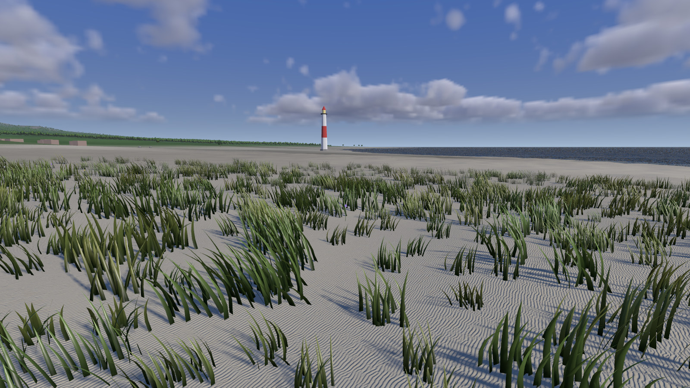

# 41 — Grass on the Island

> **Reference support:** named prepared-exercise and native-regression commands
> in this lesson run from the [reference checkout](../BranchWorkflow.md#prepared-reference-exercises).
> The growing chapter implementation remains in your learning checkout.

**Goal:** compose the Grass demo's blades and the FFT sea into Horizon on one
bounded stretch of coast, with roots on the triangles the terrain draws and a
habitat function deciding where grass may grow.

The grass demo and the island already work separately. Combining their draw
calls is not enough: their cameras, depth conventions, terrain functions and
shadow assumptions disagree. Start with a small coastal area where errors
are easy to see. Keep the original Grass and Sea demos as regression clients.

**ROADMAP:** step 21+ — the `Horizon` demo grows.

**Prerequisites:** Chapter 40 built and running, including steps 1–3 of
[Renderer convergence](RendererConvergence.md). This composition also needs the
complete Grass (25–27) and FFT Sea (29–30) lessons; the earlier Horizon chapters
used only selected pieces of them. The following sections supply the contracts
the three problems combine:

| Earlier sections | What we reuse |
| --- | --- |
| Chapter 25, sections [4](25-Grass-Blades.md#4-one-blade-from-fifteen-vertices) and [6](25-Grass-Blades.md#6-the-curve)–[8](25-Grass-Blades.md#8-stones-shadows-and-teardown); Chapter 26, sections [2](26-Grass-GPU-Generation.md#2-tiles-around-the-camera)–[6](26-Grass-GPU-Generation.md#6-hiding-the-switch); Chapter 27, sections [2](27-Grass-Look.md#2-wind), [4](27-Grass-Look.md#4-a-minimum-width-as-coverage)–[5](27-Grass-Look.md#5-rounded-normals) and [7](27-Grass-Look.md#7-light-through-the-blade-highlights-and-darker-roots)–[8](27-Grass-Look.md#8-grass-shadows-from-an-impostor) | Blade geometry, generation and indirect draws, wind, coverage, shading and shadow deformation |
| Chapter 29, sections [7](29-FFT-Ocean.md#7-the-starting-waves)–[10](29-FFT-Ocean.md#10-the-surface); Chapter 30, sections [1](30-A-Rougher-Sea.md#1-why-one-patch-is-not-enough)–[4](30-A-Rougher-Sea.md#4-adding-the-cascades-up) and [8](30-A-Rougher-Sea.md#8-foam-with-a-memory)–[10](30-A-Rougher-Sea.md#10-what-the-water-reflects) | FFT maps, cascade bands, persistent foam and the sky-lit sea surface |
| Chapter 36, sections [3](36-Terrain-To-The-Horizon.md#3-height-and-the-rule-for-detail), [5](36-Terrain-To-The-Horizon.md#5-cracks-between-rings) and [9](36-Terrain-To-The-Horizon.md#9-sampling-it); [Chapter 37, section 4](37-Objects-At-A-Distance.md#4-the-ground-as-it-is-drawn); Chapter 38, sections [1](38-Ground-Materials.md#1-erosions-footprints)–[3](38-Ground-Materials.md#3-painting-by-the-map) | Terrain height, stitched rings, rendered-surface sampling and material weights for habitat |
| [Renderer convergence](RendererConvergence.md), steps 1–3; Chapter 17, sections [11](17-Shadows.md#11-cascaded-shadow-maps)–[13](17-Shadows.md#13-choosing-a-cascade-per-pixel-and-hiding-the-seams); Chapter 18, sections [4](18-Anti-Aliasing.md#4-the-multisampled-targets)–[6](18-Anti-Aliasing.md#6-every-scene-pipeline-declares-the-sample-count) | Shared geometry, independent cascade visibility, fallible frames, shadow fits and multisampled depth resolves |
| Chapter 9, sections [2](09-Demo-Harness.md#2-the-demo-interface)–[5](09-Demo-Harness.md#5-the-renderers-side) and [9](09-Demo-Harness.md#9-what-runs-when); [Chapter 8, section 6](08-Resources-And-Descriptors.md#6-descriptor-sets) | Borrowed targets, demo lifetimes and safe descriptor replacement |

Later in the reference, [Chapter 43](43-Waves-To-The-Shore.md) adds the bounded
gentle shoreline and [Chapters 46–48](46-Capturing-Grass-Clumps.md) add shared
grass capture and representation stages; details below.

<details>
<summary>Later stages change this chapter's code</summary>

The assembled reference includes those additions; this chapter's paired
source remains pinned to its earlier coastal milestone. It does not silently
acquire later solutions or a different omission.

</details>

This chapter implements that coastal slice, not island-wide streaming, a
tree branch rig, refracting water or a surf simulation. The FFT sea is a
composition check here. It still intersects the seabed as an opaque surface;
it does not slow, break or run up the beach.

## Stage And Files

The paired `ch41-island-grass` [learning stage](https://github.com/ZevosSky/PillowFort-private/blob/reference-main/Tests/TutorialHarness/Stages/README.md)
has a buildable habitat omission. Both variants include the complete native
application, assets and shaders. The other two problems below have worked
answers in the reference; they are not separate reconstructed starters.

From the outer reference checkout, in PowerShell 7, each line prepares,
builds, checks and smokes one variant in Release:

```powershell
.\Tests\TutorialHarness\Stages\Invoke-LearningStage.ps1 -Stage ch41-island-grass -Variant Starter -Configuration Release -ExpectIncomplete -ReuseNativeDependencies -BuildWorkers 1 -MinimumAvailableMemoryMiB 4100 -MemoryFloorMiB 3072
.\Tests\TutorialHarness\Stages\Invoke-LearningStage.ps1 -Stage ch41-island-grass -Variant Solution -Configuration Release -ReuseNativeDependencies -BuildWorkers 1 -MinimumAvailableMemoryMiB 4100 -MemoryFloorMiB 3072
```

The Starter's one intended failure is `FAIL: grass grows on suitable soil`;
`TutorialFrameRecordingTests` and the terrain checks must still pass. How to
run it: [Working a prepared exercise](ReferenceSolutions.md#working-a-prepared-exercise).

| File | Responsibility |
| --- | --- |
| [CoastalArea](https://github.com/ZevosSky/PillowFort-private/blob/reference-main/Source/PillowFort/Demos/Horizon/CoastalArea.h), [implementation](https://github.com/ZevosSky/PillowFort-private/blob/reference-main/Source/PillowFort/Demos/Horizon/CoastalArea.cpp) | Bounded grass/sea composition, controls and telemetry |
| [GrassField](https://github.com/ZevosSky/PillowFort-private/blob/reference-main/Source/PillowFort/Demos/Grass/GrassField.h), [SeaSurface](https://github.com/ZevosSky/PillowFort-private/blob/reference-main/Source/PillowFort/Demos/Sea/SeaSurface.h) | Reusable GPU owners, without another camera or scene pass |
| [TerrainSurfaceMath.h](https://github.com/ZevosSky/PillowFort-private/blob/reference-main/Shaders/Horizon/TerrainSurfaceMath.h), [TerrainSurface.glsl](https://github.com/ZevosSky/PillowFort-private/blob/reference-main/Shaders/Horizon/TerrainSurface.glsl) | Rendered ring selection, stitched vertices and triangle sampling |
| [IslandGrassRules.h](https://github.com/ZevosSky/PillowFort-private/blob/reference-main/Shaders/Grass/IslandGrassRules.h) | Habitat function shared by the actual compute shader and CPU acceptance tests |
| [generation kernel](https://github.com/ZevosSky/PillowFort-private/blob/reference-main/Shaders/Grass/GrassGenerateKernel.glsl), [vertex kernel](https://github.com/ZevosSky/PillowFort-private/blob/reference-main/Shaders/Grass/GrassVertexKernel.glsl) | Stable roots, bounded generation and common camera/shadow deformation |
| [acceptance tests](https://github.com/ZevosSky/PillowFort-private/blob/reference-main/Tests/TutorialHarness/CoastalPlacementTests.cpp) | Negative coordinates, ring edges, triangle attachment and habitat controls |

Select `Coast`, `Coast dunes` or `Coast aerial` in Horizon's Viewpoint list.
Keep free flight available. Before opening the answers, predict where the
first visible defect would occur if you simply copied the Grass demo's frame.

## 1. One Frame, Several Systems

<a id="ch41-one-coastal-frame"></a>

### Attempt CH41-one-coastal-frame: compose owners without composing cameras

Reuse the grass generator and FFT sea in Horizon. Decide who owns the camera,
sky, frame buffers, shadow pass, render targets and shutdown order. Preserve
the standalone demos so you can isolate regressions. Do not fix reversed
depth by clearing the depth attachment halfway through the scene.

**Acceptance:** Coastal terrain, grass and water occlude each other under
Horizon's reversed projection. Sky and clouds remain visible. The scene has
one frame-data write and one scene rendering scope. Switching away and back,
resizing and changing MSAA do not retain invalid borrowed descriptors.

**Transfer:** Disable only the FFT sea. Should the seabed suddenly turn into
the old flat water material? Explain which setting belongs to the coastal
composition and which belongs to the water draw.

<details>
<summary>Hint 1: ownership</summary>

A reusable effect owns its GPU resources. The host supplies the frame and
lighting. Owning a generator does not imply owning the world around it.

</details>

<details>
<summary>Hint 2: the contract</summary>

Borrow the renderer, sky and island descriptor set. Keep compute outside the
scene pass and surface draws inside it. Camera depth is reversed; cascaded
shadow depth is conventional. Match clears, comparisons and MSAA resolves.

</details>

<details>
<summary>Hint 3: a concrete sequence</summary>

Write Horizon's frame and lights, prepare grass and FFT maps, draw shadows,
update the shared sky, then begin the reversed-depth scene pass. Draw the
sky, opaque island/props, grass and water before ending that pass. Destroy
the coastal resources before the borrowed terrain, sky and renderer.

</details>

<details>
<summary>Worked solution: the complete composition</summary>

`HorizonDemo::SelectView` initializes `CoastalArea` on demand and enables
`TerrainSettings::externalWater`. That flag preserves negative seabed vertex
heights and disables the old flat-water shading branch. It remains enabled
when only the FFT draw is disabled, making the ablation meaningful.

`CoastalArea::Initialize` passes the existing renderer and terrain layout to
`GrassField`, and the existing renderer and sky to `SeaSurface`. Neither
component begins a scene pass, writes another camera, or creates another sky.
Both end their fragment shaders with the frame's shared distance haze, the
`distanceHaze` call [Renderer convergence](RendererConvergence.md#shared-distance-haze)
supplies, so a blade or a wave fades with the hazed ground behind it.
The standalone demos host the same owners. Boat/spray actors remain owned
by `SeaDemo`; the coastal surface binds an explicitly initialized zero-foam
image rather than silently simulating actors at the standalone demo's origin.

`HorizonDemo::Record` prepares coastal compute before its shadow pass. An
extra-caster callback adds the generated blades. `CoastalArea::Draw` runs
inside Horizon's existing rendering scope. The shared depth policy clears
camera depth to zero and uses GREATER comparisons, while shadow rendering
uses its conventional clear/comparison. Conservative MSAA depth resolves use
MIN for reversed depth and MAX for conventional depth when supported.

`Teardown` destroys `CoastalArea` before its borrowed owners. CPU settings
survive recreation; GPU descriptors are rebuilt. The renderer's existing
device-idle recreation boundary remains the lifetime boundary.
In the current reference, `CoastalArea`, `GrassField` and `SeaSurface` delete
copying and supply no move operation. Construct them in their final hosts;
their borrowed pointers and descriptor relationships do not define a
resource-transfer operation. This policy belongs to the written continuation;
leave a sealed checkpoint's pinned protected headers unchanged.

</details>

## 2. A Root Belongs To A Triangle

<a id="ch41-roots-on-the-rendered-surface"></a>

### Attempt CH41-roots-on-the-rendered-surface: sample what was drawn

Place stable world-cell roots on the island. A continuous height query looks
plausible until the camera moves, the rings change or the ground is steep.
Determine the exact surface a root must sample. Test a nonplanar grid cell,
a negative world coordinate and an odd vertex along a ring boundary.

**Acceptance:** Roots follow the two actual terrain triangles, including
stitched boundary heights. A nonplanar cell distinguishes the answer from
bilinear interpolation. Ring selection uses the same snapped origins and
cell widths as the terrain shader. Moving the camera does not reseed roots.

**Transfer:** Freeze terrain rings and fly across their first boundary. Which
coordinates may change representation, and which must retain root identity?

<details>
<summary>Hint 1: two different functions</summary>

The height function creates vertex positions. Rasterization creates planar
triangles between those vertices. They are not generally the same surface.

</details>

<details>
<summary>Hint 2: recover the mesh</summary>

Find the finest ring covering the root. Floor world coordinates, including
negative values, into its lattice. Sample the cell's four vertices after
applying the same odd-edge stitching rule. Inspect the terrain's index order.

</details>

<details>
<summary>Hint 3: barycentric heights</summary>

The diagonal joins corners (1,0) and (0,1). For local coordinates `(u,v)`, use
the first triangle when `u+v <= 1`. Its height is
`h00 + u*(h10-h00) + v*(h01-h00)`. Derive the second from corner (1,1).
Do not interpolate the four raw heights before stitching them.

</details>

<details>
<summary>Worked solution: one sampled geometry contract</summary>

`TerrainSurfaceMath.h` is compiled by both C++ and GLSL. Its ring origins
snap down to even lattice coordinates. `terrainSurfaceCell` searches from
the finest ring outward and uses `floor`, not integer truncation.
`terrainStitchPair` returns the same vertex twice for ordinary vertices and
the two adjacent even vertices for an odd edge vertex. Average that pair's
heights before interpolating the cell.

For the second triangle the height is
`h11 + (1-u)*(h01-h11) + (1-v)*(h10-h11)`.
`terrainTriangleNormal` uses that same triangle's height differences and
cell width. `TerrainSurface.glsl` performs the texture queries once per
root and caches its ground normal in the `IslandGrassBlade`, 64 bytes at this
chapter's milestone, while the original standalone blade remains 48 bytes.
Chapter 48's terrain frame later grows them to 96 and 80 bytes, the sizes the
assembled reference's headers assert.

The terrain vertex shader calls the same stitched-height helper. For the
legacy flattened-water mode, clamp each vertex height before interpolation,
not the interpolated answer. Coastal mode retains the actual negative
heights. `Terrain::SurfaceHeightAt` implements the matching CPU query for
camera clearance. The acceptance test's nonplanar heights `(0,1,1,4)` at
`(0.3,0.3)` produce `0.6`; a bilinear sampler would produce `0.78`.

Generation still hashes world cells before clump displacement. Tile-list
order and camera motion do not change a blade's random identity. A ring
change can change the approximated ground height, not the root's XZ seed.

</details>

## 3. Habitat Before Density

<a id="ch41-grass-habitat"></a>

### Attempt CH41-grass-habitat: keep the beach bare without erasing the dunes

The runnable starter generates no coastal grass because its habitat function
returns zero. Implement that function using ground-material weights, height
above sea level, upward normal and canopy density. Keep the coefficients
explicit. Avoid placing grass everywhere and hiding underwater blades later.

**Acceptance:** Dry suitable ground admits grass; underwater, steep and
unsuitable ground reject it. Dry sand can admit sparse dune grass while the
wet beach remains bare. Canopy reduces density without deleting every plant.
Both the GPU shader and CPU acceptance executable call your implementation.

A working habitat at the **Coast** viewpoint (sun sky, 4x MSAA). The capture
is from the assembled reference, whose clumps carry Chapter 48's later
appearance repair; at this chapter's milestone admitted dune clumps look more
transparent against the sand (see the Later correction in the worked
solution). The field also ends at its 42 m reach, short of the waterline, so
judge the bare wet beach from **Coast shore**, not from this frame:



**Transfer:** Create a salt-tolerant dune profile without changing the compute
kernel. Which values change? What extra ecological signal would be needed
to distinguish a sheltered hollow from an exposed ridge?

<details>
<summary>Hint 1: combine independent constraints</summary>

Treat habitat as a multiplier in [0,1]. A hard exclusion must remain zero
even when another influence is favorable. Keep the stable random cut used
by the existing distance-density system.

</details>

<details>
<summary>Hint 2: data order</summary>

The function receives grass/soil/sand weights, not the material map's raw
sand/grass/soil order. Use a smooth dry-height ramp, a slope ramp and a
canopy attenuation factor. The final affinity component is retained density
under a closed canopy, not an additional material weight.

</details>

<details>
<summary>Hint 3: concrete coefficients</summary>

Use affinity `(1, .25, .4, .2)` and conditions `(0, .6, 2, .7)` for this
slice. These mean full grass affinity, reduced soil/sand affinity, 20%
closed-canopy density, sea level zero, a dry-height ramp from .6 to 2 m,
and minimum upward normal .7. Multiply rather than add the constraints.

</details>

<details>
<summary>Worked solution: the shared habitat function and verification</summary>

`IslandGrassRules.h` computes a clamped weighted material affinity, multiplies
it by `smoothstep(minDryHeight, fullDryHeight, height-seaLevel)`, then by
`smoothstep(minUp, 1, upwardNormal)`. Canopy attenuation interpolates
from 1 to retained closed-canopy density using clamped canopy coverage.
The reference header is the complete function; no host-only substitute
stands in for the shader implementation.

```cpp
float ground = clamp(weights.x * affinity.x + weights.y * affinity.y
                   + weights.z * affinity.z, 0.0f, 1.0f);
float dry = smoothstep(conditions.x + conditions.y,
                       conditions.x + conditions.z, height);
float slope = smoothstep(conditions.w, 1.0f, up);
float shade = 1.0f - clamp(canopy, 0.0f, 1.0f) * (1.0f - affinity.w);
return ground * dry * slope * shade;
```

`IslandGrassGenerate.comp.glsl` defines the island specialization and includes
the shared generator. After clump displacement it samples the rendered
surface, maps ground weights into the function's order and queries canopy.
Habitat multiplies distance density before the existing stable random cut
and, in this historical stage, its growth ramp. Rejected candidates do not
consume blade-buffer slots.

**Later correction:** Habitat is source-admission probability, not persistent
opacity. Reusing the habitat-scaled margin as fractional area made admitted
near dune clumps look transparent against sand. The current reference keeps
the exact `cut < density * habitat` population, but conditions the distance
rank on habitat and makes admitted full-density near clumps solid. Physical
blade/atlas edge coverage and transient distance thinning remain separate.
Predict the result for habitat 0.04 before opening
[Chapter 48's hints and complete solution](48-Grass-In-The-Coastal-Pipeline.md#ch48-grass-appearance).
The immutable habitat Starter/Solution here still teaches its original
function; it is not silently repinned to the later appearance repair.

The starter patch changes only this function to return zero. Its named
positive-habitat assertion fails; terrain and rejection checks remain healthy.
The solution is the unpatched source at the same immutable checkpoint.
Build both in isolation, run acceptance and inspect their Coast captures.
Do not accept a compile error, assertion dialog or blank whole scene as the
intended starter failure.

</details>

## Visual And Performance Exit Checks

Inspect ground-level roots, dunes and aerial water on both devices. Fly the
`coast-walk` and `coast-orbit` routes to cross ring and tile boundaries. Compare
grass/sea enabled and disabled at the same fixed time. Repeat with 1x and 4x
MSAA, sky off/on, clouds, resize and scene recreation. Inspect the captures:
clean Vulkan logs and a nonblank histogram do not prove a correct shoreline.

The coastal field is deliberately bounded: 42 m default reach, a 60 m UI
maximum at this chapter's milestone (the assembled reference allows 12–200 m,
for Chapter 48's 180 m profile) and checked tile/output capacities. Camera and shadow draws consume
the same generated deformed blades; shadow vertices omit camera-facing width
inflation. The candidate list includes the bounded camera/caster union,
including roots behind the eye. Camera-only Hi-Z cannot safely reject that
shared shadow list, so it is disabled here, not advertised as integrated.

Measure Release without validation or screenshot sequences for timing work.
Retain feature settings with each sample; never pool grass-off and grass-on
runs. The Stats inspector exposes coastal CPU preparation, compute/draw GPU
time, tile/LOD counts and overflow. Grass shadow cost also appears in the
host shadow interval. This is not a claim that the full island meets 60 fps.

Next work remains separate: data-driven foliage groups, authored selective
tree wind and conservative deformation bounds; then terrain-aware water
reflection/refraction, interactions and a real wetting/drying shoreline
solver. None is supplied by this chapter's intersecting FFT surface.

Next: [42 — One Wind](42-One-Wind.md), which gives the island one wind,
starting with this coast's grass.

Next on the coastal route: [43 — Waves to the Shore](43-Waves-To-The-Shore.md).
Chapter 42 is not a hidden prerequisite of it.
After the shoreline, [46–48](46-Capturing-Grass-Clumps.md) develop captured
grass and return it to this coastal renderer. [Chapter 45](45-Scene-Documents-And-Properties.md)
is a separate scene-project route after 19.
