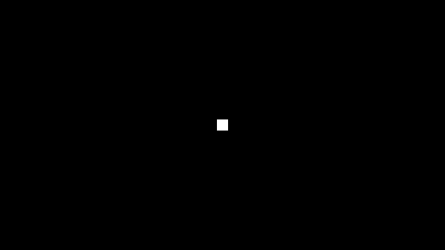

# 49. Bloom And Color Grading

> **Reference support:** named prepared-exercise and native-regression commands
> in this lesson run from the [reference checkout](../BranchWorkflow.md#prepared-reference-exercises).
> The growing chapter implementation remains in your learning checkout.

**Goal:** turn a known HDR image into a displayed image with bloom and color
grading, while preserving a neutral route and measuring the added work.

**Module:** `VulkanGraphics/Bloom` owns the pyramid. `VulkanRenderer` schedules
it after the demo and before the composite. Grading remains in that composite;
the UI is drawn afterward.

Read this optional lesson after Chapter 24. It is independent of Chapters 50
and 51. An earlier route after Chapters 16 and 18 is possible, but first read
Chapter 21, section 8 and Chapter 24's `GpuTimestamps` extraction if you want
the same timing implementation.

| Earlier work | What it supplies |
| --- | --- |
| Chapter 08, sections 3–8 | Linear HDR scene image, sampled descriptors, one display encode and shared layouts |
| Chapter 09, sections 2–5 | Demo ownership and resize/failure boundaries |
| Chapter 16, sections 2 and 6 | Light units, exposure stops and the tone curve |
| Chapter 18, sections 5 and 6 | Resolving multisample scene color before later readers |
| Chapter 21, section 8; Chapter 24, sections 3 and 9 | Timestamp queries and their reusable owner |

### Three Parts, Three Stopping Points

| Part | Observable result | What to establish before continuing |
| --- | --- | --- |
| 1 | Known HDR patches with neutral and modified grading | Color order and a capture of the real final GPU image |
| 2 | A smooth halo around one bright patch | Extraction and normalized spatial filtering |
| 3 | The same effect through resize, MSAA and demo switches | Resource lifetime, UI separation and measured cost |

This is raster post-processing; compute shaders are not required. There is no
render graph, temporal history or automatic exposure in this implementation.
The goal is a small, inspectable system rather than a general effect editor.

### What Changes, And Where

```text
Shaders/Bloom/Bloom.frag.glsl
    bright extraction, downsampling, normalized upsampling
Source/PillowFort/VulkanGraphics/Bloom.h/.cpp
    image/descriptor/pipeline lifetime and recording
Source/PillowFort/VulkanGraphics/ToneMapping.h/.cpp
    neutral grading settings and render controls
Shaders/Include/SharedShaderTypes.h
    32-byte ToneMapping push constant shared with C++
Shaders/Composite/Composite.frag.glsl
    combine, expose, grade, tone-map and encode
Source/PillowFort/VulkanGraphics/VulkanRenderer.h/.cpp
    scheduling, immutable composite sets, actual pre-UI readback, timings
Source/PillowFort/Demos/GraphicsTests/
Shaders/GraphicsTests/
    known linear-HDR inputs, independent of the bloom shader
Source/SandboxGame/Main.cpp
    registration and strict bounded-run controls
```

The full source is the assembled reference. The problems below teach its
central mechanisms; source links do not mean every intermediate listing was
built independently. The [learning-stage guide](https://github.com/ZevosSky/PillowFort-private/blob/reference-main/Tests/TutorialHarness/Stages/README.md)
records protected source-pair provenance and verification. Re-run Premake after
adding files, then use the serial build/memory guards in the
[verification guide](https://github.com/ZevosSky/PillowFort-private/blob/reference-main/Tests/TutorialHarness/README.md).

The current-reference implementation keeps the pyramid owner in place from
`Initialize` through `Shutdown`. This ownership excerpt shows its public
contract; the existing methods and private resource members are omitted here:

```cpp
class Bloom
{
public:
    Bloom() = default;
    Bloom(const Bloom&) = delete;
    Bloom& operator=(const Bloom&) = delete;
    // Existing lifecycle methods and private resources remain in this class.
};
```

The deleted copy operations suppress implicit moves too. Settings and borrowed
image/descriptor views remain values. This contract applies to the current
reference and the written implementation. The sealed prepared exercise keeps
its pinned protected headers: solving its declared shader omission does not
require an ownership migration or edits to those headers.

**Working source:** enter this lesson through its prepared current-reference
exercise. Its fixture demo, Vulkan resource owner and frame integration are
provided support, so the early color and filtering problems can run before
you generalize resource lifetime in Part 3. Do not paste these snippets onto
a historical Chapter 24 checkout and assume that later support already exists.

The `ch49-bloom-normalization` source pair pins reference commit `bbbe966` in
the stage catalog. Prepare and build its Starter from the repository root:

```powershell
./Tests/TutorialHarness/Stages/Invoke-LearningStage.ps1 `
    -Stage ch49-bloom-normalization -Variant Starter -Action Prepare
./Tests/TutorialHarness/Stages/Invoke-LearningStage.ps1 `
    -Stage ch49-bloom-normalization -Variant Starter -Action Build `
    -Configuration Debug -BuildWorkers 1 `
    -MinimumAvailableMemoryMiB 4100 -MemoryFloorMiB 3072
$lessonSource = (Resolve-Path ./Build/LearningStages/ch49-bloom-normalization/Starter/Source).Path
$lessonExe = Join-Path $lessonSource 'Build/Artifacts/Debug/SandboxGame/SandboxGame.exe'
```

Both variants have independent Debug builds and RTX/Radeon acceptance and
smoke passes. Starter fails only its declared normalization oracle; Solution
and the healthy controls pass. These receipts do not verify your repair. After
preparation, edit the learner source under
`Build/LearningStages/ch49-bloom-normalization/Starter/Source/`, not the acceptance
oracle or the final reference. The stage guide records the subsequent Check
and Solution commands and their actual results. The inspection examples below
use `$lessonExe` from that prepared Debug build. Inspecting the root reference
binary instead would not test your edited Starter.

# Part 1 — Follow the color through the frame

## 1. HDR Is The Input, Display Color Is The Output

A scene pixel of `4` is four times the radiance of a pixel of `1`. It must stay
greater than one until the display transform. Clamping or encoding it before
bloom destroys the information that says how bright the halo's source is.

The frame order is:

```text
demo lighting and atmosphere
    -> resolved linear HDR scene
    -> bloom pyramid
    -> scene + strength * bloom
    -> manual exposure, RGB gain, saturation
    -> one tone curve
    -> one sRGB encode
    -> UI
```

Exposure in stops multiplies radiance by `2^stops`. At minus four stops, an HDR
gray of `4` becomes `4 / 16 = 0.25`. In raw tone-curve mode, its sRGB value is
about `0.537`, or 137 in an 8-bit capture. This is a numerical prediction you
can check before adding bloom.

RGB gain is another linear multiplier, one value per channel. Saturation
interpolates between luminance and color. Using luminance weights
`(0.2126, 0.7152, 0.0722)`, the patch `(0.25, 0.0625, 0.015625)` has luminance
`0.098978125`. At saturation zero all three output channels have that value
before the tone curve and encode. At saturation one the original color remains.

The neutral values are gain `(1,1,1)`, saturation `1`, and bloom off. Keep the
existing exposure and tone-curve meanings. Scene-referred bloom extraction is
independent of exposure: exposure changes how an existing halo is displayed,
not which radiance values the threshold admits.

<a id="ch49-color-order"></a>

### Attempt CH49-color-order: preserve radiance until the display transform

In `Composite.frag.glsl::main`, combine bloom and perform grading in the order
above. Keep the existing tone-curve functions and encoding specialization.

**Acceptance:** with bloom off, gain one and saturation one, the existing
composite is unchanged. Constant HDR gray `4` at exposure `-4` produces the
predicted display gray within the declared capture quantization tolerance.
Use gray `0.25` for the gain/exposure comparison: gain two at exposure zero
matches gain one at exposure one, producing linear `0.5`. Using gray `4`
would clip both raw-mode outputs to white and could hide a broken control.
Saturation zero
makes each colored patch gray; emission is still allowed above one before
tone mapping.

<details>
<summary>Hint 1: which values measure light?</summary>

The scene and bloom textures contain linear radiance. sRGB values are for
display/storage; adding them is not adding light.

</details>

<details>
<summary>Hint 2: keep neutral arithmetic exact</summary>

Start with scene color. Sample bloom only when its strength is positive.
Multiply exposure and gain. Skip saturation arithmetic at its neutral value,
then use the existing tone curve and encode exactly once.

</details>

<details>
<summary>Hint 3: the luminance has one value</summary>

Use `dot(color, weights)` for luminance, construct a gray `vec3`, and interpolate
that toward color by saturation. Values above one may extrapolate; keep
negative radiance out of the tone curve.

</details>

<details>
<summary>Worked solution</summary>

The composite push constant has exposure and mode, then bloom strength and
saturation, then a `vec4` RGB gain. C++ asserts a 32-byte size and gain at byte
16. The UI/command line expresses exposure in stops; `settings.exposure`
already contains the multiplier `2^stops`. For `-4` stops it is `0.0625`,
not `-4`; the shader must not exponentiate it a second time. The fragment body is:

```glsl
void main()
{
    vec3 color = texture(sceneImage, uv).rgb;
    if (settings.bloomStrength > 0.0)
    {
        color += settings.bloomStrength * texture(bloomImage, uv).rgb;
    }
    color *= settings.exposure;
    color *= settings.gain.rgb;
    if (settings.saturation != 1.0)
    {
        float luminance = dot(color, vec3(0.2126, 0.7152, 0.0722));
        color = max(mix(vec3(luminance), color, settings.saturation), vec3(0));
    }
    if (settings.mode == 0) { color = color / (color + 1.0); }
    else if (settings.mode == 1) { color = acesApproximation(color); }
    color = clamp(color, 0.0, 1.0);
    outColor = vec4(encodeSrgb ? linearToSrgb(color) : color, 1.0);
}
```

The actual `_SRGB` versus UNORM output format decides whether hardware or the
shader performs encoding. Do not encode in both places. The
[assembled composite](https://github.com/ZevosSky/PillowFort-private/blob/reference-main/Shaders/Composite/Composite.frag.glsl) contains
the tone-curve helpers and descriptor declarations.

</details>

**Transfer:** double a patch's radiance and reduce exposure by one stop. Predict
its displayed value with bloom off. Then explain why leaving bloom's threshold
fixed need not produce the same halo.

## 2. Capture The Pixels You Actually Display

The older `--capture` reads the resolved HDR scene and applies the legacy tone
map on the CPU. It is useful for existing scene regressions, but it does not
capture bloom or grading added only in the final GPU composite.

`--capture-output` instead requests a readback of the actual swapchain image
after the composite and before UI. The frame ends that rendering scope,
transitions the image to transfer source, copies its bytes, then transitions
back and resumes with `LOAD` so ImGui overlays the preserved image. There is
no second composite replay whose settings could drift.

> **Jump:** an image can survive across two rendering scopes. `STORE` preserves
> the composite when the first scope ends; the copy reads those pixels; `LOAD`
> restores them as the starting contents of the UI scope. A layout transition
> alone does not choose either attachment operation.

### First Stopping Point

Run the `Graphics tests` demo with `--graphics-fixture constant`,
`--graphics-radiance 4`, `--exposure -4`, `--tone-curve raw`, `--bloom 0`,
positive `--frames` and a fresh `--capture-output` path. Check the gray value.
Then use `patches` and `--grade-saturation 0`. The render controls are excluded
from the capture, even when visible in the application.

One complete bounded application payload is:

```powershell
& $lessonExe `
    --gpu RTX --demo "Graphics tests" --graphics-fixture constant `
    --graphics-radiance 4 --exposure -4 --tone-curve raw --bloom 0 `
    --width 640 --height 360 --msaa 1 --frames 8 `
    --capture-output Build/GraphicsVerification/gray-output.bmp
```

Create the parent output directory first, use a fresh filename, and launch
through the project's serial native/memory supervision. Section 6 supplies
the permanent guarded suite rather than relying on this one inspection run.

This proves the input/output convention, not bloom. The native graphics runner
uses independent BMP pixel oracles and declares tolerances before comparing
candidate images. GPU execution, inspected appearance and timing remain
separate forms of evidence.

# Part 2 — Spread only the bright radiance

## 3. A Soft Threshold Avoids A Hard Switch

A hard bright pass can change abruptly when a moving highlight crosses the
threshold. The soft knee makes the admission gradual near that boundary.
For luminance `L`, threshold `t` and knee `k`, clamp `L-t+k` to `[0,2k]`, square
it and divide by `4k`. Compare that soft admission with `L-t`, then divide by
`L` to obtain a scale for the original RGB color. The scale preserves hue.

For gray `4`, threshold `1`, knee `0.5`, the hard admitted radiance is `3` and
the knee contributes less, so extraction produces gray `3`. A constant image
of that value stays `3` through normalized filtering. Bloom strength `0.1`
then gives `4 + 0.1*3 = 4.3` before exposure.

The implementation's small denominator guard supplies the zero-luminance
limit. It must not turn black into nonzero radiance.

## 4. Downsample, Then Reconstruct Without Adding A Copy Per Level

Start at half resolution. Each downsample averages four bilinear samples; the
first pass extracts bright radiance before averaging. Each lower image covers
a larger source footprint, producing a wider blur for a small number of pixels.

On the way up, combine the high-resolution level with a tent-filtered lower
level using a convex average. Its weights sum to one. A constant signal thus
stays constant regardless of pyramid depth. Simply adding every mip would make
the brightness depend on how many levels were configured.

> **Jump:** the reconstruction's low input changes after its first pass.
> Initially it is the deepest active downsample; afterward it is the preceding
> reconstructed image. Keep those two immutable descriptor choices separate
> from the image currently being written.

<a id="ch49-bloom-pyramid"></a>

### Attempt CH49-bloom-pyramid: widen the halo without changing constant gain

Implement the bright extractor and the down/up shader. Keep every pass's input
and output images distinct. Make configured levels change spatial support,
while strength remains the explicit brightness control.

**Acceptance:** black stays black; gray below the threshold and knee has no
bloom. Constant gray `4` produces the predicted extracted radiance, with the
same gain at three and six levels within the predeclared half-float/display
tolerance. The impulse fixture creates a halo beyond its 16x16 source patch.
No halo wraps to the opposite edge. Odd extents and one-level operation work.

<details>
<summary>Hint 1: constant images are the simplest filter oracle</summary>

Every sample from a constant image is the same. Its filtered result exposes
the sum of the weights without relying on a visually convincing screenshot.

</details>

<details>
<summary>Hint 2: normalization belongs in reconstruction too</summary>

A 3x3 tent has separable weights `(1,2,1)` on each axis, whose product sums to
16. Divide by 16, then average that low-frequency result with the high level.

</details>

<details>
<summary>Hint 3: the first upsample has a different low input</summary>

The highest active downsample has no reconstructed child. The first upsample
reads it directly; later ones read the reconstructed `up` image from the
preceding pass. Prebuild both descriptor choices instead of updating a set
while an older frame may still use it.

</details>

<details>
<summary>Worked solution</summary>

The extractor in `Bloom.frag.glsl` is:

```glsl
vec3 bright(vec3 color)
{
    color = max(color, vec3(0));
    float luminance = dot(color, vec3(0.2126, 0.7152, 0.0722));
    float knee = max(settings.parameters.y, 1e-5);
    float soft = clamp(luminance - settings.parameters.x + knee, 0.0, 2.0*knee);
    soft = soft*soft/(4.0*knee);
    return color*(max(luminance-settings.parameters.x, soft)/max(luminance, 1e-5));
}
```

The complete fragment `main` follows that helper in the same file. The mode
comes from the recording loop below: zero extracts and downsamples, one only
downsamples, and two reconstructs. `highImage` and `lowImage` are the two
sampled bindings; `settings.parameters` holds threshold, knee and mode.

```glsl
void main()
{
    int mode = int(settings.parameters.z);
    vec3 color = vec3(0);
    if (mode < 2)
    {
        vec2 texel = 0.5/vec2(textureSize(highImage, 0));
        for (int y=-1; y<=1; y+=2)
        {
            for (int x=-1; x<=1; x+=2)
            {
                vec3 sampleColor = texture(highImage, uv+vec2(x,y)*texel).rgb;
                color += mode == 0 ? bright(sampleColor) : sampleColor;
            }
        }
        color *= 0.25;
    }
    else
    {
        vec2 texel = 1.0/vec2(textureSize(lowImage, 0));
        for (int y=-1; y<=1; ++y)
        {
            for (int x=-1; x<=1; ++x)
            {
                float weight = (x == 0 ? 2.0 : 1.0)*(y == 0 ? 2.0 : 1.0);
                color += texture(lowImage, uv+vec2(x,y)*texel).rgb*weight;
            }
        }
        color = 0.5*(texture(highImage, uv).rgb + color/16.0);
    }
    outColor = vec4(clamp(color, vec3(0), vec3(64000)), 1);
}
```

The recording loop in `Bloom::Record` establishes the complete dependency
order. `Draw` owns each target's transition to attachment and back to sampled
layout, and performs the fullscreen draw:

```cpp
if (!settings.enabled || settings.strength <= 0.0f || m_levels.empty()) { return; }
const uint32_t count = ActiveLevels(settings);
for (uint32_t i = 0; i < count; ++i)
{
    Draw(commandBuffer, m_levels[i].down, m_levels[i].extent, m_levels[i].downSet,
         settings.threshold, settings.knee, i == 0 ? 0u : 1u);
}
for (uint32_t i = count - 1; i > 0; --i)
{
    const Level& destination = m_levels[i - 1];
    Draw(commandBuffer, destination.up, destination.extent,
         i == count - 1 ? destination.upFromDownSet : destination.upFromUpSet,
         0.0f, 0.0f, 2u);
}
```

For one level, the composite samples `down[0]`. Otherwise it samples `up[0]`.
Disabled bloom binds a permanent initialized black image and records no bloom
passes. The [complete shader](https://github.com/ZevosSky/PillowFort-private/blob/reference-main/Shaders/Bloom/Bloom.frag.glsl) supplies the
four-tap reduction and nine-tap tent; the
[owner](https://github.com/ZevosSky/PillowFort-private/blob/reference-main/Source/PillowFort/VulkanGraphics/Bloom.cpp) supplies image creation,
the immutable descriptor choices and complete pass recording.

</details>

**Transfer:** repeat the constant and impulse fixtures at `641x359` and
`1280x720`. Predict which result should remain constant and which halo changes
its pixel footprint. Explain why these tests check different properties.

### Second Stopping Point

Compare the bright-patch fixture with bloom off and on at matched exposure.
Inspect the halo and check the independent constant-image oracle before
trying a complex scene. A pleasing halo does not prove normalized gain.

| Reference fixture: bloom off | Same fixture: bloom on |
| --- | --- |
|  |  |

Look outside the original square, then predict what the constant fixture
should do as pyramid depth changes. These are matched October 30 captures;
[settings and limits](ReferenceImages.md#separate-a-halo-from-filter-gain)
keep the visual check separate from the gain oracle.

# Part 3 — Own the result across frames

## 5. Lifetime Is Part Of The Effect

`Initialize` creates pipelines and the neutral image. `Resize`, after outstanding
users complete, rebuilds the extent-dependent images and descriptor pool.
`Record` allocates nothing and updates no descriptors. `Shutdown` releases
whatever initialization reached, including partially created levels.

All down/up images are single-sample HDR images. The scene's color resolve
already happened before bloom, so changing scene MSAA does not require a
multisampled bloom shader. Extents halve with rounding up and stop at 1x1 or
the bounded level count. Samplers clamp to the image edge.

Composite descriptor sets for off, one-level and pyramid output are initialized
once per resource generation. Choose a set while recording; do not rewrite a
shared descriptor as the user changes level count between in-flight frames.

The pre-UI output readback is allocated only on request. Resizing invalidates
its readiness and extent. A failed frame must not claim it produced a new
capture. Readback deliberately serializes work and is excluded from performance
measurement runs.

<a id="ch49-final-output"></a>

### Attempt CH49-final-output: preserve the displayed image while excluding UI

Add the final-output request/readiness/save boundary to `VulkanRenderer`.
Capture the actual composite, then resume UI drawing without clearing it.

**Acceptance:** the output capture contains grading/bloom but no UI. Away from
the UI it matches the same frame's UI-inclusive capture exactly. A readback
request survives a programmed resize and reports the new extent; a failed or
unrendered frame cannot be saved. Existing raw-scene capture remains unchanged.

<details>
<summary>Hint 1: the copy cannot be inside dynamic rendering</summary>

End the composite rendering scope before the transfer. The copy reads pixels
already written by color-attachment output, not the HDR scene image.

</details>

<details>
<summary>Hint 2: returning to color-attachment layout is not enough</summary>

The UI pass must load the preserved contents. Its dependency includes the
attachment read needed by `LOAD` and blending, as well as subsequent writes.

</details>

<details>
<summary>Hint 3: retain the format used for the captured bytes</summary>

Store capture extent and RGBA/BGRA format with the readback. The BMP writer
reorders bytes; it does not apply another tone map or gamma transform.

</details>

<details>
<summary>Worked solution</summary>

The copy boundary in `VulkanRenderer::recordFrame` is:

```cpp
vkCmdEndRendering(commandBuffer);
transitionImage(commandBuffer, m_swapchain.image(imageIndex),
    VK_IMAGE_LAYOUT_COLOR_ATTACHMENT_OPTIMAL, VK_IMAGE_LAYOUT_TRANSFER_SRC_OPTIMAL,
    VK_PIPELINE_STAGE_2_COLOR_ATTACHMENT_OUTPUT_BIT, VK_ACCESS_2_COLOR_ATTACHMENT_WRITE_BIT,
    VK_PIPELINE_STAGE_2_COPY_BIT, VK_ACCESS_2_TRANSFER_READ_BIT);
const VkBufferImageCopy copy{
    .imageSubresource = { VK_IMAGE_ASPECT_COLOR_BIT, 0, 0, 1 },
    .imageExtent = { extent.width, extent.height, 1 },
};
vkCmdCopyImageToBuffer(commandBuffer, m_swapchain.image(imageIndex),
    VK_IMAGE_LAYOUT_TRANSFER_SRC_OPTIMAL, m_outputReadback.buffer, 1, &copy);
memoryBarrier(commandBuffer, VK_PIPELINE_STAGE_2_COPY_BIT, VK_ACCESS_2_TRANSFER_WRITE_BIT,
    VK_PIPELINE_STAGE_2_HOST_BIT, VK_ACCESS_2_HOST_READ_BIT);
transitionImage(commandBuffer, m_swapchain.image(imageIndex),
    VK_IMAGE_LAYOUT_TRANSFER_SRC_OPTIMAL, VK_IMAGE_LAYOUT_COLOR_ATTACHMENT_OPTIMAL,
    VK_PIPELINE_STAGE_2_COPY_BIT, VK_ACCESS_2_TRANSFER_READ_BIT,
    VK_PIPELINE_STAGE_2_COLOR_ATTACHMENT_OUTPUT_BIT,
    VK_ACCESS_2_COLOR_ATTACHMENT_READ_BIT | VK_ACCESS_2_COLOR_ATTACHMENT_WRITE_BIT);
VkRenderingAttachmentInfo uiAttachment = colorAttachment;
uiAttachment.loadOp = VK_ATTACHMENT_LOAD_OP_LOAD;
VkRenderingInfo uiRendering = renderingInfo;
uiRendering.pColorAttachments = &uiAttachment;
vkCmdBeginRendering(commandBuffer, &uiRendering);
m_outputCaptureReady = true;
```

The renderer validates readback support before requesting it and saves only
after GPU completion. `drawFrame` clears readiness on failure; swapchain
recreation discards the old buffer. The
[assembled renderer](https://github.com/ZevosSky/PillowFort-private/blob/reference-main/Source/PillowFort/VulkanGraphics/VulkanRenderer.cpp)
contains request/allocation/save handling as well as this recording boundary.

</details>

**Transfer:** request both UI-inclusive and output captures on the programmed
resize frame. Predict which regions should differ and which must match. Then
explain why a screenshot of a different frame is a weaker parity oracle.

## 6. Third Stopping Point: Cost And Regression Controls

Use fresh output directories with `VerifyGraphics.ps1 -Suite Postprocess`.
Its known-input tests check black, threshold admission, neutral settings,
constant gain, colored saturation and impulse support. The source exercise
and its Starter/Solution verification status are listed in the stage guide; changing
an image oracle or its tolerance is not the learner's repair.

Run the permanent guarded suite explicitly:

```powershell
& (Join-Path $lessonSource 'Tests/TutorialHarness/VerifyGraphics.ps1') `
    -Suite Postprocess -Gpu RTX -Configuration Debug `
    -Executable $lessonExe -ProjectRoot $lessonSource -OutputName Postprocess-Debug-First
```

Use a new output name for every device/configuration run. This suite retains
the process arguments, selected GPU, extent history, validation logs, captured
pixels and declared tolerances. Its control comparisons are exact where the
image must not change; independently computed display references and normalized
mip comparisons allow one display-channel LSB. Black must remain exactly zero.
The impulse must have visible support outside the source patch without visible
opposite-corner wrapping in its three-level fixture.

The registered Starter changes the upsample's `0.5` normalization to `1.0`.
It must still build and create a halo, while the constant-image comparison
across three/six levels must fail. The protected verifier and reference image
controls are not editable repair targets. The final Debug reference graphics
matrix passed on RTX and Radeon. Independent Debug builds, acceptance and all
four paired smokes also pass: each GPU's Starter has only the declared
normalization failure, and Solution passes every oracle. The stage guide
records those separate receipts.

Then inspect matched USD viewer and Horizon images at 1x and 4x MSAA. Exercise
odd-size resize, minimize/restore and demo switching, with synchronization
validation in the bounded Debug cases. Preserve the accepted grass source,
population and lighting: bloom must not become a way to conceal a mismatch.

When comparing vegetation-heavy frames, use the
[Foliage batches checks](FoliageBatches.md) to hold plant identity, sizes and
LOD inputs stable. A population or representation change can alter both HDR
highlights and cost before bloom runs.

Measure Release frames without capture stalls. `gpu_bloom_ms` brackets only
the bloom recording; `gpu_composite_ui_ms` brackets the final composite/UI.
Record image allocation bytes alongside extent and active level count. Compare
off, zero strength and enabled output rather than attributing total frame time
to bloom. The current resource owner allocates its bounded pyramid even when
disabled, so disabling dispatch does not mean zero allocated memory.

Automatic exposure, lens dirt/streaks and temporal reconstruction are later
topics. AO enters ambient lighting in [Chapter 50](50-Screen-Space-Ambient-Occlusion.md);
it does not belong in this color filter. Atmosphere belongs before bloom and
is taught independently in [Chapter 51](51-Atmosphere-And-Aerial-Perspective.md).
Return to the [series routes](../VulkanTutorial.md#chapters) for another path.
