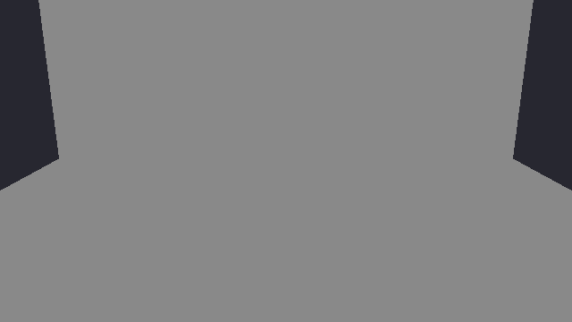
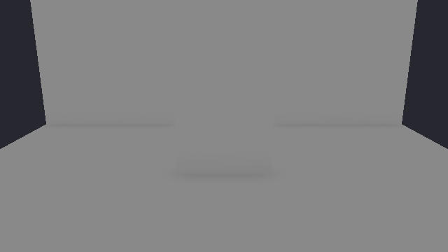

# 50 — Screen-Space Ambient Occlusion

> **Reference support:** named prepared-exercise and native-regression commands
> in this lesson run from the [reference checkout](../BranchWorkflow.md#prepared-reference-exercises).
> The growing chapter implementation remains in your learning checkout.

**Goal:** estimate nearby occlusion from the current depth image, then apply it
to diffuse ambient lighting without darkening emission or direct sunlight.

**Module:** `VulkanGraphics/ScreenSpaceAmbientOcclusion` owns two spatial
compute passes. `DeferredShading` schedules them between the G-buffer and
lighting. The USD viewer exposes their settings and diagnostic images.

**ROADMAP:** step 21+ — a renderer refinement.

**Prerequisites:** read this optional lesson after Chapters 22 and 24. Chapter
49 is independent. The particular sections used here are:

| Earlier sections | What we reuse |
| --- | --- |
| Chapter 10, sections [2](10-Cameras-And-Depth.md#2-the-projection-built-by-hand), [4](10-Cameras-And-Depth.md#4-where-the-camera-is-the-view-matrix), [7](10-Cameras-And-Depth.md#7-the-per-frame-buffer) and [9](10-Cameras-And-Depth.md#9-the-depth-buffer) | Projection/view transforms, the frame buffer and conventional depth |
| Chapter 18, sections [5](18-Anti-Aliasing.md#5-resolving-under-dynamic-rendering), [8](18-Anti-Aliasing.md#8-alpha-to-coverage-for-cutouts) and [9](18-Anti-Aliasing.md#9-what-msaa-cannot-fix) | Resolves, coverage, and why one resolved value is not every surface in a pixel |
| Chapter 20, sections [2](20-Compute-Fundamentals.md#2-the-compute-pipeline)–[5](20-Compute-Fundamentals.md#5-barriers-between-dispatches) | Compute pipelines, storage images and dispatch dependencies |
| Chapter 22, sections [2](22-Deferred-Shading.md#2-what-the-light-loop-reads-the-g-buffer)–[6](22-Deferred-Shading.md#6-the-lighting-pass), [9](22-Deferred-Shading.md#9-msaa-and-why-the-deferred-path-stays-at-one-sample) and [11](22-Deferred-Shading.md#11-measuring-both) | G-buffer material fields, position reconstruction, tiled lighting, single-sample scope and timings |
| Chapter 24, sections [4](24-Image-Based-Lighting.md#4-the-diffuse-cube-and-the-switch)–[9](24-Image-Based-Lighting.md#9-both-paths-dome-lights-and-the-cost) | Diffuse/specular IBL, material AO and the two lighting paths |

This implementation supports **the USD viewer's deferred path at 1x MSAA**.
Forward rendering, Horizon's reversed depth and coverage foliage are later
integration problems. Unsupported command-line combinations are rejected;
interactive path changes report that AO is inactive. Neither establishes AO
support on that path.

### Three Parts, Three Stopping Points

| Part | Observable result | What that result establishes |
| --- | --- | --- |
| 1, sections 1–2 | Positions reconstructed from known depth values | Projection, coordinate and background conventions |
| 2, sections 3–4 | Raw and spatially filtered visibility images | A local screen-space field with bounded values |
| 3, sections 5–7 | Ambient-only darkening with separate GPU costs | Correct integration for the initial deferred consumer |

Each central problem has acceptance checks before its three hints and worked
answer. The worked listings below teach selected mechanisms; the linked source
contains their assembled resource ownership. Follow the
[stage guide](https://github.com/ZevosSky/PillowFort-private/blob/reference-main/Tests/TutorialHarness/Stages/README.md) for protected source
exercises and their actual verification status. A named source pair is a
selected exercise on the reference, not evidence that every listing below was
built as a historical intermediate engine.

**Working source:** these are exercises on a prepared current-reference
checkout. The resource owner, fixtures and deferred integration are provided
support for the bounded problems; this is not a patch to paste directly onto
a historical Chapter 22 or 24 checkout. Part 1 begins with arithmetic, Part 2
edits the actual visibility generator, and Part 3 explains the supplied
lighting integration so you can transfer it deliberately.

The `ch50-ao-strength` pair, for the problem
[CH50-occlusion-field](#ch50-occlusion-field), pins reference commit
`bbbe966`. Prepare and build its Starter in Debug from the outer reference
checkout:

```powershell
./Tests/TutorialHarness/Stages/Invoke-LearningStage.ps1 `
    -Stage ch50-ao-strength -Variant Starter -Action Prepare
./Tests/TutorialHarness/Stages/Invoke-LearningStage.ps1 `
    -Stage ch50-ao-strength -Variant Starter -Action Build `
    -Configuration Debug -BuildWorkers 1 `
    -MinimumAvailableMemoryMiB 4100 -MemoryFloorMiB 3072
$lessonSource = (Resolve-Path ./Build/LearningStages/ch50-ao-strength/Starter/Source).Path
$lessonExe = Join-Path $lessonSource 'Build/Artifacts/Debug/SandboxGame/SandboxGame.exe'
```

Its one intended failure is the positive-strength oracle,
`FAIL: Graphics oracle failed: RTX-ao-positive-strength-response` on the RTX
suite; the healthy controls must pass. Edit the Starter under
`$lessonSource`, keeping the independent image oracles outside the repair.
The inspection commands below run `$lessonExe`, the prepared `SandboxGame`,
in the USD viewer's deferred path on the Cornell Box; the solved root
reference binary cannot show that a change to your Starter works. How to run
it: [Working a prepared exercise](ReferenceSolutions.md#working-a-prepared-exercise).

<details>
<summary>Optional comparison: the pair's own verification</summary>

Both variants have independent Debug builds and RTX/Radeon acceptance and
smoke passes. Starter fails only its declared positive-strength oracle;
Solution and the healthy controls pass.

</details>

### What Changes, And Where

```text
Shaders/AmbientOcclusion/
  AmbientOcclusionTypes.h       radius/bias/strength/sample-count push constants
  DepthPosition.glsl            current-frame depth reconstruction
  Generate.comp.glsl            the raw visibility field
  Filter.comp.glsl              depth-aware spatial filtering
Source/PillowFort/VulkanGraphics/
  ScreenSpaceAmbientOcclusion   images, descriptors, dispatches and timings
  DeferredShading               G-buffer transitions and AO-before-lighting order
  SceneRenderer                opt-in G-buffer variant and IBL descriptor forwarding
Shaders/Scene/
  GBuffer.frag.glsl             private emission RGB/material-AO alpha contract
  DeferredLighting.comp.glsl    ambient reconstruction and diffuse-only screen AO
Shaders/Include/
  ImageBasedLighting.glsl       diffuse visibility kept separate from specular
Source/PillowFort/Demos/UsdViewer/
  UsdViewerDemo                 controls, raw/filtered views and path warning
```

Headers sit beside their `.cpp` files. Shared AO declarations live under
`Shaders/AmbientOcclusion/` so C++ and GLSL see the same 16-byte push constant.
Regenerate Premake after adding the files; changing an existing shader does not
require project regeneration. Keep the current one-worker native build and
memory guards described in the [verification guide](https://github.com/ZevosSky/PillowFort-private/blob/reference-main/Tests/TutorialHarness/README.md).

The current-reference implementation gives the image/query owner the same
stable lifecycle as the earlier passes. This ownership excerpt shows its
public contract; the existing methods and private resource members are omitted:

```cpp
class ScreenSpaceAmbientOcclusion
{
public:
    ScreenSpaceAmbientOcclusion() = default;
    ScreenSpaceAmbientOcclusion(const ScreenSpaceAmbientOcclusion&) = delete;
    ScreenSpaceAmbientOcclusion& operator=(const ScreenSpaceAmbientOcclusion&) = delete;
    // Existing lifecycle methods and private resources remain in this class.
};
```

These copy deletions suppress implicit moves. The AO settings and borrowed
lighting inputs remain values. This contract applies to the current reference
and the written implementation. The sealed prepared exercise keeps its pinned
protected headers: solving its declared shader omission does not require an
ownership migration or edits to those headers.

# Part 1 — A depth value becomes a position

## 1. What AO Estimates

The sky lights a surface from many directions. A nearby wall blocks some of
those directions, so a floor close to the wall should receive less diffuse sky
light than an exposed floor. Ambient occlusion represents that loss with a
visibility factor: one means unoccluded and zero means fully occluded.

Our inputs are the nearest visible surface at each pixel and its projection.
We do not know the geometry behind that surface or outside the screen. This
is a local approximation to ambient visibility. It is not a replacement for
the sun's shadow map, a source of bounce light, or proof that distant foliage
coverage has been integrated correctly.

There are already two kinds of occlusion to keep distinct:

- A material's AO texture describes local detail authored with that material.
- This chapter's screen AO estimates nearby geometry visible in the depth image.

They may describe overlapping detail. Keep the factors separate so their
combination can be inspected, rather than turning every dark edge into an
unexplained product of several controls.

> **Jump:** a post-effect can be generated after geometry yet still belong
> inside lighting. We first make the visibility field; Part 3 changes when
> ambient lighting is evaluated so that it can consume that field.

## 2. Undo Projection Before Measuring Distance

Depth is not a distance in meters. For a conventional perspective projection
with near plane `n`, far plane `f` and view-space `z < 0`, its depth value is:

$$
d = \frac{f}{f-n} + \frac{fn}{(f-n)z}.
$$

With `n = 1`, `f = 11` and `z = -2`, depth is `1.1 - 0.55 = 0.55`.
Inverting the same expression gives:

$$
z = -\frac{fn}{f-d(f-n)} = -\frac{11}{11-0.55\cdot10} = -2.
$$

That numerical example checks the sign and nonlinear denominator. The shader
uses the inverse matrix instead of reproducing a special projection formula.
First convert the pixel center to normalized device coordinates, multiply by
the frame's inverse view-projection matrix, divide by homogeneous `w`, then
transform the world position into view space.

At normalized pixel coordinates `(0.5, 0.5)`, the device-space coordinates are
`(0, 0)`. With an identity camera pose and the projection above, depth `0.55`
therefore reconstructs `(0, 0, -2)`. For a square 90-degree view, moving to
normalized coordinates `(0.75, 0.5)` reconstructs `(1, 0, -2)`. Vulkan's Y-down
projection is already in the matrix; do not add another Y flip.

<a id="ch50-depth-position"></a>

### Attempt CH50-depth-position: measure the neighborhood in scene units

Implement `aoSurface` and `aoViewPosition` in
`Shaders/AmbientOcclusion/DepthPosition.glsl`. Use `FrameBlock.glsl`'s current
`inverseViewProjection` and `view` matrices. Predict the center and off-center
results in the example above before running the shader.

**Acceptance:** pixel centers, the camera pose and perspective divide agree
with the worked example. Depth one is background in this initial conventional
depth path. Sampling outside the image is rejected before a depth fetch.
Camera translation must not change a reconstructed *view-space* neighborhood
when the camera and fixture move together. Compare independently projected
known points rather than copying the reconstruction into an oracle.

**Transfer:** change near/far planes to `0.1/100` while keeping a plane two
meters from the camera. Its stored depth changes; the reconstructed distance
and the intended AO radius must not.

<details>
<summary>Hint 1: separate representation from distance</summary>

A pixel's depth and its device-space X/Y describe a homogeneous clip-space
point. They do not yet describe a vector on which a meter-sized radius can act.

</details>

<details>
<summary>Hint 2: reconstruct the pixel center</summary>

Add half a pixel before dividing by image dimensions. Apply the inverse
view-projection, divide all three spatial components by `w`, then apply `view`.

</details>

<details>
<summary>Hint 3: reject missing data before reconstruction</summary>

The depth image is single-sample and cleared to one. A bounds check and a
depth-less-than-one check describe valid surface samples for this consumer.

</details>

<details>
<summary>Worked solution</summary>

Put these complete functions inside the include guard in
`DepthPosition.glsl`. `frame` comes from the including shader's frame block.

```glsl
bool aoSurface(ivec2 pixel, ivec2 size, sampler2D depthImage)
{
    return all(greaterThanEqual(pixel, ivec2(0))) && all(lessThan(pixel, size))
        && texelFetch(depthImage, pixel, 0).r < 1.0;
}

vec3 aoViewPosition(ivec2 pixel, ivec2 size, sampler2D depthImage)
{
    vec2 ndc = (vec2(pixel) + 0.5) / vec2(size) * 2.0 - 1.0;
    vec4 world = frame.inverseViewProjection * vec4(ndc, texelFetch(depthImage, pixel, 0).r, 1.0);
    return (frame.view * vec4(world.xyz / world.w, 1.0)).xyz;
}
```

The short-circuit bounds check prevents an invalid texel fetch. A caller must
use `aoSurface` before asking for a position. Other depth conventions need an
explicit different background contract; renaming the helper does not provide it.

</details>

### First Stopping Point

Trace the numerical example, then inspect
[the assembled helper](https://github.com/ZevosSky/PillowFort-private/blob/reference-main/Shaders/AmbientOcclusion/DepthPosition.glsl).
Keep the background test separate from position reconstruction. Do not proceed
to tune darkening if the positions are wrong: strength can hide an error in a
screenshot without making distances correct.

This small PowerShell arithmetic checkpoint runs before a GPU build:

```powershell
$near = 1.0; $far = 11.0; $viewZ = -2.0
$depth = $far / ($far - $near) + ($far * $near) / (($far - $near) * $viewZ)
$recoveredZ = -($far * $near) / ($far - $depth * ($far - $near))
if ([Math]::Abs($depth - 0.55) -gt 1e-12) { throw 'Projection prediction failed.' }
if ([Math]::Abs($recoveredZ + 2.0) -gt 1e-12) { throw 'Depth inversion prediction failed.' }
Write-Output 'PASS: known depth and view-distance arithmetic'
```

It establishes the numerical prediction, not native shader execution. The
rendered neutral-plane/contact fixtures later exercise the actual generator.

# Part 2 — Build and filter a visibility field

## 3. Nearby Samples Must Lie Above The Surface

Let `p` be the receiver position, `N` its geometric normal and `q` a nearby
sampled position. The vector `delta = q - p` points from the receiver toward
that sample. A positive `dot(N, delta)` means the sample lies above the
receiver's tangent plane, where it could block incoming light.

We reconstruct a geometric normal from adjacent positions. At a silhouette,
one neighbor may belong to a distant surface. Choose the smaller depth jump
on each axis, then cross the two direction vectors. If only one neighbor on
an axis is valid, use it. Orient the result toward the eye. This does not
turn a depth discontinuity into reliable hidden geometry; it just avoids an
obviously incorrect cross-surface normal.

For each sample inside radius `r`, the implementation uses this bounded
obscurance contribution:

$$
o(p,q) = \frac{\max(N\cdot(q-p)-b,0)}{\|q-p\|}
\left(1-\frac{\|q-p\|^2}{r^2}\right)^2,
\qquad 0 < \|q-p\| < r.
$$

`b` is a meter-sized bias against self-occlusion. The distance falloff makes a
sample fade smoothly as it approaches the radius. Coplanar samples contribute
zero. A fixed spatial disk gives sample positions in the depth image; after
reconstruction, the distance test enforces the scene-space radius. This is a
simple screen-space obscurance estimator, not an exact hemisphere integral.

For a numerical check, take `N=(0,1,0)`, `delta=(0.1,0.1,0)`, `r=0.5` and
`b=0.02`, all distances in meters. The distance is about `0.1414`, the angular
factor is `(0.1-0.02)/0.1414 = 0.5657`, and the squared falloff is
`(1-0.02/0.25)^2 = 0.8464`. This sample contributes about `0.4788`.
With 24 total samples and strength one, that one sample alone changes
visibility from one to approximately `1 - 2*0.4788/24 = 0.9601`.

The `2` is an authored normalization, not a measured constant. The angular
factor `dot(N, delta)/|delta|` is the cosine of a sample's angle from the normal, and
over directions spread evenly above a surface that cosine averages one half.
Doubling it lets a receiver blocked on every side (with little falloff) reach
visibility zero at strength one; the clamp catches anything beyond. The screen
disk does not spread directions evenly, so treat the `2` as a gain that sets
what strength one means, not as an exact integral.

The screen footprint of `r` shrinks with distance:

$$
r_{pixels} = \frac{r\,|P_{yy}|\,H}{2\max(-p_z,\epsilon)}.
$$

`H` is image height and `P` is the projection matrix. The implementation bounds
the footprint to keep extreme near-plane cases manageable. The world-space
radius test still rejects samples outside the intended neighborhood. Samples
missing at a screen edge contribute no occlusion; the estimator therefore
loses information there rather than inventing offscreen blockers.

<a id="ch50-occlusion-field"></a>

### Attempt CH50-occlusion-field: make strength an observable contract

Finish the visibility expression in `Generate.comp.glsl`. It must map summed
obscurance to `[0,1]`, include the requested strength, and return neutral one
when strength is zero. Predict the result of doubling strength in the numerical
example before opening the answer.

**Acceptance:** an unoccluded plane and background remain neutral within the
predeclared reconstruction/format tolerance. An occluding corner produces
local nonconstant visibility. Strength zero produces a neutral image even in
that corner. A strength control that is ignored must fail the independent
corner/neutral comparison; comparing two copies of the same formula is not an
oracle. All output is finite and bounded, including near-plane and screen-edge
cases.

**Transfer:** halve the render dimensions while preserving the camera and
meter-sized radius. Predict which pattern changes are sampling error and which
would indicate that radius has accidentally become a fixed number of pixels.

<details>
<summary>Hint 1: visibility and obscurance run in opposite directions</summary>

No summed obscurance should produce visibility one. Greater obscurance or
greater strength should reduce visibility rather than brighten the surface.

</details>

<details>
<summary>Hint 2: normalize by the intended sample count</summary>

The sample loop accumulates contributions. Divide by the configured count,
including samples that found no blocker, before applying strength.

</details>

<details>
<summary>Hint 3: include the neutral endpoint explicitly</summary>

Use the shader's early return for zero strength, then clamp
`1 - 2 * strength * obscurance / samples` to the visibility interval.

</details>

<details>
<summary>Worked solution</summary>

The generator's early return establishes an exact neutral endpoint for its
stored mask; the expression also includes strength for all positive values.
These lines belong in `Generate.comp.glsl`'s `main`, at its existing early
return and final store respectively:

```glsl
if (!aoSurface(pixel,size,sceneDepth) || ao.strength<=0.0)
{
    imageStore(rawAo,pixel,vec4(1.0));
    return;
}
```

```glsl
float visibility=clamp(1.0-2.0*ao.strength*obscurance/float(ao.samples),0.0,1.0);
imageStore(rawAo,pixel,vec4(visibility));
```

The [complete generator](https://github.com/ZevosSky/PillowFort-private/blob/reference-main/Shaders/AmbientOcclusion/Generate.comp.glsl)
contains the normal construction, stable per-pixel rotation and bounded sample
loop described above. Its hash depends on pixel coordinates, not frame time.
There is no temporal accumulation or history buffer hidden in this first
implementation.

Doubling strength in the numerical example gives approximately `0.9202`.
That is a useful directional check before inspecting an image. It is not a
universal reference value for a rendered corner containing many samples.

</details>

### Protected Source Exercise

The registered `ch50-ao-strength` source pair edits this production generator.
The Starter removes strength from the final obscurance application, while the
Solution retains it. The independent rendered oracle must compare a genuinely
occluding fixture at different positive strengths as well as zero strength:
the early zero-strength return alone would let a broken positive-strength
expression pass a zero-only check. Preserve the rest of the field and the
lighting-isolation tests as healthy controls.

Use the source commit, preparation commands and verification status in the
stage catalog. Both independent Debug builds, RTX/Radeon acceptance checks and
all four smokes pass. Starter fails only its positive-strength response oracle;
Solution and healthy controls pass. The buildable omission lets the failing
observation explain which mechanism the learner must fix.

## 4. Filter Without Smearing A Foreground Edge

The stable spatial pattern avoids flickering random numbers, but its raw field
can be noisy. A small spatial blur reduces that noise. An ordinary image blur
would also drag a dark foreground value across a background edge.

Weight a neighbor by both pixel distance and reconstructed view-depth
difference. The implemented five-by-five filter uses:

```glsl
float depthWeight=exp(-abs(position.z-p.z)/max(0.1*ao.radius,0.001));
float spatialWeight=exp(-float(x*x+y*y)/4.0);
float weight=depthWeight*spatialWeight;
total+=texelFetch(rawAo,q,0).r*weight;
weights+=weight;
```

These are the inner-loop lines in
[`Filter.comp.glsl`](https://github.com/ZevosSky/PillowFort-private/blob/reference-main/Shaders/AmbientOcclusion/Filter.comp.glsl). The
complete shader rejects missing surface samples, includes the center sample,
and divides by the accumulated weights before clamping. A constant visibility
field therefore remains constant. A depth-aware filter reduces one source of
edge bleeding; it does not recover geometry that screen space never captured.

### Second Stopping Point

Run the USD viewer's deferred path at 1x, enable AO, and select **Raw visibility**
then **Filtered visibility** in the Rendering panel. For a bounded application
payload after the guarded build, the corresponding controls are:

```powershell
& $lessonExe `
    --gpu RTX --demo "USD viewer" --scene (Join-Path $lessonSource 'Assets/Scenes/CornellBox.usda') `
    --render-path deferred --msaa 1 --ao 1 --ao-radius 0.6 `
    --ao-strength 1 --ao-view raw --sky off --clouds 0 --bloom 0 `
    --tone-curve raw --exposure 0 --fixed-dt 0.016666667 --frames 60
```

Every flag is listed in [SandboxGame's command line](../VulkanTutorial.md#sandboxgames-command-line).

Use the project's native launch/memory supervision, one GPU run at a time.
Change only `--ao-view filtered` for the matched filter inspection. These
commands select a view; actual captures, validation logs and acceptance checks
remain separate evidence. Cornell Box is a convenient inspection scene, not
the independent neutral-plane/known-corner oracle.
Keep tone mapping, exposure and bloom fixed while inspecting a visibility
mask: its stored neutral value is one, while an arbitrary display transform
could make that same neutral value look gray or add a halo.

# Part 3 — Put the field inside lighting

## 5. Change The Ambient Evaluation Order

| Ambient fixture, neutral strength | Same fixture, strength 1 |
| --- | --- |
|  |  |

Inspect the contacts, not the whole image's average brightness. The fixture
([AoContactAmbient.usda](https://github.com/ZevosSky/PillowFort-private/blob/reference-main/Tests/TutorialHarness/GraphicsFixtures/AoContactAmbient.usda))
also stands a 1.4 m box on the floor in front of the back wall. Under this
uniform dome every face receives the same ambient light, so in the neutral
image the box has no visible edges at all. With strength one its contact
appears: the darkest band, in the middle of the floor, is the box's front edge
meeting the floor, and the box hides the middle of the back wall's contact
line. That band is expected, not an artifact. These are lit outputs from a
matched deferred 1x fixture, not visibility-mask previews.
Separate direct-only and emissive controls establish which terms are untouched.
The [capture notes](ReferenceImages.md#darken-nearby-ambient-contact) give the
settings and evidence boundary.

Chapter 24 evaluates ambient light while filling the G-buffer. That was
convenient because the fragment shader still had unquantized material values.
The later tiled compute pass loaded ambient plus emission and added direct
lights. Current-frame AO does not exist until the depth image is complete.

Multiplying the finished image by AO is therefore a tempting wrong shortcut:
it darkens the sun and emission along with ambient light. Adding another full
HDR attachment just to retain ambient separately would also carry memory and
bandwidth cost for every pixel.

The opt-in path uses spare alpha between two private passes:


This is not a new public definition of scene alpha. It exists only between the
selected G-buffer variant and its matching lighting dispatch. The legacy
variant still writes ambient plus emission and alpha one. `SceneRenderer`
selects the variants together, and suppresses AO for material/G-buffer debug
views so that an unlit early return cannot expose emission-only data as a
finished diagnostic image.

> **Jump:** changing storage order can change numerical results even when AO
> is neutral. Ambient in the new path uses quantized G-buffer color, roughness,
> IOR and normals. Keep the unchanged disabled route as a control, and define
> the expected quantization tolerance before looking at candidate images.

<a id="ch50-ambient-only"></a>

### Attempt CH50-ambient-only: darken the sky contribution, not the sun

Wire the private G-buffer result into deferred lighting. Use the same material
fields already reconstructed for direct lighting. Add the missing diffuse cube
and BRDF-LUT descriptors beside the existing specular cube. Decide which term
screen AO modifies before editing the shader.

**Acceptance:** with ambient disabled, changing AO does not change direct-only
or emissive-only output. With diffuse ambient enabled, contact regions darken
locally. Specular receives its existing material-AO treatment, not the new
screen factor. AO disabled uses the legacy G-buffer/lighting path. AO enabled
with neutral visibility is compared using a tolerance fixed from storage
precision and the reference fixture, not one chosen after an image fails.
Material normal/mip views, deferred debug views and final alpha retain their
declared behavior.

**Transfer:** select a metallic material. Explain why a diffuse-only screen AO
factor should have little or no effect on its sky reflection. What extra model
would be needed to justify specular occlusion rather than multiplying it too?

<details>
<summary>Hint 1: preserve three independent contributions</summary>

Emission is radiance supplied by the material. Direct sunlight already has a
shadow test. Diffuse ambient is the contribution this screen visibility field
is intended to attenuate.

</details>

<details>
<summary>Hint 2: store what deferred lighting cannot reconstruct</summary>

The G-buffer already contains base color, metallic, roughness, IOR and normals.
It does not contain the material AO texture's result or emission. Keep those
in the private scene RGB/alpha payload until lighting consumes them.

</details>

<details>
<summary>Hint 3: put the factor inside the diffuse term</summary>

For IBL, combine `materialAO * (screenAO * diffuse + specular)`. Do not combine
`screenAO * materialAO * (diffuse + specular + emission + direct)`.

</details>

<details>
<summary>Worked solution</summary>

The G-buffer shader has specialization constant `deferAmbient`. At its final
scene-target store, keep the legacy path and the private AO path explicit:

```glsl
outColor = deferAmbient ? vec4(min(emissive, vec3(64000.0)), occlusion)
                        : vec4(min(color, vec3(64000.0)), 1.0);
```

In `DeferredLighting.comp.glsl`, after reconstructing `SurfaceSample`, `N` and
`V`, start from the payload and evaluate ambient only for that matching path:

```glsl
vec4 initial = imageLoad(sceneColor, pixel);
vec3 color = initial.rgb;
if (parameters.ambientOcclusion != 0u)
{
    color += evaluateAmbientLightScreenAO(s, N, V, lightHeader.ambient.rgb,
                                         initial.a, frame.ambientMode, ao);
}
```

`ao` is the sampled current-frame visibility factor. The existing direct-light
loop follows unchanged, and the final scene store restores alpha one. For the
GGX/Blinn-Phong IBL paths, the helper's final combination is:

```glsl
return occlusion * (diffuse * screenAo + reflectance * specularLight);
```

The complete
[ambient helper](https://github.com/ZevosSky/PillowFort-private/blob/reference-main/Shaders/Include/ImageBasedLighting.glsl) also handles
Lambert and the constant-ambient route. Screen AO is a separate argument from
material AO, so those two policies are inspectable rather than silently shared.

`SceneRenderer::SetImageBasedLighting` now retains all three borrowed IBL image
infos and forwards them to `DeferredShading`, including late deferred setup.
The lighting layout keeps diffuse/specular/LUT at bindings 10/11/12 and screen
AO at binding 20. A neutral, valid sampled AO image is bound after resize even
when the effect is off; an unused branch is not permission for invalid Vulkan
descriptors.

The lookup table has a reader it did not have before. Chapter 24, section 7's
`ComputeLut` writes it once in compute, and its hand-over barrier already
names `COMPUTE_SHADER` beside `FRAGMENT_SHADER` in the destination for this
pass, as the two cubes' barriers do; if your copy names only the fragment
stage, add it now, because this lighting pass samples the table in a compute
shader. Sync validation cannot catch the missing stage: the write runs in its own
`immediateSubmit`, and the layer does not look across that host fence wait to
this later submission. Argue it from Chapter 4, section 5's three questions
instead: what must wait is now the compute stage as well as the fragment
stage; the storage writes are made visible to sampled reads in both; and the
layout answer is unchanged, `GENERAL` to `SHADER_READ_ONLY_OPTIMAL` once.

</details>

## 6. One Owner For Each Transition

`DeferredShading::PrepareLightingInputs` owns the transitions from G-buffer
attachments to sampled inputs, depth attachment to sampled depth, and scene
color attachment to storage image. It runs once before AO and lighting.
The lighting pass must not repeat those transitions while still claiming the
old attachment layouts.

`ScreenSpaceAmbientOcclusion::Record` owns only its two masks:

1. Prior sampled mask reads finish before the next storage writes.
2. Generate writes raw visibility, then a storage-write-to-sampled-read barrier
   makes it available to the filter.
3. Filter writes filtered visibility, then another barrier makes that image
   available to deferred lighting.

The component allocates full-resolution `R32_SFLOAT` masks. This avoids requiring
optional extended storage-image formats in the first implementation. Its two
images use eight bytes per pixel, about 15.8 MiB at 1920×1080, excluding allocator
overhead. They are initialized to neutral one and readable layouts during
resize. The owner rebuilds descriptors with the new views and supports cleanup
after a partially failed allocation or pipeline initialization.

There is one set per frame slot because frame buffers differ, while the masks
are reused on the same graphics queue with explicit dependencies. Descriptor
updates for the selected raw/filtered view happen only for the frame slot whose
fence has been waited. Do not generalize that into rewriting sets still used by
another in-flight frame.

## 7. Third Stopping Point And Exit Check: Correctness And Cost

The permanent independent runner is
[`VerifyGraphics.ps1`](https://github.com/ZevosSky/PillowFort-private/blob/reference-main/Tests/TutorialHarness/VerifyGraphics.ps1). Run its
AO suite with a fresh output name; it supervises serial native cases with the
4100 MiB launch gate, 3072 MiB runtime floor and bounded timeouts:

```powershell
& (Join-Path $lessonSource 'Tests/TutorialHarness/VerifyGraphics.ps1') `
    -Suite AmbientOcclusion -Gpu RTX -Configuration Debug `
    -Executable $lessonExe -ProjectRoot $lessonSource -OutputName AO-Debug-First
```

Use another fresh name for Radeon or Release. The runner also accepts
`-Executable`, `-ProjectRoot` and `-OutputDirectory` for an independently built
source pair. Choose exactly one output destination form. Selecting a suite is
not a claim that it has passed; retain that run's `run.json`, `results.json`,
logs and actual images.

Its fixtures live under
[`GraphicsFixtures`](https://github.com/ZevosSky/PillowFort-private/tree/reference-main/Tests/TutorialHarness/GraphicsFixtures):

| Fixture/control | Predeclared oracle |
| --- | --- |
| `AoContactAmbient`, AO off versus enabled strength zero | At most two display-channel LSBs from the packed material path; the fixture uses representable roughness/IOR and axis-aligned normals |
| `AoContactAmbient`, neutral versus strength one | Changed pixels, a maximum channel difference of at least three LSBs, and a lower encoded-image mean |
| `AoContactAmbient`, strength one versus two | Changed pixels, at least one display-channel LSB of difference, and a lower mean for the stronger setting |
| `AoContactDirect` and `AoContactEmissive`, neutral versus strength one | Exact RGB equality: screen AO must not affect either isolated contribution |
| `AoPlane`, filtered visibility | White within one display-channel LSB, including the background |

Explicit dome lights prevent the viewer from inventing a fallback sun. An IOR
of one isolates diffuse response. These controls are designed separately from
the production sample loop. The positive-strength omission must fail with
`Graphics oracle failed: RTX-ao-positive-strength-response` on the RTX suite,
while the other healthy contracts continue to run in the repaired Solution.
The final Debug reference graphics matrix passed on RTX and Radeon, including
the AO lighting-isolation controls. The source pair's independent Debug builds,
acceptance and all four smokes also pass on both GPUs. Starter fails only the
positive-strength response; Solution passes all controls. No numerical
tolerance was relaxed to accept a candidate.

Use the Rendering panel's AO generation/filter timings separately from the
deferred light pass total. An AO field can look reasonable and still cost more
than its contribution justifies. Record matched resolution, sample count,
camera/time, exposure, source/binary identity and image allocation bytes.

The USD viewer's `--benchmark <fresh.csv>` output provides `ao_active`,
`gpu_ao_generate_ms`, `gpu_ao_filter_ms` and `ao_bytes`. The byte count sums
the masks' reported allocation sizes; `ao_active=0` does not imply that their
allocations have been released. Pass times are the latest completed GPU query
results, while the active flag and byte count describe the latest demo state.
They are not guaranteed to describe the same frame during a setting change.
Measure stable matched windows, retain the source/binary identity, and keep
capture readbacks outside those windows. The AO intervals already belong to
the render work; do not add them again to its total.

Before describing this slice as ready, retain separate evidence for:

- Known-point reconstruction, plane/background neutrality, bounded finite masks
  and the independent positive-strength control.
- Direct-only, emission-only, material/debug and disabled-path behavior.
- Native Vulkan execution and synchronization validation, including resize,
  demo changes and AO toggles with frames in flight.
- Inspected raw/filtered/lit images at contacts, silhouettes, near-plane cuts
  and screen boundaries.
- Release generation/filter/lighting cost without capture stalls in the timing
  window.

The [roadmap](https://github.com/ZevosSky/PillowFort-private/blob/reference-main/ROADMAP.md#graphics-systems-plan) records current evidence
and unfinished gates. Tutorial text and a successful build do not establish
that the rendered oracle, appearance or cost checks ran.

### Why The Horizon Transfer Is Separate

Forward and Horizon shade ambient while drawing geometry, before the current
depth image is complete. They need a depth-before-lighting strategy or another
explicit lighting separation. Their multisampled leaf/grass coverage also
cannot be inferred from the visibility system's existing farthest-sample depth
resolve. Establish receiver/occluder policy, matching deformation and coverage,
both depth conventions and total prepass/bandwidth cost before expanding this
consumer. Water, spray and sky require their own choices too.

Preserve the accepted grass rendering while investigating those choices. A
correct single-sample deferred result is a completed bounded feature; it is
not a claim that every renderer now has AO.

Back where you branched: [25 — Grass I: Blades](25-Grass-Blades.md) in number
order, or [28 — Clouds](28-Clouds.md) on the renderer route. The other
refinements: [49 — Bloom and Color Grading](49-Bloom-And-Color-Grading.md) and
[51 — Atmosphere and Aerial Perspective](51-Atmosphere-And-Aerial-Perspective.md),
which does not depend on completing the Horizon AO transfer. Or the
[routes](../VulkanTutorial.md#routes).
