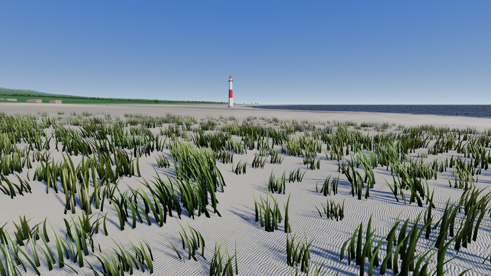
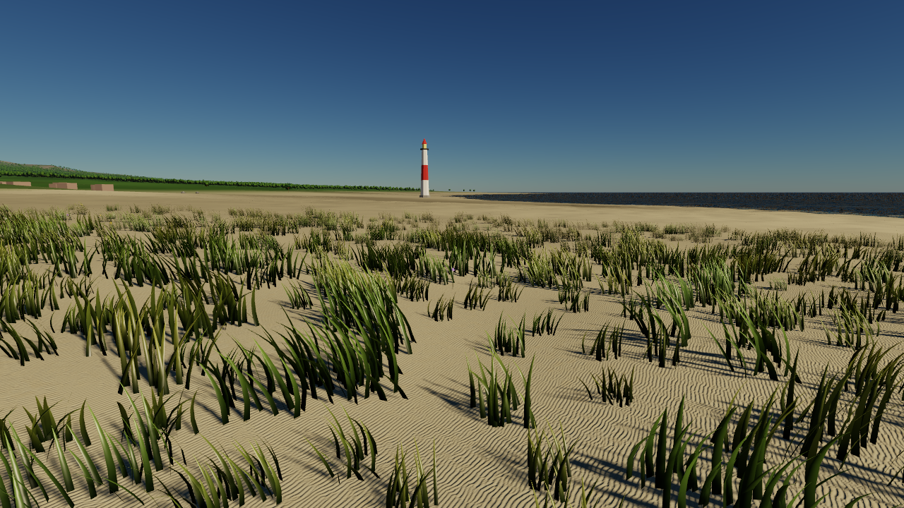
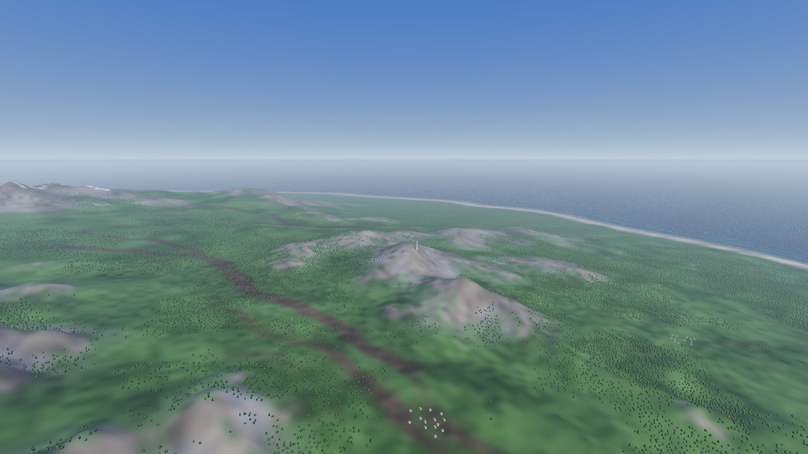
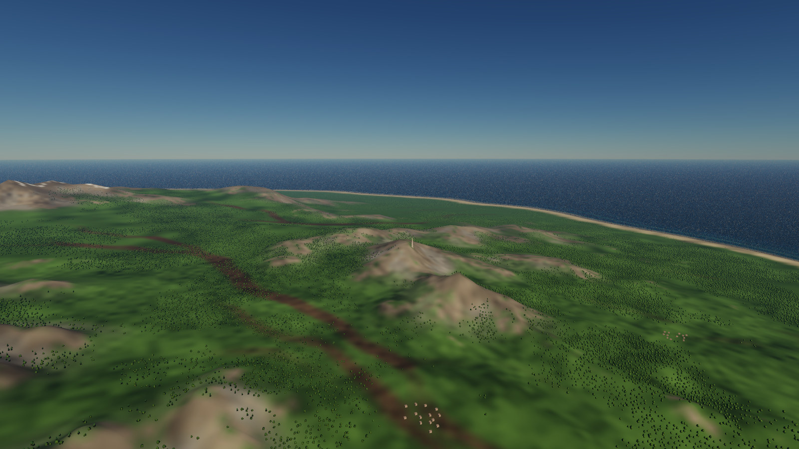

# 51 — Atmosphere And Aerial Perspective

> **Reference support:** named prepared-exercise and native-regression commands
> in this lesson run from the [reference checkout](../BranchWorkflow.md#prepared-reference-exercises).
> The growing chapter implementation remains in your learning checkout.

**Goal:** build one small model of the air that lights the sky, the scene's
sunlight and the air between a surface and the eye alike, and apply it to each
surface exactly once.

The sky and the objects below it must describe the same light. Build a small
transport model, reuse it to illuminate the scene, and account for the air
between a surface and the camera without turning that air into a second
lighting or tone-mapping system.

**ROADMAP:** step 21+ — a renderer refinement.

**Prerequisites:** Chapters 23 and 24: cube directions, radiance, sunlight,
diffuse/specular IBL and its update lifetime. Revisit Chapter 20's storage-image
dispatches/barriers and Chapter 10's world/view directions. Chapter 28, sections
[2](28-Clouds.md#2-fog-measured)–[3](28-Clouds.md#3-marching-a-ray) and
[6](28-Clouds.md#6-sunlight), supply optional background on transmittance and
scattering; its cloud noise, grass and marching implementation are not
prerequisites. Chapters 49 and 50 are independent lessons, not prerequisites
here.

| Earlier sections | What this lesson uses |
| --- | --- |
| Chapter 23, sections [1](23-The-Sky.md#1-what-a-sky-is-light-that-arrives-from-a-direction)–[3](23-The-Sky.md#3-the-cube-on-the-gpu) and [6](23-The-Sky.md#6-a-sky-computed-from-the-sun)–[8](23-The-Sky.md#8-one-setting-and-the-first-demo) | Directional radiance, cube storage, sunlight and the `Update`/`Draw` boundary |
| Chapter 24, sections [1](24-Image-Based-Lighting.md#1-why-one-ambient-color-is-wrong) and [3](24-Image-Based-Lighting.md#3-the-class-its-images-and-a-smaller-sky)–[9](24-Image-Based-Lighting.md#9-both-paths-dome-lights-and-the-cost) | Sky lighting, diffuse/specular filtering, solar units and IBL lifetime |
| Chapter 20, sections [2](20-Compute-Fundamentals.md#2-the-compute-pipeline)–[5](20-Compute-Fundamentals.md#5-barriers-between-dispatches) | Compute pipelines, storage-image writes and dependencies between dispatches |
| Chapter 10, sections [1](10-Cameras-And-Depth.md#1-four-spaces-and-the-one-you-already-know), [2](10-Cameras-And-Depth.md#2-the-projection-built-by-hand) and [4](10-Cameras-And-Depth.md#4-where-the-camera-is-the-view-matrix) | World/view directions, projection and the camera transform |
| Optional Chapter 28, sections [2](28-Clouds.md#2-fog-measured), [3](28-Clouds.md#3-marching-a-ray) and [6](28-Clouds.md#6-sunlight) | A second explanation of extinction, ray marching and phase functions |

**Scope:** an opt-in near-ground Earth-like atmosphere. Scene distances remain
metres; transport arithmetic uses kilometres. The observer is clamped to
1–1500 m above a local reference plane. The global lighting cube uses a fixed
1 m altitude. These are explicit approximations, not a ground-to-orbit model.
The original Ocean exercise has its own gradient/frame bindings and remains a
historical comparison; the shared Sea and Horizon paths consume the atmosphere.
This chapter does not add local fog, shadowed light shafts or weather simulation.

**Start here:** predict the slab result in section 1 before reading its
answer. Then inspect one transmittance LUT before integrating a sky. Keep
mathematical checks, native Vulkan execution, inspected appearance and Release
timing separate. The [roadmap](https://github.com/ZevosSky/PillowFort-private/blob/reference-main/ROADMAP.md#graphics-systems-plan) records
the actual verification state; writing these listings does not establish a
native, visual or timing pass.

| Part | Observable result | Stopping point |
| --- | --- | --- |
| 1, sections 1–2 | A numerical transmission calculation with known units | A zero-density identity and a converged direct solar reference |
| 2, sections 3–4 | Physical sky and scene sunlight agree | The sky/IBL changes on a sun edit, while camera motion leaves IBL alone |
| 3, sections 5–7 | Distant surfaces receive finite-distance aerial perspective | Actual shader composition, then water/foliage integration and cost |

### What Changes, And Where

| Owner/file | Responsibility |
| --- | --- |
| `VulkanGraphics/AtmosphereMath.h` | Double-precision CPU solar optical-depth reference, with no Vulkan state |
| `VulkanGraphics/Atmosphere.h/.cpp` | Images, samplers, compute pipelines, neutral initialization, invalidation and timings |
| `Shaders/Atmosphere/Transport.glsl` | Radius/distance mappings, density, phase functions and slab integration |
| `Shaders/Atmosphere/*.comp.glsl` | Transmittance, multiple-scattering closure, sky-view and aerial LUT generation |
| `VulkanGraphics/Sky.h/.cpp` | Physical mode selection, reference cube/IBL, visible sky, disk and cloud sunlight |
| `Shaders/Include/AtmosphereSampling.glsl` | Surface-side solar transmission, finite-segment sampling and water transport |
| `Shaders/Include/DistanceHaze.glsl` | Select physical transport or the unchanged legacy haze route |
| `FrameData.h`, `SharedShaderTypes.h` | Explicit enabled/exposure/range/observer-altitude data, appended with layout asserts |
| `SceneRenderer`, `DeferredShading` | Bind valid atmosphere descriptors beside the existing sky lighting |

Paths in this table are relative to `Source/PillowFort/` or `Shaders/` as
shown. The complete resource owner is
[Atmosphere.cpp](https://github.com/ZevosSky/PillowFort-private/blob/reference-main/Source/PillowFort/VulkanGraphics/Atmosphere.cpp).
Use its named functions as the assembly reference; do not copy the whole
current renderer into a historical chapter checkpoint. New source/shaders
require regenerating Premake before building.

The current-reference implementation keeps the atmosphere's images, pipelines
and query pools under one stable owner. This excerpt shows its public
contract; the existing methods and private resource members are omitted here:

```cpp
class Atmosphere
{
public:
    Atmosphere() = default;
    Atmosphere(const Atmosphere&) = delete;
    Atmosphere& operator=(const Atmosphere&) = delete;
    // Existing lifecycle methods and private resources remain in this class.
};
```

The deleted copy operations suppress implicit moves. `AtmosphereSettings` and
borrowed `AtmosphereImageInfos` remain values. This contract applies to the
current reference and the written implementation. The sealed prepared exercise
keeps its pinned protected headers: solving its declared math omission does
not require an ownership migration or edits to those headers.

### Enter The Prepared Source Route

The runnable exercise is on prepared **current-reference source**, not a patch
to paste into the historical source immediately after Chapter 24. That source
already supplies the later frame/resource interfaces named above. Reading this
lesson after 24 does not require learning the terrain or grass implementations
first; those are separately marked integration transfers.

The entry is `ch51-segment-transmission`, for the problem
[CH51-finite-segment](#ch51-finite-segment); the catalog pins `84b3b99`, the
focused ground-boundary revision in section 4. Prepare and build its Starter
in Debug from the outer reference checkout, keeping that working directory
for later stage commands:

```powershell
./Tests/TutorialHarness/Stages/Invoke-LearningStage.ps1 `
    -Stage ch51-segment-transmission -Variant Starter -Action Prepare
./Tests/TutorialHarness/Stages/Invoke-LearningStage.ps1 `
    -Stage ch51-segment-transmission -Variant Starter -Action Build `
    -Configuration Debug -BuildWorkers 1 `
    -MinimumAvailableMemoryMiB 4100 -MemoryFloorMiB 3072
$lessonSource = (Resolve-Path ./Build/LearningStages/ch51-segment-transmission/Starter/Source).Path
$lessonExe = Join-Path $lessonSource 'Build/Artifacts/Debug/TutorialAtmosphereGpuTests/TutorialAtmosphereGpuTests.exe'
```

The Starter must compile; its one intended failure is the finite-segment
oracle, `FAIL: finite-segment GPU transport disagrees with independent analytic slab`,
after the healthy ground, LUT, water and low-sun controls pass. Edit the
Starter under `$lessonSource`. `$lessonExe` is the focused GPU test program
`TutorialAtmosphereGpuTests`, not `SandboxGame`; the stage's smoke runs Horizon.
How to run it: [Working a prepared exercise](ReferenceSolutions.md#working-a-prepared-exercise).

<details>
<summary>Optional comparison: the pair's own verification</summary>

That revision has its own Debug/Release numerical passes on RTX and Radeon.
Both independent Debug builds, RTX/Radeon acceptance checks and all four
smokes pass. Each GPU's Starter fails only its finite-segment transport
oracle after healthy ground/LUT/water/low-sun controls pass; Solution passes
all controls. Those receipts do not verify the reader's repair.

</details>

# Part 1 — Light surviving a path

## 1. Optical Depth Has No Units

An extinction coefficient says how quickly a beam loses light per unit
distance. For a homogeneous slab,

`tau = extinction * distance`, and `T = exp(-tau)`.

`tau` is optical depth: multiplying inverse kilometres by kilometres removes
the units. `T` is transmittance, between zero and one. It is a fraction of the
original light, not a color to add. If the path doubles, optical depth doubles;
transmittance is squared rather than halved.

For `extinction = 0.2/km` and `distance = 3 km`, `tau = 0.6` and
`T = 0.5488116361`. A source with radiance 2 contributes about 1.0976232722
after that slab. If the slab also sends radiance 0.3 toward the viewer, the
result is `2*T + 0.3 = 1.3976232722`.

<a id="ch51-transmittance"></a>

### Attempt CH51-transmittance: make the units cancel

Write a scalar slab function accepting extinction per kilometre and a scene
distance in metres. Predict its result at 0, 3000 and 6000 m. Use the same
function for each RGB channel when their extinction differs.

**Acceptance:** zero distance or zero extinction returns 1; the 3000 m result
matches the worked value above; the 6000 m result matches the square of the
3000 m result. Fix tolerances before running the candidate. This calculation
has no GPU storage quantization, so a double-precision tolerance of `1e-12`
on these scalar values is sufficient.

**Transfer:** express extinction per metre instead. Identify the one
conversion that must disappear; changing both the coefficient and distance
would apply the conversion twice.

<details>
<summary>Hint 1: follow the units</summary>

Convert the scene distance to kilometres before multiplying by a coefficient
whose unit is inverse kilometres.

</details>

<details>
<summary>Hint 2: separate loss from surviving light</summary>

Form optical depth first. Apply a negative exponential to it; `1-exp(-tau)`
is the lost fraction, which the transmission test is not asking for.

</details>

<details>
<summary>Hint 3: write the identity explicitly</summary>

With `distanceMetres*0.001`, both zero cases make the exponent zero. There is
no need to divide by extinction or insert an arbitrary small denominator.

</details>

<details>
<summary>Worked solution</summary>

This complete CPU calculation can be placed in a small C++20 console source;
it needs only the standard library.

```cpp
#include <cmath>
#include <iostream>

double SlabTransmission(double extinctionPerKm, double distanceMetres)
{
    const double opticalDepth = extinctionPerKm * distanceMetres * 0.001;
    return std::exp(-opticalDepth);
}

int main()
{
    const double first = SlabTransmission(0.2, 3000.0);
    if (SlabTransmission(0.2, 0.0) != 1.0 || SlabTransmission(0.0, 3000.0) != 1.0
        || std::abs(first - 0.5488116360940264) >= 1e-12
        || std::abs(SlabTransmission(0.2, 6000.0) - first * first) >= 1e-12)
    {
        std::cerr << "FAIL: scalar atmosphere slab checks\n";
        return 1;
    }
    std::cout << "PASS: scalar atmosphere slab checks\n";
    return 0;
}
```

This is a scalar mathematical checkpoint. It does not test a LUT, a shader,
or the native application's image handling.

</details>

## 2. Density Changes With Height

The implementation uses Rayleigh scattering from air molecules and an
absorptive Mie aerosol model. At altitude `h` kilometres, their density
profiles are `exp(-h/8)` and `exp(-h/1.2)`. The shorter aerosol scale height
concentrates it close to the ground. A density multiplier changes both
profiles; it is not a multiplier applied to already-transmitted sunlight.

The sea-level Rayleigh extinction coefficients are
`(0.005802, 0.013558, 0.033100)/km`. Aerosol extinction is `0.004440/km`;
its scattering coefficient is smaller, `0.003996/km`, because some light is
absorbed. Keeping extinction and scattering distinct matters: absorbed energy
cannot reappear as light scattered toward the eye.

For a vertical, infinite exponential column, integrate
`exp(-h/H)` from zero upward: the result is `H`. Ignoring the negligible
density beyond 100 km gives a useful analytic check:

| Channel | Vertical optical depth | Transmission |
| --- | --- | --- |
| Red | `0.005802*8 + 0.004440*1.2 = 0.051744` | 0.9495719261 |
| Green | `0.013558*8 + 0.004440*1.2 = 0.113792` | 0.8924435648 |
| Blue | `0.033100*8 + 0.004440*1.2 = 0.270128` | 0.7632817880 |

Blue is removed more strongly from the direct beam. Do not obtain sunset
color by separately tinting the visible disk and scene sunlight.

For other directions, the ray remains straight while crossing spherical
density shells. For a unit ray direction `d` and origin radius `r`, put
`b = r*dot(up,d)`. The top-of-atmosphere distance is
`-b + sqrt(b*b + (Rtop-r)*(Rtop+r))`. This is the positive quadratic root.
Factoring the difference of squared radii avoids subtracting two large,
nearly equal numbers before multiplication.

> **Jump:** a ray/sphere boundary distance is a geometry calculation before it
> is a light calculation. With ray point `origin + t*d`, expand
> `|origin+t*d|²=R²` into `t²+2*b*t+r²-R²=0`, then solve that quadratic.
> Choose the first nonnegative boundary intersection appropriate to the ray.

For a numerical bridge, put the observer at radius `6361 km`, one kilometer
above a `6360 km` ground sphere. Looking straight up gives `b=6361`; the
top boundary at `6460 km` is `-6361+6460=99 km` away. Looking straight down
instead gives `b=-6361`; the first ground intersection is `6361-6360=1 km`
away. These simple answers check root selection before a grazing ray makes
the geometry less obvious.

The ground-intersection discriminant instead contains
`b*b - (r-Rground)*(r+Rground)`. A downward ray with a nonnegative
discriminant hits the planet. Such a direct solar ray is blocked; the
zero-density identity does not make an opaque planet transparent.

**CPU reference checkpoint:**
[AtmosphereSunTransmittance](https://github.com/ZevosSky/PillowFort-private/blob/reference-main/Source/PillowFort/VulkanGraphics/AtmosphereMath.h)
uses double-precision midpoint integration. Compare successively doubled step
counts before selecting a reference tolerance. A high-sample result is a
reference only after its change on refinement is smaller than the tolerance
you intend to use for the GPU candidate.

# Part 2 — One atmosphere for sky and lighting

## 3. A LUT Is A Coordinate Contract

The transmittance image stores the surviving RGB solar fraction as a function
of altitude and ray direction. It has no sun color or exposure baked into it.
The lookup accepts a radius and direction toward the sun, rejects planet
occlusion, then samples that fraction.

Altitude uses a squared mapping: a uniformly spaced image row represents
`height = rowFraction²*100 km`. More rows are spent near the dense ground.
The directional coordinate starts at the geometric horizon for that radius,
then squares its fraction toward the zenith. Ground-blocked directions are
tested before sampling. Allocating half the image to blocked directions and
interpolating their zeros into visible low sunlight would make the vacuum
case incorrectly darken the horizon.

The texel endpoints and sample endpoints must agree. A unit coordinate `u`
that addresses an endpoint maps to `(u*(size-1)+0.5)/size`, the texel center.
Using `u` directly mixes the parameterization with the image border behavior.

<a id="ch51-atmosphere-lut"></a>

### Attempt CH51-atmosphere-lut: store transmission, not optical depth

In `Shaders/Atmosphere/Transmittance.comp.glsl`, complete the final image
write from the accumulated RGB optical depth. Predict the image at density
zero and how it changes when the density doubles. Identify which dimensions
belong to this LUT and which belong to the separate sky-view LUT.

**Acceptance:** direct visible solar samples are finite and between 0 and 1.
Density zero gives 1. Compare zenith and grazing samples against a converged
CPU optical-depth integration, using a tolerance fixed from integration and
RGBA16F interpolation/storage error. Check the horizon mapping separately;
a good zenith result does not establish low-sun correctness.

**Transfer:** change the density multiplier while leaving sun direction and
color fixed. Explain why transmittance and multiple scattering rebuild, and
why merely changing camera yaw should not rebuild either image.

<details>
<summary>Hint 1: name what the image stores</summary>

The accumulator is a sum of extinction times path distance. Its unit is
dimensionless optical depth, but the receiver asks for surviving light.

</details>

<details>
<summary>Hint 2: preserve the zero-density limit</summary>

The scalar calculation in Part 1 applies independently to the three channels.
Avoid divisions that become undefined when the density is zero.

</details>

<details>
<summary>Hint 3: finish the production write</summary>

Apply a component-wise negative exponential to `depth`; write alpha 1 as
unused initialized storage. Do not multiply this texture by sun irradiance.

</details>

<details>
<summary>Worked solution</summary>

The complete main function is below. Its constants, boundary distances and
extinction helper are defined by the included
[Transport.glsl](https://github.com/ZevosSky/PillowFort-private/blob/reference-main/Shaders/Atmosphere/Transport.glsl), not hidden work in
a later chapter.

```glsl
void main()
{
    ivec2 pixel = ivec2(gl_GlobalInvocationID.xy);
    ivec2 size = imageSize(outputTransmittance);
    if (any(greaterThanEqual(pixel,size))) { return; }
    vec2 unit = vec2(pixel) / vec2(size - 1);
    float originHeight=unit.y*unit.y*(ATM_TOP-ATM_GROUND);
    float radius=ATM_GROUND+originHeight;
    float horizon=atmosphereHorizonMu(originHeight);
    float mu = horizon + (1.0-horizon)*unit.x*unit.x;
    float distance=atmosphereTopDistanceHeight(originHeight,mu);
    vec3 depth = vec3(0);
    const uint count = 128u;
    float stepSize = distance / float(count);
    for (uint i=0u;i<count;++i)
    {
        float t = (float(i)+0.5)*stepSize;
        float pointRadius=sqrt(radius*radius+t*t+2.0*radius*mu*t);
        float height=originHeight+(t*t+2.0*radius*mu*t)/(pointRadius+radius);
        depth += atmosphereExtinction(height,parameters.sunDirectionDensity.w)*stepSize;
    }
    imageStore(outputTransmittance,pixel,vec4(exp(-depth),1));
}
```

Changing this write alone does not test its coordinate mapping. Keep the
production sampling helper and independently selected lookup coordinates in
the comparison. The native shader-composition check in Part 3 is a different
test and does not automatically certify this quadrature.

The last height expression is deliberately rationalized. At a 1 m observer
altitude, subtracting a 6360 km radius from another float32 radius can lose a
substantial fraction of that metre. Keeping the starting altitude separately
and adding the radial increment avoids that large subtraction. The horizon
and boundary helpers likewise accept altitude explicitly.

</details>

## 4. Phase, Multiple Scattering And Update Domains

A phase function distributes scattered energy over directions. Rayleigh uses
`3*(1+cos²(theta))/(16*pi)`: at 90 degrees it is `3/(16*pi)`, approximately
0.05968 per steradian; forward/backward values are twice that. The aerosol
model uses Henyey–Greenstein with `g=0.8`, giving a stronger forward lobe.
The angle compares the view ray away from the eye with the direction toward
the sun. Reversing either vector changes which side of the scene brightens.

Its formula is `(1-g*g)/(4*pi*(1+g*g-2*g*cos(theta))^(3/2))`. At `g=0`
it reduces to uniform `1/(4*pi)`. With `g=0.8` and `cos(theta)=1`, the
denominator's inner value is `0.04`, giving about `3.58099` per steradian.
A directional density may exceed one: its integral over solid angle is one;
the value at a single direction is not itself a probability fraction.

A steradian measures directional area, just as a radian measures angle.
The full sphere has `4*pi` steradians. For a small directional bin, the
scattered fraction is approximately `phase * binSolidAngle`: an isotropic
phase of `1/(4*pi)` assigns about `0.00796` to a `0.1 sr` bin. Thus the phase
value needs a solid-angle weight when summing directions. It is not an
extra exposure multiplier.

Single scattering integrates local density, the phase function, surviving
sunlight, and survival along the view path. A slab's exact constant-source
weight is `(1-exp(-sigma*ds))/sigma`; its limit is `ds` when extinction goes
to zero. `atmosphereSlabWeight` includes that limit rather than dividing by
zero. Midpoint sampling still approximates the changing density/source.

The multiple-scattering LUT uses deterministic equal-solid-angle directions
to estimate isotropic returned light `L` and a return fraction `f`. If each
additional scattering order returns the same fraction, their sum is
`L + f*L + f*f*L + ... = L/(1-f)` for `0 <= f < 1`. For `L=2` and `f=0.25`,
the first three terms are `2 + 0.5 + 0.125`; the infinite closure is about
`2.6667`. Treating the returned field as isotropic and reusing one fraction
is the approximation, not the geometric-series arithmetic. This is not a
path-traced solution. Its direction and step counts need their own convergence
comparison; matching the transmittance LUT is insufficient.

An air integral also needs an endpoint condition. An upward sky ray ends
outside the atmosphere, where this model adds no background radiance. A
ground-hit ray ends on a reflecting surface. Returning only in-scattered
light for both cases silently makes the planet black and can leave a black
band beyond the finite scene geometry.

`SkyView.comp.glsl` uses a fixed Lambert ground material for that boundary:
`rho = pi*(0.060,0.050,0.040)`, approximately `(0.1885,0.1571,0.1257)`.
This preserves the legacy sky's average-ground reflectance assumption; it
does not sample the actual terrain material. At the spherical hit point,
let `n` be the outward unit normal and `muSun=max(dot(n,toSun),0)`. The
additional sky radiance is

`Tview * (rho/pi) * E_TOA * Tsun_at_ground * muSun`.

Here `Tview=exp(-optical)`, using the RGB optical depth already accumulated
along that same ground-hit ray. Before the existing 60000-per-channel storage
guard, sky radiance is the air integral `Sair` plus this attenuated boundary
term. Neither the ground's source radiance
nor the already integrated `Sair` is attenuated a second time afterward.

The sky generator uses the same lower-half ground intersection as its air
integration, including the duplicated horizon endpoint. Its solar lookup
specifies altitude zero rather than recovering it by subtracting large
radii. `E_TOA` already includes sky exposure, so that multiplier appears
once. The term belongs only to the visible/reference sky images: finite
aerial segments still end at their own material's supplied radiance.

At zero density, white unit irradiance from overhead and a nadir view,
`Tview=Tsun=1` and `muSun=1`, giving exactly `(0.060,0.050,0.040)` before
half storage. Increasing sky exposure by one stop doubles irradiance and
gives `(0.120,0.100,0.080)`. With the sun directly below that ground point,
this direct term is zero. These analytic
controls must exercise generated sky texels, not a second copy of the
boundary equation alone.

This minimal boundary includes direct sunlight. Diffuse sky illumination
of the ground and light reflected back into the atmosphere's multiple
scattering are omitted; low-sun ground may therefore remain too dark. The
correction adds one solar lookup and a transmittance evaluation per lit
ground sky texel when that small image regenerates. It adds no resource,
pass, integration step or per-fragment lookup. Check the same low/high-sun
horizon captures after its numerical controls; a missing boundary must not
be dismissed as a finite-terrain artifact. The new analytic and converged
terminal-ground controls pass in Debug and Release on RTX and Radeon. Matched
views show lit average ground at 35 degrees; at 2 degrees the direct-only
boundary remains dark, and the finite Grass material edge remains visible.

`Sky::Update` defines sunlight in physical mode as **top-of-atmosphere
irradiance**. Surface sunlight, the visible disk and cloud reference sunlight
apply the same atmospheric attenuation convention. The disk uses `L=E/Omega`
and is excluded from the IBL cube, where counting it again would double its
contribution. Sky exposure scales the physical sky, disk, cloud input and
direct solar contribution once; the final display exposure remains in the
composite.

| Input change | Rebuild |
| --- | --- |
| Atmosphere density | Transmittance, multiple scattering, lighting sky/IBL, visible sky and aerial LUTs |
| Sun direction/irradiance, sky exposure or multiple-scattering choice | Lighting sky/IBL, visible sky and aerial LUTs |
| Camera altitude | Visible sky and aerial LUTs; fixed-altitude IBL stays valid |
| Camera yaw/pitch or horizontal translation in the local-tangent model | No directional LUT rebuild; sample the existing directional images |
| Aerial range | Aerial observer images; no transmittance or IBL refilter |

The current owner uses one observer parameter key for visible sky and aerial
images, so a range change also regenerates its small visible sky. This is
bounded extra work, not a reason to refilter the large global IBL chain.

The resource setup initializes valid neutral images even when physical mode
is never enabled: solar transmittance 1, scattered radiance 0, optical depth 0.
Bind `SceneRenderer::SetAtmosphere(m_sky.AtmosphereImages())` beside the existing
IBL binding after both owners initialize. Append frame settings through
`applyAtmosphereSettings` before writing the frame UBO. A disabled branch does
not excuse an invalid statically referenced descriptor.

The three atmosphere images take set 0's bindings 13 to 15: the leaf
pipelines count their sets' bindings (Chapter 39, section 3), so they need
no change, but Horizon's terrain pipeline has no per-stage guard of its own,
and with Chapter 43's coastal images its layout now gives the fragment stage
exactly 16 combined image samplers, Vulkan's guaranteed minimum.

Each generated image moves from sampled to storage before its dispatch and
back to sampled afterward. The destination visibility covers fragment and
compute consumers. Sky resampling and IBL generation happen after their
inputs are ready; destroying Sky happens after users of its borrowed image
views have stopped. Follow the resource owner's safe partial-initialization
cleanup rather than keeping dangling views after an error.

# Part 3 — The air between a surface and the eye

## 5. Finite Segments Need Two Quantities

A sky ray continues until it exits the atmosphere or hits the planet. A
surface ray ends at that surface. Applying the infinite sky solution to a
nearby rock would add the light from air behind it.

The aerial images therefore store the finite path's in-scattered radiance
`S` and optical depth `tau`. A receiver samples both and forms

`Cout = exp(-tau) * Cin + S`.

The current images are parameterized by world direction and path distance
from the observer. The angular layout, shared with the sky-view image, has
two halves meeting at the observer's geometric horizon. In the sky-view
image, separate horizon endpoint rows preserve the different limits of
ground-hit and atmosphere-exit rays. The aerial images use the same layout
but the extended integration described below. Each half spends more rows
near the horizon. The current aerial volume has 64 azimuth columns,
64 zenith rows and 32 distance slices; this is a bounded spatial choice,
not a temporal reconstruction system or a guarantee of its error bounds.

The increase from 32 to 64 zenith rows came from an error check. At a 1400 m
observer altitude on a 150 km horizontal path, the 32-row candidate produced
red optical depth about `0.996582` against the independent reference's
`0.970493`. Its absolute error, about `0.0260889`, exceeded the predeclared
`0.0259705` bound. Doubling the angular rows increases the aerial payload
twofold while keeping azimuth and distance resolution unchanged; the
acceptance bound stays fixed. This case explains the extra sampling budget,
but does not certify other directions, radiance accuracy or the whole model.

For observer height `h` and ground radius `R`, the horizon cosine is
`muH = -sqrt(h*(2*R+h))/(R+h)`. At 2 m it is about `-0.0007930514`.
In a 64-row image, each half has 32 endpoint samples: with local coordinate
`u = rowWithinHalf/31`, the lower half stores
`mu = muH-(1+muH)*(1-u)^2`, and the upper half stores
`mu = muH+(1-muH)*u^2`. Rows 31 and 32 therefore both represent the horizon;
the sampling helper selects one half before calculating its cell weights.
Azimuth instead wraps periodically, with samples at column centers.

Distance uses `d = 100*(pow(1+Dmax/100,z)-1)` metres. The first distance slice
is exactly zero, with `S=0`, `tau=0`. The inverse logarithm identifies a cell,
but the interpolation weight within it is linear in **physical distance**.
Angular cell weights similarly interpolate physical zenith cosine, rather
than the squared allocation coordinate. Merely handing a nonlinear coordinate
to hardware filtering introduces a systematic bias even for a quantity that
changes linearly with distance. The sampling coordinates address texel centers.

For example, with the default `Dmax=200000 m`, slices 30 and 31 store distances
about `156486.835 m` and `200000 m`. A query at their physical midpoint,
`178243.418 m`, needs weight `0.5`. Its logarithmic slice-index fraction would
give about `0.53057` instead. The inverse mapping finds the two endpoints;
`(d-d0)/(d1-d0)` supplies the interpolation weight. The same distinction
applies to `mu` between the two angular endpoints.

Finite-distance transport has another boundary problem: neighboring grid rays
hit ground at different distances. Stopping each stored ray there puts a kink
inside a trilinear interpolation cell. The aerial generator stores a smooth
mathematical extension below ground, with density held at its ground value;
`atmosphereSegment` first clips the **actual requested ray** to its own ground
or atmosphere boundary, before lookup or continuation. No actual query is
transported through the planet. This off-domain storage is a filtering
boundary condition, not a claim that air exists underground. Compare actual
interpolated endpoint queries to independent integration; passing only raw
texel checks would miss this problem.

A raw aerial texel thus represents integration to its slice distance or the
top boundary, whichever comes first, without clipping that grid ray to ground.
Its RGB outputs are `S` and `tau`, not surface color and transmittance; unused
alpha is one. The generator uses 32 midpoint slabs, caps stored `S` at 60000
per channel for RGBA16F, and stores `tau` directly in RGBA32F. A raw below-ground
texel is a value of the extension, whereas a surface lookup is a filtered estimate
at the actual ray's clipped endpoint. Both storage/quadrature checks and
interpolated endpoint checks are needed.

The higher precision for `tau` is a measured storage requirement, not extra
integration work. A 1 m observer, density 4 and 150 km horizontal endpoint
gave blue `tau=20.2158` on the Radeon with half storage, versus the independent
reference's `20.2639`. The absolute error `0.0480449` exceeded the unchanged
`0.025+0.001*tau = 0.0452639` budget. An independent emulation reproduced
`20.2158318` using half conversion toward zero and 1/256 filter weights;
increasing midpoint steps barely changes these texels. Storing just optical
depth as RGBA32F removes that half-conversion error while retaining the same
grid and quadrature. Radiance keeps hardware filtering. Optical depth uses
eight explicit `texelFetch` operations and float interpolation, so it needs
sampled/storage RGBA32F support but **does not require optional RGBA32F linear
filtering**. The optical-depth descriptor uses a nearest sampler. Initialization
checks these distinct requirements and reports which format lacks support.
Requiring linear filtering unconditionally here would also prevent older sky
modes from initializing on some devices, because they retain neutral resources.
The optical-depth lookup revision passed unchanged Debug bounds on RTX and
Radeon. Whole-scene Release costs are recorded separately; those runs do not
isolate this lookup's cost.

For that explicit trilinear lookup, convert center-addressed coordinates to
`p = uv*size-0.5`. The lower corner is `floor(p)` and the three weights are
`fract(p)`. Interpolate four pairs along x, two results along y, and the final
pair along z. Wrap x indices for azimuth; clamp y and z at their endpoints.
At a texel center all weights are zero, so the stored value is returned
unchanged; halfway between two x centers the x weight is `0.5`. This performs
the same spatial interpolation intended for the radiance texture, while
avoiding hardware fractional-weight quantization for optical depth. Eight
shader fetch instructions and seven vector mixes replace its one filtered
lookup; measure that cost instead of assuming equal execution time.

Set the LUT range to cover the scene. Beyond the last slice, this implementation
continues the final slab's source/extinction until the ray hits a boundary.
That is an explicit homogeneous continuation approximation, not another
accurate quadrature of changing density. The 200 km default covers Horizon's
normal long-view domain; lowering it can change distant appearance and needs
a range-transfer comparison. Do not present a short LUT as equivalent solely
because its final slice is stretched across the horizon.

<a id="ch51-finite-segment"></a>

### Attempt CH51-finite-segment: attenuate the surface exactly once

Complete `applyAtmosphere` in `Shaders/Include/AtmosphereSampling.glsl` after
`atmosphereSegment` supplies `scattering` and `opticalDepth`. Predict the RGB
output for `Cin=(2,1,0.5)`, `tau=(0.6,0,0)`, and `S=(0.3,0.1,0)`.

**Acceptance:** the result is approximately `(1.3976232722,1.1,0.5)` before
storage/display encoding. Zero path leaves color unchanged. A black surface
shows the segment's in-scattered radiance. Use independently specified input
textures and expected numbers; reading the production formula back as the
test's answer is not an oracle. Preserve both the multiplication and addition
under intentional omission controls.

**Transfer:** disable old distance haze while enabling physical atmosphere.
Then re-enable it through the old settings. Physical mode must still apply
one atmosphere; old haze is the alternate route, not a second layer of air.

<details>
<summary>Hint 1: distinguish survival from addition</summary>

The original surface light survives by `T`. Light scattered into the ray is
added. Applying `T` to both terms changes the integrated source solution.

</details>

<details>
<summary>Hint 2: start with the slab calculation</summary>

Compute `T=exp(-opticalDepth)` component by component. Multiply the incoming
HDR color by it, then add the finite segment's scattered radiance.

</details>

<details>
<summary>Hint 3: keep the operation in linear HDR</summary>

Do not tone-map either term here. The existing composite will combine bloom,
apply display exposure and encode the completed scene afterward.

</details>

<details>
<summary>Worked solution</summary>

This is the complete production helper. Its input color is linear radiance;
its direction points away from the eye, and its range is in metres.

```glsl
vec3 applyAtmosphere(vec3 color,vec3 direction,float range)
{
    vec3 scattering,opticalDepth;
    atmosphereSegment(direction,range,scattering,opticalDepth);
    return max(vec3(0),exp(-opticalDepth)*color+scattering);
}
```

`distanceHaze` chooses this helper first when physical mode is enabled. The
legacy exponential blend remains the other branch. The mesh, deferred,
terrain, foliage and shared sea call sites replace their old final haze
operation; they do not keep both. Applying transport at each covered surface
also retains its actual distance under MSAA, rather than fogging a resolved
foreground/background mixture using one depth.

The protected source omission for `ch51-segment-transmission` removes the
`exp(-opticalDepth)` factor in this actual shader helper. Its native GPU probe
uses controlled resources and an independent finite-segment expectation, so
the omission fails the named oracle above. Check the prepared Starter with the
stage's protected check, which selects `$lessonExe` and keeps the omission
expectation:

```powershell
./Tests/TutorialHarness/Stages/Invoke-LearningStage.ps1 `
    -Stage ch51-segment-transmission -Variant Starter -Action Check `
    -Configuration Debug -Gpu RTX -ExpectIncomplete `
    -MinimumAvailableMemoryMiB 4100 -MemoryFloorMiB 3072
```

After your repair, run the same check without `-ExpectIncomplete`; for the
complete tree, select `-Variant Solution`. A run of the root checkout's final
executable is a reference run, not a check of the prepared Starter or your
repair.

</details>

## 6. Water Must Not Undo A Nearly Opaque Atmosphere

The coastal renderer samples opaque color/depth for refracted seabed light.
That color already contains air between the camera and the opaque point.
The old exponential haze path removed its own haze, applied underwater
absorption, then applied water-to-eye haze. Reusing that scalar inverse for
RGB atmospheric scattering would be wrong.

Let the captured bed color be `Ccaptured = Tbed*Cbed + Sbed`. Recovering
`Cbed=(Ccaptured-Sbed)/Tbed` amplifies quantization when `Tbed` is small.
The desired result needs only the bed's final contribution to the eye:

`Tsurface * W * Cbed = exp(logW + tauBed - tauSurface) * (Ccaptured-Sbed)`.

The combined exponent matters. A very large intermediate ratio multiplied
by tiny water transmission can overflow even when their product is small.
The implementation evaluates their log weights together. It leaves the
remaining water surface terms in surface radiance, applies their normal
atmosphere once, then adds this already-transported bed term. Fresnel and
foam coverage multiply it once.

The paths use actual Euclidean camera-to-bed and camera-to-surface endpoints;
water absorption uses the Euclidean bed-to-surface distance. A bent screen UV
must reconstruct its own bed point and direction. Reusing the surface ray's
direction for that bed lookup changes the source term being removed.

Within the documented 200 km, density-at-most-4 near-ground domain, an air
extinction/path-density-gradient bound is below `0.0065/m`; the weakest water
absorption channel is `0.06/m`. This bounds the physical combined weight by
one. The shader projects interpolation/storage rounding into that domain, but
the oracle must inspect the **unprojected** log weight as well. Otherwise a
clamp could conceal an invalid path or a bad LUT.

This algebra removes the `1/Tbed` amplification, not all error. The captured
HDR color and `Sbed` are quantized; subtraction still loses small differences.
Test final-eye absolute error against independently retained unfogged bed
radiance at the supported light/exposure extremes. A scalar identity or a
visually plausible coast alone does not establish the complete bound. An
unsupported case requires a corrected input path or a narrower documented
domain, not an arbitrary low-transmittance bed discard.

## 7. Exit Checks And The Transfer Back To The Island

| Composed coast: SunSky | Same coast: physical atmosphere |
| --- | --- |
|  |  |

Inspect sky and ground together. Switching mode changes illumination as well
as air transport, so this is the later integration target, not an isolated
aerial-perspective experiment. The first transport checks do not require the
island. See the [matched capture settings](ReferenceImages.md#keep-sky-surfaces-and-air-consistent).

Use a fixed camera, time, display exposure and source identity. Start with
clouds disabled to isolate air; then enable clouds and inspect the same sun.
The layer's solar input is attenuated at its reference altitude using the
shared TOA convention. This is not a fully coupled cloud/air transport solve.

The two modes differ most in the distance. From the **Viewpoint** bookmark,
1,000 m above sea level over the island and looking 10 degrees down, with
clouds and bloom off and the ACES curve (`--sky sun`, then `--sky atmosphere`;
every flag is listed in
[SandboxGame's command line](../VulkanTutorial.md#sandboxgames-command-line)):

| Viewpoint: SunSky | Same view: physical atmosphere |
| --- | --- |
|  |  |

Look at the far coast and the horizon. Under SunSky the legacy haze blends
distant ground toward a pale sky colour; under the physical atmosphere the
same stretch of near-ground air takes away far less contrast. As at the
coast above, illumination changes too: the ground is lit by attenuated
sunlight and a different sky, so this pair is not an isolated air experiment.

- Keep the existing off, SunSky and environment modes as controls. An
  atmosphere-off comparison must not change grass source, population, sample
  coverage or the accepted material policy.
- Check zero density/path length, direct-only solar attenuation, finite
  nonnegative radiance, and selected converged LUT samples. Test low sun and
  horizon/cubemap seams separately from zenith.
- Observe the update counters: camera altitude updates visible sky/AP,
  sun/density edits update lighting, yaw alone does not refilter IBL. Treat
  sky, transmittance/multiple, aerial and IBL costs separately.
- After the core USD/sky result, transfer to Horizon at 1x/4x MSAA, both depth
  conventions where supported, foliage mesh/proxy boundaries, coastal
  refraction and reflected sky. These are capstones after their existing
  chapters, not hidden prerequisites for the first transmittance problem.
- Inspect recreation, mode changes and partial cleanup with Vulkan
  validation. Query actual image allocations when reporting memory. Measure
  Release stationary frames, camera-altitude updates and parameter/IBL rebuilds
  separately; readback captures are not performance runs.

For machine-readable costs, the USD viewer and Horizon write these columns
when launched with `--benchmark <fresh.csv>`:

| CSV field | Meaning |
| --- | --- |
| `atmosphere_active` | Physical atmosphere is selected in the latest demo state |
| `gpu_atmosphere_transmittance_ms`, `gpu_atmosphere_multiple_ms` | Separate transport-LUT intervals |
| `gpu_atmosphere_sky_ms` | Reference and visible sky-view generation intervals combined; excludes IBL filtering |
| `gpu_atmosphere_aerial_ms` | Generation of the scattered-radiance and optical-depth volumes |
| `atmosphere_bytes` | Sum of the six images' reported allocation sizes, including neutral resources retained while inactive |
| `recorded_atmosphere_transport_updates`, `recorded_atmosphere_aerial_updates` | Cumulative CPU-side counts of recorded transport and aerial updates |

Pass times are the latest completed GPU query results. Flags, allocation bytes
and recorded update counts describe the latest CPU/demo state; a CSV row does
not make them a dispatch mask for its delayed `gpu_frame`. At a mode or parameter
change, do not join a counter increment to that row's GPU time as a same-frame
measurement. Use stable windows for steady cost and retained query evidence
for rebuild cost. An inactive flag can coexist with allocated images; a short
stationary interval can contain no LUT dispatch. These intervals are part of
the existing render work, so adding them again to total GPU time double-counts.

The `64*64*32` aerial radiance image uses RGBA16F (1 MiB texel payload), and
optical depth uses RGBA32F (2 MiB), for a combined 3 MiB texel payload.
Use `atmosphere_bytes` for actual image allocations rather than treating that
payload estimate as the whole owner's memory. The field excludes non-image
resources, allocator/driver overhead and the separate IBL chain.
The [roadmap](https://github.com/ZevosSky/PillowFort-private/blob/reference-main/ROADMAP.md#graphics-systems-plan) owns actual native,
precision and Release cost evidence. The corrected Debug/Release suites pass
unchanged bounds on RTX and Radeon, including separate
production low-sun/grazing scattered-radiance comparisons at 5, 2 and 1 degrees.
Optical-depth accuracy alone did not establish that result. Generated-texel
ground day/night/exposure and finite-path references also pass. Refreshed
720p Release cost receipts and independent Debug Starter/Solution verification
are recorded separately in the stage guide and verification report.

The mathematical sources are
[Hillaire's atmosphere reference](https://github.com/sebh/UnrealEngineSkyAtmosphere)
and [Bruneton's documented numerical implementation](https://ebruneton.github.io/precomputed_atmospheric_scattering/).
The model here deliberately has a smaller near-ground domain and an isotropic
multiple-scattering closure. Reference screenshots do not certify this
engine's LUT precision, composition or speed.

Shadow baking, volumetric fog, reflections and temporal rendering remain
separate investigations.

Back where you branched: [25 — Grass I: Blades](25-Grass-Blades.md) in number
order, or [28 — Clouds](28-Clouds.md) on the renderer route. The other
refinements: [49 — Bloom and Color Grading](49-Bloom-And-Color-Grading.md) and
[50 — Screen-Space Ambient Occlusion](50-Screen-Space-Ambient-Occlusion.md).
Or the [routes](../VulkanTutorial.md#routes).
