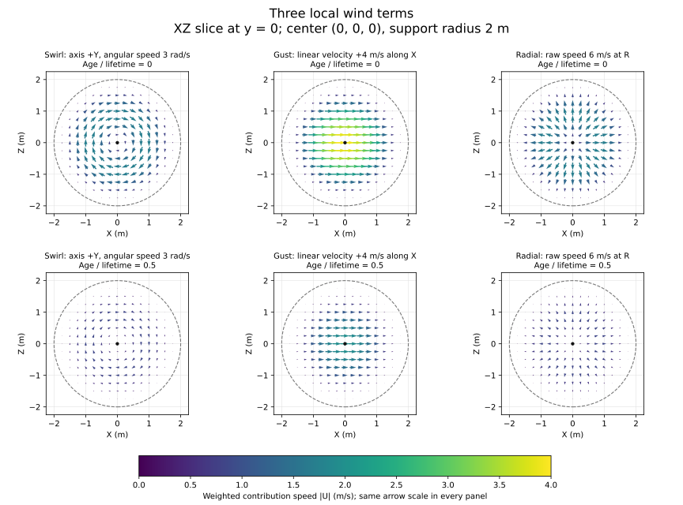

# 52 — Wind Fields and Vorticles

**Goal:** make Chapter 21's fountain respond to invisible, moving local wind
sources: a swirl, a passing gust, and an expanding-looking blast. Sources have
their own identity and lifetime. The visible particles keep their existing pool,
alive lists, indirect dispatches and draw.

**Route:** an optional continuation immediately after [Chapter 21](21-GPU-Particles.md).
Chapter 20's mapped uploads, storage buffers and readback are prerequisites.
Basic graphics and linear algebra are assumed. Chapters 25–27 become useful
later when transferring the field to vegetation; they are not required here.
When building from your Chapter 21 stage, transplant only the wind additions
described here. The assembled reference demo also contains later sky and
renderer support; those additions are not prerequisites for this continuation.
The [wind-response attempt](#ch52-wind-response) has a protected worked
solution with the wind-only file and callsite map.

**Reference:** [ParticlesDemo.cpp](https://github.com/ZevosSky/PillowFort-private/blob/reference-main/Source/PillowFort/Demos/Particles/ParticlesDemo.cpp),
[WindSources.h](https://github.com/ZevosSky/PillowFort-private/blob/reference-main/Source/PillowFort/Demos/Particles/WindSources.h),
[WindFieldTypes.h](https://github.com/ZevosSky/PillowFort-private/blob/reference-main/Shaders/Particles/WindFieldTypes.h) and
[WindFieldMath.h](https://github.com/ZevosSky/PillowFort-private/blob/reference-main/Shaders/Particles/WindFieldMath.h).
The `Particles` demo starts with local wind **off**. Open **Local wind (Chapter
52)** and press **Emit swirl**, **Emit gust**, or **Emit blast**. Each button
enables the consumer and creates a source near `(0, 2, 0)`; its radius, lifetime
and drift come from the controls. Pressing repeatedly creates overlapping
sources, up to 16. Clear stops further wind influence; reset the particle pool
as well when comparing a fresh neutral fountain.

Bill Rockenbeck's [GDC 2021 wind talk](https://www.gdcvault.com/play/1027350/Blowing-from-the-West-Simulating)
is the game-technique reference. Its overview describes many systems cooperating
to make wind visible under a tight GPU budget. Sucker Punch's [Matt Vainio also
describes shared wind and local emitters](https://blog.playstation.com/2021/01/12/how-stunning-visual-effects-bring-ghost-of-tsushima-to-life/#wind).
The retrieved text of [Rockenbeck's original slides](https://media.gdcvault.com/GDC%2B2021/Rockenbeck-Bill-Blowing%2Bfrom%2Bthe%2BWest.pdf)
lists a global direction, noise, vorticles and displacement as wind-model
components, and names distinct vorticle, smoke-particle and leaf-particle
compute stages. The diagram images were unavailable to this review, so that
text establishes the broad composition without verifying a field equation.
Our field equation, response rule and small CPU source owner below are explicit
teaching choices, inspired by that direction. This chapter does not claim to
reproduce the game's exact vorticle formula, authoring system, or fluid dynamics.

## 1. Two kinds of particle, two owners

A visible particle is one of the fountain's 32-byte records. It moves, bounces
and eventually returns its slot to the dead list. An invisible **wind source**
describes a local velocity field that other objects may sample. It can move and
expire without drawing anything. Adding a wind source does not allocate a
visible particle, and retiring one does not alter the particle counters.

```text
CPU source owner: emit → move/age → retire
                              ↓ snapshot after this frame slot's fence
                      1 KiB wind UBO for that slot
                              ↓ read only
GPU fountain: begin → emit → simulate/sample wind → end → indirect draw
```

The CPU owns one persistent `WindSources` collection. Its compact array contains
at most 16 living sources. `Emit` rejects a full array; it does not steal a
living source's slot. An increasing identity belongs to the birth event,
independently of the array index. Retirement may move the last record into a
hole, so an index is not an identity.

`WindSourceDescription` validates every scalar/vector before publication:
finite coordinates, a nonzero finite axis, positive bounded radius/lifetime,
and bounded speeds. It normalizes the accepted axis. A NaN must not reach the
shader and poison every particle that samples it. Bounds are an authored
supported domain, not a universal physical limit; see `WindSources::Valid`.

<a id="ch52-source-owner"></a>

### Attempt CH52-source-owner: keep identity through compaction

Before reading the reference owner, sketch `Emit`, `Advance`, `Clear` and `Snapshot` for
two sources with different lifetimes. Keep identity stable when the first one
expires. No Vulkan work is needed yet.

**Acceptance:** accept a finite non-unit axis and normalize it; reject zero/NaN
axes and invalid radius/lifetime before they reach a snapshot. Motion must
preserve identity. Retiring source 0 must preserve source 1's identity when its
record moves into the hole. Reject source 17 without replacing a living source.
Advancing by zero must freeze age. These cases are retained in
[ParticleWindTests.cpp](https://github.com/ZevosSky/PillowFort-private/blob/reference-main/Tests/TutorialHarness/ParticleWindTests.cpp).

<details><summary>Hint 1 — identify the invariant</summary>

The count describes occupied array entries. A separate event identity must
survive copying a record from the last occupied entry into a retired entry.

</details>
<details><summary>Hint 2 — choose an overflow policy</summary>

Reject an emission when the count equals capacity. Increment the next identity
only for accepted births. Clearing the collection need not rewind that counter.

</details>
<details><summary>Hint 3 — locate the small reference</summary>

`WindSources::Emit` validates and normalizes; `Advance` updates center/age and
compacts expired entries; `Snapshot` zero-initializes the upload block and copies
the live prefix. `Identity` is a diagnostic, not a GPU array address.

</details>

<details>
<summary>Worked solution: the source owner</summary>

Use a fixed array of `{field, driftVelocity, identity}`, a living count and a
monotonic next identity. On `Emit`, first reject full capacity and validate all
inputs; only then normalize the axis, set age to zero, assign the next identity
and append. Validation rejects nonfinite values and enforces the finite domain
documented by [WindSources::Valid](https://github.com/ZevosSky/PillowFort-private/blob/reference-main/Source/PillowFort/Demos/Particles/WindSources.h).
An overflowed identity counter rejects further births rather than recycling IDs.

```text
Advance(dt):
    reject nonfinite or negative dt without changing the collection
    i = 0
    while i < count:
        sources[i].age += dt
        newCenter = sources[i].center + sources[i].driftVelocity * dt
        if expired or newCenter leaves the supported finite domain:
            sources[i] = sources[count - 1]
            count -= 1
            continue                     // inspect the moved record at i
        sources[i].center = newCenter
        i += 1

Snapshot():
    zero-initialize all 16 GPU records
    copy the living prefix, keeping array order consistent with count
    return the snapshot
```

`Clear` sets count to zero but keeps the next identity. It does not need to
erase GPU-visible memory immediately: the next valid slot snapshot supplies
count zero and zero records. The source owner remains one collection; snapshots
are separate values, not new simulations. The complete implementation and all
supporting types are supplied by the linked header.

</details>

**Local checkpoint A:** pause means advancing by zero. Disabling the wind
consumer does not freeze source lifetime; the separate **Paused** control freezes both.
The reference advances sources in each active demo `Update`, using that
update's delta. Radius, lifetime and drift controls describe the **next** birth;
they do not rewrite living sources. The response slider affects the consumer.
An inactive demo receives no updates, so its source clock stops. An update can
also precede an acquire/resize skip with no corresponding `Record`: sources
then age/move without a submitted particle step. This is a cosmetic Update-clock
policy, not a promise that source age and GPU particle age stay in lockstep.
A fixed-step simulation would have to choose and teach a common step/publication
policy rather than infer it from the frame counter.

**Transfer:** an explosion event, audio source or transient light also needs
event identity independent of compacted storage. A pool slot alone cannot
identify a delayed event that arrives after that slot is reused.

## 2. A local field with no singular center

Each GPU source occupies four `vec4`s, 64 bytes in both C++ and std140:

| Field | Meaning and units |
| --- | --- |
| `centerRadius` | world-space center in metres; support radius `R` in metres |
| `axisAngularSpeed` | unit axis; angular speed `ω` in radians/second |
| `linearVelocity` | authored velocity in metres/second; unused `w` |
| `radialLife` | outward speed in metres/second, age in seconds, lifetime in seconds, unused `w` |

Let `r = position − center`, `q² = dot(r,r)/R²`, and `t = age/lifetime`.
Outside `q² < 1`, or after expiration, the source contributes zero. A source
with every linear/angular/radial strength exactly zero is explicitly switched
off: its weight is zero too. For an active source inside its support:

```text
support = (1 − q²)²
life    = 1 − 3t² + 2t³                  (0 ≤ t < 1)
weight  = support × life
rawWind = linearVelocity
        + ω × cross(axis, r)
        + radialSpeed × r/R
velocityContribution = weight × rawWind
```

Here `ω` is a scalar multiplication; the cross product is only `cross(axis,r)`.
The terms all have units of metres/second. The swirl uses a solid-body finite
core: speed approaches zero on the axis. The radial term also vanishes at the
center. Neither normalizes `r` or divides by distance, so there is no arbitrary
direction or infinite speed at the center. A gust can retain its authored
linear velocity there. The support and its first derivative approach zero at
the spherical boundary. This does not impose incompressibility or solve pressure.

Presets select combinations of the same terms: swirl uses angular motion plus
a little lift; gust uses linear velocity; blast uses radial motion. A source's
center advances by its separately authored drift velocity. Its radius stays
fixed: the blast **motion** looks outward, while the support sphere does not
expand in this implementation.

<a id="ch52-finite-field"></a>

### Attempt CH52-finite-field: predict before drawing

Set center to
zero, radius to `2`, axis to `+Y`, angular speed to `3`, linear velocity to
`(4,2,0)`, radial speed to `6`, and age to zero. Work out the velocity contribution
at the center, `(1,0,0)` and `(2,0,0)`.

**Acceptance:** match the independent hand-worked samples within `1e-5` in
the CPU float test. Center and axis samples must be finite, and the exact
boundary/exterior must return zero. Half lifetime gives half contribution.
Translate/rotate the source and sample together; the output must rotate as a
vector. Reverse angular speed and check circulation reverses. Fix these checks
before looking at a rendered fountain.

<details><summary>Hint 1 — separate shape and envelope</summary>

First find raw wind. Then apply support and lifetime. A correct swirl direction
with an incorrect envelope is still a wrong field.

</details>
<details><summary>Hint 2 — use the half-radius point</summary>

At `(1,0,0)`, support is `9/16`, the positive-Y swirl points along `−Z`, and
the radial term is `(3,0,0)` metres/second.

</details>
<details><summary>Hint 3 — compare independent expected values</summary>

Compute raw wind component by component, then multiply by `9/16`. For the
center, keep the linear term and let both offset-dependent terms vanish.
For the boundary, exit before evaluating a response.

</details>

<details>
<summary>Worked solution: a finite compact field</summary>

The three contributions are `(4,2,0)`, `(3.9375,1.125,−1.6875)` and zero.
At the middle sample, raw wind is `(4,2,0) + (0,0,−3) + (3,0,0)`.
The [shared field implementation](https://github.com/ZevosSky/PillowFort-private/blob/reference-main/Shaders/Particles/WindFieldMath.h)
uses this algorithm for each source:

```text
weight(source, position):
    return 0 for invalid radius/lifetime, unborn/expired age, or zero strengths
    r = position - center
    q2 = dot(r,r) / (radius*radius)
    if q2 >= 1: return 0
    remaining = 1 - age/lifetime
    return (1-q2)^2 * remaining^2 * (3-2*remaining)

velocityContribution(source, position):
    w = weight(source, position)
    if w <= 0: return zero
    r = position - center
    return w * (linearVelocity + angularSpeed*cross(axis,r)
                + radialSpeed*r/radius)
```

All axis validation/normalization happens before publication in Attempt A.
The shader therefore needs no normalization of `r` and no singular branch at
the center.
For the zero-strength switch, compare all three linear components directly
with zero, together with the angular and radial scalars. A normal float32
velocity such as `1e-30` is nonzero even though its squared length underflows
to zero. It still describes a nearly still-air target with nonzero coupling.
The CPU/GPU controls retain that case, negative/rotated variants, and the
smallest positive normal float. Truly subnormal values may be flushed under
the device's [floating-point controls](https://docs.vulkan.org/refpages/latest/refpages/source/VkPhysicalDeviceFloatControlsProperties.html);
this lesson does not request `DenormPreserve` or promise cross-device subnormal
behavior.
`ParticleWindTests` retains the numeric values above;
[ParticleWindGpuTests.cpp](https://github.com/ZevosSky/PillowFort-private/blob/reference-main/Tests/TutorialHarness/ParticleWindGpuTests.cpp)
uses independent scalar equations in double precision across a spatial grid.
CPU/GPU agreement on the same shared function alone would not establish the
formula's correctness.

</details>

**Local checkpoint B:** inspect a pure swirl with linear and radial terms zero;
then inspect a gust and a blast separately. The data representation remains the
same while the active term changes.

<details>
<summary>Compare the three terms and their lifetime fade</summary>



This computed diagram isolates one term per column. The gust uses `(4,0,0)`
with no Y lift, unlike the combined hand-worked example above. At `+X`, the
positive-Y swirl points toward `−Z`. Dashed circles mark the support boundary;
the radial **raw** speed is 6 m/s there but its weighted contribution is zero.
Arrow and color scales stay fixed between rows.

The arrows show `U = weight × rawWind`, before particle response. Halving
lifetime weight halves `U`; it does not halve a lone source's normalized target
`U/W` in the next section. Instead, the coupling rate weakens. The
[plot generator](images/make-wind-fields.py) checks independent center,
half-radius and boundary values; [diagram provenance](images/diagrams.json)
records its parameters. This is a plot of the authored equation, separate from
the native captures and the game slides.

</details>

**Transfer:** a force field, color volume or procedural influence needs the
same decisions about support, center behavior and coordinate frame. A smooth
picture cannot establish any of them by itself.

## 3. Velocity is not acceleration

Chapter 21 applies gravity, drag, then updates position. Wind adds another
clearly defined response between drag and the position update. Sampling a
velocity field gives metres/second; inserting that number directly into the
gravity acceleration would silently change its meaning.

At a particle position, sum contributions `U = Σ(weightᵢ × rawWindᵢ)` and
influence `W = Σweightᵢ`. For `W > 0`, choose a target velocity `u = U/W` and
response rate `kW`, where the panel's `k` has units inverse seconds:

```text
dv/dt = kW × (u − v)
vNext = u + (v − u) × exp(−kW × dt)
```

Equivalently, `dv/dt = k Σ weightᵢ*(rawWindᵢ − v)`. For one source with
weight `0.5`, raw wind `4 m/s` and `k = 2/s`, `U = 2 m/s`, the target is still
`4 m/s`, and the response rate is `1/s`. The envelope weakens coupling as the
source fades or the particle approaches its boundary; it does not shrink that
single source's equilibrium target. This is our chosen response model.

This exponential is exact when the sampled target and influence stay constant
over the velocity substep. We sample once from the current source snapshot.
Moving sources, spatial variation, gravity/drag splitting and the semi-implicit
position update retain time-step error. Smaller substeps can help those errors;
the exponential alone does not make the entire trajectory frame-rate independent.

Evaluate that response carefully in floats near the compact boundary. A large
target and tiny influence can make `exp(−kWdt)` round to one; subtracting the
large target again may destroy the original velocity. The implementation uses
`v + alpha*(u−v)`, with `alpha = 1−exp(−kWdt)`. For `kWdt < 0.01`, a fifth-order
small-argument polynomial evaluates alpha without the subtraction from one;
GLSL has no `expm1`. Exact alpha endpoints return `v` or `u` directly. This is
a floating-point evaluation of the analytic rule, including the stated small
polynomial approximation, rather than a claim of exact real-arithmetic storage.

Overlaps average targets by weight and add response rates. Two unit-weight
gusts of `+4X` and `−4X` give `U=0`, `W=2`: with `k=2/s` and `dt=0.125 s`,
velocity `(1,−2,3)` becomes approximately `(0.606531,−1.213061,1.819592)`.
Their still-air target retains a nonzero response. This differs from switching
both sources off by setting every strength to zero. Outside all support, `W=0`
and wind leaves velocity untouched; otherwise a local source would accidentally
add global drag. Empty/disabled, zero-strength, zero-response and zero-time-step
paths also return the original velocity unchanged. The linked tests retain
these controls, including the opposing-source distinction.

<a id="ch52-wind-response"></a>

### Attempt CH52-wind-response: connect a local consumer

Add the
read-only source input to simulation, keep the original gravity/drag ordering,
and make disabled wind produce the original particle result. Explain where the
CPU may safely overwrite each upload snapshot before writing the upload code.

**Acceptance:** empty/disabled wind, zero response, zero-strength sources,
zero time step and the support boundary must preserve velocity exactly.
An enabled constant target must match the analytic exponential, and the real
production simulation must update position using the resulting velocity.
The GPU grid oracle permits maximum error `3e-4`; the four-particle integration
oracle permits `1e-4` position/velocity error. No NaN/Inf is acceptable. Reject
an invalid frame slot, mapping, range, response rate or flush before submitting.

<details><summary>Hint 1 — distinguish simulation from snapshots</summary>

The particle pool and source owner each carry one persistent simulation. The
CPU upload snapshots need one copy per frame in flight because earlier GPU
submissions may still read them.

</details>
<details><summary>Hint 2 — follow the consumer's lifetime</summary>

Write only the returned frame slot after its fence has completed. Check the
mapped range, copy the snapshot, check the flush, and return failure before
submission if any step fails. Descriptor writes belong to setup, not this loop.

</details>
<details><summary>Hint 3 — trace the concrete reference path</summary>

`CreateWindBindings` creates a 1 KiB UBO and descriptor set per frame slot.
`WriteWindSources` checks the slot/mapping/range and flush result in `Record`.
The compute layout binds the existing particle set at set 0 and wind at set 1.
`ParticleWindSimulate.comp.glsl` samples the bounded live prefix; the shared
simulation body invokes it before updating position.

</details>

<details>
<summary>Worked solution: response and frame-safe publication</summary>

**Wind-only transplant from Chapter 21.** Keep your Chapter 21 fountain,
including its existing draw shaders and renderer. The steps below identify
the additions to that implementation; the linked assembled owner also has
later features that this route does not require.

First add these supplied files at their repository paths:

| Supplied file | Role |
| --- | --- |
| [WindSources.h](https://github.com/ZevosSky/PillowFort-private/blob/reference-main/Source/PillowFort/Demos/Particles/WindSources.h) | CPU source owner from Attempt A; includes the shared field types |
| [WindFieldTypes.h](https://github.com/ZevosSky/PillowFort-private/blob/reference-main/Shaders/Particles/WindFieldTypes.h) | 64-byte source records and the 1024-byte upload block |
| [WindFieldMath.h](https://github.com/ZevosSky/PillowFort-private/blob/reference-main/Shaders/Particles/WindFieldMath.h) | Field and response functions from Attempts B and C |
| [ParticleSimulateBody.glsl](https://github.com/ZevosSky/PillowFort-private/blob/reference-main/Shaders/Particles/ParticleSimulateBody.glsl) | The original simulation body, with the optional wind call between drag and position; an include, not a stage |
| [ParticleSimulate.comp.glsl](https://github.com/ZevosSky/PillowFort-private/blob/reference-main/Shaders/Particles/ParticleSimulate.comp.glsl) | Replace the old stage with this one-set wrapper around the shared body |
| [ParticleWindSimulate.comp.glsl](https://github.com/ZevosSky/PillowFort-private/blob/reference-main/Shaders/Particles/ParticleWindSimulate.comp.glsl) | New two-set wrapper; defines the wind sampler before including the same body |

The shared body retains Chapter 21's death, bounce and survivor-append work.
Do not append it after the old stage's `main`: each wrapper includes exactly
one body. The legacy wrapper keeps later Sea/Spray consumers independent of
the new wind binding.

Next make these owner edits in order:

1. **Shared packet.** In your existing `ParticleTypes.h`, replace only
   `ParticleSimulation::padding0` with `uint windSourceCount` and `padding1`
   with `float windResponseRate`. Keep `padding2` and every earlier field.
   Copy the two wind `offsetof` assertions from the
   [supplied header](https://github.com/ZevosSky/PillowFort-private/blob/reference-main/Shaders/Particles/ParticleTypes.h#L94): offsets stay
   84/88 and the existing size assertion stays 96 bytes. Rebuild all particle
   stages that include this shared header.

2. **Class storage and settings.** In `ParticlesDemo.h`, include
   `"PillowFort/Demos/Particles/WindSources.h"`. Add these fields to
   `ParticleSettings`, as in the
   [reference declaration](https://github.com/ZevosSky/PillowFort-private/blob/reference-main/Source/PillowFort/Demos/Particles/ParticlesDemo.h#L47):

   ```cpp
   bool  windEnabled      = false;
   float windResponseRate = 2.0f;
   float windRadius       = 5.0f;
   float windLifetime     = 8.0f;
   float windDrift        = 0.4f;
   ```

   Add the following private declarations/members to `ParticlesDemo`.
   They extend its existing pool; they do not replace its camera, descriptors
   or draw members. The CPU source owner persists across teardown like the
   other Chapter 21 CPU state.

   ```cpp
   InitializationResult CreateWindBindings();
   InitializationResult WriteWindSources(uint32_t frameIndex);
   WindSources m_windSources;
   std::array<vulkan_graphics::AllocatedBuffer, vulkan_graphics::FRAMES_IN_FLIGHT> m_windBuffers;
   std::array<VkDescriptorSet, vulkan_graphics::FRAMES_IN_FLIGHT> m_windSets{};
   VkDescriptorSetLayout m_windLayout = VK_NULL_HANDLE;
   VkDescriptorPool m_windPool = VK_NULL_HANDLE;
   ```

3. **Setup before pipeline creation.** Add `<cstring>` to
   `ParticlesDemo.cpp` for the checked writer's `std::memcpy`. Supply the
   complete [CreateWindBindings](https://github.com/ZevosSky/PillowFort-private/blob/reference-main/Source/PillowFort/Demos/Particles/ParticlesDemo.cpp#L305)
   and [WriteWindSources](https://github.com/ZevosSky/PillowFort-private/blob/reference-main/Source/PillowFort/Demos/Particles/ParticlesDemo.cpp#L340)
   methods. In your Chapter 21 `Setup`, insert
   `if (auto result = CreateWindBindings(); !result) { return result; }`
   immediately after `CreateDescriptors` and before `CreateComputePipelines`.
   The wind layout must exist before it enters the pipeline layout.

4. **Select and bind the wind consumer.** In `CreateComputePipelines`, declare
   `const VkDescriptorSetLayout layouts[] = {m_setLayout, m_windLayout};`,
   change `layoutInfo.setLayoutCount` to `2` and `pSetLayouts` to `layouts`.
   Change **only** the simulate row of its shader table to
   `"Particles/ParticleWindSimulate.comp.spv"`; leaving the Chapter 21
   `ParticleSimulate.comp.spv` selection would keep running the legacy path.
   The [reference method](https://github.com/ZevosSky/PillowFort-private/blob/reference-main/Source/PillowFort/Demos/Particles/ParticlesDemo.cpp#L366)
   shows these edits together. In `RecordCompute`, append
   `.windSourceCount = m_settings.windEnabled ? m_windSources.Count() : 0u`
   and `.windResponseRate = m_settings.windResponseRate` to the existing
   `ParticleSimulation` initializer. After the existing set-0 bind, add
   `vkCmdBindDescriptorSets(commandBuffer, VK_PIPELINE_BIND_POINT_COMPUTE, m_computeLayout, 1, 1, &m_windSets[frameIndex], 0, nullptr);`.
   Keep the existing pass sequence and barriers.

5. **Author, advance, then publish.** Extend `drawParticlePanel`'s parameter
   list with `WindSources& wind`, and its call in `Update` with
   `m_windSources`. Copy only the
   [Local wind panel block](https://github.com/ZevosSky/PillowFort-private/blob/reference-main/Source/PillowFort/Demos/Particles/ParticlesDemo.cpp#L102)
   into that function. It supplies the three preset buttons and handles
   rejected/full emissions. After `Update` chooses the paused `m_deltaTime`,
   add the [checked Advance block](https://github.com/ZevosSky/PillowFort-private/blob/reference-main/Source/PillowFort/Demos/Particles/ParticlesDemo.cpp#L546).
   In `Record`, immediately after the existing checked `WriteFrameData` and
   before query reset or compute commands, insert
   `if (auto result = WriteWindSources(frameIndex); !result) { return result; }`.
   This uses the returned frame slot whose fence Chapter 09 has already
   waited on. The source collection advances once in `Update`, rather than
   once for each snapshot or descriptor set.

6. **Cleanup and build.** Extend Chapter 21's `Teardown` after pipeline-layout
   destruction: destroy `m_windPool`, destroy `m_windLayout`, and call
   `destroyBuffer(m_vulkan, buffer)` for every `m_windBuffers` entry. Reset
   both wind handles to `VK_NULL_HANDLE` and `m_windSets` to `{}`; the
   [reference cleanup](https://github.com/ZevosSky/PillowFort-private/blob/reference-main/Source/PillowFort/Demos/Particles/ParticlesDemo.cpp#L906)
   shows the complete wind additions. Keep the existing partial-setup-safe
   teardown and preserve CPU settings/sources. Rerun `GenerateProjects.bat`
   after adding the files. Chapter 06's shader builder compiles the two
   `*.comp.glsl` wrappers and tracks the non-stage body as an include, so
   editing the body also rebuilds its consumers.

At this point the fountain uses the two-set wind entry, while the legacy
one-set entry remains available. No `Sky` member or soft-particle extension
is required. The guarded targets linked below exercise the current reference;
they do not prepare or certify a separate Chapter 21 transplant automatically.

The reference supplies all supporting plumbing in
[CreateWindBindings, WriteWindSources and Record](https://github.com/ZevosSky/PillowFort-private/blob/reference-main/Source/PillowFort/Demos/Particles/ParticlesDemo.cpp).
Create one mapped 1024-byte uniform buffer and immutable descriptor set for
each frame slot. Both use a new compute set 1, binding 0; the existing particle
set stays at set 0. Add that layout to the compute pipeline layout. No visible
particle, alive-list or indirect buffer is duplicated.

```text
Record(returnedFrameSlot):                  // its fence is already complete
    validate finite supported responseRate
    validate slot, mapped pointer, allocation and buffer range
    snapshot = sourceOwner.Snapshot()
    copy snapshot into this slot's wind UBO
    check flush; return failure if it fails
    bind particle set 0 and this slot's wind set 1
    push sourceCount (0 when disabled) and responseRate
    record the existing begin/emit/simulate/end sequence
```

The simulation's core is supplied by
[ParticleWindSimulate.comp.glsl](https://github.com/ZevosSky/PillowFort-private/blob/reference-main/Shaders/Particles/ParticleWindSimulate.comp.glsl)
and the [field/response helpers](https://github.com/ZevosSky/PillowFort-private/blob/reference-main/Shaders/Particles/WindFieldMath.h):

```text
applyWind(position, velocity, count, responseRate, dt):
    if count == 0 or responseRate <= 0 or dt <= 0: return velocity
    weightedVelocity = zero; influence = 0
    for each source in the bounded live prefix (at most 16):
        weightedVelocity += velocityContribution(source, position)
        influence += weight(source, position)
    if influence <= 0: return velocity
    target = weightedVelocity / influence
    x = responseRate * influence * dt
    alpha = 1-exp(-x)                  // use the small-x polynomial below
    if alpha <= 0: return velocity
    if alpha >= 1: return target
    return velocity + alpha*(target-velocity)

simulateParticle():
    perform the existing death/ownership branch
    velocity += gravity * dt
    velocity *= exp(-drag * dt)
    velocity = applyWind(position, velocity, count, responseRate, dt)
    position += velocity * dt
    perform the existing ground response and survivor append
```

Every upload write/flush is checked before `Record` returns success to the
renderer. Setup-only descriptor writes cannot modify pending sets. Source
simulation and frame-slot publication have different owners and lifetimes.
The shader branches before reading wind and indexes the UBO's live prefix
directly. Passing the whole source array by value could copy all 16 records
even for a disabled consumer in an unoptimized debug shader. The CPU tests use
the header's reference-taking convenience `windApplySources` instead.
For `x < 0.01`, alpha is
`x*(1 − x*(1/2 − x*(1/6 − x*(1/24 − x/120))))`; otherwise it uses `1−exp(−x)`.
The boundary control uses a 10,000 m radius, angular speed 1000/s, a point just
inside support, and a small existing velocity. It checks that weak influence
does not erase that velocity through cancellation, against a double `expm1`
reference. A separate full-response control protects the alpha-one endpoint.
The original [one-set entry](https://github.com/ZevosSky/PillowFort-private/blob/reference-main/Shaders/Particles/ParticleSimulate.comp.glsl)
is also used by sea spray. Both entries include
[ParticleSimulateBody.glsl](https://github.com/ZevosSky/PillowFort-private/blob/reference-main/Shaders/Particles/ParticleSimulateBody.glsl),
but only the wind entry declares the extra UBO. A runtime count of zero would
not remove a statically used descriptor from a shader's pipeline interface.
The complete owner and shaders are supplied, so the learner can implement the
consumer mechanism without inventing an undeclared resource system.

</details>

The UBO contains `16 × 64 = 1024` bytes. It is below Vulkan's guaranteed
16 KiB uniform range and adds one compute UBO, rather than a sixth storage
buffer. The original particle implementation's separately checked requirement
for five storage buffers remains. The helper counts one UBO descriptor for
each allocated set. `ParticleSimulation` remains 96 bytes: formerly unused
words at offsets 84 and 88 become typed `windSourceCount` and
`windResponseRate`. Size and offset assertions protect the C++/GLSL contract.

Host writes followed by a successful flush occur before the queue submission
that reads them; a compute-to-compute barrier cannot repair an overwrite while
an older frame is reading the same upload allocation. GPU-written sources would
instead need an explicit write-to-read dependency before particle simulation.
See the [Vulkan synchronization specification](https://docs.vulkan.org/spec/latest/chapters/synchronization.html#synchronization-submission-host-writes)
and [uniform-buffer limits](https://docs.vulkan.org/spec/latest/chapters/limits.html#limits-minmax).

**Local checkpoint C:** run `TutorialParticleWindTests` and the publication
checks in `TutorialMirrorBatchTests`, then the guarded
`TutorialParticleWindGpuTests` target on the selected GPU. The latter checks
729 positions per field case against a double oracle and reads back the real
wind-simulation output for enabled and neutral controls. It also creates and
runs the legacy one-set pipeline, requiring exact particle-byte agreement with
disabled wind. It checks a bounded
over-capacity count defensively. A passing field probe alone is not evidence
that the production simulation actually consumes it.
The GPU fixture writes its own input UBO. It does not fault-inject the demo's
`WriteWindSources` path, so field/integration passes cannot establish that
method's invalid-slot, mapping or flush-failure behavior. The separate
[production-writer fixture](https://github.com/ZevosSky/PillowFort-private/blob/reference-main/Tests/TutorialHarness/MirrorBatchTests.cpp)
installs distinct mapped slots and fault-controls those paths in
`TutorialMirrorBatchTests`; it also checks exact snapshot bytes and peer-slot
isolation. Follow the [guarded commands](https://github.com/ZevosSky/PillowFort-private/blob/reference-main/Tests/TutorialHarness/README.md#particle-wind-checks).
Authoring an oracle and executing it are different gates; current run status
is recorded in [the roadmap](https://github.com/ZevosSky/PillowFort-private/blob/reference-main/ROADMAP.md#status).

For the visual comparison, reset the fountain, keep the camera and emission
settings fixed, and emit one stationary source (`drift = 0`). A swirl should
turn nearby trajectories, a gust should pull them sideways, and a blast should
push outward. Watch the source count fall to zero. For the neutral comparison,
clear wind **and reset the particle pool**: clearing a force does not undo
velocities already changed by it. Pause and check that both source age and particles
stop. This picture is a behavior check, not a replacement for boundary/finite
numerical checks.

**Transfer:** sharing a sampled field does not require sharing a response law.
A leaf can relax its velocity; a grass blade can derive bend displacement; a
rigid body can convert relative air velocity into force. Each consumer must
state its units, response and update domain.

## 4. Choose the next extension by its hidden mechanism

The current loop scales roughly with simulated living-particle count times
living-source count. Off-screen particles still simulate in this path.
Sixteen local sources keep that first version bounded and readable. Measure it
before adding spatial tables or a grid. A broad-phase must preserve overlapping
support, identity and the exact zero exterior; it is not just a faster loop.

| Extension | Concrete edit | New mechanism and acceptance |
| --- | --- | --- |
| Emit a disk or several fountain emitters | `ParticleEmit.comp.glsl`, emitter push data and the emission scheduling in `RecordCompute` | Sample area correctly; assign stable emitter/event identity instead of treating a reused particle slot as a birth ID. Compare measured radial distribution and total emission rate. No new draw system is needed. |
| Curved size/color or nonuniform forces | `Particle.vert.glsl` appearance curve; `ParticleSimulateBody.glsl` shared force/integration body | Choose normalized age and units explicitly. Check endpoints, pause and time-step sensitivity. A curve texture adds a sampled resource; a small analytic curve need not. |
| Moving/expanding vorticles | `WindSources::Advance`, `WindVorticle` if radius rate is stored | Update support and lifetime without a zero/negative radius. Verify a moving boundary and source identity under compaction. The existing drift is already a contained example. |
| GPU-emitted sources | new source emit/update compute passes plus their counters/buffers | Bounded atomic append, overflow policy, persistent source identity and write-to-read/return-trip dependencies. Per-frame upload copies do not replace persistent GPU ownership. |
| Fixed-step simulation with a per-frame work budget | `Update`/`RecordCompute`, emission carry and source clock | Define accumulated time, maximum substeps and dropped/backlogged time. Re-run pause, emission-rate and source-lifetime controls. A `dt` clamp silently changes elapsed simulation time. |
| Sprite/flipbook particles | `Particle.vert.glsl`, the selected fragment variant (`ParticleSoft.frag.glsl` in the assembled fountain), appearance/descriptor data | UV frame selection, texture alpha convention and atlas padding. Preserve optional depth fade. Additive dots avoid ordering issues that alpha sprites may expose; sorting or order-independent transparency is a separate renderer feature. |
| Trails | particle history buffers, segment generation, a new draw path | Stable birth identity prevents linking a new particle to an old slot's trail. Bound history and segment counts. This is more than changing the current billboard shader. |
| Terrain/scene collision | simulation descriptors and collision sampling | The current ground is one plane. Height fields omit overhangs; depth collisions depend on camera coverage; mesh/SDF collisions need their own representation and synchronization. State which geometry is observable. |
| Shared wind for batched foliage | the vegetation source/instance records and generation/deformation shader after Chapters 19, 37 and 39 | Feed one field to many instances; batch sets by compatible resources/pipeline and preserve per-instance pose/bounds. Wind deformation must reach culling and shadow bounds. A descriptor per blade is not required. |

Stop after the bounded sampler if that is the lesson you wanted. The central
result is already reusable: one finite, authored local field, explicit source
ownership, and consumers that deliberately choose how to respond.
