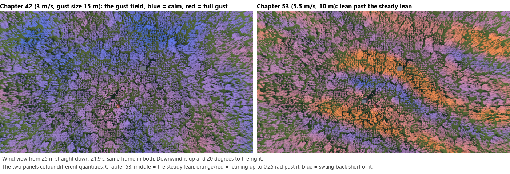
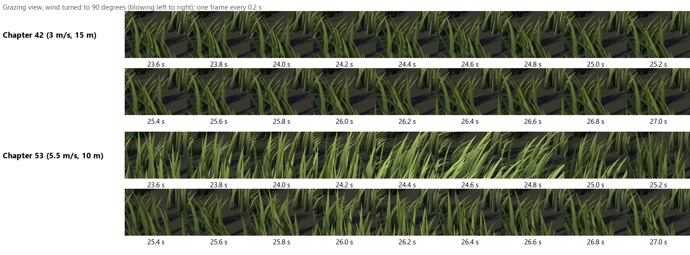
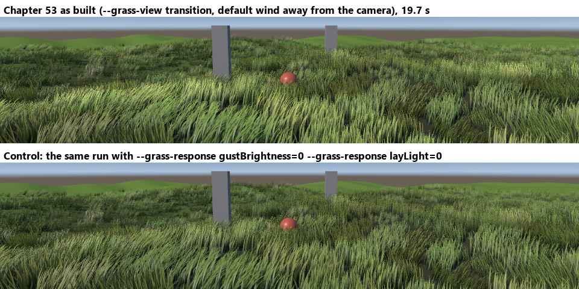

# 53 — Rolling Wind

> **Reference support:** named prepared-exercise and native-regression commands
> in this lesson run from the [reference checkout](../BranchWorkflow.md#prepared-reference-exercises).
> The growing chapter implementation remains in your learning checkout.

**Goal:** the grass's wind rolls. A gust becomes a front, a line across the wind that travels downwind and pushes the grass for a short while, and each clump of grass answers it like a damped spring: it goes over, swings back past where it stood and settles. Section 1 shows why Chapter 27's lean cannot do that and sets the design. Sections 2 to 6 build the steady lean and the bent blade, the spring, the fronts, the small differences that keep nothing still and the light that shows a gust from far away. Section 7 says what this wind does not do yet.

**Form:** typed into your tree from its own text. The tree must hold Chapter 42 and Chapters 46 to 48, and the
chapter prints every line it changes. One CPU test is supplied, not typed.

**GPU idea:** a compute pass that keeps nothing from one frame to the next can still show motion with a history, when
that history is a function of time it can evaluate in closed form: every frame, each clump works out where a spring
pushed by the fronts that have passed it would be now. One header compiled as both C++ and GLSL lets a CPU test check
the same functions the GPU runs, and the parameter block grows by appending, so no offset an earlier chapter printed
moves.

*Ghost of Tsushima* shows what such a wind looks like. Bill Rockenbeck's
[GDC 2021 talk](https://www.gdcvault.com/play/1027350/Blowing-from-the-West-Simulating)
describes a wind field that scrolls across the world and is read by every blade
where it stands, so that a gust crosses a meadow as a band. The talk shows no spring for the grass. The swing back is our choice, and
we make it because real stalks do it: wheat and barley in a gust go over, swing
back past where they stood and ring a few times, about a second apart.

Our grass has none of that. [Chapter 42](42-One-Wind.md) gave the island one
wind, but Chapter 27's lean is still the value of a noise field that drifts
past, plus a sway on a clock. It rises and falls with the field. Nothing pushes
the grass and lets go, so nothing swings back, and a field of blades that all
lean together looks, from far away, like a field that does not. This chapter
gives the grass its own answer to the wind and leaves the wind itself where
Chapter 42 put it. The plants, their shadows and Horizon's clouds follow in [Chapter 56](56-Everything-Bends.md).

**Read after:** [Chapter 42](42-One-Wind.md), over the grass clumps of Chapters 46
to 48: section 2 edits their clump impostors, the patch source and its test, so
your tree must hold their code. Section 2 also changes the impostors' lean of
[Chapter 47, section 4](47-Grass-Representation-Handover.md#4-animate-derived-data);
read that section first if you assembled their code without reading them.
Chapter 43 does not need this chapter, and section 7 returns to it.

**ROADMAP:** step 21+ — the `Grass` demo grows. The coast's grass in `Horizon`
shares `GrassField`, so it takes the same wind response; this chapter checks the
Grass demo only.

**Module:** `pf::demos::grass`. `GrassSettings` loses `swayFrequency` and
`swayAmount` and gains 32 wind-response settings (`gustLean` among them, with a new unit) in six groups, each with one
`WindRange` that the panel and the clamp share; section 2 teaches the six places a
setting is written. `GrassParameters` grows from 592 to 720 bytes by appending after
`sampleCount`, so no offset an earlier chapter printed moves. `gustStrength` is replaced
by fronts and springs, and a blade's `representation.zw` holds two lean angles. One shader
header is new, `GrassWindSource.h`, compiled as both C++ and GLSL. Two command-line
flags, `--wind-speed` and `--grass-response`, are the harness the checkpoints use; they
are not the lesson.

**Math:** section 2 uses a drag curve, `p / (1 + p)` with `p` a speed over a
knee, squared; a soft limit; and a rotation about an axis (Rodrigues's formula,
from Chapter 39). Section 3 solves a damped spring for a push that never ends.
Section 4 writes a push that ends as one step minus a later step, finds a delay
by asking the same function an earlier question, and adds the answers of many
fronts. Section 5 blends smooth noises. Section 6 shades by the change in a lean.

**Prerequisites:**

- [Chapter 42](42-One-Wind.md), built and running: `WorldWind`, the summed offset
  in `windDirection.zw`
  ([section 1](42-One-Wind.md#1-four-winds-in-one-frame),
  [section 2](42-One-Wind.md#2-a-wind-that-turns-without-jumping)), and the Grass
  demo's **Wind** group.
- [Chapter 27, section 2](27-Grass-Look.md#2-wind): the gust field and its
  blows-toward convention, (sin a, −cos a); `gustStrength`; the blade's lean
  along the wind; the Wind view; and the gradient noise behind the gust.
- [Chapter 26, section 3](26-Grass-GPU-Generation.md#3-the-generation-pass): the
  generation pass, `pcgHash`, and `GrassParameters`, the uniform block the grass's
  compute pass reads.
- [Chapter 25, section 6](25-Grass-Blades.md#6-the-curve): the blade's curve and
  its control points `p0` to `p3`.
- [Chapter 47, section 4](47-Grass-Representation-Handover.md#4-animate-derived-data):
  the group lean (`grassClumpLean`, `grassClumpUnlean`, `grassClumpLeanNormal`),
  and the clump record's `windFade` and the blade record's `representation`.
- [Chapter 46](46-Capturing-Grass-Clumps.md), built: `GrassClumpSource.h`,
  `grassClumpPrototype` and the clump record that section 2 edits.
- [Chapter 48, section 7](48-Grass-In-The-Coastal-Pipeline.md#7-author-a-source-you-can-aggregate),
  built: its patch source and its `grassLandscapeWindAnchor`, with the test
  clause that checks it, which section 2 deletes.
- [Chapter 39, section 1](39-Plants.md#1-a-tree-is-branches-on-branches):
  rotating a vector about an axis.
- [Chapter 9, section 6](09-Demo-Harness.md#guarded-float-widgets):
  the guarded `pf::debug_panels::sliderFloat` the panel uses.
- For section 3's checkpoint: an x64 Native Tools Command Prompt for VS 2022, so
  that MSVC's `cl` is on the path.
- For the checkpoints of sections 2 and 4 and the last one of section 6: the optional test projects
  (`GenerateProjects.bat --tutorial-tests`) and, for section 6, the reference's
  `GrassWindTests.cpp`, which is supplied, not typed: copy it if your tree
  lacks it.
- Mentioned but not required: [Chapter 41, section 1](41-Grass-On-The-Island.md#1-one-frame-several-systems),
  whose `CoastalArea` owns the grass that Horizon's coast draws.

## Where the code goes

| File | What sections 1 to 6 do there |
| --- | --- |
| `Shaders/Grass/GrassTypes.h` | Section 2: the two shared guards, the tail change, the Lean and Blades fields appended to `GrassParameters`, the records' comments and the asserts. Sections 4 to 6: the fields of Gusts and Spring, of Ripples, and of Wind shading |
| **New:** `Shaders/Grass/GrassWindSource.h` | Section 2: the block C++ and GLSL share, the guards, `dragBend` and `softLimit`. Section 3: `stepResponse`. Section 4: the front constants, `hash01`, `crestNoise` and `frontResponse` |
| `Shaders/Grass/GrassGenerateKernel.glsl` | Section 2: the include, the lean constants and the steady lean; `gustStrength` goes. Section 4: the fronts' frame and the gust call. Section 5: the swell, the ripples and the differences between clumps and blades |
| `Source/PillowFort/Demos/Grass/GrassField.h`, `Source/PillowFort/Demos/Grass/GrassField.cpp` | Section 2: the scaffolding (the opening comment, `WindRange`, the table's declaration, `clampTo`), the six places of the Lean and Blades settings, and, for the harness, the table's lookup and its line. Sections 4 to 6: the six places of each later group |
| `Source/PillowFort/Demos/Grass/GrassDemo.h`, `Source/PillowFort/Demos/Grass/GrassDemo.cpp` | Section 2: the demo's wind of 5.5 m/s and 10 m, `windSlider`, the **Wind response** header with the **Lean** and **Blades** nodes and **Log values**; and the two flags' setters. Sections 4 to 6: the node of each later group |
| `Source/PillowFort/Demos/Horizon/CoastalArea.h`, `Source/PillowFort/Demos/Horizon/HorizonDemo.h`, `Source/SandboxGame/Main.cpp` | Section 2, the harness: `--wind-speed` and `--grass-response` reach the Grass demo and Horizon's coastal grass. Section 4: the warning when the longest gust push is given below the shortest |
| `Shaders/Grass/GrassVertexKernel.glsl` | Section 2: a blade turns about its root, loaded and straightened. Section 4: each blade's own delay (`bladeLeans`' body) |
| `Shaders/Grass/GrassFragmentKernel.glsl` | Section 2: the shade normal reads the mean lean. Section 6: the wind shading |
| `Shaders/Grass/GrassClumpSource.h` | Section 2: the prototype's angles, and the axis and the rotation the lean uses |
| `Shaders/Grass/GrassClumpRuntime.glsl` | Section 6: hands an impostor's lean to the shading |
| `Shaders/Grass/GrassLandscapeSource.h`, `Tests/TutorialHarness/GrassClumpTests.cpp` | Section 2: the shared wind anchor goes, and the test clause that checked it |
| `premake5.lua`, `Tests/TutorialHarness/GrassWindTests.cpp` | Section 6: the `TutorialGrassWindTests` project; the test file is supplied |

`GrassWindSource.h` is a new file, so section 2 runs `GenerateProjects.bat` again
([Chapter 1, section 3](01-Environment-And-Build.md#3-the-corrected-workspace)):
premake bakes its file lists in when it generates, and a file it has not seen is
not listed. Section 6 does the same for the test file. Editing an existing file
needs no run. The acceptance tests are optional projects, which
`GenerateProjects.bat --tutorial-tests` generates; each checkpoint names the ones
it uses.

**Blank lines.** A new function, struct member block or file-scope block you add gets one blank line above it and one
below it, as its neighbours have. Constants or comment lines that join a run of constants are the exception: they sit
directly against their neighbours, and the text says "with no blank line between" where that is so.

# Part 1 — A lean that answers (sections 1–3)

## 1. A lean with no history

Run the Grass demo as Chapter 42 left it, at the grazing view, with the sun sky:

```powershell
& ./Build/Artifacts/Release/SandboxGame/SandboxGame.exe `
    --demo Grass --sky sun --msaa 4 --grass-view grazing
```

Watch one clump while a gust goes over it. The blades lean downwind, lean
further as the gust arrives and ease back as it leaves. Every clump also rocks a
little on a clock of its own. When the gust has gone, the blades are straight
back where they were. They do not swing past and settle.

Now the same wind from above, in the Wind view, where the gust
field's strength is a colour, blue for calm and red for a full gust:

```powershell
& ./Build/Artifacts/Release/SandboxGame/SandboxGame.exe `
    --demo Grass --sky sun --msaa 4 --grass-view aerial --grass-debug-view wind
```

The blotches drift downwind at the wind's speed, 3 m/s in Chapter 42's demo, and
keep their shape as they go. A blotch about one gust size across, 15 m, takes
15 / 3 = 5 s to cross a clump. A gust, in this grass, is a slow swell, not a push.

**Keep this build before you change anything.** Section 2's checkpoint compares
the new grass with it. Copy its output folder somewhere outside `Build/`, as
[Chapter 42, section 1](42-One-Wind.md#1-four-winds-in-one-frame) does:

```powershell
Copy-Item -Recurse .\Build\Artifacts\Release\SandboxGame ..\SandboxGame-before-53
```

Nothing here is broken. [Chapter 27, section 2](27-Grass-Look.md#2-wind) made a
lean the way it made a colour: from a value. A clump's lean is the gust field's
value where the clump stands, times `gustLean` blade heights, plus a sine of the
clump's own phase on a clock, times `swayAmount` and a factor that grows with the gust. Both terms are functions of
position and time. Neither remembers anything, so neither can know that a push
has ended, and without that nothing can swing back.

> **Jump:** from here on, a lean is not a value of a field now. It is the answer
> of a system to a forcing over time. Keep three words apart. The **forcing** is
> what pushes: a wind that starts and stops. The **system** is what answers: a
> clump of grass. The **answer** is the lean, and it depends on the push's
> history, not only on the push now.

<a id="ch53-forcing"></a>

### Attempt CH53-forcing: what must push the grass

This is a design attempt, with no code. Chapter 27's gust field is the obvious
thing to feed a spring: let each clump be a spring that is driven by the field's
value where it stands. Predict first: with the chapter's wind of 5.5 m/s and
gusts 10 m across, what would a clump do, and what would the clump three metres
downwind of it do? Then say what the forcing has to be instead, and what a clump
must know to compute its lean in one frame.

**Acceptance:** your design says, in a few lines each, what one push looks like
in time at one clump; which clumps are pushed together and which later; what a
clump must know to find its lean in one frame; and what it must not need to
remember from the last frame. It names which of Chapter 27's two ingredients, the
field and the sway, it keeps and which it drops. Each claim can be checked by
looking: the **Checkpoint** below says how, with the sliders Chapter 42's build
has.

**Transfer:** a spring driven by the field would work if the generation pass kept
each clump's lean and speed from one frame to the next. Why can it not keep them
here, and what would keeping them cost?

<details>
<summary>Hint 1: what a spring answers</summary>

A spring is a filter. It follows a slow input closely, hardly notices a very fast
one, and answers an input that wiggles near its own frequency with a large swing
of its own. Ask how fast the field's value changes at a clump. At 5.5 m/s, how
long does a gust 10 m across take to cross a clump, and how long does the smaller
gust, half that size, take?

</details>

<details>
<summary>Hint 2: what a swing back needs</summary>

A swing back happens after a push lets go. A signal that wanders up and down
without a start or an end has no moment of letting go. So what shape of push does
a spring answer with a swing back, and what does one such push look like when it
is drawn on a map of the field?

</details>

<details>
<summary>Hint 3: where the memory lives</summary>

Chapter 26's generation pass picks its clumps afresh every frame, from the tiles
around the camera, and appends the survivors to a buffer. Which clump holds which
slot changes from frame to frame. So where could a clump's lean from the last
frame live, and what would a formula in position and time not need?

</details>

<details>
<summary>Worked solution: a push, a front, and a formula</summary>

**The count.** Four things have to be decided, and the field fixes none of them:

| Question | What Chapter 27's field says | What the grass needs |
| --- | --- | --- |
| What does one push look like at one clump? | a smooth rise and fall over seconds, with no end | it starts, it is held for a moment, it stops |
| Who is pushed together? | everyone under the same blotch | every clump along one line across the wind |
| When does a clump further downwind swing? | whenever the blotch reaches it | later, by the time the line takes to get there |
| What must a clump remember? | nothing | nothing: the answer is a formula in position and time |

**Why the field does not work.** At 5.5 m/s a gust 10 m across takes
10 / 5.5 = 1.8 s to cross a clump. Chapter 27's field adds a second octave at about
twice the frequency, so it holds features about 10 / 2.03 = 4.9 m across, which
cross in 4.9 / 5.5 = 0.9 s. The spring's own period, at 0.8 Hz, is 1.25 s. The
second octave sits next to it, and a spring answers best what is near its own
frequency. It picks that part out of the noise and rings with it, whether or not
anything is blowing at that moment. That is the wobble in place.

Now the clump three metres downwind. It sees the same signal, delayed by
3 / 5.5 = 0.55 s. Against a period of 1.25 s that is 0.55 / 1.25 = 0.44 of a
cycle, almost opposite. The two clumps ring out of step, so the meadow fizzes
instead of rolling. We tried exactly this while designing the chapter, and the
grass fizzed.

**What the forcing has to be.** Three things follow, and each is a design
decision:

1. **Pushes that start and stop.** A spring that is pushed and let go swings back
   past where it stood. A push is a step up at one moment and a step down a short
   time later. A noise signal never lets go.
2. **Coherent along lines across the wind.** Every clump on one line is pushed at
   the same instant, so the line is a *front*. A front has a position along the
   wind, which moves, and a shape across the wind, which does not.
3. **Travelling downwind.** A clump further downwind is pushed later, by the time
   the front takes to reach it, so the phase of its swing is set by when the front
   passed. The swing travels with the front.

**Why it must be a formula.** Chapter 26's generation pass keeps no state from
frame to frame. Every clump is chosen, placed and written again each frame. A
stored lean would need a home keyed by clump: a buffer the size of the whole
field, not of the visible part, updated every frame even for clumps nobody sees,
or a reset each time a clump re-enters the view with the wrong history. So the
answer has to be a function of the clump's position and of the time since each
front passed it. A spring's answer to a step has a closed form, an answer to a
push is the difference of two such answers, and an answer to many pushes is their
sum, because the spring is linear. Section 3 derives the step's answer. Section 4
builds the fronts.

**Answer to the prediction.** The clump rings near 0.8 Hz on the field's second
octave, and the clump three metres away rings 0.44 of a cycle later: the two are
out of step, and neither is tied to anything travelling.

**Answer to the transfer.** The generation pass appends survivors to a buffer in
whatever order the GPU's atomics give, so a clump has no stable slot. Keeping its
lean would need a buffer keyed by the clump's cell, for every clump in the
field, read and written each frame whether it is drawn or not. That is a second
pass and a second buffer to add to a design whose point is that the frame holds no
history.

</details>

### The design this chapter builds

A clump's lean is a steady angle from the wind's speed, plus a sum over the
fronts that have passed it, each front's push being a step up and a step down
seen through a spring. The rest of the chapter builds that, one piece at a time,
and each section ends in a build you can run:

| Section | What it adds | What you see at its checkpoint |
| --- | --- | --- |
| 2. A steady wind, and a blade that stays whole | the steady lean from the wind's speed, the soft stop, and a blade that turns about its root | the grass leans steadily downwind and stands still; Chapter 27's gusts are gone |
| 3. A push and its swing back | the spring's answer to a step, as a function | a small program prints the swing's numbers |
| 4. Fronts that travel | gust fronts, each a step up and a later step down | bands roll downwind at the wind's speed; a clump goes over, swings back past its lean and settles |
| 5. Nothing is ever still | ripples, a slow swell, and small differences between clumps and blades | nothing stands still for more than about a second |
| 6. A gust you can see from far away | shading that follows the lean | a band of light travels across the grass at 20 to 50 m |

### Checkpoint

Nothing is built in this section. Check that you have what the design assumes.
The copy of the build exists:

```powershell
Test-Path ..\SandboxGame-before-53\SandboxGame.exe
```

It prints `True`. Run the Grass demo again at the grazing view and open **Wind**,
which holds Chapter 42's wind sliders and **Wind paused** and, from Chapter 27, **Gust lean**,
**Sway (Hz)** and **Sway amount**:

- Set **Sway amount** to 0. The blades now lean only with the field. They rise as
  a gust comes and ease back as it goes, and do not swing back past upright. That
  is the lean that has no history.
- Put **Sway amount** back to 0.06 and set **Gust lean** to 0. Now the blades only
  rock, each on its own clock (harder under a blotch), and no gust pushes any of them. That is the sway the
  chapter drops.
- Set **Mean speed (m/s)**, in the same group, to 0. In the Wind
  view (the second command above) the blotches stop, because the field no longer travels, and the blades go on rocking,
  because the clock does not care. Put the speed back to 3.

Section 2 removes the two sway sliders and gives **Gust lean** a new unit, so keep
this build until section 2's checkpoint has been compared with it.

## 2. A steady wind, and a blade that stays whole

Sections 3 and 4 will push the grass. Before anything pushes it, it needs somewhere to lean, in the right unit: an
angle in radians that comes from the wind's own speed, in place of Chapter 27's number of blade heights made from a noise
field and a sway, and a way for a blade to turn by that angle. When the section is done the field leans steadily
downwind and stands still. Chapter 27's gusts and its sway are gone until section 4, so that every later section adds
motion to a lean you can already check.

There are two questions, so there are two attempts. How far should a steady wind of a given speed lean the grass, and
what must stop it leaning too far? And how does a blade turn by an angle without moving any control point nearer to or
further from the root, and which part of it should turn most? The settings come first, because both attempts read them:
the recipe for a setting, taught once, and the two groups this section reads, Lean and Blades.

### Six places for a setting, typed once

Sections 2 to 6 read 32 settings, in six groups, and each group arrives whole, in the section that first reads it (Lean and
Blades in section 2, Gusts and Spring in section 4, Ripples in section 5, Wind shading in section 6). Each group opens with a short table of its settings, a slice of
[**The 32 wind-response settings**](#the-32-wind-response-settings), the reference table after section 7. A slider
that arrives a section before anything reads it says so where it arrives.

**Six places.** Every wind-response setting is written in the same six places. Each exists for a reason:

1. **A field of `GrassParameters`**, in `GrassTypes.h`. The block is what the GPU reads, std140, one copy per frame in
   flight, and it is the contract between the C++ and the shaders. One header that both languages include gives a
   field one declaration, so the two sides cannot disagree about it.
2. **A member of `GrassSettings`, with its default**, in `GrassField.h`. This is the CPU's state, which the panel edits
   and which survives `Teardown` and `Setup`; the default is the number this chapter's text uses.
3. **A `WindRange`**, in `GrassField.h`. The panel's slider and `PackParameters`'s clamp both read it, so they can
   never disagree.
4. **A row of `WIND_RESPONSE_SETTINGS`**, in `GrassField.h`. The program reads it in two places only: the `--grass-response`
   flag, which looks a setting up by name, and the **Log values** line; section 6's contract test checks it too. It
   gives the names one home, so neither reader keeps a list of its own.
5. **A line of `PackParameters`**, in `GrassField.cpp`. It copies the setting into the block and holds it inside its
   range, so a value typed into a slider, or given on the command line, never reaches the GPU outside the range the
   shaders were written for.
6. **A `windSlider`**, in `GrassDemo.cpp`, inside the tree node of the setting's group. It gives the slider its
   `WindRange` and `ImGuiSliderFlags_AlwaysClamp`: `PackParameters` clamps to the same range anyway, so without the
   flag a typed value would show one number while the GPU used another. The flag holds a typed number, but a typed
   "nan" passes the flag and `PackParameters`' `std::clamp` alike; the guarded slider puts it back (Chapter 9,
   section 6).

All six are typed by hand, as the settings of every other demo are. Nothing generates the panel, the clamp or the
log line from one description. That is possible, and it is [the reflection lesson](SettingsAsRows.md)'s job, later
in the guide, for the grass's wind and the particles.

Each group's arrival says "the same six places" and prints them file by file, each insert at its **final** position in
the file, so that nothing moves later. `GrassField.h` holds each group's comment twice, once in `GrassSettings` and
once in `WIND_RESPONSE_SETTINGS`, so an anchor there names its block. `PackParameters` uses C++20's designated
initialisers, which must follow the order of the fields, and inserting each group at its final position keeps that
order right at every checkpoint.

In all six places, and in the panel and the log line, the groups stand in one order: Gusts, Ripples, Spring, Lean,
Blades, Wind shading. The 32 wind-response members of `GrassSettings` match the 32 fields of `GrassParameters`, in
that order and with the same comments, and each comment says what the number means. Lean and Blades arrive first but sit fourth and fifth: the
groups of sections 4 and 5 go above them, and Wind shading below.

**Log values** works from now on. It prints every setting that exists so far on one line, so that a look can be
written down and set again by hand, or from the command line with `--grass-response`, one of the two flags the last
part of this section adds. It prints nine settings now and 32 from section 6.

**The scaffolding first.** The groups slot into a few places that exist once, so those come before the first group.

**This is the end of the parameter block**, in `GrassTypes.h`. Chapter 27's lean in blade heights and its sway
frequency and amount are gone. Their three slots stay as `float` paddings, so `clumpSize` is still at offset 424 and no
offset an earlier chapter printed moves. The three fields about the world wind keep their place and change their
meaning, and their comments say so. In place of Chapter 27's six lines from `windSpeed` to `swayAmount`:

```glsl
    float windSpeed;        /* m/s, the world wind's mean speed: the drag curve, and the fronts at frontSpeed times it */
    float windStrength;     /* 0..1, the world wind's gust strength: how much harder a gust blows than the mean
                               (sets the gust lean's span) and how much the steady lean breathes */
    float gustScale;        /* metres, the world wind's gust size; here it only sizes the swell (SWELL_CELLS_PER_GUST times it) */
    float padding3;         /* free: keeps clumpSize at 424 */
    float padding4;         /* free: keeps clumpSize at 424 */
    float padding5;         /* free: keeps clumpSize at 424 */
```

The wind-response fields go after the block's last field, `sampleCount` (offset 588), so that nothing before them
moves. A comment opens them, and each group's fields follow it under a comment of their own. After the line
`uint  sampleCount; ...`:

```glsl
    /* Chapter 53: the grass's answer to the wind, appended so every offset above is unchanged. Gusts and ripples are fronts
       that travel downwind; each clump answers each front like a damped spring, in closed form. */
```

The asserts say what the block looks like. In place of the eleven `GrassParameters` asserts, from
`sizeof(GrassParameters)` to `surfaceModel`, which Chapter 42's tree has:

```cpp
    static_assert(sizeof(GrassParameters) == 628, "GrassParameters layout drifted.");
    static_assert(offsetof(GrassParameters, debugView) == 64, "GrassParameters alignment drifted.");
    static_assert(offsetof(GrassParameters, sourceLayout) == 68, "GrassParameters alignment drifted.");
    static_assert(offsetof(GrassParameters, frustumPlanes) == 80, "GrassParameters alignment drifted.");
    static_assert(offsetof(GrassParameters, tileSize) == 224, "GrassParameters alignment drifted.");
    static_assert(offsetof(GrassParameters, surfaceModel) == 268, "GrassParameters alignment drifted.");
    static_assert(offsetof(GrassParameters, occlusionViewProjection) == 272, "GrassParameters alignment drifted.");
    static_assert(offsetof(GrassParameters, dryColor) == 352, "GrassParameters alignment drifted.");
    static_assert(offsetof(GrassParameters, windDirection) == 368, "GrassParameters alignment drifted.");
    static_assert(offsetof(GrassParameters, windSpeed) == 400, "GrassParameters alignment drifted.");
    static_assert(offsetof(GrassParameters, gustScale) == 408, "GrassParameters alignment drifted.");
    static_assert(offsetof(GrassParameters, clumpSize) == 424, "GrassParameters alignment drifted.");
    static_assert(offsetof(GrassParameters, clumpLod) == 496, "GrassParameters alignment drifted.");
    static_assert(offsetof(GrassParameters, sampleCount) == 588, "GrassParameters alignment drifted.");
```

The `clumpSize` assert proves that the paddings kept it at 424. The size, 628, is `sampleCount`'s end at 592 plus the
nine floats this section appends. That number is a staged line: it grows with each group, to 684 in section 4, 704 in
section 5 and 720 in section 6, and each of those sections replaces it. The parameter buffer is created from
`sizeof(GrassParameters)`, so an interim size needs no alignment of its own. Two more asserts, `frontSpeed` at 592 and
`farHighlight` at 716, arrive with the groups that hold those fields.

**This is the start of `GrassSettings`**, in `GrassField.h`. The struct's comment names this chapter. Replace the existing comment line above `struct GrassSettings` with:

```cpp
// What the panel edits (Chapter 25 section 2, grown in Chapters 26, 27 and 53). CPU state: it survives Teardown and Setup.
```

and, after `dryColor`, in place of Chapter 27's comment line and its three members, `gustLean`, `swayFrequency` and
`swayAmount`, go a comment that opens the wind-response settings and a line that closes them, with the groups between.
Chapter 27's `gustLean` keeps its name but changes its unit (blade heights become radians per unit of drag-curve rise,
which the first attempt below explains) and its default (0.35 becomes 1.5), so it is deleted here and written again in
the Lean group, not edited:

```cpp
    // Chapter 53: the grass's answer to the wind (the wind itself is the demo's WorldWind, Chapter 42 section 1). Gusts and
    // ripples are fronts that travel downwind; each clump answers each front like a damped spring, in closed form. The
    // panel's "Wind response" section edits these.
    // Chapter 27, continued
```

Each setting has one slider range, held in one `WindRange`, and a value typed into a slider, or read from anywhere
else, is held inside it before the GPU sees it. In `GrassField.h`, after `GrassSettings` and before `GrassStatistics`,
go the type and a comment that the ranges follow, one range for each setting, in the settings' order. The comment's
last sentence is about a range that section 4's Gusts group adds, one for the shortest and the longest push:

```cpp
// A slider's range, and the clamp PackParameters applies to what the panel (or a typed value) gives it: one home for both.
struct WindRange { float min, max; };

// The wind-response settings' ranges, in the settings' order. Gust length min and max share one.
```

**This is the table's declaration**, in `GrassField.h`, directly under the ranges' comment (the one ending `share one.`), after one
blank line; every group's ranges go between the two. It is the home of the fourth
place. A row is the member's own name (written by a macro that stringizes it, so a row cannot misspell it), a pointer
to the member, its `WindRange` and the decimals it prints with. The groups' rows go inside it. The size assert counts
them: nine here, and each later group changes the number, to 23 in section 4, 28 in section 5 and 32 in section 6 (each of those sections
replaces this line):

```cpp
// The wind-response settings by name, in GrassSettings' six groups: the one place the names exist. `--grass-response
// <name>=<value>` looks a setting up here, and the panel's "Log values" line prints from here (same order, same decimals).
// A row is the member's own name (stringized, so it cannot drift), the member, its range and the decimals it prints with.
struct WindResponseSetting
{
    const char*          name;
    float GrassSettings::* member;
    WindRange            range;
    int                  decimals;
};

#define PF_WIND_RESPONSE_ROW(member, range, decimals) { #member, &GrassSettings::member, range, decimals }
inline constexpr auto WIND_RESPONSE_SETTINGS = std::to_array<WindResponseSetting>({
});
static_assert(WIND_RESPONSE_SETTINGS.size() == 9, "one row per wind-response setting");
#undef PF_WIND_RESPONSE_ROW
```

An array with no rows does not compile, so build only after the two groups' rows are in. The two functions that use the
table are in the harness part at the end of this section.

**This is the clamp**, in `GrassField.cpp`. A value is held inside its range by one function, written once. Inside the
namespace, directly above `PackParameters` (it names `WindRange`):

```cpp
// File scope, above PackParameters: the setting held inside its slider's range.
static float clampTo(float value, WindRange range)
{
    return std::clamp(value, range.min, range.max);
}
```

In `PackParameters`, delete the three wind lines after `.gustScale` (`.gustLean`, `.swayFrequency` and `.swayAmount`:
the last two name members that no longer exist, and a `.gustLean` left in its old place breaks C++20's designated
initialiser order), and add this line after `.sampleCount`, the last initialiser. The groups' lines go under it:

```cpp
        // Chapter 53: the wind response
```

**This is the demo's wind and the panel's frame.** The Grass demo's own wind changes with this. It opens at 5.5 m/s
with 10 m gusts, where Chapter 42 left it at 3 m/s and 15 m, because the drag curve below wants a wind that moves the
grass, and every number in this chapter assumes these two. In `GrassDemo.h`, in place of Chapter 42's
`m_windSettings` and its comment:

```cpp
    // Chapter 42 section 1: the demo's one wind. The panel edits the settings; Update hands them to the owner, which keeps
    // the last good ones. Chapter 53: 5.5 m/s and 10 m.
    vulkan_graphics::WorldWindSettings m_windSettings{ .towardDegrees = 20.0f, .speed = 5.5f,
                                                       .strength = 0.6f, .gustSize = 10.0f };
```

The panel loses Chapter 27's three sliders under **Wind** and gains a **Wind response** header, open by default, that
holds one collapsed tree node for each group, in the settings' order, and then **Log values**. There are no sliders
outside a node. Every slider goes through one helper that gives it its `WindRange` and
`ImGuiSliderFlags_AlwaysClamp`. Above `drawGrassPanel`, after `using namespace vulkan_graphics;`:

```cpp
// One wind-response slider: its range is the one PackParameters clamps to, and a typed value stays inside it.
static void windSlider(const char* label, float* value, WindRange range, const char* format)
{
    pf::debug_panels::sliderFloat(label, value, range.min, range.max, format, ImGuiSliderFlags_AlwaysClamp);
}
```

`Log` has no formatting overload, so the **Log values** call hands `Log::info` the `c_str()` of a string that
`windResponseLine` builds. That function is the harness's, at the end of this section. In `drawGrassPanel`, in place of
the whole **Wind** block, the `if` with its four lines, put the block below. The groups' nodes go between the header's
opening brace and the button:

```cpp
        if (ImGui::CollapsingHeader("Wind"))
        {
            drawWorldWindPanel(wind);   // Chapter 42 section 1: the wind; the blades' response is in "Wind response"
        }

        // One node per group, in GrassSettings' order, each listing its settings in that order, as the log line does.
        if (ImGui::CollapsingHeader("Wind response", ImGuiTreeNodeFlags_DefaultOpen))
        {
            if (ImGui::Button("Log values"))
            {
                Log::info(windResponseLine(settings, wind).c_str());
            }
        }
```

### The Lean group arrives

Lean is how far the grass goes over: the angle the mean wind gives, the angle a gust will add, and where the soft stop
stops it. This section reads all of it but `gustLean`.

| Setting | Panel label | Unit | Range | Default | What it does | You move it |
| --- | --- | --- | --- | --- | --- | --- |
| `steadyLean` | Steady lean (rad) | radians | 0 to 1.2 | 0.35 | the lean the mean wind gives at the drag curve's full bend | yes |
| `gustLean` | Gust lean (rad) | radians per unit of drag-curve rise | 0 to 3 | 1.5 | what a full gust's answer adds to the lean | yes |
| `dragKnee` | Drag knee (m/s) | m/s | 3 to 20 | 9.0 | the wind speed at which the drag curve has bent a blade half way | tuning, left at the default |
| `leanLimit` | Lean limit (rad) | radians | 0.3 to 1.15 | 0.8 | where the lean's soft stop sits | yes |
| `impostorLean` | Impostor lean (x tip lean) | multiple of the tip's lean | 0.2 to 2 | 1.2 | how far the far clump cards lean, as a multiple of the tip's lean | tuning, left at the default |

**Gust lean (rad)** arrives a section before it acts: nothing reads `gustLean` until section 4's `gustSpan`, so the
slider does nothing until then. A checkpoint may set a tuning setting once, to an extreme, to test a limit. That does
not make it a setting you move. Now the same six places, in the order of the list above.

In `GrassTypes.h`, directly under the comment that opens the appended fields:

```glsl
    /* Lean: how far the grass goes over */
    float steadyLean;      /* radians the mean wind leans a blade at the drag curve's full bend */
    float gustLean;        /* radians a full gust's answer adds, per unit of drag-curve rise from mean to gust speed */
    float dragKnee;        /* m/s: the wind speed at which the drag curve has bent a blade half way */
    float leanLimit;       /* radians where the lean's soft stop sits (1.15 at most, so tips stay above horizontal) */
    float impostorLean;    /* the clump impostors' lean as a multiple of the tip's */
```

In `GrassField.h`, in `GrassSettings`, directly under the comment that opens the wind-response settings (the one
ending `edits these.`):

```cpp
    // Lean: how far the grass goes over
    float     steadyLean       = 0.35f;  // radians the mean wind leans a blade at the drag curve's full bend
    float     gustLean         = 1.5f;   // radians a full gust's answer adds, per unit of drag-curve rise from mean to gust speed
    float     dragKnee         = 9.0f;   // m/s: the wind speed at which the drag curve has bent a blade half way
    float     leanLimit        = 0.8f;   // radians where the lean's soft stop sits (1.15 at most, so tips stay above horizontal)
    float     impostorLean     = 1.2f;   // the clump impostors' lean as a multiple of the tip's
```

In `GrassField.h`, directly under the ranges' comment (the one ending `share one.`):

```cpp
inline constexpr WindRange STEADY_LEAN_RANGE         { 0.0f, 1.2f };
inline constexpr WindRange GUST_LEAN_RANGE           { 0.0f, 3.0f };
inline constexpr WindRange DRAG_KNEE_RANGE           { 3.0f, 20.0f };
inline constexpr WindRange LEAN_LIMIT_RANGE          { 0.3f, 1.15f };
inline constexpr WindRange IMPOSTOR_LEAN_RANGE       { 0.2f, 2.0f };
```

In `GrassField.h`, in `WIND_RESPONSE_SETTINGS`, directly under the line
`inline constexpr auto WIND_RESPONSE_SETTINGS = std::to_array<WindResponseSetting>({`:

```cpp
    // Lean: how far the grass goes over
    PF_WIND_RESPONSE_ROW(steadyLean,      STEADY_LEAN_RANGE,       3),
    PF_WIND_RESPONSE_ROW(gustLean,        GUST_LEAN_RANGE,         3),
    PF_WIND_RESPONSE_ROW(dragKnee,        DRAG_KNEE_RANGE,         1),
    PF_WIND_RESPONSE_ROW(leanLimit,       LEAN_LIMIT_RANGE,        2),
    PF_WIND_RESPONSE_ROW(impostorLean,    IMPOSTOR_LEAN_RANGE,     2),
```

In `PackParameters`, directly under the line `// Chapter 53: the wind response`:

```cpp
        // Lean
        .steadyLean      = clampTo(settings.steadyLean, STEADY_LEAN_RANGE),
        .gustLean        = clampTo(settings.gustLean, GUST_LEAN_RANGE),
        .dragKnee        = clampTo(settings.dragKnee, DRAG_KNEE_RANGE),
        .leanLimit       = clampTo(settings.leanLimit, LEAN_LIMIT_RANGE),
        .impostorLean    = clampTo(settings.impostorLean, IMPOSTOR_LEAN_RANGE),
```

In `GrassDemo.cpp`, in `drawGrassPanel`, directly under the opening brace of the **Wind response** header (the `{`
after `ImGui::CollapsingHeader("Wind response", ...)`), with the blank line after it:

```cpp
            if (ImGui::TreeNode("Lean"))
            {
                windSlider("Steady lean (rad)", &settings.steadyLean, STEADY_LEAN_RANGE, "%.3f");
                windSlider("Gust lean (rad)", &settings.gustLean, GUST_LEAN_RANGE, "%.3f");
                windSlider("Drag knee (m/s)", &settings.dragKnee, DRAG_KNEE_RANGE, "%.1f");
                windSlider("Lean limit (rad)", &settings.leanLimit, LEAN_LIMIT_RANGE, "%.2f");
                windSlider("Impostor lean (x tip lean)", &settings.impostorLean, IMPOSTOR_LEAN_RANGE, "%.2f");
                ImGui::TreePop();
            }

```

### The Blades group arrives

Blades is one blade against the next: how readily a blade gives way, how much it flutters, and how it stands in a
swing. This section reads all of it but one setting, and one more has little to do until gusts exist.

| Setting | Panel label | Unit | Range | Default | What it does | You move it |
| --- | --- | --- | --- | --- | --- | --- |
| `bladeLagSpread` | Blade lag spread (s) | seconds | 0 to 0.3 | 0.10 | how much later one blade of a clump answers than another | tuning, left at the default |
| `bladeFlutter` | Blade flutter (rad) | radians | 0 to 0.2 | 0.01 | a blade's own flutter at full load | tuning, left at the default |
| `crosswindShrink` | Crosswind shrink | share | 0 to 1 | 0.6 | the share of its crosswind tilt a blade gives up under full load | tuning, left at the default |
| `swingStraighten` | Straighten in a swing | share | 0 to 1 | 0.7 | the share of its authored tilt a blade gives up at the biggest swing | tuning, left at the default |

Two arrive before they have much to do. **Blade lag spread (s)** is read from section 4, where `bladeLeans` takes its
delay; this section's `bladeLeans` hands the two angles back as they are, so the slider does nothing until then.
**Straighten in a swing** is read now, by `straightenInSwing`, but a steady wind has no swing: it stirs only where the
soft stop trims a clump, which the checkpoint's soft-stop control uses, and gusts give it its real work in section 4.

In `GrassTypes.h`, directly under `impostorLean`'s line:

```glsl
    /* Blades: one blade against the next */
    float bladeLagSpread;  /* seconds: how much later one blade of a clump answers than another (saturates at the tip lag) */
    float bladeFlutter;    /* a blade's own flutter, radians at full load */
    float crosswindShrink; /* share of a blade's crosswind tilt given up under full load */
    float swingStraighten; /* share of its authored tilt a blade gives up at the biggest swing, either way */
```

In `GrassField.h`, in `GrassSettings`, directly under `impostorLean`'s line:

```cpp
    // Blades: one blade against the next
    float     bladeLagSpread   = 0.10f;  // seconds: how much later one blade of a clump answers than another (saturates at the tip lag)
    float     bladeFlutter     = 0.01f;  // a blade's own flutter, radians at full load
    float     crosswindShrink  = 0.6f;   // share of a blade's crosswind tilt given up under full load
    float     swingStraighten  = 0.7f;   // share of its authored tilt a blade gives up at the biggest swing, either way
```

In `GrassField.h`, directly under the line `inline constexpr WindRange IMPOSTOR_LEAN_RANGE       { 0.2f, 2.0f };` (the range's
definition; the `impostorLean` row you typed above also names it):

```cpp
inline constexpr WindRange BLADE_LAG_SPREAD_RANGE    { 0.0f, 0.3f };
inline constexpr WindRange BLADE_FLUTTER_RANGE       { 0.0f, 0.2f };
inline constexpr WindRange CROSSWIND_SHRINK_RANGE    { 0.0f, 1.0f };
inline constexpr WindRange SWING_STRAIGHTEN_RANGE    { 0.0f, 1.0f };
```

In `GrassField.h`, in `WIND_RESPONSE_SETTINGS`, directly under the `impostorLean` row:

```cpp
    // Blades: one blade against the next
    PF_WIND_RESPONSE_ROW(bladeLagSpread,  BLADE_LAG_SPREAD_RANGE,  2),
    PF_WIND_RESPONSE_ROW(bladeFlutter,    BLADE_FLUTTER_RANGE,     3),
    PF_WIND_RESPONSE_ROW(crosswindShrink, CROSSWIND_SHRINK_RANGE,  2),
    PF_WIND_RESPONSE_ROW(swingStraighten, SWING_STRAIGHTEN_RANGE,  2),
```

In `PackParameters`, directly under the `.impostorLean` line:

```cpp
        // Blades
        .bladeLagSpread  = clampTo(settings.bladeLagSpread, BLADE_LAG_SPREAD_RANGE),
        .bladeFlutter    = clampTo(settings.bladeFlutter, BLADE_FLUTTER_RANGE),
        .crosswindShrink = clampTo(settings.crosswindShrink, CROSSWIND_SHRINK_RANGE),
        .swingStraighten = clampTo(settings.swingStraighten, SWING_STRAIGHTEN_RANGE),
```

In `GrassDemo.cpp`, in `drawGrassPanel`, directly under the **Lean** node's closing brace and the blank line after it,
with the blank line after it:

```cpp
            if (ImGui::TreeNode("Blades"))
            {
                windSlider("Blade lag spread (s)", &settings.bladeLagSpread, BLADE_LAG_SPREAD_RANGE, "%.2f");
                windSlider("Blade flutter (rad)", &settings.bladeFlutter, BLADE_FLUTTER_RANGE, "%.3f");
                windSlider("Crosswind shrink", &settings.crosswindShrink, CROSSWIND_SHRINK_RANGE, "%.2f");
                windSlider("Straighten in a swing", &settings.swingStraighten, SWING_STRAIGHTEN_RANGE, "%.2f");
                ImGui::TreePop();
            }

```

> **Jump:** from here on, a lean is an angle in radians, found from the wind's own
> speed through a curve and a soft stop. Keep the two jobs apart. Sections 3 and 4
> will decide *when* the grass moves. This section decides *how far* it can go,
> and what a blade does when it gets there.

<a id="ch53-steady-lean"></a>

### Attempt CH53-steady-lean: from a wind speed to a lean

Predict first, with the demo's own numbers: a mean wind of 5.5 m/s, a drag knee of
9 m/s (the speed at which a blade has bent half way) and a steady lean of 0.35 rad
at full bend. Roughly how far does that wind lean a blade? Then double the wind to
11 m/s. Is the blade twice as far over, four times as far, or something else? (The
worked solution answers both.)

**Acceptance:** the generation kernel gives each clump one steady lean angle from
the world wind's mean speed alone: `steadyLean` times a function of the speed,
`dragBend`, that grows as the speed squared and saturates below 1. The clump's two
lean angles, the base's and the tip's, are both that angle passed through a soft
stop that never passes `leanLimit`, which is at most 1.15 radians. The two angles
go into `representation.zw` of every blade. The gust level (0 to 1, 0.5 at the
steady lean) goes into `variation.y` and `windFade.w`, and the Wind view shows one
flat middle colour. The clump impostors lean by an angle that never exceeds 1.3
radians. A parameter block with the wind-response fields left at 0 produces no
NaN, because every divisor is guarded, and `TutorialGrassImpostorGpuTests`, whose
generation probe leaves every wind-response field 0, still passes.

**Transfer:** the soft stop `x / (1 + (x / L)^4)^(1/4)` could be replaced by
`L * tanh(x / L)`. Both stay below `L`. Which of them leaves a small lean nearer to
`x` (compare both at `x = L/2` and `x = L`)? And what do both give at `L = 0` and
`x = 0`, the zero-filled block's case?

<details>
<summary>Hint 1: the governing idea</summary>

A wind pushes with a pressure that grows as the speed squared. A bent blade faces
the wind at a shallower angle, so the same wind pushes it less. Together: the bend
is the pressure over one plus the pressure. It rises quickly at first, then
flattens toward 1, and it is 0 when there is no wind. A gust is not extra bend
added to the mean. It is the bend at the *gust speed* minus the bend at the *mean
speed*, and at high mean speeds that difference is small.

</details>

<details>
<summary>Hint 2: the data flow</summary>

Compute the steady angle once per clump, from the mean speed. Both of the clump's
angles start as that angle passed through the soft stop; later sections add to
each. The gust level compares the base's angle with the steady angle. The
impostor's angle is the tip's times `impostorLean`, clamped below a quarter turn,
and its sine and cosine are what the view tests and the clump record carry.

</details>

<details>
<summary>Hint 3: where it goes</summary>

Two places. `dragBend` and `softLimit` are file-scope functions in a new header,
`GrassWindSource.h`, which the generation kernel and a CPU test both compile. The
angles are in `GrassGenerateKernel.glsl`'s `main`, where Chapter 27's `lean` and
`wind` were. The two angles ride in `blade.representation.zw` and the impostor's
sine and cosine in `clump.windFade.xy`. Both records are in `GrassTypes.h`, whose
comments change.

</details>

<details>
<summary>Worked solution: drag, soft stop, two angles</summary>

**The count.** Four things leave this part of the kernel.

| Output | Meaning | Where it goes |
| --- | --- | --- |
| `steadyAngle` | the lean the mean wind gives | inside both angles |
| `baseLean`, `tipLean` | the clump's two angles, soft-stopped (equal until section 4) | the gust level, the impostor, every blade's `representation.zw` |
| `gust` | where the base's lean sits about the steady lean, 0..1 | `blade.variation.y`, `clump.windFade.w` (the Wind view) |
| `impostorSineCosine` | the card's lean | `clump.windFade.xy`, and the view tests |

**This is the new header**, `GrassWindSource.h`, in `Shaders/Grass/`. The generation
pass needs the drag curve now, and the spring and the fronts in the next sections.
The CPU needs them too: section 6's last checkpoint runs a test that calls these very
functions. A C++ copy of each would be a second place for the numbers to drift, so
each function is written once, in a header both compilers read, in the pattern
`GrassClumpSource.h` ([Chapter 46](46-Capturing-Grass-Clumps.md)) already uses: a
C++ branch that opens the namespace and brings in the math names GLSL has built in,
and a macro for the one word the two languages disagree on. Four details are worth
reading before the listing:

- **`PF_WIND_FUNCTION`** is that macro: `inline` in C++ (a function in a header
  needs it), nothing in GLSL. The file `#undef`s it at its end.
- **The `using` lines and `pcgHash`** give C++ the names GLSL has built in: this
  section's `softLimit` needs `sqrt`, section 3's spring `exp`, `cos` and `sin`, and
  section 4's fronts `floor` and the hash. They come from `std` in C++. GLSL's hash
  is Random.glsl's `pcgHash`; in C++ the same name wraps `grassClumpHash`, the same
  hash, so the CPU draws the numbers the GPU draws.
- **Every number has an `f`.** C++ reads `0.5` as a `double` and turns every
  expression it touches into one; GLSL accepts the suffix.
- **The first argument is `GrassParameters grass`.** In the kernel `grass` is a
  global uniform block. C++ has none, so these functions take the block as a
  parameter, as `GrassClumpSource.h`'s already do. The kernel passes its own, and a
  test passes one it filled itself.

The file starts with the five guards a zero-filled block needs, then `dragBend` and
`softLimit`; sections 3 and 4 add the rest by anchor, and the closing lines stay
last. It is a new file, so run `GenerateProjects.bat` again before you build, with
`--tutorial-tests` if you use the test projects this section's checkpoint builds:

```cpp
///========================================================
/// @author Gary Yang
/// @brief Chapter 53's wind response, shared by the grass generation kernel and its CPU tests
/// @copyright (C) Gary 2026
///========================================================
#ifndef PF_GRASS_WIND_SOURCE_H
#define PF_GRASS_WIND_SOURCE_H
#include "GrassClumpSource.h"

#ifdef __cplusplus
#include <cmath>
namespace pf::demos::grass
{
using std::cos;
using std::exp;
using std::floor;
using std::sin;
using std::sqrt;
// GLSL gets pcgHash from Random.glsl; the CPU has the same hash as grassClumpHash.
inline uint pcgHash(uint value)
{
    return grassClumpHash(value);
}
#define PF_WIND_FUNCTION inline
#else
#include "Random.glsl"
#define PF_WIND_FUNCTION
#endif

// Guards for a zero-filled parameter block (the generation probe)
const float MIN_FRONT_SPEED      = 0.05f;  // metres per second
const float MIN_DAMPING          = 0.02f;  // damping ratio, lowest and highest
const float MAX_DAMPING          = 0.95f;
const float MIN_FRONT_METRES     = 1.0f;   // spacing and crest length, metres
const float MIN_LEAN_LIMIT       = 0.05f;  // radians

// Chapter 53: how far a wind of speed windSpeed bends grass, 0..1. Drag grows as the speed squared and a bent blade
// slips out of the flow, so the bend saturates.
PF_WIND_FUNCTION float dragBend(GrassParameters grass, float windSpeed)
{
    float knee     = max(grass.dragKnee, GRASS_MIN_DRAG_KNEE);   // the knee is a knob, guarded like the others
    float pressure = (windSpeed / knee) * (windSpeed / knee);
    return pressure / (1.0f + pressure);
}

// The soft stop on the lean: nearly the lean itself below the limit, leaning no further past it.
PF_WIND_FUNCTION float softLimit(GrassParameters grass, float lean)
{
    float ratio = lean / max(grass.leanLimit, MIN_LEAN_LIMIT);   // guarded like the other knobs
    ratio *= ratio;
    return lean / sqrt(sqrt(1.0f + ratio * ratio));
}

#undef PF_WIND_FUNCTION
#ifdef __cplusplus
}
#endif
#endif
```

The kernel includes it, after `GrassClumpSource.h` (which brings in `GrassParameters`)
and before the landscape header. In `GrassGenerateKernel.glsl`, after the line
`#include "GrassClumpSource.h"`:

```glsl
#include "GrassWindSource.h"
```

**These are the kernel's lean constants and its one guard**, in `GrassGenerateKernel.glsl`, in the place `gustStrength`
leaves: delete Chapter 27's `gustStrength` with its two comment lines, from `// Chapter 27 section 2: gust strength
where a blade stands` to its closing brace, and put these in its place. `STEADY_BREATH` is how much the swell of
section 5 breathes the steady wind, `GUST_LEVEL_SWING` how many radians fill the gust level's 0 to 1, and
`IMPOSTOR_LEAN_LIMIT` the cards' clamp below a quarter turn.

Then the guards. A guard is the smallest value a divisor may have: the generation probe of the GPU tests
(`GrassGenerationProbe.h`, which `TutorialGrassImpostorGpuTests` runs) was written before this chapter, fills in only the
fields it tests, leaves `windSpeed` and every wind-response field 0, and never passes through `PackParameters`. A 0
divided by 0 there would put a NaN in every clump's angles and card tests. There are seven: the five in the header's
listing (the two damping limits count as two), `MIN_GUST_SCALE`, which floors the swell's cell size and stays in the kernel, and the drag knee's floor, below. `MIN_LEAN_LIMIT` and the drag knee's floor are this
section's; the other five (`MIN_FRONT_SPEED`, the two damping limits, `MIN_FRONT_METRES` and `MIN_GUST_SCALE`) are explained where their divisions are, in sections 3 to 5.

```glsl
// Lean
const float STEADY_BREATH        = 0.15 / 0.35;   // the steady lean's breathing per unit of swell weight (0.15 at the default weight 0.35)
const float GUST_LEVEL_SWING     = 0.25;  // radians of lean above or below the steady lean that fill the gust level's 0..1
const float IMPOSTOR_LEAN_LIMIT  = 1.3;   // radians, below pi/2, where the impostors' unlean divides by cos
// Guard for a zero-filled parameter block (the generation probe); the others are in GrassWindSource.h
const float MIN_GUST_SCALE      = 0.5;   // metres: gustScale's floor, WorldWind::MIN_GUST_SIZE's value
```

**Why `dragBend` has this shape.** Pressure on a blade grows as the speed squared,
so write `p = (u / knee)^2`, with `knee` the speed at which `p` is 1. If the blade
did not move, the push, in units of the knee's, would be `p`. But a bent blade slips out of the flow, so
the same wind pushes it less, and the bend settles toward 1: `p / (1 + p)`. At
the demo's defaults the knee is 9 m/s and the mean wind is 5.5 m/s. With the
swell, which section 5 adds, at 0:

$$ p = \left(\frac{5.5}{9}\right)^2 = 0.373, \qquad \text{bend} = \frac{0.373}{1.373} = 0.272 $$

The steady lean is `steadyLean` times that: 0.35 × 0.272 = 0.095 rad, about 5.5
degrees. At 11 m/s, twice the speed, the pressure is four times as big,
`p` = 1.494, and the bend is 1.494 / 2.494 = 0.599. The lean is 0.35 × 0.599 =
0.21 rad, 2.2 times the first, not 4. That is the answer to the prediction: a
little more than twice as far, because the curve flattens.

The same curve decides what a gust adds on top, and it is why the knee matters
there. A gust blows at the mean speed times `1 + windStrength`, 5.5 × 1.6 = 8.8 m/s,
and its bend is (8.8 / 9)^2 = 0.956 over 1.956, 0.489. The gust adds the
*difference*, 0.489 − 0.272 = 0.217 of bend, times `gustLean`, 1.5 rad per unit:
0.325 rad, about 18.6 degrees. Section 4 turns that into code. At 11 m/s the gust
speed is 17.6 m/s with bend 0.793, so the rise is 0.793 − 0.599 = 0.194, smaller
than 0.217 although the wind is twice as fast. A strong wind holds the grass further
over, and its gusts add relatively less. That is the saturation the curve is there
for.

The knee is a knob like the others, so it gets a floor: a block whose knee is 0, as
the probe's is, would divide by zero. The floor lives in `GrassTypes.h` beside the threshold below which a wind direction
counts as calm, which the vertex kernel uses in the second attempt. The header's
`dragBend` reads it, so it is written with the `f` the header needs. In `GrassTypes.h`,
after the `GRASS_SOURCE_*` defines, with one blank line above the block and one below it (before the `/* One blade.` comment), above `struct GrassBlade`:

```glsl
/* The rolling wind's shared guards (Chapter 53): the least drag knee, and the squared wind length below which the
   wind counts as calm. One home for the generation, vertex and fragment kernels. */
#define GRASS_MIN_DRAG_KNEE 0.5f  /* metres per second */
#define GRASS_CALM_WIND     1e-6
```

**This is `softLimit`**, the last function in the header's listing, directly below
`dragBend` (sections 3 and 4 will put functions between the two). A lean must not pass
a limit, but a hard `min` would flatten the spring's overshoot into a plateau and put
a kink in the motion. A soft stop follows the lean nearly exactly below the limit and
bends over smoothly toward it: the lean over the fourth root of one plus the fourth
power of the lean over the limit.

With `L` the limit and `r = x / L`, the function is `x / (1 + r^4)^(1/4)`. For small
`r` the fourth power is tiny and the lean passes almost unchanged: at `r = 0.5`,
`r^4` = 0.0625 and the divisor is 1.0625^(1/4) = 1.015, a 1.5 per cent trim. At
`r = 1` the divisor is 2^(1/4) = 1.189, so the output is 0.84 `L`. For large `r` the
divisor tends to `r`, so the output tends to `L` and never passes it. The steady
lean at the defaults, 0.095 rad against a limit of 0.8, has `r` = 0.119, and the
trim is a few millionths. The guard `max(grass.leanLimit, MIN_LEAN_LIMIT)` keeps a
zero-filled block from dividing by zero. Why `leanLimit` stops at 1.15, the top of
`LEAN_LIMIT_RANGE`, is a question about how far a blade's tip turns, and the second
attempt answers it.

**What goes.** Chapter 27's gust field and its anchor are no longer used. Each
clump takes the wind at its own position, so that the fronts of section 4 do not
step at the border of a parent patch (the spring and the gusts vary over 3 to 8 m, and a
shared anchor would hold a whole patch to one answer). In
`GrassGenerateKernel.glsl`'s `main`, change `vec2 xz, windAnchor;` to

```glsl
    vec2 xz;
```

and delete the two lines that set `windAnchor`: `windAnchor = grassLandscapeWindAnchor(grass, cell);`
at the end of the patch-source branch and `windAnchor = xz;` at the end of the other
branch. The function the first one called, `grassLandscapeWindAnchor`, is in
`GrassLandscapeSource.h`: delete it, from its `PF_LANDSCAPE_FUNCTION vec2
grassLandscapeWindAnchor(` line to its closing brace and the blank line after it.
[Chapter 48, section 7](48-Grass-In-The-Coastal-Pipeline.md#7-author-a-source-you-can-aggregate)
said the patch source shares "an 8 m Horizon wind anchor"; after this section it
does not. Its test, in `GrassClumpTests.cpp`, checked the anchor: delete the line
`glm::distance(grassLandscapeWindAnchor(parameters, cell), center) < .0001f &&`
from the `patchSource` expression, and change the message on the next `check` to
say what is still checked:

```cpp
    check(patchSource, "canonical grass world leaves equal the independently composed parent patch children");
```

**These are the angles**, in `main`. Replace the eight lines that begin with the
comment `// Test the residual from the actual rendered triangles to the shared plane.`
and end with the second line of the `localEye` call, that is Chapter 27's `gust`,
`lean` and `wind` and the `localEye` that read `wind`. The first five lines of the
block are comments. Then three lines that are a first form, which later sections
replace: the steady angle, and both angles equal to its soft-stopped value. Section
5 adds the swell's breathing to the first, and section 4 adds the fronts' answer to
the other two, with section 5's gain and ripples after it. The rest is in its final
form. The gust level is the base's lean about the steady lean; the impostor takes the
tip's lean, scaled, because the card stands for the tip, which is what the eye sees:

```glsl
    // Every clump takes the wind at its own position, also under --grass-source patches, so the fronts do not step at a
    // parent's border (the spring and the gusts vary over 3 to 8 m).
    // Chapter 53: the lean is the steady wind's lean plus the gust fronts' spring answer (and a small layer of
    // ripples), soft-stopped. gust is where the answer sits about the steady lean, 0..1 (0.5 at the steady lean): the
    // sheen, the brightness and the Wind view show it. The tip answers one tip lag later than the base.
    float steadyAngle = grass.steadyLean * dragBend(grass, grass.windSpeed);
    float baseLean = softLimit(grass, steadyAngle);
    float tipLean = softLimit(grass, steadyAngle);
    float gust          = clamp(0.5 + 0.5 * (baseLean - steadyAngle) / GUST_LEVEL_SWING, 0.0, 1.0);
    // The impostors lean by their own scaled angle (here the tip's, which they stand for), and the view-fit tests
    // below must use that same lean, so the flat stand-in is judged by the pose it is actually drawn in.
    float impostorAngle = clamp(tipLean * grass.impostorLean, -IMPOSTOR_LEAN_LIMIT, IMPOSTOR_LEAN_LIMIT);
    vec2 impostorSineCosine = vec2(sin(impostorAngle), cos(impostorAngle));
    vec3 localEye = grassClumpLocalVector(grass.cullPosition.xyz - root, terrainGradient,
        grass.windDirection.xy, impostorSineCosine, yaw) / scale;
```

The gust level maps the base's lean about the steady lean into 0 to 1:

$$ \text{level} = \operatorname{clamp}\!\left(0.5 + 0.5\,\frac{\text{base} - \text{steady}}{0.25},\ 0,\ 1\right) $$

`GUST_LEVEL_SWING` is that 0.25 rad. A clump 0.25 rad further over than steady shows
level 1, one 0.25 rad less over shows 0, and a clump at its steady lean shows 0.5,
less only the soft stop's tiny trim. With no gust yet, every clump is at its steady
lean, so every clump shows 0.5. The level goes into `blade.variation.y` (Chapter 27's
gust, whose line `blade.variation.yzw = vec3(gust, dryness, phase);` stays as it is)
and `clump.windFade.w`, where the Wind view reads it. The view keeps its number and
changes its meaning. In `GrassTypes.h`, in place of its line:

```glsl
#define GRASS_VIEW_WIND     6u   /* Chapter 27, Chapter 53's gust level: blue lull, red gust, the middle at the steady lean */
```

**This is the impostor's lean.** A far clump is drawn as one captured card, which
[Chapter 47, section 4](47-Grass-Representation-Handover.md#4-animate-derived-data)
leans with the clump's wind, and un-leans the eye and sun directions to pick the
captured view. That lean took the sine and cosine of one angle, the gust plus the
sway, clamped to 0.8 rad. The card here stands for the tip, so its angle is the
tip's times `impostorLean`. The view tests (does the card fit the eye and the sun?)
must use the same angle, or a card is judged by a pose it is not drawn in.

The clamp is the interesting part. The un-lean divides by the cosine of the angle,
which reaches 0 at π/2. At 1.3 rad the cosine is 0.27, a division by about 3.7. At
1.5 rad it would be 0.07, a division by 14, and the un-leaned directions and the
card's normals would be stretched fourteen-fold. `IMPOSTOR_LEAN_LIMIT` is 1.3, below
π/2, for that reason. The slider tops reach it: `leanLimit` 1.15 times `impostorLean`
2.0 is 2.3, cut to 1.3. The defaults never do, since 0.8 × 1.2 = 0.96 is the most.

Three more lines read `wind`. The second `grassClumpLocalVector` call, the sun's, goes
in place of its two lines:

```glsl
    vec3 localSun = grassClumpLocalVector(-shadowData.sunDirection.xyz, terrainGradient,
        grass.windDirection.xy, impostorSineCosine, yaw);
```

and the clump record's, in place of `clump.windFade = vec4(wind, fade, gust);`:

```glsl
            clump.windFade = vec4(impostorSineCosine, fade, gust);
```

and the blade's, in place of `blade.representation = vec4(proxy, fade, wind);`. This
is another first form: section 5 gives each blade its own gain.

```glsl
        blade.representation = vec4(proxy, fade, baseLean, tipLean);
```

The records' comments change to say what their words now hold. `variation`'s comment
says that its y is now the gust level, and `representation` and `windFade` change
as follows. In `GrassTypes.h`, in place of the two comments:

```glsl
    vec4 variation;       /* Chapter 27. x: the blade's own random number, 0..1; y: the gust level where it
                             stands, 0..1 (0.5 at the steady lean); z: its clump's dryness, 0..1; w: its clump's
                             random number, 0..1 */
    vec4 representation;  /* x proxy weight, y shared coverage fade, z lean angle at the base, w lean angle one tip lag ago (radians) */
```

and in place of `windFade`'s:

```glsl
    vec4 windFade;            /* x, y: impostor lean sine and cosine; z: coverage fade; w: gust level */
```

A prototype blade's two angles start at 0, upright (the old 1 was the cosine of no
lean), because generation overwrites them. In `grassClumpPrototype`, in
`GrassClumpSource.h`, in place of `blade.representation = vec4(0.0f, 1.0f, 0.0f, 1.0f);`:

```cpp
    blade.representation = vec4(0.0f, 1.0f, 0.0f, 0.0f);   // proxy weight, fade, then two lean angles; generation overwrites them
```

**Answer to the transfer.** At `x = L/2` the quartic gives 0.985 of `x`, a 1.5 per
cent trim, and the tanh gives 0.462 `L` against 0.5 `L`, a 7.6 per cent trim. At
`x = L` the quartic gives 0.84 `L` and the tanh 0.76 `L`. The quartic leaves a small
lean nearer to itself, and bends over late and sharply, which keeps the spring's
overshoot almost whole. At `L = 0` and `x = 0` both are 0 / 0, so neither is
trustworthy unguarded, and that is why the guard is on `L`.

</details>

Run nothing yet. The generation pass now writes angles into `representation.zw`,
and the blade shaders still read them as a sine and a cosine, so the grass would
squash and flip over. The second attempt makes the shaders read them as angles.

> **Jump:** from here on, a lean *turns* a blade instead of shifting it. Keep two
> pictures in mind: the control points are three vectors from the root, `p1 - p0`,
> `p2 - p0` and `p3 - p0`, and the wind turns each of them by its own share of the
> lean, about one axis.

The `applyWind` you have hands each control point to Chapter 47's `grassClumpLean`:
the point moves downwind by sin θ times its height, and its height is scaled by
cos θ. For a point straight above the root that is exactly a rotation. For a point
that already leans it is not: the downwind shift ignores which way the point leans,
so a blade tilted with the wind is stretched and one tilted against it is shortened.
A rotation turns every vector the same way and cannot change its length. You met
that rotation in
[Chapter 39, section 1](39-Plants.md#1-a-tree-is-branches-on-branches), where a
branch's vectors turned about an axis. It is the same formula here, for one vector
**v** turned by an angle θ about the unit axis **k**:

$$
\mathbf{v}' = \mathbf{v}\cos\theta + (\mathbf{k}\times\mathbf{v})\sin\theta + \mathbf{k}\,(\mathbf{k}\cdot\mathbf{v})(1-\cos\theta)
$$

Worked, with the blade standing straight up and the wind blowing toward +X. The axis
is up × wind, which comes to (wind.y, 0, −wind.x) = (0, 0, −1), and **k** × (0, 1, 0)
= (1, 0, 0), so a positive angle lays up downwind, the way the wind blows. A tip
offset of (0, 1, 0), one metre long, turned by 0.46 radians (sine 0.444, cosine
0.896) is

$$
(0,1,0)\cdot 0.896 + (1,0,0)\cdot 0.444 + 0 = (0.444,\ 0.896,\ 0)
$$

and its length is still $\sqrt{0.444^2 + 0.896^2} = 1.000$. For this upright offset
Chapter 47's lean lands on the same point. Tilt it first, to (0.30, 0.954, 0), one
metre leaning about 0.30 rad downwind, and the two part: the lean gives
(0.30 + 0.444 × 0.954, 0.896 × 0.954) = (0.724, 0.855, 0), 1.12 m long, and the same
blade tilted the other way, (−0.30, 0.954, 0), becomes (0.124, 0.855, 0), 0.86 m.
The rotation leaves both at 1.000 m.

<a id="ch53-blade-bend"></a>

### Attempt CH53-blade-bend: bend the control points, keep the blade whole

Predict first. Suppose a gust has just arrived (section 4 builds the gust), so that a
blade has a base angle of 0.30 radians and a tip angle one tip lag older, 0.20
radians. If all three upper control points turned by the base angle, the blade would
swing as a rigid stick. If each turned by its own angle, how would you choose the
three so that the tip trails the base through a swing and the blade curls toward its
tip as it leans? And what should a blade do when the wind is calm?

**Acceptance:** `applyWind` returns at once when the wind direction is zero (a frame
whose wind nobody configured), so a calm leaves every blade as `bladeCurve` made it,
with no division by zero. Otherwise the three control points turn about the root,
about up × wind, so every control point keeps its distance from the root, to float
rounding, at any lean, load and flutter. At zero lean, zero load and zero flutter the
curve is `bladeCurve`'s untouched, to float rounding. The first point turns by 0.20
of the lean, the second by 0.55 and the tip by 1.15, and the tip's angle is the older
one, so the tip will arrive after the foot. A blade under load gives up part of the
crosswind tilt it grew with, and a blade in a swing, in either direction, stands a
little straighter; both fade away as the wind dies. No blade ever leads the gust that
moves it. The fragment shader's shade normal reads the blade's mean lean, not a sine
and cosine it does not hold.

**Transfer:** the clump impostors of
[Chapter 47, section 4](47-Grass-Representation-Handover.md#4-animate-derived-data)
lean a whole clump by one angle and undo it by dividing by its cosine. A blade's tip
turns by 1.15 of its lean plus flutter, and divides by nothing. Why does **Lean
limit (rad)** stop at 1.15, and what besides the turn decides whether a tip passes
horizontal?

<details>
<summary>Hint 1: the governing idea</summary>

A rotation about the root keeps every distance from the root, so it keeps the
blade's length from root to tip without any repair. What differs between control
points is how far each turns. A blade that curls is one whose far end has turned
further than its near end, so give the control points increasing shares of the lean.
Pick shares you can read off a picture: the first point about a fifth of the lean,
the second about half, the tip a little more than all of it.

</details>

<details>
<summary>Hint 2: the data flow</summary>

Two angles come in, the base's and the tip's; the middle point takes their mean. A
small flutter is added to all three, scaled by how hard the blade is pressed. A
blade's own delay is not a fourth angle; it is a blend between the angle now and the
angle one tip lag ago, with the share set by the blade's random number. The shrink
and the straightening come before the turn, because they change the offsets the turn
then rotates.

</details>

<details>
<summary>Hint 3: where it goes</summary>

The turn is in `GrassVertexKernel.glsl`, above `applyInteractor`. The axis and the
rotation go in `GrassClumpSource.h`, in a new `#ifndef __cplusplus` block after the
shared functions, because the fragment kernel's far normal (section 6) turns about
the same axis and the two must not drift apart. `straightenInSwing` runs in `main` on
a copy of the blade, before `bladeCurve`, since it changes the authored tilt;
`applyWind` runs after it, on the curve that tilt made. The fragment kernel's shade
normal changes in three lines.

</details>

<details>
<summary>Worked solution: the angles, the load and the turn</summary>

**The count.** Five small questions, one function each:

| Question | Where it is answered | Answer |
| --- | --- | --- |
| How easily does this blade give way? | `bladeYield` | 0.7 to 1.3, from its own random number |
| What are its base and tip angles? | `bladeLeans` | the blade's base angle blended toward its lagged one; the tip keeps the lagged angle |
| How hard is it pressed? | `windLoad` | 0 to 1, in proportion to its base lean |
| How much straighter does a swing stand it? | `straightenInSwing` | its tilt times 1 − swingStraighten × swing × yield, 0.3 to 1 |
| How does it turn? | `applyWind` | each control point about up × wind, by its share of its angle |

Two helpers carry the turn, `grassLeanAxis` and `grassRotateAboutAxis` in
`GrassClumpSource.h`, and three lines change in `main`.

**These are `grassLeanAxis` and `grassRotateAboutAxis`**, in `GrassClumpSource.h`,
after the two `#undef` lines that close the shared functions and before
`#ifdef __cplusplus` and `grassClumpBounds`. The header is also compiled as C++, and
these two are GLSL only, so they go inside `#ifndef __cplusplus`. The axis is up ×
wind written out: with up = (0, 1, 0) the cross product is (wind.y, 0, −wind.x), with
the wind written as (wind.x, 0, wind.y) in world space. It is unit length when the
wind direction is; `normalize` keeps it so when the published direction is a rounding
away from unit, and would divide by zero for a zero one, which is why `applyWind`
checks for calm first. The rotation takes a sine and cosine, not an angle, because
its other caller, the fragment kernel's far normal (section 6), already holds them;
the vertex kernel wraps it in `rotateAboutAxis`, below.

```glsl
#ifndef __cplusplus
// Chapter 53: the axis the wind's lean turns about, up x wind: turning about it lays up toward the wind. The vertex
// kernel's blades and the fragment kernel's far normal both use it, so they cannot drift apart. wind is the unit
// direction, in x and z.
vec3 grassLeanAxis(vec2 wind)
{
    return normalize(vec3(wind.y, 0.0, -wind.x));
}

// Rotate vector about the unit axis by the angle whose sine and cosine are given (Rodrigues): a rotation about the
// root keeps every length.
vec3 grassRotateAboutAxis(vec3 vector, vec3 axis, vec2 sineCosine)
{
    return vector * sineCosine.y + cross(axis, vector) * sineCosine.x + axis * (dot(axis, vector) * (1.0 - sineCosine.y));
}
#endif
```

**Why a blade's delay is a blend.** A clump answers a front with a base angle now and
a tip angle one tip lag ago (section 4). A blade of the clump should answer a little
later than its neighbours, or a tuft turns as one block. The direct way to a delay is
to evaluate the spring again for each blade at an earlier time, t minus the blade's
delay, as section 4 does for the tip. That would repeat the whole spring, every front
of both layers, per blade. A blend costs one `mix`: the blade takes a share of the way
from the base angle now toward the lagged angle, the share set by its own random
number and capped at the tip lag itself:

$$
\text{share} = \operatorname{clamp}\!\left(\frac{\text{delay}}{\text{tipLag}},\,0,\,1\right),
\qquad
\text{base}_\text{blade} = \text{base} + \text{share}\,(\text{lagged} - \text{base})
$$

With **Tip lag (s)**, a slider of section 4's Spring group, at 0 the two angles are equal, the blend changes nothing, and
`MIN_TIP_LAG` only keeps the division finite. Worked, at the defaults: a blade whose
delay comes out at 0.05 s (delays run from 0 to `bladeLagSpread`, 0.10 s) has a share
of 0.05 / 0.25 = 0.2. With a base angle of 0.40 rad and a lagged angle of 0.30 rad it
takes 0.40 + 0.2 × (0.30 − 0.40) = 0.38 rad. A blend lands between its two values, and
both are the clump's own past and present, so a blade can lag the gust but never lead
it: nothing in it asks for an angle the clump has not reached. The tip keeps the
lagged angle itself, so every tip in a clump trails by the same amount. The most any
blade takes is 0.10 / 0.25 = 0.4 of the way. This section's `bladeLeans` does
not blend yet: section 4 replaces its body with the blend, because the delay reads `tipLag`, which arrives with the
Spring group. In this section the base and the tip angle are equal anyway, so there is nothing to blend; you will see the
blend, and the tip trailing the base, from section 4 on.

**These are the six constants, `bladeYield`, `bladeLeans` and `windLoad`**, in
`GrassVertexKernel.glsl`, after the `out` declarations and above `applyWind`'s comment (`// Section 2. The upper control
points move downwind`). The
constants are named so each number says what it is for. The yield is there so that the
load and the straightening agree about which blades give way first.

```glsl
const float LOAD_LEAN        = 0.65;  // radians of clump lean at which an average blade is fully loaded
const float BLADE_YIELD_MIN  = 0.7;   // a blade gives way a little differently from the next (its own random number)
const float BLADE_YIELD_SPAN = 0.6;   // the yield runs from the minimum to the minimum plus the span
const float FLUTTER_HZ_MIN   = 1.8;   // each blade's own flutter frequency, hertz
const float FLUTTER_HZ_SPAN  = 0.9;
const float MIN_TIP_LAG      = 0.01;  // seconds: guards the division by the tip lag

// How readily this blade gives way to the wind, from its own random number, so a tuft ripples instead of turning
// as one block. Both the load and the straightening use it.
float bladeYield(GrassBlade blade)
{
    return BLADE_YIELD_MIN + BLADE_YIELD_SPAN * blade.variation.x;
}

// This blade's two lean angles (representation.zw: the base's now, the tip's one tip lag ago). The generation pass
// already gave the blade its own gain, 0.75 to 1.25, inside the soft stop, so the angles never pass the limit. Here the
// blade gets its own delay, up to bladeLagSpread seconds (from its random number), so a tuft does not move as one
// block. The delay is a blend toward the lagged angle; the tip keeps the lagged angle itself, because a blend of two
// past values can never lead the gust. Returns (base, tip).
vec2 bladeLeans(GrassBlade blade)
{
    return blade.representation.zw;
}

// Chapter 53: how hard the wind is pressing on this blade, 0..1, in proportion to its base lean
// (flutter-free: the blade's own flutter is added later and does not feed back).
float windLoad(GrassBlade blade)
{
    return clamp(max(blade.representation.z, 0.0) / LOAD_LEAN * bladeYield(blade), 0.0, 1.0);
}
```

`bladeLeans`' body is a staged line. Its comment is final, so type it as printed. Until sections 4 and 5 it describes code that is not there yet, and that is expected. The comment says that the generation pass gave each blade its own gain, which arrives in section 5, and that the blade gets its own delay, which arrives in section 4: there the body becomes the blend described above, and reads `bladeLagSpread` and `tipLag`. Until then every blade of a clump is handed the clump's two angles as they are, and in a steady wind the two are equal, so not a pixel changes. `MIN_TIP_LAG` is printed with the constants and stays unused until then; GLSL compiles an unused constant.

`windLoad` reads the blade's base angle now, not its blended one, and it ignores
flutter. The flutter is scaled by the load, so if the load read the flutter back, the
two would feed each other. The `max` against 0 matters because a rebound can swing the
base angle negative, and a blade leaning upwind is not being pressed by the wind. In
a steady wind the load is already above 0: a lean of 0.095 rad over `LOAD_LEAN`
0.65, times a yield of 0.7 to 1.3, is 0.10 to 0.19.

The vertex kernel's `representation` output says what its last two words now hold.
In place of its comment on the `layout(location = 8)` line:

```glsl
layout(location = 8) flat out vec4 representation; // proxy weight, fade, and the blade's lean angles at the base and one tip lag ago (radians)
```

**This is `straightenInSwing` and `rotateAboutAxis`**, in `GrassVertexKernel.glsl`,
between `windLoad` and `applyWind`'s comment (`// Section 2. The upper control points move
downwind`): GLSL needs a function above its first call, and
`applyWind` calls `rotateAboutAxis`. The blade's authored tilt, `shape.z`, is how far
it leans from upright when nothing blows (0 upright, 1 lying flat, a quarter turn per
unit: [Chapter 25, section 6](25-Grass-Blades.md#6-the-curve)). A swinging blade
stands straighter, and a blade that has settled goes back to its tilt. What measures
the swing? The clump's gust level in `variation.y`, 0.5 at the steady lean. So the
swing is how far that is from 0.5, scaled to 0 to 1: `|2y − 1|`, in either direction.
A rebound, a blade swinging back past its rest, straightens it as much as the push
did, which is why the absolute value is there. Worked: at a gust level of 0.75, or of
0.25, the swing is 0.5; with a yield of 1.0 and `swingStraighten` at 0.7 the tilt is
multiplied by 1 − 0.7 × 0.5 = 0.65. At the largest swing, 1, and the greatest yield,
1.3 (clamped to 1), it is multiplied by 1 − 0.7 = 0.3. In this section's steady wind
the swing is 0, so the tilt is untouched.

```glsl
// A blade stands a little straighter while the wind is moving it, and goes back to its authored tilt as the
// swing dies. The size of the swing is how far the clump's gust (variation.y, 0.5 at the steady lean) is from the
// steady lean, in either direction: a rebound straightens the blade as much as a push does.
// The facing is left alone; applyWind gives up part of the crosswind share of what remains.
void straightenInSwing(inout GrassBlade blade)
{
    float swing = abs(2.0 * blade.variation.y - 1.0);
    blade.shape.z *= 1.0 - grass.swingStraighten * clamp(swing * bladeYield(blade), 0.0, 1.0);
}

// Rotate vector about the unit axis by angle: a rotation about the root keeps every length (GrassClumpSource.h has the
// rotation itself, shared with the fragment kernel's far normal).
vec3 rotateAboutAxis(vec3 vector, vec3 axis, float angle)
{
    return grassRotateAboutAxis(vector, axis, vec2(sin(angle), cos(angle)));
}
```

**This is `applyWind`**, whole, in place of the one Chapter 47 left (its three
`grassClumpLean` lines and the comment above them). Read it in four steps. First the
calm: a frame whose wind nobody configured is all zero
([Chapter 42, section 1](42-One-Wind.md#1-four-winds-in-one-frame)), and a zero
direction has no axis: `normalize` in `grassLeanAxis` would divide by zero.
`GRASS_CALM_WIND` is a squared length, 1e-6, so a direction shorter than a thousandth
counts as calm, and the function returns with the blade as `bladeCurve` made it. Then
the three angles (base, their mean, tip) and the blade's flutter. Then, for each
control point, the shrink and the turn. Last, the points are written back.

Two things in the comment above the function. Its "Section 2" is Chapter 27's numbering, which this file's comments
keep. And "never stretches" means that each control point keeps its distance from the root, which the rotation
guarantees; the curve through the points does change length a little (the last paragraph under "The shares").

```glsl
// Section 2: the blade bends by turning its control points about the root, in the plane of up and the wind, by
// 0.2, 0.55 and 1.15 of the lean: it curls toward the tip and never stretches. The three control points do not turn
// by one lean: the first by the blade's base lean, the last by its tip's (one tip lag behind), the middle by their
// mean, so the tip trails the base through a swing. First, under load, the blade gives up part of the tilt that
// leans across the wind.
void applyWind(inout BladeCurve curve, GrassBlade blade)
{
    vec2  windDirection2  = grass.windDirection.xy;
    if (dot(windDirection2, windDirection2) < GRASS_CALM_WIND) { return; }   // calm: the wind direction may be zero
    float load            = windLoad(blade);
    vec3  leanAxis        = grassLeanAxis(windDirection2);   // up x wind: turning about it lays up toward the wind
    float crossShrink     = grass.crosswindShrink * load;
    vec2  baseAndTip      = bladeLeans(blade);
    float leanPerPoint[3] = float[3](baseAndTip.x, 0.5 * (baseAndTip.x + baseAndTip.y), baseAndTip.y);
    // a small flutter of each blade's own, only under load: a shimmer inside a gust, never the main motion.
    float flutterHz = FLUTTER_HZ_MIN + FLUTTER_HZ_SPAN * fract(blade.variation.x * 13.7);
    float flutter   = grass.bladeFlutter * load * sin(6.2831853 * (flutterHz * grass.time + blade.variation.x * 3.1));
    vec3  offset1 = curve.p1 - curve.p0, offset2 = curve.p2 - curve.p0, offset3 = curve.p3 - curve.p0;
    vec3  offsets[3] = vec3[3](offset1, offset2, offset3);
    const float CONTROL_POINT_LEAN[3] = float[3](0.20, 0.55, 1.15);   // the share of the lean each control point turns by
    for (int i = 0; i < 3; ++i)
    {
        vec3 horizontal = vec3(offsets[i].x, 0.0, offsets[i].z);
        vec3 shrunk     = horizontal - leanAxis * (dot(horizontal, leanAxis) * crossShrink);
        float height    = sqrt(max(dot(offsets[i], offsets[i]) - dot(shrunk, shrunk), 0.0));   // same length as before
        offsets[i] = rotateAboutAxis(shrunk + vec3(0.0, height, 0.0), leanAxis, CONTROL_POINT_LEAN[i] * (leanPerPoint[i] + flutter));
    }
    curve.p1 = curve.p0 + offsets[0];
    curve.p2 = curve.p0 + offsets[1];
    curve.p3 = curve.p0 + offsets[2];
}
```

**The shares.** The turn for point *i* is `CONTROL_POINT_LEAN[i]` times the lean that
point is given. With a base angle of 0.30 and a tip angle of 0.20 the mean is 0.25,
and the three points turn by 0.20 × 0.30 = 0.060, 0.55 × 0.25 = 0.1375 and
1.15 × 0.20 = 0.230 rad. The lower third barely moves, the middle goes over more, the
tip most: a curve that bends toward its end, as a blade under load does, and not a
stick. It also shows why the tip will trail. When a gust arrives the base angle rises
first, and the tip's older angle follows `tipLag` later, so the tip's larger share
catches up only after the foot has gone over. You will watch that in section 4.

The soft stop keeps every angle under the limit, so a tip turns less than
1.15 × (0.8 + 0.01) = 0.93 rad at the defaults, and less than 1.15 × (1.15 + 0.2) =
1.55 rad with **Lean limit** and **Blade flutter** at their tops: just short of a
quarter turn, 1.571 rad. That is why the limit stops at 1.15 (`GrassField.h`'s comment
says "so tips stay above horizontal", and it is true of the lean alone). The wind's
own turn of the tip at a limit of 1.15 is at most 1.15 × 1.15 = 1.32 rad, 76 degrees:
a quarter turn less 14 degrees, left for the blade's own tilt and flutter. The turn is
not the whole angle. The tip starts tilted toward its back by `shape.z` × π/2 (Chapter
25's tilt reaches 0.45), up to 0.71 rad, and when its back faces downwind the two add,
to 1.64 rad at the defaults. With **Straighten in a swing** at 0 nothing reduces that
tilt; at the default 0.7 a full swing cuts it to at most 0.51 of itself (yield 0.7 or
more), 0.36 rad, and a lean as far over as the limit is a full swing. So what decides
whether a tip passes horizontal is the lean, the blade's own tilt, and how much a swing
straightens it. The impostors' cosine is a separate bound: they lean by `impostorLean`
times the tip's angle, clamped at 1.3 rad.

Because the points turn by different angles, the curve through them changes length a
little, though every control point keeps its distance from the root. Adding up short
chords along the curve for the blades Chapter 25 allows gives a length within about 2 per
cent of the old one at the steady lean, and up to a fifth longer at the limit's 0.8 rad.
That is the allowance Chapter 27, section 2 made when it called the root-to-tip distance a
blade's length.

**The crosswind shrink.** `horizontal` is the control point's offset from the root on
the ground. `leanAxis` points across the wind, so `dot(horizontal, leanAxis)` is the
part of the offset that lies across it: the blade's authored crosswind tilt. A blade
under load gives up `crosswindShrink × load` of that part. Worked: a base angle of
0.325 rad with a yield of 1.0 gives a load of 0.325 / 0.65 = 0.5, so at
`crosswindShrink` 0.6 the blade gives up 0.3, and 30 % of its sideways tilt is gone.
Taking the sideways part away shortens the offset, so the next line puts the lost
length back into the height: `height` is what is left of the offset's squared length
once the shrunk ground part is subtracted. The offset is as long as before and stands
straighter across the wind, so grass in a gust is combed along the wind rather than
scattered.

**Flutter.** `flutter` is a sine with the blade's own frequency, 1.8 to 2.7 Hz, and its
own phase, scaled by `bladeFlutter` (0.01 rad by default) and by the load. It is added
to all three angles before the shares, so it moves the tip most. It is zero when the
blade is not pressed, and it is far smaller than the lean, so it reads as a shimmer
inside a gust and never as the main motion. It cannot feed back, because `windLoad`
does not read it.

**The call in `main`.** `straightenInSwing` changes the tilt that `bladeCurve` builds
the curve from, so it runs first, on a copy. The copy keeps `blade` as the generation
pass wrote it: the straightened tilt is this frame's pose, not the blade's own, and
`applyWind` and everything after it go on reading `blade`. In `main`, replace Chapter
27's `BladeCurve curve = bladeCurve(blade);` with

```glsl
    GrassBlade posed = blade;
    straightenInSwing(posed);         // Chapter 53: a blade stands straighter while it swings
    BladeCurve curve = bladeCurve(posed);
```

and leave the two lines after it, `terrainGradient = blade.terrainSlope.xy;` and
`applyWind(curve, blade);`, as they are: `applyWind` still takes the original `blade`.

**The shade normal.** The fragment kernel's blade branch handed `representation.zw` to
`grassClumpShadeNormal` as a sine and a cosine. They are two angles now. The shading
wants one number for the blade, and the middle of the two will do: the mean lean. In
`GrassFragmentKernel.glsl`, in `shadeGrass`'s blade branch (the `#else` of
`#ifdef PF_GRASS_PROXY`), in place of the line that makes `faceNormal` and the call to
`grassClumpShadeNormal` with its second line:

```glsl
    vec3 faceNormal = normalize(worldNormal) * (gl_FrontFacing ? 1.0 : -1.0);
    float meanLean = 0.5 * (representation.z + representation.w);   // representation.zw are the base's and the tip's angles
    vec2 leanSineCosine = vec2(sin(meanLean), cos(meanLean));
    vec3 normal = grassClumpShadeNormal(faceNormal, roundOffset, grass.windDirection.xy,
        leanSineCosine, terrainGradient);
```

The impostors keep Chapter 47's one-angle lean, so the blades and the impostors no
longer deform identically. That is by design, not a broken hand-over.

**Answer to the prediction.** Increasing shares: about 0.2, 0.55 and 1.15 of the lean,
with the tip given the older angle so that it trails the base, and a calm wind returns
at once. **Answer to the transfer.** The limit stops at 1.15 so that the wind's own
turn of the tip stays 14 degrees short of a quarter turn, and what decides whether a tip
passes horizontal is the lean plus the blade's own tilt, less what a swing straightens
it, plus flutter.

</details>

### The harness the checkpoints use: a table of names and two flags

This part is plumbing, not the lesson. It changes no default and no shader. The
checkpoints from here on put a setting where they want it from the command line:
`--wind-speed 12` sets the world wind's mean speed, and `--grass-response
steadyLean=0.5` sets one of the wind-response settings by its name. A reader and a test then
start from the same state, and the log says what a run was given. The sliders do the
same by hand and stay the interactive way. The flags are plumbed like Chapter 42's
`--wind-turn-at`. Type this part now: the panel's **Log values** button calls
`windResponseLine`, which this part defines, and this section's checkpoint sets its values
with the two flags.

**One home for the names.** `--grass-response` must know every setting's name, and
**Log values** must print them, in the panel's order. Two lists of names would drift,
so there is one table, `WIND_RESPONSE_SETTINGS`, whose declaration and nine rows
you typed above, with the Lean and Blades groups (the row's parts are explained at its declaration). The lookup holds a value to its
row's range, as `PackParameters` does, and **a held value is logged**, so what you asked
for and what ran are never silently different. In `GrassField.h`, two includes go after
`#include <span>`:

```cpp
#include <string>
#include <string_view>
```

and the two declarations that use the table go directly under the line
`#undef PF_WIND_RESPONSE_ROW`, above `GrassStatistics`' comment
(`// What the GPU reported for a frame ...`):

```cpp

// Applies "name=value" to `settings`, the value clamped to the row's range. Fails (and changes nothing) with a message that
// names the problem and lists the valid names when the name is unknown or the number malformed or not finite. `used`
// is the value stored; `clamped` is whether the range changed it.
InitializationResult applyWindResponse(GrassSettings& settings, std::string_view assignment, float& used, bool& clamped);

// The "Log values" line, without its log prefix: every wind-response setting from the table, then the world wind.
std::string windResponseLine(const GrassSettings& settings, const vulkan_graphics::WorldWindSettings& wind);
```

The functions are in `GrassField.cpp`. The number is read with `std::from_chars`, which
takes no leading space and no trailing text and reports where it stopped, so `1.5x` and
an empty value are errors rather than 1.5 and 0, a number too large for a float is an
error of its own that says so, and a `nan` or an `inf` is refused after it. The two helpers are file-scope statics, and the `+ 0.0f` turns a held `-0`
into `0`, so the log never prints a negative zero. In `GrassField.cpp`, one include goes
after `#include <bit>`:

```cpp
#include <charconv>
```

and the functions go after `clampTo` and above `PackParameters`:

```cpp
static const WindResponseSetting* findWindResponseSetting(std::string_view name)
{
    const auto found = std::find_if(WIND_RESPONSE_SETTINGS.begin(), WIND_RESPONSE_SETTINGS.end(),
                                    [&](const WindResponseSetting& row) { return name == row.name; });
    return found != WIND_RESPONSE_SETTINGS.end() ? &*found : nullptr;
}

static std::string windResponseNames()
{
    std::string names;
    for (const WindResponseSetting& row : WIND_RESPONSE_SETTINGS)
    {
        if (!names.empty()) { names += ", "; }
        names += row.name;
    }
    return names;
}

InitializationResult applyWindResponse(GrassSettings& settings, std::string_view assignment, float& used, bool& clamped)
{
    const size_t equals = assignment.find('=');
    const std::string_view name  = assignment.substr(0, equals);
    const std::string_view value = equals == std::string_view::npos ? std::string_view{} : assignment.substr(equals + 1);
    const WindResponseSetting* row = findWindResponseSetting(name);
    if (!row)
    {
        return InitializationResult::failure(std::format("--grass-response: \"{}\" is not a wind-response setting. Valid names: {}.",
                                                         name, windResponseNames()));
    }
    float number = 0.0f;
    const auto [end, error] = std::from_chars(value.data(), value.data() + value.size(), number);
    if (equals != std::string_view::npos && error == std::errc::result_out_of_range)
    {
        return InitializationResult::failure(std::format("--grass-response: \"{}\" is out of range for a number; got \"{}\". Valid names: {}.",
                                                         row->name, assignment, windResponseNames()));
    }
    if (equals == std::string_view::npos || error != std::errc{} || end != value.data() + value.size() || !std::isfinite(number))
    {
        return InitializationResult::failure(std::format("--grass-response: \"{}\" needs a finite number as name=value; got \"{}\". Valid names: {}.",
                                                         row->name, assignment, windResponseNames()));
    }
    used    = std::clamp(number, row->range.min, row->range.max) + 0.0f;   // + 0.0f turns -0 into 0
    clamped = used != number;
    settings.*(row->member) = used;
    return InitializationResult::success();
}

std::string windResponseLine(const GrassSettings& settings, const WorldWindSettings& wind)
{
    std::string line = "Wind response:";
    for (const WindResponseSetting& row : WIND_RESPONSE_SETTINGS)
    {
        line += std::format(" {}={:.{}f}", row.name, settings.*(row.member), row.decimals);
    }
    line += std::format(" | world wind: speed={:.1f}m/s strength={:.2f} gustSize={:.1f}m", wind.speed, wind.strength, wind.gustSize);
    return line;
}
```

**The setters.** The demo applies each assignment to its own settings after `Main` has
checked it; a bad one has already stopped the run, so the setters ignore the result.
In `GrassDemo.h`, after the line `void SetWindToward(...)`:

```cpp
    void SetWindSpeed(float metresPerSecond) { m_windSettings.speed = metresPerSecond; }   // --wind-speed, already clamped by Main
    // --grass-response name=value, already checked by Main (a bad one changes nothing).
    void SetWindResponse(std::string_view assignment)
    {
        float used = 0.0f;
        bool clamped = false;
        (void)applyWindResponse(m_settings, assignment, used, clamped);
    }
```

Horizon's coastal grass has its own `GrassSettings`, inside `CoastalArea`, and the
world wind inside `HorizonDemo`; the flags reach both. In `CoastalArea.h`, after the
line `bool GrassEnabled() const ...`:

```cpp
    // --grass-response name=value, already checked by Main (a bad one changes nothing).
    void SetGrassWindResponse(std::string_view assignment)
    {
        float used = 0.0f;
        bool clamped = false;
        (void)grass::applyWindResponse(m_grassSettings, assignment, used, clamped);
    }
```

In `HorizonDemo.h`, after the line `void SetCoastalGrassEnabled(...)`:

```cpp
    void SetGrassWindResponse(std::string_view assignment) { m_coastal.SetGrassWindResponse(assignment); }   // --grass-response
```

and after the line `void SetWindToward(...)`:

```cpp
    void SetWindSpeed(float metresPerSecond) { m_windSettings.speed = metresPerSecond; }   // --wind-speed, already clamped by Main
```

**The flags.** `Main.cpp` reads them the way it reads `--wind-turn-at`, and refuses what
it cannot use before any demo is built, as it does for its other options: an unreadable
`--wind-speed`, an unknown name or a bad number stops the run with an error, and the
error for a name lists the valid ones (nine at this point). A value outside a range is not an error; it is
held to the range, and a warning says what was used. `--wind-speed` is held to 0-60 m/s,
`WorldWind::MAX_SPEED`, which is what `Configure` accepts (the **Mean speed (m/s)** slider stops at 30). `--grass-response` is checked against a scratch
copy of the settings, because `Main` has no demo yet; the demo applies the same
assignments to its own, in the order given, so the last of a name wins. In
`Main.cpp`, one include goes after `#include "PillowFort/VulkanGraphics/VulkanRenderer.h"`, for `WorldWind::MAX_SPEED`:

```cpp
#include "PillowFort/VulkanGraphics/WorldWind.h"
```

and in `LaunchSettings`, after the line `bool windValuesValid = true;`:

```cpp
    float                             windSpeed = 0.0f;      // --wind-speed, m/s: the World wind panel's Mean speed
    bool                              windSpeedSet = false;
    bool                              windSpeedValid = true;
    std::vector<std::string>          grassResponse;         // --grass-response name=value, repeatable (Chapter 53)
```

In `parseSettings`, after the branch that reads `--wind-turn-at` and `--wind-turn-to`
and above `else if (key == "--wind-guide")`:

```cpp
        else if (key == "--wind-speed")
        {
            const auto [end, error] = std::from_chars(value.data(), value.data() + value.size(), settings.windSpeed);
            settings.windSpeedValid &= error == std::errc{} && end == value.data() + value.size() && std::isfinite(settings.windSpeed);
            settings.windSpeedSet = true;
        }
        else if (key == "--grass-response") { settings.grassResponse.emplace_back(value); }
```

In `main`, after the `if` that reports `--wind-turn-at must be a frame number` and
above the `if` that checks `settings.windGuide`:

```cpp
    if (!settings.windSpeedValid)
    {
        Log::error("--wind-speed must be a finite number of m/s.");
        return 1;
    }
    // WorldWind::Configure accepts 0 to MAX_SPEED (the panel's slider stops at 30): a value outside it is held to it, and the value used is logged.
    constexpr float WIND_SPEED_MAX = vulkan_graphics::WorldWind::MAX_SPEED;
    const float windSpeed = std::clamp(settings.windSpeed, 0.0f, WIND_SPEED_MAX) + 0.0f;
    if (settings.windSpeedSet && windSpeed != settings.windSpeed)
    {
        Log::warning(std::format("--wind-speed {} is outside 0 to {} m/s; using {} m/s.", settings.windSpeed, WIND_SPEED_MAX, windSpeed).c_str());
    }
    {
        // Checked against a scratch copy here; the Grass demo and Horizon's coast apply the same assignments to their own settings.
        demos::grass::GrassSettings scratch;
        for (const std::string& assignment : settings.grassResponse)
        {
            float used = 0.0f;
            bool clamped = false;
            if (auto result = demos::grass::applyWindResponse(scratch, assignment, used, clamped); !result)
            {
                Log::error(result.message());
                return 1;
            }
            if (clamped)
            {
                Log::warning(std::format("--grass-response {}: outside its range; using {}.", assignment, used).c_str());
            }
        }
    }
```

Section 4's Gusts group adds one more check inside that block, after the loop: a warning when the longest gust
push is given as shorter than the shortest.

Then, where the demos are configured, after the line `grassDemo.SetWind(settings.grassWind);`:

```cpp
    if (settings.windSpeedSet) { grassDemo.SetWindSpeed(windSpeed); }
    for (const std::string& assignment : settings.grassResponse) { grassDemo.SetWindResponse(assignment); }
```

and after the line `horizonDemo.SetShadowRange(...)`:

```cpp
    if (settings.windSpeedSet) { horizonDemo.SetWindSpeed(windSpeed); }
    for (const std::string& assignment : settings.grassResponse) { horizonDemo.SetGrassWindResponse(assignment); }
```

`--wind-speed` does not move Horizon's sea, whose wind has been its own since
[Chapter 42](42-One-Wind.md), so on Horizon the grass and the sea would disagree.
The index's command-line table lists both flags as this chapter's.

### Checkpoint

Build the game (shaders changed, and you ran `GenerateProjects.bat` after adding the
header), then the four test projects this section's code touches:
`TutorialWorldWindTests` and `TutorialWorldWindTurnTests` (both call
`PackParameters` on a default `GrassSettings`), `TutorialGrassClumpTests` (the clause that
checked the anchor is gone) and `TutorialGrassImpostorGpuTests` (the generation probe,
which leaves every wind-response field 0). Each exits 0 and prints no `FAIL` line (the two
world-wind tests print one `PASS` line each, the two grass tests one per check).

```powershell
& 'C:\Program Files\Microsoft Visual Studio\2022\Community\MSBuild\Current\Bin\MSBuild.exe' .\Build\Projects\PillowFort.sln /m /p:Configuration=Release /p:Platform=x64 /t:SandboxGame
if ($LASTEXITCODE -ne 0) { throw 'The game build failed.' }
& 'C:\Program Files\Microsoft Visual Studio\2022\Community\MSBuild\Current\Bin\MSBuild.exe' .\Build\Projects\PillowFort.sln /m:1 /nr:false /p:CL_MPCount=1 /p:UseMultiToolTask=true /p:MultiProcMaxCount=1 /p:EnforceProcessCountAcrossBuilds=true /p:Configuration=Debug /p:Platform=x64 /t:TutorialWorldWindTests,TutorialWorldWindTurnTests,TutorialGrassClumpTests,TutorialGrassImpostorGpuTests
if ($LASTEXITCODE -ne 0) { throw 'The acceptance test build failed.' }
foreach ($target in 'TutorialWorldWindTests', 'TutorialWorldWindTurnTests', 'TutorialGrassClumpTests', 'TutorialGrassImpostorGpuTests')
{
    & ".\Build\Artifacts\Debug\$target\$target.exe"
    if ($LASTEXITCODE -ne 0) { throw "$target failed." }
}
```

If the test projects are not in your solution yet, run
`.\GenerateProjects.bat --tutorial-tests` once and build again. Then run the Grass
demo at the grazing view, beside the build you kept:

```powershell
& ./Build/Artifacts/Release/SandboxGame/SandboxGame.exe `
    --demo Grass --sky sun --msaa 4 --grass-view grazing
& ..\SandboxGame-before-53\SandboxGame.exe `
    --demo Grass --sky sun --msaa 4 --grass-view grazing
```

The checks below set values with the two flags the last part of this section added;
each says which slider does the same by hand. The grazing command with a flag looks
like this, and the others differ only in what is added to it:

```powershell
& ./Build/Artifacts/Release/SandboxGame/SandboxGame.exe `
    --demo Grass --sky sun --msaa 4 --grass-view grazing `
    --wind-speed 12 --grass-response steadyLean=1.2
```

- **The new grass leans and stands still.** Every blade leans downwind by about the
  same, 0.095 rad or 5.5 degrees at the new wind of 5.5 m/s, and nothing visibly moves: no
  sway and no gust (the blade flutter runs on a clock, but in a steady wind it is a few
  thousandths of a radian). Section 1's kept build, `SandboxGame-before-53`, rocks and swells. Chapter 27's sway sliders
  are gone from the panel. Below **Wind**, the **Wind response** header is open and holds two collapsed nodes, **Lean** and
  **Blades**, and **Log values**; no other group is there yet. **Gust lean (rad)**, under **Lean**, does nothing yet.
- **The Wind view is one flat colour.** Run it from above, as section 1 did:

  ```powershell
  & ./Build/Artifacts/Release/SandboxGame/SandboxGame.exe `
      --demo Grass --sky sun --msaa 4 --grass-view aerial --grass-debug-view wind
  ```

  Every blade is at its steady lean, so every gust level is 0.5, a hair under it
  (0.49999: the soft stop trims the base's angle but not the steady one), and the
  field is one colour, between blue and red.
- **The speed sets the lean, with a flattening curve.** Add `--wind-speed 2`
  (**Mean speed (m/s)**, in **Wind**, does the same by hand): the lean is 0.016 rad,
  about one degree, and the blades look upright. At the default 5.5 it is 0.095 rad.
  With `--wind-speed 11` it is 0.21 rad, 12 degrees, a little more than twice as far
  over as at 5.5, not four times. These leans are the values `dragBend` returns, times `steadyLean`; on screen only
  their order shows (compare the tips of the nearest tufts at 2, 5.5 and 11 m/s), not the numbers.
- **Calm.** `--wind-speed 0`: both angles and the load fall to 0, so `applyWind` turns
  every point by 0 and each blade stands as `bladeCurve` made it, to float rounding.
  The early return does not run here: a configured wind keeps a unit
  direction at any speed ([Chapter 42, section 1](42-One-Wind.md#1-four-winds-in-one-frame)),
  so only a frame whose wind nobody configured, all zero, takes it.
- **The soft stop, as a positive control.** Run the Wind view with `--wind-speed 12
  --grass-response steadyLean=1.2` (**Steady lean (rad)** and **Mean speed (m/s)**).
  The bend at 12 m/s is 0.640, so the steady lean is 0.768 rad, and at the default
  limit of 0.8 the soft stop trims the base's angle to 0.659 rad. The gust level is
  0.5 + 0.5 × (0.659 − 0.768) / 0.25 = 0.28, and the Wind view turns toward blue.
  Add `--grass-response leanLimit=1.15` (**Lean limit (rad)**, under **Lean**): the base's
  angle is 0.734 rad, the level 0.43, and the colour is less blue. With `leanLimit=0.3`
  the angle is 0.298 rad, the level clamps to 0, and the field is full blue. Without the
  soft stop the field would stay flat at 0.5 at all three. The blades also stand a little straighter:
  `straightenInSwing` reads a level away from 0.5 as a swing.
- **The hand-over to the impostors.** At the grazing view, `--wind-speed 12
  --grass-response steadyLean=1.2 --grass-response leanLimit=1.15 --grass-response
  impostorLean=2.0` (**Impostor lean (x tip lean)**): the impostors' angle is
  0.734 × 2.0 = 1.47 rad, cut to 1.3. Watch the far clumps where blades hand over to
  cards: nothing smears or leaves a hole. This is a look, not a measurement.
- **The blade bend.** With `--wind-speed 12 --grass-response steadyLean=1.2`, so that
  most blades are loaded (the lean 0.659 rad is over `LOAD_LEAN` for yields of 0.99 or
  more, and 0.71 loaded for the least yielding), compare `--grass-response
  crosswindShrink=0` with `crosswindShrink=0.6` (**Crosswind shrink**). At 0.6 the
  blades give up as much as 60 per cent of their sideways tilt, and lie more nearly in
  one direction, the way the wind blows. At 0 they keep it. Add `--grass-response
  bladeFlutter=0.2` (**Blade flutter (rad)**, under **Blades**): the loaded blades buzz
  at the tip, 1.8 to 2.7 Hz, by 1.15 × 0.2 = 0.23 rad at most. At the default 0.01 you
  cannot pick it out.
- **The flags themselves.** Out-of-range values are held, and the log says so; a wrong
  name is an error that lists the valid ones (the nine of Lean and Blades), and the run does not start:

  ```powershell
  & ./Build/Artifacts/Release/SandboxGame/SandboxGame.exe --demo Grass --frames 120 `
      --wind-speed 99 --grass-response steadyLean=5
  & ./Build/Artifacts/Release/SandboxGame/SandboxGame.exe --demo Grass --frames 120 `
      --grass-response nosuch=1
  $LASTEXITCODE
  ```

  The first run warns `--wind-speed 99 is outside 0 to 60 m/s; using 60 m/s.` and
  `--grass-response steadyLean=5: outside its range; using 1.2.`. The second prints a line that contains
  `"nosuch" is not a wind-response setting`, then the valid names, and the exit code is 1.
- **What does nothing yet.** Three sliders have little or nothing to do yet, as the notes after the two tables say: **Gust lean
  (rad)**, **Blade lag spread (s)** and, until gusts exist in section 4, **Straighten in a swing**.
- **The log line.** Click **Log values**: one `Wind response:` line in the console holds the
  nine settings and the world wind's speed, strength and gust size. At the defaults it reads
  `Wind response: steadyLean=0.350 gustLean=1.500 dragKnee=9.0 leanLimit=0.80 impostorLean=1.20
  bladeLagSpread=0.10 bladeFlutter=0.010 crosswindShrink=0.60 swingStraighten=0.70 | world wind:
  speed=5.5m/s strength=0.60 gustSize=10.0m`, on one line. After `--wind-speed 12 --grass-response
  leanLimit=1.15` it reads `leanLimit=1.15` and `speed=12.0m/s`: the line is the run's own state,
  flags included.

The validation layers print nothing new: no binding or barrier changed, and the
parameter buffer is created from `sizeof(GrassParameters)`, so it grew to 628 bytes by
itself. If the layers print the two `WARNING-Shader-OutputNotConsumed` lines (vertex outputs at locations 2 and 3), they are older than this chapter: the Grass demo and Horizon gave them before it. Next the grass needs something to push it, and the
push needs a spring to answer it: section 3.

## 3. A push and its swing back

Section 2 ended with grass that leans steadily downwind and stands still. Section 1 said what is missing: a lean
that is the *answer* of something to a push, so that it can swing back. This section builds the something. It is a
spring. The pushes themselves arrive in section 4, so this section is short on pictures and long on one function you
can check with a calculator.

Think of a clump of grass as a weight on a spring in honey. A push moves the weight over. When the push lets go, the
spring pulls it back, and because the weight is moving when it gets there, it goes on past where it stood. The honey
takes some of that motion each time, so the swings get smaller and the clump settles. That is all a damped spring is.

> **Jump:** from here on, a lean is a number that obeys an equation of time. Keep three things in mind: the spring
> has a *natural frequency* (how fast it swings), a *damping ratio* (how fast the swing dies), and the push is a
> *forcing* $f(t)$ that the spring follows. The rest of the section is one closed-form answer to that equation.

### The equation, and what its two numbers mean

Let $x$ be the lean, in whatever unit you like, and $f(t)$ the push: how far the wind alone would lean the blade. The
spring follows the push and lags behind it:

$$ x'' + 2\zeta\omega_0\,x' + \omega_0^2\,x = \omega_0^2\,f(t) $$

Read it as three forces on the clump. $\omega_0^2 (f - x)$ is the pull of the spring toward where the push wants it:
the further behind, the harder it pulls. $2\zeta\omega_0\,x'$ is the honey: it grows with speed and always opposes
it. $x''$ is what is left over, the acceleration. Two numbers set the behaviour:

- $\omega_0$, the **natural frequency**, in radians per second. It is how fast the clump would swing if there were no
  honey. We set it from a frequency in hertz, $\omega_0 = 2\pi f_0$.
- $\zeta$ (zeta), the **damping ratio**, with no unit. 0 is no honey: the clump swings for ever. 1 is just enough
  honey that it never swings back at all. Between the two, it rings and fades.

With honey, the swing is a little slower than $f_0$. The **damped frequency** is

$$ \omega_d = \omega_0\sqrt{1-\zeta^2} $$

A push that starts and never ends makes the clump rise, overshoot and settle. Solving the equation for that case (a
*step*: $f = 0$ before $t = 0$ and $f = 1$ from then on, starting with no speed) gives, for $t > 0$:

$$ s(t) = 1 - e^{-\zeta\omega_0 t}\left(\cos\omega_d t + \frac{\zeta}{\sqrt{1-\zeta^2}}\,\sin\omega_d t\right) $$

You can check it without solving anything. At $t = 0$ the cosine is 1 and the sine is 0, so $s(0) = 1 - 1 = 0$: the
clump starts where it stood. Its speed there is $\zeta\omega_0 - \omega_d\,\zeta/\sqrt{1-\zeta^2}$, and since
$\omega_d/\sqrt{1-\zeta^2} = \omega_0$ that is $\zeta\omega_0 - \zeta\omega_0 = 0$: it starts with no speed. Far later
the exponential has died, so $s \to 1$: it settles at the push.

### A worked example: the defaults

This chapter's defaults for the Grass demo are a spring frequency of 0.8 Hz and a damping ratio of 0.2 (the
**Spring frequency** and **Spring damping** sliders in the **Spring** group that section 4 adds). Put them in:

- $\omega_0 = 2\pi \times 0.8 = 5.027$ radians per second.
- $\sqrt{1-\zeta^2} = \sqrt{1 - 0.04} = \sqrt{0.96} = 0.9798$.
- The damped frequency is $0.8 \times 0.9798 = 0.784$ Hz, so one swing takes $1 / 0.784 = 1.28$ seconds. Honey slowed
  the clump by only 2 %.
- The first peak is where the sine is 0 and the cosine is $-1$, that is half a damped period in, at $t = 0.64$ s.
  There $s = 1 + e^{-\zeta\pi/\sqrt{1-\zeta^2}}$. The overshoot above the push is therefore

  $$ e^{-\zeta\pi/\sqrt{1-\zeta^2}} = e^{-0.2\pi/0.9798} = e^{-0.641} = 0.527 $$

  So the clump goes 52.7 % further than the push asked for, to $s = 1.527$, before it turns back.
- Each full swing keeps the square of that: $0.527^2 = 0.277$. One cycle later the excursion is 28 % of what it was,
  and two cycles later 8 % ($0.277^2$). The clump rings visibly two or three times and settles.

At the full period, $t = 1.28$ s, the formula gives $s = 1 - 0.277 = 0.723$: below the push by the same 0.277, the
bottom of the first ring. Under a push that never ends the clump rings about the push and never goes back past where
it stood. That needs the push to end, which is next.

### A push that stops

The wind does not push for ever. A gust passes. Model a push of length $T$ seconds as a step that starts at $t = 0$
minus the same step started $T$ later:

$$ f(t) = u(t) - u(t - T) $$

where $u$ is the unit step (0 before zero, 1 after). The spring is **linear**: doubling the push doubles the answer,
and the answer to a sum of pushes is the sum of the answers. So the answer to this push needs no new solution. It is

$$ x(t) = s(t) - s(t - T) $$

The second term begins at $t = T$ and pulls the clump back, which is the swing back the section started with. With the
defaults and a push 0.8 s long, a calculator gives:

| t (s) | $s(t)$ | $s(t) - s(t - 0.8)$ |
| ---: | ---: | ---: |
| 0.4 | 1.134 | 1.134 |
| 0.64 | 1.527 | 1.527 |
| 0.8 | 1.378 | 1.378 |
| 1.11 | 0.824 | 0.006 |
| 1.39 | 0.764 | -0.747 |
| 2.03 | 1.124 | 0.393 |
| 2.67 | 0.935 | -0.207 |
| 4.0 | 0.985 | -0.055 |

The right-hand column is the clump's lean in units of the push. It peaks at 1.527 at 0.64 s, while still pushed, and is
already on its way back (1.378) when the push ends at 0.8 s. It crosses zero at about 1.11 s, passing where it stood, swings to the far side
(-0.747 at 1.39 s, three quarters of the push), comes back (+0.393 at 2.03 s) and fades. The push ended, and the
clump's answer did not.

Linearity buys the thing section 4 needs. A gust is a *front* passing a clump, and several fronts pass one after
another. The answer at the clump is the plain sum of one such expression per front. Each term depends only on how long
ago *its* front arrived, which the clump's position and the wind's summed travel
([Chapter 42, section 2](42-One-Wind.md#2-a-wind-that-turns-without-jumping)'s offset, `windDirection.zw`) already
tell us. The shader reads no clock. So the spring has **no stored state**: no velocity or position kept from frame to
frame, no integration, nothing to reset when the camera moves or a clump appears. Any frame can be drawn from that one
offset, and two frames a minute apart need nothing between them. A spring stepped with `x += dt * v` could not do
that. This is the closed form section 1 asked for.

### The two numbers must stay where the formula works

The formula divides by $\sqrt{1-\zeta^2}$. At $\zeta = 1$ that root is zero, and infinity times $\sin 0$ is NaN. Above
1 the root is of a negative number, which GLSL leaves undefined, NaN on the GPUs we know. A NaN in a lean spreads to
the pixel. Values very near 0 are not an error but are useless: at $\zeta = 0$ the exponential never decays and the
clump rings for ever. So the code clamps the damping ratio to 0.02-0.95, with section 2's `MIN_DAMPING` and
`MAX_DAMPING`. At 0.02 the swing takes $1/(\zeta\omega_0) = 1/(0.02 \times 5.027) = 9.9$ s to fade to $1/e$, ten
seconds of ringing that never settles between gusts. At 0.95 the root is 0.312, so the sine term's weight is 3.04 and
the swing back is almost gone. The **Spring damping (ratio)** slider that section 4 adds runs 0.1 to 0.9 and holds a typed value
inside that range, and `PackParameters` clamps it again before the block is written (section 4). The shader's own
clamp is for a block `PackParameters` never filled, the zero-filled one section 2's acceptance names, where the
damping would be 0.

<a id="ch53-step-response"></a>

### Attempt CH53-step-response: a push and its swing back

Write the one function that gives a clump's answer to a push that starts at `t = 0` and never ends. A push of a given
length is then two calls of it. Predict first: with a damping ratio of 0.2 and a push exactly one damped period long,
does the clump swing back past where it stood at all, or does the second step arrive just as the clump comes round
and cancel it?

**Acceptance:** `stepResponse(t, w0, zeta)` returns 0 for $t \le 0$, 1 minus a decaying wave for $t > 0$, and never
takes the root of a negative number or divides by zero for any damping the caller can send it (the caller clamps; you
may assume 0.02-0.95). It matches the worked example: with `w0` = 2π × 0.8 = 5.027 radians per second,
`stepResponse(0.638, 5.027, 0.2)` is 1.527 and `stepResponse(1.276, 5.027, 0.2)` is 0.723, to three figures. A push
that has not begun gives 0, and a push of length $T$ is two calls of it.

**Transfer:** the code clamps damping to 0.02-0.95 because the closed form divides by $\sqrt{1-\zeta^2}$. For
$\zeta \ge 1$ the spring does not ring at all, and its step response is a different formula (for $\zeta > 1$ the
cosine and sine become cosh and sinh; at exactly 1 it is $1 - e^{-\omega_0 t}(1 + \omega_0 t)$). Would you rather
clamp, or switch formulas at 1? Say what the grass would lose and what it would gain, and what you would have to test.

<details>
<summary>Hint 1: the governing idea</summary>

An answer to a push is a function of the time since the push began, and of two numbers about the spring. Nothing else
about the clump enters it. Start from the checks you made on the formula: it must be 0 at $t = 0$, must have no speed
there, and must settle at 1. Write the body so each of those is visibly true.

</details>

<details>
<summary>Hint 2: the data flow</summary>

The function takes seconds, a frequency in radians per second (not hertz) and a damping ratio, and returns a float.
The root $\sqrt{1-\zeta^2}$ is needed twice, once for the damped frequency and once as a divisor: compute it once.
The caller supplies the time since the front arrived, so a front that has not arrived yet is a negative time, and the
function answers 0. A push of $T$ seconds is the same function at two times, subtracted.

</details>

<details>
<summary>Hint 3: where it goes</summary>

In `GrassWindSource.h`, directly below `dragBend`, which section 2 added, and above `softLimit`. Nothing calls
it until section 4, and GLSL does not mind an unused function. Section 4 puts more functions on both sides of it, so
leave a blank line above and below.

</details>

<details>
<summary>Worked solution: the spring's step response</summary>

**The count.** One function, and one expression that uses it twice:

| Piece | Where | What it is |
| --- | --- | --- |
| `stepResponse` | `GrassWindSource.h`, below `dragBend`, above `softLimit` | the closed-form step answer |
| the difference of two calls | inside `frontResponse` (section 4) | a push of finite length |

**This is `stepResponse`**, in `GrassWindSource.h`, between section 2's `dragBend` and `softLimit`. It returns
0 for the time before the push, so a front that is still upwind of a clump contributes nothing. The root is computed
once, as the damped frequency needs it too, and the rest is the formula above, term for term. The `f` suffixes and
`PF_WIND_FUNCTION` are section 2's: the same text is compiled as GLSL for the kernel and as C++ for the test, and the
`sqrt`, `exp`, `cos` and `sin` are the names its C++ branch brought in:

```cpp
// The answer of a damped spring (natural frequency w0 in radians per second, damping ratio zeta) to a push that
// starts at t = 0 and never ends, 0 before it: it rises to 1, overshoots, and settles.
// It needs zeta below 1 (the root below is of 1 - zeta^2); callers clamp the damping ratio to MAX_DAMPING first.
PF_WIND_FUNCTION float stepResponse(float t, float w0, float zeta)
{
    if (t <= 0.0f) { return 0.0f; }
    float dampingRoot     = sqrt(1.0f - zeta * zeta);
    float dampedFrequency = w0 * dampingRoot;
    return 1.0f - exp(-zeta * w0 * t) * (cos(dampedFrequency * t) + (zeta / dampingRoot) * sin(dampedFrequency * t));
}
```

The `t <= 0.0` return matters twice. It makes the push begin at its own start, not at a negative time where the
formula would give a growing exponential, and it is what turns "a front that has not reached the clump" into silence
with no branch in the caller.

**A push of finite length is two calls.** Section 4's loop gives each front two times: `sinceStart`, the time since
the front reached the clump, and `sinceEnd`, the time since the push ended. `sinceEnd` is `sinceStart - T`: the push
lasted as long as the front took to cross its own length, so its answer is $s(t) - s(t - T)$ with $T = L/v$, a push
$L$ metres long crossing at $v$ metres per second. With the speed section 2 gave the Grass demo, 5.5 m/s, a push 3 to
6 m long lasts 0.55 to 1.09 seconds, from a little under half of the damped period of 1.28 s to a little over four
fifths of it (section 4 says where those lengths come from). The loop also asks for the same pair a *tip lag* earlier:
the tip is the same spring a little later. You will see both in section 4. The scratch program in the checkpoint below
makes the same two calls by hand.

**Answer to the prediction.** A push one damped period long, 1.28 s, gives $s(t) - s(t - 1.28)$. At $t = 1.28$ the
first term is 0.723 and the second 0: the clump is at the bottom of its first ring, 0.28 below where the push wants
it, and at that instant it has no speed. The second step then pulls toward where it stood, and nothing cancels: from
there the clump moves as one let go from rest at 0.723 would, $0.723\,(1 - s(t - 1.28))$, and swings past where it
stood to -0.38 at about 1.9 s. A push half a damped period long, 0.64 s, also ends when the clump has no speed, but at the
top of its first swing, 1.527, so it swings back twice as far, to -0.804 at 1.28 s. Whenever a push ends at a moment
of no speed, the swing past where it stood is the overshoot, 0.527, times the lean at that moment.

**Answer to the transfer.** Switching formulas at 1 lets the damping go past 1, where the spring never rings: a
creeping lean, like a blade in syrup. The grass has no use for that; the reason for the spring is the swing back. It
would cost a branch per clump and a formula that is exact but badly conditioned near 1: as $\zeta \to 1$,
$\zeta/\sqrt{1-\zeta^2}$ grows without bound while $\sin\omega_d t$ shrinks to zero, and 32-bit floats lose precision
in their product. So switching means testing the two formulas against each other from about 0.99 to 1.01 for a jump.
Clamping to 0.95 keeps one formula and no branch; its test is a sweep from 0.02 to 0.95, where the first overshoot
should fall from 94 % to nearly nothing without a jump.

</details>

### Checkpoint

Nothing draws differently yet: `stepResponse` has no caller until section 4. So this checkpoint is a build and the
function's numbers, checked in a scratch program.

**Build.** `GrassWindSource.h` is an include, not a stage: `GrassGenerateKernel.glsl` includes it, and
`GrassGenerate.comp.glsl` and `IslandGrassGenerate.comp.glsl` include that. premake lists every include as an input of
every shader, so the build compiles all of them again, and a typo in the function stops it with `glslc`'s message (the bounded form Chapter 42 uses):

```powershell
& "C:\Program Files\Microsoft Visual Studio\2022\Community\MSBuild\Current\Bin\MSBuild.exe" .\Build\Projects\PillowFort.sln /m:1 /nr:false /p:CL_MPCount=1 /p:UseMultiToolTask=true /p:MultiProcMaxCount=1 /p:EnforceProcessCountAcrossBuilds=true /p:Configuration=Release /p:Platform=x64 /t:SandboxGame
```

**The function.** Nothing in the shader calls `stepResponse` yet, so check it where it can be called. Make a scratch
folder outside the repository and save this as `step.cpp` in it. It is the kernel's function and the push of
this section's table, in `double`; it is not added to the solution, and no `GenerateProjects.bat` run is needed:

```cpp
#include <cmath>
#include <cstdio>
#include <cstdlib>

// The same formula as stepResponse in GrassWindSource.h, in double.
static double StepResponse(double t, double w0, double zeta)
{
    if (t <= 0.0) { return 0.0; }
    const double dampingRoot     = std::sqrt(1.0 - zeta * zeta);
    const double dampedFrequency = w0 * dampingRoot;
    return 1.0 - std::exp(-zeta * w0 * t) * (std::cos(dampedFrequency * t) + (zeta / dampingRoot) * std::sin(dampedFrequency * t));
}

int main(int argc, char** argv)
{
    const double w0       = 2.0 * 3.14159265358979 * 0.8;
    const double zeta     = argc > 1 ? std::atof(argv[1]) : 0.2;
    const double pushTime = 0.8;
    const double times[]  = { 0.4, 0.64, 0.8, 1.11, 1.39, 2.03, 2.67, 4.0 };
    std::printf("    t       s(t)  s(t)-s(t-0.8)\n");
    for (double t : times)
    {
        std::printf("%5.2f  %7.4f  %9.4f\n", t, StepResponse(t, w0, zeta), StepResponse(t, w0, zeta) - StepResponse(t - pushTime, w0, zeta));
    }
    return 0;
}
```

Open the x64 Native Tools Command Prompt for VS 2022 (the one the Prerequisites name for this checkpoint), change to the scratch folder, and build and run it with MSVC's
compiler:

```text
cl /nologo /EHsc /O2 step.cpp
step.exe
```

The table must match the table above, to the four figures printed:

```text
    t       s(t)  s(t)-s(t-0.8)
 0.40   1.1342     1.1342
 0.64   1.5266     1.5266
 0.80   1.3777     1.3777
 1.11   0.8244     0.0059
 1.39   0.7639    -0.7470
 2.03   1.1236     0.3933
 2.67   0.9353    -0.2071
 4.00   0.9854    -0.0550
```

- The peak, 1.5266, is one plus the overshoot, 0.5266 ($e^{-\zeta\pi/\sqrt{1-\zeta^2}}$), and it sits at half a damped
  period, 0.64 s.
- The last column crosses zero at about 1.11 s (0.0059 at 1.11 s) and goes to -0.747 at 1.39 s: the swing back past where the clump stood,
  three quarters of the push.
- Ending the push adds a second, negative step. It does not stop the clump, which keeps the lean and speed it had.
- Positive control: run `step.exe 0.9`. With heavy damping the last column stays at or above -0.001 in
  every row (the rows run 0.6355, 0.8782, 0.9504, 0.5066, 0.1581, 0.0002, -0.0005, 0.0000) and the swing back is
  gone. A table that still swings at 0.9 means the program does not use its damping argument.

Section 6's contract test makes a check this table cannot: it integrates the spring's equation numerically
and holds the header's `stepResponse` to that answer.

This is the spring and no more. Section 4 gives the pushes a place and a time: the fronts that call this function,
and the first picture of a lean that swings back.

# Part 2 — Fronts that travel (sections 4–5)

## 4. Fronts that travel

Section 3 gave you a spring and its answer to one push. A wind has many pushes, and they must arrive in a pattern.
This section builds the pattern: a set of lines across the wind that travel downwind with it, each one a push that
starts when the line reaches a clump and ends a few metres later. Every clump asks the same question, "which fronts
have passed me, and how long ago?", and adds up the spring's answer to each. Nothing is stored. The answer is a
function of the clump's position and of the world wind's direction and summed offset
([Chapter 42, section 2](42-One-Wind.md#2-a-wind-that-turns-without-jumping)), so two clumps that stand side by side
answer together, and a clump further downwind repeats the swing a moment later.

Look at the Wind view from above (`--demo Grass --sky sun --msaa 4 --grass-view aerial --grass-debug-view wind`):
after section 2 it is one flat colour, the middle of the scale, because every clump leans by the steady lean. This
section's checkpoint turns it into bands across the wind, each followed by a blue one where the grass has swung back.

The fronts and the spring read two groups of settings, and neither is in the build yet, so they come first. **Gusts** says
where the big fronts are and how long a push lasts, and **Spring** says how a clump answers a push. Each arrives whole, in
the same six places section 2 taught, with its own short table (a slice of
[**The 32 wind-response settings**](#the-32-wind-response-settings)). Both are inserted at their final positions, above the
**Lean** group of section 2. Two of these 14 settings arrive a section before anything reads them, and each says so in one
line where it arrives.

### The Gusts group arrives

Gusts is the layer of big fronts: how fast they travel, how far apart they are, how irregular, how long their crests are
and how they bend, how much of a crest carries a push, how long a push lasts, and the slow swell that section 5 uses to
lift and lower them. This section reads all of it but `swellWeight`.

| Setting | Panel label | Unit | Range | Default | What it does | You move it |
| --- | --- | --- | --- | --- | --- | --- |
| `frontSpeed` | Front speed (x wind) | multiple of the wind speed | 0.3 to 2 | 1.0 | how fast the fronts travel (the ripples' too) | yes |
| `gustSpacing` | Gust spacing (m) | metres | 6 to 60 | 17.0 | metres between gust fronts along the wind, before jitter | yes |
| `gustJitter` | Gust jitter (spacings) | spacings | 0 to 0.45 | 0.45 | how far a front moves off its slot; 0 is a metronome | yes |
| `gustCrestLength` | Gust crest length (m) | metres per cell of noise | 4 to 80 | 16.0 | the size of the noise that shapes a front along its crest | tuning, left at the default |
| `gustCrestBend` | Gust crest bend (spacings) | spacings | 0 to 0.6 | 0.4 | how far a crest bends, end to end | tuning, left at the default |
| `gustOccupancy` | Gust occupancy | share | 0 to 1 | 0.95 | the share of a crest that carries a push | tuning, left at the default |
| `gustLengthMin` | Gust length min (m) | metres | 0.5 to 30 | 3.0 | the shortest push along the wind | tuning, left at the default |
| `gustLengthMax` | Gust length max (m) | metres | 0.5 to 30 | 6.0 | the longest push (packed as at least the minimum) | tuning, left at the default |
| `frontSizeFloor` | Front size floor | share | 0 to 1 | 0.15 | the smallest size the size noise leaves an occupied front, in both layers | tuning, left at the default |
| `swellWeight` | Swell weight | weight, no unit | 0 to 1 | 0.35 | how much the slow swell lifts and lowers the gusts and breathes the steady lean | yes |

**Swell weight** arrives a section before it acts: nothing reads `swellWeight` until section 5's swell, so the slider does
nothing until then. Now the six places, in the order of section 2's list.

In `GrassTypes.h`, directly under the comment that opens the appended fields (the one ending `in closed form. */`), above
`/* Lean: how far the grass goes over */`:

```glsl
    /* Gusts: where the big fronts are */
    float frontSpeed;      /* how fast gust and ripple fronts travel, as a multiple of the wind speed */
    float gustSpacing;     /* metres between gust fronts along the wind, before jitter */
    float gustJitter;      /* how far a gust front moves off its slot, in spacings; 0 is a metronome */
    float gustCrestLength; /* metres per cell of the noise that shapes a front along its crest */
    float gustCrestBend;   /* how far a gust crest bends, in spacings */
    float gustOccupancy;   /* share of a gust crest that carries a gust */
    float gustLengthMin;   /* metres: the shortest push along the wind */
    float gustLengthMax;   /* metres: the longest push (packed as at least the minimum) */
    float frontSizeFloor;  /* smallest size the size noise leaves an occupied front, both layers */
    float swellWeight;     /* how much the slow swell lifts and lowers the gusts and breathes the steady lean */
```

In `GrassField.h`, in `GrassSettings`, directly under the comment that opens the wind-response settings (the one ending
`edits these.`), above the line `// Lean: how far the grass goes over`:

```cpp
    // Gusts: where the big fronts are
    float     frontSpeed       = 1.0f;   // how fast gust and ripple fronts travel, as a multiple of the wind speed
    float     gustSpacing      = 17.0f;  // metres between gust fronts along the wind, before jitter
    float     gustJitter       = 0.45f;  // how far a gust front moves off its slot, in spacings; 0 is a metronome
    float     gustCrestLength  = 16.0f;  // metres per cell of the noise that shapes a front along its crest
    float     gustCrestBend    = 0.4f;   // how far a gust crest bends, in spacings
    float     gustOccupancy    = 0.95f;  // share of a gust crest that carries a gust
    float     gustLengthMin    = 3.0f;   // metres: the shortest push along the wind
    float     gustLengthMax    = 6.0f;   // metres: the longest push (packed as at least the minimum)
    float     frontSizeFloor   = 0.15f;  // smallest size the size noise leaves an occupied front, both layers
    float     swellWeight      = 0.35f;  // how much the slow swell lifts and lowers the gusts and breathes the steady lean
```

In `GrassField.h`, directly under the ranges' comment (the one ending `share one.`), above `STEADY_LEAN_RANGE`. That last
sentence is about the range here: the shortest and the longest push share one `WindRange`, so there are nine ranges for ten
settings:

```cpp
inline constexpr WindRange FRONT_SPEED_RANGE         { 0.3f, 2.0f };
inline constexpr WindRange GUST_SPACING_RANGE        { 6.0f, 60.0f };
inline constexpr WindRange GUST_JITTER_RANGE         { 0.0f, 0.45f };
inline constexpr WindRange GUST_CREST_LENGTH_RANGE   { 4.0f, 80.0f };
inline constexpr WindRange GUST_CREST_BEND_RANGE     { 0.0f, 0.6f };
inline constexpr WindRange GUST_OCCUPANCY_RANGE      { 0.0f, 1.0f };
inline constexpr WindRange GUST_LENGTH_RANGE         { 0.5f, 30.0f };
inline constexpr WindRange FRONT_SIZE_FLOOR_RANGE    { 0.0f, 1.0f };
inline constexpr WindRange SWELL_WEIGHT_RANGE        { 0.0f, 1.0f };
```

In `GrassField.h`, in `WIND_RESPONSE_SETTINGS`, directly under the line
`inline constexpr auto WIND_RESPONSE_SETTINGS = std::to_array<WindResponseSetting>({`, above the line
`// Lean: how far the grass goes over`. Both length rows name the one range:

```cpp
    // Gusts: where the big fronts are
    PF_WIND_RESPONSE_ROW(frontSpeed,      FRONT_SPEED_RANGE,       2),
    PF_WIND_RESPONSE_ROW(gustSpacing,     GUST_SPACING_RANGE,      1),
    PF_WIND_RESPONSE_ROW(gustJitter,      GUST_JITTER_RANGE,       2),
    PF_WIND_RESPONSE_ROW(gustCrestLength, GUST_CREST_LENGTH_RANGE, 1),
    PF_WIND_RESPONSE_ROW(gustCrestBend,   GUST_CREST_BEND_RANGE,   2),
    PF_WIND_RESPONSE_ROW(gustOccupancy,   GUST_OCCUPANCY_RANGE,    2),
    PF_WIND_RESPONSE_ROW(gustLengthMin,   GUST_LENGTH_RANGE,       1),
    PF_WIND_RESPONSE_ROW(gustLengthMax,   GUST_LENGTH_RANGE,       1),
    PF_WIND_RESPONSE_ROW(frontSizeFloor,  FRONT_SIZE_FLOOR_RANGE,  2),
    PF_WIND_RESPONSE_ROW(swellWeight,     SWELL_WEIGHT_RANGE,      2),
```

In `PackParameters`, directly under the line `// Chapter 53: the wind response`, above `// Lean`. Nine of the ten lines clamp to
their range as before. The eighth, `gustLengthMax`, is held between the already-clamped minimum and the range's top, so the
maximum is never below the minimum, whatever two typed values say:

```cpp
        // Gusts
        .frontSpeed      = clampTo(settings.frontSpeed, FRONT_SPEED_RANGE),
        .gustSpacing     = clampTo(settings.gustSpacing, GUST_SPACING_RANGE),
        .gustJitter      = clampTo(settings.gustJitter, GUST_JITTER_RANGE),
        .gustCrestLength = clampTo(settings.gustCrestLength, GUST_CREST_LENGTH_RANGE),
        .gustCrestBend   = clampTo(settings.gustCrestBend, GUST_CREST_BEND_RANGE),
        .gustOccupancy   = clampTo(settings.gustOccupancy, GUST_OCCUPANCY_RANGE),
        .gustLengthMin   = clampTo(settings.gustLengthMin, GUST_LENGTH_RANGE),
        .gustLengthMax   = std::clamp(settings.gustLengthMax, clampTo(settings.gustLengthMin, GUST_LENGTH_RANGE), GUST_LENGTH_RANGE.max),
        .frontSizeFloor  = clampTo(settings.frontSizeFloor, FRONT_SIZE_FLOOR_RANGE),
        .swellWeight     = clampTo(settings.swellWeight, SWELL_WEIGHT_RANGE),
```

In `GrassDemo.cpp`, in `drawGrassPanel`, directly under the opening brace of the **Wind response** header (the `{` after
`ImGui::CollapsingHeader("Wind response", ...)`), above the **Lean** node, with the blank line after it:

```cpp
            if (ImGui::TreeNode("Gusts"))
            {
                windSlider("Front speed (x wind)", &settings.frontSpeed, FRONT_SPEED_RANGE, "%.2f");
                windSlider("Gust spacing (m)", &settings.gustSpacing, GUST_SPACING_RANGE, "%.1f");
                windSlider("Gust jitter (spacings)", &settings.gustJitter, GUST_JITTER_RANGE, "%.2f");
                windSlider("Gust crest length (m)", &settings.gustCrestLength, GUST_CREST_LENGTH_RANGE, "%.1f");
                windSlider("Gust crest bend (spacings)", &settings.gustCrestBend, GUST_CREST_BEND_RANGE, "%.2f");
                windSlider("Gust occupancy", &settings.gustOccupancy, GUST_OCCUPANCY_RANGE, "%.2f");
                windSlider("Gust length min (m)", &settings.gustLengthMin, GUST_LENGTH_RANGE, "%.1f");
                windSlider("Gust length max (m)", &settings.gustLengthMax, GUST_LENGTH_RANGE, "%.1f");
                windSlider("Front size floor", &settings.frontSizeFloor, FRONT_SIZE_FLOOR_RANGE, "%.2f");
                windSlider("Swell weight", &settings.swellWeight, SWELL_WEIGHT_RANGE, "%.2f");
                ImGui::TreePop();
            }

```

The pack line holds a longest push that is typed below the shortest, so the GPU is safe. A flag that gives such a pair is
almost certainly a slip, so say so rather than let the grass quietly use something else. In `Main.cpp`, in the block that
checks `--grass-response` against a scratch copy of the settings, directly after the `for` loop's closing brace, above the
block's closing brace:

```cpp
        if (scratch.gustLengthMax < scratch.gustLengthMin)
        {
            Log::warning(std::format("--grass-response: gustLengthMax {} is below gustLengthMin {}; the grass uses {}.",
                                     scratch.gustLengthMax, scratch.gustLengthMin, scratch.gustLengthMin).c_str());
        }
```

### The Spring group arrives

Spring is how a clump answers a push: how fast it rings, how quickly the ring dies, how much one clump's frequency differs
from the next, and how long the tip answers after the base. The first two are the numbers section 3's spring took. This
section reads all of it but `springSpread`.

| Setting | Panel label | Unit | Range | Default | What it does | You move it |
| --- | --- | --- | --- | --- | --- | --- |
| `springFrequency` | Spring frequency (Hz) | hertz | 0.3 to 3 | 0.8 | the clumps' natural frequency | yes |
| `springDamping` | Spring damping (ratio) | damping ratio | 0.1 to 0.9 | 0.2 | how quickly a swing dies; 0.2 swings back past rest and rings two or three times | yes |
| `springSpread` | Spring spread | share | 0 to 0.3 | 0.15 | how far neighbouring clumps' frequency differs | yes |
| `tipLag` | Tip lag (s) | seconds | 0 to 0.5 | 0.25 | how long the tip answers after the base | yes |

**Spring spread** arrives a section before it acts: nothing reads `springSpread` until section 5's `naturalFrequency`, so
the slider does nothing until then. The six places again.

In `GrassTypes.h`, directly above `/* Lean: how far the grass goes over */` (under `swellWeight`'s line):

```glsl
    /* Spring: how a clump answers a front */
    float springFrequency; /* the clumps' natural frequency, hertz */
    float springDamping;   /* damping ratio; 0.2 swings back past rest and rings two or three times */
    float springSpread;    /* how far neighbouring clumps' frequency differs, as a share */
    float tipLag;          /* seconds the tip answers after the base */
```

In `GrassField.h`, in `GrassSettings`, directly above the line `// Lean: how far the grass goes over`:

```cpp
    // Spring: how a clump answers a front
    float     springFrequency  = 0.8f;   // the clumps' natural frequency, hertz
    float     springDamping    = 0.2f;   // damping ratio; 0.2 swings back past rest and rings two or three times
    float     springSpread     = 0.15f;  // how far neighbouring clumps' frequency differs, as a share
    float     tipLag           = 0.25f;  // seconds the tip answers after the base
```

In `GrassField.h`, directly under the line `inline constexpr WindRange SWELL_WEIGHT_RANGE        { 0.0f, 1.0f };` (its definition), above `STEADY_LEAN_RANGE`:

```cpp
inline constexpr WindRange SPRING_FREQUENCY_RANGE    { 0.3f, 3.0f };
inline constexpr WindRange SPRING_DAMPING_RANGE      { 0.1f, 0.9f };
inline constexpr WindRange SPRING_SPREAD_RANGE       { 0.0f, 0.3f };
inline constexpr WindRange TIP_LAG_RANGE             { 0.0f, 0.5f };
```

In `GrassField.h`, in `WIND_RESPONSE_SETTINGS`, directly above the line `// Lean: how far the grass goes over`:

```cpp
    // Spring: how a clump answers a front
    PF_WIND_RESPONSE_ROW(springFrequency, SPRING_FREQUENCY_RANGE,  2),
    PF_WIND_RESPONSE_ROW(springDamping,   SPRING_DAMPING_RANGE,    2),
    PF_WIND_RESPONSE_ROW(springSpread,    SPRING_SPREAD_RANGE,     2),
    PF_WIND_RESPONSE_ROW(tipLag,          TIP_LAG_RANGE,           2),
```

In `PackParameters`, directly above the line `// Lean`:

```cpp
        // Spring
        .springFrequency = clampTo(settings.springFrequency, SPRING_FREQUENCY_RANGE),
        .springDamping   = clampTo(settings.springDamping, SPRING_DAMPING_RANGE),
        .springSpread    = clampTo(settings.springSpread, SPRING_SPREAD_RANGE),
        .tipLag          = clampTo(settings.tipLag, TIP_LAG_RANGE),
```

In `GrassDemo.cpp`, in `drawGrassPanel`, directly above the **Lean** node (under the **Gusts** node's closing brace and the
blank line after it), with the blank line after it:

```cpp
            if (ImGui::TreeNode("Spring"))
            {
                windSlider("Spring frequency (Hz)", &settings.springFrequency, SPRING_FREQUENCY_RANGE, "%.2f");
                windSlider("Spring damping (ratio)", &settings.springDamping, SPRING_DAMPING_RANGE, "%.2f");
                windSlider("Spring spread", &settings.springSpread, SPRING_SPREAD_RANGE, "%.2f");
                windSlider("Tip lag (s)", &settings.tipLag, TIP_LAG_RANGE, "%.2f");
                ImGui::TreePop();
            }

```

**Count them again.** Two lines of section 2 counted nine settings, and they were staged for this: the block's size and the
table's row count. With 14 more floats, 23 after `sampleCount`, the block is 592 + 23 × 4 = 684 bytes, and the table has 23
rows. In `GrassTypes.h`, in the line that starts `static_assert(sizeof(GrassParameters) == 628`, change 628 to 684. Then,
directly under the `sampleCount` assert, add a new one for the first appended field, which is final from now on
(`frontSpeed` is the first float after `sampleCount`, whose end is at 592):

```cpp
    static_assert(offsetof(GrassParameters, frontSpeed) == 592, "GrassParameters alignment drifted.");
```

In `GrassField.h`, in the line that starts `static_assert(WIND_RESPONSE_SETTINGS.size() == 9`, change 9 to 23. Both counts
are staged again: section 5 replaces them, and section 6 gives them their final values.

> **Jump:** a front is a line, not a blob. It has a position along the wind, which moves, and a shape across the wind,
> which does not. Keep the two apart. The position along the wind is one number per front. The shape across the wind
> is a few smooth noises, read at the clump's place along the crest. Everything that differs from one clump to its
> neighbour goes through one of those noises, so neighbours never differ by a step.

<a id="ch53-fronts"></a>

### Attempt CH53-fronts: fronts that travel

Design the layer of fronts before you read it. Predict first: a clump knows only where it stands and what the world
wind's offset is, and its answer must be the same wherever and whenever it is asked, with no memory. How can a pattern
of lines move downwind when the inputs are a position and a sum? And what must the code do about the front that is
just leaving the set of fronts a clump looks at, so that it never pops?

**Acceptance:** with the sliders at their defaults, a front reaches a clump about every 17 m of travel, shifted
irregularly, and fronts move at `frontSpeed` times the wind speed: 5.5 m/s when the wind is 5.5 m/s. A front is a long
line with a bend and with gaps along its crest, and none of these changes by a step from one clump to the next. A
clump's answer depends only on its position and the world wind's direction, speed and offset, so it is the same function of
position whichever source made the clump, `--grass-source patches` included. No clump looks at more than
`FRONT_SLOTS` fronts, and the front that leaves them leaves with a weight of nothing. A zero-filled parameter block
gives a finite answer.

**Transfer:** a clump looks at eight fronts, from one about to arrive to one seven spacings past. If you read
[Chapter 52, section 1](52-Wind-Fields-And-Vorticles.md#1-two-kinds-of-particle-two-owners), its `WindSources` are
places the wind starts from, not lines. Which of this section's ideas would a source keep (a time since it passed, a
push of a certain length, a weight that fades with distance), and what in the loop's index would have to change?

<details>
<summary>Hint 1: the governing idea</summary>

Put the whole pattern in a frame that moves with the fronts, and ask where the clump is in that frame. In that frame
the fronts stand still, so "where is the front?" is a number you can compute from a position alone. The time since the
front reached the clump is then the clump's distance behind the front, divided by the front's speed. Chapter 42's
summed offset is the frame's motion: it already carries every frame's travel.

</details>

<details>
<summary>Hint 2: the data flow</summary>

Per clump: the frame position (the position minus the offset scaled by the front speed), split into a part along the
wind and a part across it. The part across goes into the noises that shape a crest. The part along picks the fronts:
one near each multiple of the spacing, moved by a hash. Each front gives a lead (metres it lies downwind of the
clump), a size (from two noises across the crest), a push length (a third noise) and a weight (size times a fade by
distance). The lead gives the two times section 3's `stepResponse` needs: since the push started, and since it ended.
Sum the answers.

</details>

<details>
<summary>Hint 3: where it goes</summary>

The two groups above carry every setting the fronts read. New functions go in `GrassWindSource.h`, constants in both
files. In the header: the constants above the `// Guards` comment section 2 printed, `hash01` and `crestNoise` below
`dragBend`, and `frontResponse` between section 3's `stepResponse` and `softLimit`. In `GrassGenerateKernel.glsl`: a
heading and a pointer comment above the `// Lean` comment, and the frame and the call in `main`, above the line that
starts `float steadyAngle`, which section 2 printed. Three staged lines of section 2 change: `baseLean` and `tipLean` in
the kernel, and the body of `bladeLeans` in the vertex kernel.

</details>

<details>
<summary>Worked solution: slots, a frame that moves, and a closed form</summary>

**The count.** Four things vary, and each has a home:

| What varies | Along what | Made from | Changes by a step? |
| --- | --- | --- | --- |
| Where the fronts are | the wind | slots `gustSpacing` apart, each moved by a hash | no: a front is one number |
| Where along its crest a front bends | across the wind | `crestNoise` | no: smooth |
| Whether a crest carries a push, and how big | across the wind | `crestNoise` through a ramp | no: soft |
| How long a push lasts | across the wind | `crestNoise` | no: smooth |

> **Jump:** in a frame that moves downwind the fronts stand still, so the clump is the thing that moves through them.
> Keep one chain in mind: a clump's distance behind a front, divided by the speed the frame rides at, is how long ago
> that front passed the clump. The spring is asked about that time. The fronts read no clock.

**The frame.** A front that stands still in a frame travels downwind when the frame does. Chapter 42's owner sums every
frame's travel into one offset, `windDirection.zw`, which grows at the wind speed along the wind. For a clump at `xz`,
`xz - frontSpeed * offset` is its place in a frame that rides at `frontSpeed` times the wind. With $v$ the wind speed,
$s$ the front speed, $f$ the distance of a front along that frame and $a$ the clump's distance along the wind in it,
the front lies downwind of the clump by

$$ \text{lead} = f - a, \qquad a(t) = a(0) - s\,v\,t, $$

because the offset grows by $v$ metres each second along the wind and the frame subtracts $s$ of it. The lead
therefore grows by $s\,v$ metres every second, so the time since the front reached the clump, $\text{lead} / (s\,v)$,
grows by exactly one second per second while the wind's speed and direction hold. A negative lead is a front that has
not arrived. The fronts read no clock, so their answer cannot drift from the picture. At the defaults, $s\,v = 1
\times 5.5 = 5.5$ m/s, and a 17 m spacing is 17 / 5.5 = 3.1 s between fronts, before the jitter moves them.

**Why every clump takes the wind at its own position.** A push is only 3 to 6 m long, so a position that steps at a parent
patch's border would jump a clump from one side of a crest to the other; that is why section 2 deleted the anchor.

**Why one-dimensional noise along the crest.** A front is a line, so its noise needs one coordinate, the clump's place
across the wind, and a different noise for every front. A noise read at the clump's place in the frame would also
change with its distance along the wind, so a front's size would change while it passed a clump, and the push would no
longer be a step. A lattice in one dimension, with the front's index hashed into every lattice value, gives each front
its own noise, fixed for as long as the front lives. The lattice values are random numbers in [0, 1), and the blend
between two of them is Chapter 27's quintic fade, so the noise is smooth at every lattice point and has no seams. Its
value is always in [0, 1], which is what a size or an occupancy wants.

**The number a hash draws.** `hash01` mixes the two lattice indices and a salt into one `pcgHash`
([Chapter 20, section 3](20-Compute-Fundamentals.md#3-the-execution-model-and-the-first-shader)) and keeps its top 24
bits, as `randomFloat` ([Chapter 21, section 3](21-GPU-Particles.md#3-the-passes)) does. The salt keeps one layer of
fronts' noise apart from another's: section 5 adds a second, small layer that runs this same loop. `salt + 1`, `+ 3`,
`+ 4`, `+ 5` and `+ 6` keep one front's jitter, occupancy, size, length and bend apart from each other. The gusts use
salts 1 and 3 to 6, and the second layer's salts will start ten higher, so no two noises share one.

**These are the front constants**, in `GrassWindSource.h`, directly above section 2's `// Guards` comment, with no blank line between
`RIPPLE_LENGTH_MAX` and that comment (the one blank line above the block is the one that was already there). The
first line heads the block. `FRONT_SLOTS` is how many fronts a clump looks at, `OCCUPANCY_RAMP` and the two fade
distances are explained below, and `GUST_SALT` is the hash salt of the layer of big fronts. The five constants after
it are the second layer's, the ripples', which section 5 calls and explains. They are here because the contract test
at the end of section 6 calls `frontResponse` for both layers, and the function and its constants belong in
one file:

```cpp
// Fronts: the gust layer and the ripple layer are the same loop with different numbers.
const int   FRONT_SLOTS          = 8;      // fronts looked at per clump: the one that leaves last fades out before it drops off
const float OCCUPANCY_RAMP       = 0.3f;   // width of the noise ramp that says whether a crest carries a push at a point
const float FRONT_FADE_START     = 3.4f;   // a front's weight falls to nothing between these two distances behind the clump,
const float FRONT_FADE_END       = 5.4f;   // in spacings
const uint  GUST_SALT            = 0u;     // hash salts: the two layers draw different noise
const uint  RIPPLE_SALT          = 10u;
const float RIPPLE_CREST_LENGTH  = 4.0f;   // the ripples' crest length (metres per cell of crest noise), bend (spacings),
const float RIPPLE_CREST_BEND    = 0.8f;   // and push length (metres, shortest and longest): constants, not sliders
const float RIPPLE_LENGTH_MIN    = 1.0f;
const float RIPPLE_LENGTH_MAX    = 2.0f;
```

The kernel keeps a heading for the constants that stay in it, and a pointer to these. In
`GrassGenerateKernel.glsl`, directly above the `// Lean` comment of section 2's constants, with no blank line between
(the blank line above `// Lean` stays above the new lines):

```glsl
// Wind response constants (Chapter 53).
// The fronts' constants (slots, ramp, fade, salts, the ripples' crest and length, the guards and the lean-limit guard)
// are in GrassWindSource.h, which the CPU tests compile too.
```

**These are `hash01` and `crestNoise`**, in `GrassWindSource.h`, below section 2's `dragBend` and above section
3's `stepResponse`. They make a number from a front and a place. The comment above them describes this section's model,
so it goes with them. `pcgHash` is Random.glsl's in the kernel and, in C++, the wrapper section 2 put in the header,
so both compilers draw the same numbers:

```cpp
// The lean is not a field that drifts past. A gust is a front: a line across the wind that travels downwind and
// pushes the grass for a short while. Each clump answers a front the way a damped spring answers a push that starts
// and later stops, so after the push it swings back past where it stood and rings once or twice. The spring is
// linear, so the answer to a front is a closed form of the time since the front arrived: no state, no taps. The
// answer at a clump is the sum over the fronts that have passed it. A front is a long line, so clumps along the same
// crest are pushed together; clumps further downwind repeat the swing later, so the ring travels with the front.

// A random number in [0, 1) from a lattice point and a salt: the top 24 bits of a pcgHash, as randomFloat does.
PF_WIND_FUNCTION float hash01(int j, int k, uint salt)
{
    return float(pcgHash(uint(j) * 73856093u ^ uint(k) * 19349663u ^ salt * 83492791u) >> 8u) * (1.0f / 16777216.0f);
}

// Smooth noise in [0, 1] along a front's crest: lattice spacing 1 in crestCoordinate, one noise per front (and salt),
// blended with gradientNoise's quintic. Everything that varies across the wind goes through it, so no neighbours
// differ by a step.
PF_WIND_FUNCTION float crestNoise(float crestCoordinate, int frontIndex, uint salt)
{
    float lower    = floor(crestCoordinate);
    float fraction = crestCoordinate - lower;
    float fade     = fraction * fraction * fraction * (fraction * (fraction * 6.0f - 15.0f) + 10.0f);
    int   cell     = int(lower);
    return mix(hash01(frontIndex, cell, salt), hash01(frontIndex, cell + 1, salt), fade);
}
```

**What a front weighs.** `baseline` lifts every front to a share of its full size even where its crest carries no
push: `size = mix(baseline, 1.0, size)`. The gusts pass 0, so for them that line does nothing; section 5's second layer
passes a number above 0. Three noises along the crest decide what a front is at a clump. The occupancy noise says
whether this stretch of the crest carries a push, and it says so softly: a ramp 0.3 wide, starting at
`1 - occupancy`, takes the size from 0 to 1, so a push never starts or stops by a step along its crest. At
`gustOccupancy` 0.95 the ramp starts at 0.05, so nearly every stretch of a crest carries a push, and the size noise
decides how big. The size noise sets the push's height between `frontSizeFloor` (0.15, so an occupied push never
vanishes) and 1. The length noise sets the push's length between `gustLengthMin` and `gustLengthMax`: 3 to 6 m, which
at 5.5 m/s is 3 / 5.5 = 0.55 s to 6 / 5.5 = 1.09 s. Against the spring's period of 1.28 s from section 3, that is 0.43
to 0.85 of a period: long enough for the spring to be pushed, short enough that the push is gone before it settles.

**Where each front stands.** The slot of front $i$ is $i \times$ spacing. A hash moves it by up to `gustJitter`
spacings either way. At 0.45, the panel's top, two neighbouring slots can lie as close as
$17 - 2 \times 0.45 \times 17 = 1.7$ m. The crest noise then shifts the front along the wind, by a different amount at
each place across it, up to `gustCrestBend` spacings from end to end: at 0.4 that is $\pm 0.2 \times 17 = \pm 3.4$ m.
Two fronts may cross where both are at their extremes. That is harmless, because the spring is linear: two fronts that
cross add, like two waves.

**The loop.** A clump looks only at the fronts that can still matter: `FRONT_SLOTS` of them, starting at the slot just
upwind of its place in the frame, `floor(alongWind / spacing)`. The first is about to arrive or has just arrived. A
front that has not arrived answers 0, because both of its times are negative and `stepResponse` is 0 before its push
starts. The last lies between 5.35 and 7.65 spacings downwind of the clump. A front's weight falls from its size to
nothing between 3.4 and 5.4 spacings downwind of the clump, 58 to 92 m at the defaults, with a smooth step. The set of
slots changes only when the clump's place in the frame crosses a multiple of the spacing. At that moment the slot
leaving the far end lies at least $7 - 0.45 - 0.2 = 6.35$ spacings downwind, past the fade, so its weight is exactly
0, and the slot joining the near end lies at least $1 - 0.45 - 0.2 = 0.35$ spacings upwind, so it has not arrived.
Neither end can pop, whichever way the clump crosses, and at the panel's top bend (0.6, so 0.3 either way) the margins
are still 6.25 and 0.25 spacings.

How much does the fade matter? At the defaults a ring dies as $e^{-\zeta \omega_0 t}$, and
$\zeta \omega_0 = 0.2 \times 2\pi \times 0.8 = 1.0$ per second, so the front at 6.35 spacings (108 m), passed 19.6 s
ago at 5.5 m/s, is at $e^{-19.7}$, about $3 \times 10^{-9}$ of its first swing. The fade is insurance for settings the
defaults do not show. With the panel's lowest damping (0.1) and frequency (0.3 Hz), $\zeta \omega_0 = 0.1 \times
2\pi \times 0.3 = 0.19$ per second, and with the wind at 15 m/s the front leaves the loop $108 / 15 = 7.2$ s after it
passed, at $e^{-1.36} = 0.26$ of its first swing. Without the fade the grass would jump when it left.

**This is `frontResponse`**, whole, in `GrassWindSource.h`, between section 3's `stepResponse` and section 2's
`softLimit`. It takes everything it needs as arguments, because section 5 calls it a second time with other numbers, and
because a test can then call it with numbers of its own (section 6's contract test does). Its comment mentions that second layer, the ripples:

```cpp
// One layer of fronts at one clump. alongWind is the clump's distance along the wind and acrossWind across it, both in
// the frame the fronts travel with. Front frontIndex sits near slot frontIndex (its spacing is irregular), its crest
// bends with the noise across the wind, and it has a push of its own length that is there or not along the crest. A
// front has passed the clump once it lies downwind of it. Returns (the answer now, the answer one tip lag ago): a true
// delay, the step answers evaluated at t - tipLag, for the tip. FRONT_SLOTS fronts cover the ring. The ripples are a
// second, small layer of the same fronts (closer together, shorter, bent more), so nothing is ever still.
PF_WIND_FUNCTION vec2 frontResponse(float alongWind, float acrossWind, float naturalFrequency, float dampingRatio,
                                    float frontMetresPerSecond, float tipLag, float spacing, float jitter, float crestLength,
                                    float crestBend, float occupancy, float lengthMin, float lengthMax, float baseline,
                                    float sizeFloor, uint salt)
{
    float crestCoordinate = acrossWind / crestLength;
    int   firstSlot       = int(floor(alongWind / spacing));
    vec2  answer          = vec2(0.0f);
    // salt + 1, 6, 3, 4, 5: one noise each for the slot jitter, crest bend, occupancy, size and length
    for (int slotOffset = 0; slotOffset < FRONT_SLOTS; ++slotOffset)
    {
        int   frontIndex     = firstSlot + slotOffset;
        float slot           = (float(frontIndex) + jitter * (2.0f * hash01(frontIndex, 0, salt + 1u) - 1.0f)) * spacing;
        float frontPosition  = slot + crestBend * spacing * (crestNoise(crestCoordinate, frontIndex, salt + 6u) - 0.5f);
        float lead           = frontPosition - alongWind;   // metres the front is downwind of the clump
        float occupancyNoise = crestNoise(crestCoordinate, frontIndex, salt + 3u);
        float sizeNoise      = crestNoise(crestCoordinate, frontIndex, salt + 4u);
        float lengthNoise    = crestNoise(crestCoordinate, frontIndex, salt + 5u);
        // size: 0 where the crest carries no push, up to 1 where it does; sizeFloor is the smallest an occupied push gets
        float size = clamp((occupancyNoise - (1.0f - occupancy)) / OCCUPANCY_RAMP, 0.0f, 1.0f) * (sizeFloor + (1.0f - sizeFloor) * sizeNoise);
        size = mix(baseline, 1.0f, size);
        float pushLength = mix(lengthMin, lengthMax, lengthNoise);
        float weight = size * (1.0f - smoothstep(FRONT_FADE_START * spacing, FRONT_FADE_END * spacing, lead));
        if (weight <= 0.0f) { continue; }
        float sinceStart = lead / frontMetresPerSecond;
        float sinceEnd   = (lead - pushLength) / frontMetresPerSecond;
        answer += weight * vec2(stepResponse(sinceStart, naturalFrequency, dampingRatio) - stepResponse(sinceEnd, naturalFrequency, dampingRatio),
                                stepResponse(sinceStart - tipLag, naturalFrequency, dampingRatio) - stepResponse(sinceEnd - tipLag, naturalFrequency, dampingRatio));
    }
    return answer;
}
```

The function returns the answer now and the answer one tip lag ago, the same sum with every time moved back by `tipLag`,
so the tip is a true delayed copy of the base. Both come out of one loop because they share their fronts, sizes and
lengths. Section 2's vertex kernel hands the pair to the blade as it stands; until now both angles were the same
number, so there was nothing for a tip to trail. The last part of this section's code, below, gives the blade its own delay.

**This is the frame and the gust call**, in `main`, above the line that starts `float steadyAngle`, which section 2
printed. It reads `xz`, the clump's own position, and it follows the `shadowProxy` lines. Section 2 already printed the two
comment lines ("Every clump takes the wind at its own position...") and the three that follow them, so this block goes
between those comments and `float steadyAngle`:

```glsl
    vec2  windAlong  = grass.windDirection.xy;
    vec2  windAcross = vec2(-windAlong.y, windAlong.x);
    vec2  windTravel = grass.windDirection.zw;
    vec2  frontFrame = xz - grass.frontSpeed * windTravel;   // the frame the fronts keep still in
    float alongWind  = dot(frontFrame, windAlong);
    float acrossWind = dot(frontFrame, windAcross);
    float frontMetresPerSecond = max(grass.frontSpeed * grass.windSpeed, MIN_FRONT_SPEED);
    float dampingRatio         = clamp(grass.springDamping, MIN_DAMPING, MAX_DAMPING);
    float tipLag               = max(grass.tipLag, 0.0);
```

The first four lines build the frame: the wind's direction, the direction across it (a quarter turn), the summed
offset, and the clump's place in the frame the fronts keep still in. The front speed in metres per second is the wind
speed times `frontSpeed`, floored by section 2's `MIN_FRONT_SPEED` so a zero-filled block cannot divide by zero. The
damping ratio is clamped to section 3's range, and the tip lag cannot go negative. Next comes the spring's natural
frequency, below the `tipLag` line: the plain frequency in hertz, turned into radians per second. Every clump gets the same one for now:

```glsl
    float naturalFrequency = 6.2831853 * grass.springFrequency;
```

Section 5 replaces that line with one that differs slightly from clump to clump. Then the call, below `naturalFrequency`. The first
argument pair is the clump's place; the rest are the layer's settings, all of which the Gusts group above carries,
each floored where a zero would divide:

```glsl
    vec2  gustAnswer = frontResponse(alongWind, acrossWind, naturalFrequency, dampingRatio, frontMetresPerSecond, tipLag,
                                     max(grass.gustSpacing, MIN_FRONT_METRES), grass.gustJitter,
                                     max(grass.gustCrestLength, MIN_FRONT_METRES), grass.gustCrestBend, grass.gustOccupancy,
                                     grass.gustLengthMin, max(grass.gustLengthMax, grass.gustLengthMin),
                                     /* baseline: gusts have none */ 0.0, grass.frontSizeFloor, GUST_SALT);
```

**How big a push is, in radians.** `frontResponse` returns the answer in units of the push: 1 for a push the spring has
settled at, 1.527 at its first peak. The next line turns a push into radians. It is the lean the gust adds, and it
reads section 2's drag curve twice: once at the mean speed and once at the speed a gust blows at, `windSpeed` times
$1 + $ `windStrength`. It goes right below the line that starts `float steadyAngle`:

```glsl
    float gustSpan      = grass.gustLean * (dragBend(grass, grass.windSpeed * (1.0 + grass.windStrength)) - dragBend(grass, grass.windSpeed));
```

At the demo's defaults the mean speed is 5.5 m/s, the strength 0.6, the drag knee 9 m/s and `gustLean` 1.5. The
curve is $p/(1+p)$ with $p = (u/9)^2$, so it reads 0.272 at 5.5 m/s and 0.489 at the gust speed of 8.8 m/s. The span
is $1.5 \times (0.489 - 0.272) = 0.325$ radians, about 19 degrees. The steady lean is $0.35 \times 0.272 = 0.095$ radians.
A clump at the first peak of a push leans $0.095 + 0.325 \times 1.527 = 0.59$ radians before the soft stop and
$0.55$ after it, with the stop at 0.8.

**What changes in section 2's lean lines.** Section 2 printed the two lean angles as the steady lean alone. They now
add what the fronts do. Replace the line that starts `float baseLean` with

```glsl
    float baseLean = softLimit(grass, steadyAngle + gustSpan * gustAnswer.x);
```

and the line that starts `float tipLean` with

```glsl
    float tipLean = softLimit(grass, steadyAngle + gustSpan * gustAnswer.y);
```

These two forms are staged: section 5 deletes both lines and prints `baseLean` and `tipLean` in their final form.

The base takes the answer now, and the tip the answer one tip lag ago. Nothing else changes: `gust` (the Wind view's
level), the impostors' angle and `blade.representation` read `baseLean` and `tipLean`, so the gusts reach every one of
them. The answer can be negative after a push, when the clump has swung back past where it stood. `softLimit` is
odd in its argument, so a lean below the steady one is limited the same way.

**The blade's own delay.** Now that the base and the tip differ, the blade's vertex code has something to blend. Section 2
printed `bladeLeans` with a staged body, `return blade.representation.zw;`, and its comment already describes the finished
function. Replace that one line, in `GrassVertexKernel.glsl`, with the three lines below. The first draws the blade's
delay from its own random number, scrambled (`fract(x * 7.9 + 0.37)`) so that it is not the number that decides the blade's
yield or its flutter, and scaled by **Blade lag spread**. The second turns the delay into a share of the tip lag, from 0
(no delay) to 1 (the delay is the whole lag). The third blends the base's angle toward the lagged one by that share and
hands the tip the lagged angle itself, which is section 2's "Why a blade's delay is a blend":

```glsl
    float bladeDelay = fract(blade.variation.x * 7.9 + 0.37) * grass.bladeLagSpread;
    float laggedShare = clamp(bladeDelay / max(grass.tipLag, MIN_TIP_LAG), 0.0, 1.0);
    return vec2(mix(blade.representation.z, blade.representation.w, laggedShare), blade.representation.w);
```

With **Blade lag spread** at 0 the delay is 0 and the blades of a tuft answer together; at its default 0.10 s the blades
of a tuft trail the base by 0 to 0.4 of the tip's lag. `MIN_TIP_LAG`, section 2's unused constant, is used at last: at a tip
lag of 0 the two angles are equal and only the guard stops the division.

**What it cannot do.** The frame turns about its own origin, the world point `frontSpeed * windTravel`, which is the
world origin when the program starts and rides downwind with the fronts. When the wind turns, the whole pattern turns
about that point, so the longer the wind has blown, the more a turn rearranges the grass near you. No clump sees a step,
because Chapter 42's turn is gradual. Section 7 works the numbers (a 10 degree turn moves a clump 100 m from the point by
a whole spacing) and says what would fix it; [Chapter 56, section 1](56-Everything-Bends.md#1-a-front-is-a-fact-of-the-island)
makes the fix, one added term in the line `vec2 frontFrame = xz - grass.frontSpeed * windTravel;` of
`GrassGenerateKernel.glsl`.

**Answer to the prediction.** Put the clump in a frame that rides with the fronts: there the fronts stand still, so a
position and the summed offset say where every front is, and the time since it passed is its lead over the front
speed. The front that leaves the set of eight is past `FRONT_FADE_END`, so its weight is already 0.

**Answer to the transfer.** A source keeps the push (a step up when it arrives and a step down when it has passed), the
time since it passed, and a weight that fades with distance; the spring's closed form does not care what pushed. What
changes is the index: fronts are found from the clump's place along the wind, `floor(alongWind / spacing)`, because
they sit on a regular lattice; sources are a short list with their own positions and lifetimes, so the loop runs over
the live sources, and each source's arrival time comes from its own path, not from one shared frame.

</details>

### Checkpoint

Build with section 3's MSBuild command. The gusts are back, and now they are fronts. Run the Wind view from above
twice, at two frame counts that differ by 2 s:

```powershell
& ./Build/Artifacts/Release/SandboxGame/SandboxGame.exe `
    --demo Grass --sky sun --msaa 4 --grass-view aerial --grass-debug-view wind `
    --fixed-dt 0.016666667 --frames 600 --capture-output fronts-600.bmp
& ./Build/Artifacts/Release/SandboxGame/SandboxGame.exe `
    --demo Grass --sky sun --msaa 4 --grass-view aerial --grass-debug-view wind `
    --fixed-dt 0.016666667 --frames 720 --capture-output fronts-720.bmp
```

- You see bands across the wind, not blotches. Red (orange where the ramp is lit, as in the figure below) is a lean further downwind than the steady lean, where a front is
  pushing, and blue is a lean short of it, where the grass has swung back past where it stood. Each red band has a blue
  one behind it. A band runs across the picture; its strength changes every 16 m or so along it, here and there it
  fades out, it bends, and nothing in it changes by a step.

  

  The Wind view from above at the same frame number, 25 m straight down, with downwind up and 20 degrees to the right.
  The two panels colour different quantities with one ramp. Chapter 42 (left, 3 m/s, 15 m) shows the gust field, blue
  calm to red full gust, as soft blotches without edges. Chapter 53 (right, 5.5 m/s, 10 m) shows the lean: the middle is
  the steady lean, full orange is 0.25 rad or more past it (where the view clamps), and blue is where the grass has swung
  back past its steady lean. Its bands are fronts, each with a bend of its own and a blue band behind it. The crests bend differently from moment
  to moment, so the bands' slant in your capture need not match the figure's.

- Compare the two captures: a band has moved downwind by 2 s times the wind's speed, 5.5 m/s, so 11 m, two thirds of
  the gap between bands (17 m / 5.5 m/s = 3.1 s between fronts).

  

  A line through the Wind view's centre, 28 m long and 20 degrees off the wind, against time (the camera looks straight
  down, so a front at 5.5 m/s climbs this line at 5.5 / cos 20 = 5.85 m/s). A front is a slanted band climbing at its
  speed. Chapter 53 (below) shows orange bands, each followed by a blue one, climbing at about 5.9 m/s along the line,
  2 to 6 s apart (3.1 s on average by design, 17 m at 5.5 m/s), sometimes in pairs. Chapter 42 (above) has blotches that
  also climb, at 3.2 m/s (3 m/s along the wind), but broad and soft, with no sharp edge and no blue after. Each panel carries one dashed reference line, drawn into the image, so the eye
  does not read neighbouring streaks as one steeper band. The pale and dark patches with sharp edges are
  the demo's ball beside the line, not wind: near 5 m from 16 to 18.5 s in Chapter 53's panel, and near 13 m from 16 to
  24 s in Chapter 42's.

- Run the first command without `--frames` and `--capture-output`, and add `--wind-turn-at 2 --wind-turn-to 90`. The
  bands turn. The turn starts at frame 2, while the pivot is still at the world origin: the bands near the origin move
  least and those far from it swing, the limit in "What it cannot do".
- Change the picture with the panel. Open **Wind response**, which now holds **Gusts**, **Spring**, **Lean** and **Blades**
  (open **Gusts**). **Gust spacing (m)** moves the
  bands apart or together. **Front speed (x wind)** and the world wind's **Mean speed (m/s)**, under **Wind**, change
  how fast they go: at 11 m/s the bands cross the picture twice as fast, and each push lasts half as long, because
  its length is in metres. **Gust lean (rad)** (under **Lean**) and **Gust strength** (under **Wind**) change how red they
  are. While you drag the speeds or
  **Gust spacing (m)** the bands jump or race (section 7); judge each after you let go.
- Switch to the shaded view (drop `--grass-debug-view wind`) and take the grazing camera,
  `--grass-view grazing`. Each clump goes over, swings back past where it stood,
  settles, and a clump further downwind repeats it a moment later: the ring travels with the front. The tip follows
  the base by the **Tip lag (s)** under **Spring**, a quarter of a second at its default. Drag **Spring frequency (Hz)** and
  the tip lag: the ring quickens or slows, and the tip trails the base by more or less.
  **Blade lag spread (s)** and **Straighten in a swing**, under **Blades**, act from here: at 0 a tuft's blades
  move together and keep their tilt through a swing.

  

  Chapter 53's front over a nearby clump, grazing view, one frame every 0.2 s from 23.6 s, with the wind turned to blow
  left to right (`--wind-turn-at 2 --wind-turn-to 90`). The blades lean over as the front arrives (24.2 s to 24.8 s),
  swing back past upright (25.0 s to 25.4 s) and settle. The Chapter 42 rows are the same crop at the same times and
  barely move: its lean rises and falls with a soft field drifting past, and nothing swings back. The builds use different
  wind settings (3 m/s, 15 m; 5.5 m/s, 10 m), so the rows show what each build does. This is the finished chapter: the
  brightening is section 6's shading and the rocking between fronts is section 5's.

- Positive control: add `--grass-response gustJitter=0` (**Gust jitter (spacings)**, under **Gusts**, does the same by
  hand). The fronts become a metronome, exactly 17 m apart along the wind (their crests still bend), and 17 / 5.5 = 3.1 s
  apart at a clump. Without the flag they are irregular.
- Positive control for the spring: add `--grass-response springDamping=0.9`, the slider's top (**Spring damping
  (ratio)**, under **Spring**). The blue band behind each red one almost vanishes, and the clump no longer swings back past where it stood:
  section 3's program, run with 0.9 for its 0.8 s push, prints no row below -0.001.
- Zero-filled block, if you generated the tutorial tests (`GenerateProjects.bat --tutorial-tests`): build
  `TutorialGrassImpostorGpuTests` and run it as
  [Chapter 46, section 4](46-Capturing-Grass-Clumps.md#4-exit-check-the-capture-before-the-field) does; its generation
  probe dispatches this kernel with a zero wind direction, zero wind speed and every wind-response field 0, and still
  prints PASS: the guards keep the generation finite. (The test does not read the wind outputs; the guards are argued
  from the code above.) Its arguments are its own, as Chapter 46 gives them: a part of the GPU's name, then the atlas
  folder (`RTX Build/GrassImpostors/Atlas-RTX`). It has no `--gpu` flag; given one, it takes `--gpu` for a GPU name
  and fails with `Grass capture initialization failed.`

The CPU contract test, which checks the drag curve, the hash, the spring, the fronts, the soft stop and the guards against
known answers, comes at the end of section 6, because it names all 32 settings.

The grass now has a wind that pushes, ends and springs back. It is also too regular: between two fronts everything
stands still, and neighbouring clumps move in step. Section 5 fixes both.

## 5. Nothing is ever still

Section 4's wind has one fault you can see at once. A front passes, the clumps swing back past where they stood and
ring, and then the ring dies: its damping ratio is 0.2 and its natural frequency 0.8 Hz, so ω₀ = 2π × 0.8 = 5.03 rad/s
and the swing's envelope falls as e^(−ζω₀t) = e^(−1.005 t), to 0.37 of its first size after one second, 0.13 after two
and 0.05 after ln 20 / 1.005 = 3.0 seconds, which the eye reads as stopped. A gust front arrives every 17 / 5.5 = 3.1 s
on average, but the jitter makes some gaps nearly twice as long, 5.9 s slot to slot and longer where the crests bend
apart, and the size noise leaves some fronts small. In those gaps the grass stands at its steady lean and does nothing.
Real grass is never that still: a field in a light wind shimmers all the time.

This section adds the small, steady motion that fills the gaps, and then makes neighbours differ so that no two clumps
move as one. Every piece is a variation on something sections 3 and 4 already built: the ripples are `frontResponse`
called again with other numbers; the swell, the spring spread and the two gains are smooth noises (70 m and 6 m cells).

> **Jump:** until now every clump differed from the next only by where it stood. From here a clump also has its own
> frequency and its own gain, and the question is how to give it those without ever letting two clumps a step apart
> differ by a step. Keep one rule in mind: anything that varies from clump to clump goes through smooth noise, never a
> hash of the clump's index.

Run the finished section 4 at the grazing view
(`./Build/Artifacts/Release/SandboxGame/SandboxGame.exe --demo Grass --sky sun --msaa 4 --grass-view grazing`) and watch one
patch of grass for ten seconds. Fronts roll through; between them there are gaps in which nothing moves.
That is the picture to beat.

### The Ripples group arrives

The ripples are the small layer of fronts that fills the gaps: closer together, shorter and bent more than the gusts, and
never quite absent. They are the one group this section brings in, and it arrives whole, in the same six places, with its short table, a slice of
[**The 32 wind-response settings**](#the-32-wind-response-settings).

| Setting | Panel label | Unit | Range | Default | What it does | You move it |
| --- | --- | --- | --- | --- | --- | --- |
| `rippleStrength` | Ripple strength (x gust lean) | share of a gust's answer | 0 to 0.6 | 0.2 | how much of the ripples' answer is added to the gusts' | yes |
| `rippleSpacing` | Ripple spacing (m) | metres | 2 to 12 | 3.75 | metres between ripple fronts along the wind, before jitter | tuning, left at the default |
| `rippleJitter` | Ripple jitter (spacings) | spacings | 0 to 0.45 | 0.45 | how far a ripple front moves off its slot | tuning, left at the default |
| `rippleOccupancy` | Ripple occupancy | share | 0 to 1 | 0.55 | the share of a ripple crest that carries a ripple | tuning, left at the default |
| `rippleBaseline` | Ripple baseline | share | 0 to 1 | 0.2 | the share of its full size every ripple front keeps, even off its occupied stretch | tuning, left at the default |

The ripples go between the Gusts and the Spring groups everywhere, so every anchor names a neighbour. In `GrassTypes.h`,
directly under `swellWeight`'s line, above `/* Spring: how a clump answers a front */`:

```glsl
    /* Ripples: the small layer, so nothing is still */
    float rippleStrength;  /* the ripples' answer as a share of a gust's */
    float rippleSpacing;   /* metres between ripple fronts */
    float rippleJitter;    /* how far a ripple front moves off its slot, in spacings */
    float rippleOccupancy; /* share of a ripple crest that carries a ripple */
    float rippleBaseline;  /* share of its full size every ripple front keeps, even off its occupied stretch */
```

In `GrassField.h`, in `GrassSettings`, directly under `swellWeight`'s line, above `// Spring: how a clump answers a front`:

```cpp
    // Ripples: the small layer, so nothing is still
    float     rippleStrength   = 0.2f;   // the ripples' answer as a share of a gust's
    float     rippleSpacing    = 3.75f;  // metres between ripple fronts
    float     rippleJitter     = 0.45f;  // how far a ripple front moves off its slot, in spacings
    float     rippleOccupancy  = 0.55f;  // share of a ripple crest that carries a ripple
    float     rippleBaseline   = 0.2f;   // share of its full size every ripple front keeps, even off its occupied stretch
```

In `GrassField.h`, directly under the line `inline constexpr WindRange SWELL_WEIGHT_RANGE        { 0.0f, 1.0f };` (its definition), above `SPRING_FREQUENCY_RANGE`:

```cpp
inline constexpr WindRange RIPPLE_STRENGTH_RANGE     { 0.0f, 0.6f };
inline constexpr WindRange RIPPLE_SPACING_RANGE      { 2.0f, 12.0f };
inline constexpr WindRange RIPPLE_JITTER_RANGE       { 0.0f, 0.45f };
inline constexpr WindRange RIPPLE_OCCUPANCY_RANGE    { 0.0f, 1.0f };
inline constexpr WindRange RIPPLE_BASELINE_RANGE     { 0.0f, 1.0f };
```

In `GrassField.h`, in `WIND_RESPONSE_SETTINGS`, directly under the `swellWeight` row, above the line
`// Spring: how a clump answers a front`. The table's comment is shorter than the settings' one:

```cpp
    // Ripples: the small layer
    PF_WIND_RESPONSE_ROW(rippleStrength,  RIPPLE_STRENGTH_RANGE,   2),
    PF_WIND_RESPONSE_ROW(rippleSpacing,   RIPPLE_SPACING_RANGE,    2),
    PF_WIND_RESPONSE_ROW(rippleJitter,    RIPPLE_JITTER_RANGE,     2),
    PF_WIND_RESPONSE_ROW(rippleOccupancy, RIPPLE_OCCUPANCY_RANGE,  2),
    PF_WIND_RESPONSE_ROW(rippleBaseline,  RIPPLE_BASELINE_RANGE,   2),
```

In `PackParameters`, directly under the `.swellWeight` line, above `// Spring`:

```cpp
        // Ripples
        .rippleStrength  = clampTo(settings.rippleStrength, RIPPLE_STRENGTH_RANGE),
        .rippleSpacing   = clampTo(settings.rippleSpacing, RIPPLE_SPACING_RANGE),
        .rippleJitter    = clampTo(settings.rippleJitter, RIPPLE_JITTER_RANGE),
        .rippleOccupancy = clampTo(settings.rippleOccupancy, RIPPLE_OCCUPANCY_RANGE),
        .rippleBaseline  = clampTo(settings.rippleBaseline, RIPPLE_BASELINE_RANGE),
```

In `GrassDemo.cpp`, in `drawGrassPanel`, directly under the **Gusts** node's closing brace and the blank line after it,
above the **Spring** node, with the blank line after it:

```cpp
            if (ImGui::TreeNode("Ripples"))
            {
                windSlider("Ripple strength (x gust lean)", &settings.rippleStrength, RIPPLE_STRENGTH_RANGE, "%.2f");
                windSlider("Ripple spacing (m)", &settings.rippleSpacing, RIPPLE_SPACING_RANGE, "%.2f");
                windSlider("Ripple jitter (spacings)", &settings.rippleJitter, RIPPLE_JITTER_RANGE, "%.2f");
                windSlider("Ripple occupancy", &settings.rippleOccupancy, RIPPLE_OCCUPANCY_RANGE, "%.2f");
                windSlider("Ripple baseline", &settings.rippleBaseline, RIPPLE_BASELINE_RANGE, "%.2f");
                ImGui::TreePop();
            }

```

The two counts move again, by five. The block is 592 + 28 × 4 = 704 bytes, and the table has 28 rows. In `GrassTypes.h`, in
the line that starts `static_assert(sizeof(GrassParameters) == 684`, change 684 to 704; in `GrassField.h`, in the line that
starts `static_assert(WIND_RESPONSE_SETTINGS.size() == 23`, change 23 to 28. Section 6 replaces both once more, with the
last group.

The panel now shows **Wind response** with **Gusts**, **Ripples**, **Spring**, **Lean** and **Blades**, collapsed, and
**Log values**, which prints all 28 settings. Only **Wind shading** is missing; section 6 adds it.

<a id="ch53-never-still"></a>

### Attempt CH53-never-still: nothing is ever still

Predict first. With the demo's defaults, a front's ring has fallen to 5 % of its swing about 3.0 s after the front
passed, and the next front is on average 3.1 s behind it. Roughly what share of the time is a clump at rest between
fronts, and what would you add so that it is never at rest? Then say what must hold for the thing you add if two clumps
a metre apart are to stay in step with each other, as they are now.

**Acceptance:** the kernel adds a second layer of fronts, the ripples, through the same `frontResponse` and the same
`naturalFrequency`, scaled by **Ripple strength**. A slow swell lifts and lowers the gusts' push by a factor between
0.3 and 1.7, and breathes the steady lean. Each clump gets its own spring frequency (within **Spring spread** of the
setting) and its own gain (0.7 to 1.3), and each blade of a clump its own gain (0.75 to 1.25) on top, soft-stopped so
that no blade passes the lean limit. All of these come from smooth noise or from the blade's own random number: two
clumps 0.4 m apart differ by a small step, never a jump. With **Ripple strength**, **Swell weight** and **Spring
spread** all 0, each clump leans as section 4 left it, scaled by its gain. With **Ripple strength** 0 alone, the
stillness between fronts comes back. A zero-filled parameter block, section 2's probe, still gives no NaN, because the
swell's only divisor, the gust size, has the floor `MIN_GUST_SIZE`'s kernel twin, `MIN_GUST_SCALE`, that section 2's
lean constants hold.

**Transfer:** with the default spread of 0.15, a clump's natural frequency runs from 0.8 × (1 − 0.15) = 0.68 Hz to
0.8 × (1 + 0.15) = 0.92 Hz. Suppose two neighbouring clumps drew these two extremes, one each. After how many seconds of
ringing are their swings in opposite phase, and how large is the ring by then? Then say why a hash of the clump's index
instead of a smooth noise would put that picture next to every clump.

<details>
<summary>Hint 1: the invariant</summary>

Anything that makes one clump differ from the next must itself be continuous in position. A noise that is smooth over
6 m changes by a small fraction of its range over 0.4 m, so a clump and its neighbour differ a little; a number drawn
per clump from its index does not, and two clumps side by side would differ by anything. The ripples are a different
kind of variety: they are more fronts, not a difference between clumps, so they are continuous for the same reason the
gusts are, through `crestNoise`.

</details>

<details>
<summary>Hint 2: what can be reused</summary>

`frontResponse` takes everything that makes a layer what it is as arguments: spacing, jitter, crest length, crest bend,
occupancy, the two push lengths, a baseline and a size floor, and a salt for the hash. The ripples are a second call with
other numbers, summed with the gusts' answer. The swell and the two gains each need one smooth number per clump. The
swell's must be slower and wider than a gust; the gains' narrower than one. `gradientNoise` (Chapter 27, section 2) is
smooth already; a helper only has to scale it into a range.

</details>

<details>
<summary>Hint 3: where it goes</summary>

The ripples' constants are in `GrassWindSource.h` already, from section 4. The rest of the new constants are in
`GrassGenerateKernel.glsl`, above the lean constants. Two helpers, `smoothNoise01` and `bladeGain`, are file-scope
functions in the kernel, one below the other, below the constants. In the clump's main function, `naturalFrequency` gets
the spread, the ripple call goes below the gust call, and the swell, the gain and the combined answer replace the lines
that section 4's lean was built from. The blade's own gain goes where the blade's record is written, at the end.

</details>

<details>
<summary>Worked solution: ripples, swell, spread and gains</summary>

**The count.** Five new things, each a few lines:

| Thing | Value per clump | Range | Where it is used |
| --- | --- | --- | --- |
| ripples | `rippleAnswer`, a `vec2` (now, one tip lag ago) | like a gust's, at 0.2 of the size | `combinedAnswer` |
| swell | `swellNoise`, −2 to 2; `swellEnvelope`, 0.3 to 1.7 | slow, 70 m cells at a 10 m gust size | the gusts' scale; the steady lean |
| spring spread | a factor on `naturalFrequency` | 1 ± `springSpread` | both layers' springs |
| clump gain | `clumpGain` | 0.7 to 1.3 | the clump's lean, and every blade of it |
| blade gain | `bladeGain(blade.variation.x)` | 0.75 to 1.25 | that blade's own two angles |

**The ripples' constants** are in `GrassWindSource.h` already, printed by section 4 after `GUST_SALT`. The ripples run the
same loop as the gusts with different numbers: spacing, jitter, occupancy and baseline are sliders in the **Ripples**
group, and their crest length, bend and push lengths are those constants. A
ripple's crest is 4 m per cell of noise against a gust's 16 m, it bends 0.8 spacings against 0.4, and its push is 1 to
2 m long against 3 to 6 m. At 5.5 m/s a ripple push lasts 1 / 5.5 = 0.18 s to 2 / 5.5 = 0.36 s, against the spring's
period of 1 / 0.8 = 1.25 s: a tap, where a gust's push of 0.55 to 1.09 s is a shove.

**These are the constants of the spread, the gains and the swell**, in `GrassGenerateKernel.glsl`, directly below section 4's pointer comment (the one that starts `// Wind response constants`) and directly above the line `// Lean`, with no blank line on either side
(whose constants section 2 printed; `STEADY_BREATH`, one of them, has been waiting for this section). The two gains and
the spread are gradient noise on cells 6 m across: wide enough that a clump and the one beside it read almost the same
number, narrow enough that a field of a hundred metres is not one number. Each noise is read at its own offset, so the
three do not move together (the swell has one too), and each is divided by the noise's own range, which the constants
say, so that the number fills its span:

```glsl
// Spring and gain: what neighbouring clumps differ by. Both are gradient noise on 6 m cells, so a clump never differs
// from its neighbour by a jump: a clump 0.4 m downwind must not differ by more than 2 degrees.
const float SPRING_SPREAD_CELL        = 6.0;   // metres per cell of the spring frequency's spread
// where this noise is read, so the three noises differ
const vec2  SPRING_SPREAD_OFFSET      = vec2(41.3, 17.9);
const float SPRING_SPREAD_NOISE_RANGE = 0.7;   // the noise's range, divided out so the spread fills -1..1
const float CLUMP_GAIN_CELL           = 6.0;   // metres per cell of the per-clump gain
const vec2  CLUMP_GAIN_OFFSET         = vec2(12.7, 63.1);
const float CLUMP_GAIN_NOISE_RANGE    = 0.5;
const float CLUMP_GAIN_MIN            = 0.7;   // each clump pushes a little differently: the gain runs from this to the next
const float CLUMP_GAIN_MAX            = 1.3;
const float BLADE_GAIN_MIN            = 0.75;  // a blade's own gain on its clump's answer: this plus a share of the span
const float BLADE_GAIN_SPAN           = 0.5;
// Swell: the slow noise that lifts and lowers the gusts and breathes the steady lean.
const float SWELL_DRIFT          = 0.8;   // the swell travels at this share of the wind's drift
const float SWELL_CELLS_PER_GUST = 7.0;   // swell cell size, in world-wind gust sizes
const vec2  SWELL_OFFSET         = vec2(3.1, 7.7);
const float SWELL_NOISE_RANGE    = 0.24;
const float SWELL_LIMIT          = 2.0;   // the swell's range, -2..2
const float SWELL_ENVELOPE_MIN   = 0.3;   // the gusts' envelope, 1 plus the swell weight times the swell, stays inside this
const float SWELL_ENVELOPE_MAX   = 1.7;
```

**This is `smoothNoise01`**, in `GrassGenerateKernel.glsl`, directly below the constants (below `MIN_GUST_SCALE`), with one blank line between. It is the one helper for both
the spread and the clump gain: gradient noise, divided by the range the constants name so that it fills −1 to 1, and
mapped to 0 to 1. It is clamped, so a rare peak cannot run past the end of its span:

```glsl
// Gradient noise on cells of cellMetres metres, divided by noiseRange and mapped to [0, 1]: what neighbouring clumps
// differ by (spring frequency, gain).
float smoothNoise01(vec2 xz, vec2 offset, float noiseRange, float cellMetres)
{
    return 0.5 + 0.5 * clamp(gradientNoise(xz / cellMetres + offset) / noiseRange, -1.0, 1.0);
}
```

**This is `bladeGain`**, in the same file, directly below `smoothNoise01`, with one blank line between. A blade's own random number, spread to 0.75 to
1.25 by a scramble (`fract(r * 23.1 + 0.29)`, so it is not simply the number that decides the blade's height or its
flutter), so that the blades of one tuft do not lean alike. Where it is used, it goes inside the soft stop:

```glsl
// A blade's own gain on the gust's answer, 0.75 to 1.25, from its random number: the blades of one tuft do not lean
// alike. It goes inside the soft stop (the clump's lean is soft-stopped for the impostors and the Wind view; each
// blade's own is soft-stopped too), so no blade leans past the limit.
float bladeGain(float bladeRandom)
{
    return BLADE_GAIN_MIN + BLADE_GAIN_SPAN * fract(bladeRandom * 23.1 + 0.29);
}
```

**The spread.** In the clump's main function, section 4's `float naturalFrequency = 6.2831853 * grass.springFrequency;`
becomes the following, in place of that one line. The noise at the clump's own position, mapped to −1 to 1, scales the
frequency by 1 ± `springSpread`:

```glsl
    float naturalFrequency     = 6.2831853 * grass.springFrequency
        * (1.0 + grass.springSpread
                 * (2.0 * smoothNoise01(xz, SPRING_SPREAD_OFFSET, SPRING_SPREAD_NOISE_RANGE, SPRING_SPREAD_CELL) - 1.0));
```

At the default 0.15 the frequency runs from 0.68 to 0.92 Hz, and the period from 1 / 0.68 = 1.47 s to 1 / 0.92 = 1.09 s.
It is the *same* `naturalFrequency` the ripples are given, so a clump's gusts and ripples ring at one frequency, as one
spring would.

**The lean block.** The rest goes in one run, because the lines depend on each other. In the clump's main function,
delete the lines that start `float steadyAngle`, `float gustSpan`, `float baseLean` and `float tipLean` (sections 2
and 4 printed them), and put these lines directly after the `vec2  gustAnswer = frontResponse(...)` statement. The line
that starts `float gust` stays where section 2 put it, after `tipLean`. `gustSpan` is here only because its
neighbours move around it; it is section 4's line, unchanged.

```glsl
    vec2  rippleAnswer = frontResponse(alongWind, acrossWind, naturalFrequency, dampingRatio, frontMetresPerSecond, tipLag,
                                       max(grass.rippleSpacing, MIN_FRONT_METRES), grass.rippleJitter,
                                       RIPPLE_CREST_LENGTH, RIPPLE_CREST_BEND, grass.rippleOccupancy, RIPPLE_LENGTH_MIN,
                                       RIPPLE_LENGTH_MAX, grass.rippleBaseline, grass.frontSizeFloor, RIPPLE_SALT);
    // The slow swell lifts and lowers the gusts (the ripples keep their size in a trough) and breathes the steady lean.
    float swellNoise    = clamp(gradientNoise((xz - SWELL_DRIFT * windTravel)
                                              / (SWELL_CELLS_PER_GUST * max(grass.gustScale, MIN_GUST_SCALE)) + SWELL_OFFSET)
                                / SWELL_NOISE_RANGE, -SWELL_LIMIT, SWELL_LIMIT);
    float swellEnvelope = clamp(1.0 + grass.swellWeight * swellNoise, SWELL_ENVELOPE_MIN, SWELL_ENVELOPE_MAX);
    float steadyAngle   = grass.steadyLean * dragBend(grass, grass.windSpeed * (1.0 + STEADY_BREATH * grass.swellWeight * grass.windStrength * swellNoise));
    float gustSpan      = grass.gustLean * (dragBend(grass, grass.windSpeed * (1.0 + grass.windStrength)) - dragBend(grass, grass.windSpeed));
    float clumpGain     = mix(CLUMP_GAIN_MIN, CLUMP_GAIN_MAX, smoothNoise01(xz, CLUMP_GAIN_OFFSET, CLUMP_GAIN_NOISE_RANGE, CLUMP_GAIN_CELL));
    vec2  combinedAnswer = swellEnvelope * gustAnswer + grass.rippleStrength * rippleAnswer;
    float baseLean      = softLimit(grass, steadyAngle + gustSpan * clumpGain * combinedAnswer.x);   // the base's, now
    float tipLean       = softLimit(grass, steadyAngle + gustSpan * clumpGain * combinedAnswer.y);   // the tip's: what the clump did one tip lag ago
```

**The ripples.** Read the call against the gusts' call of section 4: the same function, with the ripples' own spacing,
jitter, occupancy and baseline from the panel, and section 4's four ripple constants (`RIPPLE_CREST_LENGTH`, `RIPPLE_CREST_BEND`, `RIPPLE_LENGTH_MIN`,
`RIPPLE_LENGTH_MAX`) and `RIPPLE_SALT`. The baseline is the one number the gusts
pass as 0 and the ripples do not: `size = mix(baseline, 1.0, size)` in `frontResponse`, so a ripple front keeps
`rippleBaseline` = 0.2 of its full size even where its crest carries no ripple. That is why they never stop. A ripple's
answer is added at `rippleStrength` = 0.2, so the weakest ripple, which is 0.2 of full size, comes to 0.2 × 0.2 = 0.04
of a gust's answer. The strongest single ripple front is bounded by the spring's first overshoot, 1.527 (section 3):
0.2 × 1.527 × `gustSpan` 0.325 = 0.099 rad (5.7 degrees) for a clump of gain 1, 0.129 rad (7.4 degrees) at the top gain
of 1.3, and in practice less, because a ripple's push is a tap. In the
Wind view a lean change of 0.099 rad is 0.5 × 0.099 / 0.25 = 0.2 of the gust level's range (`GUST_LEVEL_SWING` is
0.25 rad), a faint ripple of colour, which is what it should be. Ripples are not scaled by the swell, so they keep their
size in a trough, as the comment says.

**The swell.** `swellNoise` is gradient noise read at the clump's own position, moved back along the wind by
`SWELL_DRIFT` × `windTravel`, divided by seven gust sizes: at the demo's 10 m gust size, 70 m cells. It is divided by
0.24 and clamped to ±2, so its usual swings are about ±1 and a rare peak cannot pass 2. It drifts at 0.8 of the wind's
drift, while the fronts move at `frontSpeed` × the wind's, 1.0 by default, so a front slides through the swell at
5.5 − 0.8 × 5.5 = 1.1 m/s, and takes about 70 / 1.1 = 64 s to cross one cell of it. That is the point of the swell: a
long slow variety in how hard fronts push, so that the grass shows patches where the gusts are strong and patches where
they are weak, and a front passing from one to the other changes size as it goes.

`swellEnvelope` is 1 + `swellWeight` × `swellNoise`: with the default weight 0.35 it runs from 1 − 0.7 = 0.3 to
1 + 0.7 = 1.7, and so reaches both ends of its clamp at the extremes of the noise. At a higher **Swell weight** the clamp
holds it there, so the gusts never fall below 0.3 or rise above 1.7 times. The envelope multiplies the *gusts'* answer only.

The swell also breathes the steady lean, through the wind speed. `STEADY_BREATH` is 0.15 / 0.35, the breath per unit of
swell weight, so at the default weight and gust strength 0.6 the swell moves the wind speed the steady lean is read at
by 0.15 × 0.6 = 0.09 per unit of swell, at most ±0.18, so from 5.5 × 0.82 = 4.51 to 5.5 × 1.18 = 6.49 m/s. Put through
section 2's drag curve at the knee of 9 m/s that gives (4.51 / 9)² = 0.2511, a bend of 0.2511 / 1.2511 = 0.2007, and
(6.49 / 9)² = 0.5200, a bend of 0.5200 / 1.5200 = 0.3421. The steady lean, 0.35 times the bend, runs from 0.070 rad
(4.0 degrees) through 0.095 rad (5.5 degrees, at no swell) to 0.120 rad (6.9 degrees). It is a small breath on purpose:
the whole meadow leans a little further in a strong patch of wind and a little less in a weak one, slowly.

The world wind's **Gust size** sizes the swell (70 m wide at 10 m, 105 m at Chapter 42's 15 m); the fronts' own spacing,
crest length and push length are the grass's, set in its own panel group, until [Chapter 56](56-Everything-Bends.md) moves them into the world wind
(section 7). **Gust strength** keeps its meaning, how much harder a gust blows than the mean: it sets `gustSpan` (section 4)
and the breathing above.

**The gains.** `clumpGain` runs from 0.7 to 1.3 across the field, so with the span of 0.325 rad a clump's full push is
between 0.325 × 0.7 = 0.228 and 0.325 × 1.3 = 0.423 rad. It is on `gustSpan` only, never on `steadyAngle`: two clumps
in the same wind stand at the same steady lean and differ only in how a front moves them. The blade's own gain, below,
multiplies it again.

**The blade's own gain.** In the clump's main function, in the blade loop, section 2's line
`blade.representation = vec4(proxy, fade, baseLean, tipLean);` becomes, in place of that one line, these three. Each
blade gets the clump's span times its own gain, and its two angles are soft-stopped separately, so the most gained blade
cannot pass the limit even at the top of its range:

```glsl
        // This blade's two lean angles, radians: the clump's gust answer times the blade's own gain, soft-stopped.
        float bladeGustSpan = gustSpan * clumpGain * bladeGain(blade.variation.x);
        blade.representation = vec4(proxy, fade, softLimit(grass, steadyAngle + bladeGustSpan * combinedAnswer.x), softLimit(grass, steadyAngle + bladeGustSpan * combinedAnswer.y));
```

The blade's total gain therefore runs from 0.7 × 0.75 = 0.525 to 1.3 × 1.25 = 1.625 of `gustSpan`, which is 0.171 to
0.529 rad of full push, before the soft stop. The clump's own `baseLean` and `tipLean` keep only the clump's gain: they
feed the gust level, the Wind view and the impostor, which stand for the clump as a whole.

**What the vertex code does with this.** Section 4's `bladeLeans` already gives each blade its own delay, up to
**Blade lag spread** seconds, and section 2's `straightenInSwing` already straightens a blade by how far the gust level is from 0.5.
Until now every blade of a clump was handed the same two angles, so a tuft differed only in delay and in yield. With its own
gain, the blades of a tuft now differ in how far they go over as well, and the delay has something to comb.

**Answer to the transfer.** The two extremes differ by 0.92 − 0.68 = 0.24 Hz, so their phases drift apart by 0.24
cycles a second, and are in opposite phase (half a cycle) after 0.5 / 0.24 = 2.08 s. By then the slower clump's ring has fallen to
e^(−0.85 × 2.08) = 0.17 of its first swing and the faster one's to e^(−1.16 × 2.08) = 0.09: swings of 9 to 17 % of
their size, exactly opposed. A per-clump hash
would put such a pair next to each other everywhere (two neighbouring clumps are as likely to draw the two extremes as
any others), so the grass would look torn into stripes for the second or two after every front. Smooth noise gives a
neighbour a nearly equal frequency, so the pair stays in phase for far longer.

**Answer to the prediction.** A ring is 5 % of its swing after 3.0 s and a front comes every 3.1 s on average, so a clump
is rarely at rest after an average front, but often after a long gap or a weak front (the jitter makes some gaps 5.9 s slot to slot, and longer where the crests bend apart). The ripples fix it: they are fronts 3.75 m apart (0.68 s at 5.5 m/s, 4.5 of them in each 17 m gust
spacing), each keeping 20 % of its size, so at every moment some ripple has just passed or is about to.

</details>

### Checkpoint

Build with section 2's MSBuild line (`/t:SandboxGame`; no file is new, so no `GenerateProjects.bat`) and run the grazing
view again:

```powershell
& ./Build/Artifacts/Release/SandboxGame/SandboxGame.exe `
    --demo Grass --sky sun --msaa 4 --grass-view grazing
```

Watch the same patch for ten seconds. Section 4's gaps are gone: a clump rocks a little between fronts, and a clump goes
over harder in some places and less in others, in broad patches that slide slowly through the field. Look from above in
the Wind view (`--grass-view aerial --grass-debug-view wind`): the fronts are still bands of red (orange where lit) and blue, but now of
varying strength along the wind, and between them there is a faint, finer ripple of colour. The ripple layer reads live, in motion, rather than in a still; set **Ripple strength** to 0.6 and it is obvious. With the finished wind the grass stands still only a
small share of the time, and never for much more than a second; `REFERENCE.md` holds the method.

Then turn each piece off, one at a time, with a flag added to the command above (the slider named does the same by hand),
and watch what comes back:

- **The control: `--grass-response rippleStrength=0`** (**Ripple strength (x gust lean)**, under **Ripples**). The stillness
  between fronts comes back, and the Wind view between fronts turns one flat middle colour, the muted purple (a pale lilac where lit) that sits halfway between section 4's blue and red.
- **`--grass-response swellWeight=0`** (**Swell weight**, in the **Gusts** group): the gusts' strength no longer changes
  in broad 70 m patches, and the steady lean stops breathing. The patches of strong and weak gusts in the Wind view go.
  The breathing alone is hard to see, 4.0 to 6.9 degrees of lean over 70 m, and the Wind view cannot show it, since the
  gust level is measured from the steady lean it moves with.
- **`--grass-response springSpread=0`** (**Spring spread**, in the **Spring** group): every clump rings at 0.8 Hz, and
  neighbouring clumps along a crest swing alike, apart from the gains. After a front, ridges of grass swing together as
  one ruled line; at the default the ring breaks up over a few metres within a few seconds.
- With all three, `--grass-response rippleStrength=0 --grass-response swellWeight=0 --grass-response springSpread=0`, the
  grass leans as it did at the end of section 4, with only each clump's gain and each blade's own gain still different.
  That is the check of the acceptance's "as section 4 left it".

The two gains have no sliders: they are constants. To see them go, change both `CLUMP_GAIN_MIN` and `CLUMP_GAIN_MAX` to 1.0
and both `BLADE_GAIN_MIN` and `BLADE_GAIN_SPAN` to 1.0 and 0.0, and build again: with the gains at 1, clumps side by
side go over by the same amount and each tuft moves as one. Put the four constants back and the patches of stronger and
weaker response, and the differences inside a tuft, return. The constants are the control. Nothing else changes.

With **Ripple strength**, **Swell weight** and **Spring spread** at 0 and the four gain constants at 1 and 0 (as the control says), the Wind view shows section 4's picture again.

Next, section 6 makes the gust visible from far away.

# Part 3 — Seeing the wind (sections 6–7)

## 6. A gust you can see from far away

Sections 1 to 5 made the grass move well. Go 40 m back and most of that is gone: a blade is about a pixel wide, every
blade around it is the same green, and a field of identical blades moving together looks much like a still one. Yet in a
real field you do see gusts from a distance, as a band of lighter or darker grass crossing it. The light carries the
gust, not the motion.

So this section makes the shading answer the lean. The fragment shader receives the gust level as `bladeData.y`
(section 2 stored it, sections 4 and 5 made it move): 0.5 at the steady lean, 0 at 0.25 rad below it, 1 at 0.25 rad
above it (`GUST_LEVEL_SWING`). Two effects read that level and two read the lean itself; a fifth makes the tips glossier,
so that what the lean does to the highlight shows. Each is small; together they give the band. The four settings that tune
them, **Gust brightness**, **Lay light**, **Root roughness** and **Far highlight**, are the last group, **Wind shading**.
It arrives whole below, in the six places section 2 taught, before the shader code that reads it.

Run the demo at a distance where the blades are still real geometry, with the sun sky and MSAA:

```powershell
& ./Build/Artifacts/Release/SandboxGame/SandboxGame.exe `
    --demo Grass --sky sun --msaa 4 --grass-view transition
```

Watch the grass 20 to 50 m
away: the field still moves if you look for it, but no band travels across it. That flat picture is the one to beat.
Once this section is built, `--grass-response gustBrightness=0 --grass-response layLight=0 --grass-response
rootRoughness=1` gives nearly that picture again (only the sheen, which has no slider, stays).

> **Jump:** until now the lean decided where a blade's points go. From here on the same number also decides what colour
> the blade is. Keep one fact in mind: the fragment shader never recomputes the fronts or the spring. It reads two angles
> section 2 stored (`representation.zw`) and the gust level (`bladeData.y`), and shades from them.

### The Wind shading group arrives

Wind shading is how the light answers the lean: how much a gust brightens the grass, how much more light a blade lying
over catches, how the highlight's roughness changes from root to tip, and how much of the highlight survives where the
far blend takes over. It is the last of the six groups, and the one the fragment shader reads. The code that reads it is
this section's attempt, below; the group goes in first, whole, in the same six places, so that the attempt can name its
four settings.

| Setting | Panel label | Unit | Range | Default | What it does | You move it |
| --- | --- | --- | --- | --- | --- | --- |
| `gustBrightness` | Gust brightness | scale on the shader's two brightness constants | 0 to 1.5 | 0.4 | how much a gust brightens and a lull darkens the grass | yes |
| `layLight` | Lay light | gain per unit of sin(lean) | 0 to 4 | 2.0 | the extra light from above a tip catches per unit of sin(lean) past the steady lean | yes |
| `rootRoughness` | Root roughness (x tip) | multiple of the tip's roughness | 1 to 3 | 1.5 | the root's highlight roughness, as a multiple of the tip's | tuning, left at the default |
| `farHighlight` | Far highlight (Legacy fade) | share | 0 to 1 | 0.5 | the share of the highlight kept where Legacy fade blends toward the ground (Legacy fade only) | tuning, left at the default |

All four are read as soon as the shader below is typed, so none arrives before it acts. **Far highlight (Legacy fade)**
is read only under the **Legacy fade** shading model, so its slider is greyed out under the other two and says why, as the
panel node below shows. The checkpoint sets **Root roughness** and **Far highlight** once each, to an extreme, to test
them; as in section 2, that does not make them settings you move. The full table of all 32 is
[**The 32 wind-response settings**](#the-32-wind-response-settings).

In `GrassTypes.h`, directly under `swingStraighten`'s line, the last field of the block, above the `};` that closes the
struct:

```glsl
    /* Wind shading */
    float gustBrightness;  /* how much a gust brightens and a lull darkens the grass */
    float layLight;        /* extra light from above a tip catches per unit of sin(lean) past the steady lean */
    float rootRoughness;   /* the root's roughness as a multiple of the tip's */
    float farHighlight;    /* share of the highlight kept where Legacy fade blends toward the ground (read only there) */
```

In `GrassField.h`, in `GrassSettings`, directly under `swingStraighten`'s line, above `// Chapter 27, continued`:

```cpp
    // Wind shading
    float     gustBrightness   = 0.4f;   // how much a gust brightens and a lull darkens the grass
    float     layLight         = 2.0f;   // extra light from above a tip catches per unit of sin(lean) past the steady lean
    float     rootRoughness    = 1.5f;   // the root's roughness as a multiple of the tip's
    float     farHighlight     = 0.5f;   // share of the highlight kept where Legacy fade blends toward the ground (read only there)
```

In `GrassField.h`, directly under the line `inline constexpr WindRange SWING_STRAIGHTEN_RANGE    { 0.0f, 1.0f };` (its definition, the last range), above the blank line and the comment that
starts `// The wind-response settings by name`:

```cpp
inline constexpr WindRange GUST_BRIGHTNESS_RANGE     { 0.0f, 1.5f };
inline constexpr WindRange LAY_LIGHT_RANGE           { 0.0f, 4.0f };
inline constexpr WindRange ROOT_ROUGHNESS_RANGE      { 1.0f, 3.0f };
inline constexpr WindRange FAR_HIGHLIGHT_RANGE       { 0.0f, 1.0f };
```

In `GrassField.h`, in `WIND_RESPONSE_SETTINGS`, directly under the `swingStraighten` row, above the closing `});`:

```cpp
    // Wind shading
    PF_WIND_RESPONSE_ROW(gustBrightness,  GUST_BRIGHTNESS_RANGE,   2),
    PF_WIND_RESPONSE_ROW(layLight,        LAY_LIGHT_RANGE,         2),
    PF_WIND_RESPONSE_ROW(rootRoughness,   ROOT_ROUGHNESS_RANGE,    2),
    PF_WIND_RESPONSE_ROW(farHighlight,    FAR_HIGHLIGHT_RANGE,     2),
```

In `PackParameters`, directly under the `.swingStraighten` line, above the `};` that closes the initialiser:

```cpp
        // Wind shading
        .gustBrightness  = clampTo(settings.gustBrightness, GUST_BRIGHTNESS_RANGE),
        .layLight        = clampTo(settings.layLight, LAY_LIGHT_RANGE),
        .rootRoughness   = clampTo(settings.rootRoughness, ROOT_ROUGHNESS_RANGE),
        .farHighlight    = clampTo(settings.farHighlight, FAR_HIGHLIGHT_RANGE),
```

The panel node has one thing the others do not. Only **Legacy fade** blends the far normals toward the ground, so only it
reads **Far highlight**, and a slider that does nothing should say so. `ImGui::BeginDisabled` greys everything up to the
matching `EndDisabled` when its condition holds. A disabled item reports no hover unless it is asked with
`ImGuiHoveredFlags_AllowWhenDisabled`, and the tooltip, which says why, is shown only while the slider is disabled. The
`EndDisabled` comes before `TreePop`, so the greying never leaks out of the node. In `GrassDemo.cpp`, in `drawGrassPanel`,
directly under the **Blades** node's closing brace and the blank line after it, above `if (ImGui::Button("Log values"))`,
with the blank line after it:

```cpp
            if (ImGui::TreeNode("Wind shading"))
            {
                windSlider("Gust brightness", &settings.gustBrightness, GUST_BRIGHTNESS_RANGE, "%.2f");
                windSlider("Lay light", &settings.layLight, LAY_LIGHT_RANGE, "%.2f");
                windSlider("Root roughness (x tip)", &settings.rootRoughness, ROOT_ROUGHNESS_RANGE, "%.2f");
                // Only Legacy fade blends far normals toward the ground, so only it reads Far highlight.
                ImGui::BeginDisabled(settings.surfaceModel != GRASS_SURFACE_LEGACY);
                windSlider("Far highlight (Legacy fade)", &settings.farHighlight, FAR_HIGHLIGHT_RANGE, "%.2f");
                if (settings.surfaceModel != GRASS_SURFACE_LEGACY && ImGui::IsItemHovered(ImGuiHoveredFlags_AllowWhenDisabled))
                {
                    ImGui::SetTooltip("Only Legacy fade blends far normals toward the ground.");
                }
                ImGui::EndDisabled();
                ImGui::TreePop();
            }

```

The counts reach their final values. The block is 592 + 32 × 4 = 720 bytes, `farHighlight` is the last float at 716, and the table has
32 rows. In `GrassTypes.h`, in the line that starts `static_assert(sizeof(GrassParameters) == 704`, change 704 to 720, and
directly under the `offsetof(GrassParameters, frontSpeed) == 592` assert add the one that says where the last field is:

```cpp
    static_assert(offsetof(GrassParameters, farHighlight) == 716, "GrassParameters alignment drifted.");
```

In `GrassField.h`, in the line that starts `static_assert(WIND_RESPONSE_SETTINGS.size() == 28`, change 28 to 32. Nothing in
the shaders reads the four new fields yet, so no pixel changes until the attempt below is typed.

<a id="ch53-see-the-gust"></a>

### Attempt CH53-see-the-gust: light that carries a gust

Predict first. With the geometry unchanged, which of these can make a front visible at 40 m: a brighter albedo where the
gust is, a different colour on the blade's two faces, more light from the sky onto leaning blades, or a glossier tip?
Which of them would also change the field's average colour, so that turning the wind on would brighten the whole meadow?
(The worked solution answers both.)

**Acceptance:** with gusts off (`--grass-wind 0`) the gust level stays at 0.5, so the sheen and the lay light add nothing
and Gust brightness sits at its middle value, 1 + 0.04 times the slider; what still differs from section 5's build is that brightening (+1.6 % at the default slider), the
glossier tips and, under Legacy fade, the far normal and the far highlight. In a gust, blades lean more and get lighter,
most looking downwind and least looking upwind; a band of light travels with the gust at the front speed, visible in the
transition view at 20 to 50 m. The sheen is zero at the steady lean. The impostors beyond the blades take the same
shading. A zero-filled parameter block (section 2's probe), whose direction is zero, must not divide by zero or draw a NaN.

**Transfer:** a mown lawn's stripes flip as you walk round it: pale where the blades lean away from you, dark where they
lean toward you. This sheen only weakens looking upwind. Which two constants would you change to make it flip, and what
would a gust seen straight across the wind then look like?

<details>
<summary>Hint 1: what must not change</summary>

A steady wind must look as it did. Build the sheen and the lay light as signed changes about the steady lean, so that the
level 0.5 and the steady lean itself change nothing, and a lull pays for part of what a gust adds. Two effects break this
on purpose, the brightness line (larger up than down) and the glossier tips (on in any wind), and each has a slider that
turns it off.

</details>

<details>
<summary>Hint 2: what the shader has</summary>

Three inputs: `bladeData.y`, the gust level; the mean lean `0.5 * (representation.z + representation.w)`, from the two
angles section 2 stored; and `grass.windDirection.xy`, the wind's direction on the ground. The view direction comes from
the camera position. A blade bent away from you shows its back; a blade bent toward you shows its front. How much of it
you see comes from `dot` of the look direction with the wind.

</details>

<details>
<summary>Hint 3: where it goes</summary>

All of it is in `shadeGrass`, in `GrassFragmentKernel.glsl`, spread over the places each input already exists: the lean
where the blade's normal is made, at the top (section 2 already made the blade's lean there; the impostor's is new); the
lay light's gain right after the view distance; the far normal inside the existing far blend; the sheen and the
brightness right after the albedo; the roughness and the far highlight in the sun's block; the gains in the lines that add
up the colour. The impostors (Chapter 47) call the same function; `GrassClumpRuntime.glsl` hands it their lean.

</details>

<details>
<summary>Worked solution: the sheen, the lay light and the far normal</summary>

**The count.** Five effects, each its own line or block. Two read the gust level (Gust brightness and the sheen), two read
the lean (lay light and the far normal), and the glossier tips read the height up the blade:

| Effect | Reads | Changes | Zero when |
| --- | --- | --- | --- |
| Gust brightness | gust level, **Gust brightness** | albedo, every side | slider 0 |
| Sheen | gust level, height up the blade, wind against the view | albedo, and the sun's terms | gust level 0.5 |
| Lay light | the lean, height up the blade | ambient and sun's diffuse | lean equals the steady lean, or slider 0 |
| Glossier tips | height up the blade, **Root roughness** | the highlight's roughness | slider 1 |
| Far normal | the lean | the normal where Legacy fade blends far | wind calm, or any model but Legacy fade |

**This is the wind shading block**, named constants rather than sliders (the panel has enough), in
`GrassFragmentKernel.glsl`, after the `outColor` declaration:

```glsl
// Wind shading constants (Chapter 53).
const float GUST_DARKEN            = 0.14;   // how much a lull darkens the albedo at full Gust brightness
const float GUST_BRIGHTEN          = 0.22;   // how much a gust brightens it
const float SHEEN_ROOT             = 0.4;    // the sheen's size at the root, and the share it grows by toward the tip
const float SHEEN_TIP_GROWTH       = 0.6;
const float SHEEN_SUN              = 0.10;   // the sheen's reach into the sun's terms, and how much of it follows the wind against the view
const float SHEEN_SUN_DOWNWIND     = 0.08;
const float SHEEN_ALBEDO           = 0.04;   // the same in every light
const float SHEEN_ALBEDO_DOWNWIND  = 0.03;
```

**The lean the shader shades by.** Section 2 made a blade's shading normal from its mean lean: the middle of its base's
and tip's angles. The impostor has no per-blade angles. Its clump stores one lean in `windFade.xy` (section 2's clamped
impostor angle, as sine and cosine), so the proxy path takes that instead. The proxy code runs in the same kernel, but
`clumpWorldNormal` is where the clump is in hand, so that is where the value is set. **This is the line added to
`clumpWorldNormal`**, in `GrassClumpRuntime.glsl`, before its `return`:

```glsl
#ifdef PF_GRASS_PROXY
    proxyLeanSineCosine = clump.windFade.xy;   // shadeGrass tilts the far normal by the lean this clump is drawn in
#endif
```

The assignment sits inside `#ifdef PF_GRASS_PROXY` because `GrassClumpVertexKernel.glsl` and the `PF_GRASS_DEPTH` pass
include `GrassClumpRuntime.glsl` without the fragment kernel, where `proxyLeanSineCosine` does not exist. In the proxy
pass the include order makes it compile: `GrassClumpFragmentKernel.glsl` defines `PF_GRASS_PROXY`, then includes
`GrassFragmentKernel.glsl`, which declares the global, then `GrassClumpRuntime.glsl`, whose `clumpWorldNormal` sets
it. `GrassFragmentKernel.glsl` has two matching lines.
In its proxy inputs (the `#else` block), after `vec3 worldPosition, worldNormal, proxyFaceNormal,
debugColor;`:

```glsl
vec2 proxyLeanSineCosine = vec2(0.0, 1.0);   // sine and cosine of the impostor's lean; GrassClumpRuntime.glsl sets it beside the normal
```

and in `shadeGrass`'s proxy branch, after `float gradientVariance = 0.0;`:

```glsl
    vec2 leanSineCosine = proxyLeanSineCosine;
```

Both branches now hold the same `leanSineCosine` (the blade branch made its own in section 2), and everything below is
written once.

**The sheen.** A mown lawn's stripes are pale where the blades lean away from you and dark where they lean toward you.
This sheen has two parts. The larger is the same from every side: a gust lightens the grass, most at the tips and most in
sunlight. The smaller follows the wind against the view: `downwind` is the cosine between the way you look along the
ground and the way the wind blows, +1 looking downwind and −1 upwind. It adds to the sheen looking downwind and takes
from it looking upwind, but it is the smaller part, so looking upwind a gust is still a little lighter, never darker. The
gust level is signed about 0.5, so `2 * level - 1` is −1 in a lull, 0 at the steady lean and +1 at the top of a gust.

**These are the sheen lines**, in `shadeGrass`, directly after the line
`vec3  albedo    = mix(grass.rootColor.rgb, tip, bladeT) * (0.85 + 0.3 * bladeData.x);`:

```glsl
    // Chapter 53: a gust's sheen. Blades bent away from you show their paler backs, blades bent
    // toward you their darker fronts (a mown lawn's stripes), so a front reads as a band of light where its
    // motion is too small to see. bladeData.y is where the clump sits between a lull and a full gust.
    // Signed about the wind's mean lean, so the field's average colour does not change; tips bend most; a
    // little in every light, the rest only where the sun reaches (applied to the sun's terms below).
    vec2  lookXZ       = worldPosition.xz - frame.cameraPosition.xz;
    float downwind     = dot(lookXZ / max(length(lookXZ), 1e-4), grass.windDirection.xy);
    float gustSheen    = (2.0 * bladeData.y - 1.0) * (SHEEN_ROOT + SHEEN_TIP_GROWTH * clamp(bladeT, 0.0, 1.0));
    float gustSheenSun = 1.0 + gustSheen * (SHEEN_SUN + SHEEN_SUN_DOWNWIND * downwind);
    albedo *= 1.0 + gustSheen * (SHEEN_ALBEDO + SHEEN_ALBEDO_DOWNWIND * downwind);
```

The worked numbers, at the tip (`bladeT` 1, so the height factor is 0.4 + 0.6 = 1) and the top of a gust (level 1, so
`gustSheen` is 1): the albedo is scaled by 1 + 0.04 + 0.03 × downwind, which is 1.07 looking downwind and 1.01 looking
upwind. In a lull (level 0, `gustSheen` −1) the same factors are 0.93 and 0.99. At the steady lean, level 0.5,
`gustSheen` is 0 and the factor is 1. The swing back past the steady lean darkens what the push lightened. It is not zero
on average over time: a front only pushes downwind, so the level sits above 0.5 more than below, and a gusty meadow seen
downwind is a little lighter than a steady one.

The sun's terms get the larger part: `gustSheenSun` is 1 + `gustSheen` × (0.10 + 0.08 × `downwind`), at the top of a gust
1.18 downwind and 1.02 upwind. It is applied only where the sun's diffuse and through-light are added (below), so a blade
in shadow keeps only the small albedo share. A front in sunlight reads far more strongly than one in shade, as in the
field.

**The brightness line.** The sheen grows toward the tip and lives mostly in sunlight. A second term changes the albedo
itself, root to tip and in shade too, directly after the sheen lines, before the **Albedo** view's `if`:

```glsl
    // On top of the sheen, a gust brightens the grass and a lull darkens it, from every side (the sheen needs
    // the wind's direction against the view). bladeData.y is the gust, 0.5 at the steady lean; impostors carry the same.
    albedo *= mix(1.0 - GUST_DARKEN * grass.gustBrightness, 1.0 + GUST_BRIGHTEN * grass.gustBrightness, bladeData.y);
```

At **Gust brightness** 0.4 a lull scales the albedo by 1 − 0.14 × 0.4 = 0.944 and a gust by 1 + 0.22 × 0.4 = 1.088. This
one is not signed about the steady lean: it brightens more than it darkens (0.22 against 0.14), so at level 0.5 it is
1.016. That is why the slider at 0 is its control.

**Lay light.** A blade standing straight shows the sky its thin edge. A blade lying over turns more of its length up
toward the sky and a high sun, so it catches more light from above. The part of its length that faces up is |sin a|, where
a is the lean from upright: sin 0.6 is 0.565, sin 0 is 0. Lying over to either side raises it, so a blade snapped back
past upright gets lit too. What the shading needs is the change from the steady lean, so a steady wind adds nothing. At
the demo's defaults the steady lean is 0.35 × (5.5 / 9)² / (1 + (5.5 / 9)²) = 0.095 rad (sin 0.095), and **Lay light** is
2.0. Then at the tip a blade leaning 0.6 rad gets 1 + 2 × (0.565 − 0.095) = 1.94, and one standing upright gets
1 + 2 × (0 − 0.095) = 0.81. The factor is the gain on ambient and on the sun's diffuse term. It is scaled by `bladeT`
because the tip, not the root, lies over.

The steady lean here is the generation pass's without the swell's breathing (section 5): the fragment shader has only the
uniform block, and the breathing comes from a noise only the generation pass evaluates. It does not include
`GrassWindSource.h`, where `dragBend` lives, so it writes the curve out. It writes `(steadyLean * pressure) / (1 + pressure)` where
section 2's `dragBend` has `steadyLean * (pressure / (1 + pressure))`; the two differ in the last bit only, and the
reference keeps this order because its frames were measured with it. **This is the lay light's gain**, in `shadeGrass`,
after the line that computes `viewDistance`, with one blank line above the block and one below it, and before `// Retain Chapter 27's ground-surface approximation`:

```glsl
    // Lay light: a blade lying over by angle a turns |sin a| of its length up to the sky and a high sun, so the
    // light from above grows with the lean on either side of upright, most toward the tip. Zero at the steady lean (the
    // generation pass's, without the swell's breathing), so a steady wind gets no lay light.
    // The steady lean below is written in this order on purpose, (steadyLean * pressure) / (1 + pressure): the
    // generation pass writes steadyLean * (pressure / (1 + pressure)), which rounds differently. Do not call dragBend.
    float knee           = max(grass.dragKnee, GRASS_MIN_DRAG_KNEE);   // guarded as dragBend guards it
    float meanPressure   = (grass.windSpeed / knee) * (grass.windSpeed / knee);
    float meanSteadyLean = grass.steadyLean * meanPressure / (1.0 + meanPressure);
#ifdef PF_GRASS_PROXY
    meanSteadyLean *= grass.impostorLean;   // an impostor leans by impostorLean times its tip's lean
#endif
    float layLightGain = max(1.0 + grass.layLight * clamp(bladeT, 0.0, 1.0) * (abs(leanSineCosine.x) - sin(meanSteadyLean)), 0.0);
```

An impostor's lean is `impostorLean` times its tip's, so its steady lean is scaled the same way. The `max(..., 0.0)` stops a
large **Lay light** from making light negative on a blade standing upright in a strong wind.

**Glossier tips.** The grass talk of *Ghost of Tsushima* (GDC 2021) draws its gloss brightest at the tip. The highlight's
roughness already comes from one slider. A blade's root is in shade and low, so let it be rougher: the root's roughness is
`rootRoughness` times the tip's, and it blends linearly up the blade. At the default 1.5 the root's roughness is 1.5 times
the tip's (0.43 at the tip, 0.645 at the root), and the lobe's width follows alpha, roughness squared, so the root's lobe
is about 2.25 times as wide: the tip is the glossier end. **This is the tip roughness**, in the sun's block, in place of
`float roughness = max(grass.roughness, MIN_ROUGHNESS);`:

```glsl
        // Glossier toward the tip, so a bent blade's highlight is brightest there (rootRoughness: the root's roughness, as a multiple of the tip's).
        float roughness = max(grass.roughness * mix(grass.rootRoughness, 1.0, clamp(bladeT, 0.0, 1.0)), MIN_ROUGHNESS);
```

The slider's range is 1 to 3, so no setting makes the tip rougher than the root.

**The far normal (Legacy fade only).** Under **Legacy fade**, `grassSurfaceBlend` blends the blade normal toward the
ground's beyond **Far blend from**; the other two models get `far` = 0 from it and never enter this block. A flat ground's
normal points straight up whatever the lean, so every far pixel would face one way, and a gust could not turn a highlight.
So the far normal is the ground's normal tipped by the lean, a rotation about the axis section 2 turned the blades about:
`grassLeanAxis`, up × wind. `grassRotateAboutAxis` is Rodrigues's formula
([Chapter 39, section 1](39-Plants.md#1-a-tree-is-branches-on-branches)), and the lean arrives as a sine and a cosine,
made once above for a blade and stored for an impostor, so the rotation itself needs no `sin` or `cos`. **This is the far
normal**, inside `if (far > 0.0)`, in place of its `#ifdef PF_GRASS_ISLAND` block, which mixed `normal` toward
`groundNormal` or `terrainNormal(...)` directly:

```glsl
        // Toward the ground's normal tipped downwind by the lean, so far away a gust still turns the highlight,
        // instead of every pixel facing the same way. A rotation about up x wind, the axis applyWind turns the blades
        // about: the canopy's own shear (grassClumpLeanNormal) keeps a flat ground's normal pointing up whatever the lean.
#ifdef PF_GRASS_ISLAND
        vec3 farNormal = groundNormal;
#else
        vec3 farNormal = terrainNormal(worldPosition.xz, grass.terrainShape);
#endif
        vec2 windDirection2 = grass.windDirection.xy;
        if (dot(windDirection2, windDirection2) > GRASS_CALM_WIND)   // calm: the wind direction may be zero
        {
            vec3 leanAxis = grassLeanAxis(windDirection2);
            farNormal = normalize(grassRotateAboutAxis(farNormal, leanAxis, leanSineCosine));
        }
        normal = normalize(mix(normal, farNormal, far));
```

The wind's direction is a unit vector in use (a calm wind keeps one; its speed is zero), but a zero-filled parameter block,
section 2's probe, has a zero direction, and `grassLeanAxis` would normalise it into a NaN, so the rotation is skipped.

The highlight has a second far term, which replaces `highlight *= 1.0 - far;` in the sun's block:

```glsl
        highlight *= mix(1.0, grass.farHighlight, far);   // section 6: a pixel-sized blade's highlight is sparkle; farHighlight keeps a share of it
```

(The comment's section 6 is [Chapter 27's](27-Grass-Look.md).) It keeps a share (0.5 by default) of the highlight where the
surface blends toward the ground: a pixel-sized blade's highlight is sparkle, and half of it is enough. It matters only
where a far blend is applied, which is the **Legacy fade** shading model; the other two models keep each blade's normal and
widen the highlight by how far the normals spread instead
([Chapter 48, section 10](48-Grass-In-The-Coastal-Pipeline.md#10-give-the-camera-and-sun-separate-decisions)). That is why
the panel node above greys the slider out unless Legacy fade is chosen, and says why in a tooltip.

**Where the lean and the sheen meet the colour.** These lines set the final colour, with the new factors in them. In place of
`vec3 color   = albedo * occlusion * ambient;` and the line after it:

```glsl
    vec3 color   = albedo * occlusion * ambient * layLightGain;
    vec3 ambientColor = color, diffuseColor = vec3(0), throughColor = vec3(0), specularColor = vec3(0);
```

and, in the sun's block, in place of the four lines from
`diffuseColor = irradiance * shadow * albedo * occlusion / PI * diffuse;` to
`color += diffuseColor + throughColor + specularColor;`:

```glsl
        diffuseColor = irradiance * shadow * albedo * occlusion / PI * diffuse * gustSheenSun * layLightGain;
        throughColor = irradiance * shadow * albedo * occlusion / PI * grass.translucency * through * gustSheenSun;
        specularColor = irradiance * shadow * highlight * diffuse;
        color += diffuseColor + throughColor + specularColor;
```

The sheen's sun share and the lay light multiply the diffuse term; the through term takes only the sheen (light through a
blade does not care which way it lies); the specular takes neither, since its normal already follows the lean and its
roughness the height up the blade.

**The predict-first question.** The brightness line changes the average (+1.6 % at 0.5 at the default slider); the sheen and
the lay light change nothing in a steady wind; a different colour per face is not used (the sheen depends on the view
against the wind, not on which face is seen); the glossier tip changes the look in any wind.

**Answer to the transfer.** Make the sheen depend only on the view against the wind: set `SHEEN_ALBEDO` and
`SHEEN_SUN`, the shares in every light, to 0 (or below their `_DOWNWIND` partners). Then a gust looking upwind darkens,
as a lawn's stripes do. Seen straight across the wind `downwind` is 0, so the sheen vanishes and only **Gust
brightness** and **Lay light** show the gust.

</details>

### Checkpoint

Build (`/t:SandboxGame`, as section 2 does; no file is new, so no `GenerateProjects.bat`) and run the command above, in the
transition view, with the sun sky and 4x MSAA. Open **Wind response**: it holds all six groups now, and the sliders this
section's shading reads are under **Wind shading**. With **Gust brightness** at its default and **Lay light** at its default, look 20 to 50 m ahead
along the wind: a broad lighter band, often with a darker one behind it, where the grass swings back past its steady lean,
travels away from you at about the front speed, 5.5 m/s at the demo's default wind. It is faint in a still picture and clear
in motion.



Section 6's lit band, at some moment in the first half minute of the transition view. Top: Chapter 53. Bottom: the
same frame with `--grass-response gustBrightness=0 --grass-response layLight=0`. A lighter band crosses the grass in the
middle distance in the top frame and is weaker below; the top is also a little lighter overall, and the band is where it
is lighter most. The geometry is identical in the two runs, so the difference is only the lighting. The band is clearer live than in a still.

Now turn round, so that you look into the wind (add `--wind-turn-at 2 --wind-turn-to -160` to the run command:
the default wind blows toward 20 degrees, away from the transition camera, and -160 makes it blow toward it; wait the six seconds the half turn takes, during which the bands rearrange): the band is
still there but weaker; looking upwind the sheen keeps its sign and loses most of its downwind share.

Then turn each effect off, one at a time, by adding a flag to the same run (the slider named does the same by hand):
`--grass-response gustBrightness=0` (**Gust brightness**) leaves the sheen alone, strongest looking downwind;
`--grass-response layLight=0` (**Lay light**) takes the sky light off the lit side of a front; `--grass-response
rootRoughness=1` (**Root roughness**) stops the highlight brightening toward the tip. With `--grass-response
gustBrightness=0 --grass-response layLight=0` together the band nearly vanishes: what is left is the sheen, which has no
slider, and it is faint. The picture you watched at the start of this section is the one without
any of it. The default shading model is **Blade lighting**, so this is a change. In the panel, choose **Legacy fade** under **Shading**, in **Debug** (or add `--grass-surface legacy`), and **Far highlight** becomes available; under the other
two models it is greyed, and hovering it says why. Under Legacy fade, past about 25 m the highlight should now come and go
with the fronts; set **Far highlight** to 0 (or add `--grass-response farHighlight=0`) and it is gone. Click **Log values**
and read the line in the console: it holds all 32 settings, in the groups' order, and the last setting is `farHighlight=0.50`. The last
checkpoint below runs the CPU test that compares that line with the one recorded.

### Checkpoint: the whole contract on the CPU

Sections 3 to 5 checked the wind by eye and by a scratch program. The drag curve, the hash, the spring, the fronts, the soft
stop and the guards are in one header the CPU can compile, `GrassWindSource.h`, so a test can ask them what a picture
cannot: do they give the known answers worked out by hand, is the closed form really the spring's equation, does a front
ever jump when it enters or leaves the eight a clump looks at (or at any step of a sweep), does the lean ever reach its
limit, and does a zero-filled block give numbers. The reference supplies that test, as [Chapter 42](42-One-Wind.md)
supplies its `WorldWindTests.cpp`. This chapter's test is `Tests/TutorialHarness/GrassWindTests.cpp`, used
unchanged. A learning branch made from `start` already has it at that path; otherwise copy it there from the same
path in a `reference-main` checkout. It is over eight hundred lines of checking, and typing them would bury the
chapter.

It comes here, at the end, because it names all 32 settings. Its bounds table lists every setting by name, with its range,
and its recorded **Log values** line holds all 32 at their defaults, compared byte for byte, so it could not compile or
pass until the last group was in. It also calls the table and the lookup of section 2's harness, so it needed everything
sections 2 to 6 printed. Add its project to `premake5.lua`, inside the `if _OPTIONS["tutorial-tests"] then` block (the
[scene-documents reference](SceneDocumentsReference.md#register-only-completed-fixture-sources) adds the option and the
block, if your file has neither), after `TutorialGrassClumpTests`' project:

```lua
    project "TutorialGrassWindTests"   -- Chapter 53: the grass wind's contract, on the CPU
        kind "ConsoleApp"
        apply_common_cpp_settings()
        files { "Tests/TutorialHarness/GrassWindTests.cpp" }
        includedirs { "Vendor/GLFW/include" }   -- GrassField.h reaches GlfwWindow.h through Demo.h
        links { "PillowFortEngine", "GLFW", "ImGui", "TinyUSDZ" }
```

The test file is new to the tree, so generate again, build, and run it from the repository root. It opens no window; a
check that fails prints `FAIL:` and the program exits with a nonzero code:

```powershell
.\GenerateProjects.bat --tutorial-tests
if ($LASTEXITCODE -ne 0) { throw 'Project generation failed.' }
& 'C:\Program Files\Microsoft Visual Studio\2022\Community\MSBuild\Current\Bin\MSBuild.exe' .\Build\Projects\PillowFort.sln /m:1 /nr:false /p:CL_MPCount=1 /p:UseMultiToolTask=true /p:MultiProcMaxCount=1 /p:EnforceProcessCountAcrossBuilds=true /p:Configuration=Debug /p:Platform=x64 /t:TutorialGrassWindTests
if ($LASTEXITCODE -ne 0) { throw 'The acceptance test build failed.' }
& .\Build\Artifacts\Debug\TutorialGrassWindTests\TutorialGrassWindTests.exe
if ($LASTEXITCODE -ne 0) { throw 'TutorialGrassWindTests failed.' }
```

It prints a `PASS:` line for each check and a last `PASS:` line for the contract as a whole (39 `PASS:` lines in the
reference), between indented notes. Each
group of checks guards one thing:

| Checks | What they guard |
| --- | --- |
| The name table | 32 rows, each member 4 bytes after the one before (the table's order is `GrassSettings`' own, six groups); each range is the slider's, against a hand-written list of the 32 names with their bounds; the **Log values** line for the defaults, byte for byte; `--grass-response`'s paths (set, hold to the range, unknown name, malformed number, and the edge cases: `nan`, `inf`, an empty value or name, trailing text, stray spaces) |
| The hash | `pcgHash` at 0, 1 and 12345, and `hash01` at four lattice points (two with a negative index, salts 0, 1, 10 and 16), against numbers worked out by hand from `Random.glsl` |
| Known answers | `dragBend` is 0 at no wind, 0.5 at the knee and 0.8 at twice it; `frontResponse`, both components (the base and the tip a tip lag earlier), equals a sum of pushed springs integrated numerically, first with no noise (jitter 0, bend 0, baseline 1: the spring, the fade and the tip lag alone) and then with every noise on, the gusts' salt 0 and the ripples' 10 written as numbers |
| The spring against its equation | `stepResponse` against a numerical integration of the spring's equation (fourth-order Runge-Kutta) at seven frequencies and dampings, 0 at and before the push, the first peak at 1.527 for damping 0.2, and nothing before the first trough above it |
| `frontResponse` is continuous | along and across the wind, near the origin, no step beyond a loose bound worked out from the function's own slopes, and no jump (a change that does not shrink with the distance measured) at any step of the sweeps or where the loop's first slot changes (section 4's "neither end can pop") |
| The soft stop | below the limit to float rounding, strictly below it up to twice the limit, odd, never falling as the lean grows, nearly the identity far inside |
| The guards | a zero-filled `GrassParameters`, and one with only the guarded fields at zero, give finite numbers under the guards the test copies from the kernel's `main`, and in the second the fronts still carry weight, so the guards are exercised |

The last row is a copy: the test cannot see the kernel's own `main`, so a change to `main`'s guards or to the arguments it
gives `frontResponse` has to be made in the test's copies too.

Positive controls, so a quiet run means something. The first edits `GrassField.h`; the others edit `GrassWindSource.h`.
Build `TutorialGrassWindTests`, run it, see `FAIL:`, put the line back, and run once more for the `PASS:`. (Each edit
reaches the kernel or the panel too, so do not build the game with one in.)

- In `GrassSettings`, in the line that starts `float     layLight`, change `2.0f` to `2.5f`: the **Log values** line for the defaults no longer
  matches the recorded one, and the check that compares them prints `FAIL:`. A default changed in any of the six groups
  does the same, which is why the line is recorded.
- In `dragBend`, change `float pressure = (windSpeed / knee) * (windSpeed / knee);` to
  `float pressure = windSpeed * windSpeed;`: the curve ignores its knee, and the known answer at the knee fails. MSVC also warns C4189 (`knee` is initialized but not referenced) for this edit, as expected.
- In `frontResponse`, change `salt + 3u` to `salt + 7u` in the line that sets `occupancyNoise`: the noise is still smooth, so
  nothing is discontinuous and only the two known answers with every noise on (the gusts' and the ripples') fail. Only a number worked out without this
  code can see a wrong salt.
- In the line that adds to `answer`, change `sinceStart - tipLag` and `sinceEnd - tipLag` to `+ tipLag`: the tip leads the
  base. Six checks fail: all four known answers, the sweep along the wind and the check for the loop's first slot
  changing.
- In the line that sets `firstSlot`, change `int(floor(alongWind / spacing))` to `int(floor(alongWind / spacing)) + 1`: the
  loop now starts a slot too far downwind, so a front that has just arrived drops out of the eight. Five checks fail:
  the two known answers with every noise on, the loose bound along the wind, the sweep along the wind and the check for
  the loop's first slot changing.
- Change `MAX_DAMPING` to `1.0f`: a damping of 1 makes `stepResponse` divide by zero, and the two guards checks print `FAIL:`.

The chapter's wind is complete: it rolls, springs, never stands still and shows itself from far away. Next, section 7 says
what this wind does not do yet.

## 7. What this wind does not do yet

This chapter stops with a wind that rolls, springs, never stands still, and shows itself from far away. It does not do
everything a wind should, and it is better to say where it falls short than to leave you to find out. This section has no
attempt: each item is a limit, with the reason and, where there is one, what would move it.

**The pattern pivots when the wind turns.** The fronts are still in a frame that follows the wind: `frontFrame` is
`xz - frontSpeed * windTravel`, and its `alongWind` and `acrossWind` are measured against the wind's *current*
direction. Chapter 42's turn is gradual, so the direction changes by a little each frame and no clump sees a jump. But the
frame's origin is the world point `frontSpeed * windTravel`, which is the origin at the start of a run and rides downwind
with the fronts, and when the wind turns, the axes turn about that point. A clump a distance d from the pivot, across the
wind, moves along the wind in the frame by about d × Δθ. For a 10 degree turn (0.1745 rad) that is 100 × 0.1745 = 17.5 m at
100 m, about a whole gust spacing. Early in a run the pivot is near the world origin, so the camera sees a mild effect.
Later it is far away: after a minute at 5.5 m/s it is hundreds of metres downwind. A 70 degree turn then sweeps a clump
at the world origin over about a dozen gust spacings in the couple of seconds the turn takes. The fronts it normally
meets one by one come over it the other way. The weights fade smoothly with distance (`FRONT_FADE_START` to
`FRONT_FADE_END`), so nothing pops, but the pattern visibly rearranges. This is worked from the code, not captured.
The cure is a frame that does not turn, with the fronts carried along the old path while the wind's direction changes,
which needs a stored state
and so a different design from this stateless one. Chapter 56 section 1 adds that state to the world wind: a correction
to the fronts' travel that keeps the frame turning about the camera, which the one line `frontFrame` in
`GrassGenerateKernel.glsl` takes in.

**The fronts' frame is anchored far away.** Each front's time since it passed is its lead over `frontSpeed` times the
wind speed, and the frame's origin is `frontSpeed` times the wind's travel, hundreds of metres away after a minute.
So dragging **Mean speed** rescales every front's elapsed time at once (the springs jump), dragging **Front speed**
slides the whole pattern by the change times the travel (0.1 after a minute at 5.5 m/s is 33 m, two spacings), and
dragging **Gust spacing** slides the fronts near the camera by about their index times the change, 19 m per metre
after a minute. Chapter 42's turn is gradual; these sliders are not, so judge them after you let go.

**Calm and gale were not measured.** The numbers in this chapter are for the demo's 5.5 m/s and gust strength 0.6. The
drag curve, the front speed and the lean limit were written to behave at other speeds (a gale cannot lay the grass flat, and
a calm wind keeps its direction and its guards), and the panel's sliders let you try 2 m/s or 20 m/s. The band was not measured
at either end, and the figures in `REFERENCE.md` are for the default wind only.

**A tree cannot feel the same front.** The fronts, their spacing, crest and push length, belong to the grass. They sit in the
grass's own panel group and the grass's own kernel, and the world wind knows nothing of them: it publishes a direction,
a speed, a strength and a gust size, and the swell is the only thing the gust size drives. [Chapter 56, Everything Bends](56-Everything-Bends.md),
moves the fronts' layout into the world wind, so that a front is a fact of the whole island, and bends the trees and
the understory to it, with swaying shadows, and Horizon's clouds on the wind aloft; past about 450 m the forest stands
still. Until then a tree stands still while the grass beside it rolls.

**Local sources do not reach the grass.** Chapter 52's wind sources, the local swirls and pushes, live in the
Particles demo and move only its particles; neither the world wind nor the grass reads them. A wake behind a tower
would not lean a blade.

**There is no picture of the gust field.** The Wind view shows the gust level of each clump, from above, as colour. It does
not draw the field itself, the fronts as lines with their size and push length, which would make the tuning faster. A 2D
map of it, drawn from the same functions as the kernel's, is a way to extend the panel.

## The 32 wind-response settings

All 32, in the order of the panel and of the code: **Gusts**, **Ripples**, **Spring**, **Lean**, **Blades**, **Wind
shading**. Each is written in the six places of [section 2's recipe](#six-places-for-a-setting-typed-once). A setting's name
is the word `--grass-response` and **Log values** use; its panel label is the slider's; its range is the slider's and the
clamp's. **Introduced** is the section whose group brings the setting in, with the section it starts to act from when that
is later. Fourteen are settings you move, in this chapter's checkpoints or to see what they do. The other 18 read "tuning,
left at the default": they set the wind's character, and a checkpoint that sets one to an extreme, to test a limit, does
not make it a setting you move.

| Group | Setting | Panel label | Unit | Range | Default | What it does | Introduced | You move it |
| --- | --- | --- | --- | --- | --- | --- | --- | --- |
| Gusts | `frontSpeed` | Front speed (x wind) | multiple of the wind speed | 0.3 to 2 | 1.0 | how fast the fronts travel (the ripples' too) | 4 | yes |
| Gusts | `gustSpacing` | Gust spacing (m) | metres | 6 to 60 | 17.0 | metres between gust fronts along the wind, before jitter | 4 | yes |
| Gusts | `gustJitter` | Gust jitter (spacings) | spacings | 0 to 0.45 | 0.45 | how far a front moves off its slot; 0 is a metronome | 4 | yes |
| Gusts | `gustCrestLength` | Gust crest length (m) | metres per cell of noise | 4 to 80 | 16.0 | the size of the noise that shapes a front along its crest | 4 | tuning, left at the default |
| Gusts | `gustCrestBend` | Gust crest bend (spacings) | spacings | 0 to 0.6 | 0.4 | how far a crest bends, end to end | 4 | tuning, left at the default |
| Gusts | `gustOccupancy` | Gust occupancy | share | 0 to 1 | 0.95 | the share of a crest that carries a push | 4 | tuning, left at the default |
| Gusts | `gustLengthMin` | Gust length min (m) | metres | 0.5 to 30 | 3.0 | the shortest push along the wind | 4 | tuning, left at the default |
| Gusts | `gustLengthMax` | Gust length max (m) | metres | 0.5 to 30 | 6.0 | the longest push (packed as at least the minimum) | 4 | tuning, left at the default |
| Gusts | `frontSizeFloor` | Front size floor | share | 0 to 1 | 0.15 | the smallest size the size noise leaves an occupied front, in both layers | 4 | tuning, left at the default |
| Gusts | `swellWeight` | Swell weight | weight, no unit | 0 to 1 | 0.35 | how much the slow swell lifts and lowers the gusts and breathes the steady lean | 4 (acts from 5) | yes |
| Ripples | `rippleStrength` | Ripple strength (x gust lean) | share of a gust's answer | 0 to 0.6 | 0.2 | how much of the ripples' answer is added to the gusts' | 5 | yes |
| Ripples | `rippleSpacing` | Ripple spacing (m) | metres | 2 to 12 | 3.75 | metres between ripple fronts along the wind, before jitter | 5 | tuning, left at the default |
| Ripples | `rippleJitter` | Ripple jitter (spacings) | spacings | 0 to 0.45 | 0.45 | how far a ripple front moves off its slot | 5 | tuning, left at the default |
| Ripples | `rippleOccupancy` | Ripple occupancy | share | 0 to 1 | 0.55 | the share of a ripple crest that carries a ripple | 5 | tuning, left at the default |
| Ripples | `rippleBaseline` | Ripple baseline | share | 0 to 1 | 0.2 | the share of its full size every ripple front keeps, even off its occupied stretch | 5 | tuning, left at the default |
| Spring | `springFrequency` | Spring frequency (Hz) | hertz | 0.3 to 3 | 0.8 | the clumps' natural frequency | 4 | yes |
| Spring | `springDamping` | Spring damping (ratio) | damping ratio | 0.1 to 0.9 | 0.2 | how quickly a swing dies; 0.2 swings back past rest and rings two or three times | 4 | yes |
| Spring | `springSpread` | Spring spread | share | 0 to 0.3 | 0.15 | how far neighbouring clumps' frequency differs | 4 (acts from 5) | yes |
| Spring | `tipLag` | Tip lag (s) | seconds | 0 to 0.5 | 0.25 | how long the tip answers after the base | 4 | yes |
| Lean | `steadyLean` | Steady lean (rad) | radians | 0 to 1.2 | 0.35 | the lean the mean wind gives at the drag curve's full bend | 2 | yes |
| Lean | `gustLean` | Gust lean (rad) | radians per unit of drag-curve rise | 0 to 3 | 1.5 | what a full gust's answer adds to the lean | 2 (acts from 4) | yes |
| Lean | `dragKnee` | Drag knee (m/s) | m/s | 3 to 20 | 9.0 | the wind speed at which the drag curve has bent a blade half way | 2 | tuning, left at the default |
| Lean | `leanLimit` | Lean limit (rad) | radians | 0.3 to 1.15 | 0.8 | where the lean's soft stop sits | 2 | yes |
| Lean | `impostorLean` | Impostor lean (x tip lean) | multiple of the tip's lean | 0.2 to 2 | 1.2 | how far the far clump cards lean, as a multiple of the tip's lean | 2 | tuning, left at the default |
| Blades | `bladeLagSpread` | Blade lag spread (s) | seconds | 0 to 0.3 | 0.10 | how much later one blade of a clump answers than another | 2 (acts from 4) | tuning, left at the default |
| Blades | `bladeFlutter` | Blade flutter (rad) | radians | 0 to 0.2 | 0.01 | a blade's own flutter at full load | 2 | tuning, left at the default |
| Blades | `crosswindShrink` | Crosswind shrink | share | 0 to 1 | 0.6 | the share of its crosswind tilt a blade gives up under full load | 2 | tuning, left at the default |
| Blades | `swingStraighten` | Straighten in a swing | share | 0 to 1 | 0.7 | the share of its authored tilt a blade gives up at the biggest swing | 2 (swings from 4) | tuning, left at the default |
| Wind shading | `gustBrightness` | Gust brightness | scale on the shader's two brightness constants | 0 to 1.5 | 0.4 | how much a gust brightens and a lull darkens the grass | 6 | yes |
| Wind shading | `layLight` | Lay light | gain per unit of sin(lean) | 0 to 4 | 2.0 | the extra light from above a tip catches per unit of sin(lean) past the steady lean | 6 | yes |
| Wind shading | `rootRoughness` | Root roughness (x tip) | multiple of the tip's roughness | 1 to 3 | 1.5 | the root's highlight roughness, as a multiple of the tip's | 6 | tuning, left at the default |
| Wind shading | `farHighlight` | Far highlight (Legacy fade) | share | 0 to 1 | 0.5 | the share of the highlight kept where Legacy fade blends toward the ground (Legacy fade only) | 6 | tuning, left at the default |

Back on the far-view route: return to [43 — Waves to the Shore](43-Waves-To-The-Shore.md).
