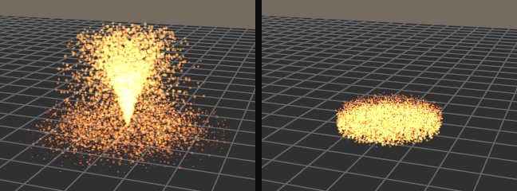
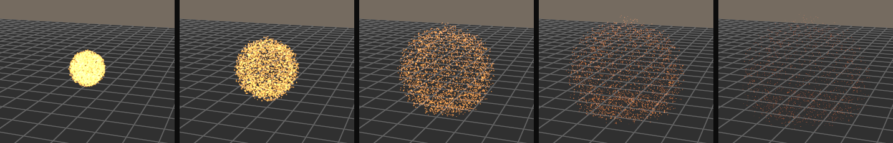
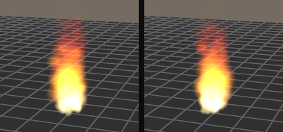
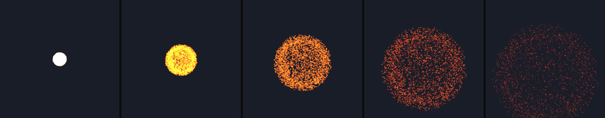

# 54 — Shaping a Particle Effect

> **Reference support:** named prepared-exercise and native-regression commands
> in this lesson run from the [reference checkout](../BranchWorkflow.md#prepared-reference-exercises).
> The growing chapter implementation remains in your learning checkout.

**Goal:** turn Chapter 21's fountain into effects. Births start on a shape instead of at a point. A clock fires
them in bursts, as a firework shell needs. An effect starts full instead of filling for four seconds. A particle's
colour, glow and size follow curves over its life, and the curves can be edited while the program runs. The chapter
ends on glow, which is fire and fireworks. Smoke that covers what is behind it, the sort that draws it back to
front and flipbooks are [Chapter 55](55-Sorted-Smoke.md); other facing modes are a lab
([Lab 5](ParticleExtensions.md#lab-5--face-another-way-or-order-by-age)). Section 1 shows what the fountain lacks
and sets the design. Sections 2 to 4 are Part 1, where and when particles start. Sections 5 to 7 are Part 2, a look
over a lifetime; section 7 says what this effect does not do yet.

**Form:** typed into your tree from its own text. The tree is the assembled reference, which holds Chapter 21's
Particles demo with section 9's soft particles, Chapter 23's sky and Chapter 52's wind; the chapter prints every
line it changes. One CPU test is supplied, not typed.

**GPU idea:** the sampler can evaluate a curve. The lifetime curves are baked into a small image that the vertex
stage reads with one filtered fetch, using `textureLod`, because the vertex stage has no derivatives to choose a
mip level with. When the panel edits a curve, the new table is copied into that one image by a copy recorded inside
the frame, between two barriers. This is Chapter 21's one-copy rule
([section 1's Jump box](21-GPU-Particles.md#1-the-pool) and
[the return trip of section 4](21-GPU-Particles.md#the-return-trip)) applied to a third kind of resource: one the
CPU rewrites rarely, at a moment the user picks. Beside it, prewarm records many dependent simulation steps into
one command buffer, because the GPU knows nothing about frames.

The pool, the lists and the passes stay as they are. The Sea's spray shares some of the pool's shaders and does not
change.

**Read after:** [Chapter 21](21-GPU-Particles.md). This is a detour like
[Chapter 52](52-Wind-Fields-And-Vorticles.md)'s: the main route goes on at Chapter 22. Reading Chapter 52 is not
required, but its code is in your tree. Section 4's listing shows where the new `RecordStep` binds Chapter 52's
wind set, now in the frame's first step only, and section 2 renames the push word Chapter 52 kept spare.

**ROADMAP:** step 21+ — the `Particles` demo grows.

**Module:** `pf::demos::particles`. There is one pool and no new demo. `ParticleSimulation` stays 96 bytes and
`ParticleAppearance` 48: the shape uses two words of the first that were spare. Two headers are shared by C++ and
GLSL, `EmitterShapes.h` and `ParticleRampMath.h`. One new vertex shader, `ParticleCurves.vert.glsl`, draws the
curves; its fragment shader is Chapter 21's `ParticleSoft.frag.glsl`, unchanged. One command-line flag,
`--particle-preset`, is the harness the checkpoints use; it is not the lesson.

**Math:** section 2 places a particle evenly on a disc by inverting an area that grows as the square of the radius,
`R√u`, and in a ball by inverting a volume that grows as the cube, `R∛u`. Section 3 writes a burst as a time that a
step crosses, in a half-open interval that never fires it twice and never misses it. Section 4 counts the particles
alive before the longest life as the area under the "still alive" line, a trapezoid, times the rate. Section 5
evaluates piecewise-linear keys and reads them at texel centres.

**Prerequisites:**

- [Chapter 21, section 1](21-GPU-Particles.md#1-the-pool): the pool has one copy of everything, and what that
  costs: a return-trip barrier each frame (section 4).
- [Chapter 21, section 3](21-GPU-Particles.md#3-the-passes): the reset, begin, emit, simulate and end passes, and
  the random numbers.
- [Chapter 21, section 4](21-GPU-Particles.md#4-recording-the-compute): `RecordCompute`, which section 4 splits in
  two, and [its return trip](21-GPU-Particles.md#the-return-trip).
- [Chapter 21, section 5](21-GPU-Particles.md#5-drawing-the-particles): the quad per particle, and the additive
  blend the curves are drawn with.
- [Chapter 21, section 7](21-GPU-Particles.md#7-the-panel-and-the-numbers-that-come-back): the panel's numbers and
  Little's law.
- [Chapter 21, section 9](21-GPU-Particles.md#9-exercise-soft-particles): the soft-particle exercise. Your tree has
  its worked solution, `ParticleSoft.frag.glsl`, with the depth image at set 1 binding 5 and the fragment push
  constants at offset 48.
- [Chapter 4, section 5](04-Commands-And-Synchronization.md#5-barriers-and-the-three-questions-they-answer) and its
  [appendix of barriers](04-Commands-And-Synchronization.md#appendix-barriers-the-later-chapters-add): the three
  questions, and the rows sections 5 and 6 reuse.
- [Chapter 8, section 4](08-Resources-And-Descriptors.md#4-getting-the-offscreen-image-to-the-screen): colour is
  sRGB when a person edits it and linear inside the renderer.
- [Chapter 15, section 5](15-Materials-And-Textures.md#5-textures-on-the-gpu): an image uploaded through
  `immediateSubmit`.
- [Chapter 16, section 6](16-Lights.md#6-exposure-and-the-tone-curve): the tone curve, which takes a glow above 1.
- [Chapter 9, section 6](09-Demo-Harness.md#guarded-float-widgets): the guarded `sliderFloat` that every float
  slider here goes through, which puts back a typed `nan`.
- [Chapter 9's optional transfer](09-Demo-Harness.md#control-workspace-transfer): the other `debug_panels` wrappers
  the panel uses (`sliderInt`, `checkbox`, `combo` and `beginCombo`).
- [Chapter 20, section 4](20-Compute-Fundamentals.md#4-storage-images): `createDescriptorSets`, which builds the
  ramp's set.
- Mentioned but not required: [Chapter 52](52-Wind-Fields-And-Vorticles.md)'s wind set (push words 84 and 88, which
  stay as they are), and [Chapter 53](53-Rolling-Wind.md)'s `GrassWindSource.h`, a second example of a header
  shared by C++ and GLSL, and [Chapter 23](23-The-Sky.md#8-one-setting-and-the-first-demo)'s `--sky sun`, in your
  tree, which the checkpoints use as a backdrop.

## Where the code goes

| File | What sections 1 to 6 do there |
| --- | --- |
| `Shaders/Particles/ParticleTypes.h` | Section 2: `emitterPosition.w` becomes the shape's size, the spare word at byte 92 is renamed `emitterShape`, and an assert pins it |
| **New:** `Shaders/Particles/EmitterShapes.h` | Section 2: where on a shape a particle is born, and which way it leaves, for C++ and GLSL |
| `Shaders/Particles/ParticleEmit.comp.glsl` | Section 2: the shape's position and direction replace the point |
| **New:** `Source/PillowFort/Demos/Particles/EmissionSchedule.h`, `Source/PillowFort/Demos/Particles/EmissionSchedule.cpp` | Section 3: the effect's clock, the rate's carry and the bursts, on the CPU only |
| **New:** `Shaders/Particles/ParticleRampMath.h`, `Shaders/Particles/ParticleCurves.vert.glsl` | Section 5: where a life lands in the ramp, and the vertex shader that reads it |
| **New:** `Source/PillowFort/Demos/Particles/ParticleCurves.h`, `Source/PillowFort/Demos/Particles/ParticleCurves.cpp` | Section 5: the colour, glow and size keys, their evaluation, their checks and the bake |
| **New:** `Source/PillowFort/Demos/Particles/ParticleRamp.h`, `Source/PillowFort/Demos/Particles/ParticleRamp.cpp` | Section 5: the ramp's image, sampler and set 2, and its upload. Section 6: the staging buffers and the copy inside the frame |
| `Source/PillowFort/Demos/Particles/ParticlesDemo.h`, `Source/PillowFort/Demos/Particles/ParticlesDemo.cpp` | Section 2: the settings regrouped, the presets and the shape group. Section 3: the Emission group and the clock's call. Section 4: prewarm, and `RecordCompute` split into steps. Section 5: the Look combo, the curves editor and the curves pipeline. Section 6: the copy in `Record` |
| `Source/SandboxGame/Main.cpp` | Section 2: `--particle-preset` |
| `premake5.lua`, `Tests/TutorialHarness/ParticleEffectTests.cpp` | Section 6: the `TutorialParticleEffectTests` project; the test file is supplied |

Sections 2, 3 and 5 add files, so each runs `GenerateProjects.bat` again
([Chapter 1, section 3](01-Environment-And-Build.md#3-the-corrected-workspace)): premake bakes its file lists in
when it generates, and a file it has not seen is not listed. A header under `Shaders/` counts, because the engine's
file list and the shaders' include dependencies come from the same glob. Section 4 adds no file. Section 6 runs
`GenerateProjects.bat --tutorial-tests` for the test project. Editing an existing file needs no run.

**Blank lines.** A new function, struct member block or file-scope block you add gets one blank line above it and
one below it, as its neighbours have. Constants or comment lines that join a run of constants are the exception:
they sit directly against their neighbours, and the text says "with no blank line between" where that is so.

# Part 1 — Where and when particles start (sections 1–4)

## 1. One fountain is not an effect

Run the fountain as Chapter 21 left it. It is the demo's default, so the demo flag is all you need:

```powershell
& ./Build/Artifacts/Release/SandboxGame/SandboxGame.exe --demo Particles
```

The panel's first lines are the numbers of
[Chapter 21, section 7](21-GPU-Particles.md#7-the-panel-and-the-numbers-that-come-back). Give the fountain five
seconds, then read **Alive**. It says about 12,000, and the panel's own "expected about 12000" agrees. This is
Little's law, which Chapter 21's section 7 taught. The rate is 4,000 a second and a life averages 3 seconds. A
particle dies in the first frame its age reaches its life, which costs about half a step. At your display's rate
(60 Hz gives 4,000 × (3 − 0.0083) = 11,967) you should read within a few dozen of 11,970. **Free** is the rest of
the pool, so **Alive** plus **Free** is **Max particles**, 65,536 at the defaults.

Watch it fill, too. After **Reset**, **Alive** climbs for about four seconds before it holds. The longest life is
3.9 seconds (3 seconds, 30 percent either way), and the pool is only in step once the oldest births have lived that
long and the newest are still arriving.

That steady fountain is a good fountain and a poor effect. Think of a firework, a fire and a puff of dust, and ask
what each needs that this does not have. There are four things:

1. **Where births start.** The fountain starts every particle at one point. A fire's flames start across a hearth.
   A dandelion head of seeds starts in a ball and leaves its centre in all directions.
2. **When they start.** The fountain is a rate: 4,000 every second, so nothing in it is ever an event. A firework
   shell is 3,000 particles at one instant, then nothing, then the next shell. Chapter 21's CPU asks for
   `rate × dt` births a frame, a number that cannot say "now".
3. **Starting full.** A campfire you come upon is already burning. Reset the fountain and it takes four seconds to
   look like itself. A fire that begins empty is a fire you watch light.
4. **A look that changes over a life.** Chapter 21 mixes one start colour into one end colour and one start size
   into one end size. A flame that is white at the base, then orange, then dark red cannot be made from two ends,
   and neither can a size that swells and then thins.

None of the four needs a new pool. The pool, the alive lists, the indirect draw and the passes that Chapter 21
built stay as they are. Each need is met by a small change at one place, and the change is one thing you can name:

| Need | The one change | Section | What its checkpoint shows |
| --- | --- | --- | --- |
| Where | Two push words that were free carry a shape and its size; the emit pass picks a point on the shape | 2 | a disc evenly filled, and a ball of seeds |
| When | One clock on the CPU, with bursts placed on it | 3 | a shell every 1.5 s, and a counter that climbs by one each time |
| Starting full | Prewarm: many simulation steps recorded into one command buffer on the frame of a reset | 4 | the fountain full on its first frame |
| A look over a life | One image holding the curves, read with one fetch per vertex, and one new pipeline that reads it | 5 | a flame, white-hot to dark |
| The same, edited live | The same image rewritten by a copy inside the frame, between two barriers | 6 | a dragged key changes the next frame |

The last two rows are the chapter's GPU lesson, and the first three are small. The chapter's new Vulkan objects are
the ramp's image, its sampler, its set layout, pool and set 2, a staging buffer for each frame slot, and one
graphics pipeline with its own layout, which is Chapter 21's own draw pipeline with a different vertex shader.
Everything else is state the demo already had, extended.

### Checkpoint

Nothing changes in this section. Write down the **Alive** and **Free** readings from the run above; section 4
compares a prewarmed start with them. Orbit the camera as Chapter 21's checkpoint did and note the fountain's base:
every particle leaves one point. Section 2 changes that.

Section 2 gives the emitter a shape.

## 2. Births on a shape

Chapter 21's emit pass starts every particle at one point and throws it up a cone. A fire starts across a hearth
and a dandelion head in a ball, so this section lets the emit pass pick the start. That is a small change to one
shader, and one problem decides whether it is a good change: the points must be spread *evenly*. The problem is old
and has a tidy answer.

You will add five shapes (a point, a disc, a ball, a sphere's skin and a box), a way to leave a shape from its
centre instead of up a cone, and a set of **presets**, each a whole set of settings under a name. The presets are
how every later checkpoint starts: `--particle-preset disc` starts the demo on the disc. A preset also says where
the camera looks, because an effect that hangs 8 m in the air is not in view from Chapter 21's camera.

Keep three words apart. A **shape** is where births start. A **launch** is the direction a particle leaves in. A
**preset** is a name for a shape, a launch and everything else that makes one look; picking one replaces the
settings in the groups it lists and resets the pool.

<a id="ch54-fill-a-shape-evenly"></a>

### Attempt CH54-fill-a-shape-evenly: births spread evenly over a disc and a ball

Predict first. Suppose a disc of radius R gets its births at a radius `r = R * u`, with `u` a uniform random number
from 0 to 1. What share of the births lands within R/2 of the centre? What share *should* land there, if the births
are spread evenly over the disc's area? Then say how the answer changes for a ball, whose births are spread over
its volume.

Design the change to the emit pass. It has to place births on a disc and in a ball from uniform random numbers,
leave Chapter 21's fountain exactly as it is when the shape is a point (or its size is 0), and not disturb the
random numbers that Chapter 21's pass uses for the launch direction, the speed and the lifetime.

**Acceptance:** on a disc of radius R, 25 percent of births (plus or minus 1 percent, over many thousands) land
within R/2 of the centre and none land outside R. In a ball, 12.5 percent land within R/2. A sphere's births are
all at R and a box's are uniform on each axis. A shape of size 0, or the point, gives the fountain exactly: the
same position and the same direction as Chapter 21's pass. Whatever the shape, Chapter 21's stream draws the same
numbers in the same order, so a shape moves births and nothing else. A launch outward is a unit vector at every
birth, and at the exact centre, where there is no "outward", it falls back to the cone's direction and stays
finite. The two push words the shape needs are words the push block already has, so `ParticleSimulation` stays 96
bytes.

**Transfer:** a ring between an inner radius `a` and an outer radius `b` is a disc with a hole. Find the radius
that holds a fraction `u` of the ring's area, and say what it gives at `a = 0`. Then say why a *box* thrown outward
from its centre is not an even burst, while a ball is.

<details>
<summary>Hint 1: how much of a disc is inside radius r</summary>

The area inside radius r is proportional to r squared. So half the radius holds a quarter of the area, and a
quarter of the births, if they are even. Now ask what `r = R * u` does at `u = 0.5`.

</details>

<details>
<summary>Hint 2: invert the share</summary>

Call the share of the area inside r, `s(r)`. For a disc `s(r) = r^2 / R^2`. A uniform random number `u` is a share
you want, so the radius that holds it solves `s(r) = u`. Do the same for a ball, whose volume grows as r cubed. For
the direction, Chapter 21's cone with a half-angle of pi is the whole sphere.

</details>

<details>
<summary>Hint 3: where the shape's numbers come from</summary>

Chapter 21's pass draws numbers one after another from one stream: two for the cone, then one for the speed, then
one for the lifetime. If the shape took its three numbers from that stream first, the speed and the lifetime would
draw different numbers whenever you changed shape. Where else can three numbers come from, and what must be
different about where it starts?

</details>

<details>
<summary>Worked solution: the inverse of the share, a second stream, and two words</summary>

**The count.** Six things leave this part of the change.

| Output | Meaning | Where it goes |
| --- | --- | --- |
| `emitterDiscPoint`, `emitterBallPoint` | a point on a disc or in a ball, from uniform numbers | the emit pass |
| `emitterRandomDirection` | a direction uniform over the whole sphere | the ball, the sphere, and the emit pass through the ball |
| `emitterShapeOffset` | the offset from the emitter for a shape kind | the emit pass |
| `emitterLaunchDirection` | outward from the shape's centre, or the cone's | the emit pass |
| `emitterPosition.w` | the shape's size: the radius, or a box's half-extent | one push word |
| `emitterShape` | the kind in the low byte, a launch-outward bit above it | one push word |

**The disc.** The share of a disc's area inside radius r is `r^2 / R^2`. The radius that holds the share `u` solves
`r^2 / R^2 = u`, so `r = R * sqrt(u)`. Why a uniform `u` does it: `u` falls below 0.25 a quarter of the time, and
`R * sqrt(0.25) = R/2`, so a quarter of the births land inside R/2, which holds a quarter of the area. Any share
works the same way: `u = 0.81` gives `r = 0.9R`, and the 19 percent of births with `u` above 0.81 land in the ring
from 0.9R to R, which is 19 percent of the area. This is the *inverse* of the share, the same move Chapter 21 made
for its cone (the cap's height is uniform, not the angle). With `r = R * u` the share inside R/2 would be 50
percent, not 25, and the centre would be crowded: that is the first prediction's answer. The angle around the disc
is uniform, `phi = 2 pi u`, because the disc looks the same turned by any angle.

**The ball.** The volume inside r is `r^3 / R^3`, so the radius is `R * cbrt(u)` and the share inside R/2 is
`(1/2)^3 = 12.5` percent. The direction is a point uniform over the sphere: Chapter 21's `randomInCone` with a
half-angle of pi. The height `cos(theta)` runs from 1 to -1 uniformly, and the angle around +Y is uniform. A
sphere's skin is that direction times R, and a box is uniform on each axis, `(2u - 1) * halfExtent`.

**The second stream.** Chapter 21's pass seeds one stream from the new particle's index in this step's emit pass
and the frame number (Chapter 21, section 3). The shape draws its three numbers from a second stream, seeded from
the same two numbers with the frame number xored by a constant (`EMITTER_SHAPE_SALT`). The first stream is never
touched, so it draws the same numbers in the same order whatever the shape, and size 0 takes the point path
exactly: the shape code is skipped.

**Two words.** The size takes `emitterPosition.w`, which Chapter 21 left unused. The kind and the launch bit share
one word, the one Chapter 52 kept spare as `padding2`: the kind is the low byte, and the bit `0x100` asks for a
launch outward. Outward is the offset from the centre, made unit length. At the exact centre (within a micrometre,
squared: 1e-12) there is no reliable "away", so the cone decides there too. A box thrown outward leaves more toward
its corners, which is the transfer question's second half.

**The ring.** The share inside r is `(r^2 - a^2) / (b^2 - a^2)`, so `r = sqrt(a^2 + u * (b^2 - a^2))`. At `a = 0`
it is the disc's `b * sqrt(u)`.

</details>

### Where the code goes

The change touches the push block's header, adds one header both languages read, edits the emit shader, regroups
the demo's settings, adds the presets and the panel's new controls, and adds one command-line flag. Do it in this
order, and build at the end.

**`ParticleTypes.h`.** Three edits. The `emitterPosition` comment says `w` is the shape's size now, where Chapter
21 wrote "w unused". Replace the line in `ParticleSimulation`:

```cpp
    vec4  emitterPosition;      /*  0: xyz metres; w the shape's size: radius or box half-extent, 0 is a point */
```

The last field of the struct was `uint  padding2;` (two spaces). Chapter 52, section 3 said "keep `padding2`" and
kept it spare; this chapter uses it, so it is renamed and given a comment. Chapter 52's sentence stays true for a
reader at Chapter 52's step. Replace the line:

```cpp
    uint  emitterShape;         /* 92: Chapter 54: the shape's kind (EmitterShapes.h) plus its launch bit */
```

Then pin its offset with an assert directly below the `windResponseRate` assert, so the link in Chapter 52 to the
wind asserts still lands on them. Insert this line after the line that asserts `windResponseRate`:

```cpp
    static_assert(offsetof(ParticleSimulation, emitterShape) == 92, "ParticleSimulation shape offset drifted.");
```

**`EmitterShapes.h`, a new file in `Shaders/Particles/`.** This is the header the emit pass and a CPU test both
read. It is written once, in the pattern Chapter 52's `WindFieldMath.h` and Chapter 53's `GrassWindSource.h` use
for the same reason: a C++ copy of each function would be a second place for the numbers to drift, and here the CPU
test of section 6 calls the very functions the emit pass runs.

It comes in four pieces, typed one after the other with one blank line between them. The first is the comment that
says what the file is, and the constants. The kind is the low byte of the shape word and the launch bit sits above
it, the salt of the second stream has its top bit set so that its numbers are not Chapter 21's, and
`EMITTER_TWO_PI` is a full turn:

```cpp
/* Chapter 54. Where on a shape a particle is born, and which way it leaves.
   One header for C++ and GLSL, like WindFieldMath.h: the CPU test and the emit
   pass call the same functions. */
#ifndef PF_EMITTER_SHAPES_H
#define PF_EMITTER_SHAPES_H
#include "ParticleTypes.h"

/* ParticleSimulation::emitterShape: the shape's kind in the low byte, and one
   flag above it. */
#define EMITTER_SHAPE_POINT   0u
#define EMITTER_SHAPE_DISC    1u   /* a flat disc in the XZ plane, across the cone's +Y axis */
#define EMITTER_SHAPE_BALL    2u   /* a filled ball */
#define EMITTER_SHAPE_SPHERE  3u   /* the ball's skin only */
#define EMITTER_SHAPE_BOX     4u   /* a box; the size is its half-extent on every axis */
#define EMITTER_SHAPE_KIND_MASK      0xFFu
#define EMITTER_SHAPE_LAUNCH_OUTWARD 0x100u
/* The shape draws from a stream of its own, so Chapter 21's stream draws the same
   numbers whatever the shape. Its seed is the frame number xor this, so its numbers
   are not Chapter 21's: with the same seed, a disc's angle would be the cone's
   azimuth. Any constant with its top bit set works; the frame number would need
   2^31 steps to reach it. */
#define EMITTER_SHAPE_SALT    0x9E3779B9u

/* A full turn, in radians. */
#define EMITTER_TWO_PI        6.28318530718f
```

The second piece is the part that makes it a twin header. In C++ it opens the namespace and brings in the names
GLSL has built in (`vec3`, `dot`, `sqrt`, `pow`, `sin` and `cos`); `uint` comes from `SharedShaderTypes.h` through
`ParticleTypes.h`. One macro covers the single word the languages disagree on: a function in a C++ header must be
`inline`, and in GLSL that word is an error. Every number has an `f`, because C++ reads `0.5` as a `double` and
would turn each expression it touches into one. The first function is the direction uniform over a sphere, Chapter
21's `randomInCone` with a half-angle of pi:

```cpp
#ifdef __cplusplus
#include <cmath>
namespace pf::demos::particles {
using glm::vec3;
using glm::dot;
using std::sqrt;
using std::pow;
using std::sin;
using std::cos;
#define PF_EMITTER_FUNCTION inline
#else
#define PF_EMITTER_FUNCTION
#endif

/* A direction uniform over the whole sphere. This is Chapter 21's randomInCone
   with a half-angle of pi: the height cos(theta) runs from 1 to -1, uniform, and
   the angle around +Y is uniform. */
PF_EMITTER_FUNCTION vec3 emitterRandomDirection(float u1, float u2)
{
    float cosTheta = 1.0f - 2.0f * u1;
    float sinTheta = sqrt(1.0f - cosTheta * cosTheta);
    float phi      = EMITTER_TWO_PI * u2;
    return vec3(sinTheta * cos(phi), cosTheta, sinTheta * sin(phi));
}
```

The third piece is the shapes. `emitterDiscPoint` and `emitterBallPoint` are the two inverses the worked solution
found; `emitterShapeOffset` picks one by kind, and a kind the header does not know gives no offset:

```cpp
/* A point uniform over a disc of radius `radius`. The area inside r grows as r
   squared, so r = radius * sqrt(u) is the radius that holds a fraction u of it. */
PF_EMITTER_FUNCTION vec3 emitterDiscPoint(float radius, float u0, float u1)
{
    float r   = radius * sqrt(u0);
    float phi = EMITTER_TWO_PI * u1;
    return vec3(r * cos(phi), 0.0f, r * sin(phi));
}

/* The same for a ball: the volume inside r grows as r cubed. */
PF_EMITTER_FUNCTION vec3 emitterBallPoint(float radius, float u0, float u1, float u2)
{
    float r = radius * pow(u0, 1.0f / 3.0f);
    return emitterRandomDirection(u1, u2) * r;
}

/* The offset from the emitter for a shape's kind. A kind this header does not
   know gives no offset. `size` is the radius, or the box's half-extent. */
PF_EMITTER_FUNCTION vec3 emitterShapeOffset(uint kind, float size, float u0, float u1, float u2)
{
    if (kind == EMITTER_SHAPE_DISC) { return emitterDiscPoint(size, u0, u1); }
    if (kind == EMITTER_SHAPE_BALL) { return emitterBallPoint(size, u0, u1, u2); }
    if (kind == EMITTER_SHAPE_SPHERE) { return emitterRandomDirection(u1, u2) * size; }
    if (kind == EMITTER_SHAPE_BOX) { return (vec3(u0, u1, u2) * 2.0f - vec3(1.0f)) * size; }
    return vec3(0.0f);
}
```

The last piece is the launch. A shape that asks for it throws a particle away from the shape's centre, and the
guard on the squared length keeps the division honest:

```cpp
/* The launch direction: away from the emitter's centre when the shape asks for
   it, otherwise the cone's. Within a micrometre of the centre (1e-12 m squared,
   far above the denormals a GPU may flush to zero) there is no reliable "away", so
   the cone decides there too. A box throws more toward its corners; only a ball
   or a sphere throws evenly. */
PF_EMITTER_FUNCTION vec3 emitterLaunchDirection(uint shape, vec3 offset, vec3 coneDirection)
{
    float squaredLength = dot(offset, offset);
    if ((shape & EMITTER_SHAPE_LAUNCH_OUTWARD) != 0u && squaredLength > 1.0e-12f)
    {
        return offset / sqrt(squaredLength);
    }
    return coneDirection;
}

#undef PF_EMITTER_FUNCTION
#ifdef __cplusplus
}
#endif
#endif
```

**`ParticleEmit.comp.glsl`.** Add this line directly under the existing `#include "Random.glsl"`:

```glsl
#include "EmitterShapes.h"
```

Chapter 21's comment above the stream said what the fountain did; the sentence now has to admit that a shape may
change it. Replace the two-line comment that starts `A different stream per new particle` with these three lines:

```glsl
    // A different stream per new particle and per frame. Chapter 21's fountain starts every
    // particle at the emitter, upwards within the spread angle of +Y; Chapter 54's shape,
    // below, may move the start and turn the launch outward.
```

Then add the shape block directly below the line `vec3 direction = randomInCone(random, simulation.spreadAngle);`,
with a blank line above and below. It takes effect only for a shape that is not the point and has a size; it takes
its three numbers from the salted stream; and it moves the position and may replace the direction:

```glsl
    // Chapter 54: a shape moves where the particle starts, and may replace the direction.
    // Its three numbers come from a second stream, so the stream above draws the same numbers in the same
    // order whatever the shape. Size zero is the point, exactly.
    uint  shape = simulation.emitterShape;
    float size  = simulation.emitterPosition.w;
    if ((shape & EMITTER_SHAPE_KIND_MASK) != EMITTER_SHAPE_POINT && size > 0.0)
    {
        uint shapeRandom = seedRandom(id, simulation.frameNumber ^ EMITTER_SHAPE_SALT);
        float u0 = randomFloat(shapeRandom);
        float u1 = randomFloat(shapeRandom);
        float u2 = randomFloat(shapeRandom);
        vec3 offset = emitterShapeOffset(shape & EMITTER_SHAPE_KIND_MASK, size, u0, u1, u2);
        position += offset;
        direction = emitterLaunchDirection(shape, offset, direction);
    }
```

**`ParticlesDemo.h`.** First the include that `SetPreset`'s argument needs, under `<cstdint>`:

```cpp
#include <string_view>
```

A preset says where the camera looks. The default is what the constructor already does: an orbit around a target
1.5 m up, 14 m away, pitched down 15 degrees. Add the struct directly above the settings' comment, with a blank
line above and below:

```cpp
// Chapter 54, section 2. Where an orbit camera looks: the target's height, how far away, and the
// pitch. The default is the constructor's, Chapter 21's.
struct ParticleFraming
{
    float targetHeight = 1.5f;     // metres
    float distance     = 14.0f;    // metres
    float pitchDegrees = -15.0f;
};
```

The settings struct is **reprinted whole**, not edited, because it is grouped by the panel's headers and ordered
for the presets, which name their fields in designated initializers that C++20 requires to follow the order of the
members. Replace everything from the comment `// What the panel edits (section 7).` to the closing `};` of
`ParticleSettings` (the struct's last member is `windDrift`; the `};` after it is the one meant, not the earlier
initializer braces) with the following. The fields Chapter 21 and Chapter 52 had are the same; `preset`, the Shape
group and `emitterHeight` are new, and `windEnabled` lost its "Chapter 52:" prefix because its group carries it
now:

```cpp
// What the panel edits (section 7), grouped by the panel's headers and ordered for the presets'
// designated initializers. CPU state: it survives Teardown and Setup.
// Colors are sRGB here, as the swatches show them; Record converts them.
struct ParticleSettings
{
    int   preset            = 0;        // Chapter 54: the table's entry the panel last applied

    // Shape (Chapter 54)
    int   shapeKind         = 0;        // 0 point, 1 disc, 2 ball, 3 sphere, 4 box (EmitterShapes.h)
    float shapeSize         = 1.0f;     // metres: the radius, or the box's half-extent
    bool  launchOutward     = false;    // leave the shape's centre instead of through the cone

    // Emitter
    float emitRate          = 4000.0f;  // particles per second
    float emitterHeight     = 0.05f;    // metres above the origin
    float speed             = 7.0f;     // metres per second
    float speedVariation    = 0.2f;     // +- fraction
    float spreadDegrees     = 15.0f;    // the cone's half-angle
    float lifetime          = 3.0f;     // seconds, the average
    float lifetimeVariation = 0.3f;     // +- fraction

    // Forces
    float gravity           = 9.81f;    // metres per second squared, downwards
    float drag              = 0.3f;     // per second
    float restitution       = 0.4f;     // vertical speed kept in a bounce
    float friction          = 0.3f;     // horizontal speed lost in a bounce

    // Look
    float startColor[4]     = { 1.0f, 0.75f, 0.35f, 1.0f };
    float endColor[4]       = { 0.9f, 0.2f, 0.05f, 0.0f };
    float startSize         = 0.12f;    // metres
    float endSize           = 0.04f;
    int   blend             = 0;        // 0 additive, 1 premultiplied alpha
    float softDistance      = 0.0f;     // metres; zero preserves the chapter's original draw

    // Pool
    int   maxParticles      = 65536;    // how much of the pool is in use
    bool  paused            = false;

    // Local wind (Chapter 52)
    bool  windEnabled       = false;    // opt in to local invisible wind sources
    float windResponseRate  = 2.0f;     // inverse seconds at full source influence
    float windRadius        = 5.0f;     // metres
    float windLifetime      = 8.0f;     // seconds
    float windDrift         = 0.4f;     // metres/second along +X
};
```

Two public functions go under `SetSoftDistance`. `SetPreset` applies a preset by name (the `--particle-preset` flag
calls it), and `Frame` points the camera. Both are public:

```cpp
    bool SetPreset(std::string_view name);              // applies one; false for a name the table does not have
    void Frame(const ParticleFraming& framing);  // Chapter 54: points the orbit camera
```

**`ParticlesDemo.cpp`.** The includes first. Add the shapes header directly under the existing
`#include "PillowFort/VulkanGraphics/VulkanBarriers.h"`:

```cpp
#include "Particles/EmitterShapes.h"
```

Everything that follows goes between the line `using namespace vulkan_graphics;` and the comment
`// Section 7. Edits the settings and shows what came back`, in this order, with one blank line between each piece
and the next and between `using namespace vulkan_graphics;` and the first piece. A preset is a label, a flag name,
the settings it sets and a camera framing. Its comment names the groups it covers, among them Emission, which
section 3 adds, and says that a preset lists only what differs from the defaults, so the first entry,
`ParticleSettings{}`, is Chapter 21's fountain. The framing is last in the struct so that a preset without one
takes `ParticleFraming{}`:

```cpp
// Chapter 54, section 2. A named set of the Shape, Emitter, Emission, Forces and Look settings,
// listing only what differs from ParticleSettings{}: that is Chapter 21's fountain, the first entry.
// The initializers follow the struct's order.
struct ParticlePreset
{
    const char*      label;      // the panel's combo
    const char*      name;       // --particle-preset
    ParticleSettings values;
    ParticleFraming  framing;    // where the camera looks, applied when the preset is picked
};
```

The table has three presets so far. Fountain is Chapter 21. Disc is a flat disc that drifts up slowly (a speed of
0.5 m/s and almost no gravity, so the cloud still reads as a disc rather than a fountain). Puff is a ball of births
that all leave the centre, a dandelion head. Puff is a **staged** form: it is continuous here, at a rate of 2,000 a
second with a life near 1.5 s, which keeps about 3,000 particles alive, and section 3 turns it into one puff at a
time. The listing ends with `PRESET_COUNT`, which goes directly under the table's `};`, with no blank line between;
the combo and `SetPreset` loop over it.

```cpp
static const ParticlePreset PRESETS[] = {
    { "Fountain (Chapter 21)", "fountain", ParticleSettings{} },
    // A disc of births that drifts up slowly, so the cloud still reads as a disc.
    { "Disc", "disc", ParticleSettings{
        .shapeKind = EMITTER_SHAPE_DISC, .shapeSize = 1.5f,
        .speed = 0.5f, .speedVariation = 0.3f, .spreadDegrees = 5.0f,
        .gravity = 0.2f,
        .startSize = 0.08f } },
    // A ball of births, every one leaving the centre: a dandelion head.
    { "Puff", "puff", ParticleSettings{
        .shapeKind = EMITTER_SHAPE_BALL, .shapeSize = 0.5f, .launchOutward = true,
        .emitRate = 2000.0f, .emitterHeight = 1.5f, .speed = 3.0f,
        .lifetime = 1.5f, .lifetimeVariation = 0.2f,
        .gravity = 1.0f, .drag = 1.5f,
        .startSize = 0.08f, .endSize = 0.02f } },
};
constexpr int PRESET_COUNT = static_cast<int>(std::size(PRESETS));
```

The combos take their labels from two tables, and a `static_assert` ties each to its enum so that a label table
shorter than the kinds does not compile. The comment names the look combo and the `LOOK_*` constants, which are
section 5's; the shape table is used now:

```cpp
// The shape and look combos' labels, indexed by EMITTER_SHAPE_* and LOOK_*.
static constexpr const char* SHAPE_LABELS[] = { "Point", "Disc", "Ball", "Sphere", "Box" };
static_assert(std::size(SHAPE_LABELS) == EMITTER_SHAPE_BOX + 1);
```

Do not type the `LOOK_LABELS` lines yet: section 5 adds them. `Frame` points the orbit camera the way the
constructor does, at the preset's target, distance and pitch, from the same side (a yaw of 20 degrees), and
recomputes the camera's translation from the target. `SetPreset` (the flag's path) and `Update` (the panel's) both
call it:

```cpp
// Points the orbit camera as a preset says, from the same side as the constructor.
void ParticlesDemo::Frame(const ParticleFraming& framing)
{
    m_controls.orbit.target   = glm::vec3(0.0f, framing.targetHeight, 0.0f);
    m_controls.orbit.distance = framing.distance;
    m_cameraTransform.rotation    = scene::rotationFromYawPitch({ .yaw   = glm::radians(20.0f),
                                                                  .pitch = glm::radians(framing.pitchDegrees) });
    m_cameraTransform.translation = m_controls.orbit.target
                                  - m_cameraTransform.Forward() * m_controls.orbit.distance;
}
```

Applying a preset replaces the settings it names, its prewarm (section 4) included, and keeps what belongs to the
person at the panel: whether the demo is paused, the pool size, the soft distance and Chapter 52's wind.
`SetPreset` applies a preset by name, frames the camera, asks for a reset and says whether the name was found:

```cpp
// Replaces the settings a preset names, its prewarm included. Paused, the pool, the soft distance
// and Chapter 52's wind belong to the person at the panel, not to a look.
static void applyPreset(ParticleSettings& settings, int index)
{
    ParticleSettings applied = PRESETS[index].values;
    applied.preset           = index;
    applied.softDistance     = settings.softDistance;
    applied.maxParticles     = settings.maxParticles;
    applied.paused           = settings.paused;
    applied.windEnabled      = settings.windEnabled;
    applied.windResponseRate = settings.windResponseRate;
    applied.windRadius       = settings.windRadius;
    applied.windLifetime     = settings.windLifetime;
    applied.windDrift        = settings.windDrift;
    settings = applied;
}

bool ParticlesDemo::SetPreset(std::string_view name)
{
    for (int i = 0; i < PRESET_COUNT; ++i)
    {
        if (name == PRESETS[i].name)
        {
            applyPreset(m_settings, i);
            Frame(PRESETS[i].framing);
            m_resetRequested = true;
            return true;
        }
    }
    return false;
}
```

The settings are typed by hand, in the struct, the panel, the packing and the preset table, as every demo's are.
Nothing generates them from one description; later in the guide, [the reflection lesson](SettingsAsRows.md) gives
each setting but the preset's index a row: the panel draws the rows, packing walks them for the straight floats,
and applying a preset walks them for what it keeps, while the struct, the preset table and the converted packing
stay typed.

The panel and `Update` change in several places. The signature gains the preset the person picked this frame, so
that `Update` can frame the camera after the panel returns (the panel is a plain function and does not own the
camera). Replace the signature's second line with two lines. The whole signature then reads as below, and its third
line is a **staged** form that section 3 extends:

```cpp
static bool drawParticlePanel(ParticleSettings& settings, const ParticleCounters& counters,
                              uint32_t drawnList, const ParticleTimings& timings, bool timed, WindSources& wind,
                              int& picked)
```

Directly above the comment `// Little's law: at equilibrium, ...`, add the **Preset** combo, with a blank line
below it. A pick applies the preset, records which one it was, and asks for a reset. Choosing the current one
restores it, which is a way back after editing; Chapter 21's expected line stays as it is below it:

```cpp
        // Chapter 54: a preset replaces the groups below it, and starts the pool clean.
        if (pf::debug_panels::beginCombo("Preset", PRESETS[settings.preset].label))
        {
            for (int preset = 0; preset < PRESET_COUNT; ++preset)
            {
                if (ImGui::Selectable(PRESETS[preset].label, preset == settings.preset))
                {
                    applyPreset(settings, preset);   // choosing the current one restores it
                    picked = preset;
                    reset = true;
                }
            }
            ImGui::EndCombo();
        }
```

Directly under the comment `// The counts stay in view; ...`, with no blank line between, add the **Shape** group,
with a blank line below it. Its size slider is clamped (`ImGuiSliderFlags_AlwaysClamp`), so a typed number cannot
be negative, and it is Chapter 9's guarded slider, so a typed `nan` is put back. Its note says which way a disc
lies:

```cpp
        if (ImGui::CollapsingHeader("Shape"))
        {
            pf::debug_panels::combo("Shape", &settings.shapeKind, SHAPE_LABELS, static_cast<int>(std::size(SHAPE_LABELS)));
            pf::debug_panels::sliderFloat("Shape size (m)", &settings.shapeSize, 0.0f, 5.0f, "%.2f", ImGuiSliderFlags_AlwaysClamp);
            ImGui::TextDisabled("Radius, or a box's half-extent. A disc lies flat, across the cone's +Y axis.");
            pf::debug_panels::checkbox("Launch outward", &settings.launchOutward);
        }
```

In the Emitter group, add **Height** under the two lines of the Rate slider. The Rate slider is the one that starts
`pf::debug_panels::sliderFloat("Rate (per s)"`. It lifts the emitter off the ground, which a shell needs; before
this section Chapter 21's push block hard-coded 0.05 m, which is now the setting's default:

```cpp
            pf::debug_panels::sliderFloat("Height (m)", &settings.emitterHeight, 0.0f, 10.0f, "%.2f", ImGuiSliderFlags_AlwaysClamp);
```

In the line that starts `pf::debug_panels::sliderFloat("Spread (deg)"`, change `90.0f` to `180.0f`: a ball's
direction is the cone at pi, and section 3's firework uses 180. The line becomes:

```cpp
            pf::debug_panels::sliderFloat("Spread (deg)", &settings.spreadDegrees, 0.0f, 180.0f);
```

`Update` calls the panel. Replace Chapter 21's two-line call with the four lines below, which are the new
`int picked`, the call and a check after it. The second line of the call is **staged** here; section 3 completes
it:

```cpp
    int picked = -1;   // the preset chosen in the panel this frame, if any
    m_resetRequested |= drawParticlePanel(m_settings, m_latest, m_latestList, m_timings,
                                          m_queryPool != VK_NULL_HANDLE, m_windSources, picked);
    if (picked >= 0) { Frame(PRESETS[picked].framing); }
```

In `RecordCompute`, the push block's emitter position becomes the height from the settings and the shape's size,
and a shape of the point kind sends size 0, so the emit pass takes the point path. Replace the line
`.emitterPosition   = glm::vec4(0.0f, 0.05f, 0.0f, 0.0f),` with these two. The second is indented by 50 spaces;
type it as printed:

```cpp
        .emitterPosition   = glm::vec4(0.0f, m_settings.emitterHeight, 0.0f,
                                                  (static_cast<uint32_t>(m_settings.shapeKind) & EMITTER_SHAPE_KIND_MASK) == EMITTER_SHAPE_POINT ? 0.0f : m_settings.shapeSize),
```

Add the two `.emitterShape` lines under `.windResponseRate`, the last field of the initializer. The kind is masked
first, so a stray bit in the setting cannot become a launch flag:

```cpp
        .emitterShape      = (static_cast<uint32_t>(m_settings.shapeKind) & EMITTER_SHAPE_KIND_MASK)
                           | (m_settings.launchOutward ? EMITTER_SHAPE_LAUNCH_OUTWARD : 0u),
```

**`Main.cpp`.** Three small edits. The flag's value is held in the launch settings, under the line
`softDistance = 0.0f;` in `LaunchSettings`:

```cpp
    std::string                       particlePreset;   // Chapter 54: empty keeps the demo's own settings
```

It is read where the other flags are, under `--soft-distance`:

```cpp
        else if (key == "--particle-preset") { settings.particlePreset = value; }
```

And it is applied where the Particles demo is built, under the `SetSoftDistance(...)` call. A name the table does
not have stops the program with a message that sends the person to the panel's **Preset** list:

```cpp
    if (!settings.particlePreset.empty() && !static_cast<demos::particles::ParticlesDemo&>(*demoList.back()).SetPreset(settings.particlePreset))
    {
        Log::error(std::format("Unknown --particle-preset \"{}\"; see the Particles demo's Preset list.",
                               settings.particlePreset).c_str());
        renderer.shutdown(); window.shutdown(); return 1;
    }
```

### Checkpoint

Run `GenerateProjects.bat` (`EmitterShapes.h` is new), then build the game, as Chapter 53 does:

```powershell
& 'C:\Program Files\Microsoft Visual Studio\2022\Community\MSBuild\Current\Bin\MSBuild.exe' .\Build\Projects\PillowFort.sln /m /p:Configuration=Release /p:Platform=x64 /t:SandboxGame
if ($LASTEXITCODE -ne 0) { throw 'The game build failed.' }
```

Run each preset in turn. The sky defaults to off, so the background is dark:

```powershell
& ./Build/Artifacts/Release/SandboxGame/SandboxGame.exe --demo Particles --particle-preset disc
& ./Build/Artifacts/Release/SandboxGame/SandboxGame.exe --demo Particles --particle-preset puff
& ./Build/Artifacts/Release/SandboxGame/SandboxGame.exe --demo Particles --particle-preset fountain
```

- **Disc:** an evenly filled disc 3 m across that drifts up slowly (for the first two seconds; with gravity 0.2 it
  then sinks back), with no crowded centre. If the centre looks denser than the rim, the radius is `R * u`, not
  `R * sqrt(u)`.

  

  The default fountain (left) and the Disc preset (right) at frame 240 of two runs with `--sky sun`, captured in
  Debug on an RTX 5090 at 1280x720 with `--fixed-dt 0.016667`. The Disc preset changes more than the shape: its
  speed is 0.5 m/s, its spread 5 degrees, its gravity 0.2 and its start size 0.08 m, so the births drift up slowly
  and the cloud still reads as a disc.
- **Puff:** a steady ball of particles flying outward from a ball of births 0.5 m in radius, 1.5 m up, a dandelion
  head that never pops. It is continuous until section 3.
- **Fountain**, or no flag: Chapter 21's fountain, with its **Alive** and **Free** readings from section 1's
  checkpoint.
- Open **Shape** while the disc runs and set **Shape size** to 0. The disc closes to a point: every birth starts at
  the emitter again, because size 0 takes the point path. The motion is still the Disc preset's, a thin, slow
  plume. For Chapter 21's fountain exactly, pick **Fountain** in the **Preset** combo, set **Shape** to **Disc**
  and **Shape size** to 0: it looks and counts as the fountain does, because the other settings are the fountain's.
- **Sphere** and **Box**, from the Disc preset (slow, so births stay near where they start): in the **Shape** combo
  pick **Sphere**, then press **Reset** in **Pool**. Every birth starts the same distance, **Shape size**, from the
  emitter, so the births lie on a sphere's skin and the ball is hollow, with no particle starting inside it. Pick
  **Box** and reset again: the births now fill a box that reaches **Shape size** from the emitter in each
  direction, each axis drawn on its own, so they are spread evenly along every axis, with no crowded centre or
  corner. Both follow from `emitterShapeOffset` in `EmitterShapes.h`; this step is a panel step and was not run.
- Ctrl+click **Shape size**, type `nan` and press Enter: the slider keeps the value it had, because it is
  [Chapter 9, section 6](09-Demo-Harness.md#guarded-float-widgets)'s guarded slider. This was not tried by hand.
- Orbit the camera away, then pick **Disc** in the **Preset** combo. The pool resets and the camera returns to
  Chapter 21's view. The flag does the same at start.
- `--particle-preset nope` prints `Unknown --particle-preset "nope"; see the Particles demo's Preset list.` and
  returns 1.

This Release build has no validation layer; it is on in Debug only. In a Debug build it prints nothing new: no
binding, barrier or push range changed, and the push block is the same 96 bytes. Section 3 gives the births a
clock.

---

## 3. A clock for the effect

A rate cannot say "now". Chapter 21's CPU asks for `rate * dt` births a frame, carrying the fraction, and the GPU
emits that many. A firework shell is 3,000 particles at one instant, then nothing, then the next shell, 1.5 s
later. This section adds the clock that says when, on the CPU, as a small class that a test can drive with any
sequence of steps.

The class owns three things. A **clock**: seconds into the effect, which loops after a **duration** (or runs once).
**Bursts**: up to four pairs of a time on the clock and a whole count. And the **rate's carry**, which Chapter 21
kept as `m_emitCarry`. The carry stays a member of the demo and is passed to the schedule by reference, because
Chapter 21's carry is unchanged and bursts never enter it: a burst is a whole count added after the rate's floor.

The one idea to get right is *when a burst fires*. A step covers a stretch of time, and a burst is a point on the
clock. The step fires the burst if the point lies inside the stretch. Frame times vary, so the rule has to give
each burst to exactly one step. It also has to survive the wrap, when a looping clock goes from 1.49 s to 0.02 s in
one step.

<a id="ch54-a-burst-is-a-crossing"></a>

### Attempt CH54-a-burst-is-a-crossing: a burst fires once per crossing

Predict first. A clock loops every 1.5 s and has a burst at 0.5 s. A frame step is 16.7 ms, but one step is 100 ms.
Which steps fire the burst? What if a step ends exactly on 0.5 s: does it fire in that step, in the next, or in
both?

Design the schedule. A burst is a time on a looping clock, and it must fire exactly once per crossing whatever the
frame steps are: across the wrap, at time zero after Play, and on a step's edge.

**Acceptance:** over a long run with random steps, every burst fires once per loop, as many times as the clock
crossed it, and never twice for one crossing. A burst at time 0 fires on the first step after Play. A burst that
sits exactly on a step's end fires in that step and not in the next. A step across the wrap fires the bursts on
both sides of it. A non-looping effect fires each burst once, then is "finished" and emits nothing. Stop ends
births and the living particles finish their lives. The carry stays in [0, 1) and bursts never change it. With no
burst and looping on, the schedule reproduces Chapter 21's request for every sequence of steps.

**Transfer:** a burst whose time is *exactly* the duration (for example 1.5 s on a 1.5 s clock): when does it fire
in a looping effect, and does it fire in the first loop of a non-looping one? Then say what the schedule would
need, beyond this clock, to run two effects on one pool.

<details>
<summary>Hint 1: a burst is a point and a step is an interval</summary>

A step from `t0` to `t1` covers a stretch of time. A burst at time `b` happened during it if `b` lies in the
stretch. Whether the ends of the stretch are included decides what happens on the edge. If both ends are included,
a burst exactly on `t1` fires in this step and again in the next, which starts at `t1`.

</details>

<details>
<summary>Hint 2: count crossings instead of testing intervals</summary>

How many times has a burst at `b` happened by time `t` on a loop of length `D`? Zero before `b`, then once at `b`,
once more at `b + D`, and so on. A step fires the difference between that count at its end and at its start. Does
this need a special case for the wrap?

</details>

<details>
<summary>Hint 3: the first step and the end of a non-looping effect</summary>

The first step after Play should include time zero, so that a burst at 0 fires at once. What count should "at the
start" be for that step? A non-looping effect has only one crossing per burst: what does the count do after the
duration, and what does the clock do when a step would pass the end?

</details>

<details>
<summary>Worked solution: half-open steps, crossings and a carry that stays out of it</summary>

**The count.** Four outputs leave the schedule.

| Output | Meaning | Where it goes |
| --- | --- | --- |
| `Advance` | the whole births this step owes: the rate's share plus every burst crossed | `RecordCompute`'s request |
| `Time` | seconds into the current loop | the panel |
| `BurstsFired` | a counter of bursts that fired since Play | the panel |
| `Play`, `Stop` | restart the clock at zero; end births | the panel, and a reset |

**Half-open.** A step owns the interval `(t0, t1]`: it excludes its start and includes its end. A burst exactly on
`t1` belongs to the step that ends there, and the next step, which excludes its own start, does not fire it again.
The first step after Play owns `[0, t1]`, with its start included, so a burst at time 0 fires at once. This is the
same rule as Chapter 21's rate: a step ends where the next begins and no instant is counted twice.

**Crossings.** On a loop of length D, a burst at `b` has happened `floor((t - b) / D) + 1` times by time `t`, if
`t >= b`, and none before. A step fires `crossings(t1) - crossings(t0)` of it, whole numbers, so the wrap needs no
special case: a step from 1.49 s to 1.52 s crosses the burst at 0 once, because the count at 1.52 s is 2 and at
1.49 s it is 1 (`floor` rounds down to a whole number). The attempt's clock, worked: D = 1.5 s and a burst at 0.5
s. With 16.7 ms steps, the step from 0.4833 to 0.5000 owns 0.5 and fires it. The next step, from 0.5000 to 0.5167,
leaves out its start and does not. The 100 ms step from 0.45 to 0.55 fires it once, and so would a 1 s step. The
step from 1.45 to 2.05 crosses the wrap and the burst's next time, 2.0, and fires it once more:
`crossings(2.05) − crossings(1.45) = 2 − 1`. For the first step after Play, the count "before" is 0. A non-looping
effect has one crossing per burst, `1` from `b` on, and a step that would pass the duration is cut at it and marks
the effect finished.

**The rate and the carry.** The rate's share is Chapter 21's: `rate * span + carry`, floored, with the fraction
carried. `span` is the time the step spends inside the effect, so a stopped or finished effect owes nothing. The
burst births are added after the floor and never enter the carry, so a burst cannot shift the rate's average.

**The two clamps.** The request goes through two caps before a particle is born. The demo's CPU side caps it at
**Max particles** (so the request fits `uint`), and the begin pass caps it again on the GPU at the free slots on
the dead list. A shell larger than the pool is dropped, not queued. The panel's **Emitted** counter is copied back
two frames late (Chapter 21, section 7), so one burst frame cannot be read from it; the schedule counts **Bursts
fired** itself.

</details>

### Where the code goes

**`EmissionSchedule.h` and `EmissionSchedule.cpp`, two new files** in `Source/PillowFort/Demos/Particles/`. They
are pure CPU: no Vulkan, so a test builds them alone. New files mean `GenerateProjects.bat` again; without it the
build stops with `LNK2019`, because `EmissionSchedule.cpp` was never compiled.

The header opens with the banner and the includes. Then the two plain structs the panel edits: a burst is a time
and a count, and a count of zero is an unused slot, so there is no separate "used" flag:

```cpp
///========================================================
/// @author Gary Yang
/// @brief  Chapter 54: the effect clock - the rate's fractional carry, and bursts placed on a loop
/// @copyright (C) Gary 2026
///========================================================

// Source/PillowFort/Demos/Particles/EmissionSchedule.h
#pragma once

#include <array>
#include <cstdint>

namespace pf::demos::particles {

// A burst: `count` particles at `time` seconds into the effect. A count of zero
// is an unused slot.
struct EmissionBurst
{
    float time  = 0.0f;
    int   count = 0;
};

// What the panel edits. Bursts must lie inside [0, duration] to fire.
struct EmissionSettings
{
    static constexpr int MAX_BURSTS = 4;

    float                                duration = 1.0f;   // seconds; one loop of the clock
    bool                                 looping  = true;
    std::array<EmissionBurst, MAX_BURSTS> bursts{};
};
```

The class is next, after one blank line. `Advance` takes the carry by reference, as the paragraph above says, and
returns a `double`: the whole births this step owes. The members are the clock (a `double`, so a long run does not
drift), the counter and three flags:

```cpp
// The CPU's side of emission: a clock, and the births each step owes. Pure CPU,
// so a test can drive it with any sequence of steps.
class EmissionSchedule
{
public:
    void Play();                        // restart the clock at zero; the first step owns [0, t1]
    void Stop();                        // no more births; the living particles finish their lives
    bool IsPlaying() const { return m_playing && !m_finished; }
    bool IsFinished() const { return m_finished; }   // a non-looping effect reached its duration

    double   Time(const EmissionSettings& settings) const;   // seconds into the current loop
    uint64_t BurstsFired() const { return m_burstsFired; }

    // Advances the clock by `deltaSeconds` and returns the whole particles to
    // emit this step: the rate's share (its fraction carried in `carry`, as
    // Chapter 21's fountain did) plus every burst the step crosses. Bursts are
    // whole counts and never enter the carry.
    double Advance(const EmissionSettings& settings, double rate, double deltaSeconds, double& carry);

private:
    double   m_elapsed     = 0.0;    // seconds since Play; double, so a long run does not drift
    uint64_t m_burstsFired = 0;
    bool     m_playing     = true;   // a fresh effect plays
    bool     m_finished    = false;
    bool     m_atStart     = true;   // the next step is the first since Play
};

} // namespace pf::demos::particles
```

The source file starts with the banner and the includes, and one file-scope helper, `crossings`, which is the count
the worked solution derived:

```cpp
///========================================================
/// @author Gary Yang
/// @brief  Chapter 54: the effect clock - the rate's fractional carry, and bursts placed on a loop
/// @copyright (C) Gary 2026
///========================================================

// Source/PillowFort/Demos/Particles/EmissionSchedule.cpp
#include "PillowFort/Demos/Particles/EmissionSchedule.h"

#include <algorithm>
#include <cmath>

namespace pf::demos::particles {

// File scope. How many times a burst at `burst` has happened by time `t`: its
// first at `burst`, then one every `duration` when looping.
static double crossings(double t, double burst, double duration, bool looping)
{
    if (t < burst) { return 0.0; }
    return looping ? std::floor((t - burst) / duration) + 1.0 : 1.0;
}
```

Nothing here checks the settings: the panel's sliders keep the duration between 0.1 s and 30 s and each burst's
count in range, and `Advance` skips a burst whose time lies beyond the duration. `Play` and `Stop` are two small
functions, and `Time` is the clock as the panel shows it:

```cpp
void EmissionSchedule::Play()
{
    m_elapsed     = 0.0;
    m_burstsFired = 0;
    m_playing     = true;
    m_finished    = false;
    m_atStart     = true;
}

void EmissionSchedule::Stop()
{
    m_playing = false;
}

double EmissionSchedule::Time(const EmissionSettings& settings) const
{
    const double duration = settings.duration;
    return settings.looping ? std::fmod(m_elapsed, duration) : std::min(m_elapsed, duration);
}
```

`Advance` is the function the attempt asks for (each piece of this file follows the last after one blank line).
Read it in three parts: the span and the cut at the end of a non-looping effect, the bursts the step crosses (with
`m_atStart` as the one special case), and Chapter 21's rate, unchanged:

```cpp
double EmissionSchedule::Advance(const EmissionSettings& settings, double rate, double deltaSeconds, double& carry)
{
    // The time this step spends inside the effect, and the bursts it crosses.
    double span        = 0.0;
    double burstBirths = 0.0;
    if (IsPlaying() && deltaSeconds > 0.0)
    {
        const double duration = settings.duration;
        const double start    = m_elapsed;
        double       end      = start + deltaSeconds;
        span                  = deltaSeconds;
        if (!settings.looping && end >= duration)
        {
            end        = std::max(start, duration);   // a clock already past the end stays put
            span       = end - start;
            m_finished = true;
        }

        // The step owns (start, end]; the first step after Play owns [0, end],
        // so a burst at time zero fires at once. A burst on a step's edge
        // belongs to the step it ends, and never to the next.
        for (const EmissionBurst& burst : settings.bursts)
        {
            if (burst.count <= 0 || burst.time > duration) { continue; }
            const double before = m_atStart ? 0.0 : crossings(start, burst.time, duration, settings.looping);
            const double fired  = crossings(end, burst.time, duration, settings.looping) - before;
            burstBirths   += fired * burst.count;
            m_burstsFired += static_cast<uint64_t>(fired);
        }
        m_elapsed = end;
        m_atStart = false;
    }

    // Chapter 21's rate: the product of two finite floats fits in double, and
    // the fraction is carried so that 4000 per second at 60 Hz averages 66.67.
    const double wanted = rate * span + carry;
    const double whole  = std::floor(wanted);
    carry               = wanted - whole;
    return whole + burstBirths;
}

} // namespace pf::demos::particles
```

**`ParticlesDemo.h`.** Include the schedule above the `WindSources.h` include:

```cpp
#include "PillowFort/Demos/Particles/EmissionSchedule.h"
```

In the settings, add the Emission group above `// Forces`, with a blank line below it. Section 4 adds a line to it:

```cpp
    // Emission (Chapter 54)
    EmissionSettings emission;          // the effect's clock and its bursts
```

The schedule is a demo member, under `m_windSources`. The carry above it stays where it was:

```cpp
    EmissionSchedule      m_schedule;                 // Chapter 54: the clock; the carry above stays here
```

**`ParticlesDemo.cpp`.** Puff becomes one puff at a time. Replace its comment, and replace the line that starts
`.emitRate = 2000.0f` (it also holds the height and the speed) with
`.emitRate = 0.0f, .emitterHeight = 1.5f, .speed = 3.0f,`. Insert the `.emission` line above
`.gravity = 1.0f, .drag = 1.5f,`: a burst of 3,000 at time 0 on a 2.5 s clock, and no rate. This is Puff's final
form:

```cpp
    // A ball of births, every one leaving the centre: a dandelion head, one burst a puff, each gone
    // before the next.
    { "Puff", "puff", ParticleSettings{
        .shapeKind = EMITTER_SHAPE_BALL, .shapeSize = 0.5f, .launchOutward = true,
        .emitRate = 0.0f, .emitterHeight = 1.5f, .speed = 3.0f,
        .lifetime = 1.5f, .lifetimeVariation = 0.2f,
        .emission = { .duration = 2.5f, .bursts = { { { 0.0f, 3000 } } } },
        .gravity = 1.0f, .drag = 1.5f,
        .startSize = 0.08f, .endSize = 0.02f } },
```

Add the Firework after Puff, before the closing `};` of the table. A shell is 3,000 particles at time 0 on a 1.5 s
clock, thrown in all directions (the spread is 180 degrees) from a point 8 m up. The life is 1.3 s, plus or minus
20 percent, so most pieces are gone before the next shell; the longest-lived, up to 1.56 s, overlap it by a few
frames. It is the first preset with a camera framing of its own, and the first that needs one: at Chapter 21's view
the shell's upper half is off the screen. The framing line is final: it looks at the shell's height from 18 m,
pitched 20 degrees, up at the dark sky. The comment and the line `.gravity = 4.0f, .drag = 1.0f },` are **staged**:
they use Chapter 21's look now, and section 5 gives the shell its colour:

```cpp
    // A shell: 3,000 particles at once, every 1.5 s, in a ball.
    { "Firework", "firework", ParticleSettings{
        .emitRate = 0.0f, .emitterHeight = 8.0f, .speed = 6.0f, .speedVariation = 0.15f, .spreadDegrees = 180.0f,
        .lifetime = 1.3f, .lifetimeVariation = 0.2f,
        .emission = { .duration = 1.5f, .bursts = { { { 0.0f, 3000 } } } },
        .gravity = 4.0f, .drag = 1.0f },
      { 8.0f, 18.0f, 20.0f } },   // the shell hangs 8 m up: look level with it, from below, at the dark sky
```

The panel's signature gains the schedule. Replace section 2's third line, `int& picked)`, so that the signature
reads as below. This is the signature's final form:

```cpp
static bool drawParticlePanel(ParticleSettings& settings, const ParticleCounters& counters,
                              uint32_t drawnList, const ParticleTimings& timings, bool timed, WindSources& wind,
                              EmissionSchedule& schedule, int& picked)
```

Chapter 21's expected line says "alive = rate x average lifetime", and that is no longer true when a burst makes
the count swing. Replace the comment `// Little's law: ...` and everything through the
`ImGui::Text("Alive ... expected ...")` line with this block. It shows the expectation only when the clock loops
with no burst, which is the one case that has an equilibrium; otherwise it shows the count alone:

```cpp
        // Little's law: at equilibrium, alive = births per second x average lifetime. Only a
        // steady rate has an equilibrium: looping, with no burst to make the count swing.
        const bool steady = settings.emission.looping
            && std::none_of(settings.emission.bursts.begin(), settings.emission.bursts.end(),
                            [](const EmissionBurst& burst) { return burst.count > 0; });
        if (steady)
        {
            const float expected = std::min(settings.emitRate * settings.lifetime,
                                            static_cast<float>(settings.maxParticles));
            ImGui::Text("Alive     %u  (expected about %.0f)", counters.aliveCount[drawnList], expected);
        }
        else
        {
            ImGui::Text("Alive     %u", counters.aliveCount[drawnList]);
        }
```

The Emission group needs one more function first, for what a clamped slider cannot hold on its own.
[Chapter 9, section 6](09-Demo-Harness.md#guarded-float-widgets)'s guarded `sliderFloat` puts back a typed `nan`,
and `ImGuiSliderFlags_AlwaysClamp` holds a typed number to the slider's range. A slider whose range is fixed needs
nothing more: its bounds, such as 0 and 5 at `%.2f`, are exact in its format, so its rounding cannot step past
them. A bound that another value sets is different. A burst's time ends at the duration, which you can type with
more decimals than the burst's slider shows, and a drag rounds to the slider's format *after* its own clamp, which
can step the time just past that end. Section 5's key editor has the same case, a key's life between its
neighbours', and its colour editors keep a typed 300. `keepInRange` runs after such a widget and puts any
value outside `[low, high]` back inside, NaN included. It is one expression: `value >= low` is false for NaN and
for anything below `low`, which both go to `low`, and otherwise `std::min(value, high)` brings anything above
`high` down to it. Add it directly above the comment that starts `// Section 7. Edits the settings`, after one
blank line, with one blank line between it and that comment. (Section 5 adds `drawKeys` between the helper and the
comment.)

```cpp
// File scope. For what a clamped, guarded slider cannot hold: a range that moves, past which the
// slider's rounding can step, and the colour editors, which keep a typed 300. This puts any value
// outside [low, high], NaN included, back inside: NaN and anything below go to low.
static void keepInRange(float& value, float low, float high)
{
    value = value >= low ? std::min(value, high) : low;
}
```

Add the **Emission** group above `if (ImGui::CollapsingHeader("Forces"))`, with a blank line below it. It holds the
duration, the **Looping** checkbox, **Play** and **Stop**, the effect's time and state, **Bursts fired**, and one
row for each of the four bursts. Its sliders are clamped. A burst's time also goes through `keepInRange`, above,
but only when its slider reports an edit: a burst left beyond a duration you shortened stays where it is, and
`Advance` skips it, as above. Section 4 inserts three lines under the **Looping** checkbox (the Prewarm slider and
a note); do not type them now:

```cpp
        if (ImGui::CollapsingHeader("Emission"))
        {
            EmissionSettings& emission = settings.emission;
            pf::debug_panels::sliderFloat("Duration (s)", &emission.duration, 0.1f, 30.0f, "%.2f", ImGuiSliderFlags_AlwaysClamp);
            pf::debug_panels::checkbox("Looping", &emission.looping);
            if (ImGui::Button("Play")) { schedule.Play(); }
            ImGui::SameLine();
            if (ImGui::Button("Stop")) { schedule.Stop(); }
            ImGui::Text("Effect time %.2f s  (%s)", schedule.Time(emission),
                        schedule.IsFinished() ? "finished" : schedule.IsPlaying() ? "playing" : "stopped");
            ImGui::Text("Bursts fired %llu", static_cast<unsigned long long>(schedule.BurstsFired()));
            ImGui::TextDisabled("A burst is a time on the clock and a count; zero is unused.");
            for (int i = 0; i < EmissionSettings::MAX_BURSTS; ++i)
            {
                ImGui::PushID(i);
                // On an edit only: a burst left beyond a shortened duration stays there, and Advance skips it.
                if (pf::debug_panels::sliderFloat("Burst time (s)", &emission.bursts[i].time, 0.0f, emission.duration, "%.2f",
                                                  ImGuiSliderFlags_AlwaysClamp))
                {
                    keepInRange(emission.bursts[i].time, 0.0f, emission.duration);
                }
                pf::debug_panels::sliderInt("Burst count", &emission.bursts[i].count, 0, 1 << 16, "%d",
                                            ImGuiSliderFlags_Logarithmic | ImGuiSliderFlags_AlwaysClamp);
                ImGui::PopID();
            }
        }
```

`Update` passes the schedule to the panel. Replace the call's second line. The four lines then read as below, and
this is the call's final form:

```cpp
    int picked = -1;   // the preset chosen in the panel this frame, if any
    m_resetRequested |= drawParticlePanel(m_settings, m_latest, m_latestList, m_timings,
                                          m_queryPool != VK_NULL_HANDLE, m_windSources, m_schedule, picked);
    if (picked >= 0) { Frame(PRESETS[picked].framing); }
```

`RecordCompute` asks the schedule for the births. Replace its first eight lines, from the comment
`// This frame's emission: the rate times the time step,` to the line `m_emitCarry         = wanted - whole;` (nine
spaces after `m_emitCarry`), with the following. A reset restarts the clock, so a burst at time 0 fires on this
frame; the comment on the births is final, and the request is Chapter 21's cap at **Max particles**, here applied
to the sum of the rate and the bursts. The `Play` block and the `Advance` call are **staged**: section 4 replaces
the whole function:

```cpp
    // A reset restarts the effect's clock, so a burst at time zero fires on this frame.
    if (m_resetRequested)
    {
        m_schedule.Play();
    }

    // This step's emission, from the effect's clock: the rate's share, with its
    // fraction carried, plus the bursts this step crosses. Cap the nonnegative
    // whole count before converting to uint; the begin pass clamps it again to the free slots.
    const double births  = m_schedule.Advance(m_settings.emission, static_cast<double>(m_settings.emitRate),
                                              static_cast<double>(m_deltaTime), m_emitCarry);
    const double request = std::min(births, static_cast<double>(m_settings.maxParticles));
```

### Checkpoint

Run `GenerateProjects.bat`, build as in section 2, and run the firework:

```powershell
& ./Build/Artifacts/Release/SandboxGame/SandboxGame.exe --demo Particles --particle-preset firework
```

The preset frames the camera: 18 m from a point 8 m up, pitched 20 degrees, looking up at the dark sky. You see
orange shells in Chapter 21's look.

- **Bursts fired**, in the **Emission** group, climbs by one each 1.5 s. **Alive** jumps by about 3,000 at each
  shell, then falls to a few hundred before the next: lives run from 1.04 s to 1.56 s, so about a tenth of a shell
  outlives the 1.5 s to the next one.
- **Stop** ends the births and the last shell fades. **Play** fires a shell at once. Clear **Looping**: the clock
  is already past the 1.5 s duration, so the state reads "finished" at once and no shell fires. Press **Play**: one
  shell fires, and 1.5 s later the state reads "finished" again, with no shell after it.
- Set **Max particles** to 2,048 (this resets the pool). The slider is logarithmic, so Ctrl+click it and type the
  number. A shell is larger than the pool, so its request is capped, and **Alive** peaks within a few of 2,048 with
  **Free** near 0. Nothing corrupts, and the next shell is the same. Type 65,536 back afterward.
- `--particle-preset puff`: one puff every 2.5 s, each gone by about 1.8 s.

  

  One puff in Chapter 21's look, run with `--sky sun`, at frames 3, 14, 32, 50 and 68 of a fixed step of 1/60 s,
  about 0.05, 0.23, 0.53, 0.83 and 1.13 s after its burst.

Section 4 gives a reset a full start.

---

## 4. Starting full

Reset the fountain and look at **Alive**: it takes four seconds to climb to 12,000, because the oldest births have
to live out their lives before the pool is in step. A fire you come upon is already burning. This section lets a
reset *run* the first seconds of the effect before the first frame is drawn, so the pool is full when the person
sees it. The seconds are a setting, **Prewarm**.

The simulation is a pass of compute commands in a command buffer. A step is some of those commands. If the GPU can
run one step, it can run two in a row, as long as the second starts after the first has finished. That is all
prewarm is: many steps recorded one after another into the command buffer of a single frame.

> **Jump:** until now one frame meant one simulation step. From here a frame may record many. Keep three facts in
> mind. The GPU knows nothing about frames: it runs commands in the order they were recorded, and the "frame" is
> only the CPU's way of grouping them. Each step is *dependent* on the one before, because it reads what the last
> wrote, so every step needs the same barrier that Chapter 21's frame needed (the return trip, which now opens each
> step). And the alive list flips from step to step, because each step reads one list and writes the other.

<a id="ch54-prewarm-to-equilibrium"></a>

### Attempt CH54-prewarm-to-equilibrium: a reset that starts full

Predict first. The Fountain makes 4,000 particles a second and each lives 3 s on average, between 2.1 s and 3.9 s.
You prewarm it for 4 s. How many are alive on the first frame? How many for a prewarm of 3 s? (Chapter 21, section
7's Little's law answers the first. Do not guess the second.)

Design the change to `RecordCompute`. It has to record many dependent simulation steps into one command buffer on
the frame of a reset, so a reset's first frame is already full, and it has to predict how full.

**Acceptance:** on the frame of a reset, with a prewarm of T seconds, `RecordCompute` records `K = ceil(T × 60)`
steps of `T / K` seconds, then the frame's own step, all in one command buffer and one submission, with at most 240
prewarm steps (the slider stops at 4 s). Each step begins with Chapter 21's return-trip barrier. Each step has its
own frame number, because the frame number seeds the births. The reset happens in the first step only. The
timestamps are written once, in the frame's last step, and the counter copy once, after it. The draw and the
readback both name the list the last step filled. With a prewarm of 0 the recorded commands are Chapter 21's:
compare the listing with [Chapter 21, section 4](21-GPU-Particles.md#4-recording-the-compute), the same commands in
the same order. A prewarm of 4 s at the fountain gives about 12,000 alive on the first frame, and a prewarm of 3 s
about 11,100 before the half-step correction.

**Transfer:** prewarm freezes the local wind of Chapter 52 for the whole prewarm, because the wind set is bound
once and the sources advance once a frame. What would an effect with a strong gust look like at the end of a long
prewarm, and what would it cost to advance the sources inside each step?

<details>
<summary>Hint 1: a step is some commands and a barrier</summary>

Everything one frame did, in order, is a step: push, return trip, reset, begin, emit, simulate, end. What in that
list must happen once a frame, and what must happen once a step? Think about the timestamps, the reset and the copy
of the counters.

</details>

<details>
<summary>Hint 2: the frame number and the list</summary>

The births of a step are seeded from its frame number. What happens to the births of two consecutive steps if they
share one? And at the end of a step, which list holds the survivors, and which list must the next step read?

</details>

<details>
<summary>Hint 3: how many are alive</summary>

Births arrive at a steady rate for T seconds before the reset. A particle born `s` seconds before the reset is
still alive if its life is longer than `s`. So the number alive is the rate times the area under the curve "share
still alive at age `s`", from 0 to T. Draw that curve for a life uniform between 2.1 s and 3.9 s: it is 1 until 2.1
s, then a line down to 0 at 3.9 s.

</details>

<details>
<summary>Worked solution: steps, one barrier, and a trapezoid</summary>

**The count.** Five things leave this part.

| Output | Meaning | Where it goes |
| --- | --- | --- |
| `RecordCompute` | the frame: reset check, the step loop, one counter copy | `Record` |
| `RecordStep` | one step: push, return trip, reset (first only), begin, emit, simulate, end, flip | the loop |
| `MAX_PREWARM_SECONDS`, `PREWARM_STEPS_PER_SECOND` | 4 s and 60 steps a second: at most 240 steps | the slider, the loop |
| the step's `deltaSeconds` | `T / K` in a prewarm step, the frame's own for the last | the push block |
| the prediction | `rate * E[min(L, T)]` | the checkpoint |

**Steps.** `K = ceil(T × 60)` steps of `T / K` seconds keep each step at or under a sixtieth of a second, which is
a time step the fountain's drag, bounce and ground handle as they do on a real frame. The ceiling rounds up so the
step never exceeds a sixtieth. At the slider's limit of 4 s, K is 240.

**One barrier.** The return trip of Chapter 21, section 4 is a barrier from last frame's draw, copy and compute to
this frame's compute. Between two steps the same hazard exists: the second step's begin pass reads what the first
step's end pass wrote, and the second step's emit writes the particles the first step's simulate wrote. The
barrier's source already names `COMPUTE_SHADER` writes, so the same barrier, recorded again at the top of every
step, orders them. No new barrier is invented. If you leave it out of the steps after the first, the validation
layer reports `SYNC-HAZARD-WRITE-AFTER-WRITE` at the second step's dispatch; that is this section's positive
control.

**The frame number.** The births are seeded from `simulation.frameNumber`. If two steps used the same one, they
would draw the same random numbers and their births would land on top of each other. So the number advances once
per *step*, not once per frame.

**The flip.** Simulate reads one alive list and writes survivors to the other; `m_currentList` is flipped at the
end of each step, and the next step starts from it. After the loop, `m_currentList` names the list the last step
filled, so the draw and the readback both name it.

**The trapezoid.** Births for T seconds before the reset, at rate `r`, with a life `L` uniform on [2.1, 3.9]. A
particle born `s` seconds ago is alive if `L > s`. The share is 1 up to `s = 2.1`, then falls on a straight line to
0 at `s = 3.9`. The number alive is `r` times the area under that share from 0 to T. The share stops at T, because
a particle born more than T ago was never made. (Statisticians write this area `E[min(L, T)]`, the average of the
smaller of a life and T.) For T = 4 s the whole curve lies inside: the 2.1 s rectangle plus the triangle from 2.1 s
to 3.9 s, whose area is 1.8 × 1 / 2 = 0.9. The total is 3, the mean life, and the count is 4,000 × 3 = 12,000. For
T = 3 s the area is the rectangle 2.1 wide and 1 high, 2.1, plus a trapezoid from `s = 2.1` to `s = 3` whose share
runs from 1 down to `1 - 0.9 / 1.8 = 0.5`: its area is `0.9 × (1 + 0.5) / 2 = 0.675`. The total is 2.775 s and the
count is 4,000 × 2.775 = 11,100.

**The clock runs through the prewarm.** `Advance` is called in every step, so the effect's clock, its bursts and
its rate all advance as they would have: a looping effect is at time T plus the frame's own step when it is first
drawn, and a burst inside the prewarm fires in a prewarm step.

</details>

### Where the code goes

No file is new here, so no `GenerateProjects.bat`.

**`ParticlesDemo.h`.** The setting is one line under `EmissionSettings emission;`:

```cpp
    float prewarmSeconds    = 0.0f;     // seconds simulated on the frame of a reset, so an effect starts full
```

`RecordCompute` splits in two. The frame's part keeps its name; the new `RecordStep` is one step. Add its
declaration under `RecordCompute`'s:

```cpp
    void RecordStep(VkCommandBuffer commandBuffer, uint32_t frameIndex, float deltaSeconds,   // Chapter 54: step
                    int step, int stepCount);                                                // of stepCount in the frame
```

**`ParticlesDemo.cpp`.** The two constants go directly above the comment
`// Chapter 54, section 2. A named set ...`, with a blank line below them. 60 steps a second matches a 60 Hz frame;
the slider stops at 4 s because the longest life is 3.9 s, and a longer prewarm would add nothing to a fountain:

```cpp
// Chapter 54, section 4. Prewarm runs a reset's first frame as many short steps: at most 60 a
// second of effect time, and the panel's slider stops at MAX_PREWARM_SECONDS.
static constexpr float MAX_PREWARM_SECONDS      = 4.0f;
static constexpr float PREWARM_STEPS_PER_SECOND = 60.0f;
```

Under the **Looping** checkbox in the Emission group, add the slider and its note. It is clamped, because the value
sizes a command buffer. A preset sets prewarm too: it is 0 for the four presets so far, and **Fire** (section 5)
sets 1.5 s:

```cpp
            pf::debug_panels::sliderFloat("Prewarm (s)", &settings.prewarmSeconds, 0.0f, MAX_PREWARM_SECONDS, "%.1f",
                                          ImGuiSliderFlags_AlwaysClamp);
            ImGui::TextDisabled("After a reset, simulate this long before the first frame is drawn.");
```

In `Record`, check the setting where the other settings are checked, above the check of `m_deltaTime`, directly
under the check that starts `if (!std::isfinite(m_settings.emitRate)` (Chapter 21's). The panel's slider keeps the
value in range (clamped, and guarded as in Chapter 9, section 6), so this check guards what code can set (a preset,
or the command line in a later change). It is a refusal and not an assert because the value sizes the recording: a
bad one would record millions of steps. The comparison is written so that a NaN fails it:

```cpp
    if (!(m_settings.prewarmSeconds >= 0.0f && m_settings.prewarmSeconds <= MAX_PREWARM_SECONDS))
    {
        return InitializationResult::failure("Particle prewarm must be finite and in [0,MAX_PREWARM_SECONDS] seconds.");
    }
```

Now `RecordCompute`. **Replace the whole function**, from its signature to its closing brace, with the two
functions below. They are printed whole, not as edits: about 50 lines of the old function change, and an anchored
edit that touched that many places would be harder to follow than the result. Read the differences instead:

- **First and last step.** `RecordStep` takes the step and the step count. The first step binds the two compute
  sets, Chapter 21's pool at set 0 and Chapter 52's wind snapshot at set 1; later steps keep them bound. The first
  step also owns the reset, because the prewarm must start from an empty pool. Like every step it pushes first, and
  the reset pass reads the pool size from the push block. The last step writes the timestamps for the begin/emit
  and simulate intervals, so every slot is written once a frame whatever the prewarm; the frame's own timestamps (0
  and 3) stay in `Record`.

```cpp
void ParticlesDemo::RecordCompute(VkCommandBuffer commandBuffer, uint32_t frameIndex)
{
    // A reset restarts the effect's clock, so a burst at time zero fires on this frame. It also
    // starts the pool full: the prewarm's steps run first, in this same command buffer. The GPU
    // knows no frames, only commands in order, so many steps are just many step recordings.
    int prewarmSteps = 0;
    if (m_resetRequested)
    {
        m_schedule.Play();
        prewarmSteps = static_cast<int>(std::ceil(m_settings.prewarmSeconds * PREWARM_STEPS_PER_SECOND));
    }
    const float prewarmStep = prewarmSteps > 0 ? m_settings.prewarmSeconds / static_cast<float>(prewarmSteps) : 0.0f;

    // The wind set is bound once, in the frame's first step, and the sources advance once a
    // frame (Update), so every prewarm step reads the frame's wind: prewarm is wind-frozen.
    const int stepCount = prewarmSteps + 1;   // the prewarm's, then the frame's own
    for (int step = 0; step < stepCount; ++step)
    {
        RecordStep(commandBuffer, frameIndex, step < prewarmSteps ? prewarmStep : m_deltaTime, step, stepCount);
    }

    // 7. Chapter 20 section 9: the counters, out to this slot's readback buffer.
    const VkBufferCopy region{ .size = sizeof(ParticleCounters) };
    vkCmdCopyBuffer(commandBuffer, m_counters.buffer, m_readback[frameIndex].buffer, 1, &region);
    memoryBarrier(commandBuffer,
                  VK_PIPELINE_STAGE_2_COPY_BIT, VK_ACCESS_2_TRANSFER_WRITE_BIT,
                  VK_PIPELINE_STAGE_2_HOST_BIT, VK_ACCESS_2_HOST_READ_BIT);
    m_readbackPending[frameIndex] = true;
    m_readbackList[frameIndex]    = m_currentList;   // the list the last step's simulate filled
}

void ParticlesDemo::RecordStep(VkCommandBuffer commandBuffer, uint32_t frameIndex, float deltaSeconds,
                               int step, int stepCount)
{
    const bool firstInFrame = step == 0;
    const bool lastInFrame  = step == stepCount - 1;

    // This step's emission, from the effect's clock: the rate's share, with its
    // fraction carried, plus the bursts this step crosses. Cap the nonnegative
    // whole count before converting to uint; the begin pass clamps it again to the free slots.
    const double births  = m_schedule.Advance(m_settings.emission, static_cast<double>(m_settings.emitRate),
                                              static_cast<double>(deltaSeconds), m_emitCarry);
    const double request = std::min(births, static_cast<double>(m_settings.maxParticles));

    const uint32_t current = m_currentList;
    const float    spread  = glm::radians(m_settings.spreadDegrees);
    const ParticleSimulation simulation{
        .emitterPosition   = glm::vec4(0.0f, m_settings.emitterHeight, 0.0f,
                                                  (static_cast<uint32_t>(m_settings.shapeKind) & EMITTER_SHAPE_KIND_MASK) == EMITTER_SHAPE_POINT ? 0.0f : m_settings.shapeSize),
        .gravity           = glm::vec4(0.0f, -m_settings.gravity, 0.0f, m_settings.drag),
        .deltaTime         = deltaSeconds,
        .speed             = m_settings.speed,
        .speedVariation    = m_settings.speedVariation,
        .spreadAngle       = spread,
        .lifetime          = m_settings.lifetime,
        .lifetimeVariation = m_settings.lifetimeVariation,
        .groundHeight      = 0.0f,
        .restitution       = m_settings.restitution,
        .friction          = m_settings.friction,
        .emitRequest       = static_cast<uint32_t>(request),
        .frameNumber       = m_frameNumber++,   // once per step: it seeds the births
        .currentList       = current,
        .maxParticles      = static_cast<uint32_t>(m_settings.maxParticles),
        .windSourceCount   = m_settings.windEnabled ? m_windSources.Count() : 0u,
        .windResponseRate  = m_settings.windResponseRate,
        .emitterShape      = (static_cast<uint32_t>(m_settings.shapeKind) & EMITTER_SHAPE_KIND_MASK)
                           | (m_settings.launchOutward ? EMITTER_SHAPE_LAUNCH_OUTWARD : 0u),
    };
    vkCmdPushConstants(commandBuffer, m_computeLayout, VK_SHADER_STAGE_COMPUTE_BIT,
                       0, sizeof(simulation), &simulation);
    if (firstInFrame)
    {
        vkCmdBindDescriptorSets(commandBuffer, VK_PIPELINE_BIND_POINT_COMPUTE, m_computeLayout,
                                0, 1, &m_set, 0, nullptr);
        vkCmdBindDescriptorSets(commandBuffer, VK_PIPELINE_BIND_POINT_COMPUTE, m_computeLayout,
                                1, 1, &m_windSets[frameIndex], 0, nullptr);
    }

    // 1. The return trip. The draw read the indirect arguments and the particles, the
    //    readback copy read the counters, and the compute passes wrote all of it. This
    //    step's compute writes them again. The same barrier opens every step after the
    //    frame's first, where the previous step's passes are the readers and writers.
    memoryBarrier(commandBuffer,
                  VK_PIPELINE_STAGE_2_DRAW_INDIRECT_BIT | VK_PIPELINE_STAGE_2_VERTEX_SHADER_BIT
                      | VK_PIPELINE_STAGE_2_COPY_BIT | VK_PIPELINE_STAGE_2_COMPUTE_SHADER_BIT,
                  VK_ACCESS_2_SHADER_STORAGE_WRITE_BIT,
                  VK_PIPELINE_STAGE_2_COMPUTE_SHADER_BIT,
                  VK_ACCESS_2_SHADER_STORAGE_READ_BIT | VK_ACCESS_2_SHADER_STORAGE_WRITE_BIT);

    // 2. Reset, when asked: every slot free, both alive lists empty. It belongs to the
    //    frame's first step, because the reset pass reads the pool size from its push constants.
    if (firstInFrame && m_resetRequested)
    {
        vkCmdBindPipeline(commandBuffer, VK_PIPELINE_BIND_POINT_COMPUTE, m_resetPipeline);
        vkCmdDispatch(commandBuffer, groupCount(simulation.maxParticles, PARTICLE_GROUP_SIZE), 1, 1);
        computeToComputeBarrier(commandBuffer);
        m_resetRequested = false;
        m_emitCarry      = 0.0f;
    }

    // 3. Begin: one invocation writes this step's counts and dispatch sizes.
    vkCmdBindPipeline(commandBuffer, VK_PIPELINE_BIND_POINT_COMPUTE, m_beginPipeline);
    vkCmdDispatch(commandBuffer, 1, 1, 1);

    // Its writes are read two ways: as indirect arguments by the dispatches, and
    // as storage by their shaders.
    memoryBarrier(commandBuffer,
                  VK_PIPELINE_STAGE_2_COMPUTE_SHADER_BIT, VK_ACCESS_2_SHADER_STORAGE_WRITE_BIT,
                  VK_PIPELINE_STAGE_2_DRAW_INDIRECT_BIT | VK_PIPELINE_STAGE_2_COMPUTE_SHADER_BIT,
                  VK_ACCESS_2_INDIRECT_COMMAND_READ_BIT
                      | VK_ACCESS_2_SHADER_STORAGE_READ_BIT | VK_ACCESS_2_SHADER_STORAGE_WRITE_BIT);

    // 4. Emit, sized by the GPU. The timestamps bracket the frame's last step, so every
    //    slot is written once a frame whatever the prewarm.
    vkCmdBindPipeline(commandBuffer, VK_PIPELINE_BIND_POINT_COMPUTE, m_emitPipeline);
    vkCmdDispatchIndirect(commandBuffer, m_indirect.buffer, offsetof(ParticleIndirect, emit));
    computeToComputeBarrier(commandBuffer);
    if (lastInFrame) { WriteTimestamp(commandBuffer, frameIndex, 1); }

    // 5. Simulate, sized by the GPU: everything alive, new particles included.
    vkCmdBindPipeline(commandBuffer, VK_PIPELINE_BIND_POINT_COMPUTE, m_simulatePipeline);
    vkCmdDispatchIndirect(commandBuffer, m_indirect.buffer, offsetof(ParticleIndirect, simulate));
    computeToComputeBarrier(commandBuffer);
    if (lastInFrame) { WriteTimestamp(commandBuffer, frameIndex, 2); }

    // 6. End: one invocation turns the survivors' count into the draw's instance count.
    vkCmdBindPipeline(commandBuffer, VK_PIPELINE_BIND_POINT_COMPUTE, m_endPipeline);
    vkCmdDispatch(commandBuffer, 1, 1, 1);

    // Read three ways: the draw's arguments, the vertex shader's particles and
    // alive list, and the copy of the counters after the last step.
    memoryBarrier(commandBuffer,
                  VK_PIPELINE_STAGE_2_COMPUTE_SHADER_BIT, VK_ACCESS_2_SHADER_STORAGE_WRITE_BIT,
                  VK_PIPELINE_STAGE_2_DRAW_INDIRECT_BIT | VK_PIPELINE_STAGE_2_VERTEX_SHADER_BIT
                      | VK_PIPELINE_STAGE_2_COPY_BIT,
                  VK_ACCESS_2_INDIRECT_COMMAND_READ_BIT | VK_ACCESS_2_SHADER_STORAGE_READ_BIT
                      | VK_ACCESS_2_TRANSFER_READ_BIT);

    // The survivors are in the other list now; the next step, or the next frame, starts from it.
    m_currentList = 1 - current;
}
```

### Checkpoint

Build in **Debug**, because validation is the evidence here:

```powershell
& 'C:\Program Files\Microsoft Visual Studio\2022\Community\MSBuild\Current\Bin\MSBuild.exe' .\Build\Projects\PillowFort.sln /m /p:Configuration=Debug /p:Platform=x64 /t:SandboxGame
if ($LASTEXITCODE -ne 0) { throw 'The game build failed.' }
& ./Build/Artifacts/Debug/SandboxGame/SandboxGame.exe --demo Particles
```

- Open **Emission** and move the **Prewarm** slider to 4 (Ctrl+click to type it), then open **Pool** and press
  **Reset**. The first frame is full: **Alive** reads about 12,000 once the two-frame readback lands. The
  validation layer prints nothing.
- Move **Prewarm** to 3 and press **Reset** again. **Alive** reads about 11,050 to 11,250 at first, then climbs to
  about 11,950 within a second (about 60 frames). That gap is the lesson: the prediction was 11,100 before the
  half-step correction, and the missing births are the ones from 3 s to 3.9 s ago, which a 3 s prewarm never made.
  The test that section 6 supplies checks the same arithmetic against a birth-and-death simulation, and they agree
  within 0.3 percent.
- **Optional control.** Wrapping the return-trip barrier in `RecordStep` in `if (firstInFrame) { ... }` and
  repeating the 4 s reset in a Debug build was seen to fire: the validation layer reported
  `SYNC-HAZARD-WRITE-AFTER-WRITE` at a `vkCmdDispatch`, at the second step. The record is in
  `REFERENCE.md`'s Chapter 54 section. To see it yourself, make the edit, repeat the reset,
  and put the barrier back. This is Chapter 21's own barrier, and the layer shows that every step needs it.

Part 2 gives the particles a look that changes over a life: section 5.

# Part 2 — A look over a lifetime (sections 5–7)

## 5. Curves baked into an image

Chapter 21 gives a particle two colours, two sizes and a fade, mixed by age. A flame is white at its base, then
orange, then dark red, and it swells and thins as it rises; a firework piece is white-hot for a moment, then gold,
then red. Two ends cannot say that. What can is a *curve*: a few **keys**, each a value at a point in the
particle's life (0 at birth, 1 at the end), with a straight line between neighbours. This section gives each
particle three of them: a colour, a size in metres and a **glow**, a brightness that multiplies the colour and may
pass 1.

The particle's vertex shader has to turn a life into those three values for every particle, every frame. The
obvious way is to put the keys in a uniform block and walk them in GLSL. That works, and it needs no barrier: the
keys would be written by the CPU into a buffer with a copy for each frame slot, after that slot's fence, as Chapter
21's first Jump box taught for anything the CPU writes every frame. For one effect with a few straight lines it is
as good as anything, and simpler than what follows. This chapter does it another way, for three reasons. The vertex
shader makes one fetch whatever shape the curve has (eased segments or a painted gradient bake to the same table).
The table the GPU reads is the very table the CPU test checks, with no second evaluator written in GLSL. And a
second effect is a second row of the same image: the vertex shader still makes one fetch, with its `v` chosen per
effect.

The other way is to **bake** the curves into a small image and let the sampler evaluate them. The image is 256
texels wide and one high, four half floats a texel. A texel holds linear rgb times glow, and the size in metres. A
vertex shader asks the sampler for the texel at the particle's life, and the sampler's linear filter does the
mixing between neighbours.

> **Jump:** until now a curve was code. From here it is data in an image, and a sampler reads it like a texture.
> Keep three things apart. A **key** is a life and a value on the CPU. The **table** is 256 texels baked from the
> keys. The **ramp** is the table as an image on the GPU, with a sampler and a descriptor set. Keys change when a
> person drags; the table is rebuilt when they do; the ramp is rewritten from it.

<a id="ch54-curves-as-data"></a>

### Attempt CH54-curves-as-data: a life in, a colour, a glow and a size out

Predict first. A curve has keys at life 0 (value 0), 0.5 (value 1) and 1 (value 0). You bake it into 256 texels,
texel `i` holding life `i / 255`, and read it with `u = life` as the sampler's coordinate. At which lives does the
sampler return exactly the baked value, and how far off, in lives, is it worst? (A texture coordinate runs from 0
at the left edge of the image to 1 at the right edge, and a texel's value sits at its centre.) Then think about the
hard case: two keys at the same life.

Design the bake and the read. A particle's colour, glow and size over its life are keys; bake them into a 256 by 1
image that the vertex shader reads with one filtered fetch, landing exactly on the end keys.

**Acceptance:** `Evaluate` returns the first key's value before the first key and the last key's after the last,
and a straight line between neighbours; at a repeated life the later key wins (a hard step). Colour keys are sRGB
as the editor shows them; they are linearized once, before they are blended. `Validate` reports a look that cannot
be baked (a missing key, an unsorted or out-of-range life, a non-finite or out-of-range value, a colour outside 0
to 1) and `Bake` asserts it is never given one. The bake writes texel `i` for life `i / 255`, so the first texel
holds life 0 and the last life 1; the shader's `particleRampU(life)` is the centre of the texel that holds that
life, so a texel's own life reads its value with no mixing of neighbours. The end texels are the end keys' colour
times glow, and their size, bit for bit as half floats. A two-key colour curve with glow 1 equals Chapter 21's
straight mix at all 256 texels, within half precision. The vertex shader makes one filtered fetch with
`textureLod`, because a vertex stage has no derivatives to choose a mip level with, and the draw uses Chapter 21's
`ParticleSoft.frag.glsl` under Chapter 21's additive blend. A **Look** combo draws either Chapter 21's look or the
curves.

**Transfer:** the bake multiplies colour and glow *per texel*, and the sampler then mixes *between* texels. Between
two texels the product of two straight lines is not a straight line. How wrong is the mixed value there, in the
worst case, and how would you make it smaller? Then say what you would change to give the ramp a second row (for a
second effect), and which of the three places that know the row's number would have to change.

<details>
<summary>Hint 1: where a sampler reads</summary>

A texel's value sits at its *centre*, half a texel in from its edge, and a linear filter mixes the two texels whose
centres lie either side of the coordinate. With 256 texels, where is the centre of texel 0, and of texel 255? Which
texel coordinate does `u = life` ask for at life 0.25, and which one holds life 0.25?

</details>

<details>
<summary>Hint 2: the bake and the read must agree</summary>

The bake decides which life texel `i` holds. The shader decides which `u` to ask for. If the bake puts life
`i / 255` in texel `i`, which `u` hits texel `i`'s centre for that life? Write it as a function of the life, and
check it at 0 and at 1.

</details>

<details>
<summary>Hint 3: colour is not a number you may mix as it comes</summary>

The colour editor shows sRGB. Chapter 8, section 4 said the renderer works in linear light, and Chapter 21 mixed
linear colours. Where must the conversion happen: before the mix, or after? And where does the glow multiply in, if
it must be possible to pass 1?

</details>

<details>
<summary>Worked solution: texel centres, linear light and one row</summary>

**The count.** Eight things leave this part.

| Output | Meaning | Where it goes |
| --- | --- | --- |
| `ParticleCurve`, `ParticleGradient`, `ParticleLook` | at most eight keys each; colour, size and glow | the settings, the panel |
| `Evaluate` | the value (or linear colour) at a life | `Bake`, the test |
| `Validate` | why a look cannot be baked, or an empty string | `Bake`'s assert, the test |
| `Bake` | 256 texels of four half floats | the ramp |
| `particleRampLife`, `particleRampU` | the life a texel holds, and the `u` that reads it | `Bake`, the vertex shader |
| `ParticleRamp` | the image, a clamped linear sampler, set 2 and the upload | `Setup`, `Record` |
| `ParticleCurves.vert.glsl` | the quad, sized and coloured from one fetch | the curves pipeline |
| the Look combo and the Curves group | which look draws, and the keys' editor | the panel |

**Texel centres.** Two decisions have to agree. First, which life each texel holds. Dividing by 255 gives texel 0
the life 0 and texel 255 the life 1, so the last texel is the last key. (Dividing by 256 would leave the last texel
short of the end key at life 255/256, and the end key would never be reached.) Second, which `u` reads a life. The
centre of texel `i` is at `u = (i + 0.5) / 256`, and texel `i` holds life `i / 255`, so the life `L` sits at texel
coordinate `L * 255` and its `u` is `(L * 255 + 0.5) / 256`. At `L = 0` that is `0.5 / 256`, the centre of texel 0;
at `L = 1`, `255.5 / 256`, the centre of texel 255. The sampler returns those texels exactly, and between them it
mixes two neighbours by how far along it is, which is what a straight line between two samples is. The tempting
`u = L` asks for texel coordinate `256 * L - 0.5` instead, which differs from `255 * L` by `L - 0.5` of a texel. It
is right at life 0.5, and at the ends the clamp rescues it, but elsewhere it mixes neighbours that the life does
not name: up to half a texel of life (about 0.2 percent) off. Small, and still a bug the test can see, which is why
the two mappings are functions in one header.

**Linear light.** The editor's colours are sRGB. The renderer adds light in linear units (Chapter 8, section 4),
and Chapter 21 mixed linear colours. So `Evaluate` converts each key to linear *first* and mixes the linear values.
Mixing in sRGB and converting after gives a darker middle. Doing the conversion twice (once in the bake and once in
the shader) darkens everything. It is done once, in the bake.

**Glow.** Glow multiplies the linear colour and may pass 1: a flame's core is brighter than white on screen, and
Chapter 16's tone curve takes it from there. The bake writes `Evaluate(color, life) * Evaluate(glow, life)` into
rgb for each texel, so the ramp holds a single HDR colour, and the sampler never has to mix a colour with a
separate brightness. Half floats hold values far above 1. The size takes the alpha channel, in metres, unmodified.
The cost of baking the product is the transfer question. Across one texel each factor moves by a small step, Δc and
Δg, and the sampler's straight line misses their product by at most Δc·Δg/4, halfway between two texels. A key that
falls between two texel centres has its corner cut the same way, by up to half a texel's life times the steeper
slope. More texels shrink both: doubling the width quarters the first error and halves the second.

**One row.** The ramp is one row, so the vertical coordinate is always `v = 0.5`, the centre of the only row. A
second effect would add a row, change the image's height, the bake's loop, and `v`.

**A hard step.** `Evaluate` gives the later key at the step's life, but the image holds samples 1/255 of a life
apart, so the sampler draws a hard step as a ramp one texel wide, 0.4 percent of the life. That is as sharp as the
ramp can be.

</details>

### Where the code goes

Six files are new, so run `GenerateProjects.bat` again when they are all on disk, before you build. A shader stage
is among them: without the run, `ParticleCurves.vert.spv` is never built. Type them in this order.

**`ParticleRampMath.h`, in `Shaders/Particles/`.** The two mappings the bake and the vertex shader must agree on
live in one header both read, in the twin-header pattern of section 2: the CPU test checks the same functions the
shader runs. `PF_RAMP_FUNCTION` is the one word the two languages disagree on, as `PF_EMITTER_FUNCTION` was. The
first function is the life a texel holds, the second the `u` that reads it:

```cpp
/* Chapter 54. Where a particle's life lands in the baked look ramp. One header
   for C++ and GLSL, like EmitterShapes.h: the bake and the vertex shader use
   its two mappings, and the CPU test checks that particleRampU(particleRampLife(i))
   is texel i's centre. */
#ifndef PF_PARTICLE_RAMP_MATH_H
#define PF_PARTICLE_RAMP_MATH_H

/* The ramp is one row, PARTICLE_RAMP_WIDTH texels across. A texel holds
   linear rgb x glow, then the size in metres. The row's centre is v = 0.5. */
#define PARTICLE_RAMP_WIDTH 256

#ifdef __cplusplus
namespace pf::demos::particles {
#define PF_RAMP_FUNCTION inline
#else
#define PF_RAMP_FUNCTION
#endif

/* The life that texel i holds: the bake writes it. */
PF_RAMP_FUNCTION float particleRampLife(int texel)
{
    return float(texel) / float(PARTICLE_RAMP_WIDTH - 1);
}

/* Texel i holds life i / (WIDTH - 1), and a texel's centre is at (i + 0.5) / WIDTH.
   So life 0 reads the first texel's centre and life 1 the last one's, with no
   blend toward the clamped edge: the end keys come out exactly. */
PF_RAMP_FUNCTION float particleRampU(float life)
{
    return (life * float(PARTICLE_RAMP_WIDTH - 1) + 0.5f) / float(PARTICLE_RAMP_WIDTH);
}

#undef PF_RAMP_FUNCTION
#ifdef __cplusplus
}
#endif
#endif
```

**`ParticleCurves.h`, in `Source/PillowFort/Demos/Particles/`.** The keys, their evaluation and the bake, with no
Vulkan. Its pieces follow one another after one blank line. The first is the banner, the includes and the limits.
`MAX_PARTICLE_SIZE` and `MAX_PARTICLE_GLOW` are shared by `Validate` and the panel's sliders, and the comment says
why glow stops at 4: a fragment adds up to four times the colour, and the scene target is a half float:

```cpp
///========================================================
/// @author Gary Yang
/// @brief  Chapter 54: a particle's look over its life as keys - color, glow and size - and the ramp they bake to
/// @copyright (C) Gary 2026
///========================================================

// Source/PillowFort/Demos/Particles/ParticleCurves.h
#pragma once

#include "Particles/ParticleRampMath.h"

#include <glm/glm.hpp>

#include <array>
#include <cstdint>
#include <initializer_list>
#include <string>

namespace pf::demos::particles {

constexpr int MAX_LOOK_KEYS = 8;

// The largest value a curve may hold. Validate and the panel's sliders share them. One fragment adds
// at most 4 x the colour, so about 16,000 full-glow particles must land on one pixel before the half-float
// scene target (largest value 65,504) overflows. The presets stay far below that; a burst of
// thousands at Speed 0 does not.
constexpr float MAX_PARTICLE_SIZE = 2.0f;   // metres
constexpr float MAX_PARTICLE_GLOW = 4.0f;   // times the color
```

A key is a life and a value. A curve is up to eight keys in a fixed array, sorted by life, with a count. The
constructors take an initializer list so that a preset can write its keys inline; more than eight is a programmer
mistake (an assertion), not an error to report. Both have `operator==` defaulted, so that `Update` can ask whether
the curves changed:

```cpp
// A value at a point in a particle's life: 0 at birth, 1 at the end.
struct CurveKey
{
    float life  = 0.0f;
    float value = 0.0f;
    bool operator==(const CurveKey&) const = default;
};

// Up to eight keys, sorted by life. A repeated life is a hard step.
struct ParticleCurve
{
    std::array<CurveKey, MAX_LOOK_KEYS> keys{};
    int                                 count = 0;

    ParticleCurve() = default;
    ParticleCurve(std::initializer_list<CurveKey> list);   // more than eight is a programmer mistake
    bool operator==(const ParticleCurve&) const = default;
};

// A color at a point in a particle's life, sRGB as the color editor shows it.
struct GradientKey
{
    float     life  = 0.0f;
    glm::vec3 color = glm::vec3(1.0f);
    bool operator==(const GradientKey&) const = default;
};

struct ParticleGradient
{
    std::array<GradientKey, MAX_LOOK_KEYS> keys{};
    int                                    count = 0;

    ParticleGradient() = default;
    ParticleGradient(std::initializer_list<GradientKey> list);
    bool operator==(const ParticleGradient&) const = default;
};
```

`ParticleLook` is the three tables together, with defaults that draw a plain white particle 0.1 m across. Then the
four functions, and the table type. `Validate` returns the problem as text for the caller; `Bake` assumes its input
passed:

```cpp
// Everything the effect's draw reads from a particle's age. Glow multiplies the color; it may exceed 1,
// and the tone curve (Chapter 16) takes it from there.
struct ParticleLook
{
    ParticleGradient color = { { 0.0f, glm::vec3(1.0f) }, { 1.0f, glm::vec3(1.0f) } };
    ParticleCurve    size  = { { 0.0f, 0.1f }, { 1.0f, 0.1f } };
    ParticleCurve    glow  = { { 0.0f, 1.0f }, { 1.0f, 1.0f } };
    bool operator==(const ParticleLook&) const = default;
};

// The value at `life`: the first key's before it, the last key's after it, a straight line between.
float Evaluate(const ParticleCurve& curve, float life);

// Linear rgb. The keys are sRGB; they are linearized before they are blended, as Chapter 21 blended
// linear colors.
glm::vec3 Evaluate(const ParticleGradient& gradient, float life);

// Why this look cannot be baked, or an empty string.
std::string Validate(const ParticleLook& look);

// The ramp as the GPU reads it: one row of PARTICLE_RAMP_WIDTH texels, four half floats each. rgb is
// linear color times glow, a is size in metres. The look must pass Validate.
using ParticleRampTable = std::array<uint16_t, PARTICLE_RAMP_WIDTH * 4>;
ParticleRampTable Bake(const ParticleLook& look);

} // namespace pf::demos::particles
```

**`ParticleCurves.cpp`.** Each piece of this file follows the last after one blank line. First the includes, the
constructors, and the lookup. `copyKeys` is a file-scope helper shared by both constructors. `findSegment` finds
the two keys around a life and how far along the line between them it is. Its loop stops at the first key *past*
`life`, so a repeated life leaves a gap of no width that `life` is never inside: at and after a step, the later key
rules, which is the hard step the acceptance asks for:

```cpp
///========================================================
/// @author Gary Yang
/// @brief  Chapter 54: a particle's look over its life as keys - color, size and glow - and the ramp they bake to
/// @copyright (C) Gary 2026
///========================================================

// Source/PillowFort/Demos/Particles/ParticleCurves.cpp
#include "PillowFort/Demos/Particles/ParticleCurves.h"

#include "PillowFort/Scene/ColorSpace.h"

#include <glm/gtc/packing.hpp>

#include <algorithm>
#include <cassert>
#include <cmath>
#include <format>

namespace pf::demos::particles {

// File scope. More than eight keys is a programmer mistake.
template <class Key>
static int copyKeys(std::initializer_list<Key> list, std::array<Key, MAX_LOOK_KEYS>& keys)
{
    assert(list.size() <= keys.size());
    const int count = static_cast<int>(std::min(list.size(), keys.size()));
    std::copy_n(list.begin(), count, keys.begin());
    return count;
}

ParticleCurve::ParticleCurve(std::initializer_list<CurveKey> list) : count(copyKeys(list, keys)) {}

ParticleGradient::ParticleGradient(std::initializer_list<GradientKey> list) : count(copyKeys(list, keys)) {}

// File scope. Where `life` falls among sorted keys: the two keys around it, and how far along
// the line between them. A repeated life leaves a gap of no width, which `life` is never
// inside, so at and after a step the later key rules: a hard step.
namespace {
struct Segment
{
    int   from;
    int   to;
    float along;   // 0 at `from`, 1 at `to`
};
} // namespace

template <class Key>
static Segment findSegment(const std::array<Key, MAX_LOOK_KEYS>& keys, int count, float life)
{
    int next = 0;   // the first key past `life`
    while (next < count && keys[next].life <= life) { ++next; }
    if (next == 0)     { return { 0, 0, 0.0f }; }                    // before the first key
    if (next == count) { return { count - 1, count - 1, 0.0f }; }    // after the last
    const float span = keys[next].life - keys[next - 1].life;        // positive: keys[next] is past `life`
    return { next - 1, next, (life - keys[next - 1].life) / span };
}
```

`Evaluate` for a curve mixes the two values. For a gradient it converts each colour to linear first, then mixes:
linear light, once:

```cpp
float Evaluate(const ParticleCurve& curve, float life)
{
    const Segment segment = findSegment(curve.keys, curve.count, life);
    return glm::mix(curve.keys[segment.from].value, curve.keys[segment.to].value, segment.along);
}

glm::vec3 Evaluate(const ParticleGradient& gradient, float life)
{
    const Segment segment = findSegment(gradient.keys, gradient.count, life);
    return glm::mix(scene::srgbToLinear(gradient.keys[segment.from].color),
                    scene::srgbToLinear(gradient.keys[segment.to].color), segment.along);
}
```

`Validate` is the check `Bake`'s assert and the supplied test rely on. The helpers test the keys (count, range,
order) and a curve's values against its largest allowed value; `Validate` adds the colours. It returns the first
broken rule as a sentence, or an empty string:

```cpp
// File scope. Between one and eight keys, each life in [0, 1], none earlier than the one before.
template <class Key>
static std::string keysProblem(const char* name, const std::array<Key, MAX_LOOK_KEYS>& keys, int count)
{
    if (count < 1 || count > MAX_LOOK_KEYS)
    {
        return std::format("The particle {} needs between 1 and {} keys.", name, MAX_LOOK_KEYS);
    }
    for (int i = 0; i < count; ++i)
    {
        if (!std::isfinite(keys[i].life) || keys[i].life < 0.0f || keys[i].life > 1.0f)
        {
            return std::format("The particle {} keys must lie at lives in [0, 1].", name);
        }
        if (i > 0 && keys[i].life < keys[i - 1].life)
        {
            return std::format("The particle {} keys must be sorted by life.", name);
        }
    }
    return {};
}

// File scope. A curve whose values are finite, not negative and at most `maxValue`: the panel's ranges.
static std::string curveProblem(const char* name, const ParticleCurve& curve, float maxValue)
{
    if (std::string problem = keysProblem(name, curve.keys, curve.count); !problem.empty()) { return problem; }
    for (int i = 0; i < curve.count; ++i)
    {
        if (!std::isfinite(curve.keys[i].value) || curve.keys[i].value < 0.0f || curve.keys[i].value > maxValue)
        {
            return std::format("The particle {} values must be finite, from 0 to {}.", name, maxValue);
        }
    }
    return {};
}

std::string Validate(const ParticleLook& look)
{
    if (std::string problem = keysProblem("color gradient", look.color.keys, look.color.count); !problem.empty())
    {
        return problem;
    }
    for (int i = 0; i < look.color.count; ++i)
    {
        const glm::vec3& color = look.color.keys[i].color;
        if (!std::isfinite(color.r) || !std::isfinite(color.g) || !std::isfinite(color.b)
            || glm::any(glm::lessThan(color, glm::vec3(0.0f))) || glm::any(glm::greaterThan(color, glm::vec3(1.0f))))
        {
            return "The particle color keys must be finite colors in [0, 1].";
        }
    }
    if (std::string problem = curveProblem("size curve", look.size, MAX_PARTICLE_SIZE); !problem.empty()) { return problem; }
    return curveProblem("glow curve", look.glow, MAX_PARTICLE_GLOW);
}
```

`Bake` asserts its input: the panel keeps every key in range, so a failure there is a caller's mistake, such as a
bad preset. It then writes the 256 texels. For each, it asks `particleRampLife` which life the texel holds,
multiplies the colour and the glow there, reads the size, and packs four half floats:

```cpp
ParticleRampTable Bake(const ParticleLook& look)
{
    assert(Validate(look).empty());   // the panel keeps every key in range: a failure is a caller's mistake, such as a bad preset
    ParticleRampTable table{};
    for (int i = 0; i < PARTICLE_RAMP_WIDTH; ++i)
    {
        const float     life  = particleRampLife(i);
        const glm::vec3 color = Evaluate(look.color, life) * Evaluate(look.glow, life);   // HDR: may exceed 1
        const float     size  = Evaluate(look.size, life);
        const float     texel[4] = { color.r, color.g, color.b, size };
        for (int channel = 0; channel < 4; ++channel)
        {
            table[i * 4 + channel] = glm::packHalf1x16(texel[channel]);
        }
    }
    return table;
}

} // namespace pf::demos::particles
```

**`ParticleCurves.vert.glsl`, in `Shaders/Particles/`.** It comes in two pieces, with one blank line between them.
This is Chapter 21's `Particle.vert`, the quad built from the vertex index, with the look read from the ramp
instead of two push-constant ends. It reads the same 48 bytes of push constants (only `aliveList` and
`maxParticles` of them), and the same particle and alive-list bindings of set 1, so the compute passes' set is
bound a second time. Set 2 is the ramp. The first piece is the bindings and the outputs:

```glsl
// Shaders/Particles/ParticleCurves.vert.glsl - Chapter 54: Particle.vert's quad, with color, glow and
// size read off the baked look ramp instead of two ends and a fade.
#version 450
#extension GL_GOOGLE_include_directive : require
#include "FrameBlock.glsl"      // set 0: frame.view, frame.projection
#include "ParticleTypes.h"
#include "ParticleRampMath.h"
#include "Random.glsl"

// Set 1: the compute passes' set, bound a second time (readonly: see Particle.vert).
layout(set = 1, binding = 0, std430) readonly buffer ParticleBuffer  { Particle particles[]; };
layout(set = 1, binding = 2, std430) readonly buffer AliveListBuffer { uint aliveLists[]; };

// Set 2: the look ramp, one row. rgb is linear color times glow, a is size in metres.
layout(set = 2, binding = 0) uniform sampler2D lookRamp;

// The same 48 bytes Particle.vert reads; this shader uses only aliveList and maxParticles.
layout(push_constant) uniform PushConstants
{
    ParticleAppearance appearance;
};

layout(location = 0) out vec2 corner;   // -1..1 across the quad
layout(location = 1) out vec4 color;    // rgb x glow, a = 1: ParticleSoft.frag adds it, faded

const vec2 corners[6] = vec2[](vec2(-1.0, -1.0), vec2( 1.0, -1.0), vec2( 1.0,  1.0),
                               vec2(-1.0, -1.0), vec2( 1.0,  1.0), vec2(-1.0,  1.0));
```

In `main`, the life is the age over the lifetime, clamped. A vertex shader has no screen-space derivatives (Chapter
15, section 5 explained how a fragment shader picks a mip level from them), so a sampler cannot choose a level
here: `textureLod` names it, and the ramp has one level. That one fetch returns the colour times glow and the size.
The size is multiplied by a fixed per-slot variation (a hash of the slot number, which stays the same for the
particle's whole life) so that a cloud does not look stamped out:

```glsl
void main()
{
    uint     index    = aliveLists[appearance.aliveList * appearance.maxParticles + uint(gl_InstanceIndex)];
    Particle particle = particles[index];

    // How far through its life, 0 to 1: where on the ramp to read.
    float life = clamp(particle.positionAndAge.w / particle.velocityAndLifetime.w, 0.0, 1.0);

    // A vertex shader has no screen-space derivatives, so a sampler cannot choose a mip level
    // here: textureLod names it. The ramp has one level, so it is 0.
    vec4 ramp = textureLod(lookRamp, vec2(particleRampU(life), 0.5), 0.0);

    // A fixed per-slot variation in size, so a cloud does not look stamped out.
    uint  random = pcgHash(index);
    float size   = ramp.a * (0.75 + 0.5 * float(random >> 8u) * (1.0 / 16777216.0));

    corner = corners[gl_VertexIndex];
    vec4 centre = frame.view * vec4(particle.positionAndAge.xyz, 1.0);
    centre.xy  += corner * (0.5 * size);
    gl_Position = frame.projection * centre;

    color = vec4(ramp.rgb, 1.0);
}
```

**`ParticleRamp.h` and `ParticleRamp.cpp`.** The class owns the image, its sampler and set 2, and uploads a table
into it. It does not know which table is in it: the caller says when to copy a new one. The banners say "rewritten
inside the frame", which becomes true in section 6; type them as printed. This is the section-5 form of both files.
Section 6 adds the staging buffers and the two functions that use them, seven lines of `ParticleRamp.h` among them.
In the header, `<array>` is included for section 6's use, and the comment on `Upload` is a **staged** form that
section 6 replaces:

```cpp
///========================================================
/// @author Gary Yang
/// @brief  Chapter 54: the look ramp's image, sampler and descriptor set, rewritten inside the frame when a curve is edited
/// @copyright (C) Gary 2026
///========================================================

// Source/PillowFort/Demos/Particles/ParticleRamp.h
#pragma once

#include "PillowFort/Demos/Particles/ParticleCurves.h"
#include "PillowFort/ErrorReporting/InitializationResult.h"
#include "PillowFort/VulkanGraphics/VulkanResources.h"

#include <array>
#include <cstdint>

namespace pf::demos::particles {

// Owns the one image the curves look's vertex shader samples, and set 2 that binds it. It holds
// no opinion about which table is in it: the caller says when to copy a new one.
// Constructing it touches no GPU; Create does.
class ParticleRamp
{
public:
    InitializationResult Create(const vulkan_graphics::VulkanContext& context);   // section 5
    // An upload through immediateSubmit: Setup's and each edit's; the CPU waits.
    InitializationResult Upload(const ParticleRampTable& table);   // section 5
    void                 Destroy();

    VkDescriptorSetLayout SetLayout() const { return m_setLayout; }
    VkDescriptorSet       Set() const { return m_set; }

private:
    void RecordCopyCommands(VkCommandBuffer commandBuffer, VkBuffer source);   // the two barriers and the copy

    vulkan_graphics::VulkanContext   m_vulkan;
    vulkan_graphics::AllocatedImage  m_ramp;
    VkSampler                        m_sampler        = VK_NULL_HANDLE;
    VkDescriptorSetLayout            m_setLayout      = VK_NULL_HANDLE;
    VkDescriptorPool                 m_descriptorPool = VK_NULL_HANDLE;
    VkDescriptorSet                  m_set            = VK_NULL_HANDLE;
};

} // namespace pf::demos::particles
```

Each piece of this file follows the last after one blank line. The source file starts with the includes and the
image format. Four half floats a texel, because linear colour times glow is HDR and can pass 1, and the size in
metres needs a range. A sampled image in this format must support linear filtering, so no feature check is needed:

```cpp
///========================================================
/// @author Gary Yang
/// @brief  Chapter 54: the look ramp's image, sampler and descriptor set, rewritten inside the frame when a curve is edited
/// @copyright (C) Gary 2026
///========================================================

// Source/PillowFort/Demos/Particles/ParticleRamp.cpp
#include "PillowFort/Demos/Particles/ParticleRamp.h"

#include "PillowFort/VulkanGraphics/VulkanBarriers.h"

#include <cstring>

namespace pf::demos::particles {

using namespace vulkan_graphics;

// Four half floats a texel: linear color times glow is HDR and can pass 1, and size in metres
// needs a range. This format's linear filtering is mandatory for sampled images.
static constexpr VkFormat RAMP_FORMAT = VK_FORMAT_R16G16B16A16_SFLOAT;
```

`Create` is typed in two pieces; the one blank line between them is inside the function body, because the first
piece stops mid-function. It makes the image (written by a copy, read by the vertex shader), its view, and the
sampler. The sampler is linear between texels and clamped at the ends; its `maxLod` is 0 because the shader names
level 0 anyway:

```cpp
InitializationResult ParticleRamp::Create(const VulkanContext& context)
{
    m_vulkan = context;

    // The image: written by a copy, read by the vertex shader.
    const VkImageCreateInfo imageInfo{
        .sType         = VK_STRUCTURE_TYPE_IMAGE_CREATE_INFO,
        .imageType     = VK_IMAGE_TYPE_2D,
        .format        = RAMP_FORMAT,
        .extent        = { PARTICLE_RAMP_WIDTH, 1, 1 },
        .mipLevels     = 1,
        .arrayLayers   = 1,
        .samples       = VK_SAMPLE_COUNT_1_BIT,
        .tiling        = VK_IMAGE_TILING_OPTIMAL,
        .usage         = VK_IMAGE_USAGE_SAMPLED_BIT | VK_IMAGE_USAGE_TRANSFER_DST_BIT,
        .sharingMode   = VK_SHARING_MODE_EXCLUSIVE,
        .initialLayout = VK_IMAGE_LAYOUT_UNDEFINED,
    };
    const VmaAllocationCreateInfo allocationInfo{ .usage = VMA_MEMORY_USAGE_AUTO };
    if (vmaCreateImage(m_vulkan.allocator, &imageInfo, &allocationInfo,
                       &m_ramp.image, &m_ramp.allocation, nullptr) != VK_SUCCESS)
    {
        return InitializationResult::failure("Creating the particle look ramp failed.");
    }
    const VkImageViewCreateInfo viewInfo{
        .sType            = VK_STRUCTURE_TYPE_IMAGE_VIEW_CREATE_INFO,
        .image            = m_ramp.image,
        .viewType         = VK_IMAGE_VIEW_TYPE_2D,
        .format           = RAMP_FORMAT,
        .subresourceRange = { VK_IMAGE_ASPECT_COLOR_BIT, 0, 1, 0, 1 },
    };
    VkImageView createdView = VK_NULL_HANDLE;
    if (vkCreateImageView(m_vulkan.device, &viewInfo, nullptr, &createdView) != VK_SUCCESS)
    {
        return InitializationResult::failure("Creating the particle look ramp's view failed.");
    }
    m_ramp.view = createdView;

    // Linear between texels, clamped at the ends, one level: the shader names level 0 anyway.
    const VkSamplerCreateInfo samplerInfo{
        .sType        = VK_STRUCTURE_TYPE_SAMPLER_CREATE_INFO,
        .magFilter    = VK_FILTER_LINEAR,
        .minFilter    = VK_FILTER_LINEAR,
        .mipmapMode   = VK_SAMPLER_MIPMAP_MODE_NEAREST,
        .addressModeU = VK_SAMPLER_ADDRESS_MODE_CLAMP_TO_EDGE,
        .addressModeV = VK_SAMPLER_ADDRESS_MODE_CLAMP_TO_EDGE,
        .addressModeW = VK_SAMPLER_ADDRESS_MODE_CLAMP_TO_EDGE,
        .minLod       = 0.0f,
        .maxLod       = 0.0f,
    };
    VkSampler createdSampler = VK_NULL_HANDLE;
    if (vkCreateSampler(m_vulkan.device, &samplerInfo, nullptr, &createdSampler) != VK_SUCCESS)
    {
        return InitializationResult::failure("Creating the particle look ramp's sampler failed.");
    }
    m_sampler = createdSampler;
```

Then set 2, which Chapter 20, section 4's helper builds: a layout with one binding visible to the vertex stage
only, a pool and the set. The set is written once, because the image view never changes; its layout is
`SHADER_READ_ONLY_OPTIMAL`, the layout every copy leaves the image in:

```cpp
    // Set 2, read by the vertex shader only. Chapter 20 section 4's helper makes the layout, the pool and the set.
    const VkDescriptorSetLayoutBinding binding{ .binding = 0, .descriptorType = VK_DESCRIPTOR_TYPE_COMBINED_IMAGE_SAMPLER,
                                                .descriptorCount = 1, .stageFlags = VK_SHADER_STAGE_VERTEX_BIT };
    if (!createDescriptorSets(m_vulkan, { &binding, 1 }, m_setLayout, m_descriptorPool, { &m_set, 1 }))
    {
        return InitializationResult::failure("Creating the particle look descriptor set failed.");
    }
    const VkDescriptorImageInfo imageDescriptor{
        .sampler     = m_sampler,
        .imageView   = m_ramp.view,
        .imageLayout = VK_IMAGE_LAYOUT_SHADER_READ_ONLY_OPTIMAL,
    };
    const VkWriteDescriptorSet write{
        .sType           = VK_STRUCTURE_TYPE_WRITE_DESCRIPTOR_SET,
        .dstSet          = m_set,
        .dstBinding      = 0,
        .descriptorCount = 1,
        .descriptorType  = VK_DESCRIPTOR_TYPE_COMBINED_IMAGE_SAMPLER,
        .pImageInfo      = &imageDescriptor,
    };
    vkUpdateDescriptorSets(m_vulkan.device, 1, &write, 0, nullptr);
    return InitializationResult::success();
}
```

The two barriers and the copy are one recording, used by Setup's upload and by every edit. They are Chapter 15's
upload pair, with the reader moved from the fragment stage to the vertex stage. The first barrier moves the image
from `UNDEFINED` (every texel is rewritten) to `TRANSFER_DST_OPTIMAL`, with the *vertex shader* as its source
stage. In Setup nothing has read the ramp yet and that source has nothing to wait for. After an edit it has real
work: the edit's submission goes on the same queue behind the frame in flight, which the CPU has not waited for,
and that frame's vertex shaders may still be reading the old table. This barrier is a write after read: it needs
the reads to finish and no access made available. The second barrier moves the image to `SHADER_READ_ONLY_OPTIMAL`,
from the copy's write to the vertex shader's sampled read: a read after write. Both are rows of
[Chapter 4's barrier cookbook](04-Commands-And-Synchronization.md#barrier-cookbook), aimed at the vertex stage, and
[the appendix's Geometry and textures](04-Commands-And-Synchronization.md#geometry-and-textures) keeps the two rows
written for this ramp: the cookbook's upload pair with the vertex stage as the reader and, on the first, last
frame's vertex reads as the source:

```cpp
// The rewrite: the copy waits for the vertex shaders that may still be reading the old table, and
// the vertex shaders that follow wait for the copy. Chapter 04's two barrier rows, with the copy as
// the writer and the vertex stage as the reader.
void ParticleRamp::RecordCopyCommands(VkCommandBuffer commandBuffer, VkBuffer source)
{
    // Write after read: no access to make visible, only the reads to finish. The old layout
    // can be UNDEFINED because every texel is rewritten.
    transitionImage(commandBuffer, m_ramp.image,
                    VK_IMAGE_LAYOUT_UNDEFINED, VK_IMAGE_LAYOUT_TRANSFER_DST_OPTIMAL,
                    VK_PIPELINE_STAGE_2_VERTEX_SHADER_BIT, VK_ACCESS_2_NONE,
                    VK_PIPELINE_STAGE_2_COPY_BIT, VK_ACCESS_2_TRANSFER_WRITE_BIT);

    const VkBufferImageCopy region{
        .imageSubresource = { VK_IMAGE_ASPECT_COLOR_BIT, 0, 0, 1 },
        .imageExtent      = { PARTICLE_RAMP_WIDTH, 1, 1 },
    };
    vkCmdCopyBufferToImage(commandBuffer, source, m_ramp.image,
                           VK_IMAGE_LAYOUT_TRANSFER_DST_OPTIMAL, 1, &region);

    // Read after write: the copy's data, to the vertex shaders that sample it next.
    transitionImage(commandBuffer, m_ramp.image,
                    VK_IMAGE_LAYOUT_TRANSFER_DST_OPTIMAL, VK_IMAGE_LAYOUT_SHADER_READ_ONLY_OPTIMAL,
                    VK_PIPELINE_STAGE_2_COPY_BIT, VK_ACCESS_2_TRANSFER_WRITE_BIT,
                    VK_PIPELINE_STAGE_2_VERTEX_SHADER_BIT, VK_ACCESS_2_SHADER_SAMPLED_READ_BIT);
}
```

`Upload` is Chapter 15's upload: a staging buffer of its own, filled and flushed, a submission through
`immediateSubmit` that the CPU waits for, then the buffer destroyed. The wait is what makes freeing it safe:

```cpp
// Chapter 15's upload: a throwaway staging buffer and a submission of its own that the CPU waits for.
InitializationResult ParticleRamp::Upload(const ParticleRampTable& table)
{
    AllocatedBuffer staging = createBuffer(m_vulkan, sizeof(table), VK_BUFFER_USAGE_TRANSFER_SRC_BIT, true);
    if (staging.buffer == VK_NULL_HANDLE || staging.mapped == nullptr)
    {
        destroyBuffer(m_vulkan, staging);
        return InitializationResult::failure("Creating the particle look staging buffer failed.");
    }
    std::memcpy(staging.mapped, table.data(), sizeof(table));
    if (vmaFlushAllocation(m_vulkan.allocator, staging.allocation, 0, VK_WHOLE_SIZE) != VK_SUCCESS)
    {
        destroyBuffer(m_vulkan, staging);
        return InitializationResult::failure("Flushing the particle look staging buffer failed.");
    }

    const InitializationResult uploaded = immediateSubmit(m_vulkan, [&](VkCommandBuffer commandBuffer) {
        RecordCopyCommands(commandBuffer, staging.buffer);
    });
    destroyBuffer(m_vulkan, staging);   // immediateSubmit waited: the copy is done
    return uploaded;
}
```

`Destroy` frees what `Create` made. It returns at once if `Create` never ran, so a `Setup` that failed before
`Create` does not call Vulkan with a null device. In the section-5 form it has no staging line:

```cpp
void ParticleRamp::Destroy()
{
    if (m_vulkan.device == VK_NULL_HANDLE) { return; }   // Create never ran: nothing to free
    vkDestroyDescriptorPool(m_vulkan.device, m_descriptorPool, nullptr);   // frees the set
    vkDestroyDescriptorSetLayout(m_vulkan.device, m_setLayout, nullptr);
    vkDestroySampler(m_vulkan.device, m_sampler, nullptr);
    destroyImage(m_vulkan, m_ramp);
    m_descriptorPool = VK_NULL_HANDLE;
    m_setLayout      = VK_NULL_HANDLE;
    m_set            = VK_NULL_HANDLE;
    m_sampler        = VK_NULL_HANDLE;
}

} // namespace pf::demos::particles
```

**`ParticlesDemo.h`.** Include the two new headers under the `EmissionSchedule.h` include and above the
`WindSources.h` one (no blank line between the includes):

```cpp
#include "PillowFort/Demos/Particles/ParticleCurves.h"
#include "PillowFort/Demos/Particles/ParticleRamp.h"
```

Add the two look kinds directly under the blank line that follows the namespace line, and above section 2's
`ParticleFraming` comment, with one blank line above and below them:

```cpp
// Chapter 54, section 5: which pipeline draws the particles.
constexpr int LOOK_CHAPTER_21 = 0;   // two ends and a fade, in push constants
constexpr int LOOK_CURVES     = 1;   // the curves, baked into the look ramp
```

In the settings' Look group, add `lookKind` directly under the `// Look` comment, with no blank line between.
Chapter 21's `blend` line below it stays as it is for the whole chapter. Then add the Curves group directly above
`// Pool`, with a blank line below it:

```cpp
    int   lookKind          = LOOK_CHAPTER_21;   // Chapter 54: LOOK_CHAPTER_21 or LOOK_CURVES
```
```cpp
    // Curves (Chapter 54): what LOOK_CURVES draws; the ramp bakes it
    ParticleLook curves;
```

`BakeLook` is a private method, directly under `CreateTimestamps`, with no blank line between. The pipelines, the
layout and the ramp are members directly under `m_drawPipelines`, with no blank line between: the curves layout is
the draw layout plus set 2, and the pipeline draws the ramp's look, additively:

```cpp
    void                 BakeLook(const ParticleLook& look);   // Chapter 54: bake the look into the next table
```
```cpp
    VkPipelineLayout          m_curvesLayout   = VK_NULL_HANDLE;   // Chapter 54: m_drawLayout plus set 2
    VkPipeline                m_curvesPipeline = VK_NULL_HANDLE;   // Chapter 54: the ramp's look, drawn additively
    ParticleRamp              m_ramp;                       // Chapter 54: the ramp's image and set 2
```

The bake's state goes under `m_schedule`, after one blank line: the curves last baked, the table that bake made, a
counter of bakes, and the bake the image holds. `Update` bakes, and `Record` copies a new bake into the image when
the two counters differ:

```cpp
    // Chapter 54: the curves, baked for the ramp. Update bakes; Record copies a new bake into the image.
    struct RampBake
    {
        ParticleLook      checked;                    // the curves last baked
        ParticleRampTable table{};                    // that bake
        uint64_t          generation = 0;             // counts the bakes
        uint64_t          copied     = 0;             // the bake the image holds
    };
    RampBake m_bake;
```

**`ParticlesDemo.cpp`.** The look combo takes its labels from a table next to the shape labels, with the same
`static_assert`. Add the two lines directly under `SHAPE_LABELS`' assert
(`static_assert(std::size(SHAPE_LABELS) == EMITTER_SHAPE_BOX + 1);`), with no blank line between, above `Frame`'s
comment:

```cpp
static constexpr const char* LOOK_LABELS[] = { "Chapter 21", "Curves" };
static_assert(std::size(LOOK_LABELS) == LOOK_CURVES + 1);
```

The Firework gets its look. Replace section 3's staged one-line comment above `{ "Firework"`,
`// A shell: 3,000 particles at once, every 1.5 s, in a ball.`, with the final two lines, and replace the line that
starts `.gravity = 4.0f, .drag = 1.0f },` with the seven lines after the comment's listing, which end by closing
`ParticleSettings{`. The framing line below them is already final. Colour keys are sRGB, as the editor shows them;
the glow starts at 1.2, so the piece is white-hot for a moment, and falls to 0 by the end of the life, so each
piece fades out:

```cpp
    // A shell: 3,000 particles at once, every 1.5 s, in a ball that is white-hot, then gold, then
    // faded before the next. Glow adds light, so the pieces overlap in any order.
```
```cpp
        .gravity = 4.0f, .drag = 1.0f,
        .lookKind = LOOK_CURVES,
        .curves = {
            .color = { { 0.00f, { 1.00f, 1.00f, 0.90f } }, { 0.12f, { 1.00f, 0.55f, 0.08f } },
                       { 0.60f, { 0.90f, 0.25f, 0.02f } }, { 1.00f, { 0.20f, 0.03f, 0.00f } } },
            .size = { { 0.0f, 0.16f }, { 1.0f, 0.07f } },
            .glow = { { 0.0f, 1.2f }, { 0.35f, 0.8f }, { 0.8f, 0.2f }, { 1.0f, 0.0f } } } },
```

The Fire is new. Add it directly above the closing `};` of the table: a small disc of births that rise (negative
gravity) and slow (drag), prewarmed for 1.5 s so it is already burning on the first frame, with no framing of its
own, so it takes the default:

```cpp
    // A small flame: a disc of births that rise (negative gravity) and slow (drag), white-hot at
    // birth, then orange, deep red and dark, swelling and thinning as they go.
    { "Fire", "fire", ParticleSettings{
        .shapeKind = EMITTER_SHAPE_DISC, .shapeSize = 0.35f,
        .emitRate = 300.0f, .emitterHeight = 0.1f, .speed = 2.2f, .speedVariation = 0.3f, .spreadDegrees = 12.0f,
        .lifetime = 1.4f,
        .prewarmSeconds = 1.5f,
        .gravity = -2.5f, .drag = 1.2f,
        .lookKind = LOOK_CURVES,
        .curves = {
            .color = { { 0.00f, { 1.00f, 0.95f, 0.70f } }, { 0.25f, { 1.00f, 0.65f, 0.15f } },
                       { 0.60f, { 0.70f, 0.12f, 0.03f } }, { 1.00f, { 0.10f, 0.03f, 0.02f } } },
            .size = { { 0.0f, 0.25f }, { 0.3f, 0.7f }, { 1.0f, 0.2f } },
            .glow = { { 0.0f, 0.45f }, { 1.0f, 0.0f } } } } },
```

The key editor is one function template. Add it directly under `keepInRange`'s closing brace and its blank line,
and above the comment `// Section 7. Edits the settings ...`, with one blank line between it and that comment. It
draws one table's keys: a **Life** slider for each, held between its neighbours' lives so a drag can never unsort
the table, and whatever `drawValue` draws for the key's value. After the slider, section 3's `keepInRange` puts the
key back between its neighbours, because the slider rounds to three places *after* its own clamp, which can step a
key past a neighbour. There are no Add or Remove buttons: a preset's keys can be moved, not added or removed:

```cpp
// File scope. One table's keys: a life and whatever `drawValue` shows for a key.
template <class Table, class DrawValue>
static void drawKeys(const char* name, Table& table, DrawValue drawValue)
{
    ImGui::SeparatorText(name);
    ImGui::PushID(name);
    for (int i = 0; i < table.count; ++i)
    {
        ImGui::PushID(i);
        // A key stays between its neighbours, so a drag can never unsort the table.
        const float earliest = i > 0 ? table.keys[i - 1].life : 0.0f;
        const float latest   = i + 1 < table.count ? table.keys[i + 1].life : 1.0f;
        pf::debug_panels::sliderFloat("Life (0-1)", &table.keys[i].life, earliest, latest, "%.3f", ImGuiSliderFlags_AlwaysClamp);
        // The slider rounds after its own clamp: keep the key between its neighbours.
        keepInRange(table.keys[i].life, earliest, latest);
        drawValue(table.keys[i]);
        ImGui::PopID();
    }
    ImGui::PopID();
}
```

The panel's **Look** group is rewritten, because the lines are re-indented. It starts with the **Look** combo.
Chapter 21's five controls stay, but only under Look "Chapter 21", and the Blending combo says so in its own
comment: the curves always add. The **Soft intersection** slider applies to both. Replace the group's lines with:

```cpp
        if (ImGui::CollapsingHeader("Look"))
        {
            pf::debug_panels::combo("Look", &settings.lookKind, LOOK_LABELS, static_cast<int>(std::size(LOOK_LABELS)));
            if (settings.lookKind == LOOK_CHAPTER_21)
            {
                pf::debug_panels::colorEdit4("Start color", settings.startColor);
                pf::debug_panels::colorEdit4("End color", settings.endColor);
                pf::debug_panels::sliderFloat("Start size (m)", &settings.startSize, 0.005f, 1.0f, "%.3f", ImGuiSliderFlags_Logarithmic);
                pf::debug_panels::sliderFloat("End size (m)", &settings.endSize, 0.005f, 1.0f, "%.3f", ImGuiSliderFlags_Logarithmic);
                // Chapter 21's look only: Curves always adds.
                pf::debug_panels::combo("Blending", &settings.blend, "Additive\0Premultiplied alpha\0");
            }
            pf::debug_panels::sliderFloat("Soft intersection (m)", &settings.softDistance, 0.0f, 1.0f,
                               "%.2f", ImGuiSliderFlags_AlwaysClamp);
        }
```

Add the **Curves** group directly above `if (ImGui::CollapsingHeader("Pool"))`, with one blank line between the
group and that line. It shows only under the Curves look. The colour key's lambda keeps each of the three channels
in 0 to 1 with `keepInRange`, because `Bake` asserts the colours are in 0 to 1. Size and glow use the `Size (m)`
and `Glow (x color)` sliders, clamped to the same maxima `Validate` checks and guarded, so, unlike the colours,
they need no `keepInRange`:

```cpp
        // Chapter 54: the Curves look's keys. Life 0 is birth and 1 the end of a particle's life.
        if (settings.lookKind == LOOK_CURVES && ImGui::CollapsingHeader("Curves"))
        {
            drawKeys("Color", settings.curves.color, [](GradientKey& key) {
                pf::debug_panels::colorEdit3("Color", &key.color.x);
                // A typed 300 must not leave a channel outside 0 to 1.
                for (int channel = 0; channel < 3; ++channel) { keepInRange(key.color[channel], 0.0f, 1.0f); }
            });
            const auto drawCurve = [](const char* name, const char* valueLabel, ParticleCurve& curve, float maxValue) {
                drawKeys(name, curve, [&](CurveKey& key) {
                    pf::debug_panels::sliderFloat(valueLabel, &key.value, 0.0f, maxValue, "%.3f", ImGuiSliderFlags_AlwaysClamp);
                });
            };
            drawCurve("Particle size (m)", "Size (m)", settings.curves.size, MAX_PARTICLE_SIZE);
            drawCurve("Glow", "Glow (x color)", settings.curves.glow, MAX_PARTICLE_GLOW);
        }
```

In `Setup`, create the ramp between the compute and draw pipeline lines (`CreateComputePipelines()` and
`CreateDrawPipelines()`), because the curves layout needs the ramp's set layout:

```cpp
    if (auto result = m_ramp.Create(m_vulkan); !result)  { return result; }   // Chapter 54
```

Then bake the curves the settings hold and upload them, under the sky line (`if (auto result = m_sky.Initialize(`),
after one blank line, with one blank line below it. They are the default look, a preset's, or the person's edits
when the demo is switched back to, and all of them are valid, so there is nothing to recover from. The upload goes
through `immediateSubmit` and marks the bake as held:

```cpp
    // The ramp holds garbage until the first upload.
    BakeLook(m_settings.curves);
    if (auto result = m_ramp.Upload(m_bake.table); !result) { return result; }
    m_bake.copied = m_bake.generation;
```

In `CreateDrawPipelines`, add the curves layout and pipeline after the loop that makes the two draw pipelines
(`for (size_t i = 0; i < m_drawPipelines.size(); ++i)`), with a blank line above it and none below: the function's
closing `return` follows directly. The layout is the draw layout plus the ramp's set as set 2, with the same two
push-constant ranges, so sets 0 and 1 stay bound whichever look draws. The pipeline is Chapter 21's soft fragment
shader under Chapter 21's additive blend:

```cpp
    // Chapter 54, section 5: the curves look. The same layout with the ramp's set added as set 2, and
    // the same push ranges, so sets 0 and 1 stay bound whichever look draws.
    const VkDescriptorSetLayout curvesSetLayouts[] = { frameSetLayout, m_setLayout, m_ramp.SetLayout() };
    const VkPipelineLayoutCreateInfo curvesLayoutInfo{
        .sType                  = VK_STRUCTURE_TYPE_PIPELINE_LAYOUT_CREATE_INFO,
        .setLayoutCount         = 3,
        .pSetLayouts            = curvesSetLayouts,
        .pushConstantRangeCount = 2,
        .pPushConstantRanges    = drawRanges,
    };
    VkPipelineLayout createdCurvesLayout = VK_NULL_HANDLE;
    if (vkCreatePipelineLayout(m_vulkan.device, &curvesLayoutInfo, nullptr, &createdCurvesLayout) != VK_SUCCESS)
    {
        return InitializationResult::failure("vkCreatePipelineLayout failed for the particle curves look.");
    }
    m_curvesLayout = createdCurvesLayout;
    // Chapter 21's soft fragment shader, under Chapter 21's additive blend: it adds the vertex shader's
    // rgb x glow, faded. Added light does not depend on the order it is drawn in.
    const GraphicsPipelineDesc curves{
        .vertexShader   = "Particles/ParticleCurves.vert.spv",
        .fragmentShader = "Particles/ParticleSoft.frag.spv",
        .colorFormats   = { &m_formats.color, 1 },
        .depthFormat    = m_formats.depth,
        .depthTest      = true,
        .depthWrite     = false,
        .depthCompare   = VK_COMPARE_OP_LESS,
        .blend          = BlendMode::Additive,
        .layout         = m_curvesLayout,
    };
    m_curvesPipeline = createGraphicsPipeline(m_vulkan.device, m_pipelineCache, curves);
    if (m_curvesPipeline == VK_NULL_HANDLE)
    {
        return InitializationResult::failure("Creating the particle curves pipeline failed.");
    }
```

`BakeLook` goes directly above `CreateTimestamps`, with a blank line between them. It remembers the curves it
baked, bakes them and counts the bake. Nothing here validates: the panel keeps the curves valid, and `Bake`'s
assert is for a caller's mistake, such as a bad preset:

```cpp
// Chapter 54, section 5. Bakes the look into the next table, counting the bake.
void ParticlesDemo::BakeLook(const ParticleLook& look)
{
    m_bake.checked = look;
    m_bake.table = Bake(look);
    ++m_bake.generation;
}
```

In `Update`, directly under the line `if (picked >= 0) { Frame(...); }` and its blank line, bake when the curves
differ from the last bake, with a blank line below:

```cpp
    // Chapter 54: an edit to the curves bakes a new table. Record copies it into the ramp, once.
    if (m_settings.curves != m_bake.checked) { BakeLook(m_settings.curves); }
```

`RecordParticles` chooses the pipeline. Replace the line
`vkCmdBindPipeline(... m_drawPipelines[m_settings.blend == 0 ? 0 : 1]);` with the next five lines (the comment is
two lines, and the expression after `:` is Chapter 21's). The curves layout matches the draw layout through set 1,
so the sets bound with the draw layout stay valid:

```cpp
    const bool curvesLook = m_settings.lookKind == LOOK_CURVES;
    vkCmdBindPipeline(commandBuffer, VK_PIPELINE_BIND_POINT_GRAPHICS,
                      curvesLook ? m_curvesPipeline : m_drawPipelines[m_settings.blend == 0 ? 0 : 1]);
    // Sets 0 and 1 are bound with m_drawLayout and stay valid for the curves layout too: the two
    // layouts match through set 1 and their push ranges are identical.
```

Directly under the `1, 1, &m_set, 0, nullptr);` line (the bind of set 1), with no blank line between, bind the ramp
as set 2 when the curves look draws:

```cpp
    if (curvesLook)
    {
        const VkDescriptorSet rampSet = m_ramp.Set();
        vkCmdBindDescriptorSets(commandBuffer, VK_PIPELINE_BIND_POINT_GRAPHICS, m_curvesLayout,
                                2, 1, &rampSet, 0, nullptr);
    }
```

Replace the one-line comment above `const float* start` with these three:

```cpp
    // The curves look reads only aliveList and maxParticles of these 48 bytes; the rest is
    // Chapter 21's two ends and a fade. ImGui's swatches are sRGB; the shader wants linear. Alpha
    // is linear already.
```

In `Record`, an edit uploads now. Under the `WriteWindSources` line, after one blank line, with one blank line
below it, add this **staged** block. The CPU waits: `Upload` goes through `immediateSubmit` while the frame's
command buffer is still being recorded. That is legal, because it records a command buffer of its own from its own
pool. It is also ordered: it goes to the same queue before this frame is submitted, so this frame's draws come
after the copy. Section 6 replaces the block:

```cpp
    // Chapter 54, section 5: an edit uploads now, through immediateSubmit, and the CPU waits for it.
    // Section 6 moves the copy inside the frame.
    if (m_bake.copied != m_bake.generation)
    {
        if (auto result = m_ramp.Upload(m_bake.table); !result) { return result; }
        m_bake.copied = m_bake.generation;
    }
```

`Teardown` destroys what `Create` and `CreateDrawPipelines` made, with the other pipelines. Add these four lines
after the loop that destroys the draw pipelines (`for (VkPipeline& pipeline : m_drawPipelines)`):

```cpp
    vkDestroyPipeline(m_vulkan.device, m_curvesPipeline, nullptr);
    m_curvesPipeline = VK_NULL_HANDLE;
    vkDestroyPipelineLayout(m_vulkan.device, m_curvesLayout, nullptr);
    m_ramp.Destroy();   // Chapter 54
```

And replace the line that resets the layouts at the end of `Teardown`,
`m_drawLayout     = m_groundLayout = m_computeLayout = VK_NULL_HANDLE;`, with the one below, which adds
`m_curvesLayout`:

```cpp
    m_drawLayout     = m_groundLayout = m_computeLayout = m_curvesLayout = VK_NULL_HANDLE;
```

### Checkpoint

Run `GenerateProjects.bat` (six new files), build as in section 2, and run the fire with the sun sky:

```powershell
& ./Build/Artifacts/Release/SandboxGame/SandboxGame.exe --demo Particles --particle-preset fire --sky sun
```

- A flame, nearly full from the first frame (the 1.5 s prewarm). It is white-hot at the disc, then orange, deep red
  and dark as it rises, swelling and then thinning. Open **Look** and pick "Chapter 21": the same motion in Chapter
  21's look, a plume of orange dots. Pick "Curves" again.

  

  Frames 1 (left) and 120 (right) of the fire preset. They look the same: the 1.5 s prewarm ran before frame 1, so
  the flame is already nearly full.
- `--particle-preset firework`: each shell is white-hot for a moment, then gold, then red, and fades. The white-hot
  start is brief; at the frame rate of a screen it reads as a flash.

  

  The third shell of a run with `--sky off`, at frames 184, 192, 205, 222 and 238 of a fixed step of 1/60 s, after
  its burst at about frame 180.
- `--particle-preset fountain`, or no flag: unchanged.
- In **Curves** under the fire, drag a **Glow** key's value or its **Life**: the flame changes on the next frame.
  The edit goes through `immediateSubmit`, and the CPU waits for it. Drag a **Color** key to a new colour, and a
  Size key; the flame follows.

If you build Debug, the validation layer prints nothing new: the barrier pair is the same for Setup and for an
edit. With the first barrier's source stage set to `NONE`, a key edit was seen to give
`SYNC-HAZARD-WRITE-AFTER-READ` at `vkQueueSubmit2`: the ramp's layout transition, whose image the draw had read.
That is the `VERTEX_SHADER` source doing real work. Section 6 takes the wait out.

---

## 6. One image, rewritten inside the frame

Section 5 rewrites the ramp when a key changes by a submission of its own. The CPU records it, hands it to the
queue, and *waits* for the GPU to finish it before going on, because the staging buffer it copies from is about to
be freed. A drag changes a key many times a second, and each change stalls the CPU for the GPU's turn at the queue.
The visible frame time may not change: a 2 KB copy behind a fence is small, and at a steady 60 Hz the stall hides
in the time the CPU would have spent waiting for the frame anyway. The wait is still there, it grows with whatever
is ahead in the queue, and the program does it for a table that holds 2,048 bytes.

This section moves the copy *into the frame*, with no wait. The question to answer is the one Chapter 21's one-copy
rule exists to answer: who can still read the thing I am about to write?

> **Jump:** the slot's fence protects the staging buffer. The barriers protect the image. These are two different
> things, and a mistake about which protects what is the whole section. The CPU may write a slot's staging buffer
> after that slot's fence has been waited on, because that frame's copy is finished. The image is not per slot:
> every frame shares the one image, so no fence can say it is safe. Only a barrier can, and the barrier says it to
> the GPU, in submission order on the queue, which reaches back into the frame before. This is
> [Chapter 21, section 1's](21-GPU-Particles.md#1-the-pool) test again: written by the CPU every frame, one copy
> per frame in flight; written by the GPU and carried from frame to frame, one copy and a return trip. The ramp is
> a third case: written rarely, at a moment the user picks, shared by every frame.

<a id="ch54-one-upload-inside-the-frame"></a>

### Attempt CH54-one-upload-inside-the-frame: a rewrite no one waits for

Predict first. A person drags a key every frame for two seconds. Frame N's vertex shaders sample the ramp; frame
N + 1 has just been recorded with a new table in it. Which work, submitted earlier, may still be reading the old
table when the copy runs, and what does the copy have to wait for?

Design the change. Rewrite the one ramp image that every frame shares when a key changes, without the CPU waiting.
The copy comes from a per-slot staging buffer, inside the frame, between the same two barriers.

**Acceptance:** when the curves differ from the table the image holds, `Record` writes the new table into this
frame slot's staging buffer and records one copy into the frame's own command buffer, outside a rendering scope,
between the barrier pair of section 5. It marks the bake as held. No frame without an edit records a copy. The CPU
never waits for the GPU for an edit. Setup still uploads through `immediateSubmit`, which shares the recording of
the barriers and the copy. The staging buffers are written only after their slot's fence has been waited on. With
the validation layer on and the shader-access heuristic on, an edit is silent; with the second barrier's
destination stage moved from the vertex stage to the fragment stage, the first frame that follows an edit reports a
read after write at the draw.

**Transfer:** a person drags a key and releases at once, and the frame that recorded the copy is not submitted
because a later step of the frame failed (ending the command buffer, or its submission). What would the bake's
counters say about the image, and why does the program stop rather than carry on? And: if the staging buffer were
*one* for both frames in flight, which frame could be reading it when the CPU writes it again?

<details>
<summary>Hint 1: who can read the ramp</summary>

Frames in flight overlap. When frame N + 1 is recorded, frame N's draw may not have run its vertex shaders yet. The
new table must not appear in frame N, and frame N + 1's draw must see the new table and not the old. Which of the
two orders does a barrier before the copy give you, and which does one after it?

</details>

<details>
<summary>Hint 2: what a fence protects</summary>

A slot's fence is signalled when that slot's last frame finished on the GPU. What memory is certainly not being
read by the GPU after that wait? What memory *is* still being read, by the other frame in flight?

</details>

<details>
<summary>Hint 3: the options</summary>

There are three ways to rewrite a shared image. Wait for the device to be idle (the first of the two options
[Chapter 21's "Where to go from here"](21-GPU-Particles.md#where-to-go-from-here) left), or wait on a fence of your
own, as section 5 does. Give each frame slot its own image, rewritten when that slot's turn comes, with per-slot
dirty tracking. Or keep one image and copy into it inside the frame, between two barriers. Cost each in memory,
copies and waiting.

</details>

<details>
<summary>Worked solution: one copy, two barriers, a staging buffer per slot</summary>

**The count.** Six things leave this part.

| Output | Meaning | Where it goes |
| --- | --- | --- |
| `m_staging` | one host-visible buffer per frame slot, mapped for good | `Stage`, `RecordCopy` |
| `Stage` | writes this slot's staging buffer; only after the slot's fence | `Record` |
| `RecordCopy` | records the barrier pair and the copy into the frame | `Record` |
| the generation check | the edit has not been copied yet | `Record` |
| the call's position | outside the rendering scope, before the compute passes | `Record` |
| the control | the second barrier's destination moved off the vertex stage | the checkpoint |

**The three ways.** *Wait* (device idle, or section 5's fence): correct and simple, and the CPU stalls on every
edit. *One image per slot*: each slot's copy is recorded in that slot's own frame, after its fence, so it waits for
nothing the other frame does, though it still needs the barrier pair inside its own frame; but each image is its
own descriptor set and memory, and an edit has to be copied into both, once per slot as that slot comes round, with
a dirty mark for each. *One image, copied inside the frame*: one image and one set, and a staging buffer for each
slot, because the CPU writes the staging buffer and the GPU reads it, and that is exactly what Chapter 8's
per-frame rule covers.

**The two barriers** are section 5's. What is new is their reach: a barrier's second half reaches every later
command on the queue (Chapter 4, section 5), so the vertex shaders of frame N + 1 and every later frame wait for
the copy, and the copy waits for the vertex shaders of every earlier frame. Nothing is added to the semaphores, and
the fence plays no part for the image.

**The position.** The copy is recorded in the frame's command buffer, outside the rendering scope, before the
frame's compute passes: copies are not allowed inside a rendering scope, and the frame has not begun one at that
point.

**Two sentences more.** Setup's upload reuses the same recording, and its source stage has nothing to wait for
there, because nothing has read the ramp yet. And the copy is marked done when it is *recorded*, not when it runs:
a recorded frame is either submitted, or the program stops, so a lost copy cannot be left unnoticed. If a frame did
go unsubmitted, `copied` would equal `generation` while the image held the old table, and no later frame would copy
it again. With one staging buffer for both slots, the CPU would write it for frame N + 1 while frame N's copy,
which no fence has covered yet, may still be reading it.

</details>

### Where the code goes

No file is new. Run `GenerateProjects.bat --tutorial-tests` at the end, for the test project.

**`ParticleRamp.h`.** The `Upload` comment was staged; replace the line that starts
`// An upload through immediateSubmit:` with this one:

```cpp
    // Setup's one upload, through immediateSubmit.
```

Add the two new functions directly under `Upload`'s declaration
(`InitializationResult Upload(const ParticleRampTable& table);`), above `Destroy`, with no blank line between.
`Stage` writes this slot's buffer, `RecordCopy` records the rewrite. The second takes the frame's command buffer
and the slot:

```cpp
    // Section 6. Writes this frame slot's staging buffer. Only after that slot's fence has been waited on.
    InitializationResult Stage(uint32_t frameIndex, const ParticleRampTable& table);
    // Section 6. Records the rewrite into the frame's command buffer, outside a rendering scope.
    void                 RecordCopy(VkCommandBuffer commandBuffer, uint32_t frameIndex);
```

And add the staging buffers directly under the line that declares `m_set`
(`VkDescriptorSet                  m_set            = VK_NULL_HANDLE;`), with no blank line between. The comment
says what a fence protects:

```cpp
    // One staging buffer per frame slot: the CPU writes a slot's after that slot's fence, so it never
    // races a copy still reading it. The image itself is shared, and the barriers protect it.
    std::array<vulkan_graphics::AllocatedBuffer, vulkan_graphics::FRAMES_IN_FLIGHT> m_staging;
```

**`ParticleRamp.cpp`.** In `Create`, a host-visible staging buffer for each frame slot, mapped for good, so the CPU
can write a slot's after its fence without creating anything. Add this directly under the `vkUpdateDescriptorSets`
line, with one blank line above it and none below: the `return` follows directly:

```cpp
    // Section 6: a host-visible staging buffer for each frame slot, mapped for good.
    for (AllocatedBuffer& staging : m_staging)
    {
        staging = createBuffer(m_vulkan, sizeof(ParticleRampTable), VK_BUFFER_USAGE_TRANSFER_SRC_BIT, true);
        if (staging.buffer == VK_NULL_HANDLE || staging.mapped == nullptr)
        {
            return InitializationResult::failure("Creating a particle look staging buffer failed.");
        }
    }
```

`Stage` and `RecordCopy` go between `Upload` and `Destroy`, with one blank line between each pair of functions.
`Stage` writes the table into the slot's buffer and flushes it, because the memory may not be coherent (Chapter 8,
section 7). `RecordCopy` is the shared recording with the slot's buffer as the source:

```cpp
InitializationResult ParticleRamp::Stage(uint32_t frameIndex, const ParticleRampTable& table)
{
    const AllocatedBuffer& staging = m_staging[frameIndex];
    std::memcpy(staging.mapped, table.data(), sizeof(table));
    if (vmaFlushAllocation(m_vulkan.allocator, staging.allocation, 0, VK_WHOLE_SIZE) != VK_SUCCESS)
    {
        return InitializationResult::failure("Flushing the particle look staging buffer failed.");
    }
    return InitializationResult::success();
}

void ParticleRamp::RecordCopy(VkCommandBuffer commandBuffer, uint32_t frameIndex)
{
    RecordCopyCommands(commandBuffer, m_staging[frameIndex].buffer);
}
```

And `Destroy` frees the buffers, under the line that destroys the sampler:

```cpp
    for (AllocatedBuffer& staging : m_staging) { destroyBuffer(m_vulkan, staging); }
```

**`ParticlesDemo.cpp`.** In `Record`, replace the staged block (the two-line comment and the `if` that follows it)
with the final one. The comment says when the copy happens. `Stage` writes this slot's buffer (the slot's fence has
been waited on), `RecordCopy` records the copy into the frame, and the generation is marked as held:

```cpp
    // Chapter 54, section 6: when the curves have changed since the image was written, this slot's
    // staging gets the table (the slot's fence has been waited on) and the frame copies it, once.
    if (m_bake.copied != m_bake.generation)
    {
        if (auto result = m_ramp.Stage(frameIndex, m_bake.table); !result) { return result; }
        m_ramp.RecordCopy(commandBuffer, frameIndex);
        m_bake.copied = m_bake.generation;
    }
```

**`premake5.lua`.** The test project is supplied, not typed, but its project block is. Add it inside the
`if _OPTIONS["tutorial-tests"] then` block, directly above the line `    project "TutorialGrassImpostorGpuTests"`,
with a blank line between:

```lua
    project "TutorialParticleEffectTests"   -- Chapter 54: shapes, the clock, the prewarm and the curves, on the CPU
        kind "ConsoleApp"
        apply_common_cpp_settings()
        files { "Tests/TutorialHarness/ParticleEffectTests.cpp" }
        links { "PillowFortEngine", "GLFW", "ImGui", "TinyUSDZ" }
```

### Checkpoint

Build in **Debug**, because validation is the evidence, and run the fire:

```powershell
& 'C:\Program Files\Microsoft Visual Studio\2022\Community\MSBuild\Current\Bin\MSBuild.exe' .\Build\Projects\PillowFort.sln /m /p:Configuration=Debug /p:Platform=x64 /t:SandboxGame
if ($LASTEXITCODE -ne 0) { throw 'The game build failed.' }
& ./Build/Artifacts/Debug/SandboxGame/SandboxGame.exe --demo Particles --particle-preset fire --sky sun
```

- **Checkpoint.** Drag a **Glow** key's value, or a **Color** key. The next frame changes, and the validation layer
  prints nothing.
- **Exit check.** Under
  [the hygiene every exit check assumes](../VulkanTutorial.md#conventions-every-chapter-uses), run each of the five
  presets by name: `--particle-preset fountain`, `disc`, `puff`, `firework` and `fire`. Run `fire` and `firework`
  also with `--msaa 4`. Use `--frames 240 --fixed-dt 0.016667` for a run of a fixed length.
- **The control.** In `ParticleRamp.cpp`, in `RecordCopyCommands`'s *second* `transitionImage`, change the
  destination stage `VK_PIPELINE_STAGE_2_VERTEX_SHADER_BIT` to `VK_PIPELINE_STAGE_2_FRAGMENT_SHADER_BIT`. Run
  `--particle-preset fire`, and *drag a key* or pick **Firework** in the panel (the other curves preset; the
  fountain draws Chapter 21's look, which never reads the ramp). It was seen to fire: 10
  `SYNC-HAZARD-READ-AFTER-WRITE` at `vkCmdDrawIndirect`, reading the ramp's image view from the vertex stage, and
  the record is in `REFERENCE.md`'s Chapter 54 section. With no edit it was silent: the
  preset flag alone makes `Setup` upload through `immediateSubmit`, and no copy is recorded in a frame. Any change
  to the curves records one. Put the line back. This is the lesson of the position: in section 5 a host fence wait
  stood between the copy and the draw, and the layer does not look across one (Chapter 36, section 8 found the same
  for the heightmap's upload), so the same mistake in section 5 would be silent. Inside the frame there is no wait,
  and the layer sees the missing dependency.
- **The test.** The reference supplies a CPU test for the whole chapter, as [Chapter 53](53-Rolling-Wind.md)
  supplies its own. This chapter's test is `Tests/TutorialHarness/ParticleEffectTests.cpp`, used unchanged. A
  learning branch made from `start` already has it at that path; otherwise copy it there from the same path in a
  `reference-main` checkout. It is over seven hundred lines of checking, and typing them
  would bury the chapter. It comes here, at the end of Part 2, because it calls the code of sections 2 to 5.
  Generate again with the optional test projects, build the target, and run it from the repository root. It opens
  no window; a check that fails prints `FAIL:` and the program exits with a nonzero code:

```powershell
.\GenerateProjects.bat --tutorial-tests
if ($LASTEXITCODE -ne 0) { throw 'Project generation failed.' }
& 'C:\Program Files\Microsoft Visual Studio\2022\Community\MSBuild\Current\Bin\MSBuild.exe' .\Build\Projects\PillowFort.sln /m:1 /nr:false /p:CL_MPCount=1 /p:UseMultiToolTask=true /p:MultiProcMaxCount=1 /p:EnforceProcessCountAcrossBuilds=true /p:Configuration=Debug /p:Platform=x64 /t:TutorialParticleEffectTests
if ($LASTEXITCODE -ne 0) { throw 'The acceptance test build failed.' }
& .\Build\Artifacts\Debug\TutorialParticleEffectTests\TutorialParticleEffectTests.exe
if ($LASTEXITCODE -ne 0) { throw 'TutorialParticleEffectTests failed.' }
```

It prints a `PASS:` line for each check, then `92 checks.`, then a last `PASS:` line for the contract as a whole
(`PASS: particle effect: the shapes, the clock and its bursts, the prewarm arithmetic and the curves.`). Its checks
fall into four groups (shapes, the clock, the prewarm and the curves), which the test file's header lists.

Each group has a control, as the chapter's attempts did: break one line, rebuild and see the named check fail, then
put the line back. The test fails, among others, with these:

| Break this | In | To | The check that fails |
| --- | --- | --- | --- |
| `float r   = radius * sqrt(u0);` | `EmitterShapes.h` | `float r   = radius * u0;` | `disc: 25 % +- 1 % of the points lie within R/2 (area grows as r squared)` |
| `crossings(start, burst.time, duration, settings.looping)` | `EmissionSchedule.cpp` | `crossings(start - 1e-9, burst.time, duration, settings.looping)` | `burst on a step boundary (0.5 s, steps of 0.25 s): fires once per loop, in the step it ends` |
| `const double whole  = std::floor(wanted);` | `EmissionSchedule.cpp` | `const double whole  = std::round(wanted);` | `no bursts: births and carry equal Chapter 21's floor-and-carry bit for bit over 300000 random steps` |
| ` * Evaluate(look.glow, life);` | `ParticleCurves.cpp` | `;` | `bake: texel 0 is the first key's colour x glow, then its size, bit for bit as half floats` |
| `float(texel) / float(PARTICLE_RAMP_WIDTH - 1)` | `ParticleRampMath.h` | `float(texel) / float(PARTICLE_RAMP_WIDTH)` | `ramp: particleRampU(particleRampLife(i)) lands on texel i's centre for all 256 texels` |
| `keys[next].life <= life` | `ParticleCurves.cpp` | `keys[next].life < life` | `Evaluate: at a repeated life the later key wins (a hard step)` |

The prewarm group has no control among these: it checks section 4's numbers with its own copy of K, not your
`RecordCompute`, whose recording only a test the reference keeps checks. Section 4's own control is the missing
return-trip barrier.

Section 7 says what this effect does not do yet.

## 7. What this effect does not do yet

The chapter built the part of an effect that adds light: births on a shape, a clock with bursts, a start that is
already full, and colour, glow and size that follow curves over a life. Four things it does not do.

**Covering particles.** Fire and fireworks add. Two sparks in the same pixel give the sum of their light, and a sum
does not depend on which is drawn first, which is why nothing in this chapter fights. Smoke *covers*: a puff in
front hides what is behind it, and covering does depend on the order.
[Chapter 21, section 5](21-GPU-Particles.md#5-drawing-the-particles) says why that is a problem here. The alive
list is rebuilt by atomic appends in whatever order the GPU's invocations finish, so the order changes from frame
to frame, and overlapping covering particles swap places and flicker. You saw it in
[Chapter 21's exit check](21-GPU-Particles.md#exit-check): overlapping covering particles swap places from frame to
frame. Covering particles, the sort that draws them back to front and flipbook smoke are
[Chapter 55](55-Sorted-Smoke.md); other facing modes are
[Lab 5](ParticleExtensions.md#lab-5--face-another-way-or-order-by-age).

**A fixed step.** Every step but the prewarm's is the frame's own time, and the simulation is not the same at every
frame rate. `Main.cpp` clamps a frame to at most 0.1 s, so a stall does not throw the fountain across the room. The
ground response in `ParticleSimulateBody.glsl` multiplies the horizontal speed by `1 - friction` each time a
particle touches the floor, a factor that is per contact, not per second, so a particle slides for a time that
depends on the step. A fixed step would remove that. Section 4 already records many steps in one command buffer;
the rule for how many, and for what to do with the remainder, is the design question, and
[Chapter 52's extension table](52-Wind-Fields-And-Vorticles.md#4-choose-the-next-extension-by-its-hidden-mechanism)
keeps it as its fixed-step row.

**Several and moving emitters.** The demo has one emitter at one place. A campfire is several: a flame and its
embers, each with its own shape, rate and look.
[Lab 2 of the particle extensions](ParticleExtensions.md#lab-2--several-emitters-share-one-bounded-pool) has you
build that, two emitters sharing one bounded pool, and a campfire is the case to try it on. An emitter that moves,
or one that follows a particle (a sub-emitter, such as sparks that leave each firework piece), needs the same
stable emitter identity; [Chapter 21's "Where to go from here"](21-GPU-Particles.md#where-to-go-from-here) sketches
the request buffer that sub-emitters write. Neither is built anywhere.

**Curves beyond keys.** The curves are straight lines between at most eight keys that can be moved, not added. An
eased segment or a painted gradient would change only `Bake`; the image and the fetch stay.
[Lab 3](ParticleExtensions.md#lab-3--change-the-lifetime-shape-then-add-a-flipbook) is this chapter up to its
flipbook, which [Chapter 55, section 5](55-Sorted-Smoke.md#5-a-flipbook-baked-in-compute) builds.

Those are the edges of this chapter. The pool, the passes, the return trip and the ramp are what you carry back.

Read next: [55 — Sorted Smoke](55-Sorted-Smoke.md), which draws covering smoke back to front.

Back on the renderer route: [22 — Deferred Shading](22-Deferred-Shading.md).
