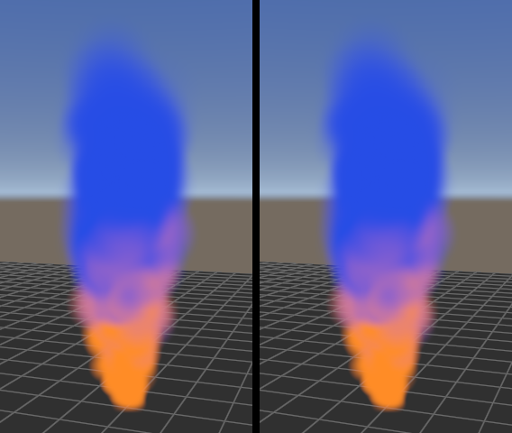
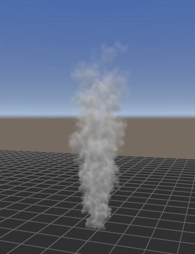
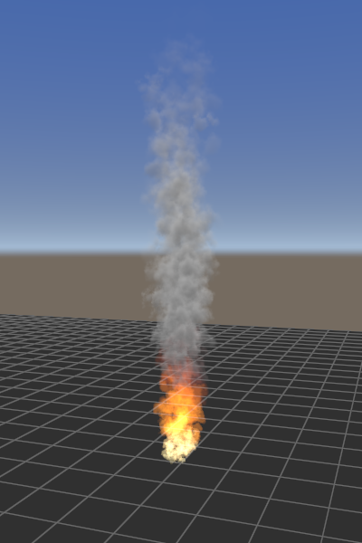

# 55 — Sorted Smoke

> **Reference support:** named prepared-exercise and native-regression commands
> in this lesson run from the [reference checkout](../BranchWorkflow.md#prepared-reference-exercises).
> The growing chapter implementation remains in your learning checkout.

**Goal:** draw particles that cover what is behind them, in the right order every frame, and make them smoke. Part
1, section 1, gives the look a coverage curve and a blend that covers, and shows what follows: Chapter 21's alive
list comes back in a new order every frame, so covering particles flicker where they overlap. Part 2, sections 2 to
4, sorts that list back to front on the GPU every frame and checks the result from the GPU's own keys. Part 3,
sections 5 to 7, bakes an atlas of smoke puffs at setup, draws Smoke and Fire to smoke from it, and says what the
effect does not do yet. Other facing modes and orders by age are
[Lab 5 on the labs page](ParticleExtensions.md#lab-5--face-another-way-or-order-by-age).

**Form:** typed into your tree from its own text, over the assembled reference; one supplied CPU test. The tree
holds Chapter 54 complete, and the chapter prints every line it changes.

**GPU idea:** order, sorted on the GPU. Blending that covers depends on the order things are drawn in. A sorting
network fixes every compare-exchange before the data arrives, so it runs as a fixed sequence of compute dispatches
over a list whose length only the GPU knows. It needs synchronisation at two levels: `barrier()` inside a dispatch,
for the workgroup's shared memory, and a pipeline barrier between dispatches. A key that sorts a float as an
unsigned integer, with the slot as a tie-break, makes the order the same however the atomics left the list.

Reused, not new: the cover term is [Chapter 21, section 5](21-GPU-Particles.md#5-drawing-the-particles)'s
premultiplied blend with its additive half used; the barriers are Chapter 20's, and Chapter 21's end barrier still
covers the draw; the soft fade is Chapter 21, section 9's; the ramp and set 2 are Chapter 54, sections 5 and 6's;
the atlas is baked at setup as Chapter 28, section 7 bakes its noise.

**Read after:** [Chapter 54](54-Shaping-A-Particle-Effect.md). Like 54, it is a detour from the renderer route:
read Chapter 21, then 54, then this chapter, in the assembled reference, and go back to
[Chapter 22](22-Deferred-Shading.md). [Chapter 57](57-The-Frame-Declared.md), The Frame, Declared, is read after this one.

**ROADMAP:** step 21+ — the `Particles` demo grows.

**Module:** `pf::demos::particles`, one pool. The Sea's spray does not change: `ParticleSimulation` stays 96 bytes
and `ParticleAppearance` 48, and the nine shaders the spray and Chapter 52's wind test share compile to
byte-identical SPIR-V. The default is still Chapter 21's fountain, with the sort off. `ParticleSortNetwork.h` and
`ParticleFlipbook.h` are new headers shared by C++ and GLSL. No flag is added; `--particle-preset` gains
`cover-test`, `smoke` and `fire-to-smoke`.

**Math:** section 1 finds what two covering particles change in a pixel when they swap, `αa·αb·(cb − ca)`. Section
2 turns a float into order-preserving bits that sort as an unsigned integer, pairs element `i` with
`partner = i ^ j` in step `(k, j)`, ascending when `i & k` is 0, and counts n/4 · log2 n · (log2 n + 1)
compare-exchanges and the dispatches that run them. Section 5 reads a flipbook's frame from a life, exact at both
ends.

**Prerequisites:**

- [Chapter 21, section 1](21-GPU-Particles.md#1-the-pool): one copy of the pool, and what that costs.
- [Chapter 21, section 2](21-GPU-Particles.md#2-lists-counters-and-the-gpu-deciding-the-count): the alive lists
  filled by atomic appends, and the caution about a necessary check that section 4 repeats.
- [Chapter 21, section 4](21-GPU-Particles.md#4-recording-the-compute) and
  [its return trip](21-GPU-Particles.md#the-return-trip): the end barrier, which still covers the draw once the
  sort writes the list.
- [Chapter 21, section 5](21-GPU-Particles.md#5-drawing-the-particles): the camera-facing quad,
  [the blend table](21-GPU-Particles.md#blending-additive-or-premultiplied-and-why-not-plain-alpha), and the alive
  list rebuilt by atomic appends, the cause section 1 starts from.
- [Chapter 21, section 7](21-GPU-Particles.md#7-the-panel-and-the-numbers-that-come-back): the counts read back
  `FRAMES_IN_FLIGHT` frames late, which the sort's bound in section 3 starts from.
- [Chapter 21, section 8](21-GPU-Particles.md#8-gpu-timing-with-timestamps): the timestamps, which gain a seventh.
- [Chapter 21, section 9](21-GPU-Particles.md#9-exercise-soft-particles): soft particles. Your tree has the worked
  solution, `ParticleSoft.frag.glsl`, whose fade the new fragment shader copies.
- [Chapter 54, section 4](54-Shaping-A-Particle-Effect.md#4-starting-full): `RecordStep`, and what the frame's last
  step owns.
- [Chapter 54, section 5](54-Shaping-A-Particle-Effect.md#5-curves-baked-into-an-image) and
  [section 6](54-Shaping-A-Particle-Effect.md#6-one-image-rewritten-inside-the-frame): the ramp, its texel centres,
  set 2, and the copy inside the frame.
- [Chapter 20, section 4](20-Compute-Fundamentals.md#4-storage-images): `createStorageImage` and
  `createDescriptorSets`.
- [Chapter 20, section 5](20-Compute-Fundamentals.md#5-barriers-between-dispatches) and
  [section 6](20-Compute-Fundamentals.md#6-shared-memory-and-barrier): barriers between dispatches, and shared
  memory with `barrier()`.
- [Chapter 20, section 9](20-Compute-Fundamentals.md#9-reading-results-back-without-stalling): reading results back
  without stalling, for section 4's Check order.
- [Chapter 28, section 2](28-Clouds.md#2-fog-measured),
  [section 7](28-Clouds.md#7-noise-that-tiles-in-three-dimensions) and [section 9](28-Clouds.md#9-the-density):
  light falling off through a medium (Beer-Lambert), Worley and Perlin-Worley noise and a compute bake at setup,
  and a shape eroded by noise. The route through 21 and 54 does not read Chapter 28, so section 5 gives each of the
  three in a sentence or two where it uses it.
- [Chapter 4, section 5](04-Commands-And-Synchronization.md#5-barriers-and-the-three-questions-they-answer) and its
  [appendix of barriers](04-Commands-And-Synchronization.md#appendix-barriers-the-later-chapters-add): the three
  questions, and the rows the sort and the bake reuse.

## Where the code goes

| File | What sections 1 to 6 do there |
| --- | --- |
| **New:** `Shaders/Particles/ParticleCurves.frag.glsl` | Section 1: glow that adds, coverage that covers. Section 5: the flipbook's cells |
| `Shaders/Particles/ParticleCurves.vert.glsl` | Section 1: the ramp's row 1. Section 5: the flipbook's cells, frame blend and turn |
| `Shaders/Particles/ParticleRampMath.h` | Section 1: the rows named, and `particleRampV` |
| `Source/PillowFort/Demos/Particles/ParticleCurves.h`, `Source/PillowFort/Demos/Particles/ParticleCurves.cpp` | Section 1: the coverage curve, its check, and row 1 of the bake |
| `Source/PillowFort/Demos/Particles/ParticleRamp.h`, `Source/PillowFort/Demos/Particles/ParticleRamp.cpp` | Section 1: two rows, in `ParticleRamp.cpp`. Section 5: set 2's binding 1, the atlas, in both |
| **New:** `Shaders/Particles/ParticleSortNetwork.h` | Section 2: the key, the comparison, the pairing and the dispatch count |
| `premake5.lua`, `Tests/TutorialHarness/ParticleSmokeTests.cpp` | Section 2: the test project; the test is supplied. Section 5: its `PF_TEST_FLIPBOOK` line set to 1 |
| **New:** `Source/PillowFort/Demos/Particles/ParticleSort.h`, `Source/PillowFort/Demos/Particles/ParticleSort.cpp`, `Shaders/Particles/ParticleSort.comp.glsl` | Section 3: the items buffer, the sort's set, one pipeline, five passes |
| **New:** `Shaders/Particles/ParticleFlipbook.h` | Section 5: the atlas's layout, the frame index, a cell's origin, the shape and turn |
| **New:** `Source/PillowFort/Demos/Particles/ParticleAtlas.h`, `Source/PillowFort/Demos/Particles/ParticleAtlas.cpp`, `Shaders/Particles/ParticleAtlasBake.comp.glsl` | Section 5: the atlas, baked at `Setup` |
| `Source/PillowFort/Demos/Particles/ParticlesDemo.h`, `Source/PillowFort/Demos/Particles/ParticlesDemo.cpp` | Section 1: the curves pipeline's blend, Coverage keys, Cover test. Section 3: the sort's call and bound, **Sort back to front**, its labelled line, the seventh timestamp. Section 4: Check order, and `TRANSFER_SRC` on the alive lists. Section 5: the atlas, **Flipbook**, the fragment push range from 4 bytes to 8, Smoke. Section 6: Fire to smoke |
| `Tests/TutorialHarness/MirrorBatchTests.cpp` | Section 5: the particle fragment push its check expects, from 4 bytes to 8 |

Sections 1, 2, 3 and 5 add files, so each runs `GenerateProjects.bat` again
([Chapter 1, section 3](01-Environment-And-Build.md#3-the-corrected-workspace)): premake bakes its file lists in
when it generates. Shaders are globbed too, so section 1's one new file, a fragment shader, needs the run. From
section 2 on, run it as `GenerateProjects.bat --tutorial-tests`, so the test project stays in the solution.
Sections 4 and 6 add no file.

**Blank lines.** A new function, struct member block or file-scope block you add gets one blank line above it and
one below it, as its neighbours have, except as the last thing in a class or struct, where it sits directly against
the closing `};`. Constants or comment lines that join a run of constants are the exception: they sit directly
against their neighbours, and the text says "with no blank line between" where that is so.

# Part 1 — Covering needs an order (section 1)

## 1. Glow, then cover

Chapter 54's curves pipeline adds what a particle gives: its colour times its glow, faded toward the quad's edge.
That is all fire and fireworks need. The other thing a particle can do to a pixel is hide part of what lies behind
it: a share from 0 (nothing) to 1 (everything), which changes over a life as the colour does. This section calls it
**coverage** and gives the look a curve for it.

[Chapter 21, section 5](21-GPU-Particles.md#blending-additive-or-premultiplied-and-why-not-plain-alpha) already
built the blend that does both. Premultiplied alpha computes `src + dst·(1 − src.a)`: a fragment with alpha 0 adds,
as additive blending does, and one with alpha 1 covers. Chapter 21's shader never used the adding half, because its
alpha always followed its colour. This section uses both: the glow goes into the colour with no alpha, and the
coverage sets the alpha and the colour the particle covers with. In code that is one more curve, a second row in
the ramp, a fragment shader of the curves look's own, and the curves pipeline switched to the premultiplied blend.

The cost is order. A sum does not depend on which particle is drawn first; hiding does. The attempt below finds
that two puffs over one pixel give results that differ by `αa·αb·(cb − ca)` between the two orders, with α a puff's
coverage and c its colour: zero where either covers nothing or both have one colour, not zero where orange overlaps
blue. Chapter 21, section 5 said why the order changes: simulate rebuilds the alive list every frame by atomic
appends, in whatever order the invocations reach the counter. So predict it before anything runs: once the curves
look covers, overlapping puffs of different colours will swap from frame to frame and shimmer. Four checks, none
needing a tool, say that it is the order and not a bug:

- **Validation is clean.** No barrier changes here. The order is in the data the GPU produced, and no layer sees
  that.
- **Coverage 0 stops it.** A look that covers nothing only adds, the same in any order.
- **Paused, it still shimmers.** Pausing stops time, not simulate: the step is 0 s and every particle stays put,
  but the list is still rebuilt, in a new order, every frame.
- **Chapter 21's look with Additive shows none.** The same particles in the same places, added, do not depend on
  the order.

A driver whose atomics run in the same order every frame, such as lavapipe, Mesa's software driver, may show none:
its order is just as wrong, but steady.

A preset made to show the problem, **Cover test**, has orange young puffs that turn into nearly opaque blue old
ones. It is the one preset that covers before the sort exists, and its label says what it is for. It is not the
only picture that shows the problem: anything that covers does, such as Fire with a Coverage key raised, or Chapter
21's look with premultiplied blending ([Chapter 21's exit check](21-GPU-Particles.md#exit-check)). From section 3
on, every such case puts a labelled line in the panel while it draws unsorted.

> **Jump:** a particle now does two things to a pixel. Keep them apart. **Glow** is light it adds; it stays in row
> 0 of the ramp, as Chapter 54 baked it, and glows sum the same in any order. **Coverage** is the share of what
> lies behind that it hides, with the colour it shows there instead; it goes in a new row 1, and "over" depends on
> the order. One premultiplied output carries both.

<a id="ch55-glow-then-cover"></a>

### Attempt CH55-glow-then-cover: one output that adds a glow and covers with a colour

Predict first. The ramp becomes two rows: row 0 is Chapter 54's, and row 1 holds the colour and the coverage.
Chapter 54's vertex shader reads at `v = 0.5`, the centre of its only row. Leave that `0.5` in place for row 0:
what does the sampler return now, and does anything report it? Then take two puffs over one pixel, `a` and `b`,
with colours `ca` and `cb`, coverages `αa` and `αb`, and no glow. What is the pixel after `a` then `b`, and after
`b` then `a`?

Design the change: a coverage curve, baked beside the colour into a second row of the ramp, and one premultiplied
output that adds the glow and covers with the colour, blended with Chapter 21's premultiplied mode. A look whose
coverage is 0 must draw as it did in Chapter 54.

**Acceptance:** row 0 of the baked table is bit for bit Chapter 54's, whatever the coverage. Row 1 holds the linear
colour, without the glow, and the coverage. Each row is read at its own centre. `Validate` takes coverage from 0 to
1 and refuses anything outside, NaN included, by the rules size and glow follow. The output's alpha is the share it
hides, and its colour is what it covers with plus its glow. With coverage 0 the blend is `src + dst`, so Fire and
Firework look as they did. A **Coverage** key table edits the curve, and a **Cover test** preset shows the problem.

**Transfer:** give puff `b` a glow `gb` as well, and let `a` cover with no glow. Does the pixel now depend on the
order, and what would you see when a glowing particle passes behind a covering one? Then say what a third row in
the ramp would take.

<details>
<summary>Hint 1: where a filtered read lands between rows</summary>

A texel's value sits at its centre in `v` as well as in `u`. With two rows, row 0's centre is at `v = 0.25` and row
1's at `v = 0.75`. Where does `0.5` fall, and what does a linear filter make of a coordinate exactly halfway
between two texel centres?

</details>

<details>
<summary>Hint 2: what "over" asks of the shader</summary>

Write the blend as Chapter 21's table does: `result = src + dst·(1 − src.a)`. A particle that hides a share α of
what lies behind and shows its colour C there leaves `α·C + (1 − α)·dst`; light L that it adds comes on top. Match
the two: which `src.rgb`, and which `src.a`? Then multiply both by the card's round falloff and the soft fade, as
Chapter 21's shader multiplies its alpha.

</details>

<details>
<summary>Hint 3: two puffs, in both orders</summary>

Apply the blend twice. After `a` the pixel is `αa·ca + (1 − αa)·d`. Draw `b` over that and expand. Do the same with
`b` first, and subtract. The term in `d` is the same both ways; what is left?

</details>

<details>
<summary>Worked solution: two rows read at their centres, one premultiplied output, and the order it needs</summary>

**The count.** Five things leave this part: the coverage curve, its limit and its check; row 1 of `Bake`; the rows'
names and `particleRampV`; `ParticleCurves.frag.glsl` under the premultiplied blend; and the **Coverage** keys and
**Cover test**.

**Two rows, each read at its centre.** The image is 256 by 2, and row r's texel centres sit at `v = (r + 0.5) / 2`:
0.25 for row 0 and 0.75 for row 1. At 0.5, exactly halfway, a linear filter returns half of row 0 plus half of row
1, and nothing reports it: the read is legal and inside the image. The size comes out as the mean of the size and
the coverage, which looks like a tuning mistake. So `v` is a function in the header both sides read,
`particleRampV(row) = (row + 0.5) / ROWS`, and the bake writes each row by its number. Row 0's offset is 0, so its
bytes stay where Chapter 54 put them. Row 1 holds the colour without the glow: what the puff shows where it hides,
not the light it adds.

**The output.** Write C and c for row 1's colour and coverage, G for row 0's colour times glow, and F for Chapter
21, section 9's soft fade. Write the card as a premultiplied pair (S, A): A is how much card there is at the pixel,
S the light it shows. "Over" needs a premultiplied colour and the share hidden, and the glow is light on top,
through the card's amount:

`src.rgb = (C·c·S + G·A)·F`,  `src.a = c·A·F`.

The blend gives `src + dst·(1 − c·A·F)`: the card hides c·A·F of what lies behind, shows C there, and adds its
glow. Chapter 54's round card is lit evenly, so S = A = (1 − r²)², with r the distance from the quad's centre in
half-widths, and the shader computes `(cover.rgb * cover.a + color.rgb) * shape` with `shape` = A·F. Section 5
gives S and A values of their own, from an atlas.

**Coverage 0 is Chapter 54.** With c = 0, `src` is `(G·A·F, 0)`, and the blend gives `dst + G·A·F`: exactly what
`ParticleSoft.frag.glsl` wrote, G times the falloff and the fade, under Chapter 21's additive blend, `src + dst`.
Every look written before this chapter has coverage 0. Half-float sums still round differently in a different
order, as they did in Chapter 54, so a pixel can differ by one level from frame to frame.

**The swap.** After `a` the pixel is `αa·ca + (1 − αa)·d`, and after `b` over that,
`αb·cb + (1 − αb)·αa·ca + (1 − αa)(1 − αb)·d`. The other order swaps the letters. The `d` term is the same, and `b`
drawn last minus `a` drawn last is

`αa·αb·(cb − ca)`.

It is zero where either puff covers nothing or the two have one colour, and largest where thick puffs of different
colours overlap. That is why the test preset is orange and blue: puffs of one grey would swap without a visible
step.

**The transfer.** With a glow on each puff the difference is `αa·αb·(cb − ca) + αa·gb − αb·ga`. A glowing `b` with
no coverage behind a covering `a` gives `αa·gb`: drawn last it shines at full strength, drawn first `a` dims it by
`1 − αa`, so it flickers, "a glow behind a cover too", as the pipeline's comment says. A third row takes
`PARTICLE_RAMP_ROWS` 3 and a name; the table, the image, the copy and every `v` (1/6, 1/2, 5/6) follow.

</details>

### Where the code goes

One file is new, a fragment shader, so run `GenerateProjects.bat` once it is on disk. Type the changes in this
order.

**`ParticleRampMath.h`.** Three edits. Replace the banner's last line, `   is texel i's centre. */`, with the first
two lines below. Replace the comment that starts `/* The ramp is one row` and the line
`#define PARTICLE_RAMP_WIDTH 256` under it with the next seven, which name the rows, so that no file holds a bare
row number:

```cpp
   is texel i's centre. Chapter 55 adds the rows: the bake writes each row by its
   number, and the vertex shader reads it at particleRampV. */
```
```cpp
/* The ramp's rows are PARTICLE_RAMP_WIDTH texels across. A texel of row 0 holds
   linear rgb x glow, then the size in metres. Chapter 55 adds row 1 below it:
   linear rgb, then the coverage, 0 to 1. */
#define PARTICLE_RAMP_WIDTH     256
#define PARTICLE_RAMP_ROWS      2
#define PARTICLE_RAMP_ROW_GLOW  0
#define PARTICLE_RAMP_ROW_COVER 1
```

Then add `particleRampV` directly above `#undef PF_RAMP_FUNCTION`, with one blank line between them; the blank line
under `particleRampU` stays above it:

```cpp
/* Chapter 55. A row's centre, where the vertex shader reads it: v is
   (row + 0.5) / ROWS, so a fetch there takes nothing from the other row. */
PF_RAMP_FUNCTION float particleRampV(int row)
{
    return (float(row) + 0.5f) / float(PARTICLE_RAMP_ROWS);
}
```

**`ParticleCurves.h`.** Three edits. Add coverage's limit, the first line below, directly under the
`MAX_PARTICLE_GLOW` line, with no blank line between. Replace `ParticleLook`, from the comment that starts
`// Everything the effect's draw reads` to the struct's closing `};`, with the next twelve lines: coverage defaults
to 0, so every older look hides nothing, and the defaulted `operator==` now compares it, so a Coverage edit bakes a
new table. Replace the comment that starts `// The ramp as the GPU reads it` and the `using ParticleRampTable` line
under it with the last four:

```cpp
constexpr float MAX_PARTICLE_COVERAGE = 1.0f;   // Chapter 55: all of what lies behind
```
```cpp
// Everything the effect's draw reads from a particle's age. Glow multiplies the color; it may exceed 1,
// and the tone curve (Chapter 16) takes it from there. Chapter 55: coverage is how much of what lies
// behind the particle it hides, 0 to 1. Zero, the default, hides nothing, so a look that only glows
// draws as it did.
struct ParticleLook
{
    ParticleGradient color    = { { 0.0f, glm::vec3(1.0f) }, { 1.0f, glm::vec3(1.0f) } };
    ParticleCurve    size     = { { 0.0f, 0.1f }, { 1.0f, 0.1f } };
    ParticleCurve    glow     = { { 0.0f, 1.0f }, { 1.0f, 1.0f } };
    ParticleCurve    coverage = { { 0.0f, 0.0f }, { 1.0f, 0.0f } };   // Chapter 55
    bool operator==(const ParticleLook&) const = default;
};
```
```cpp
// The ramp as the GPU reads it: PARTICLE_RAMP_ROWS rows of PARTICLE_RAMP_WIDTH texels, four half floats
// each, row 0 first. Row 0: rgb is linear color times glow, a is size in metres. Row 1 (Chapter 55): rgb
// is linear color, a is coverage. The look must pass Validate.
using ParticleRampTable = std::array<uint16_t, PARTICLE_RAMP_WIDTH * PARTICLE_RAMP_ROWS * 4>;
```

**`ParticleCurves.cpp`.** `Validate` checks coverage as it checks size. Add this line directly under the line that
starts `if (std::string problem = curveProblem("size curve"`:

```cpp
    if (std::string problem = curveProblem("coverage curve", look.coverage, MAX_PARTICLE_COVERAGE); !problem.empty()) { return problem; }   // Chapter 55
```

In `Bake`, replace the line `table[i * 4 + channel] = glm::packHalf1x16(texel[channel]);` with the first line
below: row 0's index gains its row's offset, which is 0, so its bytes do not move. Then, directly under the closing
brace of that inner loop, add one blank line and the seven lines after it, row 1 from the same life; the outer
loop's closing brace follows them directly:

```cpp
            table[(PARTICLE_RAMP_ROW_GLOW * PARTICLE_RAMP_WIDTH + i) * 4 + channel] = glm::packHalf1x16(texel[channel]);
```
```cpp
        // Chapter 55: row 1, the same color without the glow, and the coverage.
        const glm::vec3 linear   = Evaluate(look.color, life);
        const float     cover[4] = { linear.r, linear.g, linear.b, Evaluate(look.coverage, life) };
        for (int channel = 0; channel < 4; ++channel)
        {
            table[(PARTICLE_RAMP_ROW_COVER * PARTICLE_RAMP_WIDTH + i) * 4 + channel] = glm::packHalf1x16(cover[channel]);
        }
```

**`ParticleRamp.cpp`.** In `Create`, replace the line `.extent        = { PARTICLE_RAMP_WIDTH, 1, 1 },` with the
first line below, and in `RecordCopyCommands` the line `.imageExtent      = { PARTICLE_RAMP_WIDTH, 1, 1 },` with
the second. The staging buffers are sized from the table and the barriers cover the whole image, so Chapter 54's
copy inside the frame now copies both rows:

```cpp
        .extent        = { PARTICLE_RAMP_WIDTH, PARTICLE_RAMP_ROWS, 1 },   // Chapter 55: two rows
```
```cpp
        .imageExtent      = { PARTICLE_RAMP_WIDTH, PARTICLE_RAMP_ROWS, 1 },
```

**`ParticleCurves.vert.glsl`.** Five edits. The banner's second line,
`// size read off the baked look ramp instead of two ends and a fade.`, becomes the first two lines below; the
comment `// Set 2: the look ramp, one row. rgb is linear color times glow, a is size in metres.` becomes the next
two; and the line that starts `layout(location = 1) out vec4 color;` becomes the last two, which send row 1 out at
location 2:

```glsl
// size read off the baked look ramp instead of two ends and a fade. Chapter 55 reads the ramp's second
// row too: the color and how much it covers.
```
```glsl
// Set 2: the look ramp, row 0. rgb is linear color times glow, a is size in metres.
// Row 1 (Chapter 55): rgb is linear color, a is coverage.
```
```glsl
layout(location = 1) out vec4 color;    // rgb x glow, a = 1: the light the particle adds
layout(location = 2) out vec4 cover;    // Chapter 55: rgb, a = coverage: what it puts over what lies behind
```

This is where the attempt's trap is closed. In `main`, replace the comment line
`// here: textureLod names it. The ramp has one level, so it is 0.` and the `vec4 ramp = textureLod(` line under it
with the first three lines below: row 0 is read at `particleRampV(PARTICLE_RAMP_ROW_GLOW)`, 0.25, and `u` is kept
for both fetches. The last line, the fetch of row 1 at 0.75, goes directly under `color = vec4(ramp.rgb, 1.0);`,
with no blank line between:

```glsl
    // here: textureLod names it. The ramp has one level, so it is 0. Each row is read at its centre.
    float u    = particleRampU(life);
    vec4  ramp = textureLod(lookRamp, vec2(u, particleRampV(PARTICLE_RAMP_ROW_GLOW)), 0.0);
```
```glsl
    cover = textureLod(lookRamp, vec2(u, particleRampV(PARTICLE_RAMP_ROW_COVER)), 0.0);   // Chapter 55
```

**`ParticleCurves.frag.glsl`, a new file in `Shaders/Particles/`.** Its bindings are `ParticleSoft.frag.glsl`'s
(the scene depth at set 1, binding 5; the soft distance at offset 48), so the curves layout stays as it was. The
falloff and the fade are copied from that shader, which the fountain still draws with: a second copy, which the
house rule allows. The last line is the attempt's output, with `shape` the falloff times the fade:

```glsl
// Shaders/Particles/ParticleCurves.frag.glsl - Chapter 55: glow adds, coverage covers. Written for
// Chapter 21's premultiplied blend, result = src + dst * (1 - src.a). The color the particle puts over
// what lies behind it is its color times its coverage; the light it adds is its color times its glow,
// which row 0 of the ramp already holds. Coverage 0 leaves dst whole, so a look that only glows adds,
// as Chapter 54's did, and in any order.
#version 450
#extension GL_GOOGLE_include_directive : require
#include "FrameBlock.glsl"

layout(set = 1, binding = 5) uniform sampler2D sceneDepth;
layout(push_constant) uniform SoftAppearance
{
    layout(offset = 48) float softDistance;
};

layout(location = 0) in vec2 corner;
layout(location = 1) in vec4 color;   // row 0: linear rgb x glow
layout(location = 2) in vec4 cover;   // row 1: linear rgb, a = coverage
layout(location = 0) out vec4 outColor;

float viewDistance(float depth)
{
    return frame.projection[3][2] / (depth + frame.projection[2][2]);
}

void main()
{
    // The round falloff, then, as ParticleSoft.frag does, the fade where the particle meets a surface.
    float falloff = max(1.0 - dot(corner, corner), 0.0);
    float shape   = falloff * falloff;
    if (softDistance > 0.0)
    {
        ivec2 pixel = ivec2(gl_FragCoord.xy);
        float depth = texelFetch(sceneDepth, pixel, 0).r;
        // A clear pixel has no surface. Leave it alone rather than subtracting
        // two large distances at the far plane.
        if (depth < 1.0)
        {
            float gap = viewDistance(depth) - viewDistance(gl_FragCoord.z);
            shape *= clamp(gap / softDistance, 0.0, 1.0);
        }
    }
    outColor = vec4((cover.rgb * cover.a + color.rgb) * shape, cover.a * shape);
}
```

**`ParticlesDemo.h`.** Replace the `m_curvesPipeline` member's line, whose comment said "drawn additively", with:

```cpp
    VkPipeline                m_curvesPipeline = VK_NULL_HANDLE;   // Chapter 54: the ramp's look; Chapter 55: premultiplied
```

**`ParticlesDemo.cpp`.** Four edits. In `CreateDrawPipelines`, replace the two comment lines above
`const GraphicsPipelineDesc curves{` and the description, through its closing `};`, with the lines below; only the
comment, `.fragmentShader` and `.blend` change. Depth write stays off: a quad's transparent corners would hide
whatever is drawn after them:

```cpp
    // Chapter 55, section 1: its own fragment shader, under Chapter 21's premultiplied blend. Glow adds and
    // coverage covers what lies behind. A look that only glows adds in any order; once anything in it
    // covers, the order matters, for a glow behind a cover too.
    const GraphicsPipelineDesc curves{
        .vertexShader   = "Particles/ParticleCurves.vert.spv",
        .fragmentShader = "Particles/ParticleCurves.frag.spv",
        .colorFormats   = { &m_formats.color, 1 },
        .depthFormat    = m_formats.depth,
        .depthTest      = true,
        .depthWrite     = false,
        .depthCompare   = VK_COMPARE_OP_LESS,
        .blend          = BlendMode::PremultipliedAlpha,
        .layout         = m_curvesLayout,
    };
```

Replace the Blending combo's comment, `// Chapter 21's look only: Curves always adds.`, with:

```cpp
                // Chapter 21's look only: Curves blends premultiplied (Chapter 55), its glow adding.
```

Add the **Coverage** key table directly under the line that starts `drawCurve("Glow",`, with no blank line between.
Its guarded, clamped slider keeps every key in 0 to 1, a typed `nan` included:

```cpp
            drawCurve("Coverage", "Coverage", settings.curves.coverage, MAX_PARTICLE_COVERAGE);   // Chapter 55
```

Last, add the preset directly above the closing `};` of `PRESETS`, under Fire's entry. Births in a ball rise slowly
for about 5 s each, a few hundred alive, prewarmed for 4 s. They are orange for the first 30 percent of a life and
blue from 60 percent, growing from 0.4 m to 1.9 m so that neighbours overlap, with no glow. Coverage climbs to 0.85
within 8 percent of a life and falls to 0 at its end, so a puff fades in and out:

```cpp
    // Chapter 55, section 1. The order problem made plain: orange young puffs that turn into nearly opaque
    // blue old ones, so a puff drawn in the wrong order shows. It covers, so it flickers unless the alive
    // list is sorted back to front, which section 3 does.
    { "Cover test (the order problem)", "cover-test", ParticleSettings{
        .shapeKind = EMITTER_SHAPE_BALL, .shapeSize = 0.3f,
        .emitRate = 80.0f, .emitterHeight = 0.1f, .speed = 1.1f, .speedVariation = 0.5f, .spreadDegrees = 16.0f,
        .lifetime = 5.0f, .lifetimeVariation = 0.25f,
        .prewarmSeconds = 4.0f,
        .gravity = -0.6f, .drag = 0.6f,
        .lookKind = LOOK_CURVES,
        .curves = {
            .color = { { 0.00f, { 1.00f, 0.55f, 0.15f } }, { 0.30f, { 1.00f, 0.55f, 0.15f } },
                       { 0.60f, { 0.15f, 0.30f, 0.90f } }, { 1.00f, { 0.15f, 0.30f, 0.90f } } },
            .size     = { { 0.0f, 0.4f }, { 0.25f, 0.9f }, { 0.6f, 1.4f }, { 1.0f, 1.9f } },
            .glow     = { { 0.0f, 0.0f }, { 1.0f, 0.0f } },
            .coverage = { { 0.0f, 0.0f }, { 0.08f, 0.85f }, { 0.85f, 0.85f }, { 1.0f, 0.0f } } } },
      { 2.8f, 11.0f, -8.0f } },   // a 5 m column once it fills, a second or two after the 4 s prewarm: look level with its middle
```

### Checkpoint

Run `GenerateProjects.bat` (`ParticleCurves.frag.glsl` is new), then build the game, as Chapter 54 does, and build
Debug too (`/p:Configuration=Debug`) for the first check below:

```powershell
& 'C:\Program Files\Microsoft Visual Studio\2022\Community\MSBuild\Current\Bin\MSBuild.exe' .\Build\Projects\PillowFort.sln /m /p:Configuration=Release /p:Platform=x64 /t:SandboxGame
if ($LASTEXITCODE -ne 0) { throw 'The game build failed.' }
```

Run the two glowing presets, then the new one, with the sun sky and the clouds off: they drift on the clock even
while the effect is paused.

```powershell
& ./Build/Artifacts/Release/SandboxGame/SandboxGame.exe --demo Particles --particle-preset fire --sky sun --clouds 0
& ./Build/Artifacts/Release/SandboxGame/SandboxGame.exe --demo Particles --particle-preset firework --sky sun --clouds 0
& ./Build/Artifacts/Release/SandboxGame/SandboxGame.exe --demo Particles --particle-preset cover-test --sky sun --clouds 0
```

- **Fire** and **Firework** look as they did at the end of Chapter 54. **Curves** has a **Coverage** table under
  **Glow**, with two keys at 0.
- **Cover test:** a column of puffs rises, orange low down and nearly opaque blue higher up. Where orange and blue
  overlap, they shimmer. Open **Pool** and tick **Paused**: the puffs stop, and the overlaps go on shimmering, an
  orange puff in front in one frame and behind in the next.

  

  Two consecutive frames of the Cover test, paused, with nothing sorting it: nothing moved but the order. Measured
  on the reference, paused at 1280x720 on an RTX 5090, about 21,000 pixels change from one frame to the next.

Then the four checks the prediction named:

- **Validation is clean.** The Debug build, with the same flags and paused, prints nothing new.
- **Coverage 0 stops it.** Untick **Paused**, pick **Fire**, then tick **Paused** again: it holds still to the eye.
  In **Curves**, drag its **Coverage** values up to about 0.8, and paused it shimmers too. Pick **Fire** again to
  restore it; a preset keeps **Paused** as it was, so it stays paused.
- **Paused, it still shimmers**, as you saw: no particle moves, and the overlaps change.
- **Chapter 21's look with Additive shows none.** Pick **Cover test**, which arrives paused for the same reason,
  and in **Look** pick "Chapter 21" with **Blending** on "Additive": the same particles, as Chapter 21's dots,
  added, and nothing changes from one paused frame to the next. Pick "Curves" again.

This is the problem sections 2 to 4 fix. The draw needs one order, back to front, however the atomics left the
list, and only the GPU knows where the particles are and how many are alive. Untick **Paused** and move on.

Part 2 sorts the list on the GPU: section 2 starts with a key and a network, on the CPU.

# Part 2 — A sort on the GPU (sections 2–4)

Part 1 ended on a problem with a name: particles that cover, drawn in whatever order Chapter 21's atomics left the
alive list. This part draws them in order. Section 2 decides what the order is and checks the decision on the CPU,
where a wrong answer is easy to see. Section 3 runs the same functions on the GPU, every frame, over the list
simulate has just filled. Section 4 copies one sorted frame back and checks the GPU's own result.

## 2. Keys, and a network on the CPU first

Section 1's Cover test shimmers even when paused, so the order the draw needs cannot come from anything that
changes from frame to frame. Before any GPU code, say what the sort must give. Three things, and each rules
something out:

1. **A total order.** Two particles at exactly the same depth must still come out in the same order every frame, or
   a paused frame changes. So the sort compares a pair: a key, and then the particle's slot, which no other
   particle has. The result then depends only on the keys and the slots, and not on the order the list arrived in,
   which is the order the atomics chose.
2. **A count only the GPU knows.** Simulate decides how many particles survive, and the CPU reads that count back
   `FRAMES_IN_FLIGHT` frames late
   ([Chapter 21, section 7](21-GPU-Particles.md#7-the-panel-and-the-numbers-that-come-back)). The sort has to run
   before the number reaches the CPU.
3. **Every frame.** The atomics shuffle the list every frame, paused or not, and the camera moves. A sort that runs
   now and then is wrong in between.

**Which key is exact.** Chapter 21's quads face the camera plane: each lies in a plane parallel to the image, so
every point of it is at the same view depth, its distance along the camera's forward axis. A ray through a pixel
meets each quad at that quad's own view depth, so along every ray the quad with the larger view depth is the
farther one, over the whole of its area. Drawing in order of view depth, largest first, is therefore exact for
these quads: where two overlap, the nearer is drawn last. The key is the view depth,
`dot(position − camera, forward)`, not the distance to the camera: a quad far off to one side can be farther away
and still nearer in depth. Colour is what makes an order visible. Section 1's swap term, `αa·αb·(cb − ca)`, is zero
when two puffs' colours agree: two grey puffs commute, which is why the Cover test turns orange into blue. A facing
that does not keep each quad at one view depth makes this key inexact, and another order, such as oldest first, is
another key; [Lab 5](ParticleExtensions.md#lab-5--face-another-way-or-order-by-age) on the labs page lists them,
and section 7 says what each facing does to the key.

**The choice.** There are three ways to get the order, and the last is built:

| Way | What it costs here |
| --- | --- |
| A CPU sort of a readback | The positions reach the CPU `FRAMES_IN_FLIGHT` frames late, while the particles move, and by then the atomics have moved every particle to a new place in the list, so the order would have to be uploaded per slot and applied by another pass. About n log₂ n comparisons a frame, a million at 65,536 |
| A radix sort on the GPU | A prefix sum across workgroups to teach first, and a scatter that must be stable: built on atomics, it reorders equal digits, which is the flicker again. Its fast variants assume that one workgroup can wait for another, a forward progress Vulkan does not promise |
| **A bitonic network on the GPU (built)** | Every compare-exchange is fixed before the data arrives, so the sort is a fixed sequence of dispatches that depends on the padded size alone. No atomics, and no workgroup ever waits for another. It makes `n/4 · log₂n · (log₂n + 1)` compare-exchanges, more work than a radix sort, and few at these sizes |

A network never looks at a value to decide which items meet; only their positions decide. That is what lets the CPU
record it without knowing the count: it records the dispatches for a size n that is at least the count, and fills
the rest with a pad that sorts last.

**The key.** The network compares unsigned integers, not floats. A NaN depth compares false both ways, so a network
of float comparisons could leave it anywhere and the items around it out of order. Every two unsigned integers are
ordered, and the largest, every bit set, can be the pad. So the depth becomes a 32-bit key whose order as an
unsigned integer is the depth's order. A positive float's bits already sort as integers, because the exponent sits
above the mantissa, and setting the sign bit lifts every positive above every negative. A negative float's bits
sort backwards, a larger magnitude giving larger bits, so flipping every bit reverses that and clears the sign.
−2.0 becomes `0x3FFFFFFF`, 3.5 becomes `0xC0600000`, and −0 lands one below +0. Back to front is the farthest
first, and the network sorts ascending, so the key is the complement of those bits: a farther particle has a
smaller key. Pairs `(key, slot)` compare as the key, then the slot. The list is padded with the sentinel pair
`(0xFFFFFFFF, 0xFFFFFFFF)`, which no real pair passes: only a NaN depth with every bit set gives a real key that
large, and a real slot is always below it.

**The network.** A bitonic sort builds sorted runs and merges them. Each step has two numbers: `k`, the size of the
sorted runs it builds, and `j`, the distance between the two items it compares. In step `(k, j)`, item `i` meets
item `i ^ j`, and the pair sorts ascending when `(i & k) == 0`, descending otherwise, so neighbouring runs of size
k sort in opposite directions and together make one bitonic sequence of size 2k. For each k from 2 up to n,
doubling, j runs k/2, k/4 and so on down to 1. The n/2 pairs of one step are independent of each other; the steps
are not, so each must finish before the next reads.

> **Jump:** a **bitonic** sequence rises and then falls, or is such a sequence turned round, with items moved from
> its end to its front: 1, 4, 6, 5, 2 is one, and so is 2, 1, 4, 6, 5, the same turned round by one. The network
> rests on one fact about it. Take a bitonic sequence of k items and compare-exchange each item of its first half
> with the item k/2 after it, the smaller to the front. Both halves are then bitonic, and every item of the front
> half is no greater than every item of the back half. So the halves can be finished apart, each the same way at
> distance k/4, and so on down to 1, and the k items come out sorted.
>
> Why that holds: pick any value v and mark each item 1 if it is at least v, 0 if not. In a bitonic sequence the 1s
> form one run, counting round from the end to the start. If the run is at most k/2 long, no pair holds two 1s, so
> every 1 goes to the back half and the front half is all 0s. If it is longer, the 0s are fewer than k/2, every 0
> goes to the front, and the back half is all 1s. Either way no item of the front half reaches v while an item of
> the back half is below it, whatever v is; and in each half the 1s still form one run, so each half is still
> bitonic.
>
> Eight items, sorted ascending; each step pairs `i` with `i ^ j`, descending where `i & k` is not 0:
>
> - Start: 3 7 4 8 6 2 1 5.
> - k = 2, j = 1: 3 7, 8 4, 2 6, 5 1. Runs of 2, up and down by turns, so each 4 is bitonic.
> - k = 4, j = 2 then 1: 3 4 8 7 5 6 2 1, then 3 4 7 8 6 5 2 1. One run of 4 up, one down: 8 bitonic items.
> - k = 8, j = 4: 3 4 2 1 6 5 7 8. Every item of the front half is below every item of the back half.
> - k = 8, j = 2 then 1: 2 1 3 4 6 5 7 8, then 1 2 3 4 5 6 7 8.
>
> The pairing needs n to be a power of two. An item's partner `i ^ j` differs from it in one bit, so it stays below
> n for every item below n only when n is a power of two, and only then do the runs of each size k tile the list
> exactly. That is why the list is padded with sentinels to a power of two. It is padded to one block at least,
> too, 400 items to 1,024, because the block sort works on whole blocks.

**How many dispatches.** A step whose pairs stay inside a block of 1,024 items can run inside one workgroup, in
shared memory, with `barrier()` between steps. A step whose pairs are farther apart needs a dispatch of its own,
because workgroups cannot wait for each other inside one. So one **block sort** dispatch does every k up to 1,024.
Each larger k = 2^m then takes m − 10 **global steps**, one for each j from k/2 down to 1,024, and one **block
merge** that does every j below 1,024. With t = log₂n − 10 that is (t + 1)(t + 2)/2 dispatches: 1 at 1,024, 3 at
2,048, 6 at 4,096, 10 at 8,192, 28 at 65,536 and 66 at 2^20. The whole sort adds two more: a pass that writes the
keys before the network, and one that writes the sorted slots back after it.

<a id="ch55-a-key-that-sorts"></a>

### Attempt CH55-a-key-that-sorts: a float that sorts as an integer, and a network that runs over arrays

Predict first. The bits of −1.0 and −2.0, read as unsigned integers, are `0xBF800000` and `0xC0000000`. Which is
larger, and is that the floats' order? Where does 1.0 (`0x3F800000`) fall against them? Then: a list of 1,000
particles padded to 1,024. How many compare-exchanges does the network make, and how many of its steps can one
workgroup do without leaving shared memory?

Design the header that both the sort's shader and a CPU test read: a key from a view depth that sorts back to front
as an unsigned integer, a comparison of `(key, slot)` pairs, the pairing of a step `(k, j)`, the padded size for a
count, and the dispatch count. Then run the passes over arrays, as the shader will run them, and compare the result
with `std::sort`.

**Acceptance:** −2.0 orders as `0x3FFFFFFF` and 3.5 as `0xC0600000`; −0 orders one below +0; the ordered bits rise
with the value from −inf through the denormals and both zeros to +inf. Back to front, a farther particle has a
smaller key. The passes, run over arrays of 1 to 200,000 items padded with sentinels, give exactly what `std::sort`
gives for the same pairs, with random, equal and reversed keys, sentinels last. The padded size is a power of two,
at least 1,024 and at most the capacity. The dispatch counts are 1, 3, 6, 10, 28 and 66 at 1,024, 2,048, 4,096,
8,192, 65,536 and 2^20 items. The push block the passes share is 64 bytes.

**Transfer:** Lab 5's "oldest first" draws in age order instead. Which one function changes, and what does it
become? And why is the tie-break the slot and not the position in the list?

<details>
<summary>Hint 1: what a float's bits already do</summary>

A float is a sign bit, then eight exponent bits, then 23 mantissa bits. For two positive floats, comparing the
exponents and then the mantissas is exactly what an unsigned comparison of the same bits does. What goes wrong for
two negatives, and for a positive against a negative?

</details>

<details>
<summary>Hint 2: one operation for each sign</summary>

Find one operation that puts every positive above every negative without changing how positives compare among
themselves, and one that reverses how negatives compare among themselves and leaves them below every positive. Then
ask how an ascending sort can give back to front without a second network.

</details>

<details>
<summary>Hint 3: which items a step compares</summary>

In step `(k, j)`, an item and its partner differ in exactly the bit j. Write the partner with one operator. The
direction changes every k items: which bit of `i` says which run of size k it is in? To give every invocation one
pair and none an idle half, map pair number t to the lower item of its pair.

</details>

<details>
<summary>Worked solution: ordered bits, a complement, and pairs chosen by bits</summary>

**The count.** Seven things leave this part.

| Output | Meaning | Where it goes |
| --- | --- | --- |
| `particleOrderedBits` | a float's bits as an unsigned number in the float's order | the key |
| `particleBackToFrontKey` | the complement of those bits: farthest first, sorted ascending | the keys pass |
| `particleSortLess` | `(key, slot)` compared as a key, then a slot | every compare-exchange, and section 4's check |
| `PARTICLE_SORT_SENTINEL` | the pad: a pair no real pair passes | the keys pass |
| `particleSortLower`, `particleSortAscending` | pair t's lower item i, whose partner is i + j; ascending when the bit of i worth k is clear | every compare-exchange |
| `particleSortSize` | the padded size n for a count: a power of two, one block or more, the capacity at most | section 3's `Record` |
| `particleSortDispatches` | the network's dispatches for n | the test |

**The key.** A positive float gets its sign bit set, `bits | 0x80000000`. A negative one has every bit flipped,
`~bits`: its larger magnitudes had larger bits, and flipped they have smaller ones, all below every positive
because the sign bit is now clear. So −1.0 (`0xBF800000`) becomes `0x407FFFFF` and −2.0 becomes `0x3FFFFFFF`, below
it as the floats are; read raw, −2.0 was the larger. 1.0 becomes `0xBF800000`, above both. −0 is `0x80000000` and
becomes `0x7FFFFFFF`, one below +0's `0x80000000`. The back-to-front key is the complement of that, so the farthest
particle has the smallest key and an ascending sort puts it first.

**The pairing.** The lower item of a pair has bit j clear, so its partner `i + j` is `i ^ j`. Pair t's lower item
is `(t / j) · 2j + t mod j`: each run of 2j items holds j pairs. The pair sorts ascending when `(i & k) == 0`.

**The counts.** A list of 1,024 takes 10 values of k and 55 steps in all, each of 512 compare-exchanges: 28,160,
and every step fits in one block. The block sort is one dispatch.

**The network over arrays.** The supplied test holds that half of the answer, so it is not printed here: its
`exchange`, `blockPass` and `runNetwork` run the block sort, the global steps and the block merges over arrays, in
the order section 3's `ParticleSort::Record` dispatches them, and its `checkNetwork` compares the result with
`std::sort`. The test file arrives below, under Where the code goes; read those four functions once you have tried.

**The transfer.** Oldest first changes the key alone: the keys pass reads each particle's age instead of its depth,
and the complement of the age's ordered bits sorts the oldest first. The network, the pairing and section 4's check
stay as they are. The slot is the tie-break because it belongs to the particle; the position in the list is exactly
what the atomics change, so a tie-break on it would bring the flicker back for equal keys.

</details>

### Where the code goes

One header is new, and the test is supplied. The header lives in `Shaders/Particles/`, beside `EmitterShapes.h`,
because it is a twin header like Chapter 54's `EmitterShapes.h` and Chapter 53's `GrassWindSource.h`: section 3's
shader includes it, and so does the CPU test, which then checks the very functions the GPU runs.

**`ParticleSortNetwork.h`, a new file in `Shaders/Particles/`.** It comes in five pieces, typed one after the other
with one blank line between them. The first says what the file is and holds the constants: the block, the
workgroup, the sentinel, and the five pass words that section 3's shader chooses between. A block of 1,024 pairs is
8 KB, half the 16 KB of shared memory every device has, and 128 is the widest workgroup every device must allow:

```cpp
/* Chapter 55. The sort's key, and the bitonic network's pairing. One header for C++
   and GLSL, like EmitterShapes.h: the sort shader runs these functions on the GPU,
   and the CPU test runs the same ones over arrays and compares with std::sort. */
#ifndef PF_PARTICLE_SORT_NETWORK_H
#define PF_PARTICLE_SORT_NETWORK_H
#include "ParticleTypes.h"

/* One workgroup sorts a block of PARTICLE_SORT_BLOCK items in shared memory: 1,024
   (key, slot) pairs are 8 KB, half the 16 KB every device has. PARTICLE_SORT_GROUP_SIZE
   invocations share the block, 128, the guaranteed minimum for a workgroup's x. */
#define PARTICLE_SORT_BLOCK      1024u
#define PARTICLE_SORT_GROUP_SIZE 128u

/* Pads the list up to a power of two. Only a NaN depth with every bit set gives a real
   key this large, and a real slot is always below it, so a sentinel pair is never less
   than a real pair. */
#define PARTICLE_SORT_SENTINEL   0xFFFFFFFFu

/* What one dispatch of ParticleSort.comp.glsl does. */
#define PARTICLE_SORT_PASS_KEYS        0u   /* a (key, slot) item for every alive particle; sentinels above Alive */
#define PARTICLE_SORT_PASS_BLOCK_SORT  1u   /* every sequence size k up to a block, inside each block */
#define PARTICLE_SORT_PASS_GLOBAL_STEP 2u   /* one (k, j) with j of a block or more, across blocks */
#define PARTICLE_SORT_PASS_BLOCK_MERGE 3u   /* one k, every j below a block, inside each block */
#define PARTICLE_SORT_PASS_WRITE_BACK  4u   /* the sorted slots back into the alive list */
```

The second piece is where the two languages part. `PF_SORT_FUNCTION` is `inline` in C++ and nothing in GLSL, as
`PF_EMITTER_FUNCTION` was, and `particleFloatBits` reads a float's bits in each language's own way. Then the push
block every pass shares, 64 bytes: the camera for the keys pass, the pass word, `k` and `j` for the network, the
padded size, which list, and where list 1 starts:

```cpp
#ifdef __cplusplus
#include <bit>
namespace pf::demos::particles {
#define PF_SORT_FUNCTION inline
PF_SORT_FUNCTION uint particleFloatBits(float value) { return std::bit_cast<uint>(value); }
#else
#define PF_SORT_FUNCTION
uint particleFloatBits(float value) { return floatBitsToUint(value); }
#endif

/* Push constants for every sort pass (64 bytes). */
struct ParticleSortParameters
{
    vec4 cameraPosition;   /*  0: xyz metres */
    vec4 cameraForward;    /* 16: xyz, unit: the view direction */
    uint pass;             /* 32: PARTICLE_SORT_PASS_* */
    uint k;                /* 36: the size of the bitonic sequences this pass builds */
    uint j;                /* 40: the distance between the two items compared (a global step) */
    uint count;            /* 44: n, the padded size: a power of two, one block or more */
    uint list;             /* 48: the alive list sorted, 0 or 1 */
    uint maxParticles;     /* 52: where alive list 1 starts */
    uint padding0;         /* 56 */
    uint padding1;         /* 60 */
};
```

The third piece is the key and the comparison, as the worked solution derived them:

```cpp
/* A float's bits as an unsigned number that sorts in the float's order. A positive
   float's bits already sort as integers, and setting the sign bit puts every positive
   above every negative. A negative float's bits sort backwards (a larger magnitude has
   larger bits), and flipping all of them reverses that and clears the sign bit. -0
   lands one below +0. */
PF_SORT_FUNCTION uint particleOrderedBits(float value)
{
    uint bits = particleFloatBits(value);
    return (bits & 0x80000000u) != 0u ? ~bits : (bits | 0x80000000u);
}

/* Back to front: the farthest particle first. The network sorts keys ascending, so the
   key is the complement of the view depth's ordered bits. */
PF_SORT_FUNCTION uint particleBackToFrontKey(float viewDepth)
{
    return ~particleOrderedBits(viewDepth);
}

/* (key, slot) pairs compare as a key, then a slot. The slots are distinct, so no two
   real pairs are equal: the order is total, and the same however the list arrived. */
PF_SORT_FUNCTION bool particleSortLess(uint keyA, uint slotA, uint keyB, uint slotB)
{
    return keyA < keyB || (keyA == keyB && slotA < slotB);
}
```

The fourth is the pairing:

```cpp
/* One step of the network: sequences of size k, items j apart. Pair t's lower item is
   i; it meets item i + j, which is i ^ j because bit j of i is clear. The pair sorts
   ascending when bit k of i is clear, so neighbouring sequences of size k sort in
   opposite directions and together make one bitonic sequence of size 2k. */
PF_SORT_FUNCTION uint particleSortLower(uint t, uint j)
{
    return (t / j) * 2u * j + (t % j);
}

PF_SORT_FUNCTION bool particleSortAscending(uint i, uint k)
{
    return (i & k) == 0u;
}
```

The fifth is the padded size and the dispatch count, then the file's end. `particleSortSize` stops at the capacity,
so no count can ask for more items than the buffer holds. The asserts pin the push block's layout, which the GLSL
side cannot check:

```cpp
/* The padded size for `bound` items: a power of two, at least one block, at most
   `capacity`. The capacity must itself be a power of two of one block or more
   (ParticleSort::Initialize asserts it), or the result can pass it. */
PF_SORT_FUNCTION uint particleSortSize(uint bound, uint capacity)
{
    uint n = PARTICLE_SORT_BLOCK;
    while (n < bound && n < capacity) { n <<= 1u; }
    return n;
}

/* The network's dispatches for n items (n = 2^s, at most 2^30): one block sort covers k
   up to a block, then each k = 2^m above it takes m - 10 global steps (j from k/2 down
   to a block) and one block merge. 1, 3, 6, 10, ... 28 at 65,536 and 66 at 2^20. The
   whole sort is two more: the keys before the network and the write-back after it. */
PF_SORT_FUNCTION uint particleSortDispatches(uint n)
{
    uint dispatches = 1u;
    uint steps      = 1u;   /* the global steps for the next k: 2048 needs one */
    for (uint k = 2u * PARTICLE_SORT_BLOCK; k <= n; k <<= 1u)
    {
        dispatches += steps + 1u;
        ++steps;
    }
    return dispatches;
}

#undef PF_SORT_FUNCTION
#ifdef __cplusplus
static_assert(sizeof(ParticleSortParameters) == 64, "ParticleSortParameters layout drifted.");
static_assert(offsetof(ParticleSortParameters, pass) == 32, "ParticleSortParameters layout drifted.");
static_assert(offsetof(ParticleSortParameters, list) == 48, "ParticleSortParameters layout drifted.");
}
#endif
#endif
```

**`premake5.lua`.** The test project's block is typed, as Chapter 54's was. Add it inside the
`if _OPTIONS["tutorial-tests"] then` block, directly above the line `    project "TutorialGrassImpostorGpuTests"`,
with a blank line between:

```lua
    project "TutorialParticleSmokeTests"   -- Chapter 55: the sort's key and network, the cover term, the flipbook, on the CPU
        kind "ConsoleApp"
        apply_common_cpp_settings()
        files { "Tests/TutorialHarness/ParticleSmokeTests.cpp" }
        links { "PillowFortEngine", "GLFW", "ImGui", "TinyUSDZ" }
```

**`ParticleSmokeTests.cpp`, supplied.** It is `Tests/TutorialHarness/ParticleSmokeTests.cpp`. A learning branch
made from `start` already has it at that path; otherwise copy it there from the same path in a `reference-main`
checkout ([Which checkout](../VulkanTutorial.md#choose-your-checkout) says how to keep one).
It is about four hundred lines of checking for the whole chapter, and typing them would bury it. It comes now
because three of its four groups can run already: section 1's cover row, and this section's key and network. The
fourth, the flipbook, needs a header that section 5 adds. One line near the top says whether that group is built,
and the reference's finished copy says 1 (on a learning branch made from `start` the copy already says 0, so
there the line is already in place). Replace the line that starts `#define PF_TEST_FLIPBOOK` with this one, which
says 0:

```cpp
#define PF_TEST_FLIPBOOK 0   // 0 before section 5, 1 once it adds ParticleFlipbook.h
```

Section 5 sets it back to 1. That typed edit is also what makes the build compile the test again: MSBuild does not
watch for a header that does not exist yet, so a switch that looked for the file itself would leave the group
skipped.

### Checkpoint

The header is under `Shaders/`, so it counts as a new file
([Chapter 1, section 3](01-Environment-And-Build.md#3-the-corrected-workspace)). Generate again with the test
projects, build the test, and run it from the repository root. It opens no window; a check that fails prints
`FAIL:` and the program exits with a nonzero code:

```powershell
.\GenerateProjects.bat --tutorial-tests
if ($LASTEXITCODE -ne 0) { throw 'Project generation failed.' }
& 'C:\Program Files\Microsoft Visual Studio\2022\Community\MSBuild\Current\Bin\MSBuild.exe' .\Build\Projects\PillowFort.sln /m:1 /nr:false /p:CL_MPCount=1 /p:UseMultiToolTask=true /p:MultiProcMaxCount=1 /p:EnforceProcessCountAcrossBuilds=true /p:Configuration=Debug /p:Platform=x64 /t:TutorialParticleSmokeTests
if ($LASTEXITCODE -ne 0) { throw 'The acceptance test build failed.' }
& .\Build\Artifacts\Debug\TutorialParticleSmokeTests\TutorialParticleSmokeTests.exe
if ($LASTEXITCODE -ne 0) { throw 'TutorialParticleSmokeTests failed.' }
```

- **The test.** It prints a `PASS:` line for each check, `43 lists sorted by the network` on the way, and one line
  for the group it leaves out:
  `SKIP: flipbook: ParticleFlipbook.h does not exist yet (Chapter 55, section 5 adds it).` It ends with
  `17 checks.` and `PASS: sorted smoke: the cover row, the sort's key and network (the flipbook from section 5).`
  The groups' checks are listed in the test file's header.
- **On screen, nothing changes.** Nothing the demo runs includes the header yet, so the program draws what section
  1 left, and the Cover test still shimmers when paused. Section 3 puts the header on the GPU.
- **The controls.** Break one line, rebuild the test, and see its group fail, then put the line back. Each break
  fails its own group only:

| Break this | In | To | What fails |
| --- | --- | --- | --- |
| `return (bits & 0x80000000u) != 0u ? ~bits : (bits \| 0x80000000u);` | `particleOrderedBits` | `return bits \| 0x80000000u;` | five key checks: −2.0's value, −0 below +0, the ladder, the million random floats, and the complements |
| `return (i & k) == 0u;` | `particleSortAscending` | `return (i & k) != 0u;` | `network: the passes equal std::sort ...`, alone: every pair sorts the other way, and the counts do not change |

Section 3 runs the network on the GPU.

---

## 3. The sort on the GPU

Section 2's functions sort arrays on the CPU. This section runs them on the GPU, every frame, over the alive list
simulate has just filled, before the draw reads it. Three things are new: a class that owns the sort's buffer, set
and pipeline; one compute shader in which a push word says which of the five passes a dispatch is; and the question
every multi-pass compute job must answer, which is how each pass waits for the one before it.

The class is `ParticleSort`. It owns one new buffer, the **items**: a `uvec2` `(key, slot)` per entry, sized for
the pool's capacity, 2^20 entries or 8 MiB, so no setting of Max particles can outgrow it. It borrows the pool's
particles, alive lists and counters, and binds them with the items in a set of its own: four storage buffers, which
every device allows a stage, so there is no limit to check. One shader serves all five passes. A pass word picks
what a dispatch does, so there is one pipeline and one layout instead of five, and the five passes sit side by
side, where they can be compared.

> **Jump:** Chapter 20's Life step already used both kinds of order: a pipeline barrier between generations, and
> `barrier()` around its shared tile. What is new here is one algorithm whose steps are split between the two by
> distance. Inside one dispatch, `barrier()` makes the invocations of one workgroup wait for each other and orders
> their shared memory ([Chapter 20, section 6](20-Compute-Fundamentals.md#6-shared-memory-and-barrier)): the block
> sort's steps run one after another inside a workgroup, with a `barrier()` between them. It cannot order one
> workgroup against another, nor one dispatch against the next. Between dispatches, a pipeline barrier orders whole
> commands and makes one dispatch's writes visible to the next
> ([Chapter 20, section 5](20-Compute-Fundamentals.md#5-barriers-between-dispatches)); it says nothing about
> invocations inside one dispatch. Neither stands in for the other. A missing pipeline barrier is a hazard the
> validation layer names, as this section's control shows. A missing `barrier()` is a race inside a workgroup that
> the layer cannot see, as section 4's control shows.

<a id="ch55-sort-the-alive-list"></a>

### Attempt CH55-sort-the-alive-list: the alive list, back to front, every frame

Predict first. The fountain holds about 12,000 particles. What padded size does it sort, how many dispatches does
the network take, and how many of them are global steps? Then: the frame's last step records begin, emit, simulate
and End, then the end barrier. Between which two commands must the sort go, which of the two alive lists does it
sort, and what is the first thing that reads its write-back?

Design `ParticleSort` and its shader, and record it in `RecordStep` so the list the draw reads is in back-to-front
order. Size it from a count the CPU can prove is not too small, not from the whole pool, so that a small effect
sorts a small list.

**Acceptance:** the Cover test, paused and sorted, draws the same frame again and again, and sorts 1,024 entries in
3 dispatches. The sort runs in the frame's last step only, never in a prewarm step. With the validation layer and
its shader-access heuristic on, a sorted run is silent; with no barrier after the global steps, the layer reports a
hazard at `vkCmdDispatch`. The panel shows the size the last frame sorted and the sort's time. Picking a preset
that covers turns the sort on, and unticking it while a covering look shows says so in the panel.

**Transfer:** Max particles set to 5,000 is not a power of two. What size does a full pool sort, where do the
padded entries live, and which passes must not touch anything at 5,000 or beyond? And: last frame's readback
failed. What can the CPU still prove about the count?

<details>
<summary>Hint 1: what one dispatch can order</summary>

A workgroup's invocations can wait for each other with `barrier()`; workgroups cannot. Which steps keep both items
of every pair inside one block of 1,024, and which must be dispatches of their own? A step that has to wait for
every workgroup of the step before it needs a dispatch of its own.

</details>

<details>
<summary>Hint 2: where the list stands</summary>

In `RecordStep`, simulate appends the survivors to list `1 − current`, End turns their count into the draw's
arguments, and the end barrier hands everything to the draw, which reads list `1 − current`. Ask what End writes
that the sort reads, and what the sort writes that the draw reads. Then look at which sets the step binds, and in
which step.

</details>

<details>
<summary>Hint 3: a count the CPU can prove</summary>

Births come only from emission requests, and the CPU records every request. The last count it read back is
`FRAMES_IN_FLIGHT` frames old. What can have raised the count since that copy was made, and what can only have
lowered it?

</details>

<details>
<summary>Worked solution: five passes in one shader, after End, sized by a bound</summary>

**The count.** Seven things leave this part.

| Output | Meaning | Where it goes |
| --- | --- | --- |
| `ParticleSort` | the items, a set, a layout and one pipeline; `Initialize`, `Record`, `Shutdown` | `ParticlesDemo` |
| the keys pass | a `(key, slot)` per entry: real below Alive, sentinels from Alive to n | `ParticleSort.comp.glsl` |
| block sort, global step, block merge | the network, in shared memory where its pairs allow and in the buffer where they do not | `ParticleSort.comp.glsl` |
| the write-back | the sorted slots over the list's first Alive entries | `ParticleSort.comp.glsl` |
| the call | the frame's last step, after End, before the end barrier, over list `1 − current` | `RecordStep` |
| the bound | the count read back plus the requests since; the whole pool after a failed readback | `RecordStep`, `ReadResults` |
| the panel | **Sort back to front**, its labelled line, the seventh timestamp and the sorted size | `drawParticlePanel`, `applyPreset` |

**The passes.** The block sort and the block merge each give a workgroup one block in shared memory, with a
`barrier()` after each step. The global steps compare items a block or more apart, which different workgroups hold,
so each is a dispatch of its own that reads and writes the items buffer directly. A compute-to-compute barrier
follows every dispatch. For 12,000 particles the padded size is 16,384: one block sort, ten global steps and four
block merges, 15 network dispatches, then the keys and the write-back around them.

**The position.** Simulate's writes are already made visible to compute by the barrier after it. End writes only
the draw's arguments, which the sort neither reads nor writes, so the sort can follow End directly, before the end
barrier, and that barrier then hands the write-back to the draw. It sorts list `1 − current`, the list simulate
filled, which is the list the step then makes current and the draw reads. It runs in the frame's last step only: a
prewarm step is never drawn, and the sort binds its own set 0, which leaves the pool's sets unusable for any step
after it, because `RecordStep` binds them only in the frame's first step.

**The bound.** Births come only from requests, and only deaths and a reset lower the count. So the count read back,
plus every request recorded since the frame that copied it, is never less than the count now. A reset this frame
leaves nothing from before; a failed readback leaves nothing to start from, so the bound is the whole pool.

**The transfer.** A full pool of 5,000 sorts 8,192 entries. The padded entries live only in the items buffer, sized
for 2^20, as sentinels. The keys pass reads the list only below Alive, and the write-back writes it only below
Alive, which is never more than 5,000.

</details>

### Where the code goes

Three files are new: `ParticleSort.h` and `ParticleSort.cpp` in `Source/PillowFort/Demos/Particles/`, and
`ParticleSort.comp.glsl` in `Shaders/Particles/`. Then `ParticlesDemo.h` and `ParticlesDemo.cpp` own the sort, call
it, bound it, time it and show it.

**`ParticleSort.h`, a new file.** The class owns what the sort creates and borrows what the pool owns. Constructing
it touches no GPU; `Initialize` does, and returns a result. `Record` returns the padded size it sorted, for the
panel, and is `[[nodiscard]]` so the number is not dropped by accident. `Items()` is for section 4, which copies
the items out:

```cpp
///========================================================
/// @author Gary Yang
/// @brief  Chapter 55: the alive list sorted back to front on the GPU, by a bitonic sorting network
/// @copyright (C) Gary 2026
///========================================================

// Source/PillowFort/Demos/Particles/ParticleSort.h
#pragma once

#include "PillowFort/ErrorReporting/InitializationResult.h"
#include "PillowFort/VulkanGraphics/VulkanResources.h"

#include <glm/glm.hpp>

#include <cstdint>

namespace pf::demos::particles {

// Owns the sort's items, its set and its one pipeline; borrows the pool's buffers. Constructing it
// touches no GPU; Initialize does.
class ParticleSort
{
public:
    // The pool's particles, its two alive lists and its counters, borrowed. `capacity` is the pool's,
    // a power of two of one block or more: the items buffer holds that many (key, slot) pairs.
    InitializationResult Initialize(const vulkan_graphics::VulkanContext& context, VkPipelineCache pipelineCache,
                                    VkBuffer particles, VkBuffer aliveLists, VkBuffer counters, uint32_t capacity);
    // Records the network over alive list `list`: `count` is rounded up to a power of two of one block or
    // more and held to the capacity here. A barrier follows every dispatch. Returns that padded size.
    [[nodiscard]] uint32_t Record(VkCommandBuffer commandBuffer, uint32_t list, uint32_t maxParticles, uint32_t count,
                                  const glm::vec3& cameraPosition, const glm::vec3& cameraForward);
    void Shutdown();

    VkBuffer Items() const { return m_items.buffer; }   // section 4 copies it out to check the order

private:
    vulkan_graphics::VulkanContext   m_vulkan;
    vulkan_graphics::AllocatedBuffer m_items;           // uvec2 (key, slot) per entry, the capacity's worth
    uint32_t              m_capacity  = 0;
    VkDescriptorSetLayout m_setLayout = VK_NULL_HANDLE;
    VkDescriptorPool      m_pool      = VK_NULL_HANDLE;
    VkDescriptorSet       m_set       = VK_NULL_HANDLE;
    VkPipelineLayout      m_layout    = VK_NULL_HANDLE;
    VkPipeline            m_pipeline  = VK_NULL_HANDLE;
};

} // namespace pf::demos::particles
```

**`ParticleSort.cpp`, a new file.** It comes in four pieces, typed one after the other with one blank line between
them. The first is the banner and the includes: `GraphicsPipeline.h` for `createComputePipeline` and `groupCount`,
`VulkanBarriers.h` for Chapter 20's `computeToComputeBarrier`, the twin header for `particleSortSize` and the pass
words, `<array>` for the four bindings and writes, and `<cassert>` and `<bit>` for the assert that the capacity is
a power of two of whole blocks:

```cpp
///========================================================
/// @author Gary Yang
/// @brief  Chapter 55: the alive list sorted back to front on the GPU, by a bitonic sorting network
/// @copyright (C) Gary 2026
///========================================================

// Source/PillowFort/Demos/Particles/ParticleSort.cpp
#include "PillowFort/Demos/Particles/ParticleSort.h"

#include "PillowFort/VulkanGraphics/GraphicsPipeline.h"
#include "PillowFort/VulkanGraphics/VulkanBarriers.h"
#include "Particles/ParticleSortNetwork.h"

#include <array>
#include <cassert>
#include <bit>

namespace pf::demos::particles {

using namespace vulkan_graphics;
```

The second is `Initialize`. The items take `TRANSFER_SRC` as well as `STORAGE` now, so that section 4 can copy them
without touching this function again. The set is made by Chapter 20, section 4's `createDescriptorSets` and written
once: its four buffers never change. The layout has the one set and one push range of 64 bytes. The assert holds
the capacity to a power of two of whole blocks, which `particleSortSize` relies on:

```cpp
InitializationResult ParticleSort::Initialize(const VulkanContext& context, VkPipelineCache pipelineCache,
                                              VkBuffer particles, VkBuffer aliveLists, VkBuffer counters,
                                              uint32_t capacity)
{
    assert(std::has_single_bit(capacity) && capacity >= PARTICLE_SORT_BLOCK);   // a power of two of whole blocks
    m_vulkan   = context;
    m_capacity = capacity;

    // One (key, slot) pair per entry: 8 bytes, 8 MiB at the pool's 2^20. Device-local; section 4 copies it out.
    m_items = createBuffer(m_vulkan, sizeof(uint32_t) * 2 * capacity,
                           VK_BUFFER_USAGE_STORAGE_BUFFER_BIT | VK_BUFFER_USAGE_TRANSFER_SRC_BIT, false);
    if (m_items.buffer == VK_NULL_HANDLE)
    {
        return InitializationResult::failure("Creating the particle sort's items failed.");
    }

    // Its own set: four storage buffers, the guaranteed minimum per stage, so no limit to check.
    std::array<VkDescriptorSetLayoutBinding, 4> bindings{};
    for (uint32_t i = 0; i < bindings.size(); ++i)
    {
        bindings[i] = { .binding = i, .descriptorType = VK_DESCRIPTOR_TYPE_STORAGE_BUFFER,
                        .descriptorCount = 1, .stageFlags = VK_SHADER_STAGE_COMPUTE_BIT };
    }
    if (!createDescriptorSets(m_vulkan, bindings, m_setLayout, m_pool, { &m_set, 1 }))
    {
        return InitializationResult::failure("Creating the particle sort's descriptor set failed.");
    }
    const VkBuffer buffers[] = { particles, aliveLists, counters, m_items.buffer };
    std::array<VkDescriptorBufferInfo, 4> infos{};
    std::array<VkWriteDescriptorSet, 4>   writes{};
    for (uint32_t i = 0; i < 4; ++i)
    {
        infos[i]  = VkDescriptorBufferInfo{ .buffer = buffers[i], .offset = 0, .range = VK_WHOLE_SIZE };
        writes[i] = VkWriteDescriptorSet{
            .sType           = VK_STRUCTURE_TYPE_WRITE_DESCRIPTOR_SET,
            .dstSet          = m_set,
            .dstBinding      = i,
            .descriptorCount = 1,
            .descriptorType  = VK_DESCRIPTOR_TYPE_STORAGE_BUFFER,
            .pBufferInfo     = &infos[i],
        };
    }
    vkUpdateDescriptorSets(m_vulkan.device, static_cast<uint32_t>(writes.size()), writes.data(), 0, nullptr);

    // One pipeline, one layout, one push block for all five passes.
    const VkPushConstantRange pushRange{ VK_SHADER_STAGE_COMPUTE_BIT, 0, sizeof(ParticleSortParameters) };
    const VkPipelineLayoutCreateInfo layoutInfo{
        .sType                  = VK_STRUCTURE_TYPE_PIPELINE_LAYOUT_CREATE_INFO,
        .setLayoutCount         = 1,
        .pSetLayouts            = &m_setLayout,
        .pushConstantRangeCount = 1,
        .pPushConstantRanges    = &pushRange,
    };
    VkPipelineLayout createdLayout = VK_NULL_HANDLE;
    if (vkCreatePipelineLayout(m_vulkan.device, &layoutInfo, nullptr, &createdLayout) != VK_SUCCESS)
    {
        return InitializationResult::failure("vkCreatePipelineLayout failed for the particle sort.");
    }
    m_layout   = createdLayout;
    m_pipeline = createComputePipeline(m_vulkan.device, pipelineCache, "Particles/ParticleSort.comp.spv", m_layout);
    if (m_pipeline == VK_NULL_HANDLE)
    {
        return InitializationResult::failure("Creating the particle sort's pipeline failed.");
    }
    return InitializationResult::success();
}
```

The third is `Record`, the whole network on the CPU's side. It pads the count itself, so a caller cannot hand it a
size the shader cannot sort. A lambda records each dispatch: the push block with this pass's word, `k` and `j`, the
dispatch, and a compute-to-compute barrier, after every dispatch without exception, because each pass reads what
the one before it wrote. The order is section 2's: the keys, one block sort, then for each k above a block its
global steps and a block merge, then the write-back. The barrier after the write-back is there because the rule is
"after every dispatch", not because the draw needs it: the draw reads the list in the vertex stage, and Chapter
21's end barrier, recorded right after the sort, is what orders that read:

```cpp
uint32_t ParticleSort::Record(VkCommandBuffer commandBuffer, uint32_t list, uint32_t maxParticles, uint32_t count,
                              const glm::vec3& cameraPosition, const glm::vec3& cameraForward)
{
    // The padded size, whatever the caller asked for: a power of two, one block or more, the capacity at most.
    const uint32_t n = particleSortSize(count, m_capacity);

    vkCmdBindPipeline(commandBuffer, VK_PIPELINE_BIND_POINT_COMPUTE, m_pipeline);
    vkCmdBindDescriptorSets(commandBuffer, VK_PIPELINE_BIND_POINT_COMPUTE, m_layout, 0, 1, &m_set, 0, nullptr);
    ParticleSortParameters parameters{
        .cameraPosition = glm::vec4(cameraPosition, 0.0f),
        .cameraForward  = glm::vec4(cameraForward, 0.0f),
        .count          = n,
        .list           = list,
        .maxParticles   = maxParticles,
    };
    // Each dispatch reads what the one before it wrote, so a barrier follows every one.
    const auto dispatch = [&](uint32_t pass, uint32_t k, uint32_t j, uint32_t groups) {
        parameters.pass = pass;
        parameters.k    = k;
        parameters.j    = j;
        vkCmdPushConstants(commandBuffer, m_layout, VK_SHADER_STAGE_COMPUTE_BIT, 0, sizeof(parameters), &parameters);
        vkCmdDispatch(commandBuffer, groups, 1, 1);
        computeToComputeBarrier(commandBuffer);
    };

    const uint32_t blocks = n / PARTICLE_SORT_BLOCK;
    dispatch(PARTICLE_SORT_PASS_KEYS, 0, 0, groupCount(n, PARTICLE_SORT_GROUP_SIZE));
    dispatch(PARTICLE_SORT_PASS_BLOCK_SORT, 0, 0, blocks);   // every k up to a block
    for (uint32_t k = 2 * PARTICLE_SORT_BLOCK; k <= n; k <<= 1)
    {
        for (uint32_t j = k >> 1; j >= PARTICLE_SORT_BLOCK; j >>= 1)   // the steps that cross blocks
        {
            dispatch(PARTICLE_SORT_PASS_GLOBAL_STEP, k, j, groupCount(n / 2, PARTICLE_SORT_GROUP_SIZE));
        }
        dispatch(PARTICLE_SORT_PASS_BLOCK_MERGE, k, 0, blocks);   // the rest of this k, inside each block
    }
    dispatch(PARTICLE_SORT_PASS_WRITE_BACK, 0, 0, groupCount(n, PARTICLE_SORT_GROUP_SIZE));
    return n;
}
```

The fourth is `Shutdown`, safe after a partial `Initialize`, and the namespace's end:

```cpp
void ParticleSort::Shutdown()
{
    // Null handles are no-ops, so a partial Initialize is safe.
    if (m_vulkan.device == VK_NULL_HANDLE) { return; }
    vkDestroyPipeline(m_vulkan.device, m_pipeline, nullptr);
    vkDestroyPipelineLayout(m_vulkan.device, m_layout, nullptr);
    vkDestroyDescriptorPool(m_vulkan.device, m_pool, nullptr);   // frees the set
    vkDestroyDescriptorSetLayout(m_vulkan.device, m_setLayout, nullptr);
    destroyBuffer(m_vulkan, m_items);
    m_pipeline  = VK_NULL_HANDLE;
    m_layout    = VK_NULL_HANDLE;
    m_pool      = VK_NULL_HANDLE;
    m_setLayout = VK_NULL_HANDLE;
    m_set       = VK_NULL_HANDLE;
}

} // namespace pf::demos::particles
```

**`ParticleSort.comp.glsl`, a new file in `Shaders/Particles/`.** It comes in five pieces. The first is the
shader's declarations, then one blank line, and the other four follow one another directly, with no blank line
between them, because together they are one `main`. The declarations: the four buffers, with the particles and the
counters `readonly`; the push block; the shared block of 1,024 pairs, 8 KB; and the compare-exchange inside a
block. Each of the 128 invocations loads 8 of a block's items, and in each step makes 4 of its 512
compare-exchanges: pairs `lid`, `lid + 128`, `lid + 256` and `lid + 384`. For j of 128 or more those pairs hold
exactly the 8 items it loaded; for smaller j, at least half of them are items other invocations loaded. The
direction comes from the item's index in the whole list, `base + i`, not in the block, so the blocks of a run
alternate as they must:

```glsl
// Shaders/Particles/ParticleSort.comp.glsl - Chapter 55: a bitonic sorting network over the alive list,
// back to front by view depth. One shader; the push block's pass word picks what a dispatch does, so
// one pipeline and one layout serve the five passes.
#version 450
#extension GL_GOOGLE_include_directive : require
#include "ParticleSortNetwork.h"

layout(local_size_x = PARTICLE_SORT_GROUP_SIZE) in;

layout(set = 0, binding = 0, std430) readonly buffer ParticleBuffer { Particle particles[]; };
layout(set = 0, binding = 1, std430) buffer AliveListBuffer { uint aliveLists[]; };   // two lists, maxParticles apart
layout(set = 0, binding = 2, std430) readonly buffer CounterBuffer { ParticleCounters counters; };
layout(set = 0, binding = 3, std430) buffer ItemBuffer { uvec2 items[]; };              // (key, slot)

layout(push_constant) uniform PushConstants
{
    ParticleSortParameters sort;
};

// A block of items, shared by the workgroup. barrier() orders it between steps.
shared uvec2 block[PARTICLE_SORT_BLOCK];

const uint ITEMS_PER_INVOCATION = PARTICLE_SORT_BLOCK / PARTICLE_SORT_GROUP_SIZE;   // 8 items, so 4 pairs a step

// One compare-exchange inside the block: pair t of a step with sequences of size k, items j apart.
// The direction comes from the item's index in the whole list, so the blocks alternate as they must.
void exchangeInBlock(uint base, uint t, uint j, uint k)
{
    uint  i = particleSortLower(t, j);
    uvec2 a = block[i];
    uvec2 b = block[i + j];
    if (particleSortLess(b.x, b.y, a.x, a.y) == particleSortAscending(base + i, k))
    {
        block[i]     = b;
        block[i + j] = a;
    }
}
```

`main` opens with where the sorted list starts, then the **keys** pass: one entry per invocation up to n, a real
`(key, slot)` below Alive and a sentinel from there on. Alive comes from the counters simulate wrote; the depth is
section 2's dot product with the camera's forward axis:

```glsl
void main()
{
    uint listBase = sort.list * sort.maxParticles;

    if (sort.pass == PARTICLE_SORT_PASS_KEYS)
    {
        // One item per invocation: a real one below Alive, a sentinel from there to n.
        uint i     = gl_GlobalInvocationID.x;
        uint alive = counters.aliveCount[sort.list];
        if (i >= sort.count) { return; }
        uvec2 item = uvec2(PARTICLE_SORT_SENTINEL, PARTICLE_SORT_SENTINEL);
        if (i < alive)
        {
            uint  slot  = aliveLists[listBase + i];
            float depth = dot(particles[slot].positionAndAge.xyz - sort.cameraPosition.xyz, sort.cameraForward.xyz);
            item = uvec2(particleBackToFrontKey(depth), slot);
        }
        items[i] = item;
    }
```

The **block sort** and the **block merge** share a branch, because they differ only in which k they run: every k up
to a block, or the one k this dispatch's push block names, starting from j of half a block. A workgroup loads its
block into shared memory, runs its steps with a `barrier()` after each, and stores the block back. No invocation
leaves this branch early, and the loops' bounds come from the push block and constants, so every invocation reaches
every `barrier()`, as Chapter 20, section 6 requires. The `barrier()` after the load makes the whole block visible
before the first step reads it:

```glsl
    else if (sort.pass == PARTICLE_SORT_PASS_BLOCK_SORT || sort.pass == PARTICLE_SORT_PASS_BLOCK_MERGE)
    {
        // One workgroup per block: load it into shared memory, run every step whose pairs stay inside it,
        // and store it back. Every invocation reaches every barrier(): the loops' bounds are the push block's.
        uint base = gl_WorkGroupID.x * PARTICLE_SORT_BLOCK;
        uint lid  = gl_LocalInvocationID.x;
        for (uint q = 0u; q < ITEMS_PER_INVOCATION; ++q)
        {
            block[lid + q * PARTICLE_SORT_GROUP_SIZE] = items[base + lid + q * PARTICLE_SORT_GROUP_SIZE];
        }
        barrier();

        // The block sort builds every k up to a block; a block merge finishes one k from j = half a block.
        bool whole  = sort.pass == PARTICLE_SORT_PASS_BLOCK_SORT;
        uint kFirst = whole ? 2u : sort.k;
        uint kLast  = whole ? PARTICLE_SORT_BLOCK : sort.k;
        for (uint k = kFirst; k <= kLast; k <<= 1u)
        {
            for (uint j = min(k >> 1u, PARTICLE_SORT_BLOCK >> 1u); j > 0u; j >>= 1u)
            {
                for (uint q = 0u; q < ITEMS_PER_INVOCATION / 2u; ++q)
                {
                    exchangeInBlock(base, lid + q * PARTICLE_SORT_GROUP_SIZE, j, k);
                }
                barrier();   // this step's writes before the next step's reads, inside the workgroup
            }
        }

        for (uint q = 0u; q < ITEMS_PER_INVOCATION; ++q)
        {
            items[base + lid + q * PARTICLE_SORT_GROUP_SIZE] = block[lid + q * PARTICLE_SORT_GROUP_SIZE];
        }
    }
```

A **global step** compares items a block or more apart. Different workgroups hold them, so there is no shared
memory to use: one pair per invocation, read and written in the items buffer, and one step per dispatch:

```glsl
    else if (sort.pass == PARTICLE_SORT_PASS_GLOBAL_STEP)
    {
        // One pair per invocation, items a block or more apart, straight in the buffer.
        uint t = gl_GlobalInvocationID.x;
        if (t >= sort.count / 2u) { return; }
        uint  i = particleSortLower(t, sort.j);
        uvec2 a = items[i];
        uvec2 b = items[i + sort.j];
        if (particleSortLess(b.x, b.y, a.x, a.y) == particleSortAscending(i, sort.k))
        {
            items[i]          = b;
            items[i + sort.j] = a;
        }
    }
```

The **write-back** puts the sorted slots over the list's first Alive entries. The sentinels sort after every real
pair, so the first Alive items are exactly the real ones, in order:

```glsl
    else   // PARTICLE_SORT_PASS_WRITE_BACK
    {
        // The sorted slots replace the list's first Alive entries; the sentinels sorted after them.
        uint i     = gl_GlobalInvocationID.x;
        uint alive = counters.aliveCount[sort.list];
        if (i >= alive || i >= sort.count) { return; }
        aliveLists[listBase + i] = items[i].y;
    }
}
```

**`ParticlesDemo.h`.** Seven edits. The include goes directly under the line
`#include "PillowFort/Demos/Particles/ParticleRamp.h"`:

```cpp
#include "PillowFort/Demos/Particles/ParticleSort.h"
```

The setting goes in `ParticleSettings`, directly above the line `    // Pool`, with a blank line between. It is off
by default, so the default stays Chapter 21's fountain, unsorted and unchanged:

```cpp
    // Sort (Chapter 55): draw the alive list back to front. A preset that covers turns it on.
    bool  sortBackToFront   = false;
```

In `ParticleTimings`, Chapter 21's `end` interval included the counters' copy; the sort now goes between End and
that copy, so `end` becomes End alone and a new interval takes the rest. Replace the line
`    float end      = 0.0f;   // end + the counter readback copy` with:

```cpp
    float end      = 0.0f;   // end; Chapter 55 moves the copy into the next interval
```

and add this directly under the line `    float draw     = 0.0f;   // the particles`:

```cpp
    float sort     = 0.0f;   // Chapter 55: the sort (when on), the end barrier and the counter readback copy
```

A seventh timestamp marks the end of End. Replace the line that declares `TIMESTAMP_COUNT` with:

```cpp
    static constexpr uint32_t TIMESTAMP_COUNT   = 7;   // per frame in flight (section 8); Chapter 55's after End
```

The owner goes directly under the line that declares `m_ramp` (`ParticleRamp              m_ramp;`, with its
comment):

```cpp
    ParticleSort              m_sort;                       // Chapter 55: the alive list, back to front
```

And the bound's state goes at the end of the class, directly under the line `    RampBake m_bake;`, with a blank
line between. Each slot remembers what its frame requested, so that when its counters come back the CPU knows which
requests the count already holds. `m_countKnown` says whether the last readback worked:

```cpp
    // Chapter 55, section 3: the sort's size comes from a bound the CPU can prove. Births come only from
    // emission requests, so the count read back plus every request recorded since that frame is an upper
    // bound on what simulate can leave in the list.
    std::array<double, vulkan_graphics::FRAMES_IN_FLIGHT> m_slotRequests{};   // what each slot's frame requested
    double   m_frameRequests = 0.0;     // this frame's, so far
    bool     m_resetThisFrame = false;  // the frame's first step resets: nothing from before survives
    bool     m_countKnown     = false;  // the last readback succeeded; if not, the bound is the whole pool
    uint32_t m_sortCount     = 0;       // the last frame's padded size, 0 when the sort is off (the panel's)
```

**`ParticlesDemo.cpp`.** Fifteen edits, from the top of the file down. First, what counts as covering: the Curves
look with any coverage key above zero, or Chapter 21's look blended with premultiplied alpha, which Chapter 21,
section 5 showed popping. Add this function directly above the comment line that starts
`// Replaces the settings a preset names`, with a blank line between:

```cpp
// Chapter 55, section 3. True when these settings draw particles that cover: the curves look with a
// coverage key above zero, or Chapter 21's look blended with premultiplied alpha. Covering particles are
// drawn in order, or they flicker.
static bool coversAnything(const ParticleSettings& settings)
{
    const ParticleCurve& coverage = settings.curves.coverage;
    if (settings.lookKind == LOOK_CHAPTER_21) { return settings.blend != 0; }
    return std::any_of(coverage.keys.begin(), coverage.keys.begin() + coverage.count,
                       [](const CurveKey& key) { return key.value > 0.0f; });
}
```

`applyPreset` gains the rule: a preset that covers arrives sorted, and one that only glows leaves Sort as the
person left it. Its comment says so. Replace the comment's second line,
`// and Chapter 52's wind belong to the person at the panel, not to a look.`, with these two:

```cpp
// and Chapter 52's wind belong to the person at the panel, not to a look. Chapter 55: a preset that
// covers arrives sorted; one that only glows leaves Sort as it was.
```

and add the rule directly under the line `    applied.paused           = settings.paused;`:

```cpp
    applied.sortBackToFront  = coversAnything(applied) || settings.sortBackToFront;
```

The panel gets the sorted size. Replace the last line of `drawParticlePanel`'s parameter list,
`                              EmissionSchedule& schedule, int& picked)`, with:

```cpp
                              EmissionSchedule& schedule, int& picked, uint32_t sortCount)
```

Inside the `if (timed)` block, replace the line that starts `ImGui::Text("  end/copy` with these three. The old
line becomes two, so the panel does not scroll sideways, and the third is the size the last frame sorted, 0 when
the sort is off:

```cpp
            ImGui::Text("  end %.3f  sort/copy %.3f", timings.end, timings.sort);   // Chapter 55: sort/copy
            ImGui::Text("  scene %.3f  particles %.3f", timings.ground, timings.draw);
            ImGui::Text("  sorted %u entries", sortCount);   // Chapter 55: the padded size, 0 when off
```

The checkbox sits at the panel's top level, with the times, so that its labelled line is in view whenever it
applies. The line says, in the warning colour, that what flickers is the order and not the look. Add this directly
above the line that starts `        // The counts stay in view;`, with a blank line between:

```cpp
        // Chapter 55, section 3. Unsorted covering particles are shown only as the problem, and say so.
        pf::debug_panels::checkbox("Sort back to front", &settings.sortBackToFront);
        if (!settings.sortBackToFront && coversAnything(settings))
        {
            ImGui::PushStyleColor(ImGuiCol_Text, ImVec4(1.0f, 0.75f, 0.2f, 1.0f));
            ImGui::TextWrapped("Sort is off: these particles cover, so they flicker where they overlap. This is the order problem, not the look.");
            ImGui::PopStyleColor();
        }
```

In `Setup`, the sort is initialized after the ramp, once the pool's buffers exist. Add these lines directly under
the line `    if (auto result = m_ramp.Create(m_vulkan); !result)  { return result; }   // Chapter 54`:

```cpp
    if (auto result = m_sort.Initialize(m_vulkan, m_pipelineCache, m_particles.buffer, m_aliveLists.buffer,
                                        m_counters.buffer, PARTICLE_CAPACITY); !result) { return result; }   // Chapter 55
```

In `Update`, the panel's call passes the size. Replace the call's second line, the one that ends
`m_windSources, m_schedule, picked);`, with these two:

```cpp
                                          m_queryPool != VK_NULL_HANDLE, m_windSources, m_schedule, picked,
                                          m_sortCount);
```

In `ReadResults`, a failed readback now says so to the bound. Replace the six lines from
`        if (auto result = readBuffer(m_vulkan, m_readback[frameIndex], &latest, sizeof(latest)); !result)` to
`        m_latest = latest;` with these eight:

```cpp
        if (auto result = readBuffer(m_vulkan, m_readback[frameIndex], &latest, sizeof(latest)); !result)
        {
            Log::error(result.message());
            m_countKnown = false;   // Chapter 55: the sort's bound cannot lean on an older count
            return;
        }
        m_latest     = latest;
        m_countKnown = true;
```

Further down in `ReadResults`, the intervals. The seventh timestamp, number 6, is written after End, so `end` runs
from 2 to 6 and the new interval from 6 to 3, which `ParticlesDemo::Record` writes after the counters' copy.
Replace the three lines from `                .end      = milliseconds(2, 3),` to
`                .draw     = milliseconds(4, 5),` with these four:

```cpp
                .end      = milliseconds(2, 6),
                .ground   = milliseconds(3, 4),
                .draw     = milliseconds(4, 5),
                .sort     = milliseconds(6, 3),   // Chapter 55: written after End, before the sort
```

In `RecordCompute`, the frame starts counting its requests. Add these two lines directly under the line
`    int prewarmSteps = 0;`. A reset is remembered before the first step clears `m_resetRequested`:

```cpp
    m_frameRequests  = 0.0;               // Chapter 55: the sort's bound counts this frame's requests
    m_resetThisFrame = m_resetRequested;
```

and, at the function's end, the slot keeps what its frame requested, directly under the line
`    m_readbackList[frameIndex]    = m_currentList;   // the list the last step's simulate filled`:

```cpp
    m_slotRequests[frameIndex]    = m_frameRequests;   // Chapter 55: what this copy's frame may have added
```

In `RecordStep`, each step adds its whole request, the same `floor` the push word's conversion makes. Add this
directly under the line that starts `    const double request = std::min(births,`:

```cpp
    m_frameRequests += std::floor(request);   // Chapter 55: the whole particles this step asks for
```

Then the call itself, after End and before the end barrier. Add this block directly above the comment line
`    // Read three ways: the draw's arguments, the vertex shader's particles and`, with a blank line between. The
timestamp is written in the last step whether the sort runs or not, because every slot of the query pool must be
written each frame for its results to be read. The bound is the count read back plus the other slots' requests and
this frame's; after a reset, this frame's alone; after a failed readback, the whole pool. It is held to Max
particles, and `Record` pads it:

```cpp
    // Chapter 55, section 3. The frame's last step sorts the list simulate filled, list 1 - current,
    // back to front, so the draw reads it in order. The barrier after simulate already made its writes
    // visible to compute. End wrote only the draw's arguments, which the sort neither reads nor writes,
    // so nothing stands between them, and the end barrier below covers the sort's write-back for the draw.
    if (lastInFrame)
    {
        WriteTimestamp(commandBuffer, frameIndex, 6);
        m_sortCount = 0;
        if (m_settings.sortBackToFront)
        {
            // The bound: the count read back, plus every request recorded since that frame: the other
            // slots' frames and this one's. A reset this frame leaves nothing from before.
            double bound = m_frameRequests;
            if (!m_resetThisFrame && !m_countKnown)
            {
                bound = static_cast<double>(m_settings.maxParticles);   // no count to start from: the whole pool
            }
            else if (!m_resetThisFrame)
            {
                bound += static_cast<double>(m_latest.aliveCount[m_latestList]);
                for (uint32_t slot = 0; slot < FRAMES_IN_FLIGHT; ++slot)
                {
                    if (slot != frameIndex) { bound += m_slotRequests[slot]; }
                }
            }
            const uint32_t count = static_cast<uint32_t>(std::min(bound, static_cast<double>(m_settings.maxParticles)));
            // Record pads the count itself and says what it sorted.
            m_sortCount = m_sort.Record(commandBuffer, 1 - current, static_cast<uint32_t>(m_settings.maxParticles), count,
                                        m_cameraTransform.translation, m_cameraTransform.Forward());
        }
    }
```

The sort must stay the frame's last particle compute. It binds its own set 0 with its own layout, and that leaves
the pool's set 0 and Chapter 52's set 1 unusable for the pool's pipelines. `RecordStep` binds those only in the
frame's first step ([Chapter 54, section 4](54-Shaping-A-Particle-Effect.md#4-starting-full)), so a step recorded
after the sort would dispatch with the sort's set bound. The next frame's first step binds them again.

Last, in `Teardown`, directly under the line `    m_ramp.Destroy();   // Chapter 54`:

```cpp
    m_sort.Shutdown();  // Chapter 55
```

`ParticleSort.cpp` and `ParticleSort.comp.glsl` are new, so run `GenerateProjects.bat --tutorial-tests` again
before you build. Without it the build stops with `LNK2019` for `ParticleSort::Initialize`, and
`ParticleSort.comp.spv` is never compiled.

### Checkpoint

Build in **Debug**, because validation is the evidence, and start on the Cover test:

```powershell
& 'C:\Program Files\Microsoft Visual Studio\2022\Community\MSBuild\Current\Bin\MSBuild.exe' .\Build\Projects\PillowFort.sln /m /p:Configuration=Debug /p:Platform=x64 /t:SandboxGame
if ($LASTEXITCODE -ne 0) { throw 'The game build failed.' }
& ./Build/Artifacts/Debug/SandboxGame/SandboxGame.exe --demo Particles --particle-preset cover-test --sky sun
```

- **The Cover test, sorted.** It arrives with **Sort back to front** ticked, from the flag as from the **Preset**
  combo: untick the box, pick **Fountain**, then **Cover test (the order problem)** again, and the box is ticked
  again. The panel reads `sorted 1024 entries`: about 400 particles, one block. Open **Pool** and tick **Paused**:
  the puffs stand perfectly still, every frame the same as the one before. In the reference's runs, sorted and
  paused, not one pixel changed from frame to frame: the Cover test on the RTX 5090, and the Smoke preset that
  section 5 adds on the 2-CU Radeon too. Turn the camera: orange stays in front of blue where it is in front, and
  where a blue puff passes in front of an orange one, the colour changes once, at the crossing, and stays. The
  validation layer prints nothing.

  

  Section 1's two frames of the same view swapped orange and blue where they overlapped. Sorted, the frames are the
  same.
- **Sort off.** Untick **Sort back to front**. Section 1's problem comes back, paused or not, and under the box the
  panel says, in the warning colour,
  `Sort is off: these particles cover, so they flicker where they overlap. This is the order problem, not the look.`
  The line shows for any look that covers, not only the Cover test's: pick **Fire**, open **Curves** and raise a
  **Coverage** key above 0, or pick **Fountain** and set **Look**'s **Blending** to **Premultiplied alpha**. Tick
  the box again and the line goes.
- **Chapter 21's exit check, sorted.** Pick **Fountain**, then in **Look** set **Blending** to **Premultiplied
  alpha**, both sizes to 0.6 m and the **End color** to an opaque blue, as
  [Chapter 21's exit check](21-GPU-Particles.md#exit-check) did. Untick **Sort back to front**: it pops as it did
  there, and the labelled line shows. Tick it: the popping is gone. The sort fixes the order whatever draws the
  particles. About 12,000 alive give a bound just above 12,000, so the panel reads `sorted 16384 entries`.
- **The times.** The GPU times' second line shows `end`, End alone, and `sort/copy`: the sort, the end barrier and
  the counters' copy. With the box unticked, `sort/copy` is the copy alone. Section 4 measures it.
- **The pass-barrier control.** In `ParticleSort::Record`, make the lambda skip its barrier after a global step:
  wrap its line `computeToComputeBarrier(commandBuffer);` in
  `if (pass != PARTICLE_SORT_PASS_GLOBAL_STEP) { computeToComputeBarrier(commandBuffer); }`, which removes the
  barrier after every global step. Run the fountain with the box ticked: global steps need a padded size of 2,048
  or more, and the Cover test's 400 sort in one block, with none. The reference's run (the fountain at a padded
  size of 8,192 while it was still filling, RTX, Debug) reported 10 `SYNC-HAZARD-WRITE-AFTER-WRITE` at
  `vkCmdDispatch`: "Shader stage VK_SHADER_STAGE_COMPUTE_BIT writes to VkBuffer ..., which was previously written
  by another vkCmdDispatch command", on the sort's buffers. It is a write after write, not the read after write you
  might predict. With the shader-access heuristic the layer cannot tell what one pass of a shared shader touches,
  so it records every dispatch of this shader as a write of each buffer the shader declares writable, the items and
  the alive lists; two dispatches with nothing between them are two writes. The record is in
  `REFERENCE.md`'s Chapter 55 section. Put the line back.
- **Who orders the write-back.** The reference also recorded the sort after the end barrier instead of before it.
  That reported 10 `SYNC-HAZARD-READ-AFTER-WRITE` at `vkCmdDrawIndirect`: the vertex stage reading what the
  write-back wrote. So the end barrier, not the barrier `Record` puts after the write-back, is what hands the
  sorted list to the draw.

Section 4 checks the sorted list against the GPU's own keys, as far as a check of the output can.

---

## 4. Checking the sort

A Cover test that stands still shows that the order no longer depends on the atomics. It does not show that the
order is right: a sort that put every particle in a fixed wrong place would stand still too. This section adds a
check of the GPU's own result, **Check order**, a button that copies one sorted frame back and checks it on the
CPU. It checks the keys the GPU sorted, copied back with the rest, not depths the CPU works out again, which would
check a different calculation.

It works in three stages, across two turns of one frame slot:

1. **The request.** The button shows only while the sort is on. Pressing it asks; at the top of the next frame,
   `ParticlesDemo::Record` creates a host-visible buffer for this one check, sized for the pool in use: the list
   before the sort, the items for the largest padded size that pool can need, the list after, and the counters.
2. **The copies.** That frame's last step copies the list as simulate left it into the buffer's first part, just
   before the sort. After the frame's steps, beside the counters' own copy, it copies the sorted items, the list
   after the write-back, and the counters.
3. **The verdict.** When that slot's turn comes round, after its fence
   ([Chapter 20, section 9](20-Compute-Fundamentals.md#9-reading-results-back-without-stalling)), `ReadResults`
   reads the buffer before anything else, so the early return below it, when the counters' readback fails, cannot
   skip it. Then it destroys the buffer and checks.

The CPU makes four checks, in this order, from what the GPU wrote:

- The list before the sort holds each slot at most once, all inside the pool. It goes first, so that a fault
  already in the list is not blamed on this frame's sort.
- The items below Alive are in order: each pair is `particleSortLess` than the next, the comparison the GPU used.
- Their slots are the list before the sort, rearranged: a byte per slot marks the list's slots, and each item must
  find its slot marked and not yet used.
- The list after the sort equals the items' slots, and every item from Alive to the padded size is the sentinel
  pair.

The verdict is one line in the panel and in the log. It is the last check's result, and it stays until the next
check or until the demo is torn down: a preset change or unticking Sort leaves it as it was. The reference's Cover
test gave `Check order: 402 particles in key order, a permutation; 622 sentinels after them.`, which is 1,024
entries.

This is [Chapter 21, section 2's](21-GPU-Particles.md#the-alive-lists-compaction-by-appending) caution again: a
necessary check, not a proof. Two things it cannot see, by design. It does not show that the keys measure depth
from this camera: keys made from the wrong axis, or from a forward axis turned round so that the order runs front
to back, would sort perfectly, into the wrong order. The supplied test checks that the header's key puts a farther
particle first; that the keys pass and `Record` measure depth the right way round is checked by eye, on the Cover
test, where the nearer puff must cover. And it does not show that the draw reads the list that was sorted. Had the
sort's call, the first copy and `m_orderCheck.list` all named `current` where they name `1 - current`, the check
would follow the sort to that list and find it in key order, a permutation, with its sentinels: every check would
pass, while the draw read the other list, unsorted, and flickered. Paused stillness and the turning Cover test
watch those two. Check order watches what the eye cannot: every pair and every slot.

**Two barriers for the copy before the sort.** Simulate wrote the list in compute, and the copy reads it:
`COMPUTE_SHADER` / `SHADER_STORAGE_WRITE` to `COPY` / `TRANSFER_READ`, the row "Compute-written counters copied for
readback" of [Chapter 4's appendix](04-Commands-And-Synchronization.md#appendix-barriers-the-later-chapters-add),
on the list instead of the counters. Then the write-back writes the list the copy read. A write after a read needs
only the order, so the second barrier names no access on the copy's side: `COPY` / `NONE` to `COMPUTE_SHADER` /
`SHADER_STORAGE_WRITE`. The other copies need nothing new. Chapter 21's end barrier already names `COPY` /
`TRANSFER_READ`, for the counters' copy, so it covers the sorted items and the list after; and the `COPY`-to-`HOST`
barrier after the counters' copy covers these copies too.

**One flag in Chapter 21's code.** A buffer can be the source of a copy only if it was created with `TRANSFER_SRC`,
and Chapter 21 created the alive lists for storage alone. The items have had the flag since section 3.

**A check in flight when the demo goes.** `Teardown` destroys the buffer and clears the flags and the verdict, so
switching to another demo with a check waiting, or changing **MSAA**, which sets the demo up again, leaves nothing
behind and gives no verdict: when the demo is set up again, no verdict shows under the Check order button. In the
reference's runs a check asked for just before a demo switch was dropped, and one asked after the return passed;
and a check pressed two frames before a change of **MSAA** left no verdict under the button when the demo was set
up again, with validation quiet.

### Where the code goes

No file is new. **`ParticlesDemo.h`.** Three edits. Add `#include <string>` directly under the line
`#include <cstdint>`:

```cpp
#include <string>
```

The function that judges goes directly under the line
`    InitializationResult CreateTimestamps();         // section 8`:

```cpp
    void                 ReadOrderCheck();           // Chapter 55, section 4
```

And the check's state goes at the end of the class, directly under the line that declares `m_sortCount`, with a
blank line between. A check is requested by the panel, armed by the frame that records it, and pending until its
slot comes round; it remembers the list it copied, the pool in use, the padded size, and its own buffer:

```cpp
    // Chapter 55, section 4: one check of the sort, from the keys the GPU sorted. The panel's button asks;
    // the next sorted frame copies the list before the sort, the sorted items, the list after it and the
    // counters into a host buffer of its own; that slot's next turn reads them and gives a verdict.
    struct OrderCheck
    {
        bool                             requested    = false;
        bool                             armed        = false;   // this frame records the copies
        bool                             pending      = false;   // recorded, waiting for its slot's fence
        uint32_t                         frameIndex   = 0;
        uint32_t                         list         = 0;       // the list sorted
        uint32_t                         maxParticles = 0;
        uint32_t                         count        = 0;       // the sort's padded size, n
        vulkan_graphics::AllocatedBuffer buffer;                 // before | items | after | counters
        std::string                      verdict;                // what the panel shows
    };
    OrderCheck m_orderCheck;
```

**`ParticlesDemo.cpp`.** Thirteen edits, from the top down. The twin header now has a reader here too, for
`particleSortSize`, `particleSortLess` and the sentinel. Add this directly under the line
`#include "Particles/EmitterShapes.h"`:

```cpp
#include "Particles/ParticleSortNetwork.h"   // Chapter 55: the sort's size, comparison and sentinel
```

and these two directly under the line `#include <cstring>`:

```cpp
#include <format>
#include <string>
```

The panel takes the request and the verdict. Replace the last line of `drawParticlePanel`'s parameter list,
`                              EmissionSchedule& schedule, int& picked, uint32_t sortCount)`, with these two:

```cpp
                              EmissionSchedule& schedule, int& picked, uint32_t sortCount,
                              bool& checkOrder, const std::string& orderVerdict)
```

The button and the verdict go under section 3's labelled line, with no blank line between. The first two lines
below are already there; add the three after them:

```cpp
            ImGui::PopStyleColor();
        }
        // Chapter 55, section 4: checks the next sorted frame's order from the GPU's own keys.
        if (settings.sortBackToFront && ImGui::Button("Check order")) { checkOrder = true; }
        if (!orderVerdict.empty()) { ImGui::TextWrapped("%s", orderVerdict.c_str()); }
```

In `CreateBuffers`, the alive lists gain the flag. Replace the line that starts `        { &m_aliveLists,` with
these two:

```cpp
        { &m_aliveLists, sizeof(uint32_t) * PARTICLE_CAPACITY * 2,
          VK_BUFFER_USAGE_STORAGE_BUFFER_BIT | VK_BUFFER_USAGE_TRANSFER_SRC_BIT },    // Chapter 55: Check order copies them
```

In `Update`, the panel's call passes the check. Replace the call's last line,
`                                          m_sortCount);`, with:

```cpp
                                          m_sortCount, m_orderCheck.requested, m_orderCheck.verdict);
```

At the top of `ReadResults`, the verdict is read first. Add these lines directly under the line
`    // copied and timed the last time it ran is complete. Neither call waits.`, with a blank line below them:

```cpp
    // Chapter 55, section 4: nor does reading a Check order this slot recorded. It goes first, so the
    // early return below cannot skip it.
    if (m_orderCheck.pending && m_orderCheck.frameIndex == frameIndex) { ReadOrderCheck(); }
```

`ReadOrderCheck` goes between `ReadResults` and `RecordCompute`: add it directly above the line
`void ParticlesDemo::RecordCompute(VkCommandBuffer commandBuffer, uint32_t frameIndex)`, with a blank line between.
It reads the buffer and destroys it whatever happens, then makes the four checks in order, stopping at the first
problem, which the verdict names:

```cpp
// Chapter 55, section 4. The verdict, from the GPU's own keys: the items in key order, their slots a
// permutation of the list before the sort, the list after it equal to the items' slots, and sentinels
// from the alive count to the padded size. Necessary, not sufficient (Chapter 21, section 2): it does
// not show that the keys measure depth from this camera, nor that the draw reads the list that was sorted.
void ParticlesDemo::ReadOrderCheck()
{
    OrderCheck&        check     = m_orderCheck;
    const uint32_t     maxCount  = check.maxParticles;
    const VkDeviceSize listBytes = sizeof(uint32_t) * static_cast<VkDeviceSize>(maxCount);
    const VkDeviceSize itemBytes = sizeof(uint32_t) * 2 * static_cast<VkDeviceSize>(check.count);
    std::vector<uint32_t> data((2 * listBytes + itemBytes + sizeof(ParticleCounters)) / sizeof(uint32_t));
    check.pending = false;
    if (auto result = readBuffer(m_vulkan, check.buffer, data.data(), data.size() * sizeof(uint32_t)); !result)
    {
        check.verdict = std::format("Check order: the readback failed: {}", result.message());
        destroyBuffer(m_vulkan, check.buffer);
        return;
    }
    destroyBuffer(m_vulkan, check.buffer);

    const uint32_t* before = data.data();
    const uint32_t* items  = before + maxCount;            // (key, slot) pairs
    const uint32_t* after  = items + 2 * check.count;
    ParticleCounters counters{};
    std::memcpy(&counters, after + maxCount, sizeof(counters));
    const uint32_t alive = counters.aliveCount[check.list];

    // The list before the sort first, so a fault already in it is not blamed on this frame's sort. An earlier
    // frame's sort may have put it there: a list written back with a slot twice is simulated, and kept, twice.
    std::string problem;
    if (alive > maxCount || alive > check.count)
    {
        problem = std::format("{} alive, but the pool holds {} and the sort took {}", alive, maxCount, check.count);
    }
    std::vector<uint8_t> state(maxCount, 0);   // 1: in the list before the sort; 2: and in the sorted items
    for (uint32_t i = 0; i < alive && problem.empty(); ++i)
    {
        if (before[i] >= maxCount || state[before[i]] != 0)
        {
            problem = std::format("the list before the sort already holds slot {} twice or outside the pool, at {} (simulate's, or an earlier frame's sort)", before[i], i);
        }
        else { state[before[i]] = 1; }
    }
    for (uint32_t i = 0; i < alive && problem.empty(); ++i)
    {
        const uint32_t key = items[2 * i], slot = items[2 * i + 1];
        if (i > 0 && !particleSortLess(items[2 * i - 2], items[2 * i - 1], key, slot)) { problem = std::format("out of order at {}", i); }
        else if (slot >= maxCount || state[slot] != 1) { problem = std::format("slot {} at {} was not once in the list before the sort", slot, i); }
        else if (after[i] != slot) { problem = std::format("the list after the sort differs from the items at {}", i); }
        else { state[slot] = 2; }
    }
    for (uint32_t i = alive; i < check.count && problem.empty(); ++i)
    {
        if (items[2 * i] != PARTICLE_SORT_SENTINEL || items[2 * i + 1] != PARTICLE_SORT_SENTINEL) { problem = std::format("no sentinel at {}", i); }
    }
    check.verdict = problem.empty()
        ? std::format("Check order: {} particles in key order, a permutation; {} sentinels after them.", alive, check.count - alive)
        : std::format("Check order FAILED: {}.", problem);
    Log::info(check.verdict.c_str());
}
```

In `RecordCompute`, the copies after the sort go beside the counters' copy, before the barrier that hands them all
to the host. Add this directly under the line
`    vkCmdCopyBuffer(commandBuffer, m_counters.buffer, m_readback[frameIndex].buffer, 1, &region);`, with one blank
line above it and none below: the `memoryBarrier` follows directly:

```cpp
    // Chapter 55, section 4. Check order's other copies: the sorted items, the list after the
    // write-back, and the counters. The last step's end barrier already made the sort's writes visible
    // to copies, and the barrier below makes these copies visible to the host, as the counters' copy.
    if (m_orderCheck.armed)
    {
        const VkDeviceSize listBytes  = sizeof(uint32_t) * static_cast<VkDeviceSize>(m_orderCheck.maxParticles);
        const VkDeviceSize itemBytes  = sizeof(uint32_t) * 2 * static_cast<VkDeviceSize>(m_orderCheck.count);
        const VkBufferCopy items{ .srcOffset = 0, .dstOffset = listBytes, .size = itemBytes };
        const VkBufferCopy after{ .srcOffset = m_orderCheck.list * listBytes, .dstOffset = listBytes + itemBytes,
                                  .size = listBytes };
        const VkBufferCopy counters{ .srcOffset = 0, .dstOffset = 2 * listBytes + itemBytes, .size = sizeof(ParticleCounters) };
        vkCmdCopyBuffer(commandBuffer, m_sort.Items(), m_orderCheck.buffer.buffer, 1, &items);
        vkCmdCopyBuffer(commandBuffer, m_aliveLists.buffer, m_orderCheck.buffer.buffer, 1, &after);
        vkCmdCopyBuffer(commandBuffer, m_counters.buffer, m_orderCheck.buffer.buffer, 1, &counters);
        m_orderCheck.armed      = false;
        m_orderCheck.pending    = true;
        m_orderCheck.frameIndex = frameIndex;
    }
```

In `RecordStep`, the copy before the sort, between its two barriers. Add this directly under the line that starts
`            const uint32_t count = static_cast<uint32_t>(std::min(bound,`, with a blank line above it and below
it:

```cpp
            // Chapter 55, section 4. Check order's first copy: the list as simulate left it. Simulate's
            // compute writes before the copy reads them; the copy's read before the write-back writes
            // the list again, which needs only the order, so no access is named on the copy's side.
            if (m_orderCheck.armed)
            {
                const VkDeviceSize listBytes = sizeof(uint32_t) * static_cast<VkDeviceSize>(m_settings.maxParticles);
                memoryBarrier(commandBuffer,
                              VK_PIPELINE_STAGE_2_COMPUTE_SHADER_BIT, VK_ACCESS_2_SHADER_STORAGE_WRITE_BIT,
                              VK_PIPELINE_STAGE_2_COPY_BIT, VK_ACCESS_2_TRANSFER_READ_BIT);
                const VkBufferCopy before{ .srcOffset = (1 - current) * listBytes, .dstOffset = 0, .size = listBytes };
                vkCmdCopyBuffer(commandBuffer, m_aliveLists.buffer, m_orderCheck.buffer.buffer, 1, &before);
                memoryBarrier(commandBuffer,
                              VK_PIPELINE_STAGE_2_COPY_BIT, VK_ACCESS_2_NONE,
                              VK_PIPELINE_STAGE_2_COMPUTE_SHADER_BIT, VK_ACCESS_2_SHADER_STORAGE_WRITE_BIT);
                m_orderCheck.list = 1 - current;
            }
```

and, so the check knows the padded size, this line directly under the `m_sort.Record` call's second line,
`                                        m_cameraTransform.translation, m_cameraTransform.Forward());`:

```cpp
            if (m_orderCheck.armed) { m_orderCheck.count = m_sortCount; }
```

In `ParticlesDemo::Record`, the request becomes a check. A request made while the sort is off is dropped; one made
while a check is still pending waits for it. Add this block directly above the line
`    // 3. Sections 3 and 4: emit, simulate, and the draw's arguments, all on the GPU.`, with a blank line between:

```cpp
    // Chapter 55, section 4: a check asked for and the sort on, with none waiting: this frame records it,
    // into a host buffer sized for the pool in use. The sort happens only in the frame's last step.
    if (!m_settings.sortBackToFront) { m_orderCheck.requested = false; }   // asked for a sort that is off: dropped
    if (m_orderCheck.requested && !m_orderCheck.pending)
    {
        m_orderCheck.requested    = false;
        m_orderCheck.verdict      = "Check order: checking the next frame...";
        m_orderCheck.maxParticles = static_cast<uint32_t>(m_settings.maxParticles);
        const VkDeviceSize listBytes = sizeof(uint32_t) * static_cast<VkDeviceSize>(m_orderCheck.maxParticles);
        // The items: the most Record returns for a count held to the pool in use, which is the pool padded.
        const VkDeviceSize itemBytes = sizeof(uint32_t) * 2 * particleSortSize(m_orderCheck.maxParticles, PARTICLE_CAPACITY);
        m_orderCheck.buffer = createReadbackBuffer(m_vulkan, 2 * listBytes + itemBytes + sizeof(ParticleCounters));
        m_orderCheck.armed  = m_orderCheck.buffer.buffer != VK_NULL_HANDLE;
        if (!m_orderCheck.armed) { m_orderCheck.verdict = "Check order: could not create its readback buffer."; }
    }
```

Last, in `Teardown`, directly under the line `    m_sort.Shutdown();  // Chapter 55`:

```cpp
    destroyBuffer(m_vulkan, m_orderCheck.buffer);   // Chapter 55: a check still waiting is dropped
    m_orderCheck.pending = m_orderCheck.armed = m_orderCheck.requested = false;
    m_orderCheck.verdict.clear();   // and the panel's line: a dropped check gives no verdict
```

### Checkpoint

Build in **Debug** and start on the Cover test, as in section 3. No file is new, so there is nothing to generate:

```powershell
& 'C:\Program Files\Microsoft Visual Studio\2022\Community\MSBuild\Current\Bin\MSBuild.exe' .\Build\Projects\PillowFort.sln /m /p:Configuration=Debug /p:Platform=x64 /t:SandboxGame
if ($LASTEXITCODE -ne 0) { throw 'The game build failed.' }
& ./Build/Artifacts/Debug/SandboxGame/SandboxGame.exe --demo Particles --particle-preset cover-test --sky sun
```

- **Check order says yes.** Press **Check order**. The line under it reads
  `Check order: checking the next frame...` for a frame or two, then the verdict: about 400 particles in key order,
  a permutation, and the rest of the 1,024 sentinels. The log has the same line. Press it again while the camera
  turns: it says yes again. On the fountain with **Sort back to front** ticked, thousands of particles pass the
  same way; the reference's run, once the pool had filled, reported
  `Check order: 12009 particles in key order, a permutation; 4375 sentinels after them.`

  

- **The `barrier()` control.** In `ParticleSort.comp.glsl`, delete the line
  `barrier();   // this step's writes before the next step's reads, inside the workgroup`, the one inside the
  block's step loop, and keep the one after the load. Rebuild, run the fountain with **Sort back to front** ticked,
  and press **Check order**. The validation layer says nothing: sync validation follows memory between commands,
  not shared memory inside one dispatch. Check order is what finds it, given enough particles. In the reference's
  runs, on the RTX 5090 and on the 2-CU Radeon alike, the fountain FAILED, with a verdict that starts
  `Check order FAILED: the list before the sort already holds slot ... twice`. That verdict prints no count. A run
  with the line in place, pressed at the same frame, had 6,732 alive and a padded size of 8,192, while the pool was
  still filling. That is the previous frame's broken sort: its write-back put a slot in the list twice, the next
  simulate kept both, and the duplicates persist from frame to frame, which is why the check judges the list before
  the sort first. A Smoke-sized effect, 176 alive in one block, passed on both GPUs. A race that did not show there
  is not a sort that was right. Put the line back.
- **The cost.** The `sort/copy` interval holds the sort, the end barrier and the counters' copy, so with the box
  unticked it is the copy alone. The reference measured it in Release on the Smoke preset that section 5 adds
  (repeat it after that section), about 200 alive, with the camera still: the median of 157 steady frames.

| GPU | Sort off (the counters' copy) | Padded size 1,024 (3 dispatches) | Padded size 65,536 (30 dispatches) |
| --- | --- | --- | --- |
| RTX 5090 | 0.006 ms | 0.019 ms | 0.066 ms |
| Radeon 2-CU iGPU | 0.006 ms | 0.12 ms | 1.5 ms |

The bound is what keeps a small effect cheap: about 200 particles in a pool of 65,536 sort 1,024 entries in 3
dispatches, not 65,536 in 30. Watch `sorted N entries` as you change things: it follows the count and the requests,
not **Max particles**, which only caps it. The 65,536 column was reached by forcing the bound to the whole pool
with a temporary edit, which the panel cannot do. In that run Check order said
`203 particles in key order, a permutation; 65333 sentinels after them.` on both GPUs, so the reference's GPU sort
was also checked at the pool's size, through its global steps and merges. On the 2-CU iGPU a full pool costs about
1.5 ms a frame (the median; most frames took between 1.0 and 1.8), which is what the bound saves.

Part 3 turns the Cover test into smoke: section 5.

# Part 3 — Smoke (sections 5–7)

## 5. A flipbook baked in compute

Pick **Cover test** in the **Preset** combo. Sorted, it stands still and layers correctly from any side, and it is
still a stack of soft round cards: every puff the same disc, lit evenly, fading at its rim. Smoke is not that. A
puff of smoke has billows, a lit top and a darker underside, and as it ages it thins and breaks into wisps. This
section gives a covering particle that picture.

The picture is a **flipbook**: frames of a puff's life (pictures in the flipbook, not frames of the render loop),
drawn once into the cells of one image, the **atlas**, and read by the fragment shader at the particle's life. The
atlas is drawn by a compute shader at `Setup`, from Chapter 28's tiling noise, in one submission the CPU waits for.
That is [Chapter 28, section 7](28-Clouds.md#7-noise-that-tiles-in-three-dimensions)'s bake of the cloud volumes,
with a 2D image and a different picture; nothing in it is new Vulkan. The atlas is laid out once, in a header the
bake, both curves shaders and the CPU test read:

| | |
| --- | --- |
| The image | 1,024 × 1,024 texels, `R8G8B8A8_UNORM`, one mip level, storage and sampled: 4 MiB |
| The cells | 8 × 8 cells of 128 texels; each holds 120 × 120 texels of content inside a transparent border 4 texels wide |
| What they hold | 4 shapes of 16 frames each: cell = shape × 16 + frame, row by row. Frame 0 is a puff at birth, frame 15 at the end of its life |
| A texel | rgb is the baked shade times the density, a is the density: premultiplied |

> **Jump:** two things are new about this image. It holds 64 pictures, not one: every read is aimed into one cell's
> content, and a filtered read must never reach the next cell, which is what the border is for. And until now a
> texture's colour and its alpha were mixed separately. From here the atlas stores colour already multiplied by
> alpha, the form
> [Chapter 21, section 5](21-GPU-Particles.md#blending-additive-or-premultiplied-and-why-not-plain-alpha)'s
> premultiplied blend wants. Keep one rule: a transparent texel is (0, 0, 0, 0), and every mix of texels (the
> filter, the blend between two frames) mixes the products. With straight alpha, a filtered read at a puff's edge
> mixes the transparent texels' black into the colour, and the blend multiplies by the mixed alpha again: halfway
> across the edge the puff gives a quarter of its colour, not half, a dark rim round every puff. Premultiplied, the
> transparent texels add nothing, and the edge keeps its colour.

<a id="ch55-flipbook-frames-at-the-ends"></a>

### Attempt CH55-flipbook-frames-at-the-ends: a frame for every life, and nothing past the last

Predict first. A shape has 16 frames, frame 0 drawn at birth and frame 15 at the end of the life, and a particle
blends two neighbouring frames. Suppose you take the frame as `floor(life * 16)`, the next as that frame plus 1 and
the weight as the fraction left over. Which cells does a particle read at life 0.5, at life 0.97 and at life 1, and
at which life does frame 15 first show? Then think about a filtered read exactly at the edge of a cell's content:
which texels does the sampler mix there?

Design the frame index and the cell read. Map a life from 0 to 1 onto a shape's 16 frames so that each frame is
shown at the life the bake drew it at, life 1 shows the last frame with nothing blended past it, and no read of one
cell takes a texel from another.

**Acceptance:** with F = 16 frames the position is `clamp(life, 0, 1) * (F - 1)`. The frame is
`min(floor(position), F - 1)`, the next frame is `min(frame + 1, F - 1)`, and the weight of the next is the
fraction, `position - frame`. Life 0 reads frame 0 with weight 0 on frame 1; life 0.5 is halfway from frame 7 to
frame 8; just below life 1 is all but frame 15; life 1 reads frame 15 with weight 0 and names frame 15 as the next
too. A life outside 0 to 1 holds the first or the last frame. The bake draws frame f at life f / (F − 1), whose
position is f again, exactly in float. Every cell the index names is a cell of the particle's own shape. Each
cell's content lies a border in from every side of its cell, and a filtered read at any point of the content takes
nothing from a neighbouring cell. The frames are always blended, with no switch. The supplied test checks the
index, the cells and the round trip; the filter's half texel is argued, not tested.

**Transfer:** a looping flipbook, a flame that flickers through its frames for as long as it lives, has no last
frame. What do the position, the next frame and the weight become, and why is the multiplier then F and not F − 1?
And: if the atlas had mip levels made by halving each level into the next, how wide would the border be at levels 3
and 4, and what would a filtered read at a content edge take at each?

<details>
<summary>Hint 1: where the last frame lands</summary>

With `floor(life * 16)`, which life is the first to give 15, and what is the frame plus 1 there? A cell is shape ×
16 + frame: which cell does frame 16 of shape 0 name, and of shape 3?

</details>

<details>
<summary>Hint 2: sixteen pictures of one life</summary>

The bake draws 16 pictures at 16 lives, the first at birth and the last at death. How far apart are they, in life?
A particle between two of them blends the two; at its death it is exactly on the last one, so what weight should
the next frame get there?

</details>

<details>
<summary>Hint 3: half a texel each way</summary>

A linear filter at a point mixes the texels whose centres lie within one texel of it. At the outer edge of a cell's
outermost content texel, where do the other texels come from? How much empty border does level 0 need, and what
more does a border of 4 buy?

</details>

<details>
<summary>Worked solution: fifteen spans, a held last frame, and an empty border</summary>

**The count.** Five things leave this part.

| Output | Meaning | Where it goes |
| --- | --- | --- |
| `particleFlipbookPosition`, `particleFlipbookFrame`, `particleFlipbookNextFrame`, `particleFlipbookBlend` | where in its frames a life falls, the two frames either side, and the weight of the second | the vertex shader, the test |
| `particleFlipbookFrameLife` | the life the bake draws a frame at | the bake, the test |
| `particleFlipbookCellOrigin` | a cell's first content texel, past the border | the bake, the fragment shader, the test |
| `frames`, `frameBlend` | two cells and a weight, from the vertex shader | the fragment shader |
| `flipbookCell` | one cell read at a point from −1 to 1 across its content, with an empty quad outside it | the fragment shader |

**Fifteen spans.** Sixteen pictures from birth to death are fifteen spans apart, so the bake draws frame f at life
f/15 and the position is life × 15: its floor is the frame, the fraction is the weight of the next. At life 1 the
position is 15 exactly, frame 15 with weight 0. With `floor(life * 16)` (the prediction), frame f shows alone at
life f/16, earlier than the f/15 it was drawn at, and frame 15 first shows at life 15/16. Worse, from life 15/16 on
the next frame is 16, which is the next shape's frame 0, a young puff, blended in at a weight that reaches 0.52 at
life 0.97; for shape 3 it is cell 64, past the atlas. At life 1 the frame itself is 16.

**The ends.** Two `min`s hold them. The next frame's `min` keeps frame 15's neighbour at 15. Without it, life 1
would blend frame 16 at a weight of 0, which would not show, but it would name another shape's cell, or, for shape
3, none. The frame's `min` keeps a position at or past F − 1 on the last frame, because the function does not trust
its caller to have clamped. The rule is stronger than "it does not show": every cell the index names is a cell of
the particle's own shape, at every life, and the test runs 10,001 lives of each shape through it.

**The border.** The cell read maps −1 to the content's left edge and 1 to its right edge, so the outermost read
lands on the line between the last content texel and the first border texel, and the filter takes half of each. One
empty texel of border is all level 0 needs; the bake writes 0 there, and premultiplied, 0 is nothing. A quad turned
in the vertex shader asks for points outside −1 to 1 (a corner of the quad, turned at all, lands past them), which
would reach past the border into the next cell, so the fragment shader takes them as empty. The puff itself never
comes near the corners: the bake's radial term puts nothing past about 0.93 of the way from the centre to the edge.

**The transfer.** A loop has F spans, because the last frame blends into the first: the position is
`fract(age * rate) * F`, the next frame is `(frame + 1) % F` and the weight is the fraction. A border of 4 keeps a
filtered read at a content edge off the next cell at level 0, and it halves with each level made by halving. At
level 3 it is half a texel: a read at the content edge falls on the centre of the cell's own edge texel and takes
nothing from the next cell. At level 4 it is a quarter of a texel, and a quarter of that read comes from the next
cell. Section 7 says what that means for a chain of mips.

</details>

### Where the code goes

Four files are new: `ParticleFlipbook.h` and `ParticleAtlasBake.comp.glsl` in `Shaders/Particles/`, and
`ParticleAtlas.h` and `ParticleAtlas.cpp` in `Source/PillowFort/Demos/Particles/`. Run
`GenerateProjects.bat --tutorial-tests` once they are on disk, before you build: without the run the bake's `.spv`
is never built and `ParticleAtlas.cpp` is not compiled, and the flag keeps section 2's test project in the
solution. Six existing files are edited after them, then two lines of the reference's `MirrorBatchTests.cpp`, and
the supplied test gets one line. Type them in this order.

**`ParticleFlipbook.h`, in `Shaders/Particles/`.** The layout and the frame index live in a twin header, read by
C++ and GLSL alike, the pattern of Chapter 54's `EmitterShapes.h` and `ParticleRampMath.h`: the CPU test calls the
very functions the shaders run. `PF_FLIPBOOK_FUNCTION` is the one word the two languages disagree on. It comes in
three pieces, typed one after the other with one blank line between them. The first is the layout, the turn's two
bounds and four salts, one for each per-slot number:

```cpp
/* Chapter 55. The smoke flipbook's layout, a particle's frame in it, and the per-slot
   numbers that pick its shape and turn it. One header for C++ and GLSL, like
   EmitterShapes.h: the bake, both curves shaders and the CPU test use the same functions. */
#ifndef PF_PARTICLE_FLIPBOOK_H
#define PF_PARTICLE_FLIPBOOK_H
#include "ParticleTypes.h"

/* One atlas, PARTICLE_FLIPBOOK_SIZE texels square: GRID x GRID cells of CELL texels. A
   transparent BORDER runs round each cell's content, so a filtered read at the content's
   edge takes nothing from the next cell. SHAPES puffs, each FRAMES frames of its life in
   order: cell = shape * FRAMES + frame, row by row. */
#define PARTICLE_FLIPBOOK_SIZE    1024
#define PARTICLE_FLIPBOOK_GRID    8
#define PARTICLE_FLIPBOOK_CELL    128
#define PARTICLE_FLIPBOOK_BORDER  4
#define PARTICLE_FLIPBOOK_CONTENT (PARTICLE_FLIPBOOK_CELL - 2 * PARTICLE_FLIPBOOK_BORDER)
#define PARTICLE_FLIPBOOK_SHAPES  4
#define PARTICLE_FLIPBOOK_FRAMES  16

/* How far a puff is turned. The light is baked from a cell's top, so a puff starts within
   PARTICLE_FLIPBOOK_TURN_START of upright (radians, either way) and turns at most
   PARTICLE_FLIPBOOK_TURN_OVER_LIFE more over its whole life, however long that life is. */
#define PARTICLE_FLIPBOOK_TURN_START     0.34906585f  /* 20 degrees */
#define PARTICLE_FLIPBOOK_TURN_OVER_LIFE 0.5f         /* about 29 degrees */

/* The per-slot numbers' salts, one per use, so no two uses draw the same number. */
#define PARTICLE_SLOT_SALT_SHAPE    6u
#define PARTICLE_SLOT_SALT_ROTATION 2u
#define PARTICLE_SLOT_SALT_SPIN     3u
#define PARTICLE_SLOT_SALT_MIRROR   4u
```

The second is the C++ preamble, which brings `clamp`, `floor`, `min` and `ivec2` into the namespace so that each
body is the same text in both languages, then the frame index of the attempt and a cell's origin.
`particleFlipbookFrameLife` is the life the bake draws a frame at, and its comment states the identity the test
checks:

```cpp
#ifdef __cplusplus
#include <algorithm>
#include <cmath>
namespace pf::demos::particles {
using std::clamp;
using std::floor;
using std::min;
using glm::ivec2;
#define PF_FLIPBOOK_FUNCTION inline
#else
#define PF_FLIPBOOK_FUNCTION
#endif

/* How far through its frames a particle is: 0 at birth, FRAMES - 1 at the end of its life. */
PF_FLIPBOOK_FUNCTION float particleFlipbookPosition(float life)
{
    return clamp(life, 0.0f, 1.0f) * float(PARTICLE_FLIPBOOK_FRAMES - 1);
}

/* The frame at or before the position; at the end of a life, the last frame. */
PF_FLIPBOOK_FUNCTION int particleFlipbookFrame(float position)
{
    return min(int(floor(position)), PARTICLE_FLIPBOOK_FRAMES - 1);
}

/* The next frame, held at the last. */
PF_FLIPBOOK_FUNCTION int particleFlipbookNextFrame(float position)
{
    return min(particleFlipbookFrame(position) + 1, PARTICLE_FLIPBOOK_FRAMES - 1);
}

/* How much of the next frame to blend in: the fraction past the frame, 0 at the last. */
PF_FLIPBOOK_FUNCTION float particleFlipbookBlend(float position)
{
    return position - float(particleFlipbookFrame(position));
}

/* The life frame f shows, which the bake draws it at: 0 for the first, 1 for the last. Its position
   is f again, exactly in IEEE float (the CPU test checks it; no shader relies on it):
   particleFlipbookPosition(particleFlipbookFrameLife(f)) == f. */
PF_FLIPBOOK_FUNCTION float particleFlipbookFrameLife(int frame)
{
    return float(frame) / float(PARTICLE_FLIPBOOK_FRAMES - 1);
}

/* A cell's content: its top-left texel, past the border. */
PF_FLIPBOOK_FUNCTION ivec2 particleFlipbookCellOrigin(int cell)
{
    return ivec2(cell % PARTICLE_FLIPBOOK_GRID, cell / PARTICLE_FLIPBOOK_GRID) * PARTICLE_FLIPBOOK_CELL
         + PARTICLE_FLIPBOOK_BORDER;
}
```

The third is the per-slot numbers. The header carries Chapter 21's `pcgHash` under its own name, so the CPU test
has it and a shader that also includes `Random.glsl` sees two names, not one function defined twice.
`particleSlotRandom` hashes the slot with a salt, so the shape, the two parts of the turn and the mirror are four
independent numbers of one slot. Then the shape, and the turn with its two bounds, at most 20 degrees either way at
birth and about 29 more by the end of a life, so never more than about 49 degrees from upright:

```cpp
/* Chapter 21's PCG hash (Random.glsl's pcgHash), under its own name so a shader can include
   both. Every output bit depends on every input bit. */
PF_FLIPBOOK_FUNCTION uint particleSlotHash(uint value)
{
    uint state = value * 747796405u + 2891336453u;
    uint word  = ((state >> ((state >> 28u) + 4u)) ^ state) * 277803737u;
    return (word >> 22u) ^ word;
}

/* A number in [0, 1) fixed for a slot and a use: the top 24 bits of a hash. A particle keeps
   its slot all its life, so the number does not change while it lives; a slot reused by a new
   particle gives it the same number, which the eye cannot tell from a new one. */
PF_FLIPBOOK_FUNCTION float particleSlotRandom(uint slot, uint salt)
{
    return float(particleSlotHash(slot ^ particleSlotHash(salt)) >> 8u) * (1.0f / 16777216.0f);
}

/* The slot's shape, one of SHAPES. */
PF_FLIPBOOK_FUNCTION int particleFlipbookShape(uint slot)
{
    return min(int(particleSlotRandom(slot, PARTICLE_SLOT_SALT_SHAPE) * float(PARTICLE_FLIPBOOK_SHAPES)),
               PARTICLE_FLIPBOOK_SHAPES - 1);
}

/* How far the slot's puff is turned, in radians, at a life from 0 to 1: within TURN_START of
   upright at birth, and at most TURN_OVER_LIFE more by its end, however long the life is. */
PF_FLIPBOOK_FUNCTION float particleFlipbookTurn(uint slot, float life)
{
    return (2.0f * particleSlotRandom(slot, PARTICLE_SLOT_SALT_ROTATION) - 1.0f) * PARTICLE_FLIPBOOK_TURN_START
         + (2.0f * particleSlotRandom(slot, PARTICLE_SLOT_SALT_SPIN) - 1.0f) * PARTICLE_FLIPBOOK_TURN_OVER_LIFE * life;
}

#undef PF_FLIPBOOK_FUNCTION
#ifdef __cplusplus
}
#endif
#endif
```

**`ParticleAtlasBake.comp.glsl`, in `Shaders/Particles/`.** One shader, two passes picked by a push word, in four
pieces with one blank line between each; the last blank line is inside `main`. It includes `Random.glsl`, then
Chapter 28's `CloudNoise.glsl` from the `Clouds` folder, in that order, because the noise's lattice hash is
`pcgHash`. It binds two storage images. Why two? Pass 1 lights a texel from the density above it and from its
neighbours across, nine texels either way. Writing the lit result over the density in one image, an invocation
could read a texel another had already overwritten: a race inside one dispatch, which no barrier orders. So pass 0
writes the density to a scratch image, and pass 1 reads only that and writes only the atlas:

```glsl
// Shaders/Particles/ParticleAtlasBake.comp.glsl - Chapter 55: the smoke flipbook, baked once at setup
// with Chapter 28's tiling noise. Each cell is a puff of Perlin-Worley billows, eroded by Worley
// billows and cut off by a radius. A shape's 16 frames raise the cut with age, so the puff thins and
// breaks into wisps over its life, once, with no loop. The light is baked from the cell's top.
// Two passes: pass 0 writes each texel's density to a scratch image; pass 1 walks each column of a
// cell from the top, adding up the density above, and writes the lit, premultiplied atlas.
#version 450
#extension GL_GOOGLE_include_directive : require
#include "Random.glsl"
#include "../Clouds/CloudNoise.glsl"
#include "ParticleFlipbook.h"

layout(local_size_x = 8, local_size_y = 8) in;

layout(set = 0, binding = 0, rgba8) uniform writeonly image2D atlas;   // rgb = shade x a, a = density
layout(set = 0, binding = 1, rgba8) uniform image2D density;            // pass 0 writes it, pass 1 reads it

layout(push_constant) uniform BakeParameters
{
    uint pass;   // 0 density, 1 light
};
```

The noise is Chapter 28's. Worley noise is the distance to the nearest of a scatter of points, so one minus it is a
field of round billows; Perlin-Worley fills the gaps between them with smooth gradient noise. `perlinWorley` is
`CloudShapeNoise`'s R channel as a function with its period as an argument, and `worleyBillows` folds its G, B and
A channels into one sum, weighted 0.625, 0.25 and 0.125 as Chapter 28 weights them, which add up to 1. `puffField`
erodes the first by the second: it subtracts the billows, scaled, from the base and stretches what is left back to
0 to 1, so the base loses its thin parts and keeps its dense cores, and loses most where the billows are strongest.
[Chapter 28, section 9](28-Clouds.md#9-the-density) erodes its clouds with the same remap the other way round, most
where the billows are weak. Then `puffField` subtracts a term that grows as the square of the distance from the
cell's centre. Its zero contour is the puff's wavy outline, and past about 0.93 of the way to the content's edge it
is below zero whatever the noise:

```glsl
// Chapter 28's CloudShapeNoise R channel, at a period of our choosing: Worley billows, filled
// in with gradient noise.
float perlinWorley(vec3 p, int period)
{
    float perlin = clamp(gradientFbm(p, period, 4, 0u) * 2.0 + 0.5, 0.0, 1.0);
    float worley = 1.0 - worleyNoise(p, period, 10u);
    return worley + perlin * (1.0 - worley);
}

// Its G, B and A channels as one sum: three Worley octaves, weighted 0.625, 0.25 and 0.125 as in Chapter 28.
float worleyBillows(vec3 p, int period)
{
    return 0.625 * (1.0 - worleyNoise(p, period, 11u))
         + 0.25  * (1.0 - worleyNoise(p, period * 2, 12u))
         + 0.125 * (1.0 - worleyNoise(p, period * 4, 13u));
}

// Positive inside a puff: the base shape eroded by the billows. Chapter 28 section 9 erodes the
// other way round, most where its billows are weak; here the strongest billows lose most. Minus a
// radial term that pulls the edge in. Its zero contour is the puff's wavy outline.
float puffField(vec2 uv, float z)
{
    vec3  p       = vec3((uv + 1.0) * 0.5, z);
    float base    = perlinWorley(p, 4);
    float billows = worleyBillows(p, 8);
    float eroded  = clamp((base - 0.35 * billows) / (1.0 - 0.35 * billows), 0.0, 1.0);
    return eroded - 1.15 * dot(uv, uv);
}
```

Pass 0 is one invocation a texel. It finds the texel's cell and its place in the cell's content, and a border texel
stores 0. Inside, the shape picks its own slice of the noise, a quarter apart in z, drifting a little with age, and
the cut rises with age as `life^1.4`: a young puff is dense and whole, an old one keeps only its thickest billows,
broken apart, which is the wisps. Each frame's life is `particleFlipbookFrameLife`, the attempt's f / 15:

```glsl
void main()
{
    if (pass == 0u)
    {
        // One texel per invocation. The border stays empty.
        ivec2 texel = ivec2(gl_GlobalInvocationID.xy);
        if (any(greaterThanEqual(texel, ivec2(PARTICLE_FLIPBOOK_SIZE)))) { return; }
        ivec2 cell  = texel / PARTICLE_FLIPBOOK_CELL;
        int   index = cell.y * PARTICLE_FLIPBOOK_GRID + cell.x;
        ivec2 local = texel - particleFlipbookCellOrigin(index);
        float a     = 0.0;
        if (all(greaterThanEqual(local, ivec2(0))) && all(lessThan(local, ivec2(PARTICLE_FLIPBOOK_CONTENT))))
        {
            vec2  uv    = (vec2(local) + 0.5) / float(PARTICLE_FLIPBOOK_CONTENT) * 2.0 - 1.0;   // v = -1 at the top
            int   shape = index / PARTICLE_FLIPBOOK_FRAMES;
            float life  = particleFlipbookFrameLife(index % PARTICLE_FLIPBOOK_FRAMES);
            // Each shape its own slice of the noise, drifting a little with age; the cut rises with age.
            float z   = fract(float(shape) * 0.25 + 0.12 * life);
            float cut = 0.02 + 0.42 * pow(life, 1.4);
            a = smoothstep(cut, cut + 0.65, puffField(uv, z)) * 0.92;
        }
        imageStore(density, texel, vec4(a));
        return;
    }
```

Pass 1 is one invocation for a column of one row of cells, 1,024 × 8 of them, each walking its column's 128 texels
down from the cell's top with a running sum of the density above. The light reaching a texel falls off as
`exp(-9 × depth / 120)`, Beer-Lambert as [Chapter 28, section 2](28-Clouds.md#2-fog-measured) measured it in fog.
Each layer of density takes away the same share of the light that reaches it, so the light left falls off
exponentially with the density crossed; 9 is the optical depth through a whole cell of full density, and 0.30 the
ambient light that still reaches the darkest texel. The density it sums is blurred across (a Gaussian with a spread
of 3 texels, held to the cell's content) so columns do not band; the density it stores is the texel's own, under
the shade times it:

```glsl
    // Pass 1: x is the atlas's column, y the cell's row. Light enters at the cell's top and is dimmed
    // by the density above each texel (Beer-Lambert). The density is blurred across, a Gaussian of
    // 3 texels, so neighbouring columns do not band; outside the cell the blur repeats its edge.
    int column  = int(gl_GlobalInvocationID.x);
    int cellRow = int(gl_GlobalInvocationID.y);
    if (column >= PARTICLE_FLIPBOOK_SIZE || cellRow >= PARTICLE_FLIPBOOK_GRID) { return; }
    ivec2 origin = particleFlipbookCellOrigin(cellRow * PARTICLE_FLIPBOOK_GRID + column / PARTICLE_FLIPBOOK_CELL);
    int   left   = origin.x;
    int   right  = left + PARTICLE_FLIPBOOK_CONTENT - 1;
    int   top    = origin.y - PARTICLE_FLIPBOOK_BORDER;   // the cell's own top row

    const float OPTICAL_DEPTH = 9.0;    // through a whole cell of full density
    const float AMBIENT       = 0.30;   // the light that reaches the darkest texel
    float weights[10];
    float total = 0.0;
    for (int d = 0; d <= 9; ++d)
    {
        weights[d] = exp(-float(d * d) / 18.0);
        total += d == 0 ? weights[d] : 2.0 * weights[d];
    }

    float above = 0.0;   // density summed down the column so far
    for (int y = 0; y < PARTICLE_FLIPBOOK_CELL; ++y)
    {
        ivec2 texel = ivec2(column, top + y);
        bool  inside = column >= left && column <= right
                    && y >= PARTICLE_FLIPBOOK_BORDER && y < PARTICLE_FLIPBOOK_BORDER + PARTICLE_FLIPBOOK_CONTENT;
        if (!inside)
        {
            imageStore(atlas, texel, vec4(0.0));
            continue;
        }
        float soft = 0.0;
        for (int d = -9; d <= 9; ++d)
        {
            soft += weights[abs(d)] * imageLoad(density, ivec2(clamp(column + d, left, right), texel.y)).r;
        }
        soft /= total;
        float depth = above + 0.5 * soft;   // to the texel's middle
        above += soft;
        float shade = AMBIENT + (1.0 - AMBIENT) * exp(-OPTICAL_DEPTH * depth / float(PARTICLE_FLIPBOOK_CONTENT));
        float a     = imageLoad(density, texel).r;
        imageStore(atlas, texel, vec4(vec3(shade * a), a));   // premultiplied
    }
}
```

**`ParticleAtlas.h`, in `Source/PillowFort/Demos/Particles/`.** The atlas has its own owner, as the ramp does. It
keeps the image and its sampler, and nothing else: the scratch image and the bake's set, layout and pipeline are
made and destroyed inside `Create`. `View` and `Sampler` are what set 2 needs:

```cpp
///========================================================
/// @author Gary Yang
/// @brief  Chapter 55: the smoke flipbook's atlas, baked in compute once at setup
/// @copyright (C) Gary 2026
///========================================================

// Source/PillowFort/Demos/Particles/ParticleAtlas.h
#pragma once

#include "PillowFort/ErrorReporting/InitializationResult.h"
#include "PillowFort/VulkanGraphics/VulkanResources.h"

namespace pf::demos::particles {

// Owns the atlas image the curves look's fragment shader samples, and its sampler. Create bakes it
// with a scratch image and a pipeline it makes and destroys itself. Constructing it touches no GPU.
class ParticleAtlas
{
public:
    InitializationResult Create(const vulkan_graphics::VulkanContext& context, VkPipelineCache pipelineCache);
    void                 Destroy();

    VkImageView View() const { return m_atlas.view; }
    VkSampler   Sampler() const { return m_sampler; }

private:
    vulkan_graphics::VulkanContext  m_vulkan;
    vulkan_graphics::AllocatedImage m_atlas;      // RGBA8, premultiplied: rgb = shade x a
    VkSampler                       m_sampler = VK_NULL_HANDLE;
};

} // namespace pf::demos::particles
```

**`ParticleAtlas.cpp`, beside it.** Four pieces, one blank line between each; the last two of those blank lines are
inside `Create`. The first is the banner, the includes and the format. Eight bits a channel hold a shade and a
density, and `R8G8B8A8_UNORM` is a storage format every device supports, where a one-channel `R8` storage image
needs an optional feature:

```cpp
///========================================================
/// @author Gary Yang
/// @brief  Chapter 55: the smoke flipbook's atlas, baked in compute once at setup
/// @copyright (C) Gary 2026
///========================================================

// Source/PillowFort/Demos/Particles/ParticleAtlas.cpp
#include "PillowFort/Demos/Particles/ParticleAtlas.h"

#include "PillowFort/VulkanGraphics/GraphicsPipeline.h"
#include "PillowFort/VulkanGraphics/VulkanBarriers.h"
#include "Particles/ParticleFlipbook.h"

#include <array>

namespace pf::demos::particles {

using namespace vulkan_graphics;

// Eight bits a channel is plenty for a shade and a density, and RGBA8 is a storage format every
// device supports; R8 would need an optional feature.
static constexpr VkFormat ATLAS_FORMAT = VK_FORMAT_R8G8B8A8_UNORM;
```

The second makes both images with [Chapter 20, section 4](20-Compute-Fundamentals.md#4-storage-images)'s
`createStorageImage`, which also moves each one to `GENERAL` in a submission of its own, and the sampler: linear,
clamped, one level. The scratch image is a local, because it lives only until the bake is done:

```cpp
InitializationResult ParticleAtlas::Create(const VulkanContext& context, VkPipelineCache pipelineCache)
{
    m_vulkan = context;
    const VkExtent2D extent{ PARTICLE_FLIPBOOK_SIZE, PARTICLE_FLIPBOOK_SIZE };

    // Chapter 20 section 4's helper: the image, its view, and its move to GENERAL for compute.
    m_atlas = createStorageImage(m_vulkan, ATLAS_FORMAT, extent, VK_IMAGE_USAGE_STORAGE_BIT | VK_IMAGE_USAGE_SAMPLED_BIT);
    AllocatedImage density = createStorageImage(m_vulkan, ATLAS_FORMAT, extent, VK_IMAGE_USAGE_STORAGE_BIT);
    if (m_atlas.image == VK_NULL_HANDLE || density.image == VK_NULL_HANDLE)
    {
        destroyImage(m_vulkan, density);
        return InitializationResult::failure("Creating the smoke flipbook's images failed.");
    }

    // Linear between texels, clamped, one level: the border keeps the cells apart.
    const VkSamplerCreateInfo samplerInfo{
        .sType        = VK_STRUCTURE_TYPE_SAMPLER_CREATE_INFO,
        .magFilter    = VK_FILTER_LINEAR,
        .minFilter    = VK_FILTER_LINEAR,
        .mipmapMode   = VK_SAMPLER_MIPMAP_MODE_NEAREST,
        .addressModeU = VK_SAMPLER_ADDRESS_MODE_CLAMP_TO_EDGE,
        .addressModeV = VK_SAMPLER_ADDRESS_MODE_CLAMP_TO_EDGE,
        .addressModeW = VK_SAMPLER_ADDRESS_MODE_CLAMP_TO_EDGE,
        .minLod       = 0.0f,
        .maxLod       = 0.0f,
    };
    VkSampler createdSampler = VK_NULL_HANDLE;
    if (vkCreateSampler(m_vulkan.device, &samplerInfo, nullptr, &createdSampler) != VK_SUCCESS)
    {
        destroyImage(m_vulkan, density);
        return InitializationResult::failure("Creating the smoke flipbook's sampler failed.");
    }
    m_sampler = createdSampler;
```

The third makes the bake's set, layout and pipeline, with a `release` lambda that destroys them and the scratch
image on every path, as Chapter 28, section 7's noise bake does. The set is two storage images in `GENERAL`, and
the push range is the pass word:

```cpp
    // The bake's set, layout and pipeline, used once here and destroyed below.
    VkDescriptorSetLayout setLayout = VK_NULL_HANDLE;
    VkDescriptorPool      pool      = VK_NULL_HANDLE;
    VkDescriptorSet       set       = VK_NULL_HANDLE;
    VkPipelineLayout      layout    = VK_NULL_HANDLE;
    VkPipeline            pipeline  = VK_NULL_HANDLE;
    const auto release = [&]() {
        vkDestroyPipeline(m_vulkan.device, pipeline, nullptr);
        vkDestroyPipelineLayout(m_vulkan.device, layout, nullptr);
        vkDestroyDescriptorPool(m_vulkan.device, pool, nullptr);   // frees the set
        vkDestroyDescriptorSetLayout(m_vulkan.device, setLayout, nullptr);
        destroyImage(m_vulkan, density);
    };

    const VkDescriptorSetLayoutBinding bindings[] = {
        { .binding = 0, .descriptorType = VK_DESCRIPTOR_TYPE_STORAGE_IMAGE, .descriptorCount = 1,
          .stageFlags = VK_SHADER_STAGE_COMPUTE_BIT },   // the atlas
        { .binding = 1, .descriptorType = VK_DESCRIPTOR_TYPE_STORAGE_IMAGE, .descriptorCount = 1,
          .stageFlags = VK_SHADER_STAGE_COMPUTE_BIT },   // the density
    };
    if (!createDescriptorSets(m_vulkan, bindings, setLayout, pool, { &set, 1 }))
    {
        release();
        return InitializationResult::failure("Creating the smoke flipbook bake's descriptor set failed.");
    }
    const std::array<VkDescriptorImageInfo, 2> images{ {
        { .imageView = m_atlas.view, .imageLayout = VK_IMAGE_LAYOUT_GENERAL },
        { .imageView = density.view, .imageLayout = VK_IMAGE_LAYOUT_GENERAL },
    } };
    std::array<VkWriteDescriptorSet, 2> writes{};
    for (uint32_t i = 0; i < 2; ++i)
    {
        writes[i] = VkWriteDescriptorSet{
            .sType           = VK_STRUCTURE_TYPE_WRITE_DESCRIPTOR_SET,
            .dstSet          = set,
            .dstBinding      = i,
            .descriptorCount = 1,
            .descriptorType  = VK_DESCRIPTOR_TYPE_STORAGE_IMAGE,
            .pImageInfo      = &images[i],
        };
    }
    vkUpdateDescriptorSets(m_vulkan.device, static_cast<uint32_t>(writes.size()), writes.data(), 0, nullptr);

    const VkPushConstantRange pushRange{ VK_SHADER_STAGE_COMPUTE_BIT, 0, sizeof(uint32_t) };
    const VkPipelineLayoutCreateInfo layoutInfo{
        .sType                  = VK_STRUCTURE_TYPE_PIPELINE_LAYOUT_CREATE_INFO,
        .setLayoutCount         = 1,
        .pSetLayouts            = &setLayout,
        .pushConstantRangeCount = 1,
        .pPushConstantRanges    = &pushRange,
    };
    if (vkCreatePipelineLayout(m_vulkan.device, &layoutInfo, nullptr, &layout) != VK_SUCCESS)
    {
        release();
        return InitializationResult::failure("vkCreatePipelineLayout failed for the smoke flipbook's bake.");
    }
    pipeline = createComputePipeline(m_vulkan.device, pipelineCache, "Particles/ParticleAtlasBake.comp.spv", layout);
    if (pipeline == VK_NULL_HANDLE)
    {
        release();
        return InitializationResult::failure("Creating the smoke flipbook bake's pipeline failed.");
    }
```

The fourth is the bake, one `immediateSubmit`, then `Destroy`. Pass 0, a compute-to-compute barrier
([Chapter 20, section 5](20-Compute-Fundamentals.md#5-barriers-between-dispatches)) because pass 1 reads what pass
0 wrote, pass 1, and the atlas's move out of `GENERAL`: the row "Compute result sampled by a later shader" of
[Chapter 4's appendix](04-Commands-And-Synchronization.md#compute), into `SHADER_READ_ONLY_OPTIMAL`, the layout set
2's descriptor names. `immediateSubmit` waits, which makes the `release` after it safe. `Destroy` returns at once
if `Create` never ran:

```cpp
    // One submission, waited for: Chapter 28 section 7's bake at setup.
    const InitializationResult baked = immediateSubmit(m_vulkan, [&](VkCommandBuffer commandBuffer) {
        vkCmdBindPipeline(commandBuffer, VK_PIPELINE_BIND_POINT_COMPUTE, pipeline);
        vkCmdBindDescriptorSets(commandBuffer, VK_PIPELINE_BIND_POINT_COMPUTE, layout, 0, 1, &set, 0, nullptr);

        // Pass 0: the density, a texel an invocation.
        const uint32_t densityPass = 0;
        vkCmdPushConstants(commandBuffer, layout, VK_SHADER_STAGE_COMPUTE_BIT, 0, sizeof(densityPass), &densityPass);
        vkCmdDispatch(commandBuffer, groupCount(PARTICLE_FLIPBOOK_SIZE, 8), groupCount(PARTICLE_FLIPBOOK_SIZE, 8), 1);

        // Pass 1 reads what pass 0 wrote.
        computeToComputeBarrier(commandBuffer);

        // Pass 1: the light, a column of one cell row an invocation.
        const uint32_t lightPass = 1;
        vkCmdPushConstants(commandBuffer, layout, VK_SHADER_STAGE_COMPUTE_BIT, 0, sizeof(lightPass), &lightPass);
        vkCmdDispatch(commandBuffer, groupCount(PARTICLE_FLIPBOOK_SIZE, 8), groupCount(PARTICLE_FLIPBOOK_GRID, 8), 1);

        // Chapter 04's row "Compute result sampled by a later shader": the atlas, out of GENERAL for
        // the fragment shader that samples it from now on.
        transitionImage(commandBuffer, m_atlas.image, VK_IMAGE_LAYOUT_GENERAL, VK_IMAGE_LAYOUT_SHADER_READ_ONLY_OPTIMAL,
                        VK_PIPELINE_STAGE_2_COMPUTE_SHADER_BIT, VK_ACCESS_2_SHADER_STORAGE_WRITE_BIT,
                        VK_PIPELINE_STAGE_2_FRAGMENT_SHADER_BIT, VK_ACCESS_2_SHADER_SAMPLED_READ_BIT);
    });
    release();   // immediateSubmit waited: the scratch image and the bake's pipeline are done with
    return baked;
}

void ParticleAtlas::Destroy()
{
    if (m_vulkan.device == VK_NULL_HANDLE) { return; }   // Create never ran: nothing to free
    vkDestroySampler(m_vulkan.device, m_sampler, nullptr);
    destroyImage(m_vulkan, m_atlas);
    m_sampler = VK_NULL_HANDLE;
}

} // namespace pf::demos::particles
```

**`ParticleRamp.h` and `ParticleRamp.cpp`.** Set 2 gains the atlas as its binding 1, read by the fragment shader.
The ramp keeps owning set 2 but not the atlas: `Create` takes the atlas's view and sampler from its caller. In the
header, replace the first two of the class's three comment lines, from the one that starts
`// Owns the one image the curves look's vertex shader samples,` to the one that ends
`the caller says when to copy a new one.`, with these three lines; the third,
`// Constructing it touches no GPU; Create does.`, stays under them:

```cpp
// Owns the ramp's image, which the curves look's vertex shader samples, and set 2, which binds it and,
// from Chapter 55, the flipbook's atlas (ParticleAtlas owns that). It holds no opinion about which
// table is in the image: the caller says when to copy a new one.
```

and replace `Create`'s declaration, the line
`InitializationResult Create(const vulkan_graphics::VulkanContext& context);   // section 5`, with:

```cpp
    // Chapter 55: set 2's binding 1 is the smoke flipbook's atlas, which the caller owns and has baked.
    InitializationResult Create(const vulkan_graphics::VulkanContext& context,   // section 5
                                VkImageView atlasView, VkSampler atlasSampler);
```

In the source file, replace `Create`'s first line,
`InitializationResult ParticleRamp::Create(const VulkanContext& context)`, with:

```cpp
InitializationResult ParticleRamp::Create(const VulkanContext& context, VkImageView atlasView, VkSampler atlasSampler)
```

Then replace set 2's block, from the comment that starts `// Set 2, read by the vertex shader only.` through the
line `vkUpdateDescriptorSets(m_vulkan.device, 1, &write, 0, nullptr);`, with its two-binding form. Binding 0 is the
ramp, for the vertex stage, as before; binding 1 is the atlas with its own sampler, for the fragment stage, in the
layout the bake left it in. Chapter 54's curves layout takes set 2's layout from `SetLayout()`, so it gains the
binding with no edit of its own:

```cpp
    // Set 2. Binding 0, the ramp, is read by the vertex shader; Chapter 55's binding 1, the flipbook's atlas,
    // by the fragment shader. Chapter 20 section 4's helper makes the layout, the pool and the set.
    const VkDescriptorSetLayoutBinding bindings[] = {
        { .binding = 0, .descriptorType = VK_DESCRIPTOR_TYPE_COMBINED_IMAGE_SAMPLER,
          .descriptorCount = 1, .stageFlags = VK_SHADER_STAGE_VERTEX_BIT },
        { .binding = 1, .descriptorType = VK_DESCRIPTOR_TYPE_COMBINED_IMAGE_SAMPLER,
          .descriptorCount = 1, .stageFlags = VK_SHADER_STAGE_FRAGMENT_BIT },
    };
    if (!createDescriptorSets(m_vulkan, bindings, m_setLayout, m_descriptorPool, { &m_set, 1 }))
    {
        return InitializationResult::failure("Creating the particle look descriptor set failed.");
    }
    const VkDescriptorImageInfo imageDescriptors[] = {
        { .sampler = m_sampler, .imageView = m_ramp.view, .imageLayout = VK_IMAGE_LAYOUT_SHADER_READ_ONLY_OPTIMAL },
        { .sampler = atlasSampler, .imageView = atlasView, .imageLayout = VK_IMAGE_LAYOUT_SHADER_READ_ONLY_OPTIMAL },
    };
    VkWriteDescriptorSet writes[2]{};
    for (uint32_t i = 0; i < 2; ++i)
    {
        writes[i] = VkWriteDescriptorSet{
            .sType           = VK_STRUCTURE_TYPE_WRITE_DESCRIPTOR_SET,
            .dstSet          = m_set,
            .dstBinding      = i,
            .descriptorCount = 1,
            .descriptorType  = VK_DESCRIPTOR_TYPE_COMBINED_IMAGE_SAMPLER,
            .pImageInfo      = &imageDescriptors[i],
        };
    }
    vkUpdateDescriptorSets(m_vulkan.device, 2, writes, 0, nullptr);
```

**`ParticleCurves.vert.glsl`.** The vertex shader decides everything that is the same across a quad: which two
cells, how much of the second, and how the cell is turned. Include the new header directly under
`#include "ParticleRampMath.h"`, above `#include "Random.glsl"`:

```glsl
#include "ParticleFlipbook.h"
```

Add three outputs directly under the `cover` output (`layout(location = 2) out vec4 cover;`). The cells are
integers, so they are `flat`: there is nothing between two cell numbers to interpolate. The weight is a float, but
all six vertices of a quad compute the same one, so the interpolation hands every fragment that value:

```glsl
layout(location = 3) out vec2 atlasUv;          // Chapter 55: -1..1 across a cell's content, turned; v = -1 at its top
layout(location = 4) flat out ivec2 frames;     // Chapter 55: the two flipbook cells blended
layout(location = 5) out float frameBlend;      // Chapter 55: how much of the second
```

Then add the flipbook at the end of `main`, under the `cover = textureLod(` line, after one blank line. The slot
picks the shape, the turn and the mirror, so a puff keeps them while it lives however the sort reorders the list.
The light is baked from a cell's top, so a puff must stay near upright: it starts within 20 degrees of it and turns
at most 0.5 rad (about 29 degrees) more over its whole life, a share of the life rather than radians a second, so a
long life turns no further than a short one. A mirror flips left and right and keeps the light on top, so half the
slots mirrored make four shapes look like eight. The corner is turned into the cell in three steps: `corner` runs
right and up on screen and a cell's v runs down from its top, so v is negated, then the turn rotates it, then the
mirror flips u:

```glsl
    // Chapter 55, section 5: the flipbook. The slot picks one of the shapes and how the puff is turned.
    // The light is baked from a cell's top, so a puff starts near upright and turns only a little over its
    // life (particleFlipbookTurn); half the slots are mirrored. Nothing new is stored: the slot and the
    // life decide it all.
    int   shape = particleFlipbookShape(index);
    float turn  = particleFlipbookTurn(index, life);
    float flip  = particleSlotRandom(index, PARTICLE_SLOT_SALT_MIRROR) < 0.5 ? -1.0 : 1.0;
    // The quad's corner, right and up on screen, turned into the cell, whose v runs down from its top.
    vec2  screen = vec2(corner.x, -corner.y);
    float c = cos(turn), s = sin(turn);
    atlasUv = vec2((c * screen.x + s * screen.y) * flip, -s * screen.x + c * screen.y);

    float position = particleFlipbookPosition(life);
    frames     = shape * PARTICLE_FLIPBOOK_FRAMES + ivec2(particleFlipbookFrame(position), particleFlipbookNextFrame(position));
    frameBlend = particleFlipbookBlend(position);
```

The limit, stated: the shape, turn and mirror follow the slot, not the birth. A slot that is freed and reused gives
its new particle the same three as the last one, as Chapter 54's size variation already did. Among dozens of puffs
the eye cannot tell a reused shape from a new one; following the birth would need a seed stored in every particle
when it is born.

**`ParticleCurves.frag.glsl`.** Six edits. Include the header directly under `#include "FrameBlock.glsl"`:

```glsl
#include "ParticleFlipbook.h"
```

The atlas is set 2's binding 1, directly under the `sceneDepth` line:

```glsl
layout(set = 2, binding = 1) uniform sampler2D flipbookAtlas;   // Chapter 55, section 5: premultiplied
```

The push block gains a second word, directly under `layout(offset = 48) float softDistance;`. It says whether to
read the atlas or draw Chapter 54's round card:

```glsl
    uint  flipbook;   // Chapter 55, section 5: 1 draws the atlas's puffs, 0 Chapter 54's round card
```

The three inputs match the vertex shader's outputs, directly under the `cover` input
(`layout(location = 2) in vec4 cover;   // row 1: linear rgb, a = coverage`):

```glsl
layout(location = 3) in vec2 atlasUv;
layout(location = 4) flat in ivec2 frames;
layout(location = 5) in float frameBlend;
```

`flipbookCell` reads one cell at a point from −1 to 1 across its content: the cell's first content texel, plus the
point scaled to the 120 content texels, over the atlas's 1,024. Add it between `viewDistance` and `main`, directly
above `void main()`, with one blank line between it and `main`:

```glsl
// Chapter 55, section 5. One cell of the atlas at a point -1..1 across its content.
vec4 flipbookCell(int cell, vec2 uv)
{
    vec2 texel = vec2(particleFlipbookCellOrigin(cell)) + (uv + 1.0) * 0.5 * float(PARTICLE_FLIPBOOK_CONTENT);
    return texture(flipbookAtlas, texel / float(PARTICLE_FLIPBOOK_SIZE));
}
```

Last, replace `main`, from `void main()` to the closing brace that ends the file. The shape is now a premultiplied
`vec4`: the two frames mixed by the weight, and nothing where a turned corner leaves the content; or, with the
flipbook off, the round card, whose rgb and alpha are both section 1's falloff, lit evenly. The soft fade becomes a
factor of its own. The output keeps section 1's form: coverage covers with the shape's own light, `shape.rgb`,
which is the baked shade times the density, and glow adds through the density, `shape.a`, unshaded, because glow is
light the particle gives, not light it receives. With the round card the output is section 1's again:

```glsl
void main()
{
    // The shape, premultiplied: rgb is the light the puff lets through, a how much of it there is. The
    // round card is lit evenly. Then, as ParticleSoft.frag does, the fade where the particle meets a surface.
    vec4 shape;
    if (flipbook != 0u)
    {
        // A turned corner can leave the cell's content, toward the next cell: there the quad is empty.
        float inside = all(lessThanEqual(abs(atlasUv), vec2(1.0))) ? 1.0 : 0.0;
        shape = mix(flipbookCell(frames.x, atlasUv), flipbookCell(frames.y, atlasUv), frameBlend) * inside;
    }
    else
    {
        float falloff = max(1.0 - dot(corner, corner), 0.0);
        shape = vec4(falloff * falloff);
    }
    float fade = 1.0;
    if (softDistance > 0.0)
    {
        ivec2 pixel = ivec2(gl_FragCoord.xy);
        float depth = texelFetch(sceneDepth, pixel, 0).r;
        // A clear pixel has no surface. Leave it alone rather than subtracting
        // two large distances at the far plane.
        if (depth < 1.0)
        {
            float gap = viewDistance(depth) - viewDistance(gl_FragCoord.z);
            fade = clamp(gap / softDistance, 0.0, 1.0);
        }
    }
    // Coverage covers with the shape's own light and density; glow adds through its density.
    outColor = vec4((cover.rgb * cover.a * shape.rgb + color.rgb * shape.a) * fade, cover.a * shape.a * fade);
}
```

**`ParticlesDemo.h`.** Include the atlas's header directly under the `EmissionSchedule.h` include, above the
`ParticleCurves.h` one:

```cpp
#include "PillowFort/Demos/Particles/ParticleAtlas.h"
```

The setting goes directly under `lookKind`'s line in the settings' Look group, and the atlas directly under the
`m_sort` member's line:

```cpp
    bool  flipbook          = false;    // Chapter 55: the curves look draws the baked smoke puffs, not round cards
```
```cpp
    ParticleAtlas             m_atlas;                      // Chapter 55: the smoke flipbook, set 2's binding 1
```

**`ParticlesDemo.cpp`.** Smoke is the first preset to carry the name. Add it at the end of the preset table,
directly under the Cover test's framing line (the one that starts `{ 2.8f, 11.0f, -8.0f } },   // a 5 m column`)
and above the table's closing `};`. It is the Cover test's motion at half the rate, in a narrow grey, with the
flipbook on. The narrow grey is the preset's rule, not a tuning: two puffs that cross in depth swap places in the
sorted order, a correct swap, and the picture steps by how much they differ. Its coverage key is above zero, so
section 3's rule in `applyPreset` turns **Sort back to front** on whenever Smoke is picked, from the panel or from
`--particle-preset smoke`:

```cpp
    // Chapter 55, section 5. Smoke: the flipbook's lit, eroding puffs, rising and widening. The grey is narrow,
    // linear 0.45 to 0.63 (the baked shade averages below 1, so it is lighter than flat smoke would be), so two
    // puffs that swap places step by little; the coverage fades in at birth and out at the end.
    { "Smoke", "smoke", ParticleSettings{
        .shapeKind = EMITTER_SHAPE_BALL, .shapeSize = 0.3f,
        .emitRate = 40.0f, .emitterHeight = 0.1f, .speed = 1.1f, .speedVariation = 0.5f, .spreadDegrees = 16.0f,
        .lifetime = 5.0f, .lifetimeVariation = 0.25f,
        .prewarmSeconds = 4.0f,
        .gravity = -0.6f, .drag = 0.6f,
        .lookKind = LOOK_CURVES, .flipbook = true,
        .curves = {
            .color    = { { 0.0f, { 0.701f, 0.701f, 0.701f } }, { 1.0f, { 0.815f, 0.815f, 0.815f } } },
            .size     = { { 0.0f, 0.4f }, { 0.25f, 0.9f }, { 0.6f, 1.4f }, { 1.0f, 1.9f } },
            .glow     = { { 0.0f, 0.0f }, { 1.0f, 0.0f } },
            .coverage = { { 0.0f, 0.0f }, { 0.08f, 0.6f }, { 0.7f, 0.51f }, { 1.0f, 0.0f } } } },
      { 2.8f, 11.0f, -8.0f } },
```

The **Flipbook** checkbox goes in the panel's **Look** group, shown with the curves look only: directly under the
closing brace of the `if (settings.lookKind == LOOK_CHAPTER_21)` block, above the **Soft intersection** slider.
Off, the curves look draws Chapter 54's round card, which is the comparison to make:

```cpp
            if (settings.lookKind == LOOK_CURVES)   // Chapter 55, section 5
            {
                pf::debug_panels::checkbox("Flipbook", &settings.flipbook);
                ImGui::TextDisabled("Smoke puffs from an atlas baked at setup; off, Chapter 54's round card.");
            }
```

In `Setup`, replace the ramp's line,
`if (auto result = m_ramp.Create(m_vulkan); !result)  { return result; }   // Chapter 54`, with these two. The
atlas is baked first, because the ramp writes its view and sampler into set 2:

```cpp
    if (auto result = m_atlas.Create(m_vulkan, m_pipelineCache); !result) { return result; }   // Chapter 55
    if (auto result = m_ramp.Create(m_vulkan, m_atlas.View(), m_atlas.Sampler()); !result)  { return result; }   // Chapter 54
```

The next two edits change Chapter 21's code: the fragment push range grows from 4 bytes to 8, at the same
offset, 48. In `CreateDrawPipelines`, replace the fragment line of `drawRanges`,
`{ VK_SHADER_STAGE_FRAGMENT_BIT, sizeof(ParticleAppearance), sizeof(float) },`, with the one below. `drawRanges`
builds both Chapter 21's draw layout and Chapter 54's curves layout, so this one line grows both and they stay
identical, which is what keeps sets 0 and 1, bound with the one, valid for the other
([Chapter 54, section 5](54-Shaping-A-Particle-Effect.md#5-curves-baked-into-an-image)). Chapter 21's fragment
shaders still declare only `softDistance`, and a shader may use part of its stage's range:

```cpp
        { VK_SHADER_STAGE_FRAGMENT_BIT, sizeof(ParticleAppearance), 2 * sizeof(uint32_t) },   // Chapter 55: + the flipbook
```

In `RecordParticles`, replace the fragment push, the two-line call that starts
`vkCmdPushConstants(commandBuffer, m_drawLayout, VK_SHADER_STAGE_FRAGMENT_BIT,`, with these five lines. The struct
is the eight bytes the shader's block declares, a float and then a `uint`; the word is 1 only for the curves look
with Flipbook ticked, and Chapter 21's look never reads it:

```cpp
    // The soft distance, and Chapter 55's flipbook switch, which only ParticleCurves.frag reads.
    const struct { float softDistance; uint32_t flipbook; } fragmentWords{
        m_settings.softDistance, m_settings.lookKind == LOOK_CURVES && m_settings.flipbook ? 1u : 0u };
    vkCmdPushConstants(commandBuffer, m_drawLayout, VK_SHADER_STAGE_FRAGMENT_BIT,
                       sizeof(appearance), sizeof(fragmentWords), &fragmentWords);
```

In `Teardown`, destroy the atlas directly under `m_ramp.Destroy();   // Chapter 54`:

```cpp
    m_atlas.Destroy();  // Chapter 55
```

**`MirrorBatchTests.cpp`, in `Tests/TutorialHarness/`.** The reference's `TutorialMirrorBatchTests`, which
[Chapter 52](52-Wind-Fields-And-Vorticles.md) runs, records the particle frame's commands through stand-ins for
Vulkan's own, and it checks that the fragment push is one float. It is eight bytes now, so from here on that check
would fail. In its `vkCmdPushConstants`, replace the two-line call that starts
`check(layout == handle<VkPipelineLayout>(1503)` with these three lines:

```cpp
            // The soft distance, and Chapter 55's flipbook switch beside it.
            check(layout == handle<VkPipelineLayout>(1503) && stages == VK_SHADER_STAGE_FRAGMENT_BIT &&
                  offset == sizeof(ParticleAppearance) && size == 2 * sizeof(uint32_t), "unexpected particle soft-intersection push");
```

The reference's copy of that test also checks the sort's passes as `Record` records them. That part is not printed
here, and the test passes without it.

**The supplied test.** Section 2's `ParticleSmokeTests.cpp` has a flipbook group that has waited for this header.
Open `Tests/TutorialHarness/ParticleSmokeTests.cpp` and change the `0` in the line `#define PF_TEST_FLIPBOOK 0` to
`1`, so that the line reads:

```cpp
#define PF_TEST_FLIPBOOK 1   // 0 before section 5, 1 once it adds ParticleFlipbook.h
```

The edit has to be typed. MSBuild decides what to compile again from the headers each file included the last time
it was compiled. `ParticleFlipbook.h` did not exist then, so it is on no file's list, and its arrival makes nothing
out of date: a test that switched the group on by itself, with `__has_include`, would build, run and still skip it.
Editing the test's own line makes the test out of date, so the next build compiles it again with the group in.

### Checkpoint

Run `GenerateProjects.bat --tutorial-tests` (four new files), build the game in **Debug**, and run Smoke. The
clouds are off because they move while the particles are paused, and stillness is one of the checks:

```powershell
.\GenerateProjects.bat --tutorial-tests
if ($LASTEXITCODE -ne 0) { throw 'Project generation failed.' }
& 'C:\Program Files\Microsoft Visual Studio\2022\Community\MSBuild\Current\Bin\MSBuild.exe' .\Build\Projects\PillowFort.sln /m /p:Configuration=Debug /p:Platform=x64 /t:SandboxGame
if ($LASTEXITCODE -ne 0) { throw 'The game build failed.' }
& ./Build/Artifacts/Debug/SandboxGame/SandboxGame.exe --demo Particles --particle-preset smoke --sky sun --clouds 0
```

- **Smoke**, sorted: billowy puffs, lit from above and darker beneath, rise from a ball of births, widen, thin and
  break into wisps as they age, and fade out at the top. **Sort back to front** is ticked: the preset turned it on.
  Turn the camera: nothing flickers. Tick **Paused** in **Pool**: it holds perfectly still.

  

  The Smoke preset, sorted, from its own framing.
- Untick **Flipbook** in **Look**: the same motion, drawn with Chapter 54's round cards, grey and even. Tick it
  again.
- Untick **Sort back to front**: section 3's labelled line appears, and the puffs flicker where they overlap. Tick
  it again.
- `--particle-preset fire` and `--particle-preset firework`: unchanged. Their presets leave Flipbook off, and the
  round card's output is section 1's.
- The validation layer prints nothing new: the bake is one submission with its barriers, and set 2's new binding is
  written before any frame reads it.

**One level, and its limit.** The atlas has no mip chain. In a window 720 pixels tall, with the camera's 60-degree
vertical field of view, a mid-life Smoke puff, 1.4 m across, covers about 79 pixels at the presets' 11 m for its
cell's 120 texels of content, and about 25 at 35 m, a fifth. The reference ran Smoke once in an orbit at 35 m, and
no shimmer was visible. The presets also draw smaller puffs than that: Fire to smoke's flame starts 0.25 m across,
about 14 pixels at 11 m, and Smoke's puffs are about 30 pixels when they first show. For the flame, the reference
looked at its base pixel by pixel in consecutive frames of a 4x MSAA orbit at 11 m: the atlas's dark folds show as
specks a pixel or two wide that move with their puffs and do not flash. That is a look at one run, not a
measurement. How small a puff can be before one level shimmers was not measured; in the 35 m orbit, young puffs of
about 10 pixels showed none. Section 7 says what the fix would be, and why the shared mip function is not it.

**The test.** Build `TutorialParticleSmokeTests` and run it as in section 2. It now prints `30 checks.`, and its
last line is `PASS: sorted smoke: the cover row, the flipbook, the sort's key and network.` The `SKIP: flipbook:`
line is gone. If it still prints, the build did not compile the test again: check the line you changed. Build and
run `TutorialMirrorBatchTests` the same way: its last line starts `PASS: camera admission`.

**The control.** In `ParticleAtlas.cpp`, in the bake's last `transitionImage`, change the source stage and access,
`VK_PIPELINE_STAGE_2_COMPUTE_SHADER_BIT, VK_ACCESS_2_SHADER_STORAGE_WRITE_BIT,`, to
`VK_PIPELINE_STAGE_2_NONE, VK_ACCESS_2_NONE,`. Build Debug and run Smoke. The layer reports
`SYNC-HAZARD-WRITE-AFTER-WRITE` at `vkCmdPipelineBarrier2`, the layout transition after the bake's dispatch. A
layout transition writes the image, and with no source stage it is not ordered after pass 1's storage writes: two
writes race, hence write after write. Put the line back.

---

## 6. Fire to smoke

Smoke on its own is one material. A fire is two: a flame that adds light, and the smoke it turns into, which
covers. Section 1's fragment shader already draws both from one particle, the glow through row 0 of the ramp and
the coverage through row 1, and one sort orders every particle in the list. This section adds the preset that uses
both, **Fire to smoke**, and ends the chapter's typed part with its exit check.

Why one pool and one sort, and not a fire drawn first and smoke drawn after? A glowing particle behind a puff must
be covered by the puff, and one in front of it must add over it. Drawn as two batches, one of the two is always
wrong: smoke drawn after the flame covers the flame in front of it too, and smoke drawn before covers none of it.
In one list sorted back to front, every particle is drawn after everything behind it, whichever kind it is. Among
glows the order does not matter; against a cover it does, which is why section 1's comment on the curves pipeline
says that once anything in a look covers, the order matters for a glow behind a cover too.

The preset keeps section 5's rule: what crosses should differ little. The flame's glow fades out, to 0 at life
0.35, as its coverage fades in, from 0 at 0.3 to 0.5 at 0.45, and by 0.4 its colour has turned grey. So a young
flame in front of an old puff is glow added over grey, a young flame behind one is covered, in order, and two puffs
that cross in depth are grey over grey.

### Where the code goes

One edit, in `ParticlesDemo.cpp`. Add it at the end of the preset table, directly under Smoke's framing line,
`{ 2.8f, 11.0f, -8.0f } },`, and above the table's closing `};`. It is a disc of births at 150 a second, against
Smoke's 40, faster and shorter-lived than Smoke's: white-hot, then orange and deep red while it glows, then a
narrow grey. Its framing is a little lower, so the flame sits near the ground and the smoke above it:

```cpp
    // Chapter 55, section 6. Fire under its own smoke, one pool and one sort: white-hot, then orange and deep red
    // while it glows, then a narrow grey that covers. The flame's glow fades out as the coverage fades in, so
    // what crosses is grey over grey; a young flame behind an old puff is covered, in order.
    { "Fire to smoke", "fire-to-smoke", ParticleSettings{
        .shapeKind = EMITTER_SHAPE_DISC, .shapeSize = 0.3f,
        .emitRate = 150.0f, .emitterHeight = 0.1f, .speed = 1.8f, .speedVariation = 0.3f, .spreadDegrees = 10.0f,
        .lifetime = 3.0f, .lifetimeVariation = 0.25f,
        .prewarmSeconds = 4.0f,
        .gravity = -1.8f, .drag = 0.8f,
        .lookKind = LOOK_CURVES, .flipbook = true,
        .curves = {
            .color    = { { 0.00f, { 1.00f, 0.95f, 0.70f } }, { 0.12f, { 1.00f, 0.60f, 0.12f } },
                          { 0.30f, { 0.60f, 0.10f, 0.03f } }, { 0.40f, { 0.70f, 0.70f, 0.70f } },
                          { 1.00f, { 0.77f, 0.77f, 0.77f } } },
            .size     = { { 0.00f, 0.25f }, { 0.20f, 0.55f }, { 0.40f, 0.60f }, { 1.00f, 1.40f } },
            .glow     = { { 0.00f, 0.45f }, { 0.20f, 0.35f }, { 0.35f, 0.0f } },
            .coverage = { { 0.00f, 0.0f }, { 0.30f, 0.0f }, { 0.45f, 0.5f }, { 0.70f, 0.45f }, { 1.00f, 0.0f } } } },
      { 2.5f, 11.0f, -8.0f } },   // the flame near the ground, the smoke above it
```

No file is new, and nothing needs regenerating.

### Checkpoint

Build in **Debug**, because validation is the evidence, and run the fire under its smoke:

```powershell
& 'C:\Program Files\Microsoft Visual Studio\2022\Community\MSBuild\Current\Bin\MSBuild.exe' .\Build\Projects\PillowFort.sln /m /p:Configuration=Debug /p:Platform=x64 /t:SandboxGame
if ($LASTEXITCODE -ne 0) { throw 'The game build failed.' }
& ./Build/Artifacts/Debug/SandboxGame/SandboxGame.exe --demo Particles --particle-preset fire-to-smoke --sky sun --clouds 0
```

- **Checkpoint.** A flame at the base, white-hot to deep red, under its own grey smoke, which rises and widens
  above it. **Sort back to front** is ticked. Turn the camera round it: the smoke does not flicker and reads as
  smoke, and where a puff passes in front of the flame the flame is covered; where it passes behind, the flame
  glows over it. The flame's base flickers as new particles flare in at full glow, as it does when no order can
  matter: that is its births, not the order. Tick **Paused**: it holds still.

  

  The Fire to smoke preset, sorted, from its own framing.
- **Exit check.** Under
  [the hygiene every exit check assumes](../VulkanTutorial.md#conventions-every-chapter-uses), and with
  `--sky sun --clouds 0` on every run. Only the first item is a run of fixed length; the rest are done in an
  ordinary run:
  - Run each of the eight presets by name, `--particle-preset fountain`, `disc`, `puff`, `firework`, `fire`,
    `cover-test`, `smoke` and `fire-to-smoke`, once at 1x and once with `--msaa 4`, each with
    `--frames 240 --fixed-dt 0.016667` for a run of a fixed length. Validation prints nothing.
  - The three that cover, `cover-test`, `smoke` and `fire-to-smoke`, arrive with **Sort back to front** ticked,
    from the flag and when picked in the **Preset** combo with Sort unticked first. The five that only glow leave
    Sort as it was.
  - On Smoke, untick Sort: the labelled line appears in the warning colour, "Sort is off: these particles cover, so
    they flicker where they overlap. This is the order problem, not the look.", and the puffs flicker. Tick it
    again: the line goes, and so does the flicker.
  - Resize the window while Smoke runs, then switch to the **Life (compute)** demo and back: validation stays
    quiet, and Smoke is as it was.
  - Paused and sorted, each covering preset holds still: two consecutive frames are identical.
  - Press **Check order** on each covering preset. It says, for example,
    `Check order: 203 particles in key order, a permutation; 821 sentinels after them.` The counts are whatever is
    alive when you press it; the alive count plus the sentinels is the padded size, 1,024 in the reference's runs
    of these three.
  - The controls of sections 3, 4 and 5, one at a time, each put back after it:

    | Control | Section | What it shows |
    | --- | --- | --- |
    | No barrier after the global steps (the fountain, Sort ticked, n of 8,192 while it was still filling) | 3 | 10 × `SYNC-HAZARD-WRITE-AFTER-WRITE` at `vkCmdDispatch`, on the items and the alive lists: write after write |
    | No `barrier()` between the block sort's steps | 4 | Validation silent; Check order fails on the fountain and passes on Smoke, on both GPUs |
    | The atlas's last transition with no source | 5 | `SYNC-HAZARD-WRITE-AFTER-WRITE` at `vkCmdPipelineBarrier2` |

  - The supplied test, built and run as in section 2: `30 checks.`, then
    `PASS: sorted smoke: the cover row, the flipbook, the sort's key and network.` `TutorialMirrorBatchTests`,
    built and run the same way, passes.

**What the reference measured.** These are the reference's runs, recorded in `REFERENCE.md`'s
Chapter 55 section; they are not checks you can repeat from the panel. Captured in Debug on an RTX 5090 at
1280×720, without MSAA, each clip orbits the effect at 30 degrees a second from 11 m. Each count is one run, and a
repeat moves the fire's counts by a few events. A detector counts sudden local changes in the picture, with a score
of 5 or more in its units, of two kinds: a frame unlike both its neighbours (out-and-back, what an order change
looks like), and a step that stays (step-and-stay, what a sorted depth crossing looks like). The floor is the same
particles drawn so that no order can matter: each one's coverage added as glow, with no coverage. Paused, the count
is pixels that change between consecutive frames:

| Preset | Sorted | Floor, order-free | Sort off | Paused, sorted |
| --- | --- | --- | --- | --- |
| Smoke | 0 / 1 | 0 / 0 | 497 / 1,652 | 0 px |
| Fire to smoke | 90 / 184 | 77 / 191 | 163 / 746 | 0 px |
| Cover test | 0 / 35 | 0 / 0 | 497 / 881 | 0 px |

- Sorted, Smoke counts what its floor counts, give or take one crossing. Fire to smoke's sorted events are all in
  the flame's band, as the floor's are: new particles flaring in at full glow at the flame's edge, which the
  detector counts whatever the order. In the smoke's band sorted counts 0. The Cover test's 35 sorted step-and-stay
  events are orange and blue puffs crossing in depth, which is its point.
- Paused with Sort off, about 21,000 pixels change between consecutive frames on Smoke and the Cover test (Smoke
  21,715, by up to 48 levels), and about 12,000 on Fire to smoke (12,383, by up to 35). Sorted, none do.
- At `--msaa 4`: Smoke sorted 0 / 1 against a floor of 0 / 0, paused 0 px; Fire to smoke sorted 84 / 196 against a
  floor of 92 / 188, paused 0 px.
- On the 2-CU Radeon iGPU, Smoke paused and sorted changed 0 pixels over 59 pairs of frames, and Check order said
  206 particles in key order.
- A resize to 1100×650 and a switch from Particles to Life and back, twice, were validation-clean. A Check order
  still waiting when the demo switched away was dropped by `Teardown`, and one asked after the return passed. In
  another run, a check pressed two frames before a change to 4x MSAA left no verdict under the Check order button
  when the demo was set up again.

Section 7 says what this effect does not do yet.

## 7. What this effect does not do yet

The chapter built the part of an effect that covers: an order, sorted on the GPU every frame and checked from the
GPU's own keys, and a flipbook of smoke baked once at setup. Five things it does not do.

**Other facings and other orders.** Every quad here faces the camera's plane, Chapter 21's facing, so every point
of a quad is at that quad's own view depth, and a ray meets the quads in the order of it: that is what makes view
depth an exact key. [Lab 5](ParticleExtensions.md#lab-5--face-another-way-or-order-by-age) takes four other facings
and two other orders, says what each is for, and names the one thing that makes it hard. Each facing changes the
vertex shader's frame, and with it what the key can promise:

- **Along velocity**, a streak for sparks and rain: a streak spans many depths and two can cross, so no key is
  exact. The view depth of each centre is the usual approximation, and it can be wrong where two long streaks
  overlap.
- **Upright**, turning about world up only, for flames that must not lean. Quads that all face the camera's forward
  flattened onto the ground are parallel: under a level camera each lies at one view depth, and view depth stays
  exact; pitched, their exact key is the distance from the eye along that flattened forward, largest first, at any
  pitch, while the depth along it with its sign holds only up to 90 degrees of pitch less half the vertical field
  of view, 60 degrees at the default 60. Quads that each turn toward the camera are not parallel, and have no exact
  key.
- **Facing the camera's position**, for large puffs close by: the quads no longer lie in parallel planes, so no key
  is exact. The distance to the camera takes view depth's place as the approximation, and neighbouring quads can
  still intersect.
- **Flat**, fixed in the world, for rings and scorch on the ground: the quads are parallel to each other but not to
  the image, so view depth is wrong for them: a wide quad far ahead but high can cross a ray before a low quad
  nearer the camera does. A ray meets flat quads in order of their height's distance from the eye's height, and
  that is their exact key, largest first.
- **Oldest first or youngest first**, an order that ignores the camera: the sort's key.

The network and Check order stay as they are for every one of them: Check order tests that the keys are
non-decreasing, whatever the key.

**Smoke lit by the sun.** The atlas's light is baked from each cell's top, and the quad keeps a cell's top toward
the screen's top, so the smoke is lit from the screen's top whatever the sky does; the turn, at most about 49
degrees, keeps the light near there. Lighting it from the sun's direction, as the sky moves, is not built here.

**Several emitters.** One emitter and one pool: a campfire's flame and its embers would be two.
[Lab 2](ParticleExtensions.md#lab-2--several-emitters-share-one-bounded-pool) has you build two emitters sharing
one bounded pool, and one sort would still order them all, as it orders Fire to smoke's flame and smoke.

**Mips.** The atlas has one level, and section 5 gave its limit. The shared function that blits a chain down would
bleed: it makes every level down to one texel, and the 4-texel border halves with each, 2 texels at level 1, 1 at
level 2, half a texel at level 3 and a quarter at level 4. Down to level 3 a filtered read at a content edge stays
in its own cell; at level 4 a quarter of it comes from the next cell, and below that more. The blits themselves
keep the cells apart, because a cell's 128 texels halve evenly, so the fix would be the same blits stopped at
level 3.

**Order-independent transparency.** The sort gives Chapter 21's "over" its exact order.
[Chapter 21, section 5](21-GPU-Particles.md#blending-additive-or-premultiplied-and-why-not-plain-alpha) names the
other road, weighted blended OIT, which drops the order for an approximation of "over", with bounded accumulation
storage and a composite pass. It is not built.

Those are the edges of this chapter. The order, the sort and its two levels of synchronisation, and the check from
the GPU's own keys are what you carry back.

[Chapter 57](57-The-Frame-Declared.md), The Frame, Declared, is read after this one.

Back on the renderer route: [22 — Deferred Shading](22-Deferred-Shading.md).
