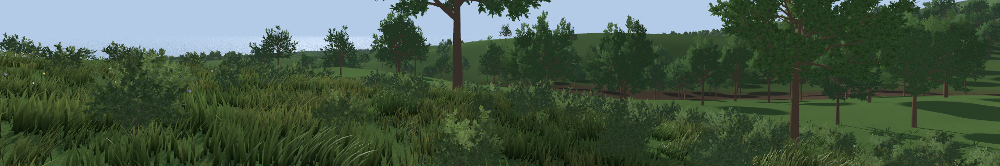

# 58 — Grass to the Horizon

> **Reference support:** named prepared-exercise and native-regression commands
> in this lesson run from the [reference checkout](../BranchWorkflow.md#prepared-reference-exercises).
> The growing chapter implementation remains in your learning checkout.

**Chapter 58's pages:** **1. Sections 1 to 3 — How much ground a field hides** · [2. Sections 4 and 5 — What the capture knows](GrassToTheHorizonBake.md) · [3. Sections 6 and 7 — The canopy](GrassToTheHorizonCanopy.md) · [4. Sections 8 to 10 — How far the cards go](GrassToTheHorizonReach.md).

**Goal:** the coastal grass reaches the horizon. Today the clump cards of Chapters 46 to 48 thin to 15 % by 42 m and
stop there, and past them Horizon's ground is Chapter 38's photograph of grass, lying flat. This chapter shades the
ground under and past
the cards as the grass they stand for, and runs the cards on to 120 m, fading into it. Sections 1 to 3, on this page,
see where the field ends, work out how much ground a field of clumps hides from a low eye, and split one population
between the cards and a canopy so that the two add up to it. Sections 4 and 5 read the clump capture back to the CPU
and hand what it knows to the terrain's shader in a uniform block. Sections 6 and 7 share the grass's light with the
terrain and draw the canopy. Sections 8 to 10 widen the cards' outer fade so the canopy takes over without a step,
measure what it costs standing and walking, and say what the chapter does not do yet.

**Form:** typed into your tree from its own text, over the assembled reference; one supplied CPU test. The tree holds
Chapter 56 complete, and the chapter prints every line it changes, except the supplied test, `GrassCanopyTests.cpp`.

**GPU idea:** objects smaller than a pixel are drawn by their statistics on the surface beneath them. A field of
opaque clumps scattered at random hides one minus the gap fraction of the ground behind it, the gap fraction being
the chance that a ray meets none of them, which is [Chapter 28's](28-Clouds.md#2-fog-measured) transmittance law reached again by counting
gaps. One population is drawn two ways at once, as cards near the eye and as the canopy everywhere the cards leave
out, and their shares of it add, so their optical depths add and their gaps multiply. A grazing ray crosses the grass
layer for tens of metres before it lands, so the canopy marches the layer back toward the eye, and shades what the
ray sees of the layer from the tips down, with the grass's own light. The canopy is a second compiled form of the
terrain's fragment shader, so without it the terrain's fragment shader runs its old SPIR-V, byte for byte.

**Vulkan idea:** one mip of a 224-layer image read back in the middle of its mip chain: the barrier from that mip's
blit to the copy, the final layout change made to wait for the copy as well, and the buffer's layer-after-layer
layout (section 4); and a uniform block written each frame by `vkCmdUpdateBuffer` whose two barriers name only the
stage that reads it (section 5).

Reused, not new: the copy to a host buffer, its barrier and the read after the fence
([Chapter 20, section 9](20-Compute-Fundamentals.md#9-reading-results-back-without-stalling), and Chapter 4's
appendix row "Readback copy visible to the CPU"); the grass's own per-frame readback
([Chapter 26, sections 4](26-Grass-GPU-Generation.md#4-appending-survivors-and-the-barriers-around-it) and
[8](26-Grass-GPU-Generation.md#8-budgets-you-can-see)); `vkCmdUpdateBuffer` and its CLEAR-stage barriers
([Chapter 39, section 9](39-Plants.md#9-planted-by-the-gpu)); a second pipeline from a second compiled form of one
shader (Chapter 56, [section 2](EverythingBendsATree.md#2-a-tree-bends-from-its-foot)); front-to-back weights through
a medium ([Chapter 28, section 3](28-Clouds.md#3-marching-a-ray)).

**Read after:** [Chapter 56](56-Everything-Bends.md), with its exit check passed, in the assembled reference. Like 56,
it is a detour from the far-view route: when you finish, go back to [43 — Waves to the Shore](43-Waves-To-The-Shore.md).

**ROADMAP:** step 21+ — the `Horizon` demo's grass reaches the horizon.

**Module:** the Grass and Horizon demos (`pf::demos::grass`, `pf::demos::horizon`). The island's set (set 1 of
Horizon's terrain) gains binding 10, a uniform block of 976 bytes; `GrassParameters` keeps its 720 bytes. Three
command-line flags, `--grass-canopy`, `--grass-canopy-view` and `--grass-reach-fade`, and two camera routes, `walk` and
`turn`, are the harness the checkpoints use.

**Math:** the gap fraction of a random field, and an area seen over a sine (section 2); a mean over ranks in closed
form (section 3); a march along a ray, and front-to-back weights, Chapter 28's, reused (section 7).

**Prerequisites:**

- [Chapter 56, section 1](56-Everything-Bends.md#1-a-front-is-a-fact-of-the-island): your tree's `GrassField`,
  `CoastalArea` and `HorizonDemo` as 56 leaves them, and the kept-build habit; and
  [section 2](EverythingBendsATree.md#2-a-tree-bends-from-its-foot): a second compiled form of a shader, and why a
  frame that must keep its bytes stays an includer of an unchanged body.
- [Chapter 46, sections 2](46-Capturing-Grass-Clumps.md#2-put-views-where-the-eye-goes) and
  [3](46-Capturing-Grass-Clumps.md#3-a-mip-is-not-a-new-material): the clump capture, its 7 elevations and 8 azimuths
  of 4 variants, and its premultiplied mips.
- [Chapter 47, sections 1](47-Grass-Representation-Handover.md#1-keep-the-plants) and
  [3](47-Grass-Representation-Handover.md#3-make-coverage-observable): one rank owns a clump's two forms, and a card's
  coverage is an ordered sample mask.
- [Chapter 48, sections 3](48-Grass-In-The-Coastal-Pipeline.md#3-separate-population-from-reach) and
  [6](48-Grass-In-The-Coastal-Pipeline.md#6-bound-the-work-without-changing-the-field): the population's schedule
  apart from the reach, and the bounded work.
- [Chapter 41, section 3](41-Grass-On-The-Island.md#3-habitat-before-density): habitat before density;
  `IslandGrassRules.h`'s `islandGrassDensity` is the one function of it this chapter calls.
- [Chapter 38, section 2](38-Ground-Materials.md#2-the-map-on-the-gpu-and-the-islands-set): the island's set and the
  material map, which the canopy reads.
- [Chapter 53, section 6](53-Rolling-Wind.md#6-a-gust-you-can-see-from-far-away): `shadeGrass`'s light, its four light
  views and the gust's brightness.
- [Chapter 28, sections 2](28-Clouds.md#2-fog-measured) and [3](28-Clouds.md#3-marching-a-ray): transmittance,
  optical depth and a march's front-to-back weights.
- [Chapter 20, section 9](20-Compute-Fundamentals.md#9-reading-results-back-without-stalling) and
  [Chapter 39, section 9](39-Plants.md#9-planted-by-the-gpu): a readback, and `vkCmdUpdateBuffer`'s barriers.
- [Chapter 8, section 8](08-Resources-And-Descriptors.md#8-one-layout-two-languages): std140, for the block C++ and
  GLSL share.
- The optional test projects (`GenerateProjects.bat --tutorial-tests`), and `GrassCanopyTests.cpp`, which is
  supplied, not typed.

## Where the code goes

| File | What sections 1 to 9 do there |
| --- | --- |
| `premake5.lua`, `Tests/TutorialHarness/GrassCanopyTests.cpp` | Section 1: the supplied test's project, at stage 0. Sections 2 to 5, 7 and 8: its stage raised. Section 5: the project's ImGui include directories. Section 7: the shader build compiles `Terrain.frag.glsl` a second time, as `TerrainCanopy.frag.spv` |
| **New:** `Shaders/Grass/GrassCanopy.h` | Section 2: the gap law. Section 3: the cards' share and the missing share. Section 7: the march and the visible layer's weights |
| **New:** `Source/PillowFort/Demos/Grass/GrassCanopyTable.h`, `Source/PillowFort/Demos/Grass/GrassCanopyTable.cpp` | Section 4: the capture folded on the CPU |
| `Source/PillowFort/Demos/Grass/GrassClumpAtlas.h`, `Source/PillowFort/Demos/Grass/GrassClumpAtlas.cpp` | Section 4: the copy of mip 3, its barriers, and taking it after the fence |
| `Source/PillowFort/Demos/Grass/GrassField.h`, `Source/PillowFort/Demos/Grass/GrassField.cpp` | Section 4: asking for the capture, folding it, the table. Section 8: the cards' outer fade band in the settings and the packing |
| **New:** `Shaders/Horizon/GrassCanopyBlock.h` | Section 5: the block, every field. Section 8: its comment on `reach` |
| `Source/PillowFort/Demos/Horizon/Terrain.h`, `Source/PillowFort/Demos/Horizon/Terrain.cpp` | Section 5: binding 10 and `RecordCanopy`. Section 7: the canopy's two pipelines, and which one draws |
| `Source/PillowFort/Demos/Horizon/CoastalArea.h`, `Source/PillowFort/Demos/Horizon/CoastalArea.cpp` | Section 4: Horizon asks for the capture. Section 5: `makeGrassCanopyBlock`, written every frame. Section 7: the switch, the cover view, `CanopyDraws`. Section 8: the **Card fade band** row |
| **New:** `Shaders/Grass/GrassLightBody.glsl`, `Shaders/Grass/GrassGust.glsl`; `Shaders/Grass/GrassFragmentKernel.glsl` | Section 6: the grass's light as an included body, and the gust's two constants |
| `Shaders/Horizon/Terrain.frag.glsl`, **New:** `Shaders/Horizon/GrassCanopyLight.glsl`, `Shaders/Grass/GrassClumpSource.h` | Section 7: the canopy, inside `PF_GRASS_CANOPY`; the schedule's two curves on their own numbers. Section 8: the cards' outer fade |
| `Shaders/Grass/GrassTypes.h` | Section 8: a free float becomes `reachFadeBand` |
| `Source/PillowFort/Demos/Horizon/HorizonDemo.h`, `Source/PillowFort/Demos/Horizon/HorizonDemo.cpp` | Section 7: the terrain told whether the canopy draws; the setters. Section 8: the fade's setter. Section 9: the routes `walk` and `turn` |
| `Source/SandboxGame/Main.cpp` | Section 7: `--grass-canopy` and `--grass-canopy-view`. Section 8: `--grass-reach-fade`, and the defaults: a 120 m reach and a 30 m card fade |

Sections 1, 2, 4, 5, 6 and 7 add files, so each runs `GenerateProjects.bat --tutorial-tests` again
([Chapter 1, section 3](01-Environment-And-Build.md#3-the-corrected-workspace)): premake bakes its file lists in when
it generates, and a file it has not seen is not built. Sections 3, 8 and 9 add none.

**Blank lines.** A new function, struct member block or file-scope block you add gets one blank line above it and one
below it, as its neighbours have, except as the last thing in a class or struct, where it sits directly against the
closing `};`. Constants or comment lines that join a run of constants are the exception: they sit directly against their
neighbours, and the text says "with no blank line between" where that is so.

## 1. Where the field ends

Chapter 48 handed the coastal grass from blades to clump cards, and Chapter 56 set it moving with the island's wind.
Stand in it and look along it. Build Release, and run Horizon at Wind edge, in a 1920 × 1080 window so that your
panel's counts are the ones this section quotes:

```powershell
& 'C:\Program Files\Microsoft Visual Studio\2022\Community\MSBuild\Current\Bin\MSBuild.exe' .\Build\Projects\PillowFort.sln /m /p:Configuration=Release /p:Platform=x64 /t:SandboxGame
& ./Build/Artifacts/Release/SandboxGame/SandboxGame.exe --demo Horizon --horizon-view "Wind edge" --msaa 4 --width 1920 --height 1080
```



The blades stand around you, and past about 20 m the clump cards take over; they thin out, and by 42 m they stop. Past
them the ground is Chapter 38's: its grass photograph near the eye, fading between 150 and 300 m into the island's far
colour ([section 10](38-Ground-Materials.md#10-the-far-island)). It is grass painted flat, with nothing standing in it.
(The picture is rows 440 to 759 of frame 90 of this view at a fixed clock, on the
reference's RTX 5090.) Open **Coastal systems** and note three lines: **Grass clump impostors**, the cards drawn this
frame for the camera and the shadows together, **Grass camera clumps**, the ones the camera's pass draws, and **Clump
draw**, what drawing them costs.

**Keep this build before you change anything.** The checkpoints of sections 4 to 7 and the exit check compare frames
with it, as [Chapter 56, section 1](56-Everything-Bends.md#1-a-front-is-a-fact-of-the-island) did:

```powershell
Copy-Item -Recurse .\Build\Artifacts\Release\SandboxGame ..\SandboxGame-before-58
```

The obvious cure is a longer reach. `--coast-grass-reach` sets it, up to 200 m:

```powershell
& ./Build/Artifacts/Release/SandboxGame/SandboxGame.exe --demo Horizon --horizon-view "Wind edge" --msaa 4 --width 1920 --height 1080 --coast-grass-reach 200
```

The cards now run on to 200 m, still at 15 %, and the flat ground begins farther off. The field does not look fuller: the
cards the schedule keeps are far apart, and between them the flat ground still shows, now under 200 m of cards instead
of 42. [Chapter 48, section 3](48-Grass-In-The-Coastal-Pipeline.md#3-separate-population-from-reach) set the rule this
runs into: the population is one thing and the reach another. The schedule says how many clumps grow at each
distance, 100 % to 12 m and thinning to 15 % at 42 m, and the reach says only how far the cards are drawn. A longer
reach draws more of the same thin 15 %, at a cost that grows with the area of the ring it adds; it never draws the
other 85 %.

That other 85 % is what this chapter draws, without cards. A clump past 40 m is a few pixels across, and a few pixels
of many clumps blend into a colour: what a pixel there shows is a share of grass over a share of ground, and the share
can be worked out from how many clumps there are, how much of the view one of them blocks, and how far the ray runs
through them. Section 2 works that share out. This section sets up the test that checks it.

<a id="ch58-where-it-ends"></a>

### Attempt CH58-where-it-ends: what 200 m of cards costs

Predict first. At 42 m the panel reads 628 camera clumps. Say the habitat is the same everywhere and the camera sees
the same share of every ring around it. The count then grows with the schedule's density summed over the ground,
∫ D(r) 2πr dr out to the reach, where D is 1 to 12 m, falls linearly to 0.15 at 42 m and stays 0.15 past it. How many
camera clumps do you expect at 200 m? Then run it, read the panel, and compare. What did 158 m more reach cost?

**Acceptance:** your prediction and the panel's count at 200 m, and the clump draw's time at both reaches. The numbers
the reference measured are in the worked solution; yours differ if your GPU does, but the counts do not depend on its
speed.

**Transfer:** the 158 m ring holds about six times the clumps of the 42 m disc. Where on the screen are they, and how
many pixels does one of them cover at 150 m?

<details>
<summary>Hint 1: three pieces</summary>

The disc to 12 m is π × 12² at full density. The ring from 12 to 42 m has a density falling linearly; split it into
thin rings, or take the mean of D weighted by r. The ring from 42 to 200 m is 0.15 × π (200² − 42²).

</details>

<details>
<summary>Hint 2: the ring from 12 to 42 m</summary>

∫ from 12 to 42 of (1 − 0.85 (r − 12) / 30) 2πr dr is about 2,526 m².

</details>

<details>
<summary>Hint 3: a ratio</summary>

The count at 200 m is 628 times the sum to 200 m over the sum to 42 m. The reach's own last 4 m of fade changes each
sum by under 4 %.

</details>

<details>
<summary>Worked solution: about 4,400 predicted, 5,697 counted; the clump draw doubles</summary>

To 42 m the sum is 452 + 2,526 = 2,978 m². To 200 m it adds 0.15 × π × (40,000 − 1,764) = 18,018 m², for 20,996 m²,
7.05 times as much. So about 628 × 7.05 ≈ 4,430 camera clumps.

The panel reads 5,697, 29 % above the prediction. The prediction assumed the same habitat everywhere and the same
share of every ring in view, and the island need not keep either; the text does not say which one moved the count.
The shape holds, though: the count grows with the area of the ring times 0.15, by a factor of about seven
or more.

On the reference's RTX 5090, at 1920 × 1080 and 4x MSAA, standing, with a fixed clock (the GPU frame the median of
478 frames after 120 to warm up, the counts and the clump draw their means): at 42 m, 2,764 clump cards for the camera and the shadows together, 628 of them the camera's, a clump
draw of 0.95 ms and a GPU frame of 3.38 ms; at 200 m, 24,880 cards, 5,697 the camera's, 1.93 ms and 4.78 ms. The clump
draw doubles, the frame grows by 1.4 ms, and the field still does not look full.

**Answer to the transfer.** In a thin band just below the horizon. Horizon's lens has a vertical field of view of 60
degrees, so a 1080-pixel window puts 540 / tan 30° = 935 pixels on one radian: at 150 m clumps 0.67 m apart stand about
4 pixels apart, a card about 1.3 m wide is about 8 pixels wide, and its blades are far thinner than a pixel. Most of the cost of a longer reach is spent on clumps that
each cover a handful of pixels.

</details>

**The supplied test.** `TutorialGrassCanopyTests` checks the canopy's statistics on the CPU, through the headers the
shaders include; it opens no window and makes no device. Its first stage needs none of this chapter's code: it calls
the engine's own schedule and tile selection on Horizon's grass settings, copied into the test from `CoastalArea`'s
constructor and `GrassSettings`' defaults, so the numbers the text quotes are the engine's arithmetic.
Each later section raises it.

**`premake5.lua`.** Inside the `if _OPTIONS["tutorial-tests"] then` block, below the `TutorialPlantWindTests` project
and its blank line, add, with a blank line below it:

```lua
    project "TutorialGrassCanopyTests"   -- Chapter 58: the canopy's statistics, on the CPU, one stage per section
        kind "ConsoleApp"
        apply_common_cpp_settings()
        files { "Tests/TutorialHarness/GrassCanopyTests.cpp" }
        includedirs { "Vendor/GLFW/include" }   -- GrassField.h reaches GlfwWindow.h through Demo.h
        links { "PillowFortEngine", "GLFW", "ImGui", "TinyUSDZ" }
```

**`GrassCanopyTests.cpp`, supplied.** It is `Tests/TutorialHarness/GrassCanopyTests.cpp`. A learning branch made from
`start` has it at stage 0; otherwise copy it there from a `reference-main` checkout
([Which checkout](../VulkanTutorial.md#choose-your-checkout)) and replace the line that starts `#define PF_TEST_STAGE`
with:

```cpp
#define PF_TEST_STAGE 0   // raised in each section of Chapter 58
```

Every part of the file that names a type or a header a later section adds is compiled only from that section's stage,
so it builds now, with none of the chapter's code. Near its top, `GRASS_CANOPY_TEST_CONTROL` swaps one step of the
test for a wrong copy, to show a stage can fail; leave it at 0 until a section asks.

### Checkpoint

The test file is new, so generate again with the test projects; then build the test in Debug with the serial flags of
the shell build in [Building PillowFort](../Premake.md#the-everyday-path), and run it from the repository root:

```powershell
.\GenerateProjects.bat --tutorial-tests
if ($LASTEXITCODE -ne 0) { throw 'Project generation failed.' }
& 'C:\Program Files\Microsoft Visual Studio\2022\Community\MSBuild\Current\Bin\MSBuild.exe' .\Build\Projects\PillowFort.sln /m:1 /nr:false /p:CL_MPCount=1 /p:UseMultiToolTask=true /p:MultiProcMaxCount=1 /p:EnforceProcessCountAcrossBuilds=true /p:Configuration=Debug /p:Platform=x64 /t:TutorialGrassCanopyTests
if ($LASTEXITCODE -ne 0) { throw 'The test build failed.' }
& .\Build\Artifacts\Debug\TutorialGrassCanopyTests\TutorialGrassCanopyTests.exe
```

It prints the tiles the field is dispatched over at four reaches, then the verdict:

```text
reach 42 m: 360 tiles, 404 examined
reach 120 m: 559 tiles, 624 examined
reach 160 m: 708 tiles, 809 examined
reach 200 m: 896 tiles, 1044 examined
PASS: grass canopy, stage 0 (15 checks)
```

Stage 0 checks the schedule (full at 12 m, the mix of 1 and 0.15 at 30 m, 0.15 at 42 m), the reach factor (1 to 38 m,
0 at 42 m), Horizon's 2.25 clumps a square metre, and that `selectGrassPatches` at 42, 120, 160 and 200 m stays inside
`MAX_TILES` and the dispatch's ceiling, so a longer reach is something the field can be asked for at all.

Next: how much ground the clumps the cards leave out would hide.

## 2. How much ground a field hides

Start on a floor, with discs. Scatter discs of area a over a large floor at random, n of them to the square metre,
each placed without regard to the others. What share of the floor stays bare?

The naive answer is 1 − n a: n discs a square metre, each covering a. It is wrong as soon as discs overlap, and with
n a above 1 it is negative. Count gaps instead. A point of the floor is bare when no disc's centre lies within a disc's
reach of it, that is inside a region of area a around the point. The centres fall independently, so the number inside
any region of area a is a Poisson count with mean n a, and the chance that it is 0 is

$$ P_{\text{bare}} = e^{-n a} . $$

> **Jump:** from "each disc covers a" to an exponential. Hold this: a random field never covers the whole floor, its
> cover grows fast while it is thin and slowly once it is thick, and each disc added covers only the bare floor that is
> left. n a is not a share of anything; it is the mean number of discs over a point. A Poisson count of it being 0 is
> what turns it into a share.

At n a = 0.1 the floor is 90.5 % bare, close to the naive 90 %. At n a = 1 the naive answer is 0 and the real one
36.8 %: a third of the floor is still bare under a field whose discs would tile it exactly if they did not overlap.

Now lift the eye. A view ray at elevation e above level ground passes over the ground and through the grass before it
lands. Put a plane across the ray, square to it. Every clump the ray could meet shows on that plane as a silhouette of
some area A(e), the area one clump blocks when seen from that elevation; a square metre of ground, seen along the ray,
covers sin e square metres of the plane. So the clumps over the ground the ray crosses land on the plane at n / sin e
to the square metre, each blocking A(e), and the floor's law holds on the plane:

$$ \tau = \frac{n\,A(e)\,m}{\sin e}, \qquad \text{cover} = 1 - e^{-\tau} , $$

where m is the share of the population counted (the clumps no card draws, section 3) and τ is the optical depth, the
mean number of clumps the ray meets.

> **Jump:** from a floor to a view. The floor's area turns into an area seen across the ray, and a clump's area into
> its silhouette at that elevation. Hold this: at a low elevation 1 / sin e is large, so the same field hides far more
> ground far off than near. That is why the far field can look solid where the near one looks sparse, and it is all
> geometry; no clump is bigger far away.

This is [Chapter 28, section 2's](28-Clouds.md#2-fog-measured) transmittance, exp(−σ d), reached a second way: there
fog had a density σ a metre of ray, measured; here the density is counted, n A(e) / sin e clumps a metre of the ray's
height, and τ is its optical depth. The rest of Chapter 28 follows: what the ray sees is weighted front to back
(section 7).

**Clumps on a meadow.** Horizon's grass is one clump to every square of 0.667 m, n = 2.25 clumps a square metre. Seen
along the ground, at 0 degrees, the capture of Chapter 46 says one clump blocks about 0.123 m² (section 4 reads that
number back from the capture). Stand at Wind edge's 2.5 m and look at level ground 10 m off: sin e = 2.5 / 10.3 =
0.243, and if no card drew any clump there,

$$ \tau = \frac{2.25 \times 0.123}{0.243} = 1.14, \qquad \text{cover} = 1 - e^{-1.14} = 0.68 . $$

A third of the ground still shows between the clumps 10 m away. (A(e) at 14 degrees is not quite the 0-degree value;
section 7 reads the capture's own row for each elevation.)

**A slope.** On ground that tilts, two things change. A square metre of slope holds the clumps of its horizontal
footprint, N.y square metres, where N is the ground's normal, so the slope holds n N.y clumps a square metre of its own
surface; and the ray meets the slope at the angle between the view and the slope, not the view and the horizontal. The
sine in the law is that angle's, the dot product of V, the unit vector from the ground toward the eye, with N. A slope
facing you, tilted 10 degrees toward the eye, 30 m out, turns the 4.8-degree view into a 14.8-degree one: the cover there is 0.66,
where level ground at the same distance gives 0.96. A slope falling away turns it toward 0, and the cover toward 1.

Seen edge-on, sin e reaches 0 and τ grows without bound, so the law takes the sine at no less than 0.02, a guard named
in the header. It is the law at one point, the pixel's own ground: section 7 shows where that is not enough.

**`GrassCanopy.h`.** The law goes in a header both the terrain's shader and the supplied test include, as
`IslandGrassRules.h` is, so the two cannot drift apart. It keeps C++ and GLSL in one text the way
[Chapter 8, section 8](08-Resources-And-Descriptors.md#8-one-layout-two-languages) taught: C++ takes the GLSL
functions' names from `<cmath>` and GLM inside a namespace, and `PF_CANOPY_FUNCTION` makes each function `inline` there.
In `Shaders/Grass/`, beside `IslandGrassRules.h`, create `GrassCanopy.h`:

```cpp
///========================================================
/// @author Gary Yang
/// @brief Chapter 58: the grass canopy's cover, shared by the terrain shader and the CPU tests
/// @copyright (C) Gary 2026
///========================================================
#ifndef PF_GRASS_CANOPY_H
#define PF_GRASS_CANOPY_H

// The smallest sine of the angle between the view and the ground that the cover is computed at: a guard for ground
// seen edge-on, where the optical depth would grow without bound.
#define GRASS_CANOPY_MIN_SINE 0.02f

#ifdef __cplusplus
#include <cmath>
#include <glm/common.hpp>
namespace pf::demos::grass
{
using std::exp;
using std::log;
using glm::max;
using glm::min;
#define PF_CANOPY_FUNCTION inline
#else
#define PF_CANOPY_FUNCTION
#endif

// Chapter 58 section 2: the gap law of a random field. A view ray crosses the clumps the cards do not draw like a ray
// through a Poisson field: the chance it meets none is exp(-tau), where tau is the expected number of clumps it meets.
// clumpsPerSquareMetre counts per square metre of horizontal ground, so groundUp (the ground normal's y) turns it into
// clumps per square metre of a slope; projectedArea is one clump seen at the view's elevation; missingShare is the part
// of the population the cards leave out; and the ray spends 1 / sinGround of a metre in the layer for every metre of
// its height.
PF_CANOPY_FUNCTION float grassCanopyOpticalDepth(float clumpsPerSquareMetre, float projectedArea, float missingShare,
                                                 float groundUp, float sinGround)
{
    return clumpsPerSquareMetre * groundUp * projectedArea * missingShare / max(sinGround, GRASS_CANOPY_MIN_SINE);
}

// The share of the ground the missing clumps hide: one minus the chance of meeting none.
PF_CANOPY_FUNCTION float grassCanopyCover(float opticalDepth)
{
    return 1.0f - exp(-opticalDepth);
}

#undef PF_CANOPY_FUNCTION
#ifdef __cplusplus
}
#endif
#endif
```

<a id="ch58-gap-law"></a>

### Attempt CH58-gap-law: how much a field hides at 30 m and at 100 m

Predict first, from a 2.5 m eye over level ground, with one clump blocking 0.123 m² and 2.25 clumps a square metre:
the cover at 30 m and at 100 m (a) if no card drew any clump there, and (b) where the cards draw 15 % of a habitat of
0.55, so the missing share is 0.55 × 0.85 = 0.47 (section 3 makes that exact). Which of the four is nearer 1 than you
expected, and why?

**Acceptance:** your four numbers, and stage 1 of the supplied test: the law against rays through a random field of
cards, at four elevations from 45 to 2 degrees.

**Transfer:** the cover depends on n A(e) m and not on the clumps' height. Where does the layer's height enter, and why
does it cancel on level ground?

<details>
<summary>Hint 1: the sine</summary>

sin e = eye / √(d² + eye²) for an eye at height eye over level ground at distance d.

</details>

<details>
<summary>Hint 2: the optical depth</summary>

τ = 2.25 × 0.123 × m / sin e, and the cover is 1 − exp(−τ). For (a) m = 1; for (b) m = 0.4675.

</details>

<details>
<summary>Hint 3: why near 1</summary>

At 100 m the sine is 0.025, a fortieth. Ask how much optical depth exp(−τ) needs before the gap is under 1 %.

</details>

<details>
<summary>Worked solution: 0.96 and 1.00 bare of cards; 0.79 and 0.99 with them</summary>

At 30 m, sin e = 2.5 / 30.10 = 0.0830 (4.8 degrees). With m = 1, τ = 0.277 / 0.0830 = 3.33 and the cover is 0.964;
with m = 0.4675, τ = 1.56 and the cover 0.79.

At 100 m, sin e = 2.5 / 100.03 = 0.0250 (1.4 degrees). With m = 1, τ = 11.1 and the cover is 1.0000 to four places;
with m = 0.4675, τ = 5.2 and the cover 0.994.

The surprise is (b) at 100 m: less than half the population, and the ground is 99.4 % hidden. An optical depth of 4.6
leaves a gap of 1 %, and at a sine of a fortieth it takes only 0.115 m² of silhouette over each square metre of
ground to reach it. The far field is solid because the ray is long in it, not because the clumps are many. That is also why
the 15 % of cards past 42 m never fill the view: 0.15 × 0.55 of a population, drawn as cards, leaves m = 0.47 that
nothing draws.

**Answer to the transfer.** The height sets how far along the ray the layer lasts. A ray at elevation e crosses a
layer H high over a path H / sin e long, and meets n A(e) m / H clumps a metre of that path, so its optical depth is
(n A m / H) × (H / sin e): H cancels. It stops cancelling where the ground under the path is not level, or where the
eye is closer than the path is long; section 7 marches the path for that reason.

</details>

### Checkpoint

Raise the supplied test's stage. In `GrassCanopyTests.cpp`, replace the line that starts `#define PF_TEST_STAGE` with:

```cpp
#define PF_TEST_STAGE 1   // raised in each section of Chapter 58
```

`GrassCanopy.h` is a new file, so generate again before the build:

```powershell
.\GenerateProjects.bat --tutorial-tests
if ($LASTEXITCODE -ne 0) { throw 'Project generation failed.' }
& 'C:\Program Files\Microsoft Visual Studio\2022\Community\MSBuild\Current\Bin\MSBuild.exe' .\Build\Projects\PillowFort.sln /m:1 /nr:false /p:CL_MPCount=1 /p:UseMultiToolTask=true /p:MultiProcMaxCount=1 /p:EnforceProcessCountAcrossBuilds=true /p:Configuration=Debug /p:Platform=x64 /t:TutorialGrassCanopyTests
if ($LASTEXITCODE -ne 0) { throw 'The test build failed.' }
& .\Build\Artifacts\Debug\TutorialGrassCanopyTests\TutorialGrassCanopyTests.exe
```

```text
reach 42 m: 360 tiles, 404 examined
reach 120 m: 559 tiles, 624 examined
reach 160 m: 708 tiles, 809 examined
reach 200 m: 896 tiles, 1044 examined
elevation 45 deg, n 12: tau 2.29183, gaps 0.1004 measured, 0.101081 from the law
elevation 25 deg, n 1.5: tau 0.614356, gaps 0.54035 measured, 0.540989 from the law
elevation 8 deg, n 1: tau 1.35894, gaps 0.25803 measured, 0.256934 from the law
elevation 2 deg, n 0.5: tau 2.73456, gaps 0.06594 measured, 0.0649225 from the law
PASS: grass canopy, stage 1 (28 checks)
```

Stage 1 throws 100,000 rays through a random field of cards at each of 45, 25, 8 and 2 degrees, each card an upright
rectangle 0.3 m wide and 1 m tall turned at random about the vertical, and counts the rays that reach the ground. A
card turned at random shows a mean width of (2 / π) × 0.3 m, and its height times cos e from the side, so the test
hands `grassCanopyOpticalDepth` that area and compares exp(−τ) with the share of rays that got through, within four
standard errors and 0.003. The field is the law's assumption made real: centres placed at random, each card blocking an area
that depends on how it is turned. Each line prints the measured gap beside the law's. The stage also checks that the
cover is 0 at no depth, grows with the depth and passes 0.999 at a depth of 20, that nothing missing hides nothing, and
that ground seen edge-on is computed at `GRASS_CANOPY_MIN_SINE`.

Next: which share of the population the cards already draw.

## 3. Two forms of one field

The cards and the canopy draw one population. Near the eye a clump is a card; as the schedule thins with distance the
cards draw a falling share of the clumps, and the canopy must draw the rest, no more and no less. So the canopy needs
the cards' share at every distance, exactly.

The schedule gives each place a density D, the share of the population that grows there: 1 to 12 m, falling to 0.15
at 42 m in Horizon (times the reach's own fade near its end). The generator does not draw a share D of each clump. It
gives every clump a rank r, uniform between 0 and 1, and keeps a clump while r is below D; near the edge it fades the
clump's card instead of cutting it, over a band b of ranks, so a clump does not pop as you walk
([Chapter 47, section 1](47-Grass-Representation-Handover.md#1-keep-the-plants)). That is
`grassPopulationCoverage` in `GrassClumpSource.h`: a clump of rank r at density D covers

$$ c(r) = \text{clamp}\!\left(\frac{D - r}{\min(b,\ 1 - r)},\ 0,\ 1\right) $$

of its card, with b = 0.08. The `min(b, 1 − r)` narrows the band for ranks near 1, so that at D = 1 every clump is
whole.

The cards' share is the mean of c over the ranks, s(D) = ∫₀¹ c(r) dr, and it has a closed form in three pieces:

- below the band, D < b: every clump that grows is still fading, and s = D² / (2b);
- in the middle, b ≤ D ≤ 1 − b: the ranks below D − b are whole, the last b fade linearly, and s = D − b / 2;
- near full density, D > 1 − b: the band is cut short by 1 − r. Write e = 1 − D, what is left to full density. The
  whole part gives D − b, the ramp of width b down to rank 1 − b gives e − e² / (2b), and the shrinking ramp past
  it gives (b − e) − e ln(b / e). Summed, s = 1 − e (1 + e / (2b) + ln(b / e)).

The last form is written in e on purpose: near D = 1 the share is 1 minus a small number, and computing it as a
difference of large terms would lose the digits that matter there. At e = b it is D − b / 2 again, and as e reaches 0
it reaches 1, so the share has no step anywhere: not at 12 m, where the schedule leaves 1, nor in the reach's outer
fade.

The clumps the cards leave out, as a share of the population, are the missing share, the habitat h times 1 − s.

> **Jump:** shares add, gaps multiply. A pixel past the near field shows cards over a canopy. The cards hide the share
> s of the habitat's clumps, the canopy the share h (1 − s) the cards leave. Their optical depths are each n A m / sin e
> with their own m, so they add to the whole habitat's, n A h / sin e, and their gaps multiply to its gap:
> exp(−τ_cards) × exp(−τ_canopy) = exp(−τ). Hold this: it is true only where the two hide the ground independently.

**Where gaps multiply and where they do not.** A card over the canopy: the card covers some of a pixel's samples, and
every sample under it and beside it sees ground that the canopy has already shaded, so the card's gap and the canopy's
are independent, and the product holds. A card over a card does not. Cards share
[Chapter 47, section 3's](47-Grass-Representation-Handover.md#3-make-coverage-observable) ordered sample masks: a card
of coverage a writes the first samples of a fixed order, so two far cards that overlap in a pixel write the same
samples, and together they hide less than two independent cards would. Where far cards overlap, the cards' own cover
falls short of their share, and the canopy, which fills only the missing share, does not make it up. Nothing in this
chapter measures how much that leaves; section 10 lists it among what nothing catches.

In `GrassCanopy.h`, below `grassCanopyCover` and its blank line, add, with a blank line below it:

```cpp
// Chapter 58 section 3: the share of the population the cards draw, on average, where the schedule's density is
// density (already multiplied by the reach factor). It is exactly the generator's coverage,
// grassPopulationCoverage in GrassClumpSource.h, averaged over the clumps' ranks: the integral over r in [0, density) of
// clamp((density - r) / min(b, 1 - r), 0, 1). Near full density the band narrows to 1 - rank, so the share reaches 1
// at density 1 with no step, and it stays exact in the reach's outer fade.
PF_CANOPY_FUNCTION float grassCardShare(float density, float fadeBand)
{
    float D = density;
    float b = min(max(fadeBand, 0.001f), 0.5f);
    if (D <= 0.0f) { return 0.0f; }
    if (D >= 1.0f) { return 1.0f; }
    if (D < b) { return D * D / (2.0f * b); }
    if (D <= 1.0f - b) { return D - 0.5f * b; }
    // Past 1 - b the band is cut short by 1 - rank: a full part, a ramp of width b, then the shrinking ramp. Summed and
    // written in what is left to full density, e = 1 - density, so nothing small is found as the difference of two
    // large numbers: at e = b it is D - b / 2 again, and it reaches 1 as e reaches 0.
    float e = 1.0f - D;
    return 1.0f - e * (1.0f + e / (2.0f * b) + log(b / e));
}

// The share of the habitat's clumps that no card stands for.
PF_CANOPY_FUNCTION float grassCanopyMissingShare(float habitat, float density, float fadeBand)
{
    return habitat * (1.0f - grassCardShare(density, fadeBand));
}
```

The share clamps its band to between 0.001 and 0.5: the generator's own band is 0.08, and a band outside that range
would put a division by zero, or a third piece wider than the middle one, into the formula.

<a id="ch58-two-forms"></a>

### Attempt CH58-two-forms: the cards' share at 0.5 and at 0.99

Predict first, with b = 0.08: the cards' share at density 0.5 and at density 0.99. Then compare the second with
the ramp that keeps 1 at full density and uses the middle piece, max(D − b / 2, 0), everywhere below it. How large is
its error at 0.99, and where on the ground is density 0.99?

**Acceptance:** your two numbers, and stage 2 of the supplied test: the share against the mean of the generator's own
`grassPopulationCoverage` over 100,000 ranks, to 10⁻⁵, at three bands, three habitats and densities from 0 to 1.

**Transfer:** the share is a mean over ranks of the generator's coverage. If the generator faded a clump's card by
its distance instead of by its rank, could the canopy still take its share from the schedule alone?

<details>
<summary>Hint 1: which piece</summary>

0.5 lies between b and 1 − b. 0.99 lies above 1 − b = 0.92.

</details>

<details>
<summary>Hint 2: the near-full piece</summary>

e = 0.01, e / (2b) = 0.0625, ln(b / e) = ln 8 = 2.079.

</details>

<details>
<summary>Hint 3: where density 0.99 is</summary>

The schedule falls linearly from 1 at 12 m to 0.15 at 42 m. How far past 12 m is 0.99?

</details>

<details>
<summary>Worked solution: 0.46 and 0.9686; the ramp is 0.019 short just past 12 m</summary>

At D = 0.5, s = 0.5 − 0.04 = 0.46.

At D = 0.99, s = 1 − 0.01 × (1 + 0.0625 + 2.0794) = 1 − 0.0314 = 0.9686. The ramp max(D − b / 2, 0) gives 0.95, 0.019
short. The schedule reaches 0.99 a third of a metre past 12 m, so the ramp's error sits in a ring just outside the
full-density disc, where it would be largest: the share would step from 1 to 0.96 at exactly 12 m, and the canopy
would draw 4 % of a population that the cards already draw, a ring of too much cover on the ground. With the exact
share there is no step.

**Answer to the transfer.** Yes, if the fade were a known function of distance: the share would be that function's
mean. What matters is that the canopy uses the same rule as the generator, from the same numbers. Here it calls the
generator's own schedule through `GrassClumpSource.h`, and section 7 splits that schedule's two curves out so the
terrain can call them with the block's numbers.

</details>

### Checkpoint

Raise the supplied test's stage. In `GrassCanopyTests.cpp`, replace the line that starts `#define PF_TEST_STAGE` with:

```cpp
#define PF_TEST_STAGE 2   // raised in each section of Chapter 58
```

No file is new. Build the test and run it, with the build and run lines of section 2's checkpoint, from `& 'C:\Program
Files\...` on.

```text
reach 42 m: 360 tiles, 404 examined
reach 120 m: 559 tiles, 624 examined
reach 160 m: 708 tiles, 809 examined
reach 200 m: 896 tiles, 1044 examined
elevation 45 deg, n 12: tau 2.29183, gaps 0.1004 measured, 0.101081 from the law
elevation 25 deg, n 1.5: tau 0.614356, gaps 0.54035 measured, 0.540989 from the law
elevation 8 deg, n 1: tau 1.35894, gaps 0.25803 measured, 0.256934 from the law
elevation 2 deg, n 0.5: tau 2.73456, gaps 0.06594 measured, 0.0649225 from the law
the share and the generator's mean coverage differ by at most 1.0122e-06
at 12 m the cards draw 1 of the clumps
at 20 m the cards draw 0.733333 of the clumps
at 30 m the cards draw 0.45 of the clumps
at 41 m the cards draw 0.00485272 of the clumps
PASS: grass canopy, stage 2 (32 checks)
```

Stage 2 averages the generator's own `grassPopulationCoverage` over 100,000 ranks at bands 0.08, 0.25 and 0.001,
habitats 1, 0.55 and 0.2, and 107 densities from 0 to 1 (0.99, 0.999 and 0.9999 among them), and checks
`grassCardShare` against each mean to 10⁻⁵. Then it walks Horizon's schedule every 0.25 m to 47 m with a habitat of
0.55: the cards' part, habitat × share, plus `grassCanopyMissingShare` is the habitat everywhere; nothing is missing
inside 12 m; everything is missing at and past the reach. It prints what the cards draw at 12, 20, 30 and 41 m.

**A stage that can fail.** Set `GRASS_CANOPY_TEST_CONTROL` to 1 near the top of `GrassCanopyTests.cpp`: the test swaps
the share for the ramp of the attempt, `max(D - b / 2, 0)`, inside its own copy, and stage 2 fails. The swap is in the
test, not in your header. Set it back to 0.

The law and the shares are now arithmetic the CPU can check. What the law needs from the GPU is A(e), one clump's
silhouette at each elevation, and the capture knows it.

Next in this chapter: [Sections 4 and 5 — What the capture knows](GrassToTheHorizonBake.md).

