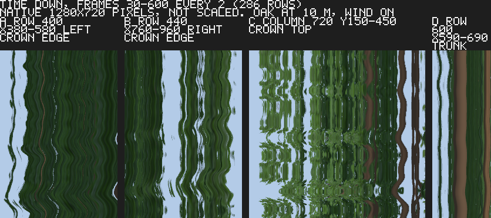
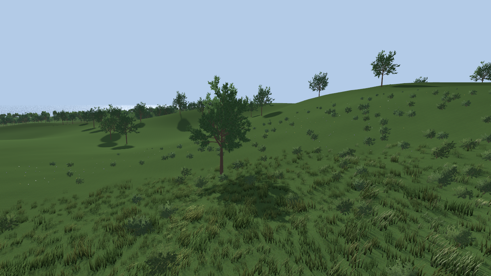

# 56 — Everything Bends, page 3: every part attached

> **Reference support:** named prepared-exercise and native-regression commands
> in this lesson run from the [reference checkout](../BranchWorkflow.md#prepared-reference-exercises).
> The growing chapter implementation remains in your learning checkout.

**Chapter 56's pages:** [1. Section 1 — One front for the whole island](56-Everything-Bends.md) · [2. Section 2 — A tree bends from its foot](EverythingBendsATree.md) · **3. Part 2 — Every part attached, every view the same** · [4. Parts 3 and 4 — Once a frame, and the clouds aloft](EverythingBendsOnceAFrame.md).

Part 1 made the fronts a fact of the island's world wind, so that a front crossing the coastal grass reaches the trees
behind it ([section 1](56-Everything-Bends.md#1-a-front-is-a-fact-of-the-island)), and bent every tree from its foot by one function that
every pass including it agrees on ([section 2](EverythingBendsATree.md#2-a-tree-bends-from-its-foot)). The whole tree still moves as one piece,
the ferns and flowers stand still, and the shadows do not move at all. Your tree holds section 2's code, its checkpoint
passed and the supplied test at stage 2. Keep `..\SandboxGame-before-56`, the build you copied before section 1:
sections 5 and 7 run it again. The prerequisites are the chapter's, listed in its [header](56-Everything-Bends.md).

# Part 2 — Every part attached, every view the same (sections 3–5)

Section 2 bent each tree from its foot as one shape. This part adds what rides on that bend and the passes that must see
it: the branches and leaves (section 3), the understory and the first cull margin (section 4), and the shadows, with the
trees' and the casters' margins (section 5).

## 3. Branches and leaves that stay attached

Run Horizon at **Wind wood** as section 2 left it and watch one crown. It swings, but as one piece: no twig moves
against the trunk and no leaf against its neighbour. A real crown's outer branches are springs of their own, and its
leaves flutter at their tips. This section adds both, and each must keep every leaf card on its twig, although the card
and the twig are drawn by different submeshes, with different materials, in different runs
([Chapter 39, section 2](39-Plants.md#2-leaves-are-cards)).

<a id="ch56-attached"></a>

### Attempt CH56-attached: flutter that keeps every card on its twig

Chapter 39's importer gives a card `uv.y` = 1 along its base, where it meets the twig, and 0 at its tip. Predict first:
of three rules for the flutter, a sine of time along the wind weighted by `uv.y` (1), the same weighted by `1 - uv.y`
(2), and rule 2 with a random phase for each card (3), which tears a card off its twig, and which keeps every card on
its twig but still looks wrong? Then say what the branch's sway may depend on, so that a twig, the bark under it and the
cards on it move together.

**Acceptance:** at **Oak at 10 m**, a bookmark this section adds, the outer crown moves on its own, the trunk slowly,
and no card leaves its twig. Stage 3 of the supplied test passes.

**Transfer:** a fern's frond is one long ribbon, not a set of cards: its `uv.y` runs from the frond's base to its tip.
What would a phase per card do to it, and what should a ribbon take instead?

<details>
<summary>Hint 1: where the weight must be 0</summary>

Which end of a card must not move, and what is `uv.y` there? For rule 3, ask what two cards a centimetre apart do when
each runs on a clock of its own.

</details>

<details>
<summary>Hint 2: what may move two touching vertices apart</summary>

The trunk's bend reads the foot, so it moves two touching vertices alike whatever draws them. Give the branch the front
field the trunk reads, at the vertex's own rest position instead of the foot.

</details>

<details>
<summary>Hint 3: where it goes</summary>

The motion goes in `PlantWindSource.h`, so the test runs it, as one function `PlantWind.glsl` calls. The rule that says
which materials flutter goes in `PlantWindTable.h`, beside `speciesWindHeight`, and Horizon's wind table calls it.

</details>

<details>
<summary>Worked solution: branches on the fronts, leaves weighted from the tip</summary>

**Answer to the prediction.** Rule 1 tears: `uv.y` is 1 at the base, so the base moves most and leaves the twig. Rule 2
keeps every base on its twig, because its weight is 0 there. Rule 3 keeps the bases too, but each card shakes on its own
clock against its neighbours. It was tried while this chapter was designed: neighbouring sprigs shook apart, and the
crown read as a seizure, not a breeze. What works is rule 2 with a phase that changes smoothly across the crown, plus a
small share for each card, a tenth of a cycle.

> **Jump:** a displacement that is a continuous function of a vertex's rest position moves everything at one place
> alike. Bark, twig and card are drawn by different submeshes, but where they touch they share a rest position, so they
> move together. The trunk reads the foot, the branch reads the rest position, and the flutter is weighted to 0 at a
> card's base. A term that read anything else, a card's index or a draw's, could move two touching vertices apart; the
> flutter takes only a small share from one.

**The branch.** A first design swayed each branch on a smooth noise of its position. It kept the crown whole, but it
jittered on a rhythm of its own, unrelated to the fronts crossing the grass. So the branch reads the trunk's front field
at the vertex's rest position (world `x` and `z` before any bend), through a spring of its own: 0.7 Hz with damping
0.25, a little quicker than the trunk's 0.5 Hz, chosen on screen over a faster one. A front reaches a crown's upwind
side first, and the field is smooth in position, so the Jump holds. The answer is held to ±1.5 (`PLANT_ANSWER_MAX`), a
stated maximum section 4's margin needs. The sway grows with the square of the distance from the trunk in units of 0.35
of the height, `(r / 0.35 h)²`, held to 2, and with the height up to the oak's, `min(1, h / 12.13 m)`, so a fern does
not swing as far as an oak.

**The flutter.** The tip moves downwind and a little up (`FLUTTER_LIFT` 0.5), not along the leaf's normal: a crown's
normals point away from its middle, so a motion along them made patches of crown swell and shrink, and a direction that
needs no normal lets the shadow pass compute the same motion (section 5). The weight `1 - uv.y` is worked out inside the
header from the raw `uv.y`, so the test can catch a weight by `uv.y`. It runs at 1.25 Hz, `flutterMetres` (0.03 m by
default) times twice the drag, grown by up to 1.75 times while a front passes, by the branch's answer. Its phase is a
smooth noise of the rest position plus 0.1 cycle from the card's key, which is the same at a card's two tip corners, or
the card would fold along its diagonal; the base corners have weight 0, so their key does not matter. Each term fades
where its motion (its amplitude) works out to under about a pixel at 1080p, the branch from 110 to 150 m and the flutter
from 60 to 80 m; where both have faded, the branch's front field is not read at all.

A pixel at distance d is about 2 d tan(fov / 2) / 1080 metres tall, the quantity
[Chapter 37, section 5](37-Objects-At-A-Distance.md#5-height-on-screen) turns into a height on screen. With Horizon's
60 degree field of view that is 0.16 m at 150 m and 0.086 m at 80 m. The fade distances were chosen by eye against
those sizes for the default amounts and wind, not derived; a stronger wind or larger amounts would push them out.

**`PlantWindSource.h`.** Replace the banner's two `@brief` lines with:

```cpp
/// @brief  Chapter 56 sections 2 and 3: a plant's trunk answer to the world wind's fronts, the root-pinned bend it drives, and
///         the branch's sway and the leaves' flutter that ride on it, one text for GLSL and for the CPU test
```

Below `using std::abs;` add `using std::floor;` and `using std::sin;`, one to a line, for the noise and the flutter on
the C++ side. Then replace the comment's last line, the one that starts `// three sit below it,`, and
the three constants under it with these lines; the blank line already below `PLANT_CUT` stays below the new block:

```cpp
// three sit below it, and the build asserts it (HorizonDemo.cpp). Section 3 adds the branch's and the flutter's nearer ends: a branch's motion is under a
// pixel past 150 m and a leaf's past 80 m.
PF_PLANT_CONST PLANT_TRUNK_FADE_START = 400.0f;
PF_PLANT_CONST PLANT_TRUNK_FADE_END   = 450.0f;
PF_PLANT_CONST PLANT_CUT              = 460.0f;
PF_PLANT_CONST PLANT_BRANCH_FADE_START  = 110.0f;
PF_PLANT_CONST PLANT_BRANCH_FADE_END    = 150.0f;
PF_PLANT_CONST PLANT_FLUTTER_FADE_START = 60.0f;
PF_PLANT_CONST PLANT_FLUTTER_FADE_END   = 80.0f;

// Section 3: the branch spring is quicker than the trunk's (0.7 Hz against 0.5), and its answer is held to a stated range,
// which section 4's margin for the frustum tests needs. The oak's wind height is the reference the branch's metres scale by.
PF_PLANT_CONST PLANT_BRANCH_FREQUENCY  = 0.7f;    // Hz
PF_PLANT_CONST PLANT_BRANCH_DAMPING    = 0.25f;
PF_PLANT_CONST PLANT_ANSWER_MAX        = 1.5f;    // the branch answer is clamped to [-PLANT_ANSWER_MAX, PLANT_ANSWER_MAX]
PF_PLANT_CONST PLANT_H_REF             = 12.13f;  // m: the oak's wind height
PF_PLANT_CONST PLANT_FLUTTER_FREQUENCY = 1.25f;   // Hz
PF_PLANT_CONST FLUTTER_LIFT            = 0.5f;    // the upward share of the flutter's direction, against the downwind one
PF_PLANT_CONST PLANT_FLUTTER_GUST      = 0.5f;    // how much the branch answer (0..PLANT_ANSWER_MAX) grows the flutter
PF_PLANT_CONST PLANT_CARD_SHARE        = 0.1f;    // cycles: each card's own share of the flutter's phase
PF_PLANT_CONST PLANT_NOISE_SCALE       = 0.7f;    // per metre: the lattice of the phase's smooth noise
```

Between `plantTrunkLean` and the comment above `bendPlant`, one blank line between functions: the two fades, shaped like
section 2's `plantTrunkFade`; the branch's answer, which is `plantFrontAnswer` asked at another place with another
spring, then held to its range; the phase's noise, a hash at each corner of a 3D lattice blended with the quintic,
smooth everywhere, so nearby cards get nearly the same phase; the card's key, from its tip corners' vertex index (`card()` in `Assets/Scenes/make_horizon_plants.py` writes a card's
corners in the order the comment says), with the foot's hash keeping two trees of one mesh apart; and the test of whether a plant answers at all, which section 2's
`plantWind` made inline and which the C++ side now needs too:

```cpp
// Section 3: the share of the branch's sway and of the leaves' flutter at a distance, 1 near and 0 from the end.
PF_PLANT_FUNCTION float plantBranchFade(float distanceToFoot)
{
    return 1.0f - smoothstep(PLANT_BRANCH_FADE_START, PLANT_BRANCH_FADE_END, distanceToFoot);
}

PF_PLANT_FUNCTION float plantFlutterFade(float distanceToFoot)
{
    return 1.0f - smoothstep(PLANT_FLUTTER_FADE_START, PLANT_FLUTTER_FADE_END, distanceToFoot);
}

// Section 3: the branch spring's answer at a vertex's own rest position (world x and z before any bend): the same front field
// the trunk reads, through a quicker spring, held to [-PLANT_ANSWER_MAX, PLANT_ANSWER_MAX]. It is a continuous function of the
// rest position, so everything at one place (bark, twig, card) gets one answer.
PF_PLANT_FUNCTION float plantBranchAnswer(vec2 rest, vec4 windDirection, vec4 windGust, WindFronts fronts, float rippleWeight)
{
    const float answer = plantFrontAnswer(rest, 6.2831853f * PLANT_BRANCH_FREQUENCY, PLANT_BRANCH_DAMPING, windDirection,
                                          windGust, fronts, rippleWeight);
    return clamp(answer, -PLANT_ANSWER_MAX, PLANT_ANSWER_MAX);
}

// A smooth noise in [0, 1] of a point (a hash at each lattice corner, blended with the quintic), for the flutter's phase.
PF_PLANT_FUNCTION float plantHash(int x, int y, int z)
{
    return float(pcgHash(uint(x) * 73856093u ^ uint(y) * 19349663u ^ uint(z) * 83492791u) >> 8u) * (1.0f / 16777216.0f);
}

PF_PLANT_FUNCTION float plantNoise(vec3 p)
{
    const float lx = floor(p.x), ly = floor(p.y), lz = floor(p.z);
    const float tx = p.x - lx, ty = p.y - ly, tz = p.z - lz;
    const float fx = tx * tx * tx * (tx * (tx * 6.0f - 15.0f) + 10.0f);
    const float fy = ty * ty * ty * (ty * (ty * 6.0f - 15.0f) + 10.0f);
    const float fz = tz * tz * tz * (tz * (tz * 6.0f - 15.0f) + 10.0f);
    const int   x = int(lx), y = int(ly), z = int(lz);
    const float x00 = mix(plantHash(x, y, z),         plantHash(x + 1, y, z),         fx);
    const float x10 = mix(plantHash(x, y + 1, z),     plantHash(x + 1, y + 1, z),     fx);
    const float x01 = mix(plantHash(x, y, z + 1),     plantHash(x + 1, y, z + 1),     fx);
    const float x11 = mix(plantHash(x, y + 1, z + 1), plantHash(x + 1, y + 1, z + 1), fx);
    return mix(mix(x00, x10, fy), mix(x01, x11, fy), fz);
}

// A leaf card's own phase, in cycles (0..1), from its tip corners' vertex index and the plant's foot. card() writes a card's
// corners BL, BR, TR, TL and the importer numbers vertices in first-use order, so the tip corners are k+2 (u > 0.5) and k+3
// (u < 0.5): adding 1 for u > 0.5 makes both k+3, one key per card. The foot's seed keeps two trees of one mesh apart.
PF_PLANT_FUNCTION float plantCardPhase(uint vertexIndex, float u, vec3 foot)
{
    const uint seed = pcgHash(floatBitsToUint(foot.x) * 747796405u ^ pcgHash(floatBitsToUint(foot.z) + 17u));
    const uint key  = vertexIndex + (u > 0.5f ? 1u : 0u);
    return float(pcgHash(key * 2654435761u ^ seed) >> 8u) * (1.0f / 16777216.0f);
}

// Whether a plant answers the wind at all: it has a height and a bend, one of the four amounts is not 0, the wind is not calm,
// and it stands inside the cut. Every vertex of one plant gets the same answer.
PF_PLANT_FUNCTION bool plantWindActive(vec3 foot, float height, float bend, vec3 camera, vec4 windGust, PlantWind plant)
{
    const float amounts = abs(plant.steadyLean) + abs(plant.gustLean) + abs(plant.branchMetres) + abs(plant.flutterMetres);
    return height > 0.0f && bend > 0.0f && amounts != 0.0f && windGust.y >= 0.5f && windGust.z > 0.0f &&
           distance(foot, camera) < PLANT_CUT;
}
```

Below `bendNormal`, with a blank line between, a vertex's whole motion. Section 4 splits this function in two so the
test can reach its inside, and section 6 lets it read a stored lean. The branch and the flutter move the rest point
first; then the trunk bends the result about the foot, so branch and leaves ride on the leaning trunk. `s` and
`tipMetres` come back for `bendNormal`:

```cpp
// A plant vertex's whole motion: branch and flutter on its rest point, then the trunk's root-pinned bend. `world` is the rest
// point of a plant standing at `foot`, `height` metres tall; `bend` (0..1) scales every term. `flutter` is 1 on a leaf material
// and 0 elsewhere, `uvY` the vertex's raw uv.y (1 at a card's base, so the weight 1 - uvY is 0 there and a card never tears
// off its twig), `cardPhase` the card's own phase from plantCardPhase or negative for a ribbon (a fern's frond moves as one).
// The weight is clamped to [0, 1] and the amplitude multiplied by `flutter`, so a uv.y outside 0..1 or a flutter between 0
// and 1 never moves a vertex farther than the plain 0-or-1 case does; with today's 0-or-1 data the clamp changes nothing.
// Returns the moved point, with s and tipMetres for bendNormal. The flutter's direction needs no normal or tangent, so the
// shadow pass computes the same motion.
PF_PLANT_FUNCTION vec3 plantWindPoint(vec3 world, vec3 foot, float height, float bend, float flutter, float uvY, float cardPhase,
                                      float time, vec3 camera, vec4 windDirection, vec4 windGust, WindFronts fronts,
                                      PlantWind plant, PF_PLANT_OUT s, PF_PLANT_OUT tipMetres)
{
    s         = 0.0f;
    tipMetres = 0.0f;
    if (!plantWindActive(foot, height, bend, camera, windGust, plant))
    {
        return world;
    }
    const float distanceToFoot = distance(foot, camera);
    const vec2  along          = vec2(windDirection.x, windDirection.y);
    tipMetres = height * bend * plantTrunkLean(foot, height, camera, windDirection, windGust, fronts, plant);

    // The branch's answer is read once, where the branch or the flutter wants it; where both fades are 0 it is not evaluated.
    const float branchFade  = plantBranchFade(distanceToFoot);
    const float flutterFade = flutter > 0.0f ? plantFlutterFade(distanceToFoot) : 0.0f;
    const bool  swaying     = branchFade > 0.0f && plant.branchMetres != 0.0f;
    vec3        moved       = world;
    float       answer      = 0.0f;
    if (swaying || flutterFade > 0.0f)
    {
        answer = plantBranchAnswer(vec2(world.x, world.z), windDirection, windGust, fronts, plant.rippleWeight);
    }
    if (swaying)
    {
        const vec3  local   = world - foot;
        const float outward = length(vec2(local.x, local.z)) / (0.35f * height);
        const float reach   = plant.branchMetres * min(1.0f, height / PLANT_H_REF) * min(outward * outward, 2.0f);
        moved += vec3(along.x, 0.0f, along.y) * (reach * answer * branchFade * bend);
    }
    if (flutterFade > 0.0f)
    {
        const float amplitude = plant.flutterMetres * 2.0f * plantDragBend(windGust.z)
                              * (1.0f + PLANT_FLUTTER_GUST * clamp(answer, 0.0f, PLANT_ANSWER_MAX));
        const float drift     = plantNoise(world * PLANT_NOISE_SCALE);
        const float phase     = cardPhase < 0.0f ? drift : drift + PLANT_CARD_SHARE * (cardPhase - 0.5f);
        const float angle     = 6.2831853f * (PLANT_FLUTTER_FREQUENCY * time + phase);
        const vec3  direction = normalize(vec3(along.x, FLUTTER_LIFT, along.y));
        moved += direction * (amplitude * flutter * clamp(1.0f - uvY, 0.0f, 1.0f) * flutterFade * bend * sin(angle));
    }
    return bendPlant(moved, foot, height, along, tipMetres, s);
}
```

**`PlantWind.glsl`.** `plantWind` now hands the work to `plantWindPoint` and keeps only the normal; more than half of it
changes, so replace it whole, with its comment:

```glsl
// A vertex of a plant standing at `foot`, `height` metres tall in the world (its plant-space height times its own scale),
// answering the wind with `bend` (0..1) of the lean. `flutter` is 1 on a leaf material (section 3), `uvY` the vertex's raw uv.y,
// `cardPhase` the card's phase (plantCardPhase) or negative for a ribbon. Returns the moved point and corrects `normal`. A
// plant that stands still (no height or bend), a wind that is calm, a plant with no amounts and one past PLANT_CUT all return
// `world`, and `normal` is left as it was.
vec3 plantWind(vec3 world, inout vec3 normal, vec3 foot, float height, float bend, float flutter, float uvY, float cardPhase)
{
    if (!plantWindActive(foot, height, bend, frame.cameraPosition.xyz, frame.windGust, frame.plantWind))   // a per-plant value
    {
        return world;
    }
    float s;
    float tipMetres;
    vec3  moved = plantWindPoint(world, foot, height, bend, flutter, uvY, cardPhase, frame.time, frame.cameraPosition.xyz,
                                 frame.windDirection, frame.windGust, frame.windFronts, frame.plantWind, s, tipMetres);
    normal      = bendNormal(normal, frame.windDirection.xy, height, tipMetres, s);
    return moved;
}
```

**`LeafBody.glsl`.** In `main`, replace the call's last line, `uintBitsToFloat(draw.windBendBits));`, with these two,
which hand on the run's flutter, the raw `uv.y` and the card's phase:

```glsl
                          uintBitsToFloat(draw.windBendBits), uintBitsToFloat(draw.windFlutterBits), inUv.y,
                          plantCardPhase(uint(gl_VertexIndex), inUv.x, instance.model[3].xyz));
```

**`HorizonTypes.h`.** The flutter word has a reader now. Replace the line that starts `uint windFlutterBits;` with:

```cpp
    uint windFlutterBits;   /* 44  section 3: 1 for a leaf material, 0 for bark and every other, as float bits; LeafBody.glsl reads it */
```

**`PlantWindTable.h`.** Which materials flutter is a rule from a material's name, and the test must run the rule Horizon
runs, so it is a free function. Replace the banner's two `@brief` lines with:

```cpp
/// @brief  Chapter 56 sections 2 and 3: the rules from a species' materials to the wind numbers each takes (one plant height
///         for all of them; flutter for the leaf materials), as free functions over plain data, so Horizon's Setup and the
///         supplied test run the same text
```

Add `#include <glm/vec3.hpp>` after `#include <functional>`, and `#include <string_view>` after `#include <string>`.
Below `PLANT_BEND_GAIN`, with a blank line between; a flower's head is a petal disc, not a leaf card, and the stand-ins
are proxies, so only names ending `Leaf` flutter:

```cpp
/// A material's wind numbers: x its height in plant space (metres), y the share of the lean it takes, z whether its cards
/// flutter. Leaf materials (names ending "Leaf") flutter; bark, a flower's head (a petal disc, not a leaf card) and every
/// other material do not. A free function of its two arguments, so Horizon's table and the CPU test call the same text.
inline glm::vec3 plantMaterialWind(std::string_view materialName, float windHeight)
{
    const bool leaf = materialName.ends_with("Leaf");
    return { windHeight, PLANT_BEND_GAIN, leaf ? 1.0f : 0.0f };
}
```

**`HorizonDemo.cpp`.** The include's comment `// Chapter 56 section 2: speciesWindHeight` becomes
`// Chapter 56 sections 2 and 3: speciesWindHeight, plantMaterialWind`. Above `RegisterPlantWind`, the comment's last
line `// with the tree. Flutter is 0 until section 3.` becomes
`// with the tree. Section 3: leaf materials flutter, through plantMaterialWind.`, and in its loop the `SetMaterialWind`
call takes the rule:

```cpp
            m_sceneRenderer.SetMaterialWind(material, plantMaterialWind(world.GetMaterial(material).name, table.height));
```

The bookmark, an oak 10 m ahead seen from the slope below. Keep the comment lines above `WIND_VIEWS`; below the one
that starts `// Section 2 adds`, replace `WIND_VIEWS` with these lines, a new comment line first:

```cpp
// Section 3 adds "Oak at 10 m": the oak at (-377.6, 694.1) 10 m ahead, its crown in frame, the camera on the slope below it.
constexpr std::array<View, 3> WIND_VIEWS{ {
    { "Wind edge", { 808.0f, -60.0f }, 2.5f, 180.0f, -2.0f },
    { "Wind wood", { -380.0f, 700.0f }, 4.0f, -35.0f, -3.0f },
    { "Oak at 10 m", { -381.3f, 703.3f }, 2.5f, -22.0f, 33.0f },
} };
```

**`PlantWindTests.cpp`.** Stage 3 calls `plantWindPoint` and `plantMaterialWind`: change the `2` in the line
`#define PF_TEST_STAGE 2` to `3`.

**Answer to the transfer.** A ribbon's vertices are not in fours, so a key from the vertex index gives vertices along
one frond different shares of the phase, and the frond ripples in pieces. A ribbon takes the smooth noise alone, which
`plantWindPoint` gives any negative `cardPhase`; section 4 passes -1 for the understory.

</details>

### Checkpoint

No file is new, so there is nothing to generate. Build the game and the supplied test, and run the test from the
repository root; sections 4 and 5 run the same lines:

```powershell
& 'C:\Program Files\Microsoft Visual Studio\2022\Community\MSBuild\Current\Bin\MSBuild.exe' .\Build\Projects\PillowFort.sln /m /p:Configuration=Release /p:Platform=x64 '/t:SandboxGame;TutorialPlantWindTests'
if ($LASTEXITCODE -ne 0) { throw 'The build failed.' }
& .\Build\Artifacts\Release\TutorialPlantWindTests\TutorialPlantWindTests.exe
if ($LASTEXITCODE -ne 0) { throw 'TutorialPlantWindTests failed.' }
```

The report ends `PASS: plant wind, stage 3 (58 checks)`. Stage 3 checks that bark and leaf at one rest position move
alike, that a card's base does not flutter, that two cards a centimetre apart differ by under 0.7 of the flutter's
amplitude, the fades, the branch's range, and that leaf materials flutter and bark never does. Then run the new
bookmark:

```powershell
& ./Build/Artifacts/Release/SandboxGame/SandboxGame.exe --demo Horizon --horizon-view "Oak at 10 m" --msaa 4
```

The outer crown moves on its own with the fronts, and its leaves flutter; the trunk moves slowly; no card comes off its
twig. Under **Wind** > **Plants in the wind**, **Branch sway (m)** at 0 stops the limbs' own motion, and **Flutter (m)**
at 0 the flutter.



Time strips from **Oak at 10 m**, the reference's run on the RTX 5090: frames 30 to 600, every second frame, native
1280x720, time running down; the labels in the top band are drawn into the image. A and B are rows through the crown's
left and right edges, C a column through its top, laid on its side, D a row across the trunk. The crown's edges wander with the fronts;
the trunk hardly moves.

Positive controls, each in `plantWindPoint`: build the test, see `FAIL:`, put the line back.

- `clamp(1.0f - uvY, 0.0f, 1.0f)` to `clamp(uvY, 0.0f, 1.0f)`, rule 1: two checks fail, that a card's base moves as the
  bark does and that a card's tip moves off the bark's path. On screen at **Oak at 10 m** the reference's run did not
  show it; the test is what catches it.
- `drift + PLANT_CARD_SHARE * (cardPhase - 0.5f)` to `cardPhase`, rule 3: one check fails, after a note that
  neighbouring cards differ by up to about 1.27 of the flutter's amplitude, against a limit of 0.7.

## 4. The understory, keyed by where it stands

The ferns, flowers and bushes still stand still. Chapter 39's generate pass plants them every frame, culls them against
the view, appends the survivors to a buffer with `atomicAdd`, and the draw reads it with one indirect command per mesh,
through the same leaf runs as the trees ([Chapter 39, section 9](39-Plants.md#9-planted-by-the-gpu) and
[section 10](39-Plants.md#10-drawn-from-the-counts)). So section 2's per-material push already reaches them, and
`UnderstoryParams` stays 320 bytes. What is new is the order they come in, and the culling.

<a id="ch56-understory"></a>

### Attempt CH56-understory: a phase that stays with the plant

Predict first: in the understory's vertex stage, `gl_InstanceIndex` is the plant's slot in this frame's buffer. If a
fern's sway took its phase from that slot, what would you see when you turn the camera and a neighbour is culled at the
frame's edge? And the generate pass culls a plant by its rest sphere: what must that test now allow for?

**Acceptance:** at **Forest floor** the ferns sway on the trees' fronts, and turning the camera makes none of them jump.
With **Plants in the wind** off, the understory draws with Chapter 39's text and nothing is added to the culling. Stage
4 passes.

**Transfer:** Chapter 21's particles are also appended in the order the GPU's atomics give. If a particle's flicker took
its phase from its slot, what would you see, and what could it take instead? Its position will not do: a particle moves.

<details>
<summary>Hint 1: what the slot is</summary>

A plant's slot is the count of plants appended before it this frame. What changes that count from one frame to the next?

</details>

<details>
<summary>Hint 2: what the cull tests</summary>

The generate pass rejects a plant when `dot(n, c) + w < -radius` for one of six planes, and the bend moves vertices out
of that sphere. By how much at most, and where can that be added without changing Chapter 39's shader?

</details>

<details>
<summary>Hint 3: where it goes</summary>

A wind twin of `Understory.vert.glsl`, made as section 2 made `LeafWind.vert.glsl`. The bound in `PlantWindSource.h`.
Horizon adds the margin to the planes it already hands `Understory::RecordCompute`.

</details>

<details>
<summary>Worked solution: the foot as the key, and a margin on the CPU</summary>

**Answer to the prediction.** It jumps. When a plant earlier in the buffer is culled, every later one moves down a slot
and takes the phase its slot's last plant had; and on a GPU the atomics can hand out slots in a different order from frame to frame
anyway (Chapter 39, section 10), so the whole floor would flicker. The key must stay with the plant: `place.xyz`, its
foot, which the generate pass works out from the plant's cell. `PlantWindSource.h` keys everything on the foot or the
rest position already, so the twin only hands it the foot. A phase keyed on the slot would be the caller's mistake,
which no CPU test can see. The culling's answer is the Jump below.

**The twin.** `Understory.vert.glsl` becomes an includer of a body, `UnderstoryBody.glsl`, and `#define PF_PLANT_WIND`
chooses the wind's lines, as section 2 did for `Leaf.vert`. With the define off the preprocessor leaves Chapter 39's
text, and the built `Understory.vert` is byte-identical to Chapter 39's built against the same headers (Release; Debug
once debug information is stripped). The plant's height is the run's wind height times `place.w`, its own size. Its card
phase is -1, a ribbon: a fern's fronds are ribbons, and a bush's cards give up their tenth of a cycle. The fern's and
the bush's leaves flutter; a flower does not. With the branch's reach scaled by `min(1, h / 12.13 m)`, a 0.9 m fern's
branch sway is about 0.07 of an oak's.

> **Jump:** what is culled must contain what is drawn. Until now every cull tested a shape that held all of its object:
> a rest box or a rest sphere. A bent plant leaves that shape, so the test must take a larger one, larger by the most
> the wind can move any vertex, or a plant whose leaves lean into view is culled while they should be on screen. That
> most is a bound worked out from the code's own clamps, not a measurement.

**The bound.** One term per motion, each the most it can be whatever the wind; `h` is the height in the world, `b` the
bend gain, $m_b$ and $m_f$ the branch's and the flutter's metres, `f` the material's flutter, 0 or 1:

$$ E = T + B + F,\quad T = 0.31\,h\,b,\quad B = 2\,m_b \min(1, h/12.13)\,1.5\,b,\quad F = 2 \cdot 1.75\,m_f\,f\,b $$

- **Trunk.** The soft stop keeps the lean under 0.3 of the height for any raw lean; `bendPlant` clamps `s` to [0, 1], so
  nothing is sheared more than the tip, even a tip the flutter lifts above `h`; and the pull-back moves a point along an
  arc whose chord is at most shear / cos(asin(0.3) / 2) = 1.0117 times the shear, which 1.012 rounds up (stage 5's
  control finds 1.0107). 0.3 × 1.012 is 0.3036, held up to 0.31.
- **Branch.** The squared distance from the trunk is held to 2, the metres scale by `min(1, h / 12.13)`, the answer is
  held to 1.5, and the fade is at most 1.
- **Sprig.** The amplitude is `flutterMetres * 2 * drag * (1 + 0.5 * answer)`, with the drag below 1 and the answer at
  most 1.5; the sine, the weight and the fade are at most 1, and the direction is a unit vector.

The terms add by the triangle inequality, so the bound need not know how the motions combine, and the bend gain is at
most 1, asserted where section 2 fills the table. Stage 4 checks the bound with every input at its worst: a raw lean far
past the soft stop, the branch's answer at both ends of its range, the wind at the top of its row. No front can be asked
for those, so the motion after the answers are known moves into `plantWindMoved`, which takes them as arguments, and
`plantWindPoint` reads them from the fronts and calls it; the soft stop becomes `plantSoftStop`, so the test can hand it
a raw lean.

**The margin.** The generate pass tests each plant's sphere against six planes Horizon hands it.
`frustumFromViewProjection` gives each plane a unit normal
([Chapter 12, section 10](12-Scene-Graph.md#10-culling-on-the-cpu)), so `w` is in metres, and adding `E_u` to every
plane's `w` makes `inView` test `radius + E_u`. Chapter 39's shader does not change, and the level of detail keeps the
rest radius. `E_u` is the bound at the tallest understory species' wind height (in plant space) times the largest size the generate pass
gives, 1.2, with flutter 1, the safe maximum. It is worked out every frame from the amounts in the frame block; with the
switch off nothing is added.

**`Understory.vert.glsl`.** Replace the whole file with:

```glsl
// Shaders/Horizon/Understory.vert.glsl - Chapter 39 section 10: the understory's vertex stage. Chapter 56 section 4 moved its
// body to UnderstoryBody.glsl, which UnderstoryWind.vert.glsl includes with the wind on; this file is the body with it off.
#version 450
#extension GL_GOOGLE_include_directive : require
#include "UnderstoryBody.glsl"
```

**`UnderstoryBody.glsl`**, new, beside it: Chapter 39's text with the push declaration and the bend behind
`#ifdef PF_PLANT_WIND`. The leaf layout's push range reaches the vertex stage since section 2:

```glsl
// Shaders/Horizon/UnderstoryBody.glsl - Chapter 39 section 10: Leaf.vert.glsl for the understory, whose
// plants the GPU placed. Each comes as two instance-rate vertex attributes, not a model matrix: where it
// stands with its size, and the cosine and sine of its turn about +Y.
// Chapter 56 section 4: the body of both Understory.vert.glsl and UnderstoryWind.vert.glsl. The includer's #version, extension and
// (for the wind twin) `#define PF_PLANT_WIND` come first; with the define off, the preprocessor leaves exactly Chapter 39's text.

#include "FrameBlock.glsl"   // set 0 binding 0: frame.viewProjection

#ifdef PF_PLANT_WIND
#include "HorizonTypes.h"    // FlatDraw: its wind words are the run's
#include "PlantWind.glsl"

// The leaf layout's push range reaches this stage (vertex | fragment); only FlatDraw's first 48 bytes are read here.
layout(push_constant) uniform WindPush { FlatDraw draw; };
#endif

layout(location = 0) in vec3 inPosition;   // binding 0: the plant's own vertices, as Leaf.vert reads them
layout(location = 1) in vec3 inNormal;
layout(location = 2) in vec2 inUv;
layout(location = 3) in vec4 place;        // binding 1, once per instance: PlantInstance::place
layout(location = 4) in vec4 turn;         // and PlantInstance::turn

layout(location = 0) out vec3 worldPosition;
layout(location = 1) out vec3 worldNormal;
layout(location = 2) out vec2 uv;
layout(location = 3) flat out vec2 plantBase;
layout(location = 4) flat out uint coverageVertex;

// A turn about +Y by the angle whose cosine and sine are c and s, written out (Chapter 10 section 1): x and z
// mix, y stays.
vec3 turned(vec3 v, float c, float s)
{
    return vec3(c * v.x + s * v.z, v.y, -s * v.x + c * v.z);
}

void main()
{
    worldPosition = place.xyz + place.w * turned(inPosition, turn.x, turn.y);
    worldNormal   = turned(inNormal, turn.x, turn.y);   // a turn and one size for all axes: no normal matrix
#ifdef PF_PLANT_WIND
    // Keyed by where the plant stands (place.xyz, its foot), never by gl_InstanceIndex: the understory is compacted every
    // frame, so an index would shift every later plant's phase when a neighbour is culled. The height is the run's, in plant
    // space, times this plant's own size. A negative card phase: a fern's fronds are ribbons that move as one, and a bush's
    // cards give up their 0.1-cycle share of phase, so every vertex takes the smooth noise alone.
    worldPosition = plantWind(worldPosition, worldNormal, place.xyz, uintBitsToFloat(draw.windHeightBits) * place.w,
                              uintBitsToFloat(draw.windBendBits), uintBitsToFloat(draw.windFlutterBits), inUv.y, -1.0);
#endif
    uv            = inUv;
    plantBase     = place.xz;
    coverageVertex = uint(gl_VertexIndex);
    gl_Position   = frame.viewProjection * vec4(worldPosition, 1.0);
}
```

**`UnderstoryWind.vert.glsl`**, new:

```glsl
// Shaders/Horizon/UnderstoryWind.vert.glsl - Chapter 56 section 4: Understory.vert.glsl's body with the plant bent on the
// world wind's fronts. A run whose material has wind draws with this while "Plants in the wind" is on; every other run, and
// every run with it off, draws with Understory.vert.glsl, which is Chapter 39's text.
#version 450
#extension GL_GOOGLE_include_directive : require
#define PF_PLANT_WIND
#include "UnderstoryBody.glsl"
```

**`PlantWindSource.h`.** Between `plantFrontAnswer` and the comment above `plantTrunkLean`, a blank line on each side:

```cpp
// The soft stop on a raw lean (a fraction of the height): nearly the lean itself below PLANT_LEAN_LIMIT, none further past it,
// so |result| < PLANT_LEAN_LIMIT for any raw lean. Written without pow, whose base GLSL leaves undefined when negative, and an
// underdamped trunk rings back past upright: q^4 is q2 * q2. Odd in the lean.
PF_PLANT_FUNCTION float plantSoftStop(float lean)
{
    const float q  = lean / PLANT_LEAN_LIMIT;
    const float q2 = q * q;
    return lean / sqrt(sqrt(1.0f + q2 * q2));
}
```

In `plantTrunkLean`, replace the seven lines from `float       lean     = steady + gustSpan * gain * answer;` through
`return fade * lean;` with:

```cpp
    return fade * plantSoftStop(steady + gustSpan * gain * answer);
```

Replace `plantWindPoint` and the comment above it with these three: `plantWindMoved`, whose two `if` blocks are
`plantWindPoint`'s, moved, with `windSpeed` for `windGust.z`; `plantWindPoint`, which keeps the reading of the answers
(two of its comment's lines are wrapped again); and the bound:

```cpp
// A plant vertex's motion once the wind's answers are known: branch and flutter on its rest point, then the trunk's root-pinned
// bend. `tipMetres` is the trunk's whole displacement of the tip (height * bend * the faded, soft-stopped lean) and `answer` the
// branch spring's answer at the vertex's rest position, held to [-PLANT_ANSWER_MAX, PLANT_ANSWER_MAX]; `windSpeed` is
// windGust.z. plantWindPoint reads them from the fronts and calls this; the test calls it with the answers at their maxima
// (section 4), which no front can be asked for.
PF_PLANT_FUNCTION vec3 plantWindMoved(vec3 world, vec3 foot, float height, float bend, float flutter, float uvY, float cardPhase,
                                      float time, vec3 camera, vec2 along, float windSpeed, float tipMetres, float answer,
                                      PlantWind plant, PF_PLANT_OUT s)
{
    const float distanceToFoot = distance(foot, camera);
    const float branchFade     = plantBranchFade(distanceToFoot);
    const float flutterFade    = flutter > 0.0f ? plantFlutterFade(distanceToFoot) : 0.0f;
    vec3        moved          = world;
    if (branchFade > 0.0f && plant.branchMetres != 0.0f)
    {
        const vec3  local   = world - foot;
        const float outward = length(vec2(local.x, local.z)) / (0.35f * height);
        const float reach   = plant.branchMetres * min(1.0f, height / PLANT_H_REF) * min(outward * outward, 2.0f);
        moved += vec3(along.x, 0.0f, along.y) * (reach * answer * branchFade * bend);
    }
    if (flutterFade > 0.0f)
    {
        const float amplitude = plant.flutterMetres * 2.0f * plantDragBend(windSpeed)
                              * (1.0f + PLANT_FLUTTER_GUST * clamp(answer, 0.0f, PLANT_ANSWER_MAX));
        const float drift     = plantNoise(world * PLANT_NOISE_SCALE);
        const float phase     = cardPhase < 0.0f ? drift : drift + PLANT_CARD_SHARE * (cardPhase - 0.5f);
        const float angle     = 6.2831853f * (PLANT_FLUTTER_FREQUENCY * time + phase);
        const vec3  direction = normalize(vec3(along.x, FLUTTER_LIFT, along.y));
        moved += direction * (amplitude * flutter * clamp(1.0f - uvY, 0.0f, 1.0f) * flutterFade * bend * sin(angle));
    }
    return bendPlant(moved, foot, height, along, tipMetres, s);
}

// A plant vertex's whole motion: branch and flutter on its rest point, then the trunk's root-pinned bend. `world` is the rest
// point of a plant standing at `foot`, `height` metres tall; `bend` (0..1) scales every term. `flutter` is 1 on a leaf material
// and 0 elsewhere, `uvY` the vertex's raw uv.y (1 at a card's base, so the weight 1 - uvY is 0 there and a card never tears
// off its twig), `cardPhase` the card's own phase from plantCardPhase or negative for a ribbon (a fern's frond moves as one).
// The weight is clamped to [0, 1] and the amplitude multiplied by `flutter`, so a uv.y outside 0..1 or a flutter between 0
// and 1 never moves a vertex farther than the plain 0-or-1 case does; with today's 0-or-1 data the clamp changes nothing.
// Returns the moved point, with s and tipMetres for bendNormal. The flutter's direction needs no normal or tangent, so the
// shadow pass computes the same motion.
PF_PLANT_FUNCTION vec3 plantWindPoint(vec3 world, vec3 foot, float height, float bend, float flutter, float uvY, float cardPhase,
                                      float time, vec3 camera, vec4 windDirection, vec4 windGust, WindFronts fronts,
                                      PlantWind plant, PF_PLANT_OUT s, PF_PLANT_OUT tipMetres)
{
    s         = 0.0f;
    tipMetres = 0.0f;
    if (!plantWindActive(foot, height, bend, camera, windGust, plant))
    {
        return world;
    }
    const float distanceToFoot = distance(foot, camera);
    const vec2  along          = vec2(windDirection.x, windDirection.y);
    tipMetres = height * bend * plantTrunkLean(foot, height, camera, windDirection, windGust, fronts, plant);

    // The branch's answer is read once, where the branch or the flutter wants it; where both fades are 0 it is not evaluated.
    const bool swaying = plantBranchFade(distanceToFoot) > 0.0f && plant.branchMetres != 0.0f;
    float      answer  = 0.0f;
    if (swaying || (flutter > 0.0f && plantFlutterFade(distanceToFoot) > 0.0f))
    {
        answer = plantBranchAnswer(vec2(world.x, world.z), windDirection, windGust, fronts, plant.rippleWeight);
    }
    return plantWindMoved(world, foot, height, bend, flutter, uvY, cardPhase, time, camera, along, windGust.z, tipMetres, answer,
                          plant, s);
}

// Section 4: the cull margin. How far from its rest position any vertex of a plant `height` metres tall can be moved by
// plantWindPoint, in metres, with the bend `bend` (0..1) on a material whose cards flutter (`flutter` 1) or do not (0): what is
// culled must contain what is drawn. Three terms, added (the triangle inequality, so the bound need not know how the motions
// combine); each is the most its motion can be, whatever the wind.
//   Trunk T: the soft stop keeps the lean under PLANT_LEAN_LIMIT (0.3) of the height for any raw lean; bendPlant clamps the
//   height fraction s to [0, 1], so the shear is never more than the tip's, and a tip the flutter lifts above `height` takes
//   no larger share; the pull-back to the old distance from the foot makes the chord at most 1.012 times the shear. 0.3 times
//   1.012 is 0.3036, held up to PLANT_TRUNK_REACH.
//   Branch B: outward squared is clamped to 2, the metres scale by min(1, height / PLANT_H_REF), the answer is clamped to
//   PLANT_ANSWER_MAX, the fade is at most 1.
//   Sprig F: the amplitude is flutterMetres * 2 * drag * (1 + PLANT_FLUTTER_GUST * answer) with the drag below 1 and the answer
//   at most PLANT_ANSWER_MAX, and the amplitude is multiplied by `flutter` (0 or 1 today, never above 1); the sine, the weight
//   clamp(1 - uv.y, 0, 1) and the fade are at most 1, and the direction is a unit vector.
// The bend gain is at most 1 (PlantWindTable.h), so `bend` is the whole of every term's share.
PF_PLANT_CONST PLANT_TRUNK_REACH = 0.31f;

PF_PLANT_FUNCTION float plantWindBound(float height, float bend, float branchMetres, float flutterMetres, float flutter)
{
    const float trunk  = PLANT_TRUNK_REACH * height * bend;
    const float branch = 2.0f * abs(branchMetres) * min(1.0f, height / PLANT_H_REF) * PLANT_ANSWER_MAX * bend;
    const float sprig  = 2.0f * (1.0f + PLANT_FLUTTER_GUST * PLANT_ANSWER_MAX) * abs(flutterMetres) * flutter * bend;
    return trunk + branch + sprig;
}
```

**`HorizonDemo.h`.** The first line goes below `RegisterPlantWind`'s declaration, the second below
`PlantWindSettings                  m_plantWindSettings;`, and the third block replaces the two comment lines above
`m_leafPipelines`:

```cpp
    float                UnderstoryWindBound(const shared::PlantWind& amounts) const;   // Chapter 56 section 4: E_u, metres
```

```cpp
    float                              m_understoryWindHeight = 0.0f;   // section 4: the tallest fern, flower or bush's wind height
```

```cpp
    // [wind][understory][mode]: Chapter 56 section 2 adds the first index, the wind twins of the pipelines; section 4 fills
    // [1][1], the understory's (16 pipelines: eight base, eight wind).
```

**`HorizonDemo.cpp`.** Below the `static_assert` that ends
`"the wind's fade and cut must end before the handover to impostors");`, with a blank line on each side, the largest
size the generate pass gives:

```cpp
// Chapter 56 section 4: the largest instance size the understory's generate pass gives a plant: its `float size = 0.8 + 0.4 *
// randomFloat(state)` (Shaders/Horizon/UnderstoryGenerate.comp.glsl, in main), whose draw is below 1.
constexpr float UNDERSTORY_MAX_SIZE = 0.8f + 0.4f;
```

In `RegisterPlantWind`, above the loop that starts `for (const auto& entry : table.materials)`, the understory's largest
wind height; and after the loop over the species, before `return InitializationResult::success();`, the margin at the
starting amounts, for the log:

```cpp
        for (const char* kind : UNDERSTORY_PLANTS)   // section 4: the understory's largest wind height
        {
            if (std::string_view(kind) == species) { m_understoryWindHeight = std::max(m_understoryWindHeight, table.height); }
        }
```

```cpp
    shared::PlantWind block{};
    debug_panels::packSettingRows(PLANT_WIND_ROWS, m_plantWindSettings, block, true);
    Log::info(std::format("Horizon wind: the understory's margin E_u is {:.3f} m (wind height {:.2f} m times size {:.1f}, with the amounts at start).",
                          UnderstoryWindBound(block), m_understoryWindHeight, UNDERSTORY_MAX_SIZE).c_str());
```

After `RegisterPlantWind`, with a blank line on each side:

```cpp
// Chapter 56 section 4: E_u, the most the understory's plants move from where the generate pass put them, in metres: the bound
// (PlantWindSource.h) at the largest wind height an understory plant can have, with the amounts the frame carries. Flowers do
// not flutter (their material is not a leaf rule), but a fern and a bush's cards do, so flutter is 1: the margin's safe maximum,
// never short of what is drawn.
float HorizonDemo::UnderstoryWindBound(const shared::PlantWind& amounts) const
{
    return plant_wind::plantWindBound(m_understoryWindHeight * UNDERSTORY_MAX_SIZE, PLANT_BEND_GAIN, amounts.branchMetres,
                                      amounts.flutterMetres, 1.0f);
}
```

In `Record`, inside `if (understory)`, replace the first two lines of the `RecordCompute` call with the grown planes:

```cpp
        // Chapter 56 section 4: what is culled must contain what is drawn. A bent plant leaves its rest sphere by at most E_u, so
        // the generate pass's inView (dot(n, c) + w < -radius, unit normals, so w is metres) tests radius + E_u: every plane's w
        // grows by it. The level of detail keeps the rest radius. With the switch off, nothing is added.
        scene::Frustum understoryView = scene::frustumFromViewProjection(frameData.viewProjection);
        if (m_plantWindOn)
        {
            const float margin = UnderstoryWindBound(frameData.plantWind);
            for (glm::vec4& plane : understoryView.planes) { plane.w += margin; }
        }
        if (auto result = m_understory.RecordCompute(commandBuffer, frame.frameIndex, m_cameraTransform.translation,
                                   understoryView, m_plantSettings.reach,
```

Further down `Record`, in the lambda handed to `m_understory.Draw`, replace the `BindLeafRun` line, so the understory
passes the switch:

```cpp
            BindLeafRun(cb, frame.frameIndex, material, true, skyOn, m_plantWindOn);   // Chapter 56 section 4: its wind twin
```

In `CreateLeafPipelines`, delete the line
`if (wind != 0 && understory != 0) { continue; }   // section 4 adds the understory's wind twins`. The `.vertexShader`
expression runs over two lines; replace only its first, the line that starts
`.vertexShader           = understory ? "Horizon/Understory.vert.spv"`, with the line below, and keep its second,
`: wind ? "Horizon/LeafWind.vert.spv" : "Horizon/Leaf.vert.spv",`, as it is:

```cpp
                    .vertexShader           = understory ? (wind ? "Horizon/UnderstoryWind.vert.spv" : "Horizon/Understory.vert.spv")
```

In `BindLeafRun`, the understory's runs choose the twin too. Replace the comment's two lines and the `windNumbers` line
with:

```cpp
    // Chapter 56 section 2 (section 4 for the understory's row): the wind twin is chosen per frame and per material: the switch is
    // on and the material's wind is not zero. Every other run draws with Chapter 39's shaders and pushes zeros, which it ignores.
    const glm::vec3 windNumbers = windOn ? m_sceneRenderer.MaterialWind(material) : glm::vec3(0.0f);
```

In `DrawWindControls`, replace the line that starts `ImGui::TextWrapped("Trees:` with:

```cpp
    ImGui::TextWrapped("Trees and understory: the same fronts (Plants in the wind); far forest: still past 450 m");
```

**`PlantWindTests.cpp`.** Change the `3` in the line `#define PF_TEST_STAGE 3` to `4`.

**Answer to the transfer.** Its slot changes whenever a particle earlier in the list dies or the atomics run in another
order, so its flicker would jump. A particle can carry a seed of its own, written once when it is born, and key its
phase on that.

</details>

### Checkpoint

Two files are new, so generate again, then build and run the test with section 3's lines:

```powershell
.\GenerateProjects.bat --tutorial-tests
if ($LASTEXITCODE -ne 0) { throw 'Project generation failed.' }
```

The report ends with a note, from the 153,600 vertices the check drives to their worst, and the pass line:

```text
      E_u: the worst vertex moves 0.961511 of the margin over 153600 points; the sprig alone, 0.917433 of its term
PASS: plant wind, stage 4 (63 checks)
```

Run Horizon at **Forest floor**:

```powershell
& ./Build/Artifacts/Release/SandboxGame/SandboxGame.exe --demo Horizon --horizon-view "Forest floor" --msaa 4
```

The log says, at start,
`Horizon wind: the understory's margin E_u is 0.709 m (wind height 1.45 m times size 1.2, with the amounts at start).`
The ferns sway with the trees, and nothing in them steps from one frame to the next. Turn the camera with the right
mouse button so plants leave the frame: none of the others jumps. The reference's runs of this view held the camera
still, so the turn is yours to watch.

Positive control: in the test's `marginOf`, change the last argument of `plantWindBound` from `1.0f` to `0.0f`, as if
the understory did not flutter because its flowers do not. The note reports the worst vertex at 2.64 of the margin, and
`FAIL: every vertex of an understory plant stays within E_u of its rest position at the clamped maxima`. Put it back.
Two things have no control: a phase keyed on `gl_InstanceIndex`, which only the screen shows and the reference did not
run, and the margin at work, never seen on screen; stage 4 checks the margin's size, not that Horizon adds it.

## 5. Shadows that follow the crown

Run **Wind wood** and look at the oaks' shadows on the ground: the crowns swing, their shadows do not. The shadow pass
draws every caster with Chapter 19's `ShadowDepth.vert`, which reads the caster's world matrix and nothing else
([Chapter 19, section 8](19-Instancing-And-Indirect.md#8-the-shadow-casters-batched-too)).

<a id="ch56-shadows"></a>

### Attempt CH56-shadows: one bend in every pass

Predict first: with sections 2 to 4 only, what do a tree's ground shadow and the dappled shadow on its own crown do
while the crown sways? Then: what must the shadow pass share with the camera pass so that a shadow bends as its tree
does, and what must the cascades' culling allow for?

**Acceptance:** at **Lone tree** the oak's ground shadow swings with its crown, and **Still shadows**, a new checkbox,
holds it while the crown goes on. With **Plants in the wind** off, Forest floor and Coast are byte-equal to the build
you kept before section 1 (the checkpoint says how far to trust a hash on your GPU). Stage 5 passes.

**Transfer:** the understory casts nothing. If it cast through its own indirect draws, which of this section's pieces
would it need, and where would its caster margin go, given that its plants never pass through `PrepareDraws`?

<details>
<summary>Hint 1: the inputs</summary>

Section 2's camera pass bends a vertex from the frame block, the instance's world matrix and the run's push. Which of
those can the shadow pass's vertex stage read? [Chapter 42, section 1](42-One-Wind.md#1-four-winds-in-one-frame)'s
transfer asked it.

</details>

<details>
<summary>Hint 2: two culls</summary>

The trees are culled against the camera's frustum, and their casters by each one's box in every cascade. Where does each
test get its planes or its box?

</details>

<details>
<summary>Hint 3: where it goes</summary>

A wind twin of `ShadowDepth.vert.glsl`, as for `Understory.vert`; `ShadowDrawData`'s three free words for the run's
numbers; `ShadowMaps` makes the twin's pipelines when asked; `SceneRenderer` chooses per run and grows the casters'
boxes, from a switch Horizon sets each frame; Horizon grows the trees' frustum.

</details>

<details>
<summary>Worked solution: the camera's function in every cascade, and three margins</summary>

**Answer to the prediction.** Both stay at rest: the shadow pass knows nothing of the wind. The ground shadow stands
still beside moving grass, and the dappled shadow stays where the crown was, so it crawls over the crown as the crown
moves. **Still shadows** keeps that picture as the control.

**Why a shadow agrees with its tree.** The camera pass and every cascade evaluate one function from the same inputs: the
frame block, which is vertex-visible in the shadow pass too (Chapter 42); the caster's slot, which keeps its tree's
world matrix and so its foot (Chapter 19, section 8); and the run's height, bend and flutter, one set per species
(checked at load, section 2). That is a claim about inputs; the checkpoint is the evidence. The flutter needs no normal
(section 3), so a leaf's shadow flutters as the leaf does. The fade is keyed to `frame.cameraPosition`, the camera's
even in the shadow pass, not the light's, so the early return skips the far work in each cascade too.

**Where it does not agree.** Past the stand-in distance, 66 m by default, a tree casts its LOD2 stand-in
([Chapter 39, section 4](39-Plants.md#4-far-trees-cast-their-stand-ins)). Its materials take the species' height and
bend, so its shadow leans and sways with the tree, but they are not leaf materials: a shadow's sprigs match its leaves
only inside 66 m, and only with the **LOD0 casts LOD1** setting off, its default, since a coarse caster is the next level's
cards. Chapter 37's **Show levels** draws the camera's trees with level materials that carry no wind, so they
stand still while their casters bend: a diagnostic view
([Chapter 37, section 5](37-Objects-At-A-Distance.md#5-height-on-screen)). And **Still shadows** pushes bend 0 into the
cascades only: the twin then leaves every vertex at rest, but it is still the twin, so its frame is not bit-equal to the
one Chapter 17's caster draws: the base computes `cascadeViewProjection * model * position` as (VP · M) · p and the twin
as VP · (M · p), which round differently even with bend 0.

**The words.** `ShadowDrawData` has had twelve free bytes since Chapter 19. They carry the run's height, bend and
flutter as float bits in `uint` words, as `FlatDraw`'s do, so the struct's types stay the base's, and
`ShadowDepth.vert`, which every demo shares, builds to the same SPIR-V as Chapter 19's text against the same headers
(byte-identical in Release; Debug once debug information is stripped).

**Pipelines only where wanted.** Only Horizon registers material wind, so `ShadowMaps` makes the twin's two pipelines
only when `SceneRenderer::EnableMaterialWindShadows` asks, once, after the last `SetMaterialWind`; every other demo
keeps two caster pipelines and its picture. The state is the same for both shaders, so it moves into one function,
`createCasterPipeline`. In `RecordShadows`' `bindRun` the twin is chosen per frame and per material, as `BindLeafRun`
does, and the push moves into `bindRun`, because it now differs from run to run.

**The margins, on the CPU, 0 with the switch off.** `Props.cpp`, `Scene.cpp` and `Visibility.h` do not change.

- *The trees, against the camera.* Horizon hands `Props::CollectDraws` a frustum whose planes are pushed out by the
  trees' `E`: section 4's bound at the taller of the oak's and the pine's wind heights times the largest scale a tree is
  placed at, 1.2. Houses and rocks are tested against it too: a few more draws, the same picture.
- *The casters, in every cascade.* `PrepareDraws` grows the box of each caster slot whose material bends by that slot's
  own `E`: its height (the material's wind height times the model's y-axis length), bend and flutter. `MirrorBatchTests`
  registers no material wind, so the exact boxes it checks hold.
- *The switch.* Horizon hands `SceneRenderer::SetMaterialWindFrame` the switch, **Still shadows** and the frame block's
  amounts every frame before `PrepareDraws`, so the margins and the shadows read the numbers the shaders do.

The camera's margin was never seen to matter on screen: at **Frustum edge**, which stands a crown just past the frame's
left edge, the reference's run saw no crown lean into the frame, with the margin or without it. Stage 5 checks the
margin's size; nothing checks that Horizon applies it.

**`SharedShaderTypes.h`.** In `ShadowDrawData`, replace the lines `uint padding0;`, `uint padding1;` and
`uint padding2;` with:

```cpp
    uint windHeightBits;                /*  4  Chapter 56 section 5: floatBitsToUint of the run's plant height in plant space,
                                              metres; 0 is rigid. Only ShadowDepthWind.vert reads the three. Words of the
                                              type the base had (uint), so no base shader's code changes (Release byte for
                                              byte; Debug once its names are stripped) when a struct member is named a float */
    uint windBendBits;                  /*  8  floatBitsToUint of the share of the lean this material takes, 0..1 (0: Still shadows) */
    uint windFlutterBits;               /* 12  floatBitsToUint of 1 for a leaf material, 0 for bark and every other */
```

**`ShadowDepth.vert.glsl`.** Replace the whole file with:

```glsl
// Shaders/Shadows/ShadowDepth.vert.glsl - Chapter 19: the model matrix per instance. Chapter 56 section 5 moved its body to
// ShadowDepthBody.glsl, which ShadowDepthWind.vert.glsl includes with the wind on; this file is the body with it off.
#version 450
#extension GL_GOOGLE_include_directive : require
#include "ShadowDepthBody.glsl"
```

**`ShadowDepthBody.glsl`**, new, beside it: Chapter 19's text, with the wind's lines behind `#ifdef PF_PLANT_WIND`; the
twin's call is `LeafBody.glsl`'s, with the same foot and the same height:

```glsl
// Shaders/Shadows/ShadowDepthBody.glsl - Chapter 19: the model matrix per instance.
// Chapter 56 section 5: the body of both ShadowDepth.vert.glsl and ShadowDepthWind.vert.glsl. The includer's #version, extension and
// (for the wind twin) `#define PF_PLANT_WIND` come first; with the define off, the preprocessor leaves exactly Chapter 19's text.

#ifdef PF_PLANT_WIND
#include "FrameBlock.glsl"   // set 0 binding 0: the camera pass's frame, vertex-visible in the shadow pass too (Chapter 42)
#include "PlantWind.glsl"
#endif
#include "SharedShaderTypes.h"

layout(location = 0) in  vec3 position;   // scene::Vertex, Chapter 11's vertex input
layout(location = 2) in  vec2 uv;
layout(location = 0) out vec2 outUv;      // read only by ShadowCutout.frag

layout(std140, set = 0, binding = 3) uniform ShadowBlock { ShadowData shadowData; };
layout(std430, set = 0, binding = 2) readonly buffer InstanceBuffer { InstanceData instances[]; };
layout(push_constant) uniform ShadowDrawBlock { ShadowDrawData draw; };

void main()
{
#ifdef PF_PLANT_WIND
    // The camera pass's own function, from the same frame, the same foot and the run's push: a caster keeps its tree's matrix
    // (Chapter 19 section 8), and a species has one wind height, so the shadow bends as the tree does. The flutter needs no
    // normal (section 3), so the unused one below is only the function's argument.
    InstanceData instance = instances[gl_InstanceIndex];
    vec4 world  = instance.model * vec4(position, 1.0);
    vec3 unused = vec3(0.0, 1.0, 0.0);
    world.xyz = plantWind(world.xyz, unused, instance.model[3].xyz, uintBitsToFloat(draw.windHeightBits) * length(instance.model[1].xyz),
                          uintBitsToFloat(draw.windBendBits), uintBitsToFloat(draw.windFlutterBits), uv.y, plantCardPhase(uint(gl_VertexIndex), uv.x, instance.model[3].xyz));
    gl_Position = shadowData.cascadeViewProjection[draw.cascade] * world;
#else
    gl_Position = shadowData.cascadeViewProjection[draw.cascade]
                * instances[gl_InstanceIndex].model * vec4(position, 1.0);
#endif
    outUv       = uv;
}
```

**`ShadowDepthWind.vert.glsl`**, new:

```glsl
// Shaders/Shadows/ShadowDepthWind.vert.glsl - Chapter 56 section 5: ShadowDepth.vert.glsl's body with the plant bent on the world
// wind's fronts, by the function the camera pass calls. A run whose material has wind draws with this while "Plants in the wind"
// is on and the demo registered material wind; every other run, and every other demo, draws with ShadowDepth.vert.glsl.
#version 450
#extension GL_GOOGLE_include_directive : require
#define PF_PLANT_WIND
#include "ShadowDepthBody.glsl"
```

**`ShadowMaps.h`.** Below `CreatePipelines`' declaration:

```cpp
    // Chapter 56 section 5: the twins of the two caster pipelines, with ShadowDepthWind.vert in place of ShadowDepth.vert (same
    // layouts, same state), made only by a demo that registers material wind: every other demo keeps two pipelines. After CreatePipelines.
    InitializationResult CreateWindPipelines(VkPipelineCache cache);
    bool                 HasWindPipelines() const { return m_windOpaquePipeline != VK_NULL_HANDLE; }
```

Replace `CasterPipeline`'s one line with:

```cpp
    VkPipeline             CasterPipeline(bool cutout, bool wind = false) const
    {
        if (wind) { return cutout ? m_windCutoutPipeline : m_windOpaquePipeline; }
        return cutout ? m_cutoutPipeline : m_opaquePipeline;
    }
```

Between `SHADOW_FORMAT`'s line and `FitCascades`' declaration, a blank line on each side; and below `m_cutoutPipeline`'s
line, the twins:

```cpp
    void DestroyWindPipelines();                                // Chapter 56 section 5
```

```cpp
    VkPipeline       m_windOpaquePipeline = VK_NULL_HANDLE;   // Chapter 56 section 5: the wind twins of those two
    VkPipeline       m_windCutoutPipeline = VK_NULL_HANDLE;
```

**`ShadowMaps.cpp`.** Above `ShadowMaps::CreatePipelines`, with a blank line on each side, the caster pipeline's state,
taken out of `CreatePipelines`:

```cpp
// One caster pipeline: depth only, no color attachments, no fragment shader for opaque casters (`fragmentShader` null), one sample
// whatever the scene uses. Depth bias is dynamic so the panel can tune it; culling is off (section 4). The shadow vertex shader
// reads only position (location 0) and uv (location 2) of scene::Vertex. Describing the other two would work, with a warning
// per pipeline that nothing consumes them.
static VkPipeline createCasterPipeline(VkDevice device, VkPipelineCache cache, const char* vertexShader,
                                       const char* fragmentShader, VkPipelineLayout layout, VkFormat depthFormat)
{
    const VkDynamicState biasStates[] = { VK_DYNAMIC_STATE_DEPTH_BIAS_ENABLE, VK_DYNAMIC_STATE_DEPTH_BIAS,
                                          VK_DYNAMIC_STATE_FRONT_FACE, VK_DYNAMIC_STATE_CULL_MODE };
    const std::array<VkVertexInputAttributeDescription, 2> attributes = {
        meshVertexAttributes()[0], meshVertexAttributes()[2],
    };
    GraphicsPipelineDesc desc{
        .vertexShader     = vertexShader,
        .vertexBindings   = meshVertexBindings(),
        .vertexAttributes = attributes,
        .depthFormat      = depthFormat,
        .depthTest        = true,
        .depthWrite       = true,
        .depthCompare     = depthCompareOp(DepthConvention::Conventional),
        .cullMode         = VK_CULL_MODE_NONE,
        .dynamicStates    = biasStates,
        .layout           = layout,
    };
    if (fragmentShader != nullptr) { desc.fragmentShader = fragmentShader; }
    return createGraphicsPipeline(device, cache, desc);
}
```

In `CreatePipelines`, replace everything from the comment that starts `// Depth only: no color attachments` through
`m_cutoutPipeline    = createGraphicsPipeline(m_context.device, cache, desc);` with:

```cpp
    // Depth only (createCasterPipeline's comment says what that means).
    m_opaquePipeline = createCasterPipeline(m_context.device, cache, "Shadows/ShadowDepth.vert.spv", nullptr, m_opaqueLayout, SHADOW_FORMAT);
    m_cutoutPipeline = createCasterPipeline(m_context.device, cache, "Shadows/ShadowDepth.vert.spv",
                                            "Shadows/ShadowCutout.frag.spv", m_cutoutLayout, SHADOW_FORMAT);
```

Below `CreatePipelines`, a blank line on each side, the twins' pair and its own destroy:

```cpp
// Chapter 56 section 5: the same two pipelines with the wind twin's vertex shader.
InitializationResult ShadowMaps::CreateWindPipelines(VkPipelineCache cache)
{
    if (m_opaqueLayout == VK_NULL_HANDLE || m_cutoutLayout == VK_NULL_HANDLE)
    {
        return InitializationResult::failure("The shadow wind pipelines need CreatePipelines first.");
    }
    DestroyWindPipelines();
    m_windOpaquePipeline = createCasterPipeline(m_context.device, cache, "Shadows/ShadowDepthWind.vert.spv", nullptr, m_opaqueLayout, SHADOW_FORMAT);
    m_windCutoutPipeline = createCasterPipeline(m_context.device, cache, "Shadows/ShadowDepthWind.vert.spv",
                                                "Shadows/ShadowCutout.frag.spv", m_cutoutLayout, SHADOW_FORMAT);
    if (m_windOpaquePipeline == VK_NULL_HANDLE || m_windCutoutPipeline == VK_NULL_HANDLE)
    {
        DestroyWindPipelines();
        return InitializationResult::failure("Creating the shadow caster wind pipelines failed.");
    }
    return InitializationResult::success();
}

void ShadowMaps::DestroyWindPipelines()
{
    vkDestroyPipeline(m_context.device, m_windCutoutPipeline, nullptr);
    vkDestroyPipeline(m_context.device, m_windOpaquePipeline, nullptr);
    m_windCutoutPipeline = m_windOpaquePipeline = VK_NULL_HANDLE;
}
```

Then make `DestroyWindPipelines();` the first line of `DestroyPipelines`' body.

**`SceneRenderer.h`.** Below the `MaterialWind` accessor; and below `m_materialWind`'s line:

```cpp
    // Chapter 56 section 5: once, after the last SetMaterialWind, makes the shadow pass's wind twins (two pipelines). A demo that
    // never registers material wind never calls it and keeps the two Chapter 17 pipelines.
    [[nodiscard]] InitializationResult EnableMaterialWindShadows() { return m_shadows.CreateWindPipelines(m_pipelineCache); }
    // What a frame's wind draws with, set by the demo each frame before PrepareDraws: whether the plants are bending at all, the
    // amounts the frame block carries (the cull margins read them), and Still shadows (the cascades push bend 0). Off, the
    // default, every shadow run draws with Chapter 17's pipeline and every caster bound is exact.
    struct MaterialWindFrame
    {
        bool              on            = false;
        bool              stillShadows  = false;
        shared::PlantWind amounts{};
    };
    void SetMaterialWindFrame(const MaterialWindFrame& frame) { m_windFrame = frame; }
```

```cpp
    MaterialWindFrame              m_windFrame;                  // section 5: this frame's switch and amounts
```

**`SceneRenderer.cpp`.** After the engine's includes, with a blank line on each side:

```cpp
#include "PlantWindSource.h"   // Chapter 56 section 4: plantWindBound, the margin a bending caster's bounds grow by
```

and `#include <bit>` after `#include <algorithm>`, for `std::bit_cast`. In `PrepareDraws`, inside the casters' `if`,
below `frame.bounds[instance] = scene::transformBounds(mesh.bounds, item.world);`:

```cpp
                // Chapter 56 section 5: what is culled must contain what is drawn. A caster whose material bends leaves its
                // rest box by at most this slot's E (its own height, bend and flutter), so the box grows by it; off, by 0.
                const glm::vec3 wind = MaterialWind(item.material);
                if (m_windFrame.on && wind.x > 0.0f && wind.y > 0.0f)
                {
                    const float margin = plant_wind::plantWindBound(wind.x * glm::length(glm::vec3(item.world[1])), wind.y,
                                                                    m_windFrame.amounts.branchMetres,
                                                                    m_windFrame.amounts.flutterMetres, wind.z);
                    frame.bounds[instance].min -= glm::vec3(margin);
                    frame.bounds[instance].max += glm::vec3(margin);
                }
```

In `Shutdown`, below `m_materialWind.clear();`:

```cpp
    m_windFrame = {};             // Chapter 56 section 5: the demo sets this frame's switch again each frame
```

In `RecordShadows`, delete the line
`const shared::ShadowDrawData push{ .cascade = cascade, .padding0 = 0, .padding1 = 0, .padding2 = 0 };` above `bindRun`,
and in `bindRun` replace the `vkCmdBindPipeline` line with:

```cpp
            // Chapter 56 section 5: the wind twin is chosen per frame and per material: the switch is on, the demo made the twins,
            // and the material's wind is not zero. Every other run draws with Chapter 17's pipeline and pushes zeros, which it
            // ignores. Still shadows pushes bend 0 in the cascades only: the twin then leaves every vertex where it rests.
            const glm::vec3 wind = (m_windFrame.on && m_shadows.HasWindPipelines()) ? MaterialWind(run.material) : glm::vec3(0.0f);
            const bool      bends = wind.x > 0.0f && wind.y > 0.0f;
            const shared::ShadowDrawData push{
                .cascade         = cascade,
                .windHeightBits  = std::bit_cast<uint32_t>(bends ? wind.x : 0.0f),
                .windBendBits    = std::bit_cast<uint32_t>(bends && !m_windFrame.stillShadows ? wind.y : 0.0f),
                .windFlutterBits = std::bit_cast<uint32_t>(bends ? wind.z : 0.0f) };
            vkCmdBindPipeline(runCb, VK_PIPELINE_BIND_POINT_GRAPHICS, m_shadows.CasterPipeline(material.cutout, bends));
```

**`HorizonDemo.h`.** Below `UnderstoryWindBound`'s declaration; and below `m_understoryWindHeight`:

```cpp
    float                TreeWindBound(const shared::PlantWind& amounts) const;         // Chapter 56 section 5: the trees' E, metres
```

```cpp
    float                              m_treeWindHeight = 0.0f;         // section 5: the taller of the oak's and the pine's
    bool                               m_stillShadows = false;          // section 5: "Still shadows", bend 0 in the cascades' pushes only
```

**`HorizonDemo.cpp`.** Three views of one oak with no other tree within 57 m, looking along +Z with the sun behind it.
Replace the comment line that starts `// Section 3 adds` and `WIND_VIEWS` with:

```cpp
// Section 3 adds "Oak at 10 m": the oak at (-377.6, 694.1) 10 m ahead, its crown in frame, the camera on the slope below it.
// Section 5 adds three views of one lone oak, the one at (1101.3, 133.0) (scale 1.175, no other tree within 57 m), looking along +Z with
// the wind running left to right and Horizon's sun behind the tree: "Lone tree" (34 m back: its ground shadow runs toward the camera,
// inside one cascade, beside its crown), "Frustum edge" (the tree 47 m to the left; it frames one crown just past the left edge of the
// frame. The reference's run saw no crown enter the frame from it: stage 5 of PlantWindTests checks the bound's size, and nothing checks that the
// margin is applied) and "Cascade edge" (38 m back: the shadow, and the crown, cross the split at 34.3 m).
constexpr std::array<View, 6> WIND_VIEWS{ {
    { "Wind edge", { 808.0f, -60.0f }, 2.5f, 180.0f, -2.0f },
    { "Wind wood", { -380.0f, 700.0f }, 4.0f, -35.0f, -3.0f },
    { "Oak at 10 m", { -381.3f, 703.3f }, 2.5f, -22.0f, 33.0f },
    { "Lone tree", { 1097.8f, 99.0f }, 8.0f, 180.0f, -8.0f },
    { "Frustum edge", { 1054.2f, 99.0f }, 8.0f, 180.0f, -8.0f },
    { "Cascade edge", { 1097.8f, 95.0f }, 8.0f, 180.0f, -8.0f },
} };
```

In `DrawWindControls`, below the **Plants in the wind** checkbox:

```cpp
        debug_panels::checkbox("Still shadows", &m_stillShadows);   // section 5: the cascades push bend 0, the camera pass bends
```

In `Record`, replace the first line of the `m_props.CollectDraws` call, the one that starts
`m_props.CollectDraws(scene::frustumFromViewProjection(`, with:

```cpp
    // Chapter 56 section 5: what is culled must contain what is drawn. A bent tree leaves its rest box by at most E, so every plane's
    // w grows by it while the switch is on; with it off nothing is added. The cascades' margins are PrepareDraws's.
    scene::Frustum treeView = scene::frustumFromViewProjection(frameData.viewProjection);
    if (m_plantWindOn)
    {
        const float margin = TreeWindBound(frameData.plantWind);
        for (glm::vec4& plane : treeView.planes) { plane.w += margin; }
    }
    m_sceneRenderer.SetMaterialWindFrame({ .on = m_plantWindOn, .stillShadows = m_stillShadows, .amounts = frameData.plantWind });
    m_props.CollectDraws(treeView, m_cameraTransform.translation,
```

Below `UNDERSTORY_MAX_SIZE`, with a blank line between, `Terrain::TreeInCell`'s largest scale:

```cpp
// Chapter 56 section 5: the largest scale Terrain::TreeInCell gives a tree (scale = 0.8 + 0.4 r, r in [0, 1)).
constexpr float TREE_MAX_SCALE = 0.8f + 0.4f;
```

In `RegisterPlantWind`, above section 4's `for (const char* kind : UNDERSTORY_PLANTS)` loop:

```cpp
        if (std::string_view(species) == "OakTree" || std::string_view(species) == "PineTree")   // section 5: the trees' tallest
        {
            m_treeWindHeight = std::max(m_treeWindHeight, table.height);
        }
```

After the loop over the species, the shadow twins, then section 4's two lines, then the trees' margin in the log above
section 4's `Log::info` of `E_u`. Replace `shared::PlantWind block{};` and the line under it with:

```cpp
    if (auto result = m_sceneRenderer.EnableMaterialWindShadows(); !result) { return result; }   // section 5: the shadow twins
    shared::PlantWind block{};
    debug_panels::packSettingRows(PLANT_WIND_ROWS, m_plantWindSettings, block, true);
    Log::info(std::format("Horizon wind: the trees' margin E is {:.3f} m (wind height {:.2f} m times scale {:.1f}, with the amounts at start).",
                          TreeWindBound(block), m_treeWindHeight, TREE_MAX_SCALE).c_str());
```

After `RegisterPlantWind`, above section 4's `UnderstoryWindBound`, with a blank line on each side:

```cpp
// Chapter 56 section 5: E, the most a tree's vertex moves from where it rests, in metres: the same bound at the tallest tree's wind
// height (the oak's or the pine's) times the largest scale a tree is placed at (Terrain::TreeInCell, 0.8 + 0.4 r). Every tree
// material takes the whole bend gain, and the leaves flutter, so flutter is 1. Houses and rocks are tested against the grown
// frustum too: a few more draws, the same picture.
float HorizonDemo::TreeWindBound(const shared::PlantWind& amounts) const
{
    return plant_wind::plantWindBound(m_treeWindHeight * TREE_MAX_SCALE, PLANT_BEND_GAIN, amounts.branchMetres,
                                      amounts.flutterMetres, 1.0f);
}
```

**`PlantWindTests.cpp`.** Change the `4` in the line `#define PF_TEST_STAGE 4` to `5`.

**Answer to the transfer.** The twin and the per-material choice, as here. The margin could not go in `PrepareDraws`,
which the understory's plants never pass through; it would go where section 4's went, into the generate pass's planes,
one set per cascade, each pushed out by `E_u`.

</details>

### Checkpoint

Two files are new: generate again as in section 4, then build and run the test with section 3's lines. The report ends:

```text
      E_u: the worst vertex moves 0.961511 of the margin over 153600 points; the sprig alone, 0.917433 of its term
      E: the worst tree vertex moves 0.952408 of the trees' margin, and 0.971504 of its caster's, over 144000 points
      T: the worst trunk vertex moves 0.978109 of the trunk's term over 254016 points
PASS: plant wind, stage 5 (72 checks)
```

Run Horizon at **Lone tree**:

```powershell
& ./Build/Artifacts/Release/SandboxGame/SandboxGame.exe --demo Horizon --horizon-view "Lone tree" --msaa 4
```

- The log says, at start,
  `Horizon wind: the trees' margin E is 5.778 m (wind height 14.04 m times scale 1.2, with the amounts at start).`
- The oak's ground shadow, between it and you, swings with its crown.

  

  **Lone tree**, frame 300 of the reference's run on the RTX 5090 at a fixed clock, 1280x720. In that run's time strips
  the crown's top and the dark mass of its ground shadow swing together.

- Under **Wind** > **Plants in the wind**, tick **Still shadows**: the crown goes on, the ground shadow all but stands,
  and the dappled shadow crawls over the crown. The casters' bend is 0, so every caster vertex is at rest, and what is
  left is not their bending: in the reference's run the ground shadow's swing fell from 2.9 px to 1.7 px at 1280x720 (standard
  deviation).
- **Cascade edge**, 38 m back, puts the shadow and the crown across a cascade split near 34 m (the code's own comment gives 34.3 m; this chapter does not derive it). Tick **Show cascades** in
  the shadow window to see where it runs, and look along it for a step or a missing piece of shadow: the cascades
  evaluate one function, so there should be none. The reference's notes record no look at the split itself, so a step
  there is yours to report. For **Frustum edge**, the margins above say what to expect: the reference saw nothing
  either way, and stage 5 is the evidence.

The calm frame is still the old one. Capture Forest floor and Coast with the build you kept before section 1 and with
this one, the plants' switch off:

```powershell
foreach ($view in 'Forest floor', 'Coast')
{
    $name = $view -replace ' ', '-'
    & ..\SandboxGame-before-56\SandboxGame.exe --demo Horizon --horizon-view $view --sky off --msaa 4 `
        --width 1600 --height 900 --fixed-dt 0.016666667 --frames 120 --capture-output "$name-before.bmp"
    & ./Build/Artifacts/Release/SandboxGame/SandboxGame.exe --demo Horizon --horizon-view $view --sky off --msaa 4 `
        --plant-wind 0 --width 1600 --height 900 --fixed-dt 0.016666667 --frames 120 --capture-output "$name-calm.bmp"
}
Get-FileHash Forest-floor-before.bmp, Forest-floor-calm.bmp, Coast-before.bmp, Coast-calm.bmp
```

In the reference's run on the RTX 5090 each pair's hashes were equal: both views matched the base byte for byte. Both frames hold plants drawn in
the order the GPU's atomics hand out slots (the understory at Forest floor, the coastal grass at Coast); if yours
differ, judge them as Chapter 42, section 1 judges the grass, as section 1 of this chapter said.

Positive control: in the test's `stage5`, change `trunkTerm(height, bend, pw::PLANT_TRUNK_REACH)` to
`trunkTerm(height, bend, 0.30f)`, a trunk term without the pull-back's chord. The `T:` note reports 1.0107, and
`FAIL: the trunk alone stays within T = 0.31 * height * bend, the pull-back's chord included`. Put it back. For the
shadow twin itself the control is **Still shadows**: without the bend in the cascades, the shadow stands.

Next in this chapter: [Parts 3 and 4 — Once a frame, and the clouds aloft](EverythingBendsOnceAFrame.md), sections 6 to 8.
