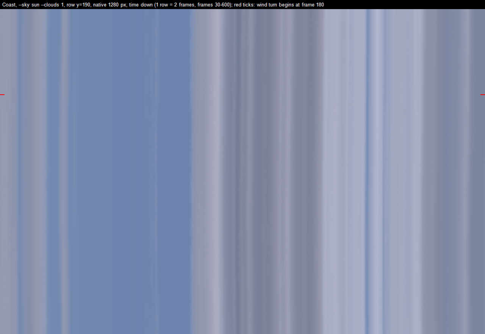

# 56 — Everything Bends, page 4: once a frame, and the clouds aloft

> **Reference support:** named prepared-exercise and native-regression commands
> in this lesson run from the [reference checkout](../BranchWorkflow.md#prepared-reference-exercises).
> The growing chapter implementation remains in your learning checkout.

**Chapter 56's pages:** [1. Section 1 — One front for the whole island](56-Everything-Bends.md) · [2. Section 2 — A tree bends from its foot](EverythingBendsATree.md) · [3. Part 2 — Every part attached, every view the same](EverythingBendsAttached.md) · **4. Parts 3 and 4 — Once a frame, and the clouds aloft**.

# Part 3 — Once a frame (section 6)

Sections 1 to 5 made the fronts a fact of the island's world wind
([section 1](56-Everything-Bends.md#1-a-front-is-a-fact-of-the-island)), bent every tree from its foot with its branches
and leaves attached ([section 2](EverythingBendsATree.md#2-a-tree-bends-from-its-foot) and
[section 3](EverythingBendsAttached.md#3-branches-and-leaves-that-stay-attached)), swayed the understory where it stands
([section 4](EverythingBendsAttached.md#4-the-understory-keyed-by-where-it-stands)), and had every shadow cascade call
the camera pass's function, so that each shadow follows its crown
([section 5](EverythingBendsAttached.md#5-shadows-that-follow-the-crown)). All of it runs per vertex, in every pass that
draws a plant. This part takes the trunk's lean out of the vertex stages. Part 4, sections 7 and 8, follows on this
page: the clouds on the same wind, then what the wind still does not do.

Your tree holds section 5's code, its checkpoint passed and the supplied test at stage 5. Two builds you kept are run
here: `..\SandboxGame-56-section5`, the timing loop's and the lean identity's "before" in section 6, and
`..\SandboxGame-before-56`, the build from before section 1, which section 7's Meshes capture runs. If you have tidied either away, rebuild it from the commit before that section.

**Prerequisites for this part**, beyond sections 1 to 5:

- [Chapter 19, section 3](19-Instancing-And-Indirect.md#3-the-instance-buffer) and
  [section 8](19-Instancing-And-Indirect.md#8-the-shadow-casters-batched-too): set 0 binding 2, written by the host
  each frame, and casters that keep their tree's matrix;
  [section 4](19-Instancing-And-Indirect.md#4-one-vertex-buffer-for-every-mesh)'s `memoryBarrier`.
- [Chapter 20, section 2](20-Compute-Fundamentals.md#2-the-compute-pipeline),
  [section 4](20-Compute-Fundamentals.md#4-storage-images) and
  [section 7](20-Compute-Fundamentals.md#7-compute-to-graphics): a compute pipeline, `createDescriptorSets`, and a
  compute write handed to a graphics stage.
- [Chapter 22, section 6](22-Deferred-Shading.md#6-the-lighting-pass): a compute set that reuses set 0's binding
  numbers.
- [Chapter 4, section 5](04-Commands-And-Synchronization.md#5-barriers-and-the-three-questions-they-answer) and its
  [appendix](04-Commands-And-Synchronization.md#appendix-barriers-the-later-chapters-add): the three questions, and
  the rows for Chapter 32's boat and for this chapter's lean pass.
- [Chapter 8, section 8](08-Resources-And-Descriptors.md#8-one-layout-two-languages): a scalar packed into a `vec4`'s
  `w`.
- [Chapter 36, section 8](36-Terrain-To-The-Horizon.md#8-the-heightmap-on-the-gpu): a barrier argued where sync
  validation cannot see.
- [Chapter 2, section 2](02-Instance-And-Device.md#2-catching-errors-during-instance-creation): the layer settings a
  control runs under.
- [Chapter 34, section 3](34-Debugging.md#3-renderdoc-finding-our-buffers) and
  [Chapter 37, section 9](37-Objects-At-A-Distance.md#9-what-each-pass-costs): a buffer found in RenderDoc by its set,
  binding and size; Horizon's pass timers.

## 6. The trunk once a frame

**This is `TrunkLeans`, a compute pass of Horizon's.** Four files are new.

### What the trunk costs per vertex

**Keep the section 5 build before you change anything.** This section's checkpoint runs it beside the new one, as
[Chapter 42, section 1](42-One-Wind.md#1-four-winds-in-one-frame) did:

```powershell
Copy-Item -Recurse .\Build\Artifacts\Release\SandboxGame ..\SandboxGame-56-section5
```

Time it with the plants' wind off and on, at the three views the reference timed. `--benchmark` writes one row per
frame after the warm-up, `gpu_render_ms` is the frame's GPU time, and `--present immediate` keeps the display's rate out
of it:

```powershell
foreach ($view in 'Forest floor', 'Wind wood', 'Wind edge')
{
    foreach ($plants in 0, 1)
    {
        $csv = "before-$view-$plants.csv"
        & ..\SandboxGame-56-section5\SandboxGame.exe --demo Horizon --horizon-view $view --plant-wind $plants `
            --msaa 4 --width 1920 --height 1080 --present immediate --fixed-dt 0.016666667 `
            --frames 600 --warmup 120 --benchmark $csv
        '{0}, plants {1}: {2:N3} ms' -f $view, $plants, (Import-Csv $csv | Measure-Object gpu_render_ms -Average).Average
    }
}
```

The reference did not time it with this loop. Its wind-off times come from one run of a scratch build of the finished
chapter that switched the wind off and on in windows of frames, in both orders, and its wind-on times from a section 5
build with the wind on throughout, each the mean of two repeats. Your loop's numbers and spread will differ, so compare
their shape. On the reference RTX 5090 (driver 621.01), at 1920 x 1080 with 4x MSAA, the plants' wind cost 0.594 ms at
**Forest floor**, 0.559 ms at **Wind wood** and 0.207 ms at **Wind edge**: the two views among the trees cost close to
three times the edge. The RTX 4060 Laptop has not been measured. Run a view live and open the **Horizon timings**
panel (in the Stats group): its **Shadows** line grows the most, because a tree near the camera is drawn by the camera
pass and again by each cascade it falls in.

Not all of that work need be done per vertex. Before the attempt, read the parameters of `plantTrunkLean` in
`PlantWindSource.h`, and what the branch's sway and the sprigs' flutter read (section 3): which of them say anything
about the vertex?

> **Jump:** every buffer this chapter has handed to a draw so far had one kind of writer: the host, between the slot's
> fence wait and the submit, or a pass of the device, inside the submission. A value the device works out once a frame,
> kept where every pass that draws the plant can read it, may give one buffer both kinds, with two frames in flight.
> Keep in mind that each pair of accesses to such a buffer needs its own ordering, the host's next write after the
> device's included.

<a id="ch56-lean-pass"></a>

### Attempt CH56-lean-pass: the trunk once a frame

Design the hand-over before you read it: where a plant's lean is kept, what writes it, what reads it, and what orders
the two. Predict first: an oak of N vertices stands near the camera, inside all four cascades. How many times a frame
does section 5's code work out its trunk's lean, and how many different values does it get? And if the shadow pass
were recorded before your new pass, what would the cascades read?

**Acceptance:** each tree's lean worked out once a frame, not once a vertex, and the same number read by the camera
pass and every cascade; section 5's picture within a handful of pixels; a rigid plant that moves nothing; Debug
validation quiet; and a check that says so when the order is wrong.

**Transfer:** the understory is placed by its own compute pass into a buffer of its own, compacted every frame
([Chapter 39, section 9](39-Plants.md#9-planted-by-the-gpu)). What would the same once-a-frame lean take there, and is
it worth it?

<details>
<summary>Hint 1: where one plant's number can live</summary>

Every draw already reads one record per instance, set 0 binding 2: 112 bytes, a `mat4` and a `mat3`. Count the bytes
`std430` gives the `mat3`, and the floats it uses.

</details>

<details>
<summary>Hint 2: who else writes that buffer</summary>

The host writes each slot in `PrepareDraws`, after the slot's fence wait, and writes it again two frames later. A
compute write between the two is a second writer. List every pair of accesses that must be ordered, and what orders
each.

</details>

<details>
<summary>Hint 3: where it goes</summary>

The lanes are named in `SharedShaderTypes.h` and filled by a free function in `SceneRenderer`. The pass is a class of
Horizon's, recorded in `HorizonDemo::Record` between `PrepareDraws` and `RecordShadows`. The twins' reads go in
`PlantWindSource.h`, `PlantWind.glsl` and the two shader bodies.

</details>

<details>
<summary>Worked solution: one lean a slot, written by a compute pass, read by every pass</summary>

**Answer to the prediction.** `plantTrunkLean` reads two layers of fronts at a plant's foot and runs the answer
through the plant's own spring. Its inputs are the foot, the plant's height, the frame block and the camera: nothing
about the vertex. The branch's sway and the sprigs' flutter do depend on the vertex (where it is in the crown, which
card it belongs to), so they stay in the vertex stages. Section 5's code works the lean out at least N times in the
camera pass (a GPU may shade an indexed vertex more than once) and as often again in each cascade the oak falls in, so
at least 5N times a frame; past 66 m its caster is the LOD2 stand-in, with fewer vertices. It gets one value: every
vertex of the oak, in every pass, has the same foot, height and frame. The pass below works it out once for each of the
oak's instance slots instead (a near oak has four: bark and leaves, in the camera list and in the casters'), each from
the same inputs.

If the shadow pass were recorded first, the cascades would read the 0 the host stored with the slot: shadows that
stand upright under leaning trees. The barrier does not help: it orders the pass's write before the reads recorded
after it, and the cascades' were recorded before. The check below names the mistake instead.

**Two lanes of a padded column.**

The two numbers fit in bytes the record already has. `std430` stores each of `normalMatrix`'s three columns in 16
bytes ([Chapter 19, section 3](19-Instancing-And-Indirect.md#3-the-instance-buffer)), so each column has a `w` that no
shader reads, and [Chapter 8, section 8](08-Resources-And-Descriptors.md#8-one-layout-two-languages)'s rule allows
packing a scalar there. Column 0's `w`, byte 76, holds the lean the pass writes. Column 1's `w`, byte 92, holds the
plant's height in the world, in metres (its plant-space wind height times the model's scale), written by the host with
the slot; 0 means rigid. Byte 108 stays free. A new `vec4` in `InstanceData` would cost 16 more bytes an instance in
every demo, for numbers one demo uses; a new binding in set 0 would change the layout every `SceneRenderer` demo
shares. A device-local buffer of leans in a set of Horizon's own would need no host half at all, but the shadow twin is
built against `ShadowMaps`' pipeline layout, which every demo shares, so reading such a set there would change that
layout instead.

The height moves into the slot because the pass has no draw runs, only slots: section 5 pushed the height per run and
multiplied it by the model's scale in the shader. Worked out once by the host, the stored height is the one number the
lean and the bend it scales both use, and a 0 lane moves nothing.

**`SharedShaderTypes.h`.** Name the lanes where both languages see them. Below `InstanceData`'s two asserts, the line
`static_assert(offsetof(InstanceData, normalMatrix) == 64, "InstanceData alignment drifted.");` and its `#endif`,
with a blank line before:

```c
/* Chapter 56 section 6: the two spare lanes of the normal matrix's padded columns, the w of column 0 and of column 1, which a
   plant's wind reads (BentInstances.glsl names them). Byte 76: the trunk's lean, written by the lean pass once a frame. Byte 92:
   the plant's wind height in metres, written with the slot by the host (0 means rigid). Byte 108 stays free. */
#define INSTANCE_LEAN_OFFSET        76
#define INSTANCE_WIND_HEIGHT_OFFSET 92

#ifdef __cplusplus
    static_assert(offsetof(InstanceData, normalMatrix) + sizeof(vec4) * 0 + 3 * sizeof(float) == INSTANCE_LEAN_OFFSET,
                  "the lean's lane drifted.");
    static_assert(offsetof(InstanceData, normalMatrix) + sizeof(vec4) * 1 + 3 * sizeof(float) == INSTANCE_WIND_HEIGHT_OFFSET,
                  "the wind height's lane drifted.");
#endif
```

**`SceneRenderer.h`.** One free function builds a slot, so `PrepareDraws` and the supplied test build it the same way.
It goes between `RendererResourceStatistics`' closing `};` and the comment that starts
`// The reusable half of every demo`, with a blank line on each side:

```cpp
// Chapter 56 section 6: one instance slot, built from an item's world matrix and its material's wind height (the x of
// SceneRenderer::MaterialWind, 0 for a material that registers none). Every lane is defined: normalMatrix[0].w, the trunk's lean,
// is 0 (the lean pass writes it); normalMatrix[1].w is the plant's wind height in metres, the material's height times the
// length of the model's y axis, and 0 means rigid. PrepareDraws and the supplied test call it, so a record depends on its two
// inputs alone: not on the item's place in a list, not on what the slot held before.
shared::InstanceData makeInstanceRecord(const glm::mat4& world, float materialWindHeight);
```

**`SceneRenderer.cpp`.** Directly below `namespace pf::vulkan_graphics {` and its blank line. The record is built whole
in a local and the caller stores it once, so a slot that held a tree last frame and holds a rock now has both lanes 0,
never a stale lean. `MaterialWind` gives 0 for a material that registers no wind, and the `> 0.0f` test turns a negative
or NaN height into a rigid slot too:

```cpp
// Chapter 56 section 6. Built in a local and stored once by the caller, so no slot is ever half-written.
shared::InstanceData makeInstanceRecord(const glm::mat4& world, float materialWindHeight)
{
    shared::InstanceData record{ .model = world, .normalMatrix = normalMatrix(world) };
    record.normalMatrix[0].w = 0.0f;   // the trunk's lean, byte 76: the lean pass writes it each frame
    record.normalMatrix[1].w = materialWindHeight > 0.0f ? materialWindHeight * glm::length(glm::vec3(world[1])) : 0.0f;   // byte 92
    return record;
}
```

In `PrepareDraws`, replace the line that starts `instances[instance] = shared::InstanceData{` with these three. `wind`
is now read for every item, not only for casters:

```cpp
            const glm::vec3 wind = MaterialWind(item.material);
            const shared::InstanceData record = makeInstanceRecord(item.world, wind.x);   // section 6: the lanes, built once
            instances[instance] = record;
```

A few lines below, inside the `ShadowCasters` block, delete the line
`const glm::vec3 wind = MaterialWind(item.material);`: the one above now serves both lists. The margin takes the stored
height, so a caster's bounds grow by the same height its twin bends with. Replace the line that starts
`const float margin = plant_wind::plantWindBound(wind.x` with:

```cpp
                    const float margin = plant_wind::plantWindBound(record.normalMatrix[1].w, wind.y,
```

**Binding 2, as a plant stage reads it.**

In GLSL a `mat3` member of a buffer has no reachable `w`. So the stages that bend a plant read the same 112 bytes as a
`mat4` and three `vec4` columns, declared once, in one include. The pass writes through it and every other includer
reads, so the access qualifier is a macro. A new file, `Shaders/Include/BentInstances.glsl`:

```glsl
// Shaders/Include/BentInstances.glsl - Chapter 56 section 6: the instance buffer (set 0 binding 2) as the plant stages see it.
// An include, not a stage. The block is declared here and nowhere else in a shader that bends a plant. A stage that writes the
// buffer (TrunkLean.comp.glsl) defines PF_BENT_INSTANCES_WRITE before including this file; every other includer reads it.
#ifndef PF_BENT_INSTANCES_GLSL
#define PF_BENT_INSTANCES_GLSL

#ifdef PF_BENT_INSTANCES_WRITE
    #define PF_BENT_ACCESS
#else
    #define PF_BENT_ACCESS readonly
#endif

// InstanceData's 112 bytes with the normal matrix's three columns as vec4s. The scalars live in the columns' w, Chapter 08's
// "use vec4 or pack a scalar into it": w of column 0 is the plant's trunk lean (byte 76, written by the lean pass once a frame),
// w of column 1 the plant's wind height in metres (byte 92, written by the host with the slot; 0 means rigid), and w of column 2
// is free (byte 108). SharedShaderTypes.h asserts the two offsets on the C++ side.
struct BentInstance
{
    mat4 model;
    vec4 normal0;
    vec4 normal1;
    vec4 normal2;
};

layout(std430, set = 0, binding = 2) PF_BENT_ACCESS buffer InstanceBuffer { BentInstance instances[]; };

mat3  bentNormalMatrix(BentInstance i) { return mat3(i.normal0.xyz, i.normal1.xyz, i.normal2.xyz); }
float bentTrunkLean(BentInstance i)    { return i.normal0.w; }
float bentWindHeight(BentInstance i)   { return i.normal1.w; }

#endif
```

The base shaders keep their `InstanceData` view. `std430` lays the two views out alike: a `mat3`'s columns are strided
16 bytes, at 64, 80 and 96, as three `vec4`s are. The asserts above pin only the C++ record's lanes to bytes 76 and 92;
nothing checks the GLSL struct against it (section 8 lists it).

**The pass.**

One invocation a slot, over every slot `PrepareDraws` wrote. It reads the slot's height and foot, calls the shared
header's `plantTrunkLean` with the frame's blocks, and writes column 0's `w`: the lean, or 0 for a rigid slot. There is
no copy of the answer anywhere else. A new file, `Shaders/Horizon/TrunkLean.comp.glsl`:

```glsl
// Shaders/Horizon/TrunkLean.comp.glsl - Chapter 56 section 6: the trunk's lean, once per instance slot, by a compute pass.
// One invocation a slot PrepareDraws wrote. The host stored each bending plant's wind height in its slot (column 1's w; 0 means
// rigid); this pass works the lean out by plantTrunkLean from the slot's foot and writes only column 0's w, byte 76. The camera
// pass and every shadow cascade read that one number.
#version 460
#extension GL_GOOGLE_include_directive : require

layout(local_size_x = 64) in;

#include "FrameBlock.glsl"         // set 0 binding 0: the frame block, as the vertex stages declare it
#define PF_BENT_INSTANCES_WRITE   // this pass writes set 0 binding 2
#include "BentInstances.glsl"
#include "PlantWind.glsl"         // plantTrunkLean, through PlantWindSource.h; it holds nothing a vertex stage alone could run

layout(push_constant) uniform LeanPush
{
    uint count;   // the slots PrepareDraws wrote this frame
};

void main()
{
    const uint slot = gl_GlobalInvocationID.x;
    if (slot >= count) { return; }
    const float height = bentWindHeight(instances[slot]);
    float lean = 0.0;
    if (height > 0.0)
    {
        lean = plantTrunkLean(instances[slot].model[3].xyz, height, frame.cameraPosition.xyz, frame.windDirection, frame.windGust,
                              frame.windFronts, frame.plantWind);
    }
    instances[slot].normal0.w = lean;
}
```

The frame block is declared by `FrameBlock.glsl` at set 0 binding 0 and the instances by `BentInstances.glsl` at set 0
binding 2, the numbers every stage uses. Could the pass bind set 0 itself? Not as set 0 stands: a layout names, per
binding, the stages that may read it, and set 0's binding 0 names vertex and fragment, binding 2 vertex only. Binding 3,
the shadow data, already names compute, and the grass's compute pass binds set 0 to read it; so adding compute to
bindings 0 and 2 would work, as [Chapter 42, section 1](42-One-Wind.md#1-four-winds-in-one-frame)'s transfer answer
says of binding 0. It would also change the layout every `SceneRenderer` pipeline in every demo is built against, for
one demo's pass, which is the reason [Chapter 22, section 6](22-Deferred-Shading.md#6-the-lighting-pass) gives its
lighting pass a set of its own. This pass makes Chapter 22's choice: a set of its own that reuses set 0's numbers, one
per frame in flight, made by `createDescriptorSets`
([Chapter 20, section 4](20-Compute-Fundamentals.md#4-storage-images)).

The class lives in Horizon, the one demo that bends plants. `Initialize` makes the set, a push range for the count and
the pipeline; `Shutdown` is safe after a partial `Initialize`; `Record` dispatches `groupCount(count, 64)` groups, the
shader's `local_size_x`, then records the barrier. A new file, `Source/PillowFort/Demos/Horizon/TrunkLeans.h`:

```cpp
///========================================================
/// @author Gary Yang
/// @brief  Chapter 56 section 6: the trunk's lean, worked out once per instance slot by a compute pass
/// @copyright (C) Gary 2026
///========================================================

// Source/PillowFort/Demos/Horizon/TrunkLeans.h
#pragma once

#include "PillowFort/ErrorReporting/InitializationResult.h"
#include "PillowFort/VulkanGraphics/VulkanResources.h"

#include <vulkan/vulkan.h>

#include <array>
#include <cstdint>

namespace pf::demos::horizon {

// One dispatch a frame over the instance slots PrepareDraws wrote, before the first shadow cascade. It reads each slot's wind
// height (the host's) and writes the slot's trunk lean in place; the camera pass and every cascade read that one number. Its
// set reuses set 0's binding numbers (0 the frame block, 2 the instance buffer), as the deferred lighting pass's does
// (Chapter 22 section 6), one set per frame in flight.
class TrunkLeans
{
public:
    TrunkLeans() = default;
    TrunkLeans(const TrunkLeans&) = delete;
    TrunkLeans& operator=(const TrunkLeans&) = delete;

    [[nodiscard]] InitializationResult Initialize(const vulkan_graphics::VulkanContext& context, VkPipelineCache pipelineCache);
    void Shutdown();

    // In Record, after PrepareDraws and after this slot's fence wait, outside any rendering scope. Records nothing when
    // `count` is 0. Both descriptors are written every time: PrepareDraws can replace the instance buffer, and a destroyed
    // buffer's handle value can come back, so no comparison of handles is trusted.
    void Record(VkCommandBuffer commandBuffer, uint32_t frameIndex, VkBuffer frameBuffer, VkBuffer instanceBuffer, uint32_t count);

private:
    vulkan_graphics::VulkanContext                                 m_context;
    VkDescriptorSetLayout                                          m_setLayout = VK_NULL_HANDLE;
    VkDescriptorPool                                               m_pool      = VK_NULL_HANDLE;
    std::array<VkDescriptorSet, vulkan_graphics::FRAMES_IN_FLIGHT> m_sets{};
    VkPipelineLayout                                               m_layout   = VK_NULL_HANDLE;
    VkPipeline                                                     m_pipeline = VK_NULL_HANDLE;
};

} // namespace pf::demos::horizon
```

`Record` writes both descriptors every frame, after the slot's fence wait, when no submitted work can be using the
set. Comparing handles to skip the write is not safe: `PrepareDraws` can replace the instance buffer when it grows
(`EnsureFrameCapacity`), and a destroyed buffer's handle value can come back for the new one. A new file,
`Source/PillowFort/Demos/Horizon/TrunkLeans.cpp`:

```cpp
///========================================================
/// @author Gary Yang
/// @brief  Chapter 56 section 6: the trunk's lean, worked out once per instance slot by a compute pass
/// @copyright (C) Gary 2026
///========================================================

// Source/PillowFort/Demos/Horizon/TrunkLeans.cpp
#include "PillowFort/Demos/Horizon/TrunkLeans.h"

#include "PillowFort/VulkanGraphics/GraphicsPipeline.h"
#include "PillowFort/VulkanGraphics/VulkanBarriers.h"

namespace pf::demos::horizon {

using namespace pf::vulkan_graphics;

namespace {

// TrunkLean.comp.glsl's push block.
struct LeanPush
{
    uint32_t count;
};

} // namespace

InitializationResult TrunkLeans::Initialize(const VulkanContext& context, VkPipelineCache pipelineCache)
{
    m_context = context;

    // Set 0's numbers: 0 the frame block, 2 the instance buffer, both for compute.
    const VkShaderStageFlags compute = VK_SHADER_STAGE_COMPUTE_BIT;
    const VkDescriptorSetLayoutBinding bindings[] = {
        { .binding = 0, .descriptorType = VK_DESCRIPTOR_TYPE_UNIFORM_BUFFER, .descriptorCount = 1, .stageFlags = compute },
        { .binding = 2, .descriptorType = VK_DESCRIPTOR_TYPE_STORAGE_BUFFER, .descriptorCount = 1, .stageFlags = compute },
    };
    if (!createDescriptorSets(m_context, bindings, m_setLayout, m_pool, m_sets))
    {
        return InitializationResult::failure("Creating the trunk lean set failed.");
    }

    const VkPushConstantRange pushRange{ .stageFlags = compute, .offset = 0, .size = sizeof(LeanPush) };
    const VkPipelineLayoutCreateInfo layoutInfo{
        .sType                  = VK_STRUCTURE_TYPE_PIPELINE_LAYOUT_CREATE_INFO,
        .setLayoutCount         = 1,
        .pSetLayouts            = &m_setLayout,
        .pushConstantRangeCount = 1,
        .pPushConstantRanges    = &pushRange,
    };
    if (vkCreatePipelineLayout(m_context.device, &layoutInfo, nullptr, &m_layout) != VK_SUCCESS)
    {
        return InitializationResult::failure("vkCreatePipelineLayout failed for the trunk lean pass.");
    }
    m_pipeline = createComputePipeline(m_context.device, pipelineCache, "Horizon/TrunkLean.comp.spv", m_layout);
    if (m_pipeline == VK_NULL_HANDLE)
    {
        return InitializationResult::failure("Creating the trunk lean pipeline failed.");
    }
    return InitializationResult::success();
}

void TrunkLeans::Shutdown()
{
    if (m_context.device == VK_NULL_HANDLE) { return; }   // Initialize never ran
    vkDestroyPipeline(m_context.device, m_pipeline, nullptr);
    vkDestroyPipelineLayout(m_context.device, m_layout, nullptr);
    vkDestroyDescriptorPool(m_context.device, m_pool, nullptr);   // frees the sets with it
    vkDestroyDescriptorSetLayout(m_context.device, m_setLayout, nullptr);
    m_pipeline  = VK_NULL_HANDLE;
    m_layout    = VK_NULL_HANDLE;
    m_pool      = VK_NULL_HANDLE;
    m_setLayout = VK_NULL_HANDLE;
    m_sets      = {};
    m_context   = {};
}

void TrunkLeans::Record(VkCommandBuffer commandBuffer, uint32_t frameIndex, VkBuffer frameBuffer, VkBuffer instanceBuffer,
                        uint32_t count)
{
    if (count == 0 || m_pipeline == VK_NULL_HANDLE || frameIndex >= FRAMES_IN_FLIGHT) { return; }

    // This slot's fence was waited (Record runs after it), so no submitted work uses its set: rewriting it is allowed.
    const VkDescriptorBufferInfo frameInfo{ .buffer = frameBuffer, .offset = 0, .range = VK_WHOLE_SIZE };
    const VkDescriptorBufferInfo instanceInfo{ .buffer = instanceBuffer, .offset = 0, .range = VK_WHOLE_SIZE };
    const VkWriteDescriptorSet writes[] = {
        { .sType = VK_STRUCTURE_TYPE_WRITE_DESCRIPTOR_SET, .dstSet = m_sets[frameIndex], .dstBinding = 0,
          .descriptorCount = 1, .descriptorType = VK_DESCRIPTOR_TYPE_UNIFORM_BUFFER, .pBufferInfo = &frameInfo },
        { .sType = VK_STRUCTURE_TYPE_WRITE_DESCRIPTOR_SET, .dstSet = m_sets[frameIndex], .dstBinding = 2,
          .descriptorCount = 1, .descriptorType = VK_DESCRIPTOR_TYPE_STORAGE_BUFFER, .pBufferInfo = &instanceInfo },
    };
    vkUpdateDescriptorSets(m_context.device, 2, writes, 0, nullptr);

    vkCmdBindPipeline(commandBuffer, VK_PIPELINE_BIND_POINT_COMPUTE, m_pipeline);
    vkCmdBindDescriptorSets(commandBuffer, VK_PIPELINE_BIND_POINT_COMPUTE, m_layout, 0, 1, &m_sets[frameIndex], 0, nullptr);
    const LeanPush push{ .count = count };
    vkCmdPushConstants(commandBuffer, m_layout, VK_SHADER_STAGE_COMPUTE_BIT, 0, sizeof(push), &push);
    vkCmdDispatch(commandBuffer, groupCount(count, 64), 1, 1);

    // The pass's storage writes before the camera pass's and every cascade's vertex read (Chapter 04's appendix row for Chapter
    // 32's boat, with the host in place of the copy): the host half is a write after a write, and the slot's fence wait is what
    // orders the host's next write to this slot, two frames on. The barrier's HOST_WRITE destination only adds the
    // device-to-host domain operation; HOST_READ is not named because the host never reads the lanes.
    vulkan_graphics::memoryBarrier(commandBuffer, VK_PIPELINE_STAGE_2_COMPUTE_SHADER_BIT, VK_ACCESS_2_SHADER_STORAGE_WRITE_BIT,
                                   VK_PIPELINE_STAGE_2_VERTEX_SHADER_BIT | VK_PIPELINE_STAGE_2_HOST_BIT,
                                   VK_ACCESS_2_SHADER_STORAGE_READ_BIT | VK_ACCESS_2_HOST_WRITE_BIT);
}

} // namespace pf::demos::horizon
```

**One barrier, and its host half.**

Three orderings keep a slot's lanes right. The host's write of the slot comes before the pass: the submission orders
it, since a queue submission makes the host's earlier writes to mapped memory available to the device (the
specification's host write ordering guarantee), which is why the host's per-frame writes of set 0 have never needed a
barrier. The pass comes before the camera pass and every cascade: one barrier. And the pass comes before the host's
next write to the same slot, two frames later: the slot's fence wait, with the barrier's host half (below).

Ask [Chapter 4](04-Commands-And-Synchronization.md#5-barriers-and-the-three-questions-they-answer)'s questions of
the pass's write. What must finish first: the compute shader, whose storage writes must be made available. What must
wait: the vertex shaders of the camera pass and every cascade, to which they must be visible as storage reads. It is a
buffer, so there is no layout. That is the
[appendix](04-Commands-And-Synchronization.md#appendix-barriers-the-later-chapters-add)'s row for 56's lean pass:
Chapter 32's boat's row, `COMPUTE_SHADER` / `SHADER_STORAGE_WRITE` to `VERTEX_SHADER | COPY` /
`SHADER_STORAGE_READ | TRANSFER_READ`, with the host in place of the copy.

The host half is for the host's next write to the same slot, two frames later: a write after a write. The slot's fence
wait orders it after the pass, but a fence's access scope "only includes device access": "Signaling a fence and waiting
on the host does not guarantee that the results of memory accesses will be visible to the host." The device's write
must first be made available in the host's domain, and only a destination access of `HOST_READ` or `HOST_WRITE` adds
that memory domain operation, from the device's domain to the host's. The host writes and does not read, so
`HOST_WRITE` is named and nothing needs invalidating.

Sync validation can check the vertex half. Debug builds run under
[Chapter 2](02-Instance-And-Device.md#2-catching-errors-during-instance-creation)'s layer settings, with sync
validation on. In the barrier, change `VK_PIPELINE_STAGE_2_VERTEX_SHADER_BIT` to
`VK_PIPELINE_STAGE_2_FRAGMENT_SHADER_BIT`, keeping the host half, and a Debug run at **Wind edge** reports the hazard
the barrier prevents:

```text
[ERROR] Vulkan [SYNC-HAZARD-READ-AFTER-WRITE]: vkCmdDrawIndexedIndirect(): READ_AFTER_WRITE hazard detected. Shader stage VK_SHADER_STAGE_VERTEX_BIT reads VkBuffer 0x5f800000005f8, which was previously written by vkCmdDispatch.
The buffer is referenced by descriptor binding 2 (VK_DESCRIPTOR_TYPE_STORAGE_BUFFER) from descriptor set 0 (VkDescriptorSet 0x770000000077), VkPipeline 0x1400000000140.
```

The reference's run printed it 10 times; 10 is the layer's cap on repeats of one message, not a count of hazards. Put
the line back. The host half has no control: the layer records no host access, so a weakened host half is silent. It
rests on the argument above, as
[Chapter 36, section 8](36-Terrain-To-The-Horizon.md#8-the-heightmap-on-the-gpu)'s host-fence barrier does.

**The order, checked where the lane is read.**

The barrier orders the pass's write before the reads recorded after it. It cannot see a pass recorded in the wrong
place: a shadow pass recorded first simply reads the host's 0. So the order is checked where the lane is read.
`PrepareDraws` clears a per-slot mark, the demo sets it after recording the pass, and binding a tree's wind twin while
it is clear is reported once, by name. It is a programmer's mistake, not a data error, so a Debug build asserts and
Release logs and goes on.

**`SceneRenderer.h`.** Below the line that starts `void SetMaterialWindFrame(`. The pass needs the slot's two buffers
and its count, which `SceneRenderer` owns:

```cpp
    // Chapter 56 section 6: what the lean pass needs, and the order it keeps. After PrepareDraws, the slot's instance buffer and its
    // frame block, and how many instances were written; the demo records the pass, then calls MarkLeaned. PrepareDraws clears the
    // mark. A wind twin bound while the mark is clear would read lanes the pass has not written: RequireLeaned says so, once.
    VkBuffer InstanceBuffer(uint32_t frameIndex) const { return m_frameDraws[frameIndex].instances.buffer; }
    VkBuffer FrameBuffer(uint32_t frameIndex) const    { return m_frameBuffers[frameIndex].buffer; }
    uint32_t InstanceCount(uint32_t frameIndex) const  { return m_frameDraws[frameIndex].uploadedInstances; }
    void     MarkLeaned(uint32_t frameIndex)           { m_frameDraws[frameIndex].leaned = true; }
    void     RequireLeaned(uint32_t frameIndex, const char* where) const;
```

Below the member `MaterialWindFrame              m_windFrame;`:

```cpp
    mutable bool                   m_leanOrderReported = false;  // section 6: RequireLeaned says it once
```

And in `FrameDraws`, below `std::vector<DrawRun>                                 shadowRuns;`:

```cpp
        bool                                                leaned = false;   // section 6: the lean pass was recorded for this slot
```

**`SceneRenderer.cpp`.** `#include <cassert>` goes below `#include <algorithm>`:

```cpp
#include <cassert>
```

`RequireLeaned` goes below `makeInstanceRecord`, with a blank line between:

```cpp
void SceneRenderer::RequireLeaned(uint32_t frameIndex, const char* where) const
{
    if (m_frameDraws[frameIndex].leaned || m_leanOrderReported) { return; }
    m_leanOrderReported = true;
    Log::error(std::format("Chapter 56 section 6: {} binds a wind twin before the lean pass wrote this frame's instance lanes; every tree would stand upright. Record TrunkLeans after PrepareDraws and before the shadow pass.", where).c_str());
#ifdef PF_DEBUG
    assert(false && "the lean pass must be recorded before a wind twin is bound");   // a programmer's mistake, so Debug asserts; Release logs and goes on
#endif
}
```

In `PrepareDraws`, below `frame.uploadedShadowCommands = 0;` (the one under `frame.uploadedInstances = 0;`):

```cpp
    frame.leaned = false;   // section 6: this frame's lanes are the host's until the lean pass writes them
```

In `Shutdown`, below `m_windFrame = {};`, so a new `Initialize` may report again:

```cpp
    m_leanOrderReported = false;  // Chapter 56 section 6: the order check may report again after a new Initialize
```

In `RecordShadows`, the caster's push stops carrying the height, which the twin now reads from the slot, and a
bending run checks the order. Replace the five lines of `const shared::ShadowDrawData push{ ... };` with:

```cpp
            const shared::ShadowDrawData push{
                .cascade         = cascade,
                .padding0        = 0,   // the height is the instance's lane (section 6)
                .windBendBits    = std::bit_cast<uint32_t>(bends && !m_windFrame.stillShadows ? wind.y : 0.0f),
                .windFlutterBits = std::bit_cast<uint32_t>(bends ? wind.z : 0.0f) };
            if (bends) { RequireLeaned(frameIndex, "the shadow pass"); }   // section 6: the twin reads the lean pass's lane
```

**`SharedShaderTypes.h`.** `ShadowDrawData`'s height word has no reader now and goes back to padding, still a `uint`,
for the reason its comment gives. Replace its four lines, from `uint windHeightBits;` down to the line that ends
`when a struct member is named a float */`, with:

```c
    uint padding0;                      /*  4  free: Chapter 56 section 5 carried the run's plant height here as a float's bits; section 6
                                              reads it from the instance's lane instead, and the host writes 0. A word of the type the base
                                              had (uint), so no base shader's code changes (Release byte for byte; Debug once its
                                              names are stripped) */
```

**Horizon records it.**

**`HorizonDemo.h`.** The include goes below `#include "PillowFort/Demos/Horizon/Terrain.h"`:

```cpp
#include "PillowFort/Demos/Horizon/TrunkLeans.h"
```

and the member below `Understory m_understory;`:

```cpp
    TrunkLeans m_trunkLeans;   // Chapter 56 section 6: the trees' lean, once a frame
```

**`HorizonDemo.cpp`.** In `Setup`, above the comment that starts `// Chapter 37 section 9: timestamps a frame`, with a
blank line after:

```cpp
    // Chapter 56 section 6: the lean pass: one dispatch a frame while "Plants in the wind" is on.
    if (auto result = m_trunkLeans.Initialize(m_context.vulkan, m_context.pipelineCache); !result) { return result; }
```

In `Teardown`, below `m_targets={};`:

```cpp
    m_trunkLeans.Shutdown();                                                     // Chapter 56 section 6
```

In `Record`, the pass goes after `PrepareDraws`, which wrote the slot, and before `RecordShadows`, whose cascades read
it: between `m_timestamps.Write(commandBuffer, frame.frameIndex, 0);` and the comment that starts
`// Chapter 37 section 8: the props' shadows`, with a blank line on each side. With the plants' switch off nothing is
recorded, and no twin is bound to read a lane:

```cpp
    // Chapter 56 section 6: every tree's trunk once, into the lanes PrepareDraws left: after it, and before the first cascade,
    // which reads them. Recorded only while the plants are in the wind; the shadow pass's and BindLeafRun's check names the order.
    if (m_plantWindOn)
    {
        m_trunkLeans.Record(commandBuffer, frame.frameIndex, m_sceneRenderer.FrameBuffer(frame.frameIndex),
                            m_sceneRenderer.InstanceBuffer(frame.frameIndex), m_sceneRenderer.InstanceCount(frame.frameIndex));
        m_sceneRenderer.MarkLeaned(frame.frameIndex);
    }
```

The pass sits between the frame's first two timestamps, so the first timer now holds it beside the shadows. In
`DrawStatsControls`, replace the line `ImGui::TextWrapped("Shadows %.3f ms", m_rawTimings[0]);` with:

```cpp
        ImGui::TextWrapped("Shadows and lean pass %.3f ms", m_rawTimings[0]);
```

In `BindLeafRun`, below `const bool      wind        = windNumbers.x > 0.0f && windNumbers.y > 0.0f;`. The understory's
twin works its trunk out itself, so only a tree's is checked:

```cpp
    // Section 6: a tree's twin reads the lean pass's lane; the understory's works its trunk out itself.
    if (wind && !understory) { m_sceneRenderer.RequireLeaned(frameIndex, "the leaf pass"); }
```

**The twins read the lanes.**

The shared header gains the trees' way in. A lean can be any float, negative after a push, so no value of it can mean
"not stored": a `bool` says which. `plantWindPoint` stays, as the case that works the lean out per vertex, for the
understory.

**`PlantWindSource.h`.** In the banner, the `@brief` line becomes:

```cpp
/// @brief  Chapter 56 sections 2-4 and 6: a plant's trunk answer to the world wind's fronts, the root-pinned bend it drives, and
```

Replace the three lines of `plantWindPoint`'s signature, from `PF_PLANT_FUNCTION vec3 plantWindPoint(` down to
`PlantWind plant, PF_PLANT_OUT s, PF_PLANT_OUT tipMetres)`, with the comment and signature of `plantWindPointLean`:

```cpp
// Section 6: the trunk's lean is either worked out here, from the fronts (`leanStored` false: the understory's way, per vertex),
// or read, `storedLean` being what plantTrunkLean gave for this plant's foot and height, which the lean pass wrote into its
// instance slot once for the camera pass and every cascade (`leanStored` true: the trees').
PF_PLANT_FUNCTION vec3 plantWindPointLean(vec3 world, vec3 foot, float height, float bend, float flutter, float uvY,
                                          float cardPhase, float time, vec3 camera, vec4 windDirection, vec4 windGust,
                                          WindFronts fronts, PlantWind plant, bool leanStored, float storedLean,
                                          PF_PLANT_OUT s, PF_PLANT_OUT tipMetres)
```

In its body, replace the line that starts `tipMetres = height * bend * plantTrunkLean(` with:

```cpp
    const float lean           = leanStored ? storedLean : plantTrunkLean(foot, height, camera, windDirection, windGust, fronts, plant);
    tipMetres = height * bend * lean;
```

Below the function's closing brace, and above `// Section 4: the cull margin.`, with a blank line on each side, the
old name comes back as the per-vertex case:

```cpp
// The lean worked out here, per vertex: plantWindPointLean with `leanStored` false.
PF_PLANT_FUNCTION vec3 plantWindPoint(vec3 world, vec3 foot, float height, float bend, float flutter, float uvY, float cardPhase,
                                      float time, vec3 camera, vec4 windDirection, vec4 windGust, WindFronts fronts,
                                      PlantWind plant, PF_PLANT_OUT s, PF_PLANT_OUT tipMetres)
{
    return plantWindPointLean(world, foot, height, bend, flutter, uvY, cardPhase, time, camera, windDirection, windGust, fronts,
                              plant, false, 0.0f, s, tipMetres);
}
```

**`PlantWind.glsl`.** `plantWind`'s twin for a stored lean, below `plantWind`'s closing brace and above `#endif`, with a
blank line on each side:

```glsl
// Section 6: plantWind for a plant whose trunk's lean was worked out once for it (TrunkLean.comp.glsl wrote it into the plant's
// instance slot) and is read here as `lean`; every other number is plantWind's. A rigid plant has height 0 and gives `world`.
vec3 plantWindLean(vec3 world, inout vec3 normal, vec3 foot, float height, float bend, float flutter, float uvY, float cardPhase,
                   float lean)
{
    if (!plantWindActive(foot, height, bend, frame.cameraPosition.xyz, frame.windGust, frame.plantWind))
    {
        return world;
    }
    float s;
    float tipMetres;
    vec3  moved = plantWindPointLean(world, foot, height, bend, flutter, uvY, cardPhase, frame.time, frame.cameraPosition.xyz,
                                     frame.windDirection, frame.windGust, frame.windFronts, frame.plantWind, true, lean, s, tipMetres);
    normal      = bendNormal(normal, frame.windDirection.xy, height, tipMetres, s);
    return moved;
}
```

**`LeafBody.glsl`.** The wind twin reads the record through `BentInstances.glsl` and takes the height and the lean
from the slot; the base text, under `#else`, is Chapter 39's. Replace everything from the line that starts
`// Set 0 binding 2: every instance PrepareDraws wrote` to the end of the file with:

```glsl
// Set 0 binding 2: every instance PrepareDraws wrote this frame (Chapter 19 section 3).
#ifdef PF_PLANT_WIND
// Chapter 56 section 6: the same buffer as BentInstance, whose two w lanes carry the plant's wind height (the host's) and its
// trunk's lean (the lean pass's, once a frame).
#include "BentInstances.glsl"
#else
layout(std430, set = 0, binding = 2) readonly buffer InstanceBuffer { InstanceData instances[]; };
#endif

void main()
{
#ifdef PF_PLANT_WIND
    BentInstance instance = instances[gl_InstanceIndex];
    vec4 world    = instance.model * vec4(inPosition, 1.0);
    vec3 normal   = bentNormalMatrix(instance) * inNormal;
    // The plant's height in the world (its plant-space height times its own scale) and its trunk's lean, both from its slot:
    // one value for the camera pass and every cascade, and a rigid plant's lane is 0.
    world.xyz = plantWindLean(world.xyz, normal, instance.model[3].xyz, bentWindHeight(instance),
                              uintBitsToFloat(draw.windBendBits), uintBitsToFloat(draw.windFlutterBits), inUv.y, plantCardPhase(uint(gl_VertexIndex), inUv.x, instance.model[3].xyz), bentTrunkLean(instance));
#else
    InstanceData instance = instances[gl_InstanceIndex];
    vec4 world    = instance.model * vec4(inPosition, 1.0);
#endif
    worldPosition = world.xyz;
#ifdef PF_PLANT_WIND
    worldNormal   = normal;
#else
    worldNormal   = instance.normalMatrix * inNormal;
#endif
    uv            = inUv;
    plantBase     = instance.model[3].xz;
    coverageVertex = uint(gl_VertexIndex);
    gl_Position   = frame.viewProjection * world;
}
```

**`ShadowDepthBody.glsl`.** The same for the caster. Replace the line that starts
`layout(std430, set = 0, binding = 2) readonly buffer` with these five:

```glsl
#ifdef PF_PLANT_WIND
#include "BentInstances.glsl"   // Chapter 56 section 6: set 0 binding 2 as BentInstance: the plant's height and lean are its lanes
#else
layout(std430, set = 0, binding = 2) readonly buffer InstanceBuffer { InstanceData instances[]; };
#endif
```

and `main()` whole with:

```glsl
void main()
{
#ifdef PF_PLANT_WIND
    // The camera pass's own function, from the same frame, the same foot and the same slot lanes: a caster keeps its tree's matrix
    // (Chapter 19 section 8), so its wind height and its trunk's lean, which the lean pass wrote once, are its tree's and the
    // shadow bends as the tree does. The flutter needs no normal (section 3), so the unused one below is only the function's argument.
    BentInstance instance = instances[gl_InstanceIndex];
    vec4 world  = instance.model * vec4(position, 1.0);
    vec3 unused = vec3(0.0, 1.0, 0.0);
    world.xyz = plantWindLean(world.xyz, unused, instance.model[3].xyz, bentWindHeight(instance),
                              uintBitsToFloat(draw.windBendBits), uintBitsToFloat(draw.windFlutterBits), uv.y,
                              plantCardPhase(uint(gl_VertexIndex), uv.x, instance.model[3].xyz), bentTrunkLean(instance));
    gl_Position = shadowData.cascadeViewProjection[draw.cascade] * world;
#else
    gl_Position = shadowData.cascadeViewProjection[draw.cascade]
                * instances[gl_InstanceIndex].model * vec4(position, 1.0);
#endif
    outUv       = uv;
}
```

**`HorizonTypes.h`.** `FlatDraw`'s height word now has one reader, the understory's twin. Replace its four lines, from
`uint windHeightBits;` down to the line that ends `Debug once its names are stripped) */`, with:

```c
    uint windHeightBits;    /* 36  Chapter 56 section 2: the run's plant height in plant space, metres, as float bits (read with
                                  uintBitsToFloat); 0 is rigid. Section 6: only UnderstoryWind.vert reads it; the trees'
                                  twins read the height from the instance lane. These three words stay uint, as ShadowDrawData's
                                  do, so no base shader's code changes (Release byte for byte; Debug once its names are
                                  stripped) */
```

The understory keeps its per-vertex trunk: `UnderstoryBody.glsl` still calls `plantWind`, and its push still carries
the height. Its whole wind cost is small: in the reference's runs on the RTX 5090 its **Understory draw** timer moved
by at most about 0.03 ms between the wind off and on, less than a pass and a second reader of its buffer would be
worth.

**Answer to the transfer.** A variant of the understory's generate pass that writes the lean beside each plant it
places, and a second reader of its output; for the cost just given, the understory keeps its per-vertex trunk.

</details>

### Checkpoint

Raise the supplied test's stage. In `Tests/TutorialHarness/PlantWindTests.cpp`:

```cpp
#define PF_TEST_STAGE 6   // raised in each section of Chapter 56
```

Stage 6 checks the record through `makeInstanceRecord` itself: 112 bytes, the lanes at 76 and 92, the lean 0, the
height the material's times the model's y-axis length, the model stored whole, byte 108 at 0 and the normal matrix
unchanged beside the lanes. For 50 plants, a bark's, a leaf's and a caster's record built from one world matrix, with
the heights `speciesWindHeight` gives (the oak's stand-in box is 10.83 m tall against the species' 12.13 m), carry the
same foot and the same height bits. A rock stored over a plant's slot has both lanes 0, and a negative, NaN or
unregistered height gives a rigid slot. The reference's `MirrorBatchTests.cpp` adds one case beside it: a tree's bark,
leaf and stand-in run through the real `PrepareDraws` carry one height in all six slots, and the casters' bounds are the
rest box grown by `plantWindBound`.

Four files are new: regenerate (`GenerateProjects.bat`), then build the game in Release and the tests in Debug, as
section 1 does, and run the supplied test and `TutorialMirrorBatchTests`, which compiles `SceneRenderer.cpp` into
itself:

```powershell
.\GenerateProjects.bat --tutorial-tests
if ($LASTEXITCODE -ne 0) { throw 'Project generation failed.' }
& 'C:\Program Files\Microsoft Visual Studio\2022\Community\MSBuild\Current\Bin\MSBuild.exe' .\Build\Projects\PillowFort.sln /m /p:Configuration=Release /p:Platform=x64 /t:SandboxGame
if ($LASTEXITCODE -ne 0) { throw 'The game build failed.' }
& 'C:\Program Files\Microsoft Visual Studio\2022\Community\MSBuild\Current\Bin\MSBuild.exe' .\Build\Projects\PillowFort.sln /m:1 /nr:false /p:CL_MPCount=1 /p:UseMultiToolTask=true /p:MultiProcMaxCount=1 /p:EnforceProcessCountAcrossBuilds=true /p:Configuration=Debug /p:Platform=x64 /t:TutorialPlantWindTests,TutorialMirrorBatchTests
if ($LASTEXITCODE -ne 0) { throw 'The acceptance test build failed.' }
foreach ($target in 'TutorialPlantWindTests', 'TutorialMirrorBatchTests')
{
    & ".\Build\Artifacts\Debug\$target\$target.exe"
    if ($LASTEXITCODE -ne 0) { throw "$target failed." }
}
```

The supplied test ends `PASS: plant wind, stage 6 (85 checks)`; `TutorialMirrorBatchTests`' last line starts
`PASS: camera admission`. A positive control: in `stage6`, build the caster's record from the stand-in's own box,
`makeInstanceRecord(world, 10.83f)` in place of `makeInstanceRecord(world, heightOf(3u))`, and the check that says
`a plant's bark, leaf and caster records carry the same foot and the same height bits` prints `FAIL:`. Put it back.

**1. The motion is section 5's.** Capture **Wind edge** at a fixed clock with the section 5 build and the new one, and
count the pixels that differ with Chapter 42's `ImageArtifacts.ps1`:

```powershell
foreach ($run in @(@('..\SandboxGame-56-section5\SandboxGame.exe', 'lean-before'),
                   @('.\Build\Artifacts\Release\SandboxGame\SandboxGame.exe', 'lean-after')))
{
    & $run[0] --demo Horizon --horizon-view "Wind edge" --msaa 4 --width 1280 --height 720 --fixed-dt 0.016666667 `
        --frames 120 --sequence $run[1] --sequence-first 30 --sequence-last 120 --sequence-every 30
}
. .\Tests\TutorialHarness\ImageArtifacts.ps1
foreach ($n in 30, 60, 90, 120)
{
    $name = 'frame-{0:D6}.bmp' -f $n
    [TutorialImageDiff]::Compare("$PWD\lean-before\$name", "$PWD\lean-after\$name", 1).ChangedPixels
}
```

Expect a handful of pixels, not equal bytes. On the reference RTX 5090 frames 30, 60, 90 and 120 differed in 6, 6, 5
and 10 of 921,600 pixels, each with no differing neighbour. The two builds compute the same function, but two of its
numbers now come from elsewhere: the height from the CPU's `glm::length` instead of the vertex shader's `length`, and
the lean from a compute shader, which the compiler may round differently. A last-bit difference in either is the likely
cause, not a measured one. A lane read wrong is not subtle: the trunks stop (section 8's controls).

**2. Both of a tree's slots hold one lean.** The reference checked this with a readback of the instance buffer: 0 of
879 plants differed between their slots (222 of them had both a camera and a caster slot), and with a planted lean
keyed on the invocation index instead of the foot, all 879 did. That readback is the evidence. If you want to look for
yourself, RenderDoc can show the same buffer; the reference did not try this route. Capture a frame at **Wind edge**,
select a draw of the shadow pass after the dispatch that binds the wind twin (`ShadowDepthWind.vert`), and open the
vertex stage's binding 2 of set 0, as [Chapter 34, section 3](34-Debugging.md#3-renderdoc-finding-our-buffers) finds a
buffer. With the shader's `BentInstance` struct, one row a slot, the camera list's slots come first, then the
casters'. A tree near the camera has rows in both lists with the same `model` matrix; their `normal0.w` should be the
same float, and so should their `normal1.w`.

**3. The cost.** Run the timing loop from the start of this section again, with
`.\Build\Artifacts\Release\SandboxGame\SandboxGame.exe` in place of the section 5 build. The reference's
`gpu_render_ms`, RTX 5090, 1920 x 1080, 4x MSAA, 600 frames in all, the first 120 of them warm-up, two repeats, measured as the
start of this section describes rather than by that loop:

| View | Wind off | Per vertex (end of section 5) | The lean pass |
| --- | --- | --- | --- |
| Forest floor | 2.776 | 3.370 | 2.973 |
| Wind wood | 2.665 | 3.224 | 2.833 |
| Wind edge | 3.447 | 3.654 | 3.555 |

The pass gives back 0.397, 0.391 and 0.099 ms of the per-vertex cost, and the wind now costs 0.197, 0.168 and
0.108 ms over off. Repeats were noisy: **Forest floor**'s two runs with the wind off differed by 0.128 ms. The dispatch
was not timed alone. The **Shadows and lean pass** timer, which holds it and the cascades' remaining wind work, rose
0.119, 0.106 and 0.051 ms over off: an upper bound for it. The RTX 4060 Laptop has not been measured.

**The order control.** In `Record`, move the `if (m_plantWindOn)` block that records the pass below the
`RecordShadows` call. A Release run logs once and goes on:

```text
[ERROR] Chapter 56 section 6: the shadow pass binds a wind twin before the lean pass wrote this frame's instance lanes; every tree would stand upright. Record TrunkLeans after PrepareDraws and before the shadow pass.
```

A Debug run with `--frames` prints the same and aborts with exit code 3; a Debug run without it shows the C runtime's
assertion dialog. Put the block back.

**Why not the others.** The lean could be worked out on the CPU in `PrepareDraws` and stored in the same lane. A
prototype of that form, on an earlier version of this code, saved about as much GPU time as this pass does and spent
more than that on the CPU, plant by plant. A field baked around the camera, which section 8 describes, serves every
plant from one pass, but it changes the motion.

Part 4 takes the world wind one step higher, to the clouds, and then lists what this wind still does not do.

# Part 4 — The clouds aloft (sections 7–8)

## 7. Horizon's clouds on the wind aloft

**This is `WorldWind::Offset` and `cloudOffsetAloft` beside the wind, an optional offset in `CloudInputs` and
`SkyInputs`, and Horizon handing it in.** No file is new, and there is no new GPU idea: this applies
[Chapter 42, section 2](42-One-Wind.md#2-a-wind-that-turns-without-jumping)'s integrated offset to one more reader.

Horizon's clouds still blow on their own: Chapter 28's **Wind** settings, read by the march, while the grass, the trees
and their shadows follow the world wind. Turn the wind and the sky goes its own way.

> **Jump:** unlike the grass and the trees, the clouds keep a running average of their march over many frames
> ([Chapter 28, section 13](28-Clouds.md#13-time-slicing-and-the-running-average)). Keep in mind what restarts that
> average ([When the average restarts](28-Clouds.md#when-the-average-restarts)) when you choose how the wind reaches
> them.

<a id="ch56-clouds"></a>

### Attempt CH56-clouds: the clouds on the world wind

Predict first. The obvious change copies the world wind's direction and speed into the clouds' own settings every
frame. What does a turn (the world wind's default **Turn rate** is 30 degrees a second) do to the clouds' running
average? And if the clouds instead took the world wind's velocity times the time, as
[Chapter 28, section 10](28-Clouds.md#10-wind) moves them, what would the turn do to where they are?

**Acceptance:** one function of the world wind's own offset, scaled and turned, handed to the clouds each frame as an
input; the clouds pause with the wind, turn with it without a jump, and never restart their average for it; every
other demo's clouds as they were.

**Transfer:** the march moves the clouds' detail noise by 1.5 times their offset (Chapter 28, section 10). With
Horizon's offset, what does the detail do while the wind is paused, and through a turn?

<details>
<summary>Hint 1: what Chapter 42 already sums</summary>

`WorldWind` carries its gusts by the sum of every frame's travel, in double, so a turn bends their path. The clouds
need the same sum. Where is it kept, and what would they do with it?

</details>

<details>
<summary>Hint 2: what the march multiplies</summary>

The march subtracts the push's `wind` times its seconds, `toSun.w`. If `wind` already holds metres, what must the
seconds be? And the push is 128 bytes, every device's minimum: is there room for a field of its own?

</details>

<details>
<summary>Hint 3: where it goes</summary>

The function sits beside the wind, in `WorldWind.h` and `.cpp`. The clouds take the offset as an optional input in
`CloudInputs`; Horizon reaches them through its `Sky`, so `SkyInputs` and `Sky::Update` pass it on, and
`MarchParameters` chooses it or Chapter 28's wind.

</details>

<details>
<summary>Worked solution: the wind's own offset, scaled and turned</summary>

**Answer to the prediction.** As a setting: while the wind turns, the copied direction differs every frame, so
`CloudSettings::operator==` fails every frame and the average restarts every frame, a turning sky of fresh, unconverged
clouds. As velocity times time: the clouds' offset is the velocity now times all the time so far, so when the
direction turns, the whole offset turns with it. After a minute at 18 m/s aloft it is 1,080 m long, and a 10 degree
turn, a third of a second at 30 degrees a second, moves every cloud about 190 m: the jump Chapter 42 removed from the
grass.

**The offset.** A reader that averages over time takes an integrated input, not a setting. `WorldWind::Offset` is the
sum of every frame's travel. The clouds take it, scaled and turned, as an input: it never touches `CloudSettings`, it
stops when the wind is paused, and a turn bends its path.

**Horizon opts in.** Each frame it hands its clouds an offset: the world wind's own offset, 1.5 times as long and
turned 25 degrees. The wind aloft blows faster than at the ground and veers with height; both numbers are stated
simplifications, named constants beside the wind. The offset is the wind's, so the clouds pause with it and inherit
its frame-time rule: `Main.cpp` caps a frame's step at 0.1 s, so a longer hitch loses its excess drift, as the grass's
does. The march's text and its push stay Chapter 28's. The march subtracts the push's `wind` times its seconds
(`toSun.w`), and the push is already exactly the 128 bytes every device guarantees, so Horizon writes its offset as
`wind` and 1 as the seconds. In Horizon the clouds' own wind sliders no longer move them, but they are still settings,
so a drag still restarts the average; the panel says both.

**Every other demo keeps Chapter 28's clouds.** It hands in no offset, and the push is filled as before.
`CloudSettings` does not change: its wind still restarts the history when you drag it.

**`WorldWind.h`.** The offset is private; an accessor returns it in double. Below `TravelCorrection()`:

```cpp
    // Chapter 56 section 7: how far the wind has carried the gusts, in metres along world x and z, as the wind holds it
    // (double: the sum of every frame's travel, so a turn bends its path). State().direction.zw is this, as floats.
    glm::dvec2               Offset() const { return m_offset; }
```

The constants and the function go after the class's closing `};` and above the comment that starts
`// The wind's controls, the same in every demo`, with a blank line on each side. The function lives beside the wind,
not in `Clouds.h`: the clouds know no wind, only an offset to subtract.

```cpp
// Chapter 56 section 7: the wind aloft, which carries the clouds. Two stated simplifications: it blows 1.5 times as fast as
// the wind at the ground, and turned 25 degrees. The turn is positive in the wind's own sense (blows-toward degrees, from
// -Z toward +X).
inline constexpr double CLOUD_WIND_SPEED_FACTOR = 1.5;
inline constexpr double CLOUD_WIND_VEER_DEGREES = 25.0;

// Chapter 56 section 7: the clouds' offset from the world wind's own offset (WorldWind::Offset), world x and z in metres.
// It scales and turns the offset, in double, and returns the float the clouds' push carries; it integrates nothing, so the
// clouds pause with the wind and turn with it, with no jump. It lives beside the wind, not in Clouds.h: Clouds knows no
// wind, only an offset to subtract.
glm::vec2 cloudOffsetAloft(glm::dvec2 windOffset);
```

**`WorldWind.cpp`.** Below `drawWorldWindPanel`'s closing brace and above the comment that starts
`// Section 2: atan2 answers`, with a blank line on each side. It turns and scales in double and returns the float the
push carries; it integrates nothing:

```cpp
glm::vec2 cloudOffsetAloft(glm::dvec2 windOffset)
{
    // Turning the vector (sin a, -cos a) to angle a + t is x' = x cos t - y sin t, y' = x sin t + y cos t.
    const double turn = glm::radians(CLOUD_WIND_VEER_DEGREES);
    const double c    = std::cos(turn);
    const double s    = std::sin(turn);
    const glm::dvec2 aloft{ windOffset.x * c - windOffset.y * s, windOffset.x * s + windOffset.y * c };
    return glm::vec2(aloft * CLOUD_WIND_SPEED_FACTOR);
}
```

**`Clouds.h`.** `#include <optional>` goes below `#include <cstdint>`:

```cpp
#include <optional>
```

and in `CloudInputs`, below `skyContentRevision`'s line:

```cpp
    // Chapter 56 section 7: metres the wind has carried the clouds (world x, z), summed by whoever owns that wind. With
    // one, the clouds' own wind settings are not read; without, Chapter 28's wind times the time. An input, not a setting:
    // it never restarts the running average.
    std::optional<glm::vec2> windOffset;
```

`CloudInputs` is not `CloudSettings`: nothing in it enters the comparison that restarts the average.

**`Clouds.cpp`.** In `MarchParameters`, replace the four lines that set `.toSun`, `.sunIrradiance`, `.origin` and
`.wind` with:

```cpp
        // Chapter 56 section 7: the march subtracts wind times the seconds in .w, so an offset goes in as the wind with 1 second.
        .toSun         = glm::vec4(-inputs.sunDirection, inputs.windOffset ? 1.0f : inputs.time),
        .sunIrradiance = glm::vec4(inputs.sunIrradiance * inputs.exposure, settings.octaveEnergy),
        .origin        = glm::vec4(origin, weight),
        .wind          = inputs.windOffset ? *inputs.windOffset
                                           : glm::vec2(std::sin(windAngle), -std::cos(windAngle)) * settings.windSpeed,
```

**`CloudTypes.h`.** Two of the push's comments say what their fields hold now. Replace the four lines from
`vec4  toSun;` down to `vec2  wind;` with:

```c
    vec4  toSun;           /*   0  xyz: unit direction TOWARD the sun; w: seconds, which moves the wind or, with CloudInputs::windOffset, 1 */
    vec4  sunIrradiance;   /*  16  rgb: the sun's irradiance times the sky's exposure; w: each octave's energy, 0..1 */
    vec4  origin;          /*  32  xyz: where the cube is seen from, below the cloud base; w: this update's blend weight */
    vec2  wind;            /*  48  wind velocity along world x and z, m/s or, with CloudInputs::windOffset, an offset in metres and 1 */
```

**`Sky.h` and `Sky.cpp`.** Horizon reaches its clouds through its `Sky`, so the sky passes the offset on. In `Sky.h`,
`#include <optional>` goes below `#include <glm/glm.hpp>`:

```cpp
#include <optional>
```

and in `SkyInputs`, below `float     time = 0.0f;`:

```cpp
    std::optional<glm::vec2> cloudWindOffset;      // Chapter 56 section 7: the clouds' offset from a world wind, if the demo has one
```

In `Sky::Update`, the clouds' inputs end with it. Replace the line `.skyContentRevision = m_recordedCubeRevision });`
with:

```cpp
                                                      .skyContentRevision = m_recordedCubeRevision,
                                                      .windOffset     = inputs.cloudWindOffset });
```

**`HorizonDemo.h`.** The panel's readout is a distance now. Replace the member `m_cloudWind` with:

```cpp
    float                              m_cloudDisplacement = 0.0f;   // net metres from where the clouds started
```

**`HorizonDemo.cpp`.** In `DrawWindControls`, replace the line that starts `ImGui::TextWrapped("Clouds: their own,`
with:

```cpp
    ImGui::TextWrapped("Clouds: on the wind aloft (1.5 x, turned 25 deg), net displacement %.0f m", m_cloudDisplacement);
    ImGui::TextDisabled("The clouds' wind sliders no longer move them; a drag restarts their history.");
```

In `Record`, replace the line `m_cloudWind = { frame.sky.clouds.windAngle, frame.sky.clouds.windSpeed };` with:

```cpp
    m_cloudDisplacement = glm::length(vulkan_graphics::cloudOffsetAloft(m_wind.Offset()));
```

Further down, below the comment that starts `// Chapter 35 section 7: Chapter 23's sky` and its second line, replace
the `m_sky.Update` call with:

```cpp
    // Chapter 56 section 7: the clouds ride the wind aloft: an offset from the world wind's own, an input, not a setting.
    const glm::vec2 cloudOffset = vulkan_graphics::cloudOffsetAloft(m_wind.Offset());
    m_sky.Update(commandBuffer, frame.frameIndex, frame.sky,
                 { .sunDirection   = SUN_TRAVEL,
                   .sunIrradiance  = glm::pi<float>() * glm::vec3(0.90f, 0.85f, 0.80f),
                   .cameraPosition = m_cameraTransform.translation,
                   .time           = m_time,
                   .cloudWindOffset = cloudOffset });
```

**Answer to the transfer.** The detail's offset is 1.5 times the same offset, so it holds while the wind is paused and
bends with the path through a turn, with no jump, as the clouds' shape does.

</details>

### Checkpoint

Raise the supplied test's stage. In `Tests/TutorialHarness/PlantWindTests.cpp`:

```cpp
#define PF_TEST_STAGE 7   // raised in each section of Chapter 56
```

Stage 7 calls `cloudOffsetAloft` on a real `WorldWind`: the offset is 1.5 times the wind's and turned 25 degrees in the
wind's own sense; across a 180-degree turn at 30 degrees a second no frame moves the clouds further than 1.5 times the
wind's travel in that frame, and none stalls; a paused or calm wind leaves them where they were. It also runs
section 1's pivot 10 km away through 1,000 turns: the correction stays finite, and the published float's error at the
pivot stays under a bound worked out from the floats involved, itself under half a metre. Build it with the section 6
checkpoint's test command; it prints, among the earlier stages' notes:

```text
stage 7: largest frame step 0.250004 m of a limit 0.25025 m
PASS: plant wind, stage 7 (98 checks)
```

The reference's `CloudHistoryTests.cpp` adds `windOffsetInput`, which checks that an offset reaches the march as the
push's wind with one second, restarts nothing, and arrives through `Sky::Update` too.

Build the game. The clouds drift slowly at Horizon's own 5.5 m/s, so this view raises the wind to 12 m/s (18 m/s
aloft) and turns it at frame 180; Horizon's sky is off by default:

```powershell
& ./Build/Artifacts/Release/SandboxGame/SandboxGame.exe `
    --demo Horizon --horizon-view Coast --sky sun --clouds 1 --msaa 4 `
    --wind-speed 12 --wind-turn-at 180 --wind-turn-to 90
```

Through the turn the clouds neither jump nor flash with fresh grain; they keep their shape and drift slowly, too slowly to judge by eye in ten seconds; the wind's turn is proved by stage
7 and by the net displacement below. Under
**Wind**, **Who reads it** says `Clouds: on the wind aloft (1.5 x, turned 25 deg), net displacement`, the length of the
offset in metres. It grows while the wind blows and holds when you tick **Wind paused**. After a turn there and back it
is less than the path's length, 18 m for every second the wind has blown at 12 m/s. Then drag one of the clouds' own
wind sliders: the clouds keep their course, but the drag is a settings change, so the average restarts and the sky
shows fresh grain for a moment, as the grey line warns.



One row of **Coast**'s sky, 190 pixels from the top of a 1280 x 720 frame, every second frame from 30 to 600, time
running down. The red ticks, drawn on the image, mark frame 180, where the wind begins to turn; the caption bar at the
top is drawn on it too. Each time row is 3 pixels tall (858 pixels for 286 rows, under the 24-pixel caption bar). Over these ten seconds the
drift is too slow to show in one row: the strip shows only that nothing steps or flashes at frame 180.

The other demos keep Chapter 28's clouds. Capture the Meshes demo with the build you kept before section 1 and with
this one:

```powershell
foreach ($run in @(@('..\SandboxGame-before-56\SandboxGame.exe', 'meshes-before-56.bmp'),
                   @('.\Build\Artifacts\Release\SandboxGame\SandboxGame.exe', 'meshes-56-7.bmp')))
{
    & $run[0] --demo Meshes --sky sun --clouds 1 --msaa 4 --width 1600 --height 900 --fixed-dt 0.016666667 `
        --frames 120 --capture-output $run[1]
}
Get-FileHash meshes-before-56.bmp, meshes-56-7.bmp
```

On the reference RTX 5090 the two were equal, byte for byte, and so were the two with `--sky off`.

## 8. What the wind still does not do, and the exit check

This chapter ends with one wind for the whole island: a front crosses the coastal grass and the trees lean in turn,
their branches and leaves on them, the understory sways, every shadow follows its crown, and the clouds ride the same
wind aloft. This section has no attempt: each item below is a limit, stated here so that you need not find it.

### What it does not do

- **A far tree still sweeps during a turn.** Section 1 turns the fronts' frame about the camera, so the pattern does not
  sweep past you, but a foot D metres away still moves through the pattern by D times the angle turned: at the default
  30 degrees a second and 60 frames a second, 300 m times half a degree, 2.6 m a frame. The lean it reads changes that
  much faster, and by the CPU's count the crown of a tree 300 m away steps up to about 1.5 pixels between frames.
  Worked out on the CPU, not captured.
- **One gust size for crowns and blades.** The fronts' spacing and push length suit the grass; a crown is many metres
  across and averages them.
- **No branch pivots.** A branch sways from the fronts at its own rest position, weighted by its distance from the
  trunk, not about its own joint.
- **The far forest stands still.** Past about 450 m a tree does not sway: its swing there would still be one to two pixels at 1080p
  (section 2), and the fade takes it to 0 before the hand-over to the far forest at 490 m. The impostors past 490 m
  do not lean, and a sheen on them, tried three times, did not read as wind.
- **The branch term is still per vertex**, because it varies across a crown. The understory's trunk is per vertex too
  (section 6).
- **The understory casts no shadow**, as in Chapter 39.
- **The sea keeps its own wind**: changing it rebuilds the sea's spectrum
  ([Chapter 42, section 1](42-One-Wind.md#1-four-winds-in-one-frame)).
- **A shadow's leaves flutter as the tree's do only within 66 m, and with LOD0 casts LOD1 off.** Past 66 m a tree
  casts its solid LOD2 stand-in ([Chapter 39, section 4](39-Plants.md#4-far-trees-cast-their-stand-ins)), which has no
  cards to flutter; with **LOD0 casts LOD1** ticked, a near tree casts its LOD1, whose cards are not its LOD0's.
- **Still shadows is not the old caster.** It bends by 0 through the wind twin, which is not bit-equal to Chapter 17's
  pipeline: the twin works out `cascadeViewProjection * (model * p)`, Chapter 17's
  `(cascadeViewProjection * model) * p`, the same product rounded differently.
- **The frustum margin was never seen to matter.** With it removed, no pop showed at **Frustum edge**; stage 5 checks
  only its size.
- **Paused, the crowns hold and the sprigs run on.** **Wind paused** stops the wind's clock; the flutter, the grass
  blades and the leaves' shadows run on the frame's clock.
- **The barrier's control proves the vertex half only.** The host half is argued (section 6), and the layer's "10" is
  its cap on repeats.
- **Show levels is a diagnostic.** Chapter 37's level colours replace the plants' materials in the camera pass, so the
  trees stand still while their casters bend.

### Exit check

Under [the hygiene every exit check assumes](../VulkanTutorial.md#conventions-every-chapter-uses), build Release and
Debug, then run each and check what it says:

```powershell
& ./Build/Artifacts/Release/SandboxGame/SandboxGame.exe `
    --demo Horizon --horizon-view "Wind wood" --msaa 4 --wind-turn-at 150 --wind-turn-to 90 --wind-guide lighthouse
```

- A front crosses the grass, the ferns and the trees alike: each answers it as it reaches where that plant stands.
- From frame 150 **Guide toward** turns the wind to the lighthouse: the crowns and the grass turn with it, without a
  jump. Choose another landmark in the panel to turn it again.
- Tick **Wind paused**: the crowns hold; the sprigs, the grass blades and the leaves' shadows keep moving.
- Untick **Plants in the wind**: every plant stands as in Chapter 39, and the lean pass leaves the first timer.
- At **Lone tree**, the tree's shadow on the ground follows its crown.
- Run section 7's cloud command (`--demo Horizon --horizon-view Coast --sky sun --clouds 1 --msaa 4 --wind-speed 12
  --wind-turn-at 180 --wind-turn-to 90`): the clouds neither jump nor flash with fresh grain through the turn, and
  **Who reads it** counts the net displacement (section 7). At Horizon's default 5.5 m/s with no turn nothing shows.

A Debug run of Horizon and of the Grass demo is validation-clean:

```powershell
& ./Build/Artifacts/Debug/SandboxGame/SandboxGame.exe --demo Horizon --horizon-view "Wind edge" --msaa 4 --frames 120
& ./Build/Artifacts/Debug/SandboxGame/SandboxGame.exe --demo Grass --msaa 4 --frames 120
```

Each prints the `VALIDATION-SETTINGS` notice and two `WARNING-Shader-OutputNotConsumed` (locations 2 and 3), the same
three lines the build before this chapter prints; the chapter adds none.

Every `Tutorial*` test project passes in Debug and Release, `TutorialPlantWindTests` at stage 7. This loop builds the
whole solution in each configuration, one compiler at a time as [Premake.md](../Premake.md) explains, and runs every
test from the repository root:

```powershell
foreach ($config in 'Debug', 'Release')
{
    & 'C:\Program Files\Microsoft Visual Studio\2022\Community\MSBuild\Current\Bin\MSBuild.exe' .\Build\Projects\PillowFort.sln /m:1 /nr:false /p:CL_MPCount=1 /p:UseMultiToolTask=true /p:MultiProcMaxCount=1 /p:EnforceProcessCountAcrossBuilds=true "/p:Configuration=$config" /p:Platform=x64
    if ($LASTEXITCODE -ne 0) { throw "The $config build failed." }
    foreach ($test in Get-ChildItem ".\Build\Artifacts\$config\Tutorial*\Tutorial*.exe")
    {
        & $test.FullName
        if ($LASTEXITCODE -ne 0) { throw "$($test.Name) failed in $config." }
    }
}
```

Two of them print an error on purpose and still exit 0: `TutorialFrameFailureGpuTests` an injected `[ERROR]`, and
`TutorialSyncValidationControl` its planted hazard.

### What the tests catch, and what nothing catches

Each control below was planted in the reference and undone, unless its row says it was not run or not seen. A CPU
stage catches most; the rest need the picture or a GPU run.

| Control | Caught by |
| --- | --- |
| The grass's packed block differs from Chapter 53's | stage 1 |
| A `WIND_FRONT_ROWS` row with a wrong member or range | `SettingRowsTests`, stage 4 |
| `CoastalArea::Prepare` back on `FrameData`'s two vectors | section 1's **Coast** hash: the gusts are gone and the hash differs |
| A non-finite pivot accepted (the guard in `SetPivot` removed) | stage 1 (1 of its checks fails) |
| The plants' front frame without the travel correction | stage 2 (2 of its checks fail) |
| A guard of `plantTrunkLean` removed (calm, rigid, the fade, the soft stop) | stage 2 |
| A fade end or the cut at or past 490 m; a bend gain above 1 | a `static_assert`: the build stops |
| A species' materials with two wind heights | `Setup` fails: "OakTree's materials do not share one height", in Release too |
| Flutter weighted by `uv.y`; flutter on bark | stage 3 (on screen at **Oak at 10 m** the `uv.y` control was not seen) |
| A phase from the instance index | on screen only, turning at **Forest floor** (not run by the reference) |
| The understory's margin without its sprig term | stage 4 |
| A bound below the clamped maxima (trees, casters) | stage 5 |
| No motion margin | casters: the reference's `MirrorBatchTests` case, not printed; the frustum pushes: nothing (none seen at **Frustum edge**) |
| The shadow twin without the bend; Still shadows | on screen only, at **Lone tree**: the ground shadow nearly stands |
| A record with a lane left from the slot's last plant | stage 6 |
| The lean keyed on the invocation index, not the foot | nothing on the CPU; a readback: 879 of 879 plants differ |
| `RecordShadows` above the lean pass | the order check's message; Debug aborts |
| The barrier's vertex half weakened to the fragment stage | sync validation in Debug: `SYNC-HAZARD-READ-AFTER-WRITE` at `vkCmdDrawIndexedIndirect` |
| The twins reading the wrong lane for the lean | on screen: the trunks stand, the crown tops nearly still, the lower branches move |
| Horizon's clouds back on velocity times time | stage 7: the turn's frame step and the pause |
| The march's seconds left at the time beside an offset; `Sky.cpp` not handing it on | `CloudHistoryTests` |

What nothing catches: the look (stiff, wobbly, or ringing with the fronts); the approximate normal's error (a normal
facing up keeps its rest direction, off by about the lean times `s` radians); a far foot's sweep through a turn; a
travel correction kept in float (stage 1 shows only that the error is measurable); the plants' front-frame lines
against the grass kernel's own, copied by hand (stage 2 compares the header with the test's copy, not with the
kernel); a `pow` of a signed value back in the GLSL (C++'s `std::pow` is defined there); whether Horizon applies the
frustum push at all; the barrier's host half; `BentInstance`'s layout against `InstanceData` (`std430` keeps them
alike, and no test compiles the GLSL struct); a demo that never calls `SetPivot` (stage 1 tests `WorldWind` alone; on
screen, during a turn, the fronts sweep past a view far from the origin); and the leaf plates' wind-free copies of the
leaf materials (without them the plates bend, which only the screen shows).

### Where to go from here

**A baked wind field.** Horizon Zero Dawn bends its vegetation from a field ("Between Tech and Art: The Vegetation of
Horizon Zero Dawn", Gilbert Sanders, GDC 2018): one compute pass a frame writes the plants' spring answers into a grid
around the camera, in up to four spring categories, and a tree samples it once, at its centre, for its trunk and its
branches. One mechanism then serves the trees, their casters and the understory, and its cost does not grow with the
number of plants. The price is this chapter's per-plant spring: here each plant's frequency is spread by plus or minus
15 % from a hash of its foot and raised by `clamp(sqrt(12 m / h), 1, 4)` for a small plant, and a field keyed by spring
category drops both, which changes the motion. It was weighed for this chapter and not taken.

**One copy of the front frame.** The plants' header carries the grass kernel's front-frame lines by hand (section 1). A
small include that both use would let the compiler keep them equal, and stage 2 could then test the kernel's own text.

## The twenty rows: thirteen moved, seven new

The 13 fronts moved from Chapter 53's grass settings into the world wind (section 1), with Chapter 53's ranges and
defaults; each demo that owns a world wind draws them in its **Wind** panel under **Fronts**, and
`--wind-fronts <name>=<value>` sets one.
The 7 plant rows are Horizon's, under **Wind**, **Plants in the wind**; they have no command-line name, and
`--plant-wind 0` turns them all off.

| Group | Setting | Panel label | Range | Default | What it does | Section |
| --- | --- | --- | --- | --- | --- | --- |
| Gusts | `frontSpeed` | Front speed (x wind) | 0.3 to 2 | 1.0 | how fast gust and ripple fronts travel, as a multiple of the wind speed | 1 |
| Gusts | `gustSpacing` | Gust spacing (m) | 6 to 60 | 17.0 | metres between gust fronts along the wind, before jitter | 1 |
| Gusts | `gustJitter` | Gust jitter (spacings) | 0 to 0.45 | 0.45 | how far a gust front moves off its slot; 0 is a metronome | 1 |
| Gusts | `gustCrestLength` | Gust crest length (m) | 4 to 80 | 16.0 | metres per cell of the noise that shapes a front along its crest | 1 |
| Gusts | `gustCrestBend` | Gust crest bend (spacings) | 0 to 0.6 | 0.4 | how far a gust crest bends | 1 |
| Gusts | `gustOccupancy` | Gust occupancy | 0 to 1 | 0.95 | the share of a gust crest that carries a gust | 1 |
| Gusts | `gustLengthMin` | Gust length min (m) | 0.5 to 30 | 3.0 | the shortest push along the wind | 1 |
| Gusts | `gustLengthMax` | Gust length max (m) | 0.5 to 30 | 6.0 | the longest push, published as at least the minimum | 1 |
| Gusts | `frontSizeFloor` | Front size floor | 0 to 1 | 0.15 | the smallest size the size noise leaves an occupied front, both layers | 1 |
| Ripples | `rippleSpacing` | Ripple spacing (m) | 2 to 12 | 3.75 | metres between ripple fronts | 1 |
| Ripples | `rippleJitter` | Ripple jitter (spacings) | 0 to 0.45 | 0.45 | how far a ripple front moves off its slot | 1 |
| Ripples | `rippleOccupancy` | Ripple occupancy | 0 to 1 | 0.55 | the share of a ripple crest that carries a ripple | 1 |
| Ripples | `rippleBaseline` | Ripple baseline | 0 to 1 | 0.2 | the share of its full size every ripple front keeps | 1 |
| Plants | `trunkFrequency` | Tree frequency (Hz) | 0.05 to 3 | 0.5 | the trunk's own spring, before each plant's spread | 2 |
| Plants | `trunkDamping` | Damping | 0.02 to 0.95 | 0.3 | the trunk's damping ratio; underdamped, so a front is a push and a release | 2 |
| Plants | `steadyLean` | Steady lean | 0 to 0.5 | 0.04 | the lean at full drag, as a fraction of the height (half of it at the 9 m/s knee) | 2 |
| Plants | `gustLean` | Gust lean | 0 to 1 | 0.30 | the lean per unit of drag rise, before the plant's gain; the soft stop caps the lean at 0.3 | 2 |
| Plants | `rippleWeight` | Ripple weight | 0 to 2 | 0.3 | how much of the ripple layer the trunk answers, against the gusts' 1 | 2 |
| Plants | `branchMetres` | Branch sway (m) | 0 to 1 | 0.15 | how far a crown's outer branches sway | 3 |
| Plants | `flutterMetres` | Flutter (m) | 0 to 0.2 | 0.03 | how far a leaf card's tip flutters | 3 |

[Chapter 58, Grass to the Horizon](58-Grass-To-The-Horizon.md), is read after this chapter, in the same tree, and comes
back to 43 too.

Back on the far-view route: return to [43 — Waves to the Shore](43-Waves-To-The-Shore.md).
