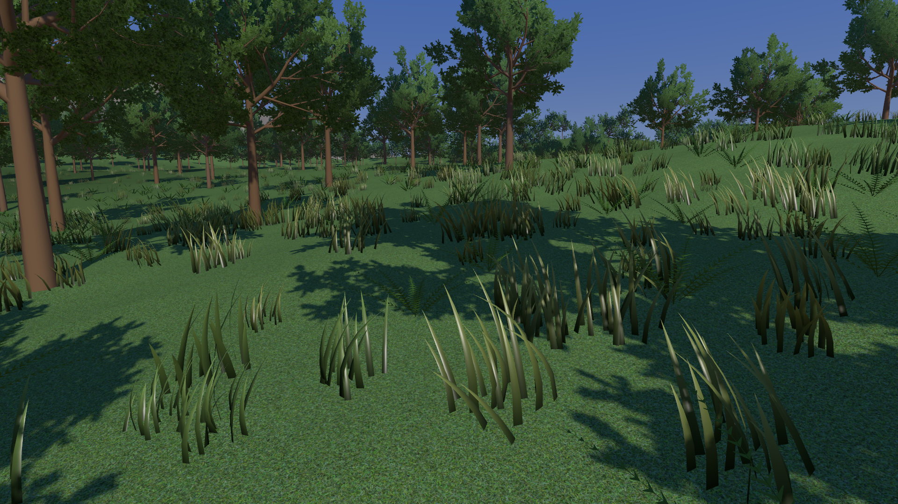

# Foliage batches: more plants, different sizes

**Goal:** predict which costs grow when a field gains plants, and trace two
differently sized plants through the same draw without duplicating their mesh.

**Read after Chapter 39, section 10, and step 1 of
[Renderer convergence](RendererConvergence.md#convergence-geometry)**, which
writes `BuildMeshCommands`; the instancing idea is Chapter 19's. The concrete
example is Chapter 39's understory (sections 8 to 10), and the page leans on
what it was built from: Chapter 19's instancing and indirect draws, Chapters
20 and 26's compute passes and `atomicAdd` appends, and Chapter 38's habitat
weights. Chapter 19 points here early, to show where its instancing leads;
come back after 39 and that step to do the tasks. You can read the three
short tasks separately; each ends with a check. Basic graphics and linear
algebra are assumed.

This is a support lesson, not a new renderer stage. Its source landmarks are
[Understory.cpp](https://github.com/ZevosSky/PillowFort-private/blob/reference-main/Source/PillowFort/Demos/Horizon/Understory.cpp),
[UnderstoryTypes.h](https://github.com/ZevosSky/PillowFort-private/blob/reference-main/Shaders/Horizon/UnderstoryTypes.h), the
[generate shader](https://github.com/ZevosSky/PillowFort-private/blob/reference-main/Shaders/Horizon/UnderstoryGenerate.comp.glsl) and the
[vertex shader](https://github.com/ZevosSky/PillowFort-private/blob/reference-main/Shaders/Horizon/Understory.vert.glsl).

Reference view: several foliage systems share one scene

This retained reference capture combines trees, understory and the separate
grass field. It helps locate the systems; it does not reveal their command
counts or establish that each visible plant casts a shadow. Capture provenance
is recorded in [the figure manifest](images/provenance.json).

## 1. Predict the number of commands

Instancing repeats shared geometry using per-instance data. Batching groups
work that can use compatible geometry, material and rendering state. An
indirect draw reads its counts and offsets from a buffer. These solve related
problems, but one does not automatically supply the others.

Carucci's original [Inside Geometry Instancing](https://developer.nvidia.com/gpugems/gpugems2/part-i-geometric-complexity/chapter-3-inside-geometry-instancing),
Sections 3.2.1–3.2.5, separates shared geometry, instance attributes and rendering
context. Here is that separation in this project:

| Shared by a command | Different for each plant |
| --- | --- |
| One kind's mesh at one LOD, and one material part of it | Root position, positive uniform size, yaw |
| Vertex/index ranges, pipeline and material bindings | Stable random choices from its world cell |
| Compatible cutout, sample-count and rasterization state | Which kind/LOD region the plant enters |

`BuildMeshCommands` currently makes this fixed command template:

| Kind | Parts at each LOD | LODs | Commands |
| --- | --- | --- | --- |
| Fern | Fronds: 1 | 2 | 2 |
| Flower | Stem and head: 2 | 2 | 4 |
| Bush | Bark and leaves: 2 | 2 | 4 |
| Total | | | **10** |

The count is **2 × (1 + 2 + 2)**, not 3 × 2 commands: a material part needs its
own command. Both parts of one flower use the same instance records. The
shader increments both part counts, while taking the append slot from the
first part's counter. The dispatch-to-draw dependency makes the completed
counts and instance records visible before drawing.

**Task:** 100 flowers survive into LOD0. Predict the commands and plant
records. Then double that population without changing kind, LOD or material.

Check the prediction

Two commands each draw 100 instances: stem and head. They read the same 100
plant records, rather than storing one record per part. With 200 flowers the
template still has ten total commands, of which these two now draw 200
instances each. The mesh is still stored once in the renderer's shared geometry.

More plants still mean more vertex and fragment work, instance traffic and
possibly cutout overdraw. Current `Draw` issues ten indirect draw calls, even
when some commands contain zero instances; it does not combine all foliage
materials into one call. Fewer command submissions do not promise a lower
total GPU time. Measure population, triangles, shaded coverage and preparation
cost separately, as [Chapter 40](40-Forests-To-The-Horizon.md#ch40-measure-the-whole-forest)
does for the forest.

## 2. Trace two sizes through one batch

`PlantInstance` is 32 bytes: two instance-rate `vec4` attributes.

| Field | Meaning | Reader |
| --- | --- | --- |
| `place.xyz` | World root, with the current terrain height and small sink | Vertex placement; fragment shading receives the resulting position |
| `place.w` | Uniform size | Vertex placement |
| `turn.xy` | Cosine and sine of yaw | Vertex position and normal rotation |
| `turn.zw` | Unused in the current path | No current wind phase is stored here |

A world cell here is one fixed 2 m × 2 m square on the world's XZ grid.
Its integer coordinates seed a candidate and its repeatable random choices.
The route is:

The compute pass writes `PlantInstance` records through its set 2, binding 1,
and counts through binding 2. The draw binds that same instance buffer as
vertex binding 1: locations 3 and 4 fetch `place` and `turn` once per instance.
Binding 0 supplies the shared mesh's vertices. This is a storage-buffer writer
and an instance-rate vertex-input reader of the same bytes, with no intervening
copy. The compute and draw layouts have different roles; the draw's material
binding is not the compute pass's instance buffer.

The generator chooses nominal size `0.8 + 0.4 * randomFloat(state)`. It then
shrinks the plant over the outer reach band; that final rendered size can be
smaller than 0.8. `Understory.vert.glsl` applies the final size to each plant's
local vertices, then adds its root. A size change needs another instance value,
not another copy of the mesh or a new batch by itself.

**Task:** put plants A and B in the same kind/LOD region, with sizes 0.8 and
1.2. Predict how their positions, normals, bounds and LOD inputs differ.

Check the trace

Both commands read the same local mesh. For each record the vertex shader uses
`root + size * yawRotation * localPosition`. Its normal uses yaw rotation;
positive uniform scale does not change the normalized normal direction.
The generator uses the same final size for sphere radius and center height
before its frustum and projected-size tests. A larger plant may select a finer
LOD; the task holds their LOD equal only to show that size variation can live
inside one batch.

For a general local sphere `(center, radius)`, positive uniform size `s` gives
`worldCenter = root + s * R * center` and `worldRadius = s * radius`.
Current `BuildMeshCommands` stores a chosen center on the root's vertical axis,
`(0, middleY, 0)`, plus half the LOD0 bounding-box diagonal as radius. Its
generator therefore only scales the center's height. That is the current asset
contract; it is not a general center calculation for arbitrary off-axis meshes.

Check the current assets before changing that contract

At size 1, the retained plant files give these distances in metres. The last
column checks **both rendered LODs**, using the chosen vertical-axis center.

| Kind | Stored radius | Farthest vertex in LOD0 or LOD1 |
| --- | --- | --- |
| Fern | 1.9563 | 1.5146 |
| Flower | 0.2763 | 0.2485 |
| Bush | 1.3445 | 1.1407 |

The distance values are rounded upward in the last column. All six current
meshes fit; a new asset still needs its own check. These are distances from the
authored local vertices, not a GPU culling test.

Try a box with `min=(2,0,-1)` and `max=(4,2,1)`. Its half-diagonal is about
1.732, but the corner `(4,2,1)` is about 4.243 from the chosen center `(0,1,0)`.
Keeping the stem at the origin does not force the mesh's box center onto that
axis. The usual box-derived sphere instead uses the **whole box midpoint**,
as [PBRT's bounding-sphere construction](https://www.pbr-book.org/4ed/Geometry_and_Transformations/Bounding_Boxes)
does. Either carry that center through the instance transform or calculate a
radius that contains the geometry about the center you actually use.

**Recovery check for a new asset:** verify the chosen sphere contains every
vertex of both drawn LODs before trusting culling. A yaw does not change a
sphere's radius. If the local center moves off-axis, rotate and scale that
center too. If adding nonuniform or negative scales, revisit normal transforms,
front-face state and conservative bounds together. Chapter 19 already splits
mirrored instances into compatible runs.

The current projected-size rule divides by radial distance. It is an
approximation near wide-view edges, as
[Chapter 37 explains](37-Objects-At-A-Distance.md#how-tall-a-thing-looks). Correctly
scaling its input bound does not turn that estimator into an exact screen bound.
At the stated 720p/60-degree view, a size-1 fern reaches the unjittered 60-pixel
line at about 41 m. Size 0.8 reaches that line at about 33 m, size 1.2 at about
49 m. The actual per-cell threshold jitter and reach fade also affect the
choice. These different LOD choices can change which region receives a plant;
they do not require a different batch for each size.

## 3. Keep identity when the buffer is rebuilt

The world cell seeds the candidate's random sequence. Camera motion changes
which cells are processed and which plants survive, but does not deliberately
reroll an unchanged cell's kind, nominal size or yaw.

`atomicAdd` returns a compacted storage slot. Execution order and visibility
can change that slot next frame. It identifies where this frame stored a
plant, not which plant it is. Each part uses the same `firstInstance` region,
whose base is `(2 * kind + lod) * capacity`.

**Task:** remove one visible neighbor, move across a cell boundary and cross a
LOD threshold. Which identifier should control plant-specific wind phase or
variation if you add it?

Check identity before adding animation

Use a stable world-cell identity, or a stable candidate ID derived from it,
with independent salts for new random properties. Preserve the existing
placement choices. Do not seed phase from the append slot, draw number or
frame-local instance index: compaction or LOD changes can reassign those values.

There are six instance regions: three kinds × two LODs. Each reserves 6,400
32-byte records, so the main instance allocation is 1,228,800 bytes. This
supports at most 6,400 candidate cells in a dispatch, with at most one plant
per cell, assigned to one kind and one LOD. The allocation is deliberately
larger than the live population because each region must fit the worst case.
Increasing reach, candidates per cell or the number of kinds invalidates that
capacity argument; change it explicitly before changing the generator.

Coverage check: the processed square and the reach circle differ

The current window is centred on the camera's world cell, followed by the
radial reach test. It can omit an edge strip when the camera is offset inside
that cell. For example, camera XZ = (3.5, 0.5) m and reach = 10 m choose x
cells −4 through 5. A possible candidate at XZ = (12.2, 0.5) m lies in omitted
x cell 6, although its distance from the camera is only 8.7 m.

The 6,400-cell bound proves capacity for the processed square; it does not
prove complete radius-query coverage. An extension that needs complete
coverage must include the missing edge cells and update its capacity,
dispatch and region offsets together. Keep the stable world-cell seeds.

In this two-flower example, both commands use `instanceCount = 2` and
`firstInstance = 12800`. They read the same two records, with sizes 0.8 and
1.2. The flower's shape is schematic; the two sizes illustrate the uniform
transform of one local shape. A/B label the example records. The
[diagram manifest](images/diagrams.json) records the parameters and optional
generator; the forest image above has its separate capture provenance.

## 4. Extend one contract at a time

**Another kind or plant set.** Register its shared geometry and materials,
define compatible parts for each LOD, extend the kind/command tables and size
the instance regions. `BuildMeshCommands` checks LOD part counts and the final
command count. A new material or pipeline state may need another command;
another uniform size alone does not. Habitat weights from
[Chapter 38](38-Ground-Materials.md#what-the-next-chapters-read) decide which
candidate grows, rather than changing what a draw command means.

**Clusters.** Several plants can share a cluster transform and still keep
individual local roots, sizes and IDs. Decide which level is culled. Culling
a cluster requires a bound containing every member at its maximum permitted
deformation. Clustering saves some work at the cost of a looser bound; it does
not require flattening all members into one identity.

**Wind.** The current understory vertex shader places static geometry; shared
plant wind is an extension. Pelzer's original
[grass chapter](https://developer.nvidia.com/gpugems/gpugems/part-i-natural-effects/chapter-7-rendering-countless-blades-waving-grass),
Sections 7.4.2–7.4.4, shows why per-object shader animation can preserve local
variation while avoiding a separate draw for each wind cluster. For this
project, define the deformation's units, root anchor and maximum displacement,
then share its stable inputs across LODs. Include that displacement in culling
and caster bounds before accepting the animated result.

**Shadows.** Current understory receives the sun-shadow lookup through the
leaf fragment shader, `Leaf.frag.glsl` (whose body the complete reference
keeps in `LeafFragment.glsl`). It is generated after Horizon records its shadow maps,
and it has no understory caster draw there. Adding wind does not add casting.
A caster extension needs a light-visible candidate list, matching deformation
and alpha policy, and conservative bounds. Reusing only camera-visible plants
would drop off-camera plants whose shadows reach the view. The existing prop
and far-tree caster routes are separate examples, not a completed understory
shadow path.

Stop when the current contract is clear. A useful extension first demonstrates
stable plants under compaction, correct size through an LOD change, and no
clipping at its maximum displacement. Keep population and lighting fixed while
comparing images; bloom or a darker material must not hide a missing plant.

Khronos's [vertex-input specification](https://docs.vulkan.org/spec/latest/chapters/fxvertex.html)
defines instance-rate fetching, and its
[drawing specification](https://docs.vulkan.org/spec/latest/chapters/drawing.html)
defines the indirect command fields. These specify data access; the plant
identity, bounds and quality checks above remain this project's responsibility.
