# Reading the reference images

These are real native-renderer captures from the source history integrated
into `reference-main`. They are comparison aids, not a requirement to match
every pixel or proof that a historical chapter checkout contains later work.
The original scenes, settings and build identities are recorded in
[the figure manifest](images/provenance.json). Images were copied or
losslessly converted from BMP to PNG; their decoded pixels are unchanged.
Asset notices remain in [THIRD_PARTY_NOTICES.md](https://github.com/ZevosSky/PillowFort-private/blob/reference-main/THIRD_PARTY_NOTICES.md).

Computed teaching illustrations have a [separate diagram manifest](images/diagrams.json):
[wind-field slices](52-Wind-Fields-And-Vorticles.md) visualize the authored
equation, and [foliage batches](FoliageBatches.md#3-keep-identity-when-the-buffer-is-rebuilt)
trace shared meshes and differently sized instance records. Their generators
and parameters are recorded separately from the native captures below.

## Orient the first draws

These three October 15 images come from the assembled reference checkpoint
`1729beab59d752e419cadedfe52cbcb693325376`, rather than separate historical
chapter builds. The Debug run used the RTX 4060 Laptop GPU at 1280 × 720,
capturing after 60 frames with a fixed 0.016666667-second step. They show the
scene output before the UI overlay. The manifest identifies each original
capture, result record, executable and source commit.

Chapter 06: inspect the triangle's orientation and clear margins

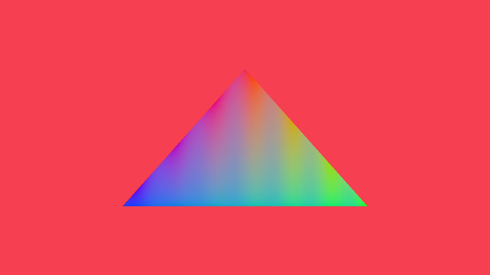

For [Chapter 06](06-Shaders-And-Pipelines.md#exit-check), locate the top vertex
and the lower horizontal edge, then check that the clear color surrounds all
three sides. The assembled shader includes later color controls: these are
not the exact colors required from the chapter's first shader. Use your own
resize and launch-path checks to verify the pipeline beyond this one frame.

Chapter 10: inspect near and far cubes where their silhouettes overlap

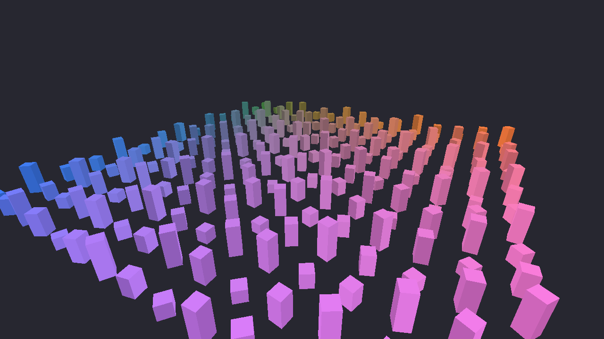

For [Chapter 10](10-Cameras-And-Depth.md), choose one overlap near the front
and follow the farther cube's edge until the nearer cube hides it. This is a
visual target for solid boxes and perspective. A still image cannot establish
that depth testing caused the ordering; orbit the camera and toggle the depth
test as the checkpoint asks.

## Follow light to the surface

Chapter 16: locate warm and cool illumination in LightTest

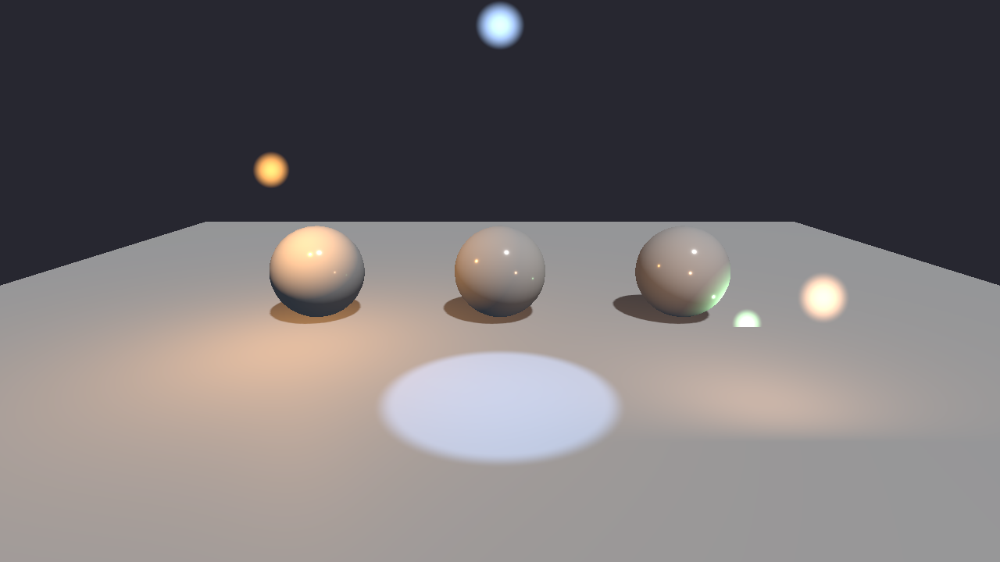

For [Chapter 16's scene](16-Lights.md#appendix-a--lighttestusda), locate the
orange pool near the left sphere, the cool cone on the floor, and the green
illumination beneath the right sphere. The soft colored disks are the viewer's
light-position markers. Follow a color from its marker to the surfaces it lights.

This November 4 Debug capture uses the assembled viewer at the source context
recorded in the manifest, with LightTest.usda, 1x MSAA, sky mode off, and clouds,
bloom and AO disabled. Later shadow rendering is visible here. Use the image
for orientation and the chapter's exit checks for numerical changes; finite
packet rejection is checked separately by the CPU writer fixture.

## Recognize the baseline fountain

Chapter 21: inspect the fountain's narrow origin and wider upper plume

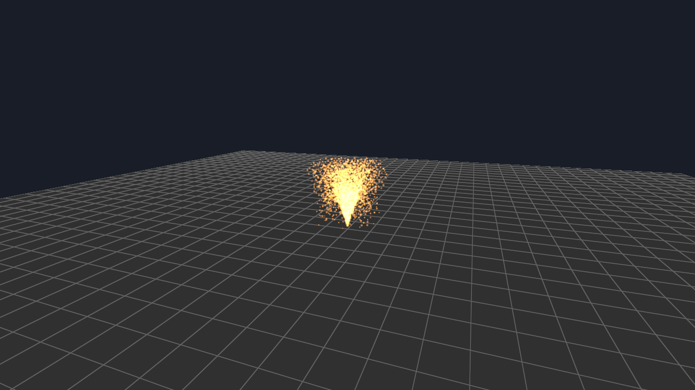

For [Chapter 21](21-GPU-Particles.md#checkpoint--the-fountain), find the
origin on the grid, then follow the plume upward as it spreads. This is the
same assembled October 15 checkpoint described above. One frame cannot prove
birth, bounce, fade or alive/dead count conservation; use the chapter's motion
and readback checks. This is the baseline fountain, before Chapter 52's wind
extension, and supplies no evidence for that extension.

## Read the water surface

These October 15 views share the assembled checkpoint, GPU and fixed-step
capture setup recorded for the first draws above. They show different demos
and cameras, so they do not form a controlled before/after comparison.
Use the chapter's single-mode or Solo controls to test numerical claims.

Chapter 29: separate broad wave shape from the reflection path

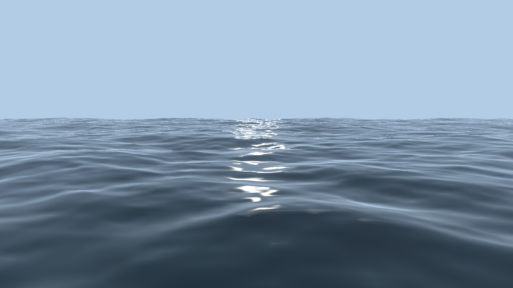

For [Chapter 29](29-FFT-Ocean.md), trace one wave outside the bright path,
then follow the broken highlights toward the horizon. Shape and lighting
provide different clues; a plausible highlight pattern does not establish
spectral normalization or the correctness of the stored normals.

Chapter 30: inspect surface scales in a later assembled Sea view

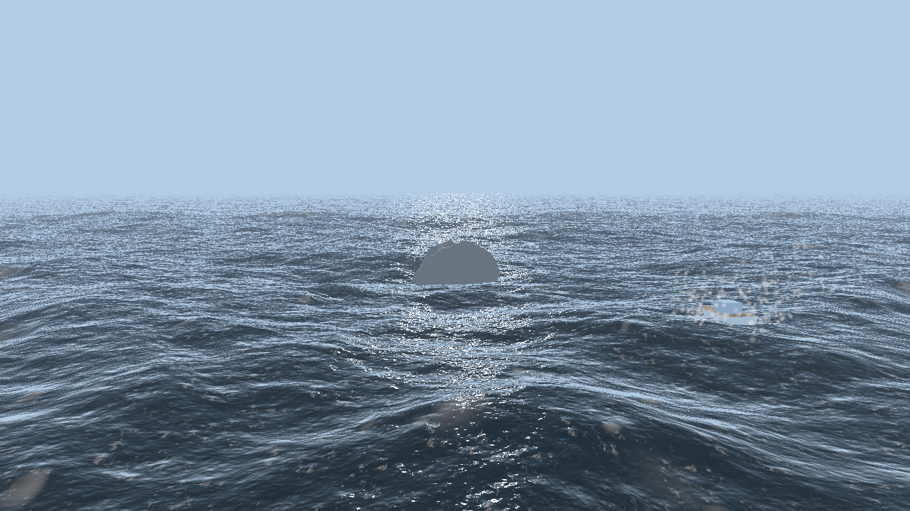

For [Chapter 30](30-A-Rougher-Sea.md), pick a foreground crest and look for
smaller detail across it. Predict what Solo removes, then make that controlled
comparison in your demo. The central rock and right-hand boat are later
Chapters 31–32 features. The distant bright points mix lighting and surface
effects; the capture does not isolate foam, and one frame does not test motion.

## Capture surface data before lighting

For [Chapter 46](46-Capturing-Grass-Clumps.md), inspect one matching tile in
both atlas previews. The silhouette belongs to the captured source; the RGB
normal visualization encodes a direction rather than the current sun's
brightness. The material preview reconstructs color from captured attributes;
it is not a dump of the raw attachment channels. Black is uncovered background
in these previews, not a demonstration of alpha blending.

Inspect the historical material and shading-normal atlas previews

| Material preview | Shading-normal preview |
| --- | --- |
| 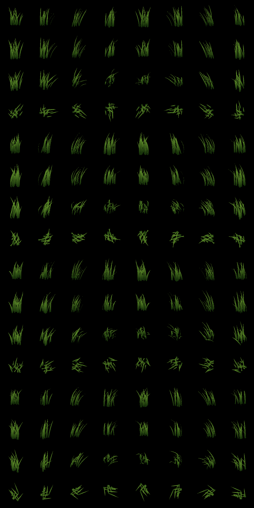 | 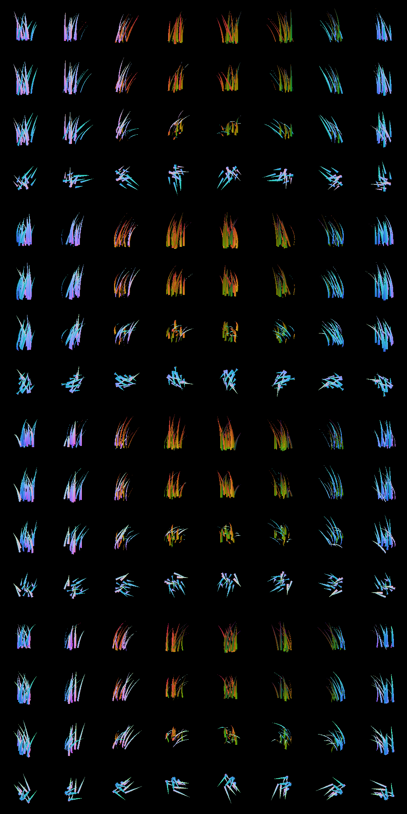 |

These October 17 captures predate later source-selection refinements. Use
them to understand the outputs, not to infer the current source variant or
prove the metric-depth and geometric-normal checks.

## Compose the field with the world

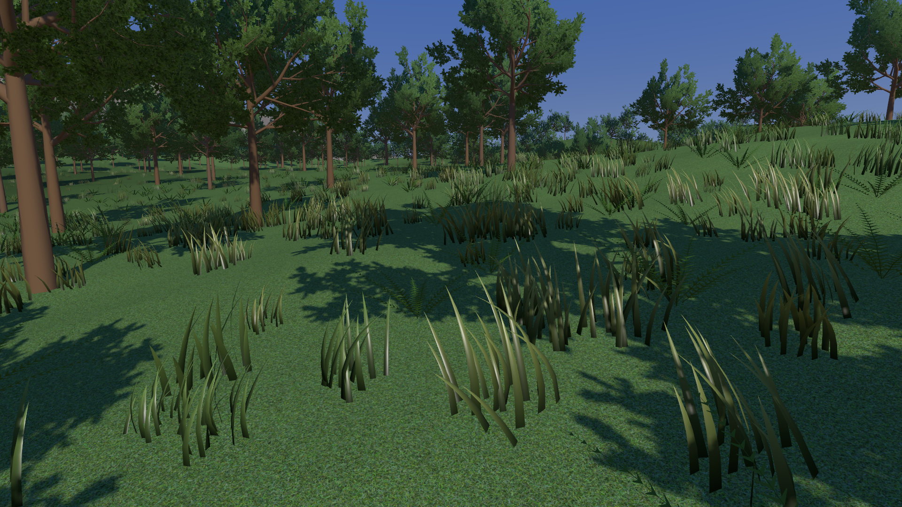

For [Chapter 48](48-Grass-In-The-Coastal-Pipeline.md), look at the grass roots
where the ground slopes and at the transition from foreground clumps to the
trees. This October 19 diagnostic has grass shadows disabled and uses its
recorded historical source settings. It is distinct from the chapter's
accepted startup profile. One frame does not establish stable identity while
moving, correct shadow ownership or a performance improvement.

## Separate a halo from filter gain

| Bloom off | Bloom on |
| --- | --- |
| 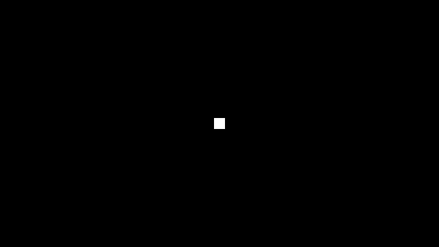 |  |

For [Chapter 49](49-Bloom-And-Color-Grading.md#second-stopping-point), look
outside the original square's footprint. The halo is the visible result to
predict. The constant-image oracle tests normalization separately: a halo
alone cannot show whether adding pyramid levels also amplified a flat image.
These October 30 fixtures use the same raw display curve and exposure.

## Darken nearby ambient contact

| Neutral strength, 0 | AO strength, 1 |
| --- | --- |
|  | 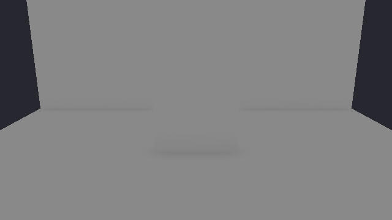 |

For [Chapter 50](50-Screen-Space-Ambient-Occlusion.md#5-change-the-ambient-evaluation-order),
inspect the wall-floor contacts. Both images are lit output from the ambient
fixture, not raw visibility masks. They use the same deferred 1x path, radius
0.6 m, raw display curve and exposure. The difference is deliberately subtle;
open the original images if the preview is small. Separate direct-only and
emissive controls are still needed to prove those terms stay unchanged.

## Keep sky, surfaces and air consistent

| SunSky | Physical atmosphere |
| --- | --- |
| 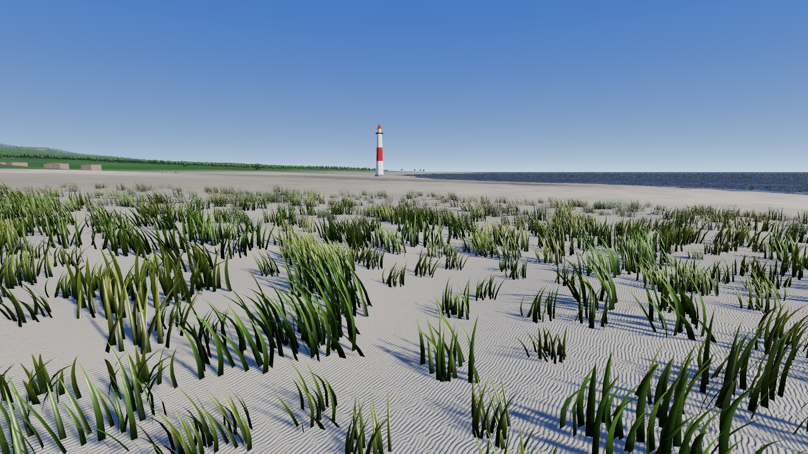 | 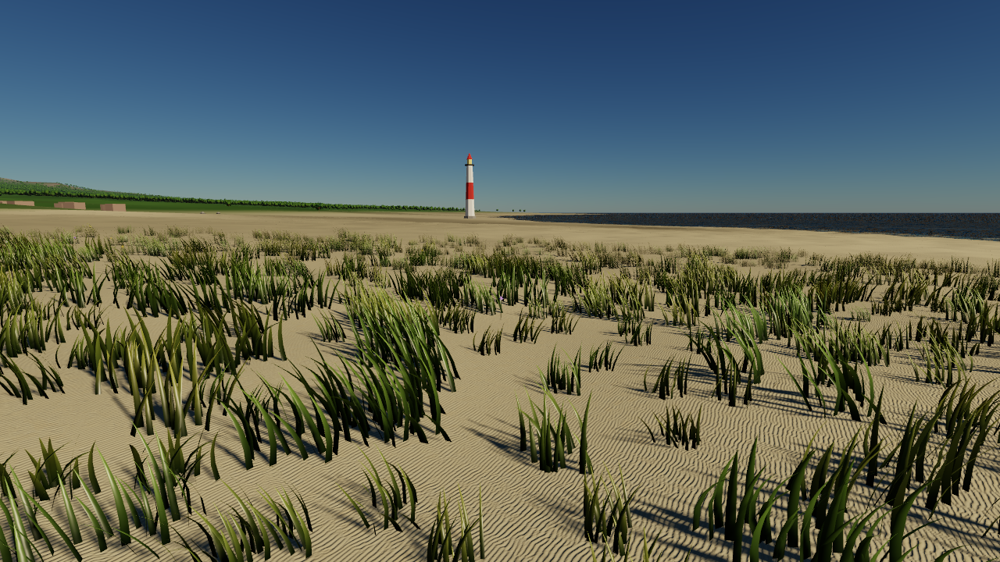 |

For [Chapter 51](51-Atmosphere-And-Aerial-Perspective.md#7-exit-checks-and-the-transfer-back-to-the-island),
inspect both the sky and the ground. These October 30 corrected-reference
captures keep the Coast camera, fixed time step, 4x MSAA, ACES display curve,
clouds off and bloom off. Switching sky mode also changes illumination: this
pair is an integration comparison, not an isolated measurement of aerial
perspective. It does not establish LUT precision or cost. For the first
transport exercises, stay with their numerical and prepared-source checks;
the composed coast is the later transfer.
